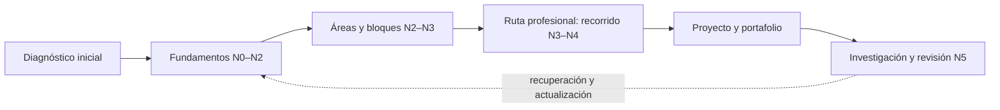

<div align="center">

# 🌌 Programa Integral de Astronomía, Astrofísica, Ciencias Espaciales e Ingeniería Aeroespacial

## **2.077 clases planificadas · 12 áreas · 133 bloques · 24 rutas profesionales**

**Un programa independiente en español que organiza, con IDs estables y trazabilidad, el recorrido desde la observación del cielo y los fundamentos científicos hasta la investigación, la ingeniería y las operaciones espaciales.**

[](https://github.com/vladimiracunadev-create/astronomy-astrophysics-space-sciences-aerospace-engineering-learning-program/actions/workflows/validate.yml)
[](https://vladimiracunadev-create.github.io/astronomy-astrophysics-space-sciences-aerospace-engineering-learning-program/)

[](CHANGELOG.md)
[](PROGRAMA_ACADEMICO_COMPLETO.md)
[](STATUS.md)
[](README.md)
[](LICENSE)
[](LICENSE-CONTENT.md)

[🌐 Explorar el catálogo](https://vladimiracunadev-create.github.io/astronomy-astrophysics-space-sciences-aerospace-engineering-learning-program/) ·
[📚 Programa completo](PROGRAMA_ACADEMICO_COMPLETO.md) ·
[🧭 Rutas profesionales](documentacion/MAPA_DE_RUTAS_PROFESIONALES.md) ·
[🎓 Estándar de clase](documentacion/ESTANDAR_PEDAGOGICO_Y_DE_EVALUACION.md) ·
[🗺️ Roadmap](ROADMAP.md) ·
[✅ Estado verificable](STATUS.md) ·
[📖 Documentación](documentacion/README.md) ·
[⚖️ Licencias](documentacion/LICENCIAS_Y_PROCEDENCIA.md) ·
[🤝 Contribuir](CONTRIBUTING.md)

</div>

---

> [!IMPORTANT]
> **El programa está planificado (2.077 clases en 133 bloques) y todas sus clases siguen en E0.** Hay **160 clases con texto redactado** (el área A01, bloques B01 a B08), pendientes de aprobación y de revisión disciplinar; las otras 1.120 de la línea base solo tienen título y descripción preliminar y las 797 restantes están programadas, sin redactar. Ninguna debe presentarse como impartida, revisada o verificada. Clases completamente redactadas **y verificadas**: **0/2.077**.

> [!WARNING]
> **Formación independiente, no habilitación profesional.** El programa no otorga títulos, grados, licencias ni certificaciones; tampoco autoriza decisiones médicas, jurídicas, de vuelo, lanzamiento, seguridad o ingeniería crítica. Toda aplicación real exige normativa vigente, datos adecuados y profesionales competentes.

## 🎯 Qué es este programa

Es una arquitectura curricular única y extensible: **un solo conjunto de clases organizado en áreas y bloques**. Las rutas profesionales no tienen contenido propio: son recorridos que ordenan clases de esas áreas y bloques. No son 24 programas separados.

| Superficie | Estado verificable |
|---|---:|
| Áreas | 12 |
| Bloques | 133 (64 de la línea base y 69 nuevos programados) |
| Clases de la línea base en el tronco | 1.280 |
| Clases programadas (citadas, ubicadas y justificadas; **no redactadas**) | 797 |
| **Clases del programa** | **2.077** |
| Rutas profesionales (recorridos sobre áreas y bloques) | 24 |
| Clases con texto redactado, pendientes de revisión (A01) | 160 |
| **Clases completamente redactadas y verificadas** | **0** |

## 🧮 Cómo se organiza y cuánto suma

El tronco de la línea base `0.1.0` tenía 8 áreas, 64 bloques y 1.280 clases; las rutas profesionales sumaban otras 3.840 clases en 192 módulos, para una referencia inicial de 5.120. Esa cifra fue un punto de partida, no una meta. En esta versión **todo el contenido de los módulos de las rutas se ubicó dentro de áreas y bloques**: de sus 1.920 temas, 1.101 ya estaban cubiertos por clases existentes y 819 dieron lugar a 797 clases programadas distintas (varios temas coinciden en una misma clase). El resultado son **12 áreas, 133 bloques y 2.077 clases**.

Las áreas **no** tienen el mismo tamaño: crecen con el contenido que necesitan, y A01 (160 clases, conocimiento básico) no cambia. Los bloques se numeran de forma consecutiva (B01–B133) en el orden de las áreas; la tabla con el número anterior de cada bloque está en [`numeracion_bloques.json`](catalogo/v0.2.0/numeracion_bloques.json). Las clases programadas se agregan al final de un bloque existente (`B83-C21`…) o forman bloques nuevos. Los IDs `Rxx-Mxx-Cnn` se conservan como equivalencias: el [programa completo](PROGRAMA_ACADEMICO_COMPLETO.md) indica, módulo por módulo, dónde vive hoy su contenido. Detalle de la línea base: [estructura y conteo del catálogo](documentacion/ESTRUCTURA_Y_CONTEO_DEL_CATALOGO.md).

Nadie necesita cursar todo: el diagnóstico indica qué partes del tronco hacen falta y una ruta profesional ordena las clases de su campo. La carga y las equivalencias se definirán después de pilotajes reales.



## 🗂️ Las 12 áreas y 133 bloques

Este mapa deja el contenido visible desde la portada. Cada bloque muestra su rango de clases; las **programadas** son clases citadas con su ubicación y la necesidad que resuelven, todavía sin redactar.

> [!IMPORTANT]
> Todos los registros permanecen en E0. Las clases de A01 (160) tienen texto redactado y enlazado desde su bloque, pendiente de revisión; el resto solo tiene título y descripción preliminar, o es una clase programada sin redactar. Ninguna está impartida ni verificada.

### A01 · Alfabetización científica, astronómica y tecnológica

Punto de partida común: observar y medir el cielo, entender la ciencia como método y adquirir la matemática, la física, la química y la informática básicas. Nivel N0–N1. **Sin cambios respecto de la línea base.**

*8 bloques · 160 clases de la línea base · 0 programadas · 160 en total.*

| Bloque | Contenido previsto | Clases | Ficha |
|---|---|---:|---|
| B01 | El universo y el pensamiento científico | B01-C01 → B01-C20 | [📘 ver las 20 clases](programa/tronco-comun/B01-el-universo-y-el-pensamiento-cientifico.md) |
| B02 | Historia, arqueoastronomía y culturas del cielo | B02-C01 → B02-C20 | [📘 ver las 20 clases](programa/tronco-comun/B02-historia-arqueoastronomia-y-culturas-del-cielo.md) |
| B03 | Matemática elemental para ciencias espaciales | B03-C01 → B03-C20 | [📘 ver las 20 clases](programa/tronco-comun/B03-matematica-elemental-para-ciencias-espaciales.md) |
| B04 | Álgebra, trigonometría y geometría espacial | B04-C01 → B04-C20 | [📘 ver las 20 clases](programa/tronco-comun/B04-algebra-trigonometria-y-geometria-espacial.md) |
| B05 | Física fundamental para el espacio | B05-C01 → B05-C20 | [📘 ver las 20 clases](programa/tronco-comun/B05-fisica-fundamental-para-el-espacio.md) |
| B06 | Química y materia del universo | B06-C01 → B06-C20 | [📘 ver las 20 clases](programa/tronco-comun/B06-quimica-y-materia-del-universo.md) |
| B07 | Informática científica desde cero | B07-C01 → B07-C20 | [📘 ver las 20 clases](programa/tronco-comun/B07-informatica-cientifica-desde-cero.md) |
| B08 | Observación del cielo y astronomía práctica | B08-C01 → B08-C20 | [📘 ver las 20 clases](programa/tronco-comun/B08-observacion-del-cielo-y-astronomia-practica.md) |

### A02 · Matemática, física computacional y métodos científicos

Los lenguajes cuantitativos del programa: cálculo, álgebra lineal, simulación, estadística e incertidumbre, metrología, computación científica, señales y control; más aprendizaje automático, inferencia y verificación de software. Nivel N2–N3.

*15 bloques · 160 clases de la línea base · 77 programadas · 237 en total.*

| Bloque | Contenido previsto | Clases | Ficha |
|---|---|---:|---|
| B09 | Cálculo diferencial e integral | B09-C01 → B09-C20 | [📘 ver las 20 clases](programa/tronco-comun/B09-calculo-diferencial-e-integral.md) |
| B10 | Álgebra lineal y matemáticas geométricas | B10-C01 → B10-C20 | [📘 ver las 20 clases](programa/tronco-comun/B10-algebra-lineal-y-matematicas-geometricas.md) |
| B11 | Ecuaciones diferenciales y simulación numérica | B11-C01 → B11-C26 | [📘 ver el bloque](programa/tronco-comun/B11-ecuaciones-diferenciales-y-simulacion-numerica.md) |
| B12 | Probabilidad, estadística e incertidumbre | B12-C01 → B12-C26 | [📘 ver el bloque](programa/tronco-comun/B12-probabilidad-estadistica-e-incertidumbre.md) |
| B13 | Metrología, tiempo y mediciones científicas | B13-C01 → B13-C23 | [📘 ver el bloque](programa/tronco-comun/B13-metrologia-tiempo-y-mediciones-cientificas.md) |
| B14 | Computación científica y ciencia abierta | B14-C01 → B14-C31 | [📘 ver el bloque](programa/tronco-comun/B14-computacion-cientifica-y-ciencia-abierta.md) |
| B15 | Señales, imágenes y estimación científica | B15-C01 → B15-C24 | [📘 ver el bloque](programa/tronco-comun/B15-senales-imagenes-y-estimacion-cientifica.md) |
| B16 | Sistemas dinámicos y control automático | B16-C01 → B16-C20 | [📘 ver las 20 clases](programa/tronco-comun/B16-sistemas-dinamicos-y-control-automatico.md) |
| B17 | Aprendizaje automático científico | B17-C01 → B17-C12 | [📘 ver el bloque](programa/tronco-comun/B17-aprendizaje-automatico-cientifico.md) |
| B18 | Computación de alto rendimiento | B18-C01 → B18-C05 | [📘 ver el bloque](programa/tronco-comun/B18-computacion-de-alto-rendimiento.md) |
| B19 | Inferencia bayesiana y computación probabilística | B19-C01 → B19-C08 | [📘 ver el bloque](programa/tronco-comun/B19-inferencia-bayesiana-y-computacion-probabilistica.md) |
| B20 | Metodología de la investigación científica | B20-C01 → B20-C04 | [📘 ver el bloque](programa/tronco-comun/B20-metodologia-de-la-investigacion-cientifica.md) |
| B21 | Métodos numéricos para EDP y fluidos computacionales | B21-C01 → B21-C05 | [📘 ver el bloque](programa/tronco-comun/B21-metodos-numericos-para-edp-y-fluidos-computacionales.md) |
| B22 | Problemas inversos y estimación de modelos | B22-C01 → B22-C05 | [📘 ver el bloque](programa/tronco-comun/B22-problemas-inversos-y-estimacion-de-modelos.md) |
| B23 | Verificación y validación de software científico | B23-C01 → B23-C08 | [📘 ver el bloque](programa/tronco-comun/B23-verificacion-y-validacion-de-software-cientifico.md) |

### A03 · Astrofísica y ciencias fundamentales del universo

La física del universo: estrellas, galaxias, cosmología, objetos compactos, mensajeros, exoplanetas, el Sol y su plasma, y física nuclear y de partículas, con profundización en interiores estelares, universo temprano y clima espacial. Nivel N2–N4.

*17 bloques · 160 clases de la línea base · 112 programadas · 272 en total.*

| Bloque | Contenido previsto | Clases | Ficha |
|---|---|---:|---|
| B24 | Física y evolución de estrellas | B24-C01 → B24-C22 | [📘 ver el bloque](programa/tronco-comun/B24-fisica-y-evolucion-de-estrellas.md) |
| B25 | Galaxias y medio interestelar | B25-C01 → B25-C20 | [📘 ver las 20 clases](programa/tronco-comun/B25-galaxias-y-medio-interestelar.md) |
| B26 | Relatividad y cosmología | B26-C01 → B26-C23 | [📘 ver el bloque](programa/tronco-comun/B26-relatividad-y-cosmologia.md) |
| B27 | Objetos compactos y altas energías | B27-C01 → B27-C22 | [📘 ver el bloque](programa/tronco-comun/B27-objetos-compactos-y-altas-energias.md) |
| B28 | Astronomía multimensajero | B28-C01 → B28-C22 | [📘 ver el bloque](programa/tronco-comun/B28-astronomia-multimensajero.md) |
| B29 | Astronomía temporal y exoplanetas | B29-C01 → B29-C20 | [📘 ver las 20 clases](programa/tronco-comun/B29-astronomia-temporal-y-exoplanetas.md) |
| B30 | Heliofísica y física de plasmas | B30-C01 → B30-C23 | [📘 ver el bloque](programa/tronco-comun/B30-heliofisica-y-fisica-de-plasmas.md) |
| B31 | Física cuántica, nuclear y astropartículas | B31-C01 → B31-C20 | [📘 ver las 20 clases](programa/tronco-comun/B31-fisica-cuantica-nuclear-y-astroparticulas.md) |
| B32 | Atmósferas estelares y espectroscopía estelar cuantitativa | B32-C01 → B32-C12 | [📘 ver el bloque](programa/tronco-comun/B32-atmosferas-estelares-y-espectroscopia-estelar-cuantitativa.md) |
| B33 | Clima espacial: impactos, pronóstico y riesgo | B33-C01 → B33-C14 | [📘 ver el bloque](programa/tronco-comun/B33-clima-espacial-impactos-pronostico-y-riesgo.md) |
| B34 | Corona solar y erupciones: diagnóstico y modelos | B34-C01 → B34-C09 | [📘 ver el bloque](programa/tronco-comun/B34-corona-solar-y-erupciones-diagnostico-y-modelos.md) |
| B35 | Física avanzada de plasmas y MHD espacial | B35-C01 → B35-C10 | [📘 ver el bloque](programa/tronco-comun/B35-fisica-avanzada-de-plasmas-y-mhd-espacial.md) |
| B36 | Formación de estructuras cósmicas y materia oscura | B36-C01 → B36-C11 | [📘 ver el bloque](programa/tronco-comun/B36-formacion-de-estructuras-cosmicas-y-materia-oscura.md) |
| B37 | Interiores estelares y asterosismología | B37-C01 → B37-C14 | [📘 ver el bloque](programa/tronco-comun/B37-interiores-estelares-y-asterosismologia.md) |
| B38 | Poblaciones estelares y simulación de galaxias | B38-C01 → B38-C09 | [📘 ver el bloque](programa/tronco-comun/B38-poblaciones-estelares-y-simulacion-de-galaxias.md) |
| B39 | Relatividad general avanzada | B39-C01 → B39-C06 | [📘 ver el bloque](programa/tronco-comun/B39-relatividad-general-avanzada.md) |
| B40 | Universo temprano y radiación cósmica de fondo | B40-C01 → B40-C15 | [📘 ver el bloque](programa/tronco-comun/B40-universo-temprano-y-radiacion-cosmica-de-fondo.md) |

### A04 · Óptica, telescopios y observatorios científicos

Cómo se observa: óptica, telescopios, detectores, espectroscopía, radioastronomía y observatorios terrestres y espaciales, con profundización en diseño óptico, antenas e interferometría. Nivel N3–N4.

*11 bloques · 160 clases de la línea base · 62 programadas · 222 en total.*

| Bloque | Contenido previsto | Clases | Ficha |
|---|---|---:|---|
| B41 | Óptica geométrica y diseño de telescopios | B41-C01 → B41-C20 | [📘 ver las 20 clases](programa/tronco-comun/B41-optica-geometrica-y-diseno-de-telescopios.md) |
| B42 | Óptica física y óptica adaptativa | B42-C01 → B42-C24 | [📘 ver el bloque](programa/tronco-comun/B42-optica-fisica-y-optica-adaptativa.md) |
| B43 | Construcción y mecánica de telescopios | B43-C01 → B43-C26 | [📘 ver el bloque](programa/tronco-comun/B43-construccion-y-mecanica-de-telescopios.md) |
| B44 | Detectores y adquisición astronómica | B44-C01 → B44-C20 | [📘 ver las 20 clases](programa/tronco-comun/B44-detectores-y-adquisicion-astronomica.md) |
| B45 | Espectroscopía, fotometría y polarimetría | B45-C01 → B45-C24 | [📘 ver el bloque](programa/tronco-comun/B45-espectroscopia-fotometria-y-polarimetria.md) |
| B46 | Radioastronomía e interferometría | B46-C01 → B46-C20 | [📘 ver las 20 clases](programa/tronco-comun/B46-radioastronomia-e-interferometria.md) |
| B47 | Instrumentación y observatorios espaciales | B47-C01 → B47-C25 | [📘 ver el bloque](programa/tronco-comun/B47-instrumentacion-y-observatorios-espaciales.md) |
| B48 | Operaciones de observatorios científicos | B48-C01 → B48-C23 | [📘 ver el bloque](programa/tronco-comun/B48-operaciones-de-observatorios-cientificos.md) |
| B49 | Antenas y receptores de radioastronomía | B49-C01 → B49-C11 | [📘 ver el bloque](programa/tronco-comun/B49-antenas-y-receptores-de-radioastronomia.md) |
| B50 | Diseño óptico computacional y tolerancias | B50-C01 → B50-C15 | [📘 ver el bloque](programa/tronco-comun/B50-diseno-optico-computacional-y-tolerancias.md) |
| B51 | Interferometría avanzada y reducción de datos de radio | B51-C01 → B51-C14 | [📘 ver el bloque](programa/tronco-comun/B51-interferometria-avanzada-y-reduccion-de-datos-de-radio.md) |

### A05 · Ciencias planetarias, astroquímica y habitabilidad

Los mundos y la vida: formación planetaria, geología, atmósferas, química, astrobiología, observación terrestre, cuerpos menores y recursos, con bloques nuevos de vulcanismo, impactos, geofísica y astroquímica. Nivel N2–N4.

*19 bloques · 160 clases de la línea base · 97 programadas · 257 en total.*

| Bloque | Contenido previsto | Clases | Ficha |
|---|---|---:|---|
| B52 | Formación y dinámica de sistemas planetarios | B52-C01 → B52-C20 | [📘 ver las 20 clases](programa/tronco-comun/B52-formacion-y-dinamica-de-sistemas-planetarios.md) |
| B53 | Astrogeología y geodesia planetaria | B53-C01 → B53-C30 | [📘 ver el bloque](programa/tronco-comun/B53-astrogeologia-y-geodesia-planetaria.md) |
| B54 | Atmósferas y climatología planetaria | B54-C01 → B54-C20 | [📘 ver las 20 clases](programa/tronco-comun/B54-atmosferas-y-climatologia-planetaria.md) |
| B55 | Astroquímica y geoquímica extraterrestre | B55-C01 → B55-C20 | [📘 ver las 20 clases](programa/tronco-comun/B55-astroquimica-y-geoquimica-extraterrestre.md) |
| B56 | Astrobiología y vida extraterrestre | B56-C01 → B56-C21 | [📘 ver el bloque](programa/tronco-comun/B56-astrobiologia-y-vida-extraterrestre.md) |
| B57 | Observación terrestre y geociencias orbitales | B57-C01 → B57-C34 | [📘 ver el bloque](programa/tronco-comun/B57-observacion-terrestre-y-geociencias-orbitales.md) |
| B58 | Asteroides, cometas y defensa planetaria | B58-C01 → B58-C20 | [📘 ver las 20 clases](programa/tronco-comun/B58-asteroides-cometas-y-defensa-planetaria.md) |
| B59 | Recursos in situ y sostenibilidad extraterrestre | B59-C01 → B59-C23 | [📘 ver el bloque](programa/tronco-comun/B59-recursos-in-situ-y-sostenibilidad-extraterrestre.md) |
| B60 | Cinética y modelado astroquímico | B60-C01 → B60-C04 | [📘 ver el bloque](programa/tronco-comun/B60-cinetica-y-modelado-astroquimico.md) |
| B61 | Cráteres de impacto y geología de impactos | B61-C01 → B61-C07 | [📘 ver el bloque](programa/tronco-comun/B61-crateres-de-impacto-y-geologia-de-impactos.md) |
| B62 | Espectroscopía molecular para astroquímica | B62-C01 → B62-C08 | [📘 ver el bloque](programa/tronco-comun/B62-espectroscopia-molecular-para-astroquimica.md) |
| B63 | Exploración in situ y análisis de muestras planetarias | B63-C01 → B63-C06 | [📘 ver el bloque](programa/tronco-comun/B63-exploracion-in-situ-y-analisis-de-muestras-planetarias.md) |
| B64 | Extremófilos y límites de la vida | B64-C01 → B64-C07 | [📘 ver el bloque](programa/tronco-comun/B64-extremofilos-y-limites-de-la-vida.md) |
| B65 | Geofísica de interiores planetarios | B65-C01 → B65-C06 | [📘 ver el bloque](programa/tronco-comun/B65-geofisica-de-interiores-planetarios.md) |
| B66 | Geomorfología y procesos superficiales planetarios | B66-C01 → B66-C05 | [📘 ver el bloque](programa/tronco-comun/B66-geomorfologia-y-procesos-superficiales-planetarios.md) |
| B67 | Prospección y evaluación de reservas de recursos extraterrestres | B67-C01 → B67-C08 | [📘 ver el bloque](programa/tronco-comun/B67-prospeccion-y-evaluacion-de-reservas-de-recursos-extraterrestres.md) |
| B68 | Química de granos y hielos interestelares | B68-C01 → B68-C04 | [📘 ver el bloque](programa/tronco-comun/B68-quimica-de-granos-y-hielos-interestelares.md) |
| B69 | Radar de apertura sintética e interferometría (profundización) | B69-C01 → B69-C07 | [📘 ver el bloque](programa/tronco-comun/B69-radar-de-apertura-sintetica-e-interferometria-profundizacion.md) |
| B70 | Vulcanismo planetario | B70-C01 → B70-C07 | [📘 ver el bloque](programa/tronco-comun/B70-vulcanismo-planetario.md) |

### A06 · Mecánica orbital, navegación y vuelo espacial

Órbitas, perturbaciones, navegación, trayectorias, dinámica cislunar, lanzamiento y propulsión, con optimización de trayectorias, transferencias de Lambert y fluidos de propulsión. Nivel N3–N4.

*12 bloques · 160 clases de la línea base · 77 programadas · 237 en total.*

| Bloque | Contenido previsto | Clases | Ficha |
|---|---|---:|---|
| B71 | Mecánica orbital fundamental | B71-C01 → B71-C20 | [📘 ver las 20 clases](programa/tronco-comun/B71-mecanica-orbital-fundamental.md) |
| B72 | Perturbaciones y evolución de órbitas | B72-C01 → B72-C21 | [📘 ver el bloque](programa/tronco-comun/B72-perturbaciones-y-evolucion-de-orbitas.md) |
| B73 | Mecánica celeste, resonancias y caos | B73-C01 → B73-C22 | [📘 ver el bloque](programa/tronco-comun/B73-mecanica-celeste-resonancias-y-caos.md) |
| B74 | Estimación de órbitas y navegación espacial | B74-C01 → B74-C30 | [📘 ver el bloque](programa/tronco-comun/B74-estimacion-de-orbitas-y-navegacion-espacial.md) |
| B75 | Trayectorias y misiones interplanetarias | B75-C01 → B75-C30 | [📘 ver el bloque](programa/tronco-comun/B75-trayectorias-y-misiones-interplanetarias.md) |
| B76 | Dinámica cislunar y operaciones de proximidad | B76-C01 → B76-C20 | [📘 ver las 20 clases](programa/tronco-comun/B76-dinamica-cislunar-y-operaciones-de-proximidad.md) |
| B77 | Dinámica de lanzamiento y reentrada | B77-C01 → B77-C25 | [📘 ver el bloque](programa/tronco-comun/B77-dinamica-de-lanzamiento-y-reentrada.md) |
| B78 | Tecnologías de propulsión espacial | B78-C01 → B78-C22 | [📘 ver el bloque](programa/tronco-comun/B78-tecnologias-de-propulsion-espacial.md) |
| B79 | Fluidos, termodinámica y aerotermodinámica de propulsión | B79-C01 → B79-C16 | [📘 ver el bloque](programa/tronco-comun/B79-fluidos-termodinamica-y-aerotermodinamica-de-propulsion.md) |
| B80 | Navegación inercial y fusión multisensorial | B80-C01 → B80-C09 | [📘 ver el bloque](programa/tronco-comun/B80-navegacion-inercial-y-fusion-multisensorial.md) |
| B81 | Optimización de trayectorias y diseño robusto | B81-C01 → B81-C15 | [📘 ver el bloque](programa/tronco-comun/B81-optimizacion-de-trayectorias-y-diseno-robusto.md) |
| B82 | Problema de Lambert y transferencias de dos puntos | B82-C01 → B82-C07 | [📘 ver el bloque](programa/tronco-comun/B82-problema-de-lambert-y-transferencias-de-dos-puntos.md) |

### A07 · Ingeniería y construcción de sistemas espaciales

La ingeniería del satélite y de la misión: sistemas, estructuras, térmica, potencia, actitud, aviónica, comunicaciones, integración y ensayos, con enlaces, antenas, comunicaciones ópticas y plataformas pequeñas. Nivel N3–N4.

*13 bloques · 160 clases de la línea base · 99 programadas · 259 en total.*

| Bloque | Contenido previsto | Clases | Ficha |
|---|---|---:|---|
| B83 | Ingeniería de sistemas y diseño de misiones | B83-C01 → B83-C24 | [📘 ver el bloque](programa/tronco-comun/B83-ingenieria-de-sistemas-y-diseno-de-misiones.md) |
| B84 | Estructuras, materiales y fabricación espacial | B84-C01 → B84-C38 | [📘 ver el bloque](programa/tronco-comun/B84-estructuras-materiales-y-fabricacion-espacial.md) |
| B85 | Gestión térmica y entorno espacial | B85-C01 → B85-C29 | [📘 ver el bloque](programa/tronco-comun/B85-gestion-termica-y-entorno-espacial.md) |
| B86 | Sistemas de potencia y energía espacial | B86-C01 → B86-C23 | [📘 ver el bloque](programa/tronco-comun/B86-sistemas-de-potencia-y-energia-espacial.md) |
| B87 | Sensores y control de actitud | B87-C01 → B87-C22 | [📘 ver el bloque](programa/tronco-comun/B87-sensores-y-control-de-actitud.md) |
| B88 | Aviónica y software crítico espacial | B88-C01 → B88-C44 | [📘 ver el bloque](programa/tronco-comun/B88-avionica-y-software-critico-espacial.md) |
| B89 | Comunicaciones y navegación satelital | B89-C01 → B89-C25 | [📘 ver el bloque](programa/tronco-comun/B89-comunicaciones-y-navegacion-satelital.md) |
| B90 | Integración, ensayos y calificación espacial | B90-C01 → B90-C24 | [📘 ver el bloque](programa/tronco-comun/B90-integracion-ensayos-y-calificacion-espacial.md) |
| B91 | Antenas y propagación para enlaces espaciales | B91-C01 → B91-C08 | [📘 ver el bloque](programa/tronco-comun/B91-antenas-y-propagacion-para-enlaces-espaciales.md) |
| B92 | Comunicaciones ópticas espaciales (profundización) | B92-C01 → B92-C08 | [📘 ver el bloque](programa/tronco-comun/B92-comunicaciones-opticas-espaciales-profundizacion.md) |
| B93 | Electrónica embarcada y compatibilidad electromagnética | B93-C01 → B93-C04 | [📘 ver el bloque](programa/tronco-comun/B93-electronica-embarcada-y-compatibilidad-electromagnetica.md) |
| B94 | Modulación, codificación y protocolos de enlace | B94-C01 → B94-C06 | [📘 ver el bloque](programa/tronco-comun/B94-modulacion-codificacion-y-protocolos-de-enlace.md) |
| B95 | Plataformas de satélites pequeños y CubeSat | B95-C01 → B95-C04 | [📘 ver el bloque](programa/tronco-comun/B95-plataformas-de-satelites-pequenos-y-cubesat.md) |

### A08 · Operaciones de misión y robótica espacial

Operar la misión y construir fuera de la Tierra: control de misión, robótica, percepción, movilidad, manipulación, autonomía y logística extraterrestre. Nivel N3–N4.

*8 bloques · 40 clases de la línea base · 65 programadas · 105 en total.*

| Bloque | Contenido previsto | Clases | Ficha |
|---|---|---:|---|
| B96 | Control y operación de misiones espaciales | B96-C01 → B96-C30 | [📘 ver el bloque](programa/tronco-comun/B96-control-y-operacion-de-misiones-espaciales.md) |
| B97 | Robótica y construcción extraterrestre | B97-C01 → B97-C27 | [📘 ver el bloque](programa/tronco-comun/B97-robotica-y-construccion-extraterrestre.md) |
| B98 | Autonomía y teleoperación espacial | B98-C01 → B98-C08 | [📘 ver el bloque](programa/tronco-comun/B98-autonomia-y-teleoperacion-espacial.md) |
| B99 | Localización y mapeo robótico | B99-C01 → B99-C07 | [📘 ver el bloque](programa/tronco-comun/B99-localizacion-y-mapeo-robotico.md) |
| B100 | Logística y cadena de suministro extraterrestre | B100-C01 → B100-C07 | [📘 ver el bloque](programa/tronco-comun/B100-logistica-y-cadena-de-suministro-extraterrestre.md) |
| B101 | Manipuladores robóticos espaciales | B101-C01 → B101-C10 | [📘 ver el bloque](programa/tronco-comun/B101-manipuladores-roboticos-espaciales.md) |
| B102 | Movilidad de robots planetarios | B102-C01 → B102-C08 | [📘 ver el bloque](programa/tronco-comun/B102-movilidad-de-robots-planetarios.md) |
| B103 | Percepción visual robótica | B103-C01 → B103-C08 | [📘 ver el bloque](programa/tronco-comun/B103-percepcion-visual-robotica.md) |

### A09 · Astronáutica humana, medicina y hábitats

La persona en el espacio: preparación de astronautas, medicina y biología, hábitats y soporte vital, con bloques nuevos de salud, radiación, emergencias y bioregeneración. Nivel N3–N4.

*14 bloques · 60 clases de la línea base · 93 programadas · 153 en total.*

| Bloque | Contenido previsto | Clases | Ficha |
|---|---|---:|---|
| B104 | Astronáutica y preparación de astronautas | B104-C01 → B104-C23 | [📘 ver el bloque](programa/tronco-comun/B104-astronautica-y-preparacion-de-astronautas.md) |
| B105 | Medicina y biología espacial | B105-C01 → B105-C27 | [📘 ver el bloque](programa/tronco-comun/B105-medicina-y-biologia-espacial.md) |
| B106 | Hábitats espaciales y soporte vital | B106-C01 → B106-C29 | [📘 ver el bloque](programa/tronco-comun/B106-habitats-espaciales-y-soporte-vital.md) |
| B107 | Acondicionamiento físico y rehabilitación de astronautas | B107-C01 → B107-C10 | [📘 ver el bloque](programa/tronco-comun/B107-acondicionamiento-fisico-y-rehabilitacion-de-astronautas.md) |
| B108 | Actividades extravehiculares y trajes espaciales | B108-C01 → B108-C05 | [📘 ver el bloque](programa/tronco-comun/B108-actividades-extravehiculares-y-trajes-espaciales.md) |
| B109 | Arquitectura y factores humanos de hábitats extraterrestres | B109-C01 → B109-C12 | [📘 ver el bloque](programa/tronco-comun/B109-arquitectura-y-factores-humanos-de-habitats-extraterrestres.md) |
| B110 | Emergencias y seguridad de tripulación | B110-C01 → B110-C05 | [📘 ver el bloque](programa/tronco-comun/B110-emergencias-y-seguridad-de-tripulacion.md) |
| B111 | Factores humanos y liderazgo de tripulación | B111-C01 → B111-C06 | [📘 ver el bloque](programa/tronco-comun/B111-factores-humanos-y-liderazgo-de-tripulacion.md) |
| B112 | Radiobiología y protección radiológica espacial | B112-C01 → B112-C06 | [📘 ver el bloque](programa/tronco-comun/B112-radiobiologia-y-proteccion-radiologica-espacial.md) |
| B113 | Salud conductual y bienestar en aislamiento | B113-C01 → B113-C05 | [📘 ver el bloque](programa/tronco-comun/B113-salud-conductual-y-bienestar-en-aislamiento.md) |
| B114 | Seguridad y respuesta a emergencias en hábitats | B114-C01 → B114-C06 | [📘 ver el bloque](programa/tronco-comun/B114-seguridad-y-respuesta-a-emergencias-en-habitats.md) |
| B115 | Sistemas bioregenerativos y cultivo en hábitats | B115-C01 → B115-C07 | [📘 ver el bloque](programa/tronco-comun/B115-sistemas-bioregenerativos-y-cultivo-en-habitats.md) |
| B116 | Telemedicina y monitorización de salud en misión | B116-C01 → B116-C07 | [📘 ver el bloque](programa/tronco-comun/B116-telemedicina-y-monitorizacion-de-salud-en-mision.md) |
| B117 | Urgencias médicas y atención clínica en misión | B117-C01 → B117-C05 | [📘 ver el bloque](programa/tronco-comun/B117-urgencias-medicas-y-atencion-clinica-en-mision.md) |

### A10 · Entorno orbital, derecho y seguridad espacial

Un espacio compartido y seguro: tráfico y sostenibilidad orbital, derecho internacional y nacional, espectro y licencias, responsabilidad, seguridad y resiliencia. Tratamiento histórico, jurídico, defensivo y de resiliencia. Nivel N3–N4.

*6 bloques · 40 clases de la línea base · 45 programadas · 85 en total.*

| Bloque | Contenido previsto | Clases | Ficha |
|---|---|---:|---|
| B118 | Tráfico espacial y sostenibilidad orbital | B118-C01 → B118-C24 | [📘 ver el bloque](programa/tronco-comun/B118-trafico-espacial-y-sostenibilidad-orbital.md) |
| B119 | Derecho, seguridad y geopolítica espacial | B119-C01 → B119-C36 | [📘 ver el bloque](programa/tronco-comun/B119-derecho-seguridad-y-geopolitica-espacial.md) |
| B120 | Espectro, licencias y regulación satelital | B120-C01 → B120-C06 | [📘 ver el bloque](programa/tronco-comun/B120-espectro-licencias-y-regulacion-satelital.md) |
| B121 | Regulación nacional de actividades espaciales | B121-C01 → B121-C05 | [📘 ver el bloque](programa/tronco-comun/B121-regulacion-nacional-de-actividades-espaciales.md) |
| B122 | Resiliencia y continuidad de infraestructura espacial | B122-C01 → B122-C10 | [📘 ver el bloque](programa/tronco-comun/B122-resiliencia-y-continuidad-de-infraestructura-espacial.md) |
| B123 | Responsabilidad, daños y controversias espaciales | B123-C01 → B123-C04 | [📘 ver el bloque](programa/tronco-comun/B123-responsabilidad-danos-y-controversias-espaciales.md) |

### A11 · Economía, industria y gestión de proyectos espaciales

Cadena de valor, costos, financiamiento, seguros, creación de empresas y gestión de proyectos espaciales. Nivel N3–N4.

*4 bloques · 20 clases de la línea base · 24 programadas · 44 en total.*

| Bloque | Contenido previsto | Clases | Ficha |
|---|---|---:|---|
| B124 | Industria, economía, ética y proyectos espaciales | B124-C01 → B124-C24 | [📘 ver el bloque](programa/tronco-comun/B124-industria-economia-etica-y-proyectos-espaciales.md) |
| B125 | Creación y operación de empresas espaciales | B125-C01 → B125-C06 | [📘 ver el bloque](programa/tronco-comun/B125-creacion-y-operacion-de-empresas-espaciales.md) |
| B126 | Financiamiento de proyectos y negocios espaciales | B126-C01 → B126-C06 | [📘 ver el bloque](programa/tronco-comun/B126-financiamiento-de-proyectos-y-negocios-espaciales.md) |
| B127 | Seguros espaciales | B127-C01 → B127-C08 | [📘 ver el bloque](programa/tronco-comun/B127-seguros-espaciales.md) |

### A12 · Educación, historia aplicada y divulgación astronómica

Enseñar, divulgar e investigar el cielo: historia y arqueoastronomía aplicadas, saberes y educación intercultural, didáctica, ciencia ciudadana, accesibilidad y comunicación. Nivel N3–N4.

*6 bloques · 0 clases de la línea base · 46 programadas · 46 en total.*

| Bloque | Contenido previsto | Clases | Ficha |
|---|---|---:|---|
| B128 | Accesibilidad e inclusión en la enseñanza de la astronomía | B128-C01 → B128-C11 | [📘 ver el bloque](programa/tronco-comun/B128-accesibilidad-e-inclusion-en-la-ensenanza-de-la-astronomia.md) |
| B129 | Ciencia ciudadana astronómica | B129-C01 → B129-C07 | [📘 ver el bloque](programa/tronco-comun/B129-ciencia-ciudadana-astronomica.md) |
| B130 | Comunicación y divulgación científica | B130-C01 → B130-C06 | [📘 ver el bloque](programa/tronco-comun/B130-comunicacion-y-divulgacion-cientifica.md) |
| B131 | Didáctica de la astronomía | B131-C01 → B131-C11 | [📘 ver el bloque](programa/tronco-comun/B131-didactica-de-la-astronomia.md) |
| B132 | Historia y arqueoastronomía aplicadas | B132-C01 → B132-C06 | [📘 ver el bloque](programa/tronco-comun/B132-historia-y-arqueoastronomia-aplicadas.md) |
| B133 | Saberes astronómicos y educación intercultural | B133-C01 → B133-C05 | [📘 ver el bloque](programa/tronco-comun/B133-saberes-astronomicos-y-educacion-intercultural.md) |

➡️ **[Ver el programa completo: 2.077 clases en 133 bloques](PROGRAMA_ACADEMICO_COMPLETO.md)**

## 🧭 Los 24 roles y su ruta de áreas y bloques

Cada rol tiene una guía (qué es, qué no es, un día de trabajo, qué necesitas saber, tu ruta de áreas y bloques, evidencias y progresión) en [`rutas/`](rutas/README.md). Un rol no tiene clases propias: reutiliza las del programa y no es un programa separado.

> [!NOTE]
> Ninguna ruta constituye formación terminada ni habilitación profesional.

<!-- roles:inicio -->
| Rol | Áreas y bloques que usa | Guía |
|---|---|---|
| ⭐ **Astrofísica estelar y galáctica** | A01: B01; A02: B09, B12, B14, B15, B20; A03: B24, B25, B27, B29, B32, B37, B38; A04: B45; A06: B73; A11: B124 | [📖 abrir](rutas/astrofisica-estelar-y-galactica.md) |
| 🌀 **Cosmología y astrofísica extrema** | A02: B10, B12; A03: B25, B26, B27, B28, B30, B31, B36, B39, B40; A04: B47; A05: B55 | [📖 abrir](rutas/cosmologia-y-astrofisica-extrema.md) |
| 🔭 **Ingeniería óptica y telescopios profesionales** | A02: B12, B13; A03: B29; A04: B41, B42, B43, B44, B45, B47, B48, B50; A07: B83, B84, B88, B90; A11: B124 | [📖 abrir](rutas/ingenieria-optica-y-telescopios-profesionales.md) |
| 📡 **Radioastronomía e interferometría** | A02: B12, B13, B14, B15; A03: B30; A04: B42, B44, B46, B48, B49, B51; A05: B53, B57; A06: B74; A07: B89, B90; A10: B118 | [📖 abrir](rutas/radioastronomia-e-interferometria.md) |
| 🪐 **Ciencias planetarias y astrogeología** | A01: B06; A02: B12, B13, B14; A04: B45, B47; A05: B52, B53, B55, B56, B57, B58, B61, B63, B65, B66, B70; A06: B74; A07: B89; A11: B124 | [📖 abrir](rutas/ciencias-planetarias-y-astrogeologia.md) |
| 🧪 **Astroquímica y astrobiología** | A01: B06; A02: B12, B13, B15; A03: B25, B28, B29, B31; A04: B46; A05: B52, B53, B54, B55, B56, B60, B62, B63, B64, B65, B68; A07: B90; A10: B119 | [📖 abrir](rutas/astroquimica-y-astrobiologia.md) |
| ☀️ **Heliofísica y climatología espacial** | A02: B12, B13, B14, B15, B21; A03: B30, B31, B33, B34, B35; A04: B45, B47; A06: B72, B74; A07: B85, B89; A09: B105; A10: B119 | [📖 abrir](rutas/heliofisica-y-climatologia-espacial.md) |
| 🧮 **Matemática y computación científica espacial** | A02: B10, B11, B12, B13, B14, B15, B17, B18, B19, B21, B22, B23; A05: B53; A06: B74; A11: B124 | [📖 abrir](rutas/matematica-y-computacion-cientifica-espacial.md) |
| 🛰️ **Astrodinámica interplanetaria** | A01: B07; A02: B09, B10, B11, B12, B13, B14; A05: B53; A06: B71, B72, B73, B74, B75, B76, B77, B81, B82; A07: B86, B89; A08: B96 | [📖 abrir](rutas/astrodinamica-interplanetaria.md) |
| 🧭 **Navegación guiado y autonomía espacial** | A02: B10, B11, B12, B13, B14, B15, B16; A04: B44, B47; A06: B71, B72, B74, B76, B80; A07: B83, B87, B88, B89, B90; A08: B96, B97, B98; A10: B118 | [📖 abrir](rutas/navegacion-guiado-y-autonomia-espacial.md) |
| 🚀 **Ingeniería de lanzadores y propulsión** | A01: B05, B06; A02: B11, B12, B14; A06: B72, B75, B77, B78, B79; A07: B83, B84, B85, B86, B90; A08: B96; A10: B119 | [📖 abrir](rutas/ingenieria-de-lanzadores-y-propulsion.md) |
| 🛠️ **Ingeniería y construcción de satélites y CubeSats** | A02: B13; A04: B44, B46, B47; A06: B71; A07: B83, B84, B85, B86, B87, B88, B89, B90, B95; A08: B96; A10: B119 | [📖 abrir](rutas/ingenieria-y-construccion-de-satelites-y-cubesats.md) |
| 💾 **Aviónica y software espacial de alta fiabilidad** | A02: B14; A04: B47; A06: B74; A07: B83, B86, B88, B89, B90, B93; A08: B96 | [📖 abrir](rutas/avionica-y-software-espacial-de-alta-fiabilidad.md) |
| 🧱 **Materiales estructuras e ingeniería térmica espacial** | A04: B47; A06: B77; A07: B84, B85, B90; A09: B106 | [📖 abrir](rutas/materiales-estructuras-e-ingenieria-termica-espacial.md) |
| 📶 **Telecomunicaciones y estaciones terrestres espaciales** | A02: B13; A04: B46, B48; A06: B74; A07: B83, B88, B89, B90, B91, B92, B94; A08: B96 | [📖 abrir](rutas/telecomunicaciones-y-estaciones-terrestres-espaciales.md) |
| 🌍 **Observación terrestre y geointeligencia científica** | A01: B04, B07; A02: B12, B13, B14, B15, B17; A04: B44, B45, B47; A05: B53, B57, B69; A07: B83, B89, B90; A08: B96; A11: B124 | [📖 abrir](rutas/observacion-terrestre-y-geointeligencia-cientifica.md) |
| 🤖 **Robótica espacial y sistemas autónomos** | A02: B10, B15; A06: B76, B80; A07: B83, B86, B88, B89; A08: B96, B97, B98, B99, B101, B102, B103; A11: B124 | [📖 abrir](rutas/robotica-espacial-y-sistemas-autonomos.md) |
| 👩‍🚀 **Astronáutica tripulada y entrenamiento de astronautas** | A06: B74, B76; A07: B83, B86, B88, B89, B90; A08: B96, B97, B98, B101; A09: B104, B105, B106, B107, B108, B110, B111 | [📖 abrir](rutas/astronautica-tripulada-y-entrenamiento-de-astronautas.md) |
| 🩺 **Medicina y bioingeniería espacial** | A02: B12, B14; A03: B30, B31; A07: B83, B88, B89; A08: B96; A09: B104, B105, B106, B107, B112, B113, B116, B117; A10: B119; A11: B124 | [📖 abrir](rutas/medicina-y-bioingenieria-espacial.md) |
| 🏗️ **Arquitectura y hábitats extraterrestres** | A03: B30; A05: B53, B56, B59; A07: B83, B84, B85, B86, B90; A08: B96, B97; A09: B104, B105, B106, B109, B114, B115 | [📖 abrir](rutas/arquitectura-y-habitats-extraterrestres.md) |
| ⛏️ **Recursos extraterrestres y economía industrial espacial** | A02: B11; A04: B45; A05: B53, B55, B56, B57, B59, B67; A06: B75, B78; A07: B83, B84, B85, B86; A08: B96, B97, B100; A09: B106; A10: B119; A11: B124 | [📖 abrir](rutas/recursos-extraterrestres-y-economia-industrial-espacial.md) |
| 🛡️ **Seguridad defensa y resiliencia de infraestructuras espaciales** | A01: B02; A06: B72, B74, B76, B77; A07: B83, B86, B88, B89; A08: B96; A09: B104; A10: B118, B119, B122 | [📖 abrir](rutas/seguridad-defensa-y-resiliencia-de-infraestructuras-espaciales.md) |
| ⚖️ **Derecho políticas y negocios espaciales** | A04: B46; A05: B56; A07: B89; A10: B118, B119, B120, B121, B123; A11: B124, B125, B126, B127 | [📖 abrir](rutas/derecho-politicas-y-negocios-espaciales.md) |
| 🎓 **Educación historia y divulgación astronómica** | A01: B01, B02, B08; A02: B14; A03: B25; A04: B48; A09: B104; A11: B124; A12: B128, B129, B130, B131, B132, B133 | [📖 abrir](rutas/educacion-historia-y-divulgacion-astronomica.md) |
<!-- /roles -->

➡️ **[Comparar las rutas y su relación con el tronco común](documentacion/MAPA_DE_RUTAS_PROFESIONALES.md)**

## 🧠 Estándar para generar los contenidos

La futura redacción seguirá el estándar **`clase-profunda-cientifica`**. Una clase no será aceptada por tener muchas palabras: deberá conectar necesidad, fundamento, fuente, actividad, evidencia, evaluación y continuidad. El contrato completo está en el [estándar pedagógico y de evaluación](documentacion/ESTANDAR_PEDAGOGICO_Y_DE_EVALUACION.md).

Cada clase deberá cubrir 22 funciones verificables:

1. identidad y estado editorial;
2. propósito y decisión central;
3. resultados observables;
4. prerrequisitos y diagnóstico;
5. contexto científico o profesional;
6. vocabulario y definiciones operacionales;
7. modelo mental y relaciones causales;
8. desarrollo progresivo;
9. magnitudes, símbolos y unidades;
10. sistema de referencia, escala temporal y convenciones;
11. evidencia y fuentes con alcance declarado;
12. visualización accesible;
13. ejemplo trabajado y reproducible;
14. comparación de métodos y límites;
15. práctica guiada;
16. práctica autónoma y transferencia;
17. laboratorio, observación o simulación cuando corresponda;
18. errores frecuentes y recuperación;
19. evaluación formativa;
20. evidencia de aprendizaje y rúbrica;
21. seguridad, ética, accesibilidad y límites profesionales;
22. síntesis, glosario, continuidad y bibliografía verificada.

Cuando aparezcan fórmulas, datos o simulaciones se deberán declarar unidades, sistema de referencia, escala temporal, procedencia, versión, supuestos, tolerancias, incertidumbre y límites de validez. Un resultado simulado nunca se presentará como observado o certificado.

## 🪜 Resolución de contenidos por etapas

Cada clase avanzará con evidencia, no por declaración manual:

| Etapa editorial | Resultado exigido | ¿Cuenta como clase redactada? |
|---|---|:---:|
| `E0 · catalogada` | ID, título, ubicación y referencias preliminares | No |
| `E1 · especificada` | propósito, resultados, prerrequisitos, decisión y riesgos | No |
| `E2 · documentada` | fuentes localizadas con función, alcance, versión y límites | No |
| `E3 · redactada` | las 22 funciones con ejemplos, prácticas y soluciones | No |
| `E4 · verificada` | revisión conceptual, matemática, dimensional y de referencias | No |
| `E5 · validada` | accesibilidad, evaluación, pruebas técnicas y revisión disciplinar | **Sí** |
| `E6 · pilotada` | evidencia de uso, errores observados y mejoras documentadas | Sí, con nivel superior |

La secuencia de implementación comenzará con pilotos completos y pequeños; después escalará por bloques y rutas. Las condiciones de cierre, entregables y puertas de calidad están en el [roadmap](ROADMAP.md) y el [plan detallado](documentacion/PLAN_DE_IMPLEMENTACION_Y_ESTADOS.md).

## 🗂️ Qué contiene hoy

- [`PROGRAMA_ACADEMICO_COMPLETO.md`](PROGRAMA_ACADEMICO_COMPLETO.md): índice unificado de 2.077 clases en 12 áreas y 133 bloques, con la correspondencia de los módulos de ruta.
- [`catalogo/clases.jsonl`](catalogo/clases.jsonl): línea base `0.1.0` (5.120 registros), sincronizada con CSV y JSON.
- [`catalogo/v0.2.0/`](catalogo/v0.2.0/): estructura unificada (áreas y bloques), clases programadas, equivalencias y colocación de los módulos de ruta.
- [`programa/tronco-comun/`](programa/tronco-comun/): fichas de los 64 bloques de la línea base.
- [`programa/clases/`](programa/clases/): las 160 clases redactadas de A01.
- [`programa/rutas-profesionales/`](programa/rutas-profesionales/): 24 rutas con su recorrido; los 192 módulos de la línea base se conservan como equivalencias.
- [`metadatos/`](metadatos/): inventarios y relaciones estructurales.
- [`documentacion/`](documentacion/): alcance, pedagogía, experiencia, cobertura, rutas y plan de implementación.
- [`fuentes/`](fuentes/): referencias institucionales preliminares, todavía no verificadas clase por clase.
- [`visor/index.html`](visor/index.html): explorador estático, accesible y sin dependencias externas.
- [`herramientas/validar_catalogo.py`](herramientas/validar_catalogo.py): control reproducible de cantidades, IDs, orden y estados.
- [`herramientas/generar_manifiesto.py`](herramientas/generar_manifiesto.py): regeneración determinista de huellas SHA-256.

## ✅ Validación local

Requiere Python 3.11 o posterior y no instala dependencias:

```bash
python herramientas/validar_catalogo.py
```

La salida esperada es:

```text
Catálogo: 5120 clases | 64 bloques | 24 rutas | 192 módulos   (línea base 0.1.0)
VALIDACIÓN DOCUMENTAL APROBADA (no implica clases desarrolladas).
```

## 🔭 Principios editoriales

- Una sola fuente de verdad y numeración permanente.
- Resultados observables, práctica auténtica y evaluación alineada.
- Progresión desde reconocimiento hasta investigación, sin saltos ocultos.
- Fuentes primarias o institucionales con localizador, versión, fecha y límite de uso.
- Separación explícita entre datos observados, estimados, sintéticos y simulados.
- Accesibilidad desde el diseño: teclado, lectores de pantalla, alternativas textuales y lenguaje claro.
- Seguridad, ética y fronteras profesionales visibles.
- Interoperabilidad con otros programas mediante manifiestos y metadatos, sin modificar repositorios ajenos.

## 🎯 Qué es y qué no es este programa

<table>
<tr>
<td valign="top" width="50%">

### ✅ Lo que sí es

- 🌌 un **programa independiente** con una arquitectura curricular única para astronomía, astrofísica, ciencias espaciales e ingeniería aeroespacial;
- 🗂️ un programa ordenado de **2.077 clases** en 12 áreas y 133 bloques, todas en E0, con IDs estables sobre una línea base de 5.120 registros;
- 🧭 una referencia para planificar recorridos profesionales sobre áreas y bloques sin perder IDs, dependencias ni trazabilidad;
- 🎓 un estándar pedagógico y científico que define cómo una futura clase deberá avanzar desde E0 hasta E6;
- 🌐 un repositorio público, navegable y legible por personas y máquinas, con visor estático y validación reproducible.

</td>
<td valign="top" width="50%">

### ❌ Lo que no es

- 🚫 una colección de 2.077 clases ya redactadas y verificadas: hoy hay 160 con texto redactado (A01), sin revisión disciplinar; el resto conserva título y descripción preliminar o está programado sin redactar;
- 🚫 veinticuatro programas separados: las rutas son recorridos sobre las mismas áreas y bloques de una sola formación;
- 🚫 una universidad, carrera acreditada, título, certificación ni licencia profesional;
- 🚫 autorización para diseñar, fabricar, lanzar, pilotar, diagnosticar o intervenir sistemas reales sin normativa y profesionales competentes;
- 🚫 una reproducción de libros, normas o documentación institucional, ni un proyecto patrocinado por los organismos citados.

</td>
</tr>
</table>

## 💡 Idea fuerza

> El valor de este programa no está en afirmar que miles de clases ya existen, sino en **hacer visible cómo deberán construirse**: una secuencia estable, fuentes con alcance declarado, decisiones científicas reproducibles, práctica auténtica, evidencia, accesibilidad y puertas de calidad que impidan confundir un título catalogado con aprendizaje verificado.

## 📄 Licencias y propiedad intelectual

Este repositorio separa las obras por su naturaleza:

- **Código propio, scripts, workflows, configuración y componentes funcionales:** [Apache License 2.0](LICENSE).
- **Arquitectura curricular, documentación, rutas, futuras clases, ejercicios, evaluaciones, diagramas y materiales educativos originales:** [CC BY-NC-SA 4.0](LICENSE-CONTENT.md).
- **Catálogos, metadatos y futuros datos científicos:** consulta [DATA_LICENSES.md](DATA_LICENSES.md); hechos y datos externos no se relicencian automáticamente.
- **Imágenes, audio, video, modelos, tipografías y otros activos:** consulta [ASSET_LICENSES.md](ASSET_LICENSES.md).
- **Herramientas, fuentes y material de terceros:** conservan sus licencias y derechos originales; consulta [THIRD_PARTY_NOTICES.md](THIRD_PARTY_NOTICES.md).

Copyright © 2026 **Vladimir Acuña** (`vladimiracunadev-create`). La [historia del licenciamiento](documentacion/LICENSING_HISTORY.md) distingue las revisiones anteriores que no tenían una concesión explícita y evita interpretaciones retroactivas. Las licencias no conceden derechos de marca, acreditación ni carácter oficial: consulta [TRADEMARKS.md](TRADEMARKS.md), la [matriz por componente](documentacion/LICENSING_MATRIX.md) y la [auditoría vigente](LICENSING_AUDIT.md).

---

<div align="center">

**Hecho para ordenar y desarrollar una formación espacial profunda, verificable y accesible.**

[⬆️ Explorar el programa de 2.077 clases](PROGRAMA_ACADEMICO_COMPLETO.md)

<br>

**¿Te resulta útil? ⭐ Dale una estrella al repositorio.**

[](https://github.com/vladimiracunadev-create/astronomy-astrophysics-space-sciences-aerospace-engineering-learning-program/stargazers)
[](https://github.com/vladimiracunadev-create/astronomy-astrophysics-space-sciences-aerospace-engineering-learning-program/network/members)
[](https://github.com/vladimiracunadev-create)

Hecho con 🧠 y ☕ por [Vladimir Acuña](https://github.com/vladimiracunadev-create)

</div>
