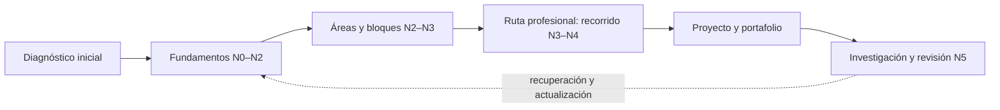

<div align="center">

# 🌌 Programa Integral de Astronomía, Astrofísica, Ciencias Espaciales e Ingeniería Aeroespacial

## **2.077 clases planificadas · 12 áreas · 133 bloques · 24 rutas profesionales**

**Un programa independiente en español que organiza, con IDs estables y trazabilidad, el recorrido desde la observación del cielo y los fundamentos científicos hasta la investigación, la ingeniería y las operaciones espaciales.**

[](https://github.com/vladimiracunadev-create/astronomy-astrophysics-space-sciences-aerospace-engineering-learning-program/actions/workflows/validate.yml)
[](https://vladimiracunadev-create.github.io/astronomy-astrophysics-space-sciences-aerospace-engineering-learning-program/)

[](CHANGELOG.md)
[](PROGRAMA_ACADEMICO_COMPLETO.md)
[](STATUS.md)
[](README.md)
[](LICENSE)
[](LICENSE-CONTENT.md)

[🌐 Explorar el catálogo](https://vladimiracunadev-create.github.io/astronomy-astrophysics-space-sciences-aerospace-engineering-learning-program/) ·
[📚 Programa completo](PROGRAMA_ACADEMICO_COMPLETO.md) ·
[🧭 Rutas profesionales](documentacion/MAPA_DE_RUTAS_PROFESIONALES.md) ·
[🎓 Estándar de clase](documentacion/ESTANDAR_PEDAGOGICO_Y_DE_EVALUACION.md) ·
[🗺️ Roadmap](ROADMAP.md) ·
[✅ Estado verificable](STATUS.md) ·
[📖 Documentación](documentacion/README.md) ·
[⚖️ Licencias](documentacion/LICENCIAS_Y_PROCEDENCIA.md) ·
[🤝 Contribuir](CONTRIBUTING.md)

</div>

---

> [!IMPORTANT]
> **El programa está planificado (2.077 clases en 133 bloques) y todas sus clases siguen en E0.** Hay **160 clases con texto redactado** (el área A01, bloques B01 a B08), pendientes de aprobación y de revisión disciplinar; las otras 1.120 de la línea base solo tienen título y descripción preliminar y las 797 restantes están programadas, sin redactar. Ninguna debe presentarse como impartida, revisada o verificada. Clases completamente redactadas **y verificadas**: **0/2.077**.

> [!WARNING]
> **Formación independiente, no habilitación profesional.** El programa no otorga títulos, grados, licencias ni certificaciones; tampoco autoriza decisiones médicas, jurídicas, de vuelo, lanzamiento, seguridad o ingeniería crítica. Toda aplicación real exige normativa vigente, datos adecuados y profesionales competentes.

## 🎯 Qué es este programa

Es una arquitectura curricular única y extensible: **un solo conjunto de clases organizado en áreas y bloques**. Las rutas profesionales no tienen contenido propio: son recorridos que ordenan clases de esas áreas y bloques. No son 24 programas separados.

| Superficie | Estado verificable |
|---|---:|
| Áreas | 12 |
| Bloques | 133 (64 de la línea base y 69 nuevos programados) |
| Clases de la línea base en el tronco | 1.280 |
| Clases programadas (citadas, ubicadas y justificadas; **no redactadas**) | 797 |
| **Clases del programa** | **2.077** |
| Rutas profesionales (recorridos sobre áreas y bloques) | 24 |
| Clases con texto redactado, pendientes de revisión (A01) | 160 |
| **Clases completamente redactadas y verificadas** | **0** |

## 🧮 Cómo se organiza y cuánto suma

El tronco de la línea base `0.1.0` tenía 8 áreas, 64 bloques y 1.280 clases; las rutas profesionales sumaban otras 3.840 clases en 192 módulos, para una referencia inicial de 5.120. Esa cifra fue un punto de partida, no una meta. En esta versión **todo el contenido de los módulos de las rutas se ubicó dentro de áreas y bloques**: de sus 1.920 temas, 1.101 ya estaban cubiertos por clases existentes y 819 dieron lugar a 797 clases programadas distintas (varios temas coinciden en una misma clase). El resultado son **12 áreas, 133 bloques y 2.077 clases**.

Las áreas **no** tienen el mismo tamaño: crecen con el contenido que necesitan, y A01 (160 clases, conocimiento básico) no cambia. Los IDs de la línea base se conservan; los bloques B57–B64 pasan a las áreas A08 a A11 sin cambiar el ID de ninguna de sus clases. Las clases programadas se agregan al final de un bloque existente (`B49-C21`…) o forman bloques nuevos (`B65`…). Los IDs `Rxx-Mxx-Cnn` se conservan como equivalencias: el [programa completo](PROGRAMA_ACADEMICO_COMPLETO.md) indica, módulo por módulo, dónde vive hoy su contenido. Detalle de la línea base: [estructura y conteo del catálogo](documentacion/ESTRUCTURA_Y_CONTEO_DEL_CATALOGO.md).

Nadie necesita cursar todo: el diagnóstico indica qué partes del tronco hacen falta y una ruta profesional ordena las clases de su campo. La carga y las equivalencias se definirán después de pilotajes reales.



## 🗂️ Las 12 áreas y 133 bloques

Este mapa deja el contenido visible desde la portada. Cada bloque muestra su rango de clases; las **programadas** son clases citadas con su ubicación y la necesidad que resuelven, todavía sin redactar.

> [!IMPORTANT]
> Todos los registros permanecen en E0. Las clases de A01 (160) tienen texto redactado y enlazado desde su bloque, pendiente de revisión; el resto solo tiene título y descripción preliminar, o es una clase programada sin redactar. Ninguna está impartida ni verificada.

### A01 · Alfabetización científica, astronómica y tecnológica

Punto de partida común: observar y medir el cielo, entender la ciencia como método y adquirir la matemática, la física, la química y la informática básicas. Nivel N0–N1. **Sin cambios respecto de la línea base.**

*8 bloques · 160 clases de la línea base · 0 programadas · 160 en total.*

| Bloque | Contenido previsto | Clases | Ficha |
|---|---|---:|---|
| B01 | El universo y el pensamiento científico | B01-C01 → B01-C20 | [📘 ver las 20 clases](programa/tronco-comun/B01-el-universo-y-el-pensamiento-cientifico.md) |
| B02 | Historia, arqueoastronomía y culturas del cielo | B02-C01 → B02-C20 | [📘 ver las 20 clases](programa/tronco-comun/B02-historia-arqueoastronomia-y-culturas-del-cielo.md) |
| B03 | Matemática elemental para ciencias espaciales | B03-C01 → B03-C20 | [📘 ver las 20 clases](programa/tronco-comun/B03-matematica-elemental-para-ciencias-espaciales.md) |
| B04 | Álgebra, trigonometría y geometría espacial | B04-C01 → B04-C20 | [📘 ver las 20 clases](programa/tronco-comun/B04-algebra-trigonometria-y-geometria-espacial.md) |
| B05 | Física fundamental para el espacio | B05-C01 → B05-C20 | [📘 ver las 20 clases](programa/tronco-comun/B05-fisica-fundamental-para-el-espacio.md) |
| B06 | Química y materia del universo | B06-C01 → B06-C20 | [📘 ver las 20 clases](programa/tronco-comun/B06-quimica-y-materia-del-universo.md) |
| B07 | Informática científica desde cero | B07-C01 → B07-C20 | [📘 ver las 20 clases](programa/tronco-comun/B07-informatica-cientifica-desde-cero.md) |
| B08 | Observación del cielo y astronomía práctica | B08-C01 → B08-C20 | [📘 ver las 20 clases](programa/tronco-comun/B08-observacion-del-cielo-y-astronomia-practica.md) |

### A02 · Matemática, física computacional y métodos científicos

Los lenguajes cuantitativos del programa: cálculo, álgebra lineal, simulación, estadística e incertidumbre, metrología, computación científica, señales y control; más aprendizaje automático, inferencia y verificación de software. Nivel N2–N3.

*15 bloques · 160 clases de la línea base · 77 programadas · 237 en total.*

| Bloque | Contenido previsto | Clases | Ficha |
|---|---|---:|---|
| B09 | Cálculo diferencial e integral | B09-C01 → B09-C20 | [📘 ver las 20 clases](programa/tronco-comun/B09-calculo-diferencial-e-integral.md) |
| B10 | Álgebra lineal y matemáticas geométricas | B10-C01 → B10-C20 | [📘 ver las 20 clases](programa/tronco-comun/B10-algebra-lineal-y-matematicas-geometricas.md) |
| B11 | Ecuaciones diferenciales y simulación numérica | B11-C01 → B11-C26 (6 programadas) | [📘 ver el bloque](programa/tronco-comun/B11-ecuaciones-diferenciales-y-simulacion-numerica.md) |
| B12 | Probabilidad, estadística e incertidumbre | B12-C01 → B12-C26 (6 programadas) | [📘 ver el bloque](programa/tronco-comun/B12-probabilidad-estadistica-e-incertidumbre.md) |
| B13 | Metrología, tiempo y mediciones científicas | B13-C01 → B13-C23 (3 programadas) | [📘 ver el bloque](programa/tronco-comun/B13-metrologia-tiempo-y-mediciones-cientificas.md) |
| B14 | Computación científica y ciencia abierta | B14-C01 → B14-C31 (11 programadas) | [📘 ver el bloque](programa/tronco-comun/B14-computacion-cientifica-y-ciencia-abierta.md) |
| B15 | Señales, imágenes y estimación científica | B15-C01 → B15-C24 (4 programadas) | [📘 ver el bloque](programa/tronco-comun/B15-senales-imagenes-y-estimacion-cientifica.md) |
| B16 | Sistemas dinámicos y control automático | B16-C01 → B16-C20 | [📘 ver las 20 clases](programa/tronco-comun/B16-sistemas-dinamicos-y-control-automatico.md) |
| B65 | Aprendizaje automático científico | B65-C01 → B65-C12 (programadas) | [📋 ver en el programa](PROGRAMA_ACADEMICO_COMPLETO.md#b65--aprendizaje-automático-científico) |
| B66 | Computación de alto rendimiento | B66-C01 → B66-C05 (programadas) | [📋 ver en el programa](PROGRAMA_ACADEMICO_COMPLETO.md#b66--computación-de-alto-rendimiento) |
| B67 | Inferencia bayesiana y computación probabilística | B67-C01 → B67-C08 (programadas) | [📋 ver en el programa](PROGRAMA_ACADEMICO_COMPLETO.md#b67--inferencia-bayesiana-y-computación-probabilística) |
| B68 | Metodología de la investigación científica | B68-C01 → B68-C04 (programadas) | [📋 ver en el programa](PROGRAMA_ACADEMICO_COMPLETO.md#b68--metodología-de-la-investigación-científica) |
| B69 | Métodos numéricos para EDP y fluidos computacionales | B69-C01 → B69-C05 (programadas) | [📋 ver en el programa](PROGRAMA_ACADEMICO_COMPLETO.md#b69--métodos-numéricos-para-edp-y-fluidos-computacionales) |
| B70 | Problemas inversos y estimación de modelos | B70-C01 → B70-C05 (programadas) | [📋 ver en el programa](PROGRAMA_ACADEMICO_COMPLETO.md#b70--problemas-inversos-y-estimación-de-modelos) |
| B71 | Verificación y validación de software científico | B71-C01 → B71-C08 (programadas) | [📋 ver en el programa](PROGRAMA_ACADEMICO_COMPLETO.md#b71--verificación-y-validación-de-software-científico) |

### A03 · Astrofísica y ciencias fundamentales del universo

La física del universo: estrellas, galaxias, cosmología, objetos compactos, mensajeros, exoplanetas, el Sol y su plasma, y física nuclear y de partículas, con profundización en interiores estelares, universo temprano y clima espacial. Nivel N2–N4.

*17 bloques · 160 clases de la línea base · 112 programadas · 272 en total.*

| Bloque | Contenido previsto | Clases | Ficha |
|---|---|---:|---|
| B17 | Física y evolución de estrellas | B17-C01 → B17-C22 (2 programadas) | [📘 ver el bloque](programa/tronco-comun/B17-fisica-y-evolucion-de-estrellas.md) |
| B18 | Galaxias y medio interestelar | B18-C01 → B18-C20 | [📘 ver las 20 clases](programa/tronco-comun/B18-galaxias-y-medio-interestelar.md) |
| B19 | Relatividad y cosmología | B19-C01 → B19-C23 (3 programadas) | [📘 ver el bloque](programa/tronco-comun/B19-relatividad-y-cosmologia.md) |
| B20 | Objetos compactos y altas energías | B20-C01 → B20-C22 (2 programadas) | [📘 ver el bloque](programa/tronco-comun/B20-objetos-compactos-y-altas-energias.md) |
| B21 | Astronomía multimensajero | B21-C01 → B21-C22 (2 programadas) | [📘 ver el bloque](programa/tronco-comun/B21-astronomia-multimensajero.md) |
| B22 | Astronomía temporal y exoplanetas | B22-C01 → B22-C20 | [📘 ver las 20 clases](programa/tronco-comun/B22-astronomia-temporal-y-exoplanetas.md) |
| B23 | Heliofísica y física de plasmas | B23-C01 → B23-C23 (3 programadas) | [📘 ver el bloque](programa/tronco-comun/B23-heliofisica-y-fisica-de-plasmas.md) |
| B24 | Física cuántica, nuclear y astropartículas | B24-C01 → B24-C20 | [📘 ver las 20 clases](programa/tronco-comun/B24-fisica-cuantica-nuclear-y-astroparticulas.md) |
| B72 | Atmósferas estelares y espectroscopía estelar cuantitativa | B72-C01 → B72-C12 (programadas) | [📋 ver en el programa](PROGRAMA_ACADEMICO_COMPLETO.md#b72--atmósferas-estelares-y-espectroscopía-estelar-cuantitativa) |
| B73 | Clima espacial: impactos, pronóstico y riesgo | B73-C01 → B73-C14 (programadas) | [📋 ver en el programa](PROGRAMA_ACADEMICO_COMPLETO.md#b73--clima-espacial-impactos-pronóstico-y-riesgo) |
| B74 | Corona solar y erupciones: diagnóstico y modelos | B74-C01 → B74-C09 (programadas) | [📋 ver en el programa](PROGRAMA_ACADEMICO_COMPLETO.md#b74--corona-solar-y-erupciones-diagnóstico-y-modelos) |
| B75 | Física avanzada de plasmas y MHD espacial | B75-C01 → B75-C10 (programadas) | [📋 ver en el programa](PROGRAMA_ACADEMICO_COMPLETO.md#b75--física-avanzada-de-plasmas-y-mhd-espacial) |
| B76 | Formación de estructuras cósmicas y materia oscura | B76-C01 → B76-C11 (programadas) | [📋 ver en el programa](PROGRAMA_ACADEMICO_COMPLETO.md#b76--formación-de-estructuras-cósmicas-y-materia-oscura) |
| B77 | Interiores estelares y asterosismología | B77-C01 → B77-C14 (programadas) | [📋 ver en el programa](PROGRAMA_ACADEMICO_COMPLETO.md#b77--interiores-estelares-y-asterosismología) |
| B78 | Poblaciones estelares y simulación de galaxias | B78-C01 → B78-C09 (programadas) | [📋 ver en el programa](PROGRAMA_ACADEMICO_COMPLETO.md#b78--poblaciones-estelares-y-simulación-de-galaxias) |
| B79 | Relatividad general avanzada | B79-C01 → B79-C06 (programadas) | [📋 ver en el programa](PROGRAMA_ACADEMICO_COMPLETO.md#b79--relatividad-general-avanzada) |
| B80 | Universo temprano y radiación cósmica de fondo | B80-C01 → B80-C15 (programadas) | [📋 ver en el programa](PROGRAMA_ACADEMICO_COMPLETO.md#b80--universo-temprano-y-radiación-cósmica-de-fondo) |

### A04 · Óptica, telescopios y observatorios científicos

Cómo se observa: óptica, telescopios, detectores, espectroscopía, radioastronomía y observatorios terrestres y espaciales, con profundización en diseño óptico, antenas e interferometría. Nivel N3–N4.

*11 bloques · 160 clases de la línea base · 62 programadas · 222 en total.*

| Bloque | Contenido previsto | Clases | Ficha |
|---|---|---:|---|
| B25 | Óptica geométrica y diseño de telescopios | B25-C01 → B25-C20 | [📘 ver las 20 clases](programa/tronco-comun/B25-optica-geometrica-y-diseno-de-telescopios.md) |
| B26 | Óptica física y óptica adaptativa | B26-C01 → B26-C24 (4 programadas) | [📘 ver el bloque](programa/tronco-comun/B26-optica-fisica-y-optica-adaptativa.md) |
| B27 | Construcción y mecánica de telescopios | B27-C01 → B27-C26 (6 programadas) | [📘 ver el bloque](programa/tronco-comun/B27-construccion-y-mecanica-de-telescopios.md) |
| B28 | Detectores y adquisición astronómica | B28-C01 → B28-C20 | [📘 ver las 20 clases](programa/tronco-comun/B28-detectores-y-adquisicion-astronomica.md) |
| B29 | Espectroscopía, fotometría y polarimetría | B29-C01 → B29-C24 (4 programadas) | [📘 ver el bloque](programa/tronco-comun/B29-espectroscopia-fotometria-y-polarimetria.md) |
| B30 | Radioastronomía e interferometría | B30-C01 → B30-C20 | [📘 ver las 20 clases](programa/tronco-comun/B30-radioastronomia-e-interferometria.md) |
| B31 | Instrumentación y observatorios espaciales | B31-C01 → B31-C25 (5 programadas) | [📘 ver el bloque](programa/tronco-comun/B31-instrumentacion-y-observatorios-espaciales.md) |
| B32 | Operaciones de observatorios científicos | B32-C01 → B32-C23 (3 programadas) | [📘 ver el bloque](programa/tronco-comun/B32-operaciones-de-observatorios-cientificos.md) |
| B81 | Antenas y receptores de radioastronomía | B81-C01 → B81-C11 (programadas) | [📋 ver en el programa](PROGRAMA_ACADEMICO_COMPLETO.md#b81--antenas-y-receptores-de-radioastronomía) |
| B82 | Diseño óptico computacional y tolerancias | B82-C01 → B82-C15 (programadas) | [📋 ver en el programa](PROGRAMA_ACADEMICO_COMPLETO.md#b82--diseño-óptico-computacional-y-tolerancias) |
| B83 | Interferometría avanzada y reducción de datos de radio | B83-C01 → B83-C14 (programadas) | [📋 ver en el programa](PROGRAMA_ACADEMICO_COMPLETO.md#b83--interferometría-avanzada-y-reducción-de-datos-de-radio) |

### A05 · Ciencias planetarias, astroquímica y habitabilidad

Los mundos y la vida: formación planetaria, geología, atmósferas, química, astrobiología, observación terrestre, cuerpos menores y recursos, con bloques nuevos de vulcanismo, impactos, geofísica y astroquímica. Nivel N2–N4.

*19 bloques · 160 clases de la línea base · 97 programadas · 257 en total.*

| Bloque | Contenido previsto | Clases | Ficha |
|---|---|---:|---|
| B33 | Formación y dinámica de sistemas planetarios | B33-C01 → B33-C20 | [📘 ver las 20 clases](programa/tronco-comun/B33-formacion-y-dinamica-de-sistemas-planetarios.md) |
| B34 | Astrogeología y geodesia planetaria | B34-C01 → B34-C30 (10 programadas) | [📘 ver el bloque](programa/tronco-comun/B34-astrogeologia-y-geodesia-planetaria.md) |
| B35 | Atmósferas y climatología planetaria | B35-C01 → B35-C20 | [📘 ver las 20 clases](programa/tronco-comun/B35-atmosferas-y-climatologia-planetaria.md) |
| B36 | Astroquímica y geoquímica extraterrestre | B36-C01 → B36-C20 | [📘 ver las 20 clases](programa/tronco-comun/B36-astroquimica-y-geoquimica-extraterrestre.md) |
| B37 | Astrobiología y vida extraterrestre | B37-C01 → B37-C21 (1 programadas) | [📘 ver el bloque](programa/tronco-comun/B37-astrobiologia-y-vida-extraterrestre.md) |
| B38 | Observación terrestre y geociencias orbitales | B38-C01 → B38-C34 (14 programadas) | [📘 ver el bloque](programa/tronco-comun/B38-observacion-terrestre-y-geociencias-orbitales.md) |
| B39 | Asteroides, cometas y defensa planetaria | B39-C01 → B39-C20 | [📘 ver las 20 clases](programa/tronco-comun/B39-asteroides-cometas-y-defensa-planetaria.md) |
| B40 | Recursos in situ y sostenibilidad extraterrestre | B40-C01 → B40-C23 (3 programadas) | [📘 ver el bloque](programa/tronco-comun/B40-recursos-in-situ-y-sostenibilidad-extraterrestre.md) |
| B84 | Cinética y modelado astroquímico | B84-C01 → B84-C04 (programadas) | [📋 ver en el programa](PROGRAMA_ACADEMICO_COMPLETO.md#b84--cinética-y-modelado-astroquímico) |
| B85 | Cráteres de impacto y geología de impactos | B85-C01 → B85-C07 (programadas) | [📋 ver en el programa](PROGRAMA_ACADEMICO_COMPLETO.md#b85--cráteres-de-impacto-y-geología-de-impactos) |
| B86 | Espectroscopía molecular para astroquímica | B86-C01 → B86-C08 (programadas) | [📋 ver en el programa](PROGRAMA_ACADEMICO_COMPLETO.md#b86--espectroscopía-molecular-para-astroquímica) |
| B87 | Exploración in situ y análisis de muestras planetarias | B87-C01 → B87-C06 (programadas) | [📋 ver en el programa](PROGRAMA_ACADEMICO_COMPLETO.md#b87--exploración-in-situ-y-análisis-de-muestras-planetarias) |
| B88 | Extremófilos y límites de la vida | B88-C01 → B88-C07 (programadas) | [📋 ver en el programa](PROGRAMA_ACADEMICO_COMPLETO.md#b88--extremófilos-y-límites-de-la-vida) |
| B89 | Geofísica de interiores planetarios | B89-C01 → B89-C06 (programadas) | [📋 ver en el programa](PROGRAMA_ACADEMICO_COMPLETO.md#b89--geofísica-de-interiores-planetarios) |
| B90 | Geomorfología y procesos superficiales planetarios | B90-C01 → B90-C05 (programadas) | [📋 ver en el programa](PROGRAMA_ACADEMICO_COMPLETO.md#b90--geomorfología-y-procesos-superficiales-planetarios) |
| B91 | Prospección y evaluación de reservas de recursos extraterrestres | B91-C01 → B91-C08 (programadas) | [📋 ver en el programa](PROGRAMA_ACADEMICO_COMPLETO.md#b91--prospección-y-evaluación-de-reservas-de-recursos-extraterrestres) |
| B92 | Química de granos y hielos interestelares | B92-C01 → B92-C04 (programadas) | [📋 ver en el programa](PROGRAMA_ACADEMICO_COMPLETO.md#b92--química-de-granos-y-hielos-interestelares) |
| B93 | Radar de apertura sintética e interferometría (profundización) | B93-C01 → B93-C07 (programadas) | [📋 ver en el programa](PROGRAMA_ACADEMICO_COMPLETO.md#b93--radar-de-apertura-sintética-e-interferometría-profundización) |
| B94 | Vulcanismo planetario | B94-C01 → B94-C07 (programadas) | [📋 ver en el programa](PROGRAMA_ACADEMICO_COMPLETO.md#b94--vulcanismo-planetario) |

### A06 · Mecánica orbital, navegación y vuelo espacial

Órbitas, perturbaciones, navegación, trayectorias, dinámica cislunar, lanzamiento y propulsión, con optimización de trayectorias, transferencias de Lambert y fluidos de propulsión. Nivel N3–N4.

*12 bloques · 160 clases de la línea base · 77 programadas · 237 en total.*

| Bloque | Contenido previsto | Clases | Ficha |
|---|---|---:|---|
| B41 | Mecánica orbital fundamental | B41-C01 → B41-C20 | [📘 ver las 20 clases](programa/tronco-comun/B41-mecanica-orbital-fundamental.md) |
| B42 | Perturbaciones y evolución de órbitas | B42-C01 → B42-C21 (1 programadas) | [📘 ver el bloque](programa/tronco-comun/B42-perturbaciones-y-evolucion-de-orbitas.md) |
| B43 | Mecánica celeste, resonancias y caos | B43-C01 → B43-C22 (2 programadas) | [📘 ver el bloque](programa/tronco-comun/B43-mecanica-celeste-resonancias-y-caos.md) |
| B44 | Estimación de órbitas y navegación espacial | B44-C01 → B44-C30 (10 programadas) | [📘 ver el bloque](programa/tronco-comun/B44-estimacion-de-orbitas-y-navegacion-espacial.md) |
| B45 | Trayectorias y misiones interplanetarias | B45-C01 → B45-C30 (10 programadas) | [📘 ver el bloque](programa/tronco-comun/B45-trayectorias-y-misiones-interplanetarias.md) |
| B46 | Dinámica cislunar y operaciones de proximidad | B46-C01 → B46-C20 | [📘 ver las 20 clases](programa/tronco-comun/B46-dinamica-cislunar-y-operaciones-de-proximidad.md) |
| B47 | Dinámica de lanzamiento y reentrada | B47-C01 → B47-C25 (5 programadas) | [📘 ver el bloque](programa/tronco-comun/B47-dinamica-de-lanzamiento-y-reentrada.md) |
| B48 | Tecnologías de propulsión espacial | B48-C01 → B48-C22 (2 programadas) | [📘 ver el bloque](programa/tronco-comun/B48-tecnologias-de-propulsion-espacial.md) |
| B95 | Fluidos, termodinámica y aerotermodinámica de propulsión | B95-C01 → B95-C16 (programadas) | [📋 ver en el programa](PROGRAMA_ACADEMICO_COMPLETO.md#b95--fluidos-termodinámica-y-aerotermodinámica-de-propulsión) |
| B96 | Navegación inercial y fusión multisensorial | B96-C01 → B96-C09 (programadas) | [📋 ver en el programa](PROGRAMA_ACADEMICO_COMPLETO.md#b96--navegación-inercial-y-fusión-multisensorial) |
| B97 | Optimización de trayectorias y diseño robusto | B97-C01 → B97-C15 (programadas) | [📋 ver en el programa](PROGRAMA_ACADEMICO_COMPLETO.md#b97--optimización-de-trayectorias-y-diseño-robusto) |
| B98 | Problema de Lambert y transferencias de dos puntos | B98-C01 → B98-C07 (programadas) | [📋 ver en el programa](PROGRAMA_ACADEMICO_COMPLETO.md#b98--problema-de-lambert-y-transferencias-de-dos-puntos) |

### A07 · Ingeniería y construcción de sistemas espaciales

La ingeniería del satélite y de la misión: sistemas, estructuras, térmica, potencia, actitud, aviónica, comunicaciones, integración y ensayos, con enlaces, antenas, comunicaciones ópticas y plataformas pequeñas. Nivel N3–N4.

*13 bloques · 160 clases de la línea base · 99 programadas · 259 en total.*

| Bloque | Contenido previsto | Clases | Ficha |
|---|---|---:|---|
| B49 | Ingeniería de sistemas y diseño de misiones | B49-C01 → B49-C24 (4 programadas) | [📘 ver el bloque](programa/tronco-comun/B49-ingenieria-de-sistemas-y-diseno-de-misiones.md) |
| B50 | Estructuras, materiales y fabricación espacial | B50-C01 → B50-C38 (18 programadas) | [📘 ver el bloque](programa/tronco-comun/B50-estructuras-materiales-y-fabricacion-espacial.md) |
| B51 | Gestión térmica y entorno espacial | B51-C01 → B51-C29 (9 programadas) | [📘 ver el bloque](programa/tronco-comun/B51-gestion-termica-y-entorno-espacial.md) |
| B52 | Sistemas de potencia y energía espacial | B52-C01 → B52-C23 (3 programadas) | [📘 ver el bloque](programa/tronco-comun/B52-sistemas-de-potencia-y-energia-espacial.md) |
| B53 | Sensores y control de actitud | B53-C01 → B53-C22 (2 programadas) | [📘 ver el bloque](programa/tronco-comun/B53-sensores-y-control-de-actitud.md) |
| B54 | Aviónica y software crítico espacial | B54-C01 → B54-C44 (24 programadas) | [📘 ver el bloque](programa/tronco-comun/B54-avionica-y-software-critico-espacial.md) |
| B55 | Comunicaciones y navegación satelital | B55-C01 → B55-C25 (5 programadas) | [📘 ver el bloque](programa/tronco-comun/B55-comunicaciones-y-navegacion-satelital.md) |
| B56 | Integración, ensayos y calificación espacial | B56-C01 → B56-C24 (4 programadas) | [📘 ver el bloque](programa/tronco-comun/B56-integracion-ensayos-y-calificacion-espacial.md) |
| B99 | Antenas y propagación para enlaces espaciales | B99-C01 → B99-C08 (programadas) | [📋 ver en el programa](PROGRAMA_ACADEMICO_COMPLETO.md#b99--antenas-y-propagación-para-enlaces-espaciales) |
| B100 | Comunicaciones ópticas espaciales (profundización) | B100-C01 → B100-C08 (programadas) | [📋 ver en el programa](PROGRAMA_ACADEMICO_COMPLETO.md#b100--comunicaciones-ópticas-espaciales-profundización) |
| B101 | Electrónica embarcada y compatibilidad electromagnética | B101-C01 → B101-C04 (programadas) | [📋 ver en el programa](PROGRAMA_ACADEMICO_COMPLETO.md#b101--electrónica-embarcada-y-compatibilidad-electromagnética) |
| B102 | Modulación, codificación y protocolos de enlace | B102-C01 → B102-C06 (programadas) | [📋 ver en el programa](PROGRAMA_ACADEMICO_COMPLETO.md#b102--modulación-codificación-y-protocolos-de-enlace) |
| B103 | Plataformas de satélites pequeños y CubeSat | B103-C01 → B103-C04 (programadas) | [📋 ver en el programa](PROGRAMA_ACADEMICO_COMPLETO.md#b103--plataformas-de-satélites-pequeños-y-cubesat) |

### A08 · Operaciones de misión y robótica espacial

Operar la misión y construir fuera de la Tierra: control de misión, robótica, percepción, movilidad, manipulación, autonomía y logística extraterrestre. Nivel N3–N4.

*8 bloques · 40 clases de la línea base · 65 programadas · 105 en total.*

| Bloque | Contenido previsto | Clases | Ficha |
|---|---|---:|---|
| B57 | Control y operación de misiones espaciales | B57-C01 → B57-C30 (10 programadas) | [📘 ver el bloque](programa/tronco-comun/B57-control-y-operacion-de-misiones-espaciales.md) |
| B61 | Robótica y construcción extraterrestre | B61-C01 → B61-C27 (7 programadas) | [📘 ver el bloque](programa/tronco-comun/B61-robotica-y-construccion-extraterrestre.md) |
| B104 | Autonomía y teleoperación espacial | B104-C01 → B104-C08 (programadas) | [📋 ver en el programa](PROGRAMA_ACADEMICO_COMPLETO.md#b104--autonomía-y-teleoperación-espacial) |
| B105 | Localización y mapeo robótico | B105-C01 → B105-C07 (programadas) | [📋 ver en el programa](PROGRAMA_ACADEMICO_COMPLETO.md#b105--localización-y-mapeo-robótico) |
| B106 | Logística y cadena de suministro extraterrestre | B106-C01 → B106-C07 (programadas) | [📋 ver en el programa](PROGRAMA_ACADEMICO_COMPLETO.md#b106--logística-y-cadena-de-suministro-extraterrestre) |
| B107 | Manipuladores robóticos espaciales | B107-C01 → B107-C10 (programadas) | [📋 ver en el programa](PROGRAMA_ACADEMICO_COMPLETO.md#b107--manipuladores-robóticos-espaciales) |
| B108 | Movilidad de robots planetarios | B108-C01 → B108-C08 (programadas) | [📋 ver en el programa](PROGRAMA_ACADEMICO_COMPLETO.md#b108--movilidad-de-robots-planetarios) |
| B109 | Percepción visual robótica | B109-C01 → B109-C08 (programadas) | [📋 ver en el programa](PROGRAMA_ACADEMICO_COMPLETO.md#b109--percepción-visual-robótica) |

### A09 · Astronáutica humana, medicina y hábitats

La persona en el espacio: preparación de astronautas, medicina y biología, hábitats y soporte vital, con bloques nuevos de salud, radiación, emergencias y bioregeneración. Nivel N3–N4.

*14 bloques · 60 clases de la línea base · 93 programadas · 153 en total.*

| Bloque | Contenido previsto | Clases | Ficha |
|---|---|---:|---|
| B58 | Astronáutica y preparación de astronautas | B58-C01 → B58-C23 (3 programadas) | [📘 ver el bloque](programa/tronco-comun/B58-astronautica-y-preparacion-de-astronautas.md) |
| B59 | Medicina y biología espacial | B59-C01 → B59-C27 (7 programadas) | [📘 ver el bloque](programa/tronco-comun/B59-medicina-y-biologia-espacial.md) |
| B60 | Hábitats espaciales y soporte vital | B60-C01 → B60-C29 (9 programadas) | [📘 ver el bloque](programa/tronco-comun/B60-habitats-espaciales-y-soporte-vital.md) |
| B110 | Acondicionamiento físico y rehabilitación de astronautas | B110-C01 → B110-C10 (programadas) | [📋 ver en el programa](PROGRAMA_ACADEMICO_COMPLETO.md#b110--acondicionamiento-físico-y-rehabilitación-de-astronautas) |
| B111 | Actividades extravehiculares y trajes espaciales | B111-C01 → B111-C05 (programadas) | [📋 ver en el programa](PROGRAMA_ACADEMICO_COMPLETO.md#b111--actividades-extravehiculares-y-trajes-espaciales) |
| B112 | Arquitectura y factores humanos de hábitats extraterrestres | B112-C01 → B112-C12 (programadas) | [📋 ver en el programa](PROGRAMA_ACADEMICO_COMPLETO.md#b112--arquitectura-y-factores-humanos-de-hábitats-extraterrestres) |
| B113 | Emergencias y seguridad de tripulación | B113-C01 → B113-C05 (programadas) | [📋 ver en el programa](PROGRAMA_ACADEMICO_COMPLETO.md#b113--emergencias-y-seguridad-de-tripulación) |
| B114 | Factores humanos y liderazgo de tripulación | B114-C01 → B114-C06 (programadas) | [📋 ver en el programa](PROGRAMA_ACADEMICO_COMPLETO.md#b114--factores-humanos-y-liderazgo-de-tripulación) |
| B115 | Radiobiología y protección radiológica espacial | B115-C01 → B115-C06 (programadas) | [📋 ver en el programa](PROGRAMA_ACADEMICO_COMPLETO.md#b115--radiobiología-y-protección-radiológica-espacial) |
| B116 | Salud conductual y bienestar en aislamiento | B116-C01 → B116-C05 (programadas) | [📋 ver en el programa](PROGRAMA_ACADEMICO_COMPLETO.md#b116--salud-conductual-y-bienestar-en-aislamiento) |
| B117 | Seguridad y respuesta a emergencias en hábitats | B117-C01 → B117-C06 (programadas) | [📋 ver en el programa](PROGRAMA_ACADEMICO_COMPLETO.md#b117--seguridad-y-respuesta-a-emergencias-en-hábitats) |
| B118 | Sistemas bioregenerativos y cultivo en hábitats | B118-C01 → B118-C07 (programadas) | [📋 ver en el programa](PROGRAMA_ACADEMICO_COMPLETO.md#b118--sistemas-bioregenerativos-y-cultivo-en-hábitats) |
| B119 | Telemedicina y monitorización de salud en misión | B119-C01 → B119-C07 (programadas) | [📋 ver en el programa](PROGRAMA_ACADEMICO_COMPLETO.md#b119--telemedicina-y-monitorización-de-salud-en-misión) |
| B120 | Urgencias médicas y atención clínica en misión | B120-C01 → B120-C05 (programadas) | [📋 ver en el programa](PROGRAMA_ACADEMICO_COMPLETO.md#b120--urgencias-médicas-y-atención-clínica-en-misión) |

### A10 · Entorno orbital, derecho y seguridad espacial

Un espacio compartido y seguro: tráfico y sostenibilidad orbital, derecho internacional y nacional, espectro y licencias, responsabilidad, seguridad y resiliencia. Tratamiento histórico, jurídico, defensivo y de resiliencia. Nivel N3–N4.

*6 bloques · 40 clases de la línea base · 45 programadas · 85 en total.*

| Bloque | Contenido previsto | Clases | Ficha |
|---|---|---:|---|
| B62 | Tráfico espacial y sostenibilidad orbital | B62-C01 → B62-C24 (4 programadas) | [📘 ver el bloque](programa/tronco-comun/B62-trafico-espacial-y-sostenibilidad-orbital.md) |
| B63 | Derecho, seguridad y geopolítica espacial | B63-C01 → B63-C36 (16 programadas) | [📘 ver el bloque](programa/tronco-comun/B63-derecho-seguridad-y-geopolitica-espacial.md) |
| B121 | Espectro, licencias y regulación satelital | B121-C01 → B121-C06 (programadas) | [📋 ver en el programa](PROGRAMA_ACADEMICO_COMPLETO.md#b121--espectro-licencias-y-regulación-satelital) |
| B122 | Regulación nacional de actividades espaciales | B122-C01 → B122-C05 (programadas) | [📋 ver en el programa](PROGRAMA_ACADEMICO_COMPLETO.md#b122--regulación-nacional-de-actividades-espaciales) |
| B123 | Resiliencia y continuidad de infraestructura espacial | B123-C01 → B123-C10 (programadas) | [📋 ver en el programa](PROGRAMA_ACADEMICO_COMPLETO.md#b123--resiliencia-y-continuidad-de-infraestructura-espacial) |
| B124 | Responsabilidad, daños y controversias espaciales | B124-C01 → B124-C04 (programadas) | [📋 ver en el programa](PROGRAMA_ACADEMICO_COMPLETO.md#b124--responsabilidad-daños-y-controversias-espaciales) |

### A11 · Economía, industria y gestión de proyectos espaciales

Cadena de valor, costos, financiamiento, seguros, creación de empresas y gestión de proyectos espaciales. Nivel N3–N4.

*4 bloques · 20 clases de la línea base · 24 programadas · 44 en total.*

| Bloque | Contenido previsto | Clases | Ficha |
|---|---|---:|---|
| B64 | Industria, economía, ética y proyectos espaciales | B64-C01 → B64-C24 (4 programadas) | [📘 ver el bloque](programa/tronco-comun/B64-industria-economia-etica-y-proyectos-espaciales.md) |
| B125 | Creación y operación de empresas espaciales | B125-C01 → B125-C06 (programadas) | [📋 ver en el programa](PROGRAMA_ACADEMICO_COMPLETO.md#b125--creación-y-operación-de-empresas-espaciales) |
| B126 | Financiamiento de proyectos y negocios espaciales | B126-C01 → B126-C06 (programadas) | [📋 ver en el programa](PROGRAMA_ACADEMICO_COMPLETO.md#b126--financiamiento-de-proyectos-y-negocios-espaciales) |
| B127 | Seguros espaciales | B127-C01 → B127-C08 (programadas) | [📋 ver en el programa](PROGRAMA_ACADEMICO_COMPLETO.md#b127--seguros-espaciales) |

### A12 · Educación, historia aplicada y divulgación astronómica

Enseñar, divulgar e investigar el cielo: historia y arqueoastronomía aplicadas, saberes y educación intercultural, didáctica, ciencia ciudadana, accesibilidad y comunicación. Nivel N3–N4.

*6 bloques · 0 clases de la línea base · 46 programadas · 46 en total.*

| Bloque | Contenido previsto | Clases | Ficha |
|---|---|---:|---|
| B128 | Accesibilidad e inclusión en la enseñanza de la astronomía | B128-C01 → B128-C11 (programadas) | [📋 ver en el programa](PROGRAMA_ACADEMICO_COMPLETO.md#b128--accesibilidad-e-inclusión-en-la-enseñanza-de-la-astronomía) |
| B129 | Ciencia ciudadana astronómica | B129-C01 → B129-C07 (programadas) | [📋 ver en el programa](PROGRAMA_ACADEMICO_COMPLETO.md#b129--ciencia-ciudadana-astronómica) |
| B130 | Comunicación y divulgación científica | B130-C01 → B130-C06 (programadas) | [📋 ver en el programa](PROGRAMA_ACADEMICO_COMPLETO.md#b130--comunicación-y-divulgación-científica) |
| B131 | Didáctica de la astronomía | B131-C01 → B131-C11 (programadas) | [📋 ver en el programa](PROGRAMA_ACADEMICO_COMPLETO.md#b131--didáctica-de-la-astronomía) |
| B132 | Historia y arqueoastronomía aplicadas | B132-C01 → B132-C06 (programadas) | [📋 ver en el programa](PROGRAMA_ACADEMICO_COMPLETO.md#b132--historia-y-arqueoastronomía-aplicadas) |
| B133 | Saberes astronómicos y educación intercultural | B133-C01 → B133-C05 (programadas) | [📋 ver en el programa](PROGRAMA_ACADEMICO_COMPLETO.md#b133--saberes-astronómicos-y-educación-intercultural) |

➡️ **[Ver el programa completo: 2.077 clases en 133 bloques](PROGRAMA_ACADEMICO_COMPLETO.md)**

## 🧭 Las 24 rutas profesionales

Cada ruta es un recorrido por rol dentro del mismo programa: indica qué clases de las áreas y bloques usa y en qué orden. No tiene contenido propio ni es un programa separado.

> [!NOTE]
> Los recorridos se están definiendo rol por rol; los que aún no tienen recorrido lo indican en su página. Ninguna ruta constituye formación terminada ni habilitación profesional.

| Ruta | Recorrido | Índice |
|---|---|---|
| **R01 · Astrofísica estelar y galáctica** | [🧭 recorrido](programa/rutas-profesionales/R01-astrofisica-estelar-y-galactica/RECORRIDO.md) | [📋 abrir](programa/rutas-profesionales/R01-astrofisica-estelar-y-galactica/INDICE.md) |
| **R02 · Cosmología y astrofísica extrema** | [🧭 recorrido](programa/rutas-profesionales/R02-cosmologia-y-astrofisica-extrema/RECORRIDO.md) | [📋 abrir](programa/rutas-profesionales/R02-cosmologia-y-astrofisica-extrema/INDICE.md) |
| **R03 · Ingeniería óptica y telescopios profesionales** | [🧭 recorrido](programa/rutas-profesionales/R03-ingenieria-optica-y-telescopios-profesionales/RECORRIDO.md) | [📋 abrir](programa/rutas-profesionales/R03-ingenieria-optica-y-telescopios-profesionales/INDICE.md) |
| **R04 · Radioastronomía e interferometría** | [🧭 recorrido](programa/rutas-profesionales/R04-radioastronomia-e-interferometria/RECORRIDO.md) | [📋 abrir](programa/rutas-profesionales/R04-radioastronomia-e-interferometria/INDICE.md) |
| **R05 · Ciencias planetarias y astrogeología** | [🧭 recorrido](programa/rutas-profesionales/R05-ciencias-planetarias-y-astrogeologia/RECORRIDO.md) | [📋 abrir](programa/rutas-profesionales/R05-ciencias-planetarias-y-astrogeologia/INDICE.md) |
| **R06 · Astroquímica y astrobiología** | [🧭 recorrido](programa/rutas-profesionales/R06-astroquimica-y-astrobiologia/RECORRIDO.md) | [📋 abrir](programa/rutas-profesionales/R06-astroquimica-y-astrobiologia/INDICE.md) |
| **R07 · Heliofísica y climatología espacial** | [🧭 recorrido](programa/rutas-profesionales/R07-heliofisica-y-climatologia-espacial/RECORRIDO.md) | [📋 abrir](programa/rutas-profesionales/R07-heliofisica-y-climatologia-espacial/INDICE.md) |
| **R08 · Matemática y computación científica espacial** | [🧭 recorrido](programa/rutas-profesionales/R08-matematica-y-computacion-cientifica-espacial/RECORRIDO.md) | [📋 abrir](programa/rutas-profesionales/R08-matematica-y-computacion-cientifica-espacial/INDICE.md) |
| **R09 · Astrodinámica interplanetaria** | [🧭 recorrido](programa/rutas-profesionales/R09-astrodinamica-interplanetaria/RECORRIDO.md) | [📋 abrir](programa/rutas-profesionales/R09-astrodinamica-interplanetaria/INDICE.md) |
| **R10 · Navegación guiado y autonomía espacial** | [🧭 recorrido](programa/rutas-profesionales/R10-navegacion-guiado-y-autonomia-espacial/RECORRIDO.md) | [📋 abrir](programa/rutas-profesionales/R10-navegacion-guiado-y-autonomia-espacial/INDICE.md) |
| **R11 · Ingeniería de lanzadores y propulsión** | [🧭 recorrido](programa/rutas-profesionales/R11-ingenieria-de-lanzadores-y-propulsion/RECORRIDO.md) | [📋 abrir](programa/rutas-profesionales/R11-ingenieria-de-lanzadores-y-propulsion/INDICE.md) |
| **R12 · Ingeniería y construcción de satélites y CubeSats** | [🧭 recorrido](programa/rutas-profesionales/R12-ingenieria-y-construccion-de-satelites-y-cubesats/RECORRIDO.md) | [📋 abrir](programa/rutas-profesionales/R12-ingenieria-y-construccion-de-satelites-y-cubesats/INDICE.md) |
| **R13 · Aviónica y software espacial de alta fiabilidad** | [🧭 recorrido](programa/rutas-profesionales/R13-avionica-y-software-espacial-de-alta-fiabilidad/RECORRIDO.md) | [📋 abrir](programa/rutas-profesionales/R13-avionica-y-software-espacial-de-alta-fiabilidad/INDICE.md) |
| **R14 · Materiales estructuras e ingeniería térmica espacial** | [🧭 recorrido](programa/rutas-profesionales/R14-materiales-estructuras-e-ingenieria-termica-espacial/RECORRIDO.md) | [📋 abrir](programa/rutas-profesionales/R14-materiales-estructuras-e-ingenieria-termica-espacial/INDICE.md) |
| **R15 · Telecomunicaciones y estaciones terrestres espaciales** | [🧭 recorrido](programa/rutas-profesionales/R15-telecomunicaciones-y-estaciones-terrestres-espaciales/RECORRIDO.md) | [📋 abrir](programa/rutas-profesionales/R15-telecomunicaciones-y-estaciones-terrestres-espaciales/INDICE.md) |
| **R16 · Observación terrestre y geointeligencia científica** | [🧭 recorrido](programa/rutas-profesionales/R16-observacion-terrestre-y-geointeligencia-cientifica/RECORRIDO.md) | [📋 abrir](programa/rutas-profesionales/R16-observacion-terrestre-y-geointeligencia-cientifica/INDICE.md) |
| **R17 · Robótica espacial y sistemas autónomos** | [🧭 recorrido](programa/rutas-profesionales/R17-robotica-espacial-y-sistemas-autonomos/RECORRIDO.md) | [📋 abrir](programa/rutas-profesionales/R17-robotica-espacial-y-sistemas-autonomos/INDICE.md) |
| **R18 · Astronáutica tripulada y entrenamiento de astronautas** | [🧭 recorrido](programa/rutas-profesionales/R18-astronautica-tripulada-y-entrenamiento-de-astronautas/RECORRIDO.md) | [📋 abrir](programa/rutas-profesionales/R18-astronautica-tripulada-y-entrenamiento-de-astronautas/INDICE.md) |
| **R19 · Medicina y bioingeniería espacial** | [🧭 recorrido](programa/rutas-profesionales/R19-medicina-y-bioingenieria-espacial/RECORRIDO.md) | [📋 abrir](programa/rutas-profesionales/R19-medicina-y-bioingenieria-espacial/INDICE.md) |
| **R20 · Arquitectura y hábitats extraterrestres** | [🧭 recorrido](programa/rutas-profesionales/R20-arquitectura-y-habitats-extraterrestres/RECORRIDO.md) | [📋 abrir](programa/rutas-profesionales/R20-arquitectura-y-habitats-extraterrestres/INDICE.md) |
| **R21 · Recursos extraterrestres y economía industrial espacial** | [🧭 recorrido](programa/rutas-profesionales/R21-recursos-extraterrestres-y-economia-industrial-espacial/RECORRIDO.md) | [📋 abrir](programa/rutas-profesionales/R21-recursos-extraterrestres-y-economia-industrial-espacial/INDICE.md) |
| **R22 · Seguridad defensa y resiliencia de infraestructuras espaciales** | [🧭 recorrido](programa/rutas-profesionales/R22-seguridad-defensa-y-resiliencia-de-infraestructuras-espaciales/RECORRIDO.md) | [📋 abrir](programa/rutas-profesionales/R22-seguridad-defensa-y-resiliencia-de-infraestructuras-espaciales/INDICE.md) |
| **R23 · Derecho políticas y negocios espaciales** | [🧭 recorrido](programa/rutas-profesionales/R23-derecho-politicas-y-negocios-espaciales/RECORRIDO.md) | [📋 abrir](programa/rutas-profesionales/R23-derecho-politicas-y-negocios-espaciales/INDICE.md) |
| **R24 · Educación historia y divulgación astronómica** | [🧭 recorrido](programa/rutas-profesionales/R24-educacion-historia-y-divulgacion-astronomica/RECORRIDO.md) | [📋 abrir](programa/rutas-profesionales/R24-educacion-historia-y-divulgacion-astronomica/INDICE.md) |

➡️ **[Comparar las rutas y su relación con el tronco común](documentacion/MAPA_DE_RUTAS_PROFESIONALES.md)**

## 🧠 Estándar para generar los contenidos

La futura redacción seguirá el estándar **`clase-profunda-cientifica`**. Una clase no será aceptada por tener muchas palabras: deberá conectar necesidad, fundamento, fuente, actividad, evidencia, evaluación y continuidad. El contrato completo está en el [estándar pedagógico y de evaluación](documentacion/ESTANDAR_PEDAGOGICO_Y_DE_EVALUACION.md).

Cada clase deberá cubrir 22 funciones verificables:

1. identidad y estado editorial;
2. propósito y decisión central;
3. resultados observables;
4. prerrequisitos y diagnóstico;
5. contexto científico o profesional;
6. vocabulario y definiciones operacionales;
7. modelo mental y relaciones causales;
8. desarrollo progresivo;
9. magnitudes, símbolos y unidades;
10. sistema de referencia, escala temporal y convenciones;
11. evidencia y fuentes con alcance declarado;
12. visualización accesible;
13. ejemplo trabajado y reproducible;
14. comparación de métodos y límites;
15. práctica guiada;
16. práctica autónoma y transferencia;
17. laboratorio, observación o simulación cuando corresponda;
18. errores frecuentes y recuperación;
19. evaluación formativa;
20. evidencia de aprendizaje y rúbrica;
21. seguridad, ética, accesibilidad y límites profesionales;
22. síntesis, glosario, continuidad y bibliografía verificada.

Cuando aparezcan fórmulas, datos o simulaciones se deberán declarar unidades, sistema de referencia, escala temporal, procedencia, versión, supuestos, tolerancias, incertidumbre y límites de validez. Un resultado simulado nunca se presentará como observado o certificado.

## 🪜 Resolución de contenidos por etapas

Cada clase avanzará con evidencia, no por declaración manual:

| Etapa editorial | Resultado exigido | ¿Cuenta como clase redactada? |
|---|---|:---:|
| `E0 · catalogada` | ID, título, ubicación y referencias preliminares | No |
| `E1 · especificada` | propósito, resultados, prerrequisitos, decisión y riesgos | No |
| `E2 · documentada` | fuentes localizadas con función, alcance, versión y límites | No |
| `E3 · redactada` | las 22 funciones con ejemplos, prácticas y soluciones | No |
| `E4 · verificada` | revisión conceptual, matemática, dimensional y de referencias | No |
| `E5 · validada` | accesibilidad, evaluación, pruebas técnicas y revisión disciplinar | **Sí** |
| `E6 · pilotada` | evidencia de uso, errores observados y mejoras documentadas | Sí, con nivel superior |

La secuencia de implementación comenzará con pilotos completos y pequeños; después escalará por bloques y rutas. Las condiciones de cierre, entregables y puertas de calidad están en el [roadmap](ROADMAP.md) y el [plan detallado](documentacion/PLAN_DE_IMPLEMENTACION_Y_ESTADOS.md).

## 🗂️ Qué contiene hoy

- [`PROGRAMA_ACADEMICO_COMPLETO.md`](PROGRAMA_ACADEMICO_COMPLETO.md): índice unificado de 2.077 clases en 12 áreas y 133 bloques, con la correspondencia de los módulos de ruta.
- [`catalogo/clases.jsonl`](catalogo/clases.jsonl): línea base `0.1.0` (5.120 registros), sincronizada con CSV y JSON.
- [`catalogo/v0.2.0/`](catalogo/v0.2.0/): estructura unificada (áreas y bloques), clases programadas, equivalencias y colocación de los módulos de ruta.
- [`programa/tronco-comun/`](programa/tronco-comun/): fichas de los 64 bloques de la línea base.
- [`programa/clases/`](programa/clases/): las 160 clases redactadas de A01.
- [`programa/rutas-profesionales/`](programa/rutas-profesionales/): 24 rutas con su recorrido; los 192 módulos de la línea base se conservan como equivalencias.
- [`metadatos/`](metadatos/): inventarios y relaciones estructurales.
- [`documentacion/`](documentacion/): alcance, pedagogía, experiencia, cobertura, rutas y plan de implementación.
- [`fuentes/`](fuentes/): referencias institucionales preliminares, todavía no verificadas clase por clase.
- [`visor/index.html`](visor/index.html): explorador estático, accesible y sin dependencias externas.
- [`herramientas/validar_catalogo.py`](herramientas/validar_catalogo.py): control reproducible de cantidades, IDs, orden y estados.
- [`herramientas/generar_manifiesto.py`](herramientas/generar_manifiesto.py): regeneración determinista de huellas SHA-256.

## ✅ Validación local

Requiere Python 3.11 o posterior y no instala dependencias:

```bash
python herramientas/validar_catalogo.py
```

La salida esperada es:

```text
Catálogo: 5120 clases | 64 bloques | 24 rutas | 192 módulos   (línea base 0.1.0)
VALIDACIÓN DOCUMENTAL APROBADA (no implica clases desarrolladas).
```

## 🔭 Principios editoriales

- Una sola fuente de verdad y numeración permanente.
- Resultados observables, práctica auténtica y evaluación alineada.
- Progresión desde reconocimiento hasta investigación, sin saltos ocultos.
- Fuentes primarias o institucionales con localizador, versión, fecha y límite de uso.
- Separación explícita entre datos observados, estimados, sintéticos y simulados.
- Accesibilidad desde el diseño: teclado, lectores de pantalla, alternativas textuales y lenguaje claro.
- Seguridad, ética y fronteras profesionales visibles.
- Interoperabilidad con otros programas mediante manifiestos y metadatos, sin modificar repositorios ajenos.

## 🎯 Qué es y qué no es este programa

<table>
<tr>
<td valign="top" width="50%">

### ✅ Lo que sí es

- 🌌 un **programa independiente** con una arquitectura curricular única para astronomía, astrofísica, ciencias espaciales e ingeniería aeroespacial;
- 🗂️ un programa ordenado de **2.077 clases** en 12 áreas y 133 bloques, todas en E0, con IDs estables sobre una línea base de 5.120 registros;
- 🧭 una referencia para planificar recorridos profesionales sobre áreas y bloques sin perder IDs, dependencias ni trazabilidad;
- 🎓 un estándar pedagógico y científico que define cómo una futura clase deberá avanzar desde E0 hasta E6;
- 🌐 un repositorio público, navegable y legible por personas y máquinas, con visor estático y validación reproducible.

</td>
<td valign="top" width="50%">

### ❌ Lo que no es

- 🚫 una colección de 2.077 clases ya redactadas y verificadas: hoy hay 160 con texto redactado (A01), sin revisión disciplinar; el resto conserva título y descripción preliminar o está programado sin redactar;
- 🚫 veinticuatro programas separados: las rutas son recorridos sobre las mismas áreas y bloques de una sola formación;
- 🚫 una universidad, carrera acreditada, título, certificación ni licencia profesional;
- 🚫 autorización para diseñar, fabricar, lanzar, pilotar, diagnosticar o intervenir sistemas reales sin normativa y profesionales competentes;
- 🚫 una reproducción de libros, normas o documentación institucional, ni un proyecto patrocinado por los organismos citados.

</td>
</tr>
</table>

## 💡 Idea fuerza

> El valor de este programa no está en afirmar que miles de clases ya existen, sino en **hacer visible cómo deberán construirse**: una secuencia estable, fuentes con alcance declarado, decisiones científicas reproducibles, práctica auténtica, evidencia, accesibilidad y puertas de calidad que impidan confundir un título catalogado con aprendizaje verificado.

## 📄 Licencias y propiedad intelectual

Este repositorio separa las obras por su naturaleza:

- **Código propio, scripts, workflows, configuración y componentes funcionales:** [Apache License 2.0](LICENSE).
- **Arquitectura curricular, documentación, rutas, futuras clases, ejercicios, evaluaciones, diagramas y materiales educativos originales:** [CC BY-NC-SA 4.0](LICENSE-CONTENT.md).
- **Catálogos, metadatos y futuros datos científicos:** consulta [DATA_LICENSES.md](DATA_LICENSES.md); hechos y datos externos no se relicencian automáticamente.
- **Imágenes, audio, video, modelos, tipografías y otros activos:** consulta [ASSET_LICENSES.md](ASSET_LICENSES.md).
- **Herramientas, fuentes y material de terceros:** conservan sus licencias y derechos originales; consulta [THIRD_PARTY_NOTICES.md](THIRD_PARTY_NOTICES.md).

Copyright © 2026 **Vladimir Acuña** (`vladimiracunadev-create`). La [historia del licenciamiento](documentacion/LICENSING_HISTORY.md) distingue las revisiones anteriores que no tenían una concesión explícita y evita interpretaciones retroactivas. Las licencias no conceden derechos de marca, acreditación ni carácter oficial: consulta [TRADEMARKS.md](TRADEMARKS.md), la [matriz por componente](documentacion/LICENSING_MATRIX.md) y la [auditoría vigente](LICENSING_AUDIT.md).

---

<div align="center">

**Hecho para ordenar y desarrollar una formación espacial profunda, verificable y accesible.**

[⬆️ Explorar el programa de 2.077 clases](PROGRAMA_ACADEMICO_COMPLETO.md)

<br>

**¿Te resulta útil? ⭐ Dale una estrella al repositorio.**

[](https://github.com/vladimiracunadev-create/astronomy-astrophysics-space-sciences-aerospace-engineering-learning-program/stargazers)
[](https://github.com/vladimiracunadev-create/astronomy-astrophysics-space-sciences-aerospace-engineering-learning-program/network/members)
[](https://github.com/vladimiracunadev-create)

Hecho con 🧠 y ☕ por [Vladimir Acuña](https://github.com/vladimiracunadev-create)

</div>
