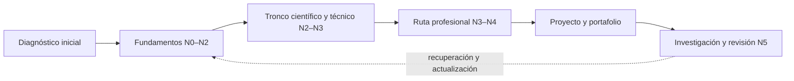

<div align="center">

# 🌌 Programa Integral de Astronomía, Astrofísica, Ciencias Espaciales e Ingeniería Aeroespacial

## **5.120 clases planificadas · 64 bloques transversales · 24 rutas profesionales · 192 módulos especializados**

**Un programa independiente en español que organiza, con IDs estables y trazabilidad, el recorrido desde la observación del cielo y los fundamentos científicos hasta la investigación, la ingeniería y las operaciones espaciales.**

[](https://github.com/vladimiracunadev-create/astronomy-astrophysics-space-sciences-aerospace-engineering-learning-program/actions/workflows/validate.yml)
[](https://vladimiracunadev-create.github.io/astronomy-astrophysics-space-sciences-aerospace-engineering-learning-program/)

[](CHANGELOG.md)
[](PROGRAMA_ACADEMICO_COMPLETO.md)
[](STATUS.md)
[](README.md)
[](LICENSE)
[](LICENSE-CONTENT.md)

[🌐 Explorar el catálogo](https://vladimiracunadev-create.github.io/astronomy-astrophysics-space-sciences-aerospace-engineering-learning-program/) ·
[📚 Programa completo](PROGRAMA_ACADEMICO_COMPLETO.md) ·
[🧭 Rutas profesionales](documentacion/MAPA_DE_RUTAS_PROFESIONALES.md) ·
[🎓 Estándar de clase](documentacion/ESTANDAR_PEDAGOGICO_Y_DE_EVALUACION.md) ·
[🗺️ Roadmap](ROADMAP.md) ·
[✅ Estado verificable](STATUS.md) ·
[📖 Documentación](documentacion/README.md) ·
[⚖️ Licencias](documentacion/LICENCIAS_Y_PROCEDENCIA.md) ·
[🤝 Contribuir](CONTRIBUTING.md)

</div>

---

> [!IMPORTANT]
> **El catálogo está definido; los contenidos aún no están redactados.** Los 5.120 registros contienen un título, una descripción y fuentes preliminares. No deben presentarse como clases desarrolladas, impartidas, revisadas ni verificadas. El contador actual es **0/5.120 clases completamente redactadas**.

> [!WARNING]
> **Formación independiente, no habilitación profesional.** El programa no otorga títulos, grados, licencias ni certificaciones; tampoco autoriza decisiones médicas, jurídicas, de vuelo, lanzamiento, seguridad o ingeniería crítica. Toda aplicación real exige normativa vigente, datos adecuados y profesionales competentes.

## 🎯 Qué es este programa

Es una arquitectura curricular única y extensible. No son 24 programas separados: las rutas profesionales reutilizan un tronco transversal y profundizan competencias concretas sin renumerar ni duplicar lo ya definido.

| Superficie | Estado verificable |
|---|---:|
| Áreas transversales | 8 |
| Bloques transversales | 64 |
| Clases transversales catalogadas | 1.280 |
| Rutas profesionales | 24 |
| Módulos de especialización | 192 |
| Clases especializadas catalogadas | 3.840 |
| **Clases catalogadas** | **5.120** |
| **Clases completamente redactadas y verificadas** | **0** |

La estructura permite estudiar por diagnóstico y ruta. Nadie necesita cursar las 5.120 unidades ni seguir una duración académica inventada: la carga y las equivalencias se definirán después de pilotajes reales.



## 🗂️ Los 64 bloques, agrupados en 8 áreas

Este mapa deja el contenido previsto visible desde la portada, con el mismo lenguaje visual de tablas, enlaces directos y rutas navegables usado en los programas de aprendizaje de referencia. Cada bloque contiene 20 clases numeradas y enlaza su ficha completa.

> [!IMPORTANT]
> Este es un mapa de referencia para ordenar el trabajo. Los 1.280 registros permanecen en E0: sólo título, descripción y referencias preliminares. No son clases redactadas, impartidas ni verificadas.

### A01 · Alfabetización científica, astronómica y tecnológica

| Bloque | Contenido previsto | Clases | Ficha |
|---|---|---:|---:|
| B01 | El universo y el pensamiento científico | B01-C01 → B01-C20 | [📘 ver las 20 clases](programa/tronco-comun/B01-el-universo-y-el-pensamiento-cientifico.md) |
| B02 | Historia, arqueoastronomía y culturas del cielo | B02-C01 → B02-C20 | [📘 ver las 20 clases](programa/tronco-comun/B02-historia-arqueoastronomia-y-culturas-del-cielo.md) |
| B03 | Matemática elemental para ciencias espaciales | B03-C01 → B03-C20 | [📘 ver las 20 clases](programa/tronco-comun/B03-matematica-elemental-para-ciencias-espaciales.md) |
| B04 | Álgebra, trigonometría y geometría espacial | B04-C01 → B04-C20 | [📘 ver las 20 clases](programa/tronco-comun/B04-algebra-trigonometria-y-geometria-espacial.md) |
| B05 | Física fundamental para el espacio | B05-C01 → B05-C20 | [📘 ver las 20 clases](programa/tronco-comun/B05-fisica-fundamental-para-el-espacio.md) |
| B06 | Química y materia del universo | B06-C01 → B06-C20 | [📘 ver las 20 clases](programa/tronco-comun/B06-quimica-y-materia-del-universo.md) |
| B07 | Informática científica desde cero | B07-C01 → B07-C20 | [📘 ver las 20 clases](programa/tronco-comun/B07-informatica-cientifica-desde-cero.md) |
| B08 | Observación del cielo y astronomía práctica | B08-C01 → B08-C20 | [📘 ver las 20 clases](programa/tronco-comun/B08-observacion-del-cielo-y-astronomia-practica.md) |

### A02 · Matemática, física computacional y métodos científicos

| Bloque | Contenido previsto | Clases | Ficha |
|---|---|---:|---:|
| B09 | Cálculo diferencial e integral | B09-C01 → B09-C20 | [📘 ver las 20 clases](programa/tronco-comun/B09-calculo-diferencial-e-integral.md) |
| B10 | Álgebra lineal y matemáticas geométricas | B10-C01 → B10-C20 | [📘 ver las 20 clases](programa/tronco-comun/B10-algebra-lineal-y-matematicas-geometricas.md) |
| B11 | Ecuaciones diferenciales y simulación numérica | B11-C01 → B11-C20 | [📘 ver las 20 clases](programa/tronco-comun/B11-ecuaciones-diferenciales-y-simulacion-numerica.md) |
| B12 | Probabilidad, estadística e incertidumbre | B12-C01 → B12-C20 | [📘 ver las 20 clases](programa/tronco-comun/B12-probabilidad-estadistica-e-incertidumbre.md) |
| B13 | Metrología, tiempo y mediciones científicas | B13-C01 → B13-C20 | [📘 ver las 20 clases](programa/tronco-comun/B13-metrologia-tiempo-y-mediciones-cientificas.md) |
| B14 | Computación científica y ciencia abierta | B14-C01 → B14-C20 | [📘 ver las 20 clases](programa/tronco-comun/B14-computacion-cientifica-y-ciencia-abierta.md) |
| B15 | Señales, imágenes y estimación científica | B15-C01 → B15-C20 | [📘 ver las 20 clases](programa/tronco-comun/B15-senales-imagenes-y-estimacion-cientifica.md) |
| B16 | Sistemas dinámicos y control automático | B16-C01 → B16-C20 | [📘 ver las 20 clases](programa/tronco-comun/B16-sistemas-dinamicos-y-control-automatico.md) |

### A03 · Astrofísica y ciencias fundamentales del universo

| Bloque | Contenido previsto | Clases | Ficha |
|---|---|---:|---:|
| B17 | Física y evolución de estrellas | B17-C01 → B17-C20 | [📘 ver las 20 clases](programa/tronco-comun/B17-fisica-y-evolucion-de-estrellas.md) |
| B18 | Galaxias y medio interestelar | B18-C01 → B18-C20 | [📘 ver las 20 clases](programa/tronco-comun/B18-galaxias-y-medio-interestelar.md) |
| B19 | Relatividad y cosmología | B19-C01 → B19-C20 | [📘 ver las 20 clases](programa/tronco-comun/B19-relatividad-y-cosmologia.md) |
| B20 | Objetos compactos y altas energías | B20-C01 → B20-C20 | [📘 ver las 20 clases](programa/tronco-comun/B20-objetos-compactos-y-altas-energias.md) |
| B21 | Astronomía multimensajero | B21-C01 → B21-C20 | [📘 ver las 20 clases](programa/tronco-comun/B21-astronomia-multimensajero.md) |
| B22 | Astronomía temporal y exoplanetas | B22-C01 → B22-C20 | [📘 ver las 20 clases](programa/tronco-comun/B22-astronomia-temporal-y-exoplanetas.md) |
| B23 | Heliofísica y física de plasmas | B23-C01 → B23-C20 | [📘 ver las 20 clases](programa/tronco-comun/B23-heliofisica-y-fisica-de-plasmas.md) |
| B24 | Física cuántica, nuclear y astropartículas | B24-C01 → B24-C20 | [📘 ver las 20 clases](programa/tronco-comun/B24-fisica-cuantica-nuclear-y-astroparticulas.md) |

### A04 · Óptica, telescopios y observatorios científicos

| Bloque | Contenido previsto | Clases | Ficha |
|---|---|---:|---:|
| B25 | Óptica geométrica y diseño de telescopios | B25-C01 → B25-C20 | [📘 ver las 20 clases](programa/tronco-comun/B25-optica-geometrica-y-diseno-de-telescopios.md) |
| B26 | Óptica física y óptica adaptativa | B26-C01 → B26-C20 | [📘 ver las 20 clases](programa/tronco-comun/B26-optica-fisica-y-optica-adaptativa.md) |
| B27 | Construcción y mecánica de telescopios | B27-C01 → B27-C20 | [📘 ver las 20 clases](programa/tronco-comun/B27-construccion-y-mecanica-de-telescopios.md) |
| B28 | Detectores y adquisición astronómica | B28-C01 → B28-C20 | [📘 ver las 20 clases](programa/tronco-comun/B28-detectores-y-adquisicion-astronomica.md) |
| B29 | Espectroscopía, fotometría y polarimetría | B29-C01 → B29-C20 | [📘 ver las 20 clases](programa/tronco-comun/B29-espectroscopia-fotometria-y-polarimetria.md) |
| B30 | Radioastronomía e interferometría | B30-C01 → B30-C20 | [📘 ver las 20 clases](programa/tronco-comun/B30-radioastronomia-e-interferometria.md) |
| B31 | Instrumentación y observatorios espaciales | B31-C01 → B31-C20 | [📘 ver las 20 clases](programa/tronco-comun/B31-instrumentacion-y-observatorios-espaciales.md) |
| B32 | Operaciones de observatorios científicos | B32-C01 → B32-C20 | [📘 ver las 20 clases](programa/tronco-comun/B32-operaciones-de-observatorios-cientificos.md) |

### A05 · Ciencias planetarias, astroquímica y habitabilidad

| Bloque | Contenido previsto | Clases | Ficha |
|---|---|---:|---:|
| B33 | Formación y dinámica de sistemas planetarios | B33-C01 → B33-C20 | [📘 ver las 20 clases](programa/tronco-comun/B33-formacion-y-dinamica-de-sistemas-planetarios.md) |
| B34 | Astrogeología y geodesia planetaria | B34-C01 → B34-C20 | [📘 ver las 20 clases](programa/tronco-comun/B34-astrogeologia-y-geodesia-planetaria.md) |
| B35 | Atmósferas y climatología planetaria | B35-C01 → B35-C20 | [📘 ver las 20 clases](programa/tronco-comun/B35-atmosferas-y-climatologia-planetaria.md) |
| B36 | Astroquímica y geoquímica extraterrestre | B36-C01 → B36-C20 | [📘 ver las 20 clases](programa/tronco-comun/B36-astroquimica-y-geoquimica-extraterrestre.md) |
| B37 | Astrobiología y vida extraterrestre | B37-C01 → B37-C20 | [📘 ver las 20 clases](programa/tronco-comun/B37-astrobiologia-y-vida-extraterrestre.md) |
| B38 | Observación terrestre y geociencias orbitales | B38-C01 → B38-C20 | [📘 ver las 20 clases](programa/tronco-comun/B38-observacion-terrestre-y-geociencias-orbitales.md) |
| B39 | Asteroides, cometas y defensa planetaria | B39-C01 → B39-C20 | [📘 ver las 20 clases](programa/tronco-comun/B39-asteroides-cometas-y-defensa-planetaria.md) |
| B40 | Recursos in situ y sostenibilidad extraterrestre | B40-C01 → B40-C20 | [📘 ver las 20 clases](programa/tronco-comun/B40-recursos-in-situ-y-sostenibilidad-extraterrestre.md) |

### A06 · Mecánica orbital, navegación y vuelo espacial

| Bloque | Contenido previsto | Clases | Ficha |
|---|---|---:|---:|
| B41 | Mecánica orbital fundamental | B41-C01 → B41-C20 | [📘 ver las 20 clases](programa/tronco-comun/B41-mecanica-orbital-fundamental.md) |
| B42 | Perturbaciones y evolución de órbitas | B42-C01 → B42-C20 | [📘 ver las 20 clases](programa/tronco-comun/B42-perturbaciones-y-evolucion-de-orbitas.md) |
| B43 | Mecánica celeste, resonancias y caos | B43-C01 → B43-C20 | [📘 ver las 20 clases](programa/tronco-comun/B43-mecanica-celeste-resonancias-y-caos.md) |
| B44 | Estimación de órbitas y navegación espacial | B44-C01 → B44-C20 | [📘 ver las 20 clases](programa/tronco-comun/B44-estimacion-de-orbitas-y-navegacion-espacial.md) |
| B45 | Trayectorias y misiones interplanetarias | B45-C01 → B45-C20 | [📘 ver las 20 clases](programa/tronco-comun/B45-trayectorias-y-misiones-interplanetarias.md) |
| B46 | Dinámica cislunar y operaciones de proximidad | B46-C01 → B46-C20 | [📘 ver las 20 clases](programa/tronco-comun/B46-dinamica-cislunar-y-operaciones-de-proximidad.md) |
| B47 | Dinámica de lanzamiento y reentrada | B47-C01 → B47-C20 | [📘 ver las 20 clases](programa/tronco-comun/B47-dinamica-de-lanzamiento-y-reentrada.md) |
| B48 | Tecnologías de propulsión espacial | B48-C01 → B48-C20 | [📘 ver las 20 clases](programa/tronco-comun/B48-tecnologias-de-propulsion-espacial.md) |

### A07 · Ingeniería y construcción de sistemas espaciales

| Bloque | Contenido previsto | Clases | Ficha |
|---|---|---:|---:|
| B49 | Ingeniería de sistemas y diseño de misiones | B49-C01 → B49-C20 | [📘 ver las 20 clases](programa/tronco-comun/B49-ingenieria-de-sistemas-y-diseno-de-misiones.md) |
| B50 | Estructuras, materiales y fabricación espacial | B50-C01 → B50-C20 | [📘 ver las 20 clases](programa/tronco-comun/B50-estructuras-materiales-y-fabricacion-espacial.md) |
| B51 | Gestión térmica y entorno espacial | B51-C01 → B51-C20 | [📘 ver las 20 clases](programa/tronco-comun/B51-gestion-termica-y-entorno-espacial.md) |
| B52 | Sistemas de potencia y energía espacial | B52-C01 → B52-C20 | [📘 ver las 20 clases](programa/tronco-comun/B52-sistemas-de-potencia-y-energia-espacial.md) |
| B53 | Sensores y control de actitud | B53-C01 → B53-C20 | [📘 ver las 20 clases](programa/tronco-comun/B53-sensores-y-control-de-actitud.md) |
| B54 | Aviónica y software crítico espacial | B54-C01 → B54-C20 | [📘 ver las 20 clases](programa/tronco-comun/B54-avionica-y-software-critico-espacial.md) |
| B55 | Comunicaciones y navegación satelital | B55-C01 → B55-C20 | [📘 ver las 20 clases](programa/tronco-comun/B55-comunicaciones-y-navegacion-satelital.md) |
| B56 | Integración, ensayos y calificación espacial | B56-C01 → B56-C20 | [📘 ver las 20 clases](programa/tronco-comun/B56-integracion-ensayos-y-calificacion-espacial.md) |

### A08 · Astronáutica humana, operaciones, sociedad y futuro espacial

| Bloque | Contenido previsto | Clases | Ficha |
|---|---|---:|---:|
| B57 | Control y operación de misiones espaciales | B57-C01 → B57-C20 | [📘 ver las 20 clases](programa/tronco-comun/B57-control-y-operacion-de-misiones-espaciales.md) |
| B58 | Astronáutica y preparación de astronautas | B58-C01 → B58-C20 | [📘 ver las 20 clases](programa/tronco-comun/B58-astronautica-y-preparacion-de-astronautas.md) |
| B59 | Medicina y biología espacial | B59-C01 → B59-C20 | [📘 ver las 20 clases](programa/tronco-comun/B59-medicina-y-biologia-espacial.md) |
| B60 | Hábitats espaciales y soporte vital | B60-C01 → B60-C20 | [📘 ver las 20 clases](programa/tronco-comun/B60-habitats-espaciales-y-soporte-vital.md) |
| B61 | Robótica y construcción extraterrestre | B61-C01 → B61-C20 | [📘 ver las 20 clases](programa/tronco-comun/B61-robotica-y-construccion-extraterrestre.md) |
| B62 | Tráfico espacial y sostenibilidad orbital | B62-C01 → B62-C20 | [📘 ver las 20 clases](programa/tronco-comun/B62-trafico-espacial-y-sostenibilidad-orbital.md) |
| B63 | Derecho, seguridad y geopolítica espacial | B63-C01 → B63-C20 | [📘 ver las 20 clases](programa/tronco-comun/B63-derecho-seguridad-y-geopolitica-espacial.md) |
| B64 | Industria, economía, ética y proyectos espaciales | B64-C01 → B64-C20 | [📘 ver las 20 clases](programa/tronco-comun/B64-industria-economia-etica-y-proyectos-espaciales.md) |

➡️ **[Ver el índice plano de las 5.120 clases catalogadas](PROGRAMA_ACADEMICO_COMPLETO.md)**

## 🧭 Las 24 rutas profesionales y sus módulos

Las rutas funcionan como recorridos por especialización o rol dentro del mismo programa. Cada ruta reúne ocho módulos de 20 clases y reutilizará los bloques transversales que correspondan; no son 24 programas separados.

> [!NOTE]
> Las rutas también permanecen en E0. Los módulos y títulos sirven para ordenar futuras especificaciones, fuentes y dependencias; todavía no constituyen formación terminada ni habilitación profesional.

| Ruta | Módulos previstos | Clases | Índice |
|---|---|---:|---:|
| **R01 · Astrofísica estelar y galáctica** | [M01](programa/rutas-profesionales/R01-astrofisica-estelar-y-galactica/R01-M01-atmosferas-estelares.md) · Atmósferas estelares<br>[M02](programa/rutas-profesionales/R01-astrofisica-estelar-y-galactica/R01-M02-modelos-de-interiores-estelares.md) · Modelos de interiores estelares<br>[M03](programa/rutas-profesionales/R01-astrofisica-estelar-y-galactica/R01-M03-evolucion-estelar-avanzada.md) · Evolución estelar avanzada<br>[M04](programa/rutas-profesionales/R01-astrofisica-estelar-y-galactica/R01-M04-espectroscopia-estelar-avanzada.md) · Espectroscopía estelar avanzada<br>[M05](programa/rutas-profesionales/R01-astrofisica-estelar-y-galactica/R01-M05-asterosismologia.md) · Asterosismología<br>[M06](programa/rutas-profesionales/R01-astrofisica-estelar-y-galactica/R01-M06-poblaciones-estelares.md) · Poblaciones estelares<br>[M07](programa/rutas-profesionales/R01-astrofisica-estelar-y-galactica/R01-M07-simulacion-de-galaxias.md) · Simulación de galaxias<br>[M08](programa/rutas-profesionales/R01-astrofisica-estelar-y-galactica/R01-M08-investigacion-estelar-y-galactica.md) · Investigación estelar y galáctica | 160 | [🧭 abrir](programa/rutas-profesionales/R01-astrofisica-estelar-y-galactica/INDICE.md) |
| **R02 · Cosmología y astrofísica extrema** | [M01](programa/rutas-profesionales/R02-cosmologia-y-astrofisica-extrema/R02-M01-relatividad-avanzada.md) · Relatividad avanzada<br>[M02](programa/rutas-profesionales/R02-cosmologia-y-astrofisica-extrema/R02-M02-universo-temprano.md) · Universo temprano<br>[M03](programa/rutas-profesionales/R02-cosmologia-y-astrofisica-extrema/R02-M03-radiacion-cosmica-de-fondo.md) · Radiación cósmica de fondo<br>[M04](programa/rutas-profesionales/R02-cosmologia-y-astrofisica-extrema/R02-M04-formacion-de-estructuras-cosmicas.md) · Formación de estructuras cósmicas<br>[M05](programa/rutas-profesionales/R02-cosmologia-y-astrofisica-extrema/R02-M05-materia-oscura.md) · Materia oscura<br>[M06](programa/rutas-profesionales/R02-cosmologia-y-astrofisica-extrema/R02-M06-astrofisica-de-altas-energias.md) · Astrofísica de altas energías<br>[M07](programa/rutas-profesionales/R02-cosmologia-y-astrofisica-extrema/R02-M07-astronomia-multimensajero.md) · Astronomía multimensajero<br>[M08](programa/rutas-profesionales/R02-cosmologia-y-astrofisica-extrema/R02-M08-inferencia-y-parametros-cosmologicos.md) · Inferencia y parámetros cosmológicos | 160 | [🧭 abrir](programa/rutas-profesionales/R02-cosmologia-y-astrofisica-extrema/INDICE.md) |
| **R03 · Ingeniería óptica y telescopios profesionales** | [M01](programa/rutas-profesionales/R03-ingenieria-optica-y-telescopios-profesionales/R03-M01-diseno-optico-computacional.md) · Diseño óptico computacional<br>[M02](programa/rutas-profesionales/R03-ingenieria-optica-y-telescopios-profesionales/R03-M02-aberraciones-y-tolerancias-opticas.md) · Aberraciones y tolerancias ópticas<br>[M03](programa/rutas-profesionales/R03-ingenieria-optica-y-telescopios-profesionales/R03-M03-fabricacion-y-pruebas-opticas.md) · Fabricación y pruebas ópticas<br>[M04](programa/rutas-profesionales/R03-ingenieria-optica-y-telescopios-profesionales/R03-M04-monturas-y-mecanica-de-precision.md) · Monturas y mecánica de precisión<br>[M05](programa/rutas-profesionales/R03-ingenieria-optica-y-telescopios-profesionales/R03-M05-optica-adaptativa-profesional.md) · Óptica adaptativa profesional<br>[M06](programa/rutas-profesionales/R03-ingenieria-optica-y-telescopios-profesionales/R03-M06-fotometria-instrumental-avanzada.md) · Fotometría instrumental avanzada<br>[M07](programa/rutas-profesionales/R03-ingenieria-optica-y-telescopios-profesionales/R03-M07-automatizacion-de-observatorios.md) · Automatización de observatorios<br>[M08](programa/rutas-profesionales/R03-ingenieria-optica-y-telescopios-profesionales/R03-M08-proyecto-completo-de-instrumentacion-optica.md) · Proyecto completo de instrumentación óptica | 160 | [🧭 abrir](programa/rutas-profesionales/R03-ingenieria-optica-y-telescopios-profesionales/INDICE.md) |
| **R04 · Radioastronomía e interferometría** | [M01](programa/rutas-profesionales/R04-radioastronomia-e-interferometria/R04-M01-ingenieria-de-antenas.md) · Ingeniería de antenas<br>[M02](programa/rutas-profesionales/R04-radioastronomia-e-interferometria/R04-M02-receptores-de-bajo-ruido.md) · Receptores de bajo ruido<br>[M03](programa/rutas-profesionales/R04-radioastronomia-e-interferometria/R04-M03-radiofrecuencia-y-cadenas-de-recepcion.md) · Radiofrecuencia y cadenas de recepción<br>[M04](programa/rutas-profesionales/R04-radioastronomia-e-interferometria/R04-M04-radioastronomia-con-sdr.md) · Radioastronomía con SDR<br>[M05](programa/rutas-profesionales/R04-radioastronomia-e-interferometria/R04-M05-calibracion-de-interferometros.md) · Calibración de interferómetros<br>[M06](programa/rutas-profesionales/R04-radioastronomia-e-interferometria/R04-M06-correlacion-de-senales-astronomicas.md) · Correlación de señales astronómicas<br>[M07](programa/rutas-profesionales/R04-radioastronomia-e-interferometria/R04-M07-vlbi-y-geodesia.md) · VLBI y geodesia<br>[M08](programa/rutas-profesionales/R04-radioastronomia-e-interferometria/R04-M08-reduccion-profesional-de-datos-de-radio.md) · Reducción profesional de datos de radio | 160 | [🧭 abrir](programa/rutas-profesionales/R04-radioastronomia-e-interferometria/INDICE.md) |
| **R05 · Ciencias planetarias y astrogeología** | [M01](programa/rutas-profesionales/R05-ciencias-planetarias-y-astrogeologia/R05-M01-geodesia-planetaria.md) · Geodesia planetaria<br>[M02](programa/rutas-profesionales/R05-ciencias-planetarias-y-astrogeologia/R05-M02-geofisica-de-interiores.md) · Geofísica de interiores<br>[M03](programa/rutas-profesionales/R05-ciencias-planetarias-y-astrogeologia/R05-M03-geomorfologia-comparada.md) · Geomorfología comparada<br>[M04](programa/rutas-profesionales/R05-ciencias-planetarias-y-astrogeologia/R05-M04-geologia-de-impactos.md) · Geología de impactos<br>[M05](programa/rutas-profesionales/R05-ciencias-planetarias-y-astrogeologia/R05-M05-vulcanismo-planetario.md) · Vulcanismo planetario<br>[M06](programa/rutas-profesionales/R05-ciencias-planetarias-y-astrogeologia/R05-M06-criosferas-y-mundos-helados.md) · Criósferas y mundos helados<br>[M07](programa/rutas-profesionales/R05-ciencias-planetarias-y-astrogeologia/R05-M07-cartografia-y-estratigrafia-planetaria.md) · Cartografía y estratigrafía planetaria<br>[M08](programa/rutas-profesionales/R05-ciencias-planetarias-y-astrogeologia/R05-M08-muestras-y-resultados-de-misiones-planetarias.md) · Muestras y resultados de misiones planetarias | 160 | [🧭 abrir](programa/rutas-profesionales/R05-ciencias-planetarias-y-astrogeologia/INDICE.md) |
| **R06 · Astroquímica y astrobiología** | [M01](programa/rutas-profesionales/R06-astroquimica-y-astrobiologia/R06-M01-cinetica-astroquimica.md) · Cinética astroquímica<br>[M02](programa/rutas-profesionales/R06-astroquimica-y-astrobiologia/R06-M02-espectros-moleculares.md) · Espectros moleculares<br>[M03](programa/rutas-profesionales/R06-astroquimica-y-astrobiologia/R06-M03-quimica-de-granos-interestelares.md) · Química de granos interestelares<br>[M04](programa/rutas-profesionales/R06-astroquimica-y-astrobiologia/R06-M04-quimica-prebiotica.md) · Química prebiótica<br>[M05](programa/rutas-profesionales/R06-astroquimica-y-astrobiologia/R06-M05-extremofilos-y-biosferas-limite.md) · Extremófilos y biosferas límite<br>[M06](programa/rutas-profesionales/R06-astroquimica-y-astrobiologia/R06-M06-mundos-oceanicos.md) · Mundos oceánicos<br>[M07](programa/rutas-profesionales/R06-astroquimica-y-astrobiologia/R06-M07-biofirmas-y-tecnofirmas.md) · Biofirmas y tecnofirmas<br>[M08](programa/rutas-profesionales/R06-astroquimica-y-astrobiologia/R06-M08-proteccion-planetaria-aplicada.md) · Protección planetaria aplicada | 160 | [🧭 abrir](programa/rutas-profesionales/R06-astroquimica-y-astrobiologia/INDICE.md) |
| **R07 · Heliofísica y climatología espacial** | [M01](programa/rutas-profesionales/R07-heliofisica-y-climatologia-espacial/R07-M01-plasmas-avanzados.md) · Plasmas avanzados<br>[M02](programa/rutas-profesionales/R07-heliofisica-y-climatologia-espacial/R07-M02-magnetohidrodinamica-aplicada.md) · Magnetohidrodinámica aplicada<br>[M03](programa/rutas-profesionales/R07-heliofisica-y-climatologia-espacial/R07-M03-fisica-de-corona-solar.md) · Física de corona solar<br>[M04](programa/rutas-profesionales/R07-heliofisica-y-climatologia-espacial/R07-M04-erupciones-solares.md) · Erupciones solares<br>[M05](programa/rutas-profesionales/R07-heliofisica-y-climatologia-espacial/R07-M05-magnetosferas-y-radiacion.md) · Magnetosferas y radiación<br>[M06](programa/rutas-profesionales/R07-heliofisica-y-climatologia-espacial/R07-M06-observatorios-heliofisicos.md) · Observatorios heliofísicos<br>[M07](programa/rutas-profesionales/R07-heliofisica-y-climatologia-espacial/R07-M07-impactos-tecnologicos-del-clima-espacial.md) · Impactos tecnológicos del clima espacial<br>[M08](programa/rutas-profesionales/R07-heliofisica-y-climatologia-espacial/R07-M08-modelos-de-pronostico-espacial.md) · Modelos de pronóstico espacial | 160 | [🧭 abrir](programa/rutas-profesionales/R07-heliofisica-y-climatologia-espacial/INDICE.md) |
| **R08 · Matemática y computación científica espacial** | [M01](programa/rutas-profesionales/R08-matematica-y-computacion-cientifica-espacial/R08-M01-algoritmos-numericos-avanzados.md) · Algoritmos numéricos avanzados<br>[M02](programa/rutas-profesionales/R08-matematica-y-computacion-cientifica-espacial/R08-M02-computacion-de-alto-rendimiento.md) · Computación de alto rendimiento<br>[M03](programa/rutas-profesionales/R08-matematica-y-computacion-cientifica-espacial/R08-M03-metodos-para-ecuaciones-en-derivadas-parciales.md) · Métodos para ecuaciones en derivadas parciales<br>[M04](programa/rutas-profesionales/R08-matematica-y-computacion-cientifica-espacial/R08-M04-problemas-inversos-astronomicos.md) · Problemas inversos astronómicos<br>[M05](programa/rutas-profesionales/R08-matematica-y-computacion-cientifica-espacial/R08-M05-modelos-bayesianos-cientificos.md) · Modelos bayesianos científicos<br>[M06](programa/rutas-profesionales/R08-matematica-y-computacion-cientifica-espacial/R08-M06-aprendizaje-automatico-cientifico.md) · Aprendizaje automático científico<br>[M07](programa/rutas-profesionales/R08-matematica-y-computacion-cientifica-espacial/R08-M07-verificacion-y-validacion-computacional.md) · Verificación y validación computacional<br>[M08](programa/rutas-profesionales/R08-matematica-y-computacion-cientifica-espacial/R08-M08-publicacion-de-investigacion-reproducible.md) · Publicación de investigación reproducible | 160 | [🧭 abrir](programa/rutas-profesionales/R08-matematica-y-computacion-cientifica-espacial/INDICE.md) |
| **R09 · Astrodinámica interplanetaria** | [M01](programa/rutas-profesionales/R09-astrodinamica-interplanetaria/R09-M01-transferencias-orbitales-avanzadas.md) · Transferencias orbitales avanzadas<br>[M02](programa/rutas-profesionales/R09-astrodinamica-interplanetaria/R09-M02-problemas-de-lambert.md) · Problemas de Lambert<br>[M03](programa/rutas-profesionales/R09-astrodinamica-interplanetaria/R09-M03-dinamica-interplanetaria-de-n-cuerpos.md) · Dinámica interplanetaria de N cuerpos<br>[M04](programa/rutas-profesionales/R09-astrodinamica-interplanetaria/R09-M04-asistencias-gravitacionales-multiples.md) · Asistencias gravitacionales múltiples<br>[M05](programa/rutas-profesionales/R09-astrodinamica-interplanetaria/R09-M05-trayectorias-de-bajo-empuje.md) · Trayectorias de bajo empuje<br>[M06](programa/rutas-profesionales/R09-astrodinamica-interplanetaria/R09-M06-ventanas-y-oportunidades-de-mision.md) · Ventanas y oportunidades de misión<br>[M07](programa/rutas-profesionales/R09-astrodinamica-interplanetaria/R09-M07-optimizacion-e-incertidumbre-orbital.md) · Optimización e incertidumbre orbital<br>[M08](programa/rutas-profesionales/R09-astrodinamica-interplanetaria/R09-M08-verificacion-de-trayectorias-interplanetarias.md) · Verificación de trayectorias interplanetarias | 160 | [🧭 abrir](programa/rutas-profesionales/R09-astrodinamica-interplanetaria/INDICE.md) |
| **R10 · Navegación guiado y autonomía espacial** | [M01](programa/rutas-profesionales/R10-navegacion-guiado-y-autonomia-espacial/R10-M01-sensores-de-orientacion.md) · Sensores de orientación<br>[M02](programa/rutas-profesionales/R10-navegacion-guiado-y-autonomia-espacial/R10-M02-navegacion-inercial-espacial.md) · Navegación inercial espacial<br>[M03](programa/rutas-profesionales/R10-navegacion-guiado-y-autonomia-espacial/R10-M03-filtrado-y-estimacion-de-estado.md) · Filtrado y estimación de estado<br>[M04](programa/rutas-profesionales/R10-navegacion-guiado-y-autonomia-espacial/R10-M04-determinacion-orbital-de-precision.md) · Determinación orbital de precisión<br>[M05](programa/rutas-profesionales/R10-navegacion-guiado-y-autonomia-espacial/R10-M05-navegacion-optica-autonoma.md) · Navegación óptica autónoma<br>[M06](programa/rutas-profesionales/R10-navegacion-guiado-y-autonomia-espacial/R10-M06-fusion-multisensorial.md) · Fusión multisensorial<br>[M07](programa/rutas-profesionales/R10-navegacion-guiado-y-autonomia-espacial/R10-M07-control-autonomo-de-vehiculos.md) · Control autónomo de vehículos<br>[M08](programa/rutas-profesionales/R10-navegacion-guiado-y-autonomia-espacial/R10-M08-encuentro-y-operaciones-de-proximidad.md) · Encuentro y operaciones de proximidad | 160 | [🧭 abrir](programa/rutas-profesionales/R10-navegacion-guiado-y-autonomia-espacial/INDICE.md) |
| **R11 · Ingeniería de lanzadores y propulsión** | [M01](programa/rutas-profesionales/R11-ingenieria-de-lanzadores-y-propulsion/R11-M01-mecanica-de-fluidos-para-propulsion.md) · Mecánica de fluidos para propulsión<br>[M02](programa/rutas-profesionales/R11-ingenieria-de-lanzadores-y-propulsion/R11-M02-termodinamica-de-sistemas-propulsivos.md) · Termodinámica de sistemas propulsivos<br>[M03](programa/rutas-profesionales/R11-ingenieria-de-lanzadores-y-propulsion/R11-M03-modelos-de-propulsion-quimica.md) · Modelos de propulsión química<br>[M04](programa/rutas-profesionales/R11-ingenieria-de-lanzadores-y-propulsion/R11-M04-tecnologias-de-propulsion-electrica.md) · Tecnologías de propulsión eléctrica<br>[M05](programa/rutas-profesionales/R11-ingenieria-de-lanzadores-y-propulsion/R11-M05-dinamica-de-vehiculos-de-lanzamiento.md) · Dinámica de vehículos de lanzamiento<br>[M06](programa/rutas-profesionales/R11-ingenieria-de-lanzadores-y-propulsion/R11-M06-ascenso-y-reentrada-atmosfericos.md) · Ascenso y reentrada atmosféricos<br>[M07](programa/rutas-profesionales/R11-ingenieria-de-lanzadores-y-propulsion/R11-M07-seguridad-y-evaluacion-de-sistemas-de-lanzamiento.md) · Seguridad y evaluación de sistemas de lanzamiento<br>[M08](programa/rutas-profesionales/R11-ingenieria-de-lanzadores-y-propulsion/R11-M08-simulacion-de-mision-propulsiva.md) · Simulación de misión propulsiva | 160 | [🧭 abrir](programa/rutas-profesionales/R11-ingenieria-de-lanzadores-y-propulsion/INDICE.md) |
| **R12 · Ingeniería y construcción de satélites y CubeSats** | [M01](programa/rutas-profesionales/R12-ingenieria-y-construccion-de-satelites-y-cubesats/R12-M01-arquitectura-de-mision-satelital.md) · Arquitectura de misión satelital<br>[M02](programa/rutas-profesionales/R12-ingenieria-y-construccion-de-satelites-y-cubesats/R12-M02-diseno-de-cargas-utiles.md) · Diseño de cargas útiles<br>[M03](programa/rutas-profesionales/R12-ingenieria-y-construccion-de-satelites-y-cubesats/R12-M03-plataformas-y-buses-satelitales.md) · Plataformas y buses satelitales<br>[M04](programa/rutas-profesionales/R12-ingenieria-y-construccion-de-satelites-y-cubesats/R12-M04-sistema-electrico-de-potencia.md) · Sistema eléctrico de potencia<br>[M05](programa/rutas-profesionales/R12-ingenieria-y-construccion-de-satelites-y-cubesats/R12-M05-sistema-de-comunicaciones-satelitales.md) · Sistema de comunicaciones satelitales<br>[M06](programa/rutas-profesionales/R12-ingenieria-y-construccion-de-satelites-y-cubesats/R12-M06-sistema-de-determinacion-y-control-de-actitud.md) · Sistema de determinación y control de actitud<br>[M07](programa/rutas-profesionales/R12-ingenieria-y-construccion-de-satelites-y-cubesats/R12-M07-ingenieria-de-interfaces-y-configuracion.md) · Ingeniería de interfaces y configuración<br>[M08](programa/rutas-profesionales/R12-ingenieria-y-construccion-de-satelites-y-cubesats/R12-M08-integracion-y-calificacion-de-cubesat.md) · Integración y calificación de CubeSat | 160 | [🧭 abrir](programa/rutas-profesionales/R12-ingenieria-y-construccion-de-satelites-y-cubesats/INDICE.md) |
| **R13 · Aviónica y software espacial de alta fiabilidad** | [M01](programa/rutas-profesionales/R13-avionica-y-software-espacial-de-alta-fiabilidad/R13-M01-electronica-embarcada-avanzada.md) · Electrónica embarcada avanzada<br>[M02](programa/rutas-profesionales/R13-avionica-y-software-espacial-de-alta-fiabilidad/R13-M02-arquitectura-de-computadores-de-vuelo.md) · Arquitectura de computadores de vuelo<br>[M03](programa/rutas-profesionales/R13-avionica-y-software-espacial-de-alta-fiabilidad/R13-M03-sistemas-de-tiempo-real.md) · Sistemas de tiempo real<br>[M04](programa/rutas-profesionales/R13-avionica-y-software-espacial-de-alta-fiabilidad/R13-M04-comunicaciones-y-buses-internos.md) · Comunicaciones y buses internos<br>[M05](programa/rutas-profesionales/R13-avionica-y-software-espacial-de-alta-fiabilidad/R13-M05-tolerancia-a-fallos-de-hardware-y-software.md) · Tolerancia a fallos de hardware y software<br>[M06](programa/rutas-profesionales/R13-avionica-y-software-espacial-de-alta-fiabilidad/R13-M06-recuperacion-autonoma-de-anomalias.md) · Recuperación autónoma de anomalías<br>[M07](programa/rutas-profesionales/R13-avionica-y-software-espacial-de-alta-fiabilidad/R13-M07-seguridad-y-aseguramiento-del-software.md) · Seguridad y aseguramiento del software<br>[M08](programa/rutas-profesionales/R13-avionica-y-software-espacial-de-alta-fiabilidad/R13-M08-verificacion-integral-de-avionica.md) · Verificación integral de aviónica | 160 | [🧭 abrir](programa/rutas-profesionales/R13-avionica-y-software-espacial-de-alta-fiabilidad/INDICE.md) |
| **R14 · Materiales estructuras e ingeniería térmica espacial** | [M01](programa/rutas-profesionales/R14-materiales-estructuras-e-ingenieria-termica-espacial/R14-M01-materiales-aeroespaciales-avanzados.md) · Materiales aeroespaciales avanzados<br>[M02](programa/rutas-profesionales/R14-materiales-estructuras-e-ingenieria-termica-espacial/R14-M02-mecanica-estructural-espacial.md) · Mecánica estructural espacial<br>[M03](programa/rutas-profesionales/R14-materiales-estructuras-e-ingenieria-termica-espacial/R14-M03-elementos-finitos-y-analisis-de-tensiones.md) · Elementos finitos y análisis de tensiones<br>[M04](programa/rutas-profesionales/R14-materiales-estructuras-e-ingenieria-termica-espacial/R14-M04-vibraciones-y-dinamica-estructural.md) · Vibraciones y dinámica estructural<br>[M05](programa/rutas-profesionales/R14-materiales-estructuras-e-ingenieria-termica-espacial/R14-M05-fabricacion-avanzada-y-mecanismos.md) · Fabricación avanzada y mecanismos<br>[M06](programa/rutas-profesionales/R14-materiales-estructuras-e-ingenieria-termica-espacial/R14-M06-control-termico-de-vehiculos.md) · Control térmico de vehículos<br>[M07](programa/rutas-profesionales/R14-materiales-estructuras-e-ingenieria-termica-espacial/R14-M07-proteccion-contra-ambientes-espaciales.md) · Protección contra ambientes espaciales<br>[M08](programa/rutas-profesionales/R14-materiales-estructuras-e-ingenieria-termica-espacial/R14-M08-calificacion-estructural-y-termica.md) · Calificación estructural y térmica | 160 | [🧭 abrir](programa/rutas-profesionales/R14-materiales-estructuras-e-ingenieria-termica-espacial/INDICE.md) |
| **R15 · Telecomunicaciones y estaciones terrestres espaciales** | [M01](programa/rutas-profesionales/R15-telecomunicaciones-y-estaciones-terrestres-espaciales/R15-M01-antenas-espaciales-avanzadas.md) · Antenas espaciales avanzadas<br>[M02](programa/rutas-profesionales/R15-telecomunicaciones-y-estaciones-terrestres-espaciales/R15-M02-presupuesto-de-enlace-de-mision.md) · Presupuesto de enlace de misión<br>[M03](programa/rutas-profesionales/R15-telecomunicaciones-y-estaciones-terrestres-espaciales/R15-M03-modulacion-y-codificacion-de-canal.md) · Modulación y codificación de canal<br>[M04](programa/rutas-profesionales/R15-telecomunicaciones-y-estaciones-terrestres-espaciales/R15-M04-diseno-de-redes-de-estaciones-terrestres.md) · Diseño de redes de estaciones terrestres<br>[M05](programa/rutas-profesionales/R15-telecomunicaciones-y-estaciones-terrestres-espaciales/R15-M05-enlaces-de-radiofrecuencia-profundos.md) · Enlaces de radiofrecuencia profundos<br>[M06](programa/rutas-profesionales/R15-telecomunicaciones-y-estaciones-terrestres-espaciales/R15-M06-enlaces-opticos-espaciales.md) · Enlaces ópticos espaciales<br>[M07](programa/rutas-profesionales/R15-telecomunicaciones-y-estaciones-terrestres-espaciales/R15-M07-sincronizacion-y-protocolos-de-mision.md) · Sincronización y protocolos de misión<br>[M08](programa/rutas-profesionales/R15-telecomunicaciones-y-estaciones-terrestres-espaciales/R15-M08-operaciones-integrales-de-estaciones-terrestres.md) · Operaciones integrales de estaciones terrestres | 160 | [🧭 abrir](programa/rutas-profesionales/R15-telecomunicaciones-y-estaciones-terrestres-espaciales/INDICE.md) |
| **R16 · Observación terrestre y geointeligencia científica** | [M01](programa/rutas-profesionales/R16-observacion-terrestre-y-geointeligencia-cientifica/R16-M01-instrumentos-orbitales-para-observacion-terrestre.md) · Instrumentos orbitales para observación terrestre<br>[M02](programa/rutas-profesionales/R16-observacion-terrestre-y-geointeligencia-cientifica/R16-M02-procesamiento-multiespectral.md) · Procesamiento multiespectral<br>[M03](programa/rutas-profesionales/R16-observacion-terrestre-y-geointeligencia-cientifica/R16-M03-radar-de-apertura-sintetica.md) · Radar de apertura sintética<br>[M04](programa/rutas-profesionales/R16-observacion-terrestre-y-geointeligencia-cientifica/R16-M04-altimetria-y-lidar-orbital.md) · Altimetría y LiDAR orbital<br>[M05](programa/rutas-profesionales/R16-observacion-terrestre-y-geointeligencia-cientifica/R16-M05-calibracion-radiometrica-de-imagenes.md) · Calibración radiométrica de imágenes<br>[M06](programa/rutas-profesionales/R16-observacion-terrestre-y-geointeligencia-cientifica/R16-M06-plataformas-de-datos-geoespaciales.md) · Plataformas de datos geoespaciales<br>[M07](programa/rutas-profesionales/R16-observacion-terrestre-y-geointeligencia-cientifica/R16-M07-ia-para-monitoreo-de-desastres.md) · IA para monitoreo de desastres<br>[M08](programa/rutas-profesionales/R16-observacion-terrestre-y-geointeligencia-cientifica/R16-M08-diseno-de-servicios-satelitales-de-observacion.md) · Diseño de servicios satelitales de observación | 160 | [🧭 abrir](programa/rutas-profesionales/R16-observacion-terrestre-y-geointeligencia-cientifica/INDICE.md) |
| **R17 · Robótica espacial y sistemas autónomos** | [M01](programa/rutas-profesionales/R17-robotica-espacial-y-sistemas-autonomos/R17-M01-cinematica-de-manipuladores-espaciales.md) · Cinemática de manipuladores espaciales<br>[M02](programa/rutas-profesionales/R17-robotica-espacial-y-sistemas-autonomos/R17-M02-dinamica-de-robots-sobre-otros-cuerpos.md) · Dinámica de robots sobre otros cuerpos<br>[M03](programa/rutas-profesionales/R17-robotica-espacial-y-sistemas-autonomos/R17-M03-vision-artificial-y-percepcion-espacial.md) · Visión artificial y percepción espacial<br>[M04](programa/rutas-profesionales/R17-robotica-espacial-y-sistemas-autonomos/R17-M04-localizacion-y-mapeo-slam.md) · Localización y mapeo SLAM<br>[M05](programa/rutas-profesionales/R17-robotica-espacial-y-sistemas-autonomos/R17-M05-teleoperacion-con-retardo.md) · Teleoperación con retardo<br>[M06](programa/rutas-profesionales/R17-robotica-espacial-y-sistemas-autonomos/R17-M06-manipulacion-y-mantenimiento-orbital.md) · Manipulación y mantenimiento orbital<br>[M07](programa/rutas-profesionales/R17-robotica-espacial-y-sistemas-autonomos/R17-M07-exploracion-autonoma-planetaria.md) · Exploración autónoma planetaria<br>[M08](programa/rutas-profesionales/R17-robotica-espacial-y-sistemas-autonomos/R17-M08-integracion-de-mision-robotica.md) · Integración de misión robótica | 160 | [🧭 abrir](programa/rutas-profesionales/R17-robotica-espacial-y-sistemas-autonomos/INDICE.md) |
| **R18 · Astronáutica tripulada y entrenamiento de astronautas** | [M01](programa/rutas-profesionales/R18-astronautica-tripulada-y-entrenamiento-de-astronautas/R18-M01-preparacion-fisica-y-factores-humanos.md) · Preparación física y factores humanos<br>[M02](programa/rutas-profesionales/R18-astronautica-tripulada-y-entrenamiento-de-astronautas/R18-M02-sistemas-de-vehiculos-tripulados.md) · Sistemas de vehículos tripulados<br>[M03](programa/rutas-profesionales/R18-astronautica-tripulada-y-entrenamiento-de-astronautas/R18-M03-operaciones-de-cabina-espacial.md) · Operaciones de cabina espacial<br>[M04](programa/rutas-profesionales/R18-astronautica-tripulada-y-entrenamiento-de-astronautas/R18-M04-actividades-extravehiculares-eva.md) · Actividades extravehiculares EVA<br>[M05](programa/rutas-profesionales/R18-astronautica-tripulada-y-entrenamiento-de-astronautas/R18-M05-robotica-para-tripulaciones.md) · Robótica para tripulaciones<br>[M06](programa/rutas-profesionales/R18-astronautica-tripulada-y-entrenamiento-de-astronautas/R18-M06-procedimientos-de-emergencia-espacial.md) · Procedimientos de emergencia espacial<br>[M07](programa/rutas-profesionales/R18-astronautica-tripulada-y-entrenamiento-de-astronautas/R18-M07-coordinacion-y-liderazgo-de-tripulacion.md) · Coordinación y liderazgo de tripulación<br>[M08](programa/rutas-profesionales/R18-astronautica-tripulada-y-entrenamiento-de-astronautas/R18-M08-simulacion-integral-de-vuelo-tripulado.md) · Simulación integral de vuelo tripulado | 160 | [🧭 abrir](programa/rutas-profesionales/R18-astronautica-tripulada-y-entrenamiento-de-astronautas/INDICE.md) |
| **R19 · Medicina y bioingeniería espacial** | [M01](programa/rutas-profesionales/R19-medicina-y-bioingenieria-espacial/R19-M01-fisiologia-espacial-avanzada.md) · Fisiología espacial avanzada<br>[M02](programa/rutas-profesionales/R19-medicina-y-bioingenieria-espacial/R19-M02-adaptaciones-a-microgravedad.md) · Adaptaciones a microgravedad<br>[M03](programa/rutas-profesionales/R19-medicina-y-bioingenieria-espacial/R19-M03-radiobiologia-espacial.md) · Radiobiología espacial<br>[M04](programa/rutas-profesionales/R19-medicina-y-bioingenieria-espacial/R19-M04-salud-conductual-en-aislamiento.md) · Salud conductual en aislamiento<br>[M05](programa/rutas-profesionales/R19-medicina-y-bioingenieria-espacial/R19-M05-telemedicina-y-monitorizacion.md) · Telemedicina y monitorización<br>[M06](programa/rutas-profesionales/R19-medicina-y-bioingenieria-espacial/R19-M06-urgencias-medicas-simuladas.md) · Urgencias médicas simuladas<br>[M07](programa/rutas-profesionales/R19-medicina-y-bioingenieria-espacial/R19-M07-rehabilitacion-de-astronautas.md) · Rehabilitación de astronautas<br>[M08](programa/rutas-profesionales/R19-medicina-y-bioingenieria-espacial/R19-M08-investigacion-biomedica-en-ambiente-espacial.md) · Investigación biomédica en ambiente espacial | 160 | [🧭 abrir](programa/rutas-profesionales/R19-medicina-y-bioingenieria-espacial/INDICE.md) |
| **R20 · Arquitectura y hábitats extraterrestres** | [M01](programa/rutas-profesionales/R20-arquitectura-y-habitats-extraterrestres/R20-M01-arquitectura-de-entornos-extraterrestres.md) · Arquitectura de entornos extraterrestres<br>[M02](programa/rutas-profesionales/R20-arquitectura-y-habitats-extraterrestres/R20-M02-sistemas-de-soporte-vital-eclss.md) · Sistemas de soporte vital ECLSS<br>[M03](programa/rutas-profesionales/R20-arquitectura-y-habitats-extraterrestres/R20-M03-control-de-atmosfera-y-presiones.md) · Control de atmósfera y presiones<br>[M04](programa/rutas-profesionales/R20-arquitectura-y-habitats-extraterrestres/R20-M04-ciclos-cerrados-de-agua.md) · Ciclos cerrados de agua<br>[M05](programa/rutas-profesionales/R20-arquitectura-y-habitats-extraterrestres/R20-M05-produccion-de-alimentos-en-habitats.md) · Producción de alimentos en hábitats<br>[M06](programa/rutas-profesionales/R20-arquitectura-y-habitats-extraterrestres/R20-M06-blindaje-y-proteccion-ambiental.md) · Blindaje y protección ambiental<br>[M07](programa/rutas-profesionales/R20-arquitectura-y-habitats-extraterrestres/R20-M07-ergonomia-y-bienestar-de-tripulacion.md) · Ergonomía y bienestar de tripulación<br>[M08](programa/rutas-profesionales/R20-arquitectura-y-habitats-extraterrestres/R20-M08-diseno-integral-de-habitat-lunar-o-marciano.md) · Diseño integral de hábitat lunar o marciano | 160 | [🧭 abrir](programa/rutas-profesionales/R20-arquitectura-y-habitats-extraterrestres/INDICE.md) |
| **R21 · Recursos extraterrestres y economía industrial espacial** | [M01](programa/rutas-profesionales/R21-recursos-extraterrestres-y-economia-industrial-espacial/R21-M01-prospeccion-geologica-extraterrestre.md) · Prospección geológica extraterrestre<br>[M02](programa/rutas-profesionales/R21-recursos-extraterrestres-y-economia-industrial-espacial/R21-M02-hielos-y-volatiles-de-interes.md) · Hielos y volátiles de interés<br>[M03](programa/rutas-profesionales/R21-recursos-extraterrestres-y-economia-industrial-espacial/R21-M03-procesamiento-de-recursos-in-situ.md) · Procesamiento de recursos in situ<br>[M04](programa/rutas-profesionales/R21-recursos-extraterrestres-y-economia-industrial-espacial/R21-M04-robotica-para-recursos-espaciales.md) · Robótica para recursos espaciales<br>[M05](programa/rutas-profesionales/R21-recursos-extraterrestres-y-economia-industrial-espacial/R21-M05-sistemas-energeticos-de-instalaciones.md) · Sistemas energéticos de instalaciones<br>[M06](programa/rutas-profesionales/R21-recursos-extraterrestres-y-economia-industrial-espacial/R21-M06-manufactura-en-cuerpos-celestes.md) · Manufactura en cuerpos celestes<br>[M07](programa/rutas-profesionales/R21-recursos-extraterrestres-y-economia-industrial-espacial/R21-M07-logistica-de-suministros-interplanetarios.md) · Logística de suministros interplanetarios<br>[M08](programa/rutas-profesionales/R21-recursos-extraterrestres-y-economia-industrial-espacial/R21-M08-viabilidad-tecnica-y-economica-isru.md) · Viabilidad técnica y económica ISRU | 160 | [🧭 abrir](programa/rutas-profesionales/R21-recursos-extraterrestres-y-economia-industrial-espacial/INDICE.md) |
| **R22 · Seguridad defensa y resiliencia de infraestructuras espaciales** | [M01](programa/rutas-profesionales/R22-seguridad-defensa-y-resiliencia-de-infraestructuras-espaciales/R22-M01-vigilancia-y-conciencia-situacional-espacial.md) · Vigilancia y conciencia situacional espacial<br>[M02](programa/rutas-profesionales/R22-seguridad-defensa-y-resiliencia-de-infraestructuras-espaciales/R22-M02-seguimiento-de-objetos-orbitales.md) · Seguimiento de objetos orbitales<br>[M03](programa/rutas-profesionales/R22-seguridad-defensa-y-resiliencia-de-infraestructuras-espaciales/R22-M03-riesgo-de-conjunciones-y-colisiones.md) · Riesgo de conjunciones y colisiones<br>[M04](programa/rutas-profesionales/R22-seguridad-defensa-y-resiliencia-de-infraestructuras-espaciales/R22-M04-mitigacion-de-desechos-espaciales.md) · Mitigación de desechos espaciales<br>[M05](programa/rutas-profesionales/R22-seguridad-defensa-y-resiliencia-de-infraestructuras-espaciales/R22-M05-seguridad-de-infraestructura-critica-espacial.md) · Seguridad de infraestructura crítica espacial<br>[M06](programa/rutas-profesionales/R22-seguridad-defensa-y-resiliencia-de-infraestructuras-espaciales/R22-M06-ciberdefensa-y-continuidad-satelital.md) · Ciberdefensa y continuidad satelital<br>[M07](programa/rutas-profesionales/R22-seguridad-defensa-y-resiliencia-de-infraestructuras-espaciales/R22-M07-geopolitica-y-doctrina-espacial.md) · Geopolítica y doctrina espacial<br>[M08](programa/rutas-profesionales/R22-seguridad-defensa-y-resiliencia-de-infraestructuras-espaciales/R22-M08-gestion-institucional-de-crisis-espaciales.md) · Gestión institucional de crisis espaciales | 160 | [🧭 abrir](programa/rutas-profesionales/R22-seguridad-defensa-y-resiliencia-de-infraestructuras-espaciales/INDICE.md) |
| **R23 · Derecho políticas y negocios espaciales** | [M01](programa/rutas-profesionales/R23-derecho-politicas-y-negocios-espaciales/R23-M01-tratados-de-derecho-espacial.md) · Tratados de derecho espacial<br>[M02](programa/rutas-profesionales/R23-derecho-politicas-y-negocios-espaciales/R23-M02-legislaciones-y-supervision-nacionales.md) · Legislaciones y supervisión nacionales<br>[M03](programa/rutas-profesionales/R23-derecho-politicas-y-negocios-espaciales/R23-M03-espectro-radioelectrico-y-licencias.md) · Espectro radioeléctrico y licencias<br>[M04](programa/rutas-profesionales/R23-derecho-politicas-y-negocios-espaciales/R23-M04-responsabilidad-civil-y-estatal-espacial.md) · Responsabilidad civil y estatal espacial<br>[M05](programa/rutas-profesionales/R23-derecho-politicas-y-negocios-espaciales/R23-M05-seguros-espaciales.md) · Seguros espaciales<br>[M06](programa/rutas-profesionales/R23-derecho-politicas-y-negocios-espaciales/R23-M06-financiamiento-de-negocios-espaciales.md) · Financiamiento de negocios espaciales<br>[M07](programa/rutas-profesionales/R23-derecho-politicas-y-negocios-espaciales/R23-M07-creacion-y-operacion-de-empresas-espaciales.md) · Creación y operación de empresas espaciales<br>[M08](programa/rutas-profesionales/R23-derecho-politicas-y-negocios-espaciales/R23-M08-gobernanza-etica-y-sostenibilidad.md) · Gobernanza ética y sostenibilidad | 160 | [🧭 abrir](programa/rutas-profesionales/R23-derecho-politicas-y-negocios-espaciales/INDICE.md) |
| **R24 · Educación historia y divulgación astronómica** | [M01](programa/rutas-profesionales/R24-educacion-historia-y-divulgacion-astronomica/R24-M01-historia-de-la-ciencia-astronomica.md) · Historia de la ciencia astronómica<br>[M02](programa/rutas-profesionales/R24-educacion-historia-y-divulgacion-astronomica/R24-M02-arqueoastronomia-comparada.md) · Arqueoastronomía comparada<br>[M03](programa/rutas-profesionales/R24-educacion-historia-y-divulgacion-astronomica/R24-M03-astronomias-culturales-y-saberes.md) · Astronomías culturales y saberes<br>[M04](programa/rutas-profesionales/R24-educacion-historia-y-divulgacion-astronomica/R24-M04-observacion-astronomica-educativa.md) · Observación astronómica educativa<br>[M05](programa/rutas-profesionales/R24-educacion-historia-y-divulgacion-astronomica/R24-M05-diseno-de-secuencias-pedagogicas.md) · Diseño de secuencias pedagógicas<br>[M06](programa/rutas-profesionales/R24-educacion-historia-y-divulgacion-astronomica/R24-M06-ciencia-ciudadana-astronomica.md) · Ciencia ciudadana astronómica<br>[M07](programa/rutas-profesionales/R24-educacion-historia-y-divulgacion-astronomica/R24-M07-accesibilidad-e-inclusion-educativa.md) · Accesibilidad e inclusión educativa<br>[M08](programa/rutas-profesionales/R24-educacion-historia-y-divulgacion-astronomica/R24-M08-investigacion-y-divulgacion-cientifica.md) · Investigación y divulgación científica | 160 | [🧭 abrir](programa/rutas-profesionales/R24-educacion-historia-y-divulgacion-astronomica/INDICE.md) |

➡️ **[Comparar las rutas y su relación con el tronco común](documentacion/MAPA_DE_RUTAS_PROFESIONALES.md)**

## 🧠 Estándar para generar los contenidos

La futura redacción seguirá el estándar **`clase-profunda-cientifica`**. Una clase no será aceptada por tener muchas palabras: deberá conectar necesidad, fundamento, fuente, actividad, evidencia, evaluación y continuidad. El contrato completo está en el [estándar pedagógico y de evaluación](documentacion/ESTANDAR_PEDAGOGICO_Y_DE_EVALUACION.md).

Cada clase deberá cubrir 22 funciones verificables:

1. identidad y estado editorial;
2. propósito y decisión central;
3. resultados observables;
4. prerrequisitos y diagnóstico;
5. contexto científico o profesional;
6. vocabulario y definiciones operacionales;
7. modelo mental y relaciones causales;
8. desarrollo progresivo;
9. magnitudes, símbolos y unidades;
10. sistema de referencia, escala temporal y convenciones;
11. evidencia y fuentes con alcance declarado;
12. visualización accesible;
13. ejemplo trabajado y reproducible;
14. comparación de métodos y límites;
15. práctica guiada;
16. práctica autónoma y transferencia;
17. laboratorio, observación o simulación cuando corresponda;
18. errores frecuentes y recuperación;
19. evaluación formativa;
20. evidencia de aprendizaje y rúbrica;
21. seguridad, ética, accesibilidad y límites profesionales;
22. síntesis, glosario, continuidad y bibliografía verificada.

Cuando aparezcan fórmulas, datos o simulaciones se deberán declarar unidades, sistema de referencia, escala temporal, procedencia, versión, supuestos, tolerancias, incertidumbre y límites de validez. Un resultado simulado nunca se presentará como observado o certificado.

## 🪜 Resolución de contenidos por etapas

Cada clase avanzará con evidencia, no por declaración manual:

| Etapa editorial | Resultado exigido | ¿Cuenta como clase redactada? |
|---|---|:---:|
| `E0 · catalogada` | ID, título, ubicación y referencias preliminares | No |
| `E1 · especificada` | propósito, resultados, prerrequisitos, decisión y riesgos | No |
| `E2 · documentada` | fuentes localizadas con función, alcance, versión y límites | No |
| `E3 · redactada` | las 22 funciones con ejemplos, prácticas y soluciones | No |
| `E4 · verificada` | revisión conceptual, matemática, dimensional y de referencias | No |
| `E5 · validada` | accesibilidad, evaluación, pruebas técnicas y revisión disciplinar | **Sí** |
| `E6 · pilotada` | evidencia de uso, errores observados y mejoras documentadas | Sí, con nivel superior |

La secuencia de implementación comenzará con pilotos completos y pequeños; después escalará por bloques y rutas. Las condiciones de cierre, entregables y puertas de calidad están en el [roadmap](ROADMAP.md) y el [plan detallado](documentacion/PLAN_DE_IMPLEMENTACION_Y_ESTADOS.md).

## 🗂️ Qué contiene hoy

- [`PROGRAMA_ACADEMICO_COMPLETO.md`](PROGRAMA_ACADEMICO_COMPLETO.md): índice legible de las 5.120 unidades.
- [`catalogo/clases.jsonl`](catalogo/clases.jsonl): fuente canónica legible por máquinas, sincronizada con CSV y JSON.
- [`programa/tronco-comun/`](programa/tronco-comun/): 64 fichas de bloque con 20 títulos cada una.
- [`programa/rutas-profesionales/`](programa/rutas-profesionales/): 24 rutas y 192 módulos.
- [`metadatos/`](metadatos/): inventarios y relaciones estructurales.
- [`documentacion/`](documentacion/): alcance, pedagogía, experiencia, cobertura, rutas y plan de implementación.
- [`fuentes/`](fuentes/): referencias institucionales preliminares, todavía no verificadas clase por clase.
- [`visor/index.html`](visor/index.html): explorador estático, accesible y sin dependencias externas.
- [`herramientas/validar_catalogo.py`](herramientas/validar_catalogo.py): control reproducible de cantidades, IDs, orden y estados.
- [`herramientas/generar_manifiesto.py`](herramientas/generar_manifiesto.py): regeneración determinista de huellas SHA-256.

## ✅ Validación local

Requiere Python 3.11 o posterior y no instala dependencias:

```bash
python herramientas/validar_catalogo.py
```

La salida esperada es:

```text
Catálogo: 5120 clases | 64 bloques | 24 rutas | 192 módulos
VALIDACIÓN DOCUMENTAL APROBADA (no implica clases desarrolladas).
```

## 🔭 Principios editoriales

- Una sola fuente de verdad y numeración permanente.
- Resultados observables, práctica auténtica y evaluación alineada.
- Progresión desde reconocimiento hasta investigación, sin saltos ocultos.
- Fuentes primarias o institucionales con localizador, versión, fecha y límite de uso.
- Separación explícita entre datos observados, estimados, sintéticos y simulados.
- Accesibilidad desde el diseño: teclado, lectores de pantalla, alternativas textuales y lenguaje claro.
- Seguridad, ética y fronteras profesionales visibles.
- Interoperabilidad con otros programas mediante manifiestos y metadatos, sin modificar repositorios ajenos.

## 📌 Identidad y alcance

El nombre académico formal es **Programa Integral de Astronomía, Astrofísica, Ciencias Espaciales e Ingeniería Aeroespacial** y el repositorio es `astronomy-astrophysics-space-sciences-aerospace-engineering-learning-program`. No se utiliza una sigla como nombre alternativo.

La versión documental `0.1.0` fija la línea base del catálogo. Las futuras ampliaciones serán aditivas, conservarán los IDs existentes y registrarán dependencias, fuentes y decisiones. Consulta el [contrato del repositorio](documentacion/ALCANCE_Y_CONTRATO_DEL_REPOSITORIO.md) antes de proponer cambios.

## ⚖️ Licenciamiento diferenciado

El software propio —scripts, workflows, configuración y componentes funcionales— se publica bajo [Apache License 2.0](LICENSE). La expresión educativa original, la arquitectura curricular y la documentación se publican bajo [CC BY-NC-SA 4.0](LICENSE-CONTENT.md). Datos, activos, fuentes de terceros y marcas conservan reglas específicas.

Consulta el [centro de licencias](documentacion/LICENCIAS_Y_PROCEDENCIA.md), la [matriz por componente](documentacion/LICENSING_MATRIX.md) y la [auditoría vigente](LICENSING_AUDIT.md). La publicación no relicencia obras externas ni implica patrocinio institucional.
