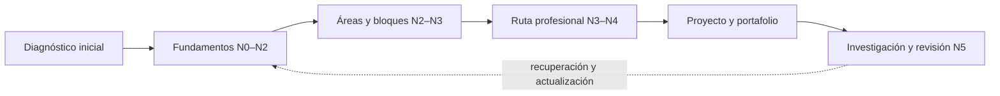

<div align="center">

# 🌌 Programa Integral de Astronomía, Astrofísica, Ciencias Espaciales e Ingeniería Aeroespacial

## **12 áreas · 133 bloques · 2.077 clases · 24 roles profesionales**

**Un programa de formación independiente, en español, que lleva desde la observación del cielo y los fundamentos científicos hasta la investigación, la ingeniería y las operaciones espaciales.**

[](https://github.com/vladimiracunadev-create/astronomy-astrophysics-space-sciences-aerospace-engineering-learning-program/actions/workflows/validate.yml)
[](https://vladimiracunadev-create.github.io/astronomy-astrophysics-space-sciences-aerospace-engineering-learning-program/)

[](https://github.com/vladimiracunadev-create/astronomy-astrophysics-space-sciences-aerospace-engineering-learning-program/releases/latest)
[](PROGRAMA_ACADEMICO_COMPLETO.md)
[](STATUS.md)
[](README.md)
[](LICENSE)
[](LICENSE-CONTENT.md)

[🌐 Sitio web](https://vladimiracunadev-create.github.io/astronomy-astrophysics-space-sciences-aerospace-engineering-learning-program/) ·
[📕 PDF general](https://github.com/vladimiracunadev-create/astronomy-astrophysics-space-sciences-aerospace-engineering-learning-program/releases/latest/download/Programa-General.pdf) ·
[📦 Descargas](#-descargas-y-pdf) ·
[📚 Programa completo](PROGRAMA_ACADEMICO_COMPLETO.md) ·
[🧭 Roles](#-los-24-roles-y-su-ruta-de-áreas-y-bloques) ·
[📎 Anexos](anexos/README.md) ·
[🔤 Glosario](glosario/README.md) ·
[📖 Documentación](documentacion/README.md) ·
[✅ Estado](STATUS.md) ·
[🗺️ Roadmap](ROADMAP.md) ·
[⚖️ Licencias](documentacion/LICENCIAS_Y_PROCEDENCIA.md) ·
[🤝 Contribuir](CONTRIBUTING.md)

</div>

---

> [!IMPORTANT]
> **Las 2.077 clases tienen texto y laboratorio, pero ninguna está revisada ni verificada.** Todas siguen en nivel **E0**: pendientes de la aprobación del autor y de revisión disciplinar. Clases verificadas: **0 de 2.077**. Ninguna debe presentarse como impartida, revisada o verificada. Detalle en [`STATUS.md`](STATUS.md) y en la [resolución por etapas](documentacion/RESOLUCION_DE_CONTENIDOS_POR_ETAPAS.md).

> [!WARNING]
> **Formación independiente, no habilitación profesional.** No otorga títulos, grados, licencias ni certificaciones, y no autoriza decisiones médicas, jurídicas, de vuelo, lanzamiento, seguridad o ingeniería crítica. Toda aplicación real exige normativa vigente, datos adecuados y profesionales competentes.

## 🎯 Qué es este programa

**Un solo conjunto de clases, organizado en áreas y bloques.** Los 24 roles profesionales no tienen contenido propio: son rutas que ordenan clases de esas áreas y bloques. No son 24 programas separados, y nadie necesita cursar todo: un diagnóstico indica qué partes hacen falta y una ruta ordena el camino.

| ✅ Es | ❌ No es |
|---|---|
| Un programa ordenado de **2.077 clases** con IDs estables, trazabilidad y laboratorios en Python | Una universidad, una carrera acreditada, un título o una certificación |
| Un conjunto de **rutas profesionales** sobre las mismas áreas y bloques | Veinticuatro programas separados |
| Un contenido **abierto, navegable y descargable** (sitio, PDF y aplicaciones sin conexión) | Contenido ya revisado por especialistas: está en E0 |
| Un [estándar de clase](documentacion/ESTANDAR_PARA_GENERAR_CONTENIDOS.md) con 22 funciones verificables | Una reproducción de libros, normas o documentación de organismos, ni un proyecto patrocinado por ellos |

## 🚀 Cómo empezar

| Quiero… | Voy a… |
|---|---|
| Leer en pantalla | El [sitio web](https://vladimiracunadev-create.github.io/astronomy-astrophysics-space-sciences-aerospace-engineering-learning-program/) (con búsqueda y progreso local) |
| Leer sin conexión | Los [PDF y las aplicaciones](#-descargas-y-pdf) |
| Seguir una ruta profesional | Los [24 roles](#-los-24-roles-y-su-ruta-de-áreas-y-bloques) |
| Estudiar un tema suelto | El [programa completo](PROGRAMA_ACADEMICO_COMPLETO.md) o el [glosario esencial](glosario/esencial/README.md) |
| Entender cómo está hecho | La [documentación](documentacion/README.md) y el [mapa del repositorio](documentacion/MAPA_DEL_REPOSITORIO.md) |



## 🗂️ Las 12 áreas

| Área | Qué cubre | Bloques | Clases | Nivel |
|---|---|---|---:|---|
| **A01** · Alfabetización científica, astronómica y tecnológica | Punto de partida común: observar y medir el cielo, entender la ciencia como método y adquirir la matemática, la física, la química y la informática básicas. | B01–B08 (8) | 160 | N0–N1 |
| **A02** · Matemática, física computacional y métodos científicos | Los lenguajes cuantitativos del programa: cálculo, álgebra lineal, simulación, estadística e incertidumbre, metrología, computación científica, señales y control; más aprendizaje automático, inferencia y verificación de software. | B09–B23 (15) | 237 | N2–N3 |
| **A03** · Astrofísica y ciencias fundamentales del universo | La física del universo: estrellas, galaxias, cosmología, objetos compactos, mensajeros, exoplanetas, el Sol y su plasma, y física nuclear y de partículas, con profundización en interiores estelares, universo temprano y clima espacial. | B24–B40 (17) | 272 | N2–N4 |
| **A04** · Óptica, telescopios y observatorios científicos | Cómo se observa: óptica, telescopios, detectores, espectroscopía, radioastronomía y observatorios terrestres y espaciales, con profundización en diseño óptico, antenas e interferometría. | B41–B51 (11) | 222 | N3–N4 |
| **A05** · Ciencias planetarias, astroquímica y habitabilidad | Los mundos y la vida: formación planetaria, geología, atmósferas, química, astrobiología, observación terrestre, cuerpos menores y recursos, con bloques nuevos de vulcanismo, impactos, geofísica y astroquímica. | B52–B70 (19) | 257 | N2–N4 |
| **A06** · Mecánica orbital, navegación y vuelo espacial | Órbitas, perturbaciones, navegación, trayectorias, dinámica cislunar, lanzamiento y propulsión, con optimización de trayectorias, transferencias de Lambert y fluidos de propulsión. | B71–B82 (12) | 237 | N3–N4 |
| **A07** · Ingeniería y construcción de sistemas espaciales | La ingeniería del satélite y de la misión: sistemas, estructuras, térmica, potencia, actitud, aviónica, comunicaciones, integración y ensayos, con enlaces, antenas, comunicaciones ópticas y plataformas pequeñas. | B83–B95 (13) | 259 | N3–N4 |
| **A08** · Operaciones de misión y robótica espacial | Operar la misión y construir fuera de la Tierra: control de misión, robótica, percepción, movilidad, manipulación, autonomía y logística extraterrestre. | B96–B103 (8) | 105 | N3–N4 |
| **A09** · Astronáutica humana, medicina y hábitats | La persona en el espacio: preparación de astronautas, medicina y biología, hábitats y soporte vital, con bloques nuevos de salud, radiación, emergencias y bioregeneración. | B104–B117 (14) | 153 | N3–N4 |
| **A10** · Entorno orbital, derecho y seguridad espacial | Un espacio compartido y seguro: tráfico y sostenibilidad orbital, derecho internacional y nacional, espectro y licencias, responsabilidad, seguridad y resiliencia. | B118–B123 (6) | 85 | N3–N4 |
| **A11** · Economía, industria y gestión de proyectos espaciales | Cadena de valor, costos, financiamiento, seguros, creación de empresas y gestión de proyectos espaciales. | B124–B127 (4) | 44 | N3–N4 |
| **A12** · Educación, historia aplicada y divulgación astronómica | Enseñar, divulgar e investigar el cielo: historia y arqueoastronomía aplicadas, saberes y educación intercultural, didáctica, ciencia ciudadana, accesibilidad y comunicación. | B128–B133 (6) | 46 | N3–N4 |

Todos los bloques, con el rango de clases y el enlace a su guía: [mapa de áreas y bloques](documentacion/MAPA_DE_AREAS_Y_BLOQUES.md). La estructura creció desde la línea base (8 áreas, 64 bloques y 1.280 clases en el tronco más 3.840 en las rutas) hasta 12 áreas, 133 bloques y 2.077 clases al ubicar todo el contenido de los módulos de las rutas dentro de áreas y bloques; cómo se hizo, en [estructura y conteo del catálogo](documentacion/ESTRUCTURA_Y_CONTEO_DEL_CATALOGO.md).

## 🧭 Los 24 roles y su ruta de áreas y bloques

Cada rol tiene una guía (qué es, qué no es, un día de trabajo, qué necesitas saber, tu ruta, evidencias y progresión) en [`rutas/`](rutas/README.md). Ninguna ruta constituye formación terminada ni habilitación profesional.

<!-- roles:inicio -->
| Rol | Áreas y bloques que usa | Guía |
|---|---|---|
| ⭐ **Astrofísica estelar y galáctica** | A01: B01; A02: B09, B12, B14, B15, B20; A03: B24, B25, B27, B29, B32, B37, B38; A04: B45; A06: B73; A11: B124 | [📖 abrir](rutas/astrofisica-estelar-y-galactica.md) |
| 🌀 **Cosmología y astrofísica extrema** | A02: B10, B12; A03: B25, B26, B27, B28, B30, B31, B36, B39, B40; A04: B47; A05: B55 | [📖 abrir](rutas/cosmologia-y-astrofisica-extrema.md) |
| 🔭 **Ingeniería óptica y telescopios profesionales** | A02: B12, B13; A03: B29; A04: B41, B42, B43, B44, B45, B47, B48, B50; A07: B83, B84, B88, B90; A11: B124 | [📖 abrir](rutas/ingenieria-optica-y-telescopios-profesionales.md) |
| 📡 **Radioastronomía e interferometría** | A02: B12, B13, B14, B15; A03: B30; A04: B42, B44, B46, B48, B49, B51; A05: B53, B57; A06: B74; A07: B89, B90; A10: B118 | [📖 abrir](rutas/radioastronomia-e-interferometria.md) |
| 🪐 **Ciencias planetarias y astrogeología** | A01: B06; A02: B12, B13, B14; A04: B45, B47; A05: B52, B53, B55, B56, B57, B58, B61, B63, B65, B66, B70; A06: B74; A07: B89; A11: B124 | [📖 abrir](rutas/ciencias-planetarias-y-astrogeologia.md) |
| 🧪 **Astroquímica y astrobiología** | A01: B06; A02: B12, B13, B15; A03: B25, B28, B29, B31; A04: B46; A05: B52, B53, B54, B55, B56, B60, B62, B63, B64, B65, B68; A07: B90; A10: B119 | [📖 abrir](rutas/astroquimica-y-astrobiologia.md) |
| ☀️ **Heliofísica y climatología espacial** | A02: B12, B13, B14, B15, B21; A03: B30, B31, B33, B34, B35; A04: B45, B47; A06: B72, B74; A07: B85, B89; A09: B105; A10: B119 | [📖 abrir](rutas/heliofisica-y-climatologia-espacial.md) |
| 🧮 **Matemática y computación científica espacial** | A02: B10, B11, B12, B13, B14, B15, B17, B18, B19, B21, B22, B23; A05: B53; A06: B74; A11: B124 | [📖 abrir](rutas/matematica-y-computacion-cientifica-espacial.md) |
| 🛰️ **Astrodinámica interplanetaria** | A01: B07; A02: B09, B10, B11, B12, B13, B14; A05: B53; A06: B71, B72, B73, B74, B75, B76, B77, B81, B82; A07: B86, B89; A08: B96 | [📖 abrir](rutas/astrodinamica-interplanetaria.md) |
| 🧭 **Navegación guiado y autonomía espacial** | A02: B10, B11, B12, B13, B14, B15, B16; A04: B44, B47; A06: B71, B72, B74, B76, B80; A07: B83, B87, B88, B89, B90; A08: B96, B97, B98; A10: B118 | [📖 abrir](rutas/navegacion-guiado-y-autonomia-espacial.md) |
| 🚀 **Ingeniería de lanzadores y propulsión** | A01: B05, B06; A02: B11, B12, B14; A06: B72, B75, B77, B78, B79; A07: B83, B84, B85, B86, B90; A08: B96; A10: B119 | [📖 abrir](rutas/ingenieria-de-lanzadores-y-propulsion.md) |
| 🛠️ **Ingeniería y construcción de satélites y CubeSats** | A02: B13; A04: B44, B46, B47; A06: B71; A07: B83, B84, B85, B86, B87, B88, B89, B90, B95; A08: B96; A10: B119 | [📖 abrir](rutas/ingenieria-y-construccion-de-satelites-y-cubesats.md) |
| 💾 **Aviónica y software espacial de alta fiabilidad** | A02: B14; A04: B47; A06: B74; A07: B83, B86, B88, B89, B90, B93; A08: B96 | [📖 abrir](rutas/avionica-y-software-espacial-de-alta-fiabilidad.md) |
| 🧱 **Materiales estructuras e ingeniería térmica espacial** | A04: B47; A06: B77; A07: B84, B85, B90; A09: B106 | [📖 abrir](rutas/materiales-estructuras-e-ingenieria-termica-espacial.md) |
| 📶 **Telecomunicaciones y estaciones terrestres espaciales** | A02: B13; A04: B46, B48; A06: B74; A07: B83, B88, B89, B90, B91, B92, B94; A08: B96 | [📖 abrir](rutas/telecomunicaciones-y-estaciones-terrestres-espaciales.md) |
| 🌍 **Observación terrestre y geointeligencia científica** | A01: B04, B07; A02: B12, B13, B14, B15, B17; A04: B44, B45, B47; A05: B53, B57, B69; A07: B83, B89, B90; A08: B96; A11: B124 | [📖 abrir](rutas/observacion-terrestre-y-geointeligencia-cientifica.md) |
| 🤖 **Robótica espacial y sistemas autónomos** | A02: B10, B15; A06: B76, B80; A07: B83, B86, B88, B89; A08: B96, B97, B98, B99, B101, B102, B103; A11: B124 | [📖 abrir](rutas/robotica-espacial-y-sistemas-autonomos.md) |
| 👩‍🚀 **Astronáutica tripulada y entrenamiento de astronautas** | A06: B74, B76; A07: B83, B86, B88, B89, B90; A08: B96, B97, B98, B101; A09: B104, B105, B106, B107, B108, B110, B111 | [📖 abrir](rutas/astronautica-tripulada-y-entrenamiento-de-astronautas.md) |
| 🩺 **Medicina y bioingeniería espacial** | A02: B12, B14; A03: B30, B31; A07: B83, B88, B89; A08: B96; A09: B104, B105, B106, B107, B112, B113, B116, B117; A10: B119; A11: B124 | [📖 abrir](rutas/medicina-y-bioingenieria-espacial.md) |
| 🏗️ **Arquitectura y hábitats extraterrestres** | A03: B30; A05: B53, B56, B59; A07: B83, B84, B85, B86, B90; A08: B96, B97; A09: B104, B105, B106, B109, B114, B115 | [📖 abrir](rutas/arquitectura-y-habitats-extraterrestres.md) |
| ⛏️ **Recursos extraterrestres y economía industrial espacial** | A02: B11; A04: B45; A05: B53, B55, B56, B57, B59, B67; A06: B75, B78; A07: B83, B84, B85, B86; A08: B96, B97, B100; A09: B106; A10: B119; A11: B124 | [📖 abrir](rutas/recursos-extraterrestres-y-economia-industrial-espacial.md) |
| 🛡️ **Seguridad defensa y resiliencia de infraestructuras espaciales** | A01: B02; A06: B72, B74, B76, B77; A07: B83, B86, B88, B89; A08: B96; A09: B104; A10: B118, B119, B122 | [📖 abrir](rutas/seguridad-defensa-y-resiliencia-de-infraestructuras-espaciales.md) |
| ⚖️ **Derecho políticas y negocios espaciales** | A04: B46; A05: B56; A07: B89; A10: B118, B119, B120, B121, B123; A11: B124, B125, B126, B127 | [📖 abrir](rutas/derecho-politicas-y-negocios-espaciales.md) |
| 🎓 **Educación historia y divulgación astronómica** | A01: B01, B02, B08; A02: B14; A03: B25; A04: B48; A09: B104; A11: B124; A12: B128, B129, B130, B131, B132, B133 | [📖 abrir](rutas/educacion-historia-y-divulgacion-astronomica.md) |
<!-- /roles -->

<!-- descargas:inicio -->
## 📦 Descargas y PDF

Los enlaces apuntan siempre a la **última versión** publicada y no caducan al publicar una nueva. Cada versión adjunta `SHA256SUMS.txt` y sus notas. Versión actual: **0.1.0**.

| Descarga | Qué es |
|---|---|
| [**📕 Programa general (PDF)**](https://github.com/vladimiracunadev-create/astronomy-astrophysics-space-sciences-aerospace-engineering-learning-program/releases/latest/download/Programa-General.pdf) | Programa completo, guías de los 24 roles y de los 133 bloques, los 20 anexos, la documentación y los glosarios |
| [**🖥️ Windows**](https://github.com/vladimiracunadev-create/astronomy-astrophysics-space-sciences-aerospace-engineering-learning-program/releases/latest) · `Programa-Aeroespacial_v0.1.0_Windows.zip` | Aplicación sin conexión, portable: extraer todo el ZIP y abrir `ProgramaAeroespacial.exe` (usa Edge o Chrome ya instalados) |
| [**📱 Android**](https://github.com/vladimiracunadev-create/astronomy-astrophysics-space-sciences-aerospace-engineering-learning-program/releases/latest) · `Programa-Aeroespacial_v0.1.0_Android.apk` | Aplicación sin conexión para móvil y tableta (Android 7 o superior) |

<details><summary><b>📕 PDF por área</b> (guía de cada bloque y todas sus clases)</summary>

- [A01 · Alfabetización científica, astronómica y tecnológica](https://github.com/vladimiracunadev-create/astronomy-astrophysics-space-sciences-aerospace-engineering-learning-program/releases/latest/download/Area-A01-alfabetizacion-cientifica-astronomica-y-tecnologica.pdf)
- [A02 · Matemática, física computacional y métodos científicos](https://github.com/vladimiracunadev-create/astronomy-astrophysics-space-sciences-aerospace-engineering-learning-program/releases/latest/download/Area-A02-matematica-fisica-computacional-y-metodos-cientificos.pdf)
- [A03 · Astrofísica y ciencias fundamentales del universo](https://github.com/vladimiracunadev-create/astronomy-astrophysics-space-sciences-aerospace-engineering-learning-program/releases/latest/download/Area-A03-astrofisica-y-ciencias-fundamentales-del-universo.pdf)
- [A04 · Óptica, telescopios y observatorios científicos](https://github.com/vladimiracunadev-create/astronomy-astrophysics-space-sciences-aerospace-engineering-learning-program/releases/latest/download/Area-A04-optica-telescopios-y-observatorios-cientificos.pdf)
- [A05 · Ciencias planetarias, astroquímica y habitabilidad](https://github.com/vladimiracunadev-create/astronomy-astrophysics-space-sciences-aerospace-engineering-learning-program/releases/latest/download/Area-A05-ciencias-planetarias-astroquimica-y-habitabilidad.pdf)
- [A06 · Mecánica orbital, navegación y vuelo espacial](https://github.com/vladimiracunadev-create/astronomy-astrophysics-space-sciences-aerospace-engineering-learning-program/releases/latest/download/Area-A06-mecanica-orbital-navegacion-y-vuelo-espacial.pdf)
- [A07 · Ingeniería y construcción de sistemas espaciales](https://github.com/vladimiracunadev-create/astronomy-astrophysics-space-sciences-aerospace-engineering-learning-program/releases/latest/download/Area-A07-ingenieria-y-construccion-de-sistemas-espaciales.pdf)
- [A08 · Operaciones de misión y robótica espacial](https://github.com/vladimiracunadev-create/astronomy-astrophysics-space-sciences-aerospace-engineering-learning-program/releases/latest/download/Area-A08-operaciones-de-mision-y-robotica-espacial.pdf)
- [A09 · Astronáutica humana, medicina y hábitats](https://github.com/vladimiracunadev-create/astronomy-astrophysics-space-sciences-aerospace-engineering-learning-program/releases/latest/download/Area-A09-astronautica-humana-medicina-y-habitats.pdf)
- [A10 · Entorno orbital, derecho y seguridad espacial](https://github.com/vladimiracunadev-create/astronomy-astrophysics-space-sciences-aerospace-engineering-learning-program/releases/latest/download/Area-A10-entorno-orbital-derecho-y-seguridad-espacial.pdf)
- [A11 · Economía, industria y gestión de proyectos espaciales](https://github.com/vladimiracunadev-create/astronomy-astrophysics-space-sciences-aerospace-engineering-learning-program/releases/latest/download/Area-A11-economia-industria-y-gestion-de-proyectos-espaciales.pdf)
- [A12 · Educación, historia aplicada y divulgación astronómica](https://github.com/vladimiracunadev-create/astronomy-astrophysics-space-sciences-aerospace-engineering-learning-program/releases/latest/download/Area-A12-educacion-historia-aplicada-y-divulgacion-astronomica.pdf)

</details>

<details><summary><b>📕 PDF por rol</b> (guía del rol y las clases que usa, en orden)</summary>

- [R01 · Astrofísica estelar y galáctica](https://github.com/vladimiracunadev-create/astronomy-astrophysics-space-sciences-aerospace-engineering-learning-program/releases/latest/download/Rol-R01-astrofisica-estelar-y-galactica.pdf)
- [R02 · Cosmología y astrofísica extrema](https://github.com/vladimiracunadev-create/astronomy-astrophysics-space-sciences-aerospace-engineering-learning-program/releases/latest/download/Rol-R02-cosmologia-y-astrofisica-extrema.pdf)
- [R03 · Ingeniería óptica y telescopios profesionales](https://github.com/vladimiracunadev-create/astronomy-astrophysics-space-sciences-aerospace-engineering-learning-program/releases/latest/download/Rol-R03-ingenieria-optica-y-telescopios-profesionales.pdf)
- [R04 · Radioastronomía e interferometría](https://github.com/vladimiracunadev-create/astronomy-astrophysics-space-sciences-aerospace-engineering-learning-program/releases/latest/download/Rol-R04-radioastronomia-e-interferometria.pdf)
- [R05 · Ciencias planetarias y astrogeología](https://github.com/vladimiracunadev-create/astronomy-astrophysics-space-sciences-aerospace-engineering-learning-program/releases/latest/download/Rol-R05-ciencias-planetarias-y-astrogeologia.pdf)
- [R06 · Astroquímica y astrobiología](https://github.com/vladimiracunadev-create/astronomy-astrophysics-space-sciences-aerospace-engineering-learning-program/releases/latest/download/Rol-R06-astroquimica-y-astrobiologia.pdf)
- [R07 · Heliofísica y climatología espacial](https://github.com/vladimiracunadev-create/astronomy-astrophysics-space-sciences-aerospace-engineering-learning-program/releases/latest/download/Rol-R07-heliofisica-y-climatologia-espacial.pdf)
- [R08 · Matemática y computación científica espacial](https://github.com/vladimiracunadev-create/astronomy-astrophysics-space-sciences-aerospace-engineering-learning-program/releases/latest/download/Rol-R08-matematica-y-computacion-cientifica-espacial.pdf)
- [R09 · Astrodinámica interplanetaria](https://github.com/vladimiracunadev-create/astronomy-astrophysics-space-sciences-aerospace-engineering-learning-program/releases/latest/download/Rol-R09-astrodinamica-interplanetaria.pdf)
- [R10 · Navegación guiado y autonomía espacial](https://github.com/vladimiracunadev-create/astronomy-astrophysics-space-sciences-aerospace-engineering-learning-program/releases/latest/download/Rol-R10-navegacion-guiado-y-autonomia-espacial.pdf)
- [R11 · Ingeniería de lanzadores y propulsión](https://github.com/vladimiracunadev-create/astronomy-astrophysics-space-sciences-aerospace-engineering-learning-program/releases/latest/download/Rol-R11-ingenieria-de-lanzadores-y-propulsion.pdf)
- [R12 · Ingeniería y construcción de satélites y CubeSats](https://github.com/vladimiracunadev-create/astronomy-astrophysics-space-sciences-aerospace-engineering-learning-program/releases/latest/download/Rol-R12-ingenieria-y-construccion-de-satelites-y-cubesats.pdf)
- [R13 · Aviónica y software espacial de alta fiabilidad](https://github.com/vladimiracunadev-create/astronomy-astrophysics-space-sciences-aerospace-engineering-learning-program/releases/latest/download/Rol-R13-avionica-y-software-espacial-de-alta-fiabilidad.pdf)
- [R14 · Materiales estructuras e ingeniería térmica espacial](https://github.com/vladimiracunadev-create/astronomy-astrophysics-space-sciences-aerospace-engineering-learning-program/releases/latest/download/Rol-R14-materiales-estructuras-e-ingenieria-termica-espacial.pdf)
- [R15 · Telecomunicaciones y estaciones terrestres espaciales](https://github.com/vladimiracunadev-create/astronomy-astrophysics-space-sciences-aerospace-engineering-learning-program/releases/latest/download/Rol-R15-telecomunicaciones-y-estaciones-terrestres-espaciales.pdf)
- [R16 · Observación terrestre y geointeligencia científica](https://github.com/vladimiracunadev-create/astronomy-astrophysics-space-sciences-aerospace-engineering-learning-program/releases/latest/download/Rol-R16-observacion-terrestre-y-geointeligencia-cientifica.pdf)
- [R17 · Robótica espacial y sistemas autónomos](https://github.com/vladimiracunadev-create/astronomy-astrophysics-space-sciences-aerospace-engineering-learning-program/releases/latest/download/Rol-R17-robotica-espacial-y-sistemas-autonomos.pdf)
- [R18 · Astronáutica tripulada y entrenamiento de astronautas](https://github.com/vladimiracunadev-create/astronomy-astrophysics-space-sciences-aerospace-engineering-learning-program/releases/latest/download/Rol-R18-astronautica-tripulada-y-entrenamiento-de-astronautas.pdf)
- [R19 · Medicina y bioingeniería espacial](https://github.com/vladimiracunadev-create/astronomy-astrophysics-space-sciences-aerospace-engineering-learning-program/releases/latest/download/Rol-R19-medicina-y-bioingenieria-espacial.pdf)
- [R20 · Arquitectura y hábitats extraterrestres](https://github.com/vladimiracunadev-create/astronomy-astrophysics-space-sciences-aerospace-engineering-learning-program/releases/latest/download/Rol-R20-arquitectura-y-habitats-extraterrestres.pdf)
- [R21 · Recursos extraterrestres y economía industrial espacial](https://github.com/vladimiracunadev-create/astronomy-astrophysics-space-sciences-aerospace-engineering-learning-program/releases/latest/download/Rol-R21-recursos-extraterrestres-y-economia-industrial-espacial.pdf)
- [R22 · Seguridad defensa y resiliencia de infraestructuras espaciales](https://github.com/vladimiracunadev-create/astronomy-astrophysics-space-sciences-aerospace-engineering-learning-program/releases/latest/download/Rol-R22-seguridad-defensa-y-resiliencia-de-infraestructuras-espacial.pdf)
- [R23 · Derecho políticas y negocios espaciales](https://github.com/vladimiracunadev-create/astronomy-astrophysics-space-sciences-aerospace-engineering-learning-program/releases/latest/download/Rol-R23-derecho-politicas-y-negocios-espaciales.pdf)
- [R24 · Educación historia y divulgación astronómica](https://github.com/vladimiracunadev-create/astronomy-astrophysics-space-sciences-aerospace-engineering-learning-program/releases/latest/download/Rol-R24-educacion-historia-y-divulgacion-astronomica.pdf)

</details>

Las aplicaciones muestran el mismo contenido que el [sitio web](https://vladimiracunadev-create.github.io/astronomy-astrophysics-space-sciences-aerospace-engineering-learning-program/) (Markdown convertido a HTML), con búsqueda y sin conexión. Para verificar lo que descargas:

```bash
sha256sum -c SHA256SUMS.txt
```

> El APK está firmado con una clave de publicación propia del proyecto y **no** procede de Google Play: se instala permitiendo «orígenes desconocidos». Los ejecutables de Windows **no están firmados digitalmente**; SmartScreen puede avisar. Comprueba siempre el `SHA256SUMS.txt` antes de ejecutarlos. Cómo se generan estos archivos: [`herramientas/publicacion/`](herramientas/publicacion/README.md).
<!-- /descargas -->

## 📎 Anexos y glosarios

- **[20 anexos](anexos/README.md)** históricos, pedagógicos y de cálculo: agencias, misiones, científicos y astronautas, satélites, telescopios, lanzadores, cronología, escalas y fórmulas, estudios de caso, Sistema Solar, estrellas y cosmología, exoplanetas, órbitas, propulsión, derecho espacial, mitos frecuentes, Chile y cielos originarios, y datos y fuentes.
- **[Glosario esencial](glosario/esencial/README.md)**: unas 165 entradas explicadas a fondo (intuición, fórmula, ejemplo y errores frecuentes).
- **[Glosario completo](glosario/README.md)**: 8.702 términos, 445 siglas y 4.207 símbolos, con el contexto de su clase.
- **[Calculadora científica](herramientas/calculadora_cientifica.py)**: constantes con fuente, conversión de unidades y fórmulas orbitales (`python herramientas/calculadora_cientifica.py autotest`).

## 📖 Documentación y cómo está construido

| Documento | Para qué |
|---|---|
| [Estándar para generar los contenidos](documentacion/ESTANDAR_PARA_GENERAR_CONTENIDOS.md) | Las 22 funciones de una clase y cómo se escribió cada una |
| [Resolución por etapas](documentacion/RESOLUCION_DE_CONTENIDOS_POR_ETAPAS.md) | Qué significan E0–E6 y qué falta para que una clase sea aceptada |
| [Mapa del repositorio](documentacion/MAPA_DEL_REPOSITORIO.md) | Qué hay en cada carpeta, qué se escribe y qué se genera |
| [Mapa de áreas y bloques](documentacion/MAPA_DE_AREAS_Y_BLOQUES.md) | Los 133 bloques con sus clases y guías |
| [Índice de la documentación](documentacion/README.md) | Contrato, estándares, planes, licencias y seguridad |
| [Estado verificable](STATUS.md) · [Roadmap](ROADMAP.md) · [Cambios](CHANGELOG.md) | Qué está hecho, qué sigue y qué cambió |

## ✅ Validación local

Requiere Python 3.11 o posterior y no instala dependencias:

```bash
python herramientas/validar_catalogo.py
```

La salida esperada es:

```text
Catálogo: 5120 clases | 64 bloques | 24 rutas | 192 módulos   (línea base 0.1.0)
VALIDACIÓN DOCUMENTAL APROBADA (no implica clases desarrolladas).
```

Esta validación comprueba estructura (V1), no corrección científica. Los demás controles están descritos en el [mapa del repositorio](documentacion/MAPA_DEL_REPOSITORIO.md#controles-automáticos-ci).

## 🔭 Principios editoriales

- Una sola fuente de verdad y numeración permanente.
- Resultados observables, práctica auténtica y evaluación alineada.
- Fuentes con localizador, versión, fecha y límite de uso; los datos observados, estimados, sintéticos y simulados se separan siempre.
- Accesibilidad desde el diseño: teclado, lectores de pantalla, alternativas textuales y lenguaje claro.
- Seguridad, ética y fronteras profesionales visibles.
- Interoperabilidad con otros programas mediante manifiestos y metadatos, sin modificar repositorios ajenos.

## 📄 Licencias y propiedad intelectual

Este repositorio separa las obras por su naturaleza:

- **Código propio, scripts, workflows, configuración y componentes funcionales:** [Apache License 2.0](LICENSE).
- **Arquitectura curricular, documentación, rutas, futuras clases, ejercicios, evaluaciones, diagramas y materiales educativos originales:** [CC BY-NC-SA 4.0](LICENSE-CONTENT.md).
- **Catálogos, metadatos y futuros datos científicos:** consulta [DATA_LICENSES.md](DATA_LICENSES.md); hechos y datos externos no se relicencian automáticamente.
- **Imágenes, audio, video, modelos, tipografías y otros activos:** consulta [ASSET_LICENSES.md](ASSET_LICENSES.md).
- **Herramientas, fuentes y material de terceros:** conservan sus licencias y derechos originales; consulta [THIRD_PARTY_NOTICES.md](THIRD_PARTY_NOTICES.md).

Copyright © 2026 **Vladimir Acuña** (`vladimiracunadev-create`). La [historia del licenciamiento](documentacion/LICENSING_HISTORY.md) distingue las revisiones anteriores que no tenían una concesión explícita y evita interpretaciones retroactivas. Las licencias no conceden derechos de marca, acreditación ni carácter oficial: consulta [TRADEMARKS.md](TRADEMARKS.md), la [matriz por componente](documentacion/LICENSING_MATRIX.md) y la [auditoría vigente](LICENSING_AUDIT.md).

---

<div align="center">

**Hecho para ordenar y desarrollar una formación espacial profunda, verificable y accesible.**

[⬆️ Explorar el programa de 2.077 clases](PROGRAMA_ACADEMICO_COMPLETO.md) · [🌐 Sitio web](https://vladimiracunadev-create.github.io/astronomy-astrophysics-space-sciences-aerospace-engineering-learning-program/) · [🌐 Sitio web](https://vladimiracunadev-create.github.io/astronomy-astrophysics-space-sciences-aerospace-engineering-learning-program/) · [🌐 Sitio web](https://vladimiracunadev-create.github.io/astronomy-astrophysics-space-sciences-aerospace-engineering-learning-program/)

<br>

**¿Te resulta útil? ⭐ Dale una estrella al repositorio.**

[](https://github.com/vladimiracunadev-create/astronomy-astrophysics-space-sciences-aerospace-engineering-learning-program/stargazers)
[](https://github.com/vladimiracunadev-create/astronomy-astrophysics-space-sciences-aerospace-engineering-learning-program/network/members)
[](https://github.com/vladimiracunadev-create)

Hecho con 🧠 y ☕ por [Vladimir Acuña](https://github.com/vladimiracunadev-create)

</div>
