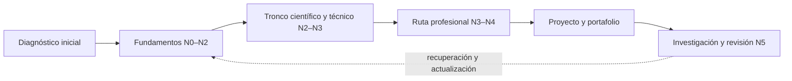

<div align="center">

# 🌌 Programa Integral de Astronomía, Astrofísica, Ciencias Espaciales e Ingeniería Aeroespacial

## **5.120 clases planificadas · 64 bloques transversales · 24 rutas profesionales · 192 módulos especializados**

**Un programa independiente en español que organiza, con IDs estables y trazabilidad, el recorrido desde la observación del cielo y los fundamentos científicos hasta la investigación, la ingeniería y las operaciones espaciales.**

[](https://github.com/vladimiracunadev-create/astronomy-astrophysics-space-sciences-aerospace-engineering-learning-program/actions/workflows/validate.yml)
[](https://vladimiracunadev-create.github.io/astronomy-astrophysics-space-sciences-aerospace-engineering-learning-program/)

[](CHANGELOG.md)
[](PROGRAMA_ACADEMICO_COMPLETO.md)
[](STATUS.md)
[](README.md)
[](LICENSE)
[](LICENSE-CONTENT.md)

[🌐 Explorar el catálogo](https://vladimiracunadev-create.github.io/astronomy-astrophysics-space-sciences-aerospace-engineering-learning-program/) ·
[📚 Programa completo](PROGRAMA_ACADEMICO_COMPLETO.md) ·
[🧭 Rutas profesionales](documentacion/MAPA_DE_RUTAS_PROFESIONALES.md) ·
[🎓 Estándar de clase](documentacion/ESTANDAR_PEDAGOGICO_Y_DE_EVALUACION.md) ·
[🗺️ Roadmap](ROADMAP.md) ·
[✅ Estado verificable](STATUS.md) ·
[📖 Documentación](documentacion/README.md) ·
[⚖️ Licencias](documentacion/LICENCIAS_Y_PROCEDENCIA.md) ·
[🤝 Contribuir](CONTRIBUTING.md)

</div>

---

> [!IMPORTANT]
> **El catálogo está definido; los contenidos aún no están redactados.** Los 5.120 registros contienen un título, una descripción y fuentes preliminares. No deben presentarse como clases desarrolladas, impartidas, revisadas ni verificadas. El contador actual es **0/5.120 clases completamente redactadas**.

> [!WARNING]
> **Formación independiente, no habilitación profesional.** El programa no otorga títulos, grados, licencias ni certificaciones; tampoco autoriza decisiones médicas, jurídicas, de vuelo, lanzamiento, seguridad o ingeniería crítica. Toda aplicación real exige normativa vigente, datos adecuados y profesionales competentes.

## 🎯 Qué es este programa

Es una arquitectura curricular única y extensible. No son 24 programas separados: las rutas profesionales reutilizan un tronco transversal y profundizan competencias concretas sin renumerar ni duplicar lo ya definido.

| Superficie | Estado verificable |
|---|---:|
| Áreas transversales | 8 |
| Bloques transversales | 64 |
| Clases transversales catalogadas | 1.280 |
| Rutas profesionales | 24 |
| Módulos de especialización | 192 |
| Clases especializadas catalogadas | 3.840 |
| **Clases catalogadas** | **5.120** |
| **Clases completamente redactadas y verificadas** | **0** |

La estructura permite estudiar por diagnóstico y ruta. Nadie necesita cursar las 5.120 unidades ni seguir una duración académica inventada: la carga y las equivalencias se definirán después de pilotajes reales.



## 🧠 Estándar para generar los contenidos

La futura redacción seguirá el estándar **`clase-profunda-cientifica`**. Una clase no será aceptada por tener muchas palabras: deberá conectar necesidad, fundamento, fuente, actividad, evidencia, evaluación y continuidad. El contrato completo está en el [estándar pedagógico y de evaluación](documentacion/ESTANDAR_PEDAGOGICO_Y_DE_EVALUACION.md).

Cada clase deberá cubrir 22 funciones verificables:

1. identidad y estado editorial;
2. propósito y decisión central;
3. resultados observables;
4. prerrequisitos y diagnóstico;
5. contexto científico o profesional;
6. vocabulario y definiciones operacionales;
7. modelo mental y relaciones causales;
8. desarrollo progresivo;
9. magnitudes, símbolos y unidades;
10. sistema de referencia, escala temporal y convenciones;
11. evidencia y fuentes con alcance declarado;
12. visualización accesible;
13. ejemplo trabajado y reproducible;
14. comparación de métodos y límites;
15. práctica guiada;
16. práctica autónoma y transferencia;
17. laboratorio, observación o simulación cuando corresponda;
18. errores frecuentes y recuperación;
19. evaluación formativa;
20. evidencia de aprendizaje y rúbrica;
21. seguridad, ética, accesibilidad y límites profesionales;
22. síntesis, glosario, continuidad y bibliografía verificada.

Cuando aparezcan fórmulas, datos o simulaciones se deberán declarar unidades, sistema de referencia, escala temporal, procedencia, versión, supuestos, tolerancias, incertidumbre y límites de validez. Un resultado simulado nunca se presentará como observado o certificado.

## 🪜 Resolución de contenidos por etapas

Cada clase avanzará con evidencia, no por declaración manual:

| Etapa editorial | Resultado exigido | ¿Cuenta como clase redactada? |
|---|---|:---:|
| `E0 · catalogada` | ID, título, ubicación y referencias preliminares | No |
| `E1 · especificada` | propósito, resultados, prerrequisitos, decisión y riesgos | No |
| `E2 · documentada` | fuentes localizadas con función, alcance, versión y límites | No |
| `E3 · redactada` | las 22 funciones con ejemplos, prácticas y soluciones | No |
| `E4 · verificada` | revisión conceptual, matemática, dimensional y de referencias | No |
| `E5 · validada` | accesibilidad, evaluación, pruebas técnicas y revisión disciplinar | **Sí** |
| `E6 · pilotada` | evidencia de uso, errores observados y mejoras documentadas | Sí, con nivel superior |

La secuencia de implementación comenzará con pilotos completos y pequeños; después escalará por bloques y rutas. Las condiciones de cierre, entregables y puertas de calidad están en el [roadmap](ROADMAP.md) y el [plan detallado](documentacion/PLAN_DE_IMPLEMENTACION_Y_ESTADOS.md).

## 🗂️ Qué contiene hoy

- [`PROGRAMA_ACADEMICO_COMPLETO.md`](PROGRAMA_ACADEMICO_COMPLETO.md): índice legible de las 5.120 unidades.
- [`catalogo/clases.jsonl`](catalogo/clases.jsonl): fuente canónica legible por máquinas, sincronizada con CSV y JSON.
- [`programa/tronco-comun/`](programa/tronco-comun/): 64 fichas de bloque con 20 títulos cada una.
- [`programa/rutas-profesionales/`](programa/rutas-profesionales/): 24 rutas y 192 módulos.
- [`metadatos/`](metadatos/): inventarios y relaciones estructurales.
- [`documentacion/`](documentacion/): alcance, pedagogía, experiencia, cobertura, rutas y plan de implementación.
- [`fuentes/`](fuentes/): referencias institucionales preliminares, todavía no verificadas clase por clase.
- [`visor/index.html`](visor/index.html): explorador estático, accesible y sin dependencias externas.
- [`herramientas/validar_catalogo.py`](herramientas/validar_catalogo.py): control reproducible de cantidades, IDs, orden y estados.
- [`herramientas/generar_manifiesto.py`](herramientas/generar_manifiesto.py): regeneración determinista de huellas SHA-256.

## ✅ Validación local

Requiere Python 3.11 o posterior y no instala dependencias:

```bash
python herramientas/validar_catalogo.py
```

La salida esperada es:

```text
Catálogo: 5120 clases | 64 bloques | 24 rutas | 192 módulos
VALIDACIÓN DOCUMENTAL APROBADA (no implica clases desarrolladas).
```

## 🔭 Principios editoriales

- Una sola fuente de verdad y numeración permanente.
- Resultados observables, práctica auténtica y evaluación alineada.
- Progresión desde reconocimiento hasta investigación, sin saltos ocultos.
- Fuentes primarias o institucionales con localizador, versión, fecha y límite de uso.
- Separación explícita entre datos observados, estimados, sintéticos y simulados.
- Accesibilidad desde el diseño: teclado, lectores de pantalla, alternativas textuales y lenguaje claro.
- Seguridad, ética y fronteras profesionales visibles.
- Interoperabilidad con otros programas mediante manifiestos y metadatos, sin modificar repositorios ajenos.

## 📌 Identidad y alcance

El nombre académico formal es **Programa Integral de Astronomía, Astrofísica, Ciencias Espaciales e Ingeniería Aeroespacial** y el repositorio es `astronomy-astrophysics-space-sciences-aerospace-engineering-learning-program`. No se utiliza una sigla como nombre alternativo.

La versión documental `0.1.0` fija la línea base del catálogo. Las futuras ampliaciones serán aditivas, conservarán los IDs existentes y registrarán dependencias, fuentes y decisiones. Consulta el [contrato del repositorio](documentacion/ALCANCE_Y_CONTRATO_DEL_REPOSITORIO.md) antes de proponer cambios.

## ⚖️ Licenciamiento diferenciado

El software propio —scripts, workflows, configuración y componentes funcionales— se publica bajo [Apache License 2.0](LICENSE). La expresión educativa original, la arquitectura curricular y la documentación se publican bajo [CC BY-NC-SA 4.0](LICENSE-CONTENT.md). Datos, activos, fuentes de terceros y marcas conservan reglas específicas.

Consulta el [centro de licencias](documentacion/LICENCIAS_Y_PROCEDENCIA.md), la [matriz por componente](documentacion/LICENSING_MATRIX.md) y la [auditoría vigente](LICENSING_AUDIT.md). La publicación no relicencia obras externas ni implica patrocinio institucional.
