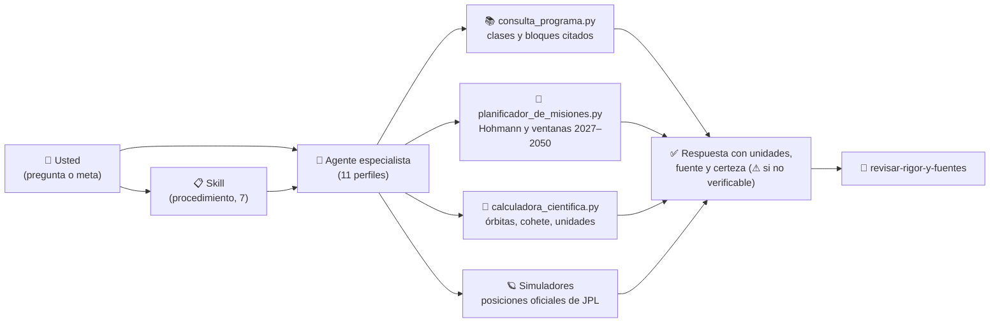
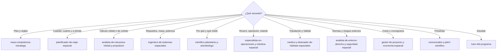

# 🤖 Agentes y skills especializados

> Un equipo de especialistas que trabaja **con el contenido de este programa**: 11 agentes y 7 skills de Claude Code que localizan las clases pertinentes, calculan con las herramientas del repositorio, contrastan con los simuladores y entregan resultados con unidades, fuente y nivel de certeza.

[🏠 Volver al README](../README.md) · [📖 Documentación](README.md) · [🧭 Rutas profesionales](MAPA_DE_RUTAS_PROFESIONALES.md) · [🪐 Simuladores](../simuladores/README.md) · [🛠️ Talleres de misión](../talleres/README.md)

---

## 📌 En una pantalla

| Qué | Cuántos | Dónde viven |
|---|---:|---|
| **Agentes** (especialistas por tema) | 11 | [`.claude/agents/`](../.claude/agents/) |
| **Skills** (procedimientos paso a paso) | 7 | [`.claude/skills/`](../.claude/skills/) |
| **Herramientas** que ellos usan | 3 | [`herramientas/`](../herramientas/) |
| **Contenido** del que se alimentan | 12 áreas · 133 bloques · 2 077 clases · 24 rutas · 10 talleres · 23 simuladores | [`programa/`](../programa/), [`talleres/`](../talleres/), [`simuladores/`](../simuladores/) |

> ⚠️ **Alcance honesto.** Las 2 077 clases están **redactadas pero pendientes de revisión**: ninguna está impartida, revisada ni verificada, y los agentes las tratan como material de estudio, no como norma. Los simuladores y calculadoras son **apoyo didáctico: no sirven para decisiones de vuelo**. Toda cifra sin fuente pública verificable se marca con **⚠**. Las reglas de una competencia concreta salen de **su convocatoria oficial**, nunca del programa ni de la memoria de un agente.

---

## 🧭 Cómo encaja todo



**Regla de oro de todos los agentes:** el resultado va primero; después, los supuestos, la verificación hecha y lo que **no** se pudo verificar.

---

## 🧰 Las tres herramientas del repositorio

| Herramienta | Para qué | Ejemplos |
|---|---|---|
| [`consulta_programa.py`](../herramientas/consulta_programa.py) | Encuentra qué clases y bloques responden una pregunta y da su ruta | `python herramientas/consulta_programa.py tema "ventana de lanzamiento"` · `… tema "delta-v" --texto` · `… bloque B75` · `… area A06` |
| [`planificador_de_misiones.py`](../herramientas/planificador_de_misiones.py) | Hohmann Tierra→planeta y **ventanas 2027–2050** con las posiciones oficiales de JPL | `python herramientas/planificador_de_misiones.py resumen` · `… hohmann --destino marte --h-captura 400` · `… ventanas --destino marte --desde 2027 --hasta 2036` |
| [`calculadora_cientifica.py`](../herramientas/calculadora_cientifica.py) | Constantes con fuente, órbitas, Hohmann, ecuación del cohete, conversiones | `python herramientas/calculadora_cientifica.py cohete --isp 450 --m0 1000 --mf 300` |

Las dos primeras tienen `autotest` y se ejecutan en la integración continua en cada cambio.

### Precisión del planificador (medida, no supuesta)

| Comprobación | Referencia | Resultado |
|---|---|---|
| Tierra → Marte, Hohmann | Valores de libro: 258,9 d y v∞ 2,94 km/s | 259 d · 2,94 km/s ✅ |
| Tierra → Venus, Hohmann | 146 d y v∞ 2,50 km/s | 146 d · 2,50 km/s ✅ |
| Ventana a Marte | Óptimo de Lambert del simulador de trayectorias: salida el 29-nov-2028 | Primera aproximación: 6-ene-2029 (≈ 5 semanas de diferencia) |
| Ventana a Venus | Óptimo de Lambert: 25-mar-2028 | Primera aproximación: 8-mar-2028 (17 días de diferencia) |

> Es Hohmann circular y coplanar: **para diseñar, confirme el óptimo con el [simulador de trayectorias](../simuladores/documentacion/trayectorias.md)** (problema de Lambert, gráfico porkchop) y con JPL Horizons.

---

## 👥 Los 11 agentes

### Mapa por área del programa

```mermaid
flowchart TB
    subgraph A12["A12 · Educación y divulgación"]
        COM["comunicador-y-pitch-cientifico"]
        TUT["tutor-del-programa"]
    end
    subgraph A11["A11 · Economía y proyectos"]
        GES["gestor-de-proyecto-y-economia-espacial"]
    end
    subgraph A10["A10 · Entorno, derecho y seguridad"]
        LEY["analista-de-entorno-derecho-y-seguridad-espacial"]
    end
    subgraph A09["A09 · Astronáutica humana"]
        MED["medico-y-disenador-de-habitats-espaciales"]
    end
    subgraph A08["A08 · Operaciones y robótica"]
        OPS["especialista-en-operaciones-y-robotica-espacial"]
    end
    subgraph A07["A07 · Ingeniería de sistemas"]
        ING["ingeniero-de-sistemas-espaciales"]
    end
    subgraph A06["A06 · Mecánica orbital y vuelo"]
        VIA["planificador-de-viaje-espacial"]
        ORB["analista-de-mecanica-orbital-y-propulsion"]
    end
    subgraph A0345["A03–A05 · Ciencia"]
        CIE["cientifico-planetario-y-astrobiologo"]
    end
    EST["nasa-competencia-estratega<br/>(coordina a todos)"] --> VIA & ING & CIE & OPS & MED & LEY & GES & COM
```



### Ficha de cada agente

#### 🏆 `nasa-competencia-estratega` — Estratega de competencias NASA
| | |
|---|---|
| **Misión** | Convertir la convocatoria y la rúbrica oficiales en un plan: reglas → entregables → evidencia → responsable → riesgo, con cronograma hora a hora y lista de comprobación |
| **Úselo cuando** | Empieza una competencia, o en el último repaso antes de entregar |
| **Necesita** | La convocatoria y la rúbrica (las aporta usted o las busca en el sitio oficial, anotando la fecha de la versión) |
| **Entrega** | (1) qué hacer ahora, (2) cronograma, (3) lista de comprobación final, (4) riesgos y plan B |
| **Se apoya en** | A12 B130 · A11 B124 · A07 B83 · talleres de misión como modelo de entregable |
| **Herramientas** | Read, Grep, Glob, Bash, WebFetch, WebSearch |
| **Ejemplo** | *«Usa nasa-competencia-estratega: te pego la convocatoria y la rúbrica; tenemos 18 horas y 4 personas. Dame el plan.»* |

#### 🚀 `planificador-de-viaje-espacial` — Planificador de viajes y misiones
| | |
|---|---|
| **Misión** | Elegir destino, ventana de lanzamiento, trayectoria, delta-v, duración, retardo de señal y cronograma de un viaje robótico o tripulado |
| **Úselo cuando** | Necesita «cuándo salir, cuánto cuesta en delta-v, cuánto tarda y qué riesgos tiene» |
| **Entrega** | Perfil de viaje con delta-v, C3, v∞, duración, fechas, retardo de señal, riesgos y cronograma con hitos; para viajes tripulados, también el regreso y el aborto |
| **Se apoya en** | A06 B75 (trayectorias) · B71, B81, B82 · B76 (cislunar) · B77 (lanzamiento) · A08 B96 (operación) · talleres T01–T10 |
| **Herramientas** | Read, Grep, Glob, Bash (usa `planificador_de_misiones.py`, la calculadora y los simuladores) |
| **Ejemplo** | *«Planifica una misión robótica a Marte con salida entre 2028 y 2031: ventanas, delta-v desde 300 km, duración, retardo al llegar y tres riesgos.»* |

#### 🧮 `analista-de-mecanica-orbital-y-propulsion` — A06 en profundidad
| | |
|---|---|
| **Misión** | Resolver y **verificar** órbitas, maniobras, Lambert, perturbaciones, lanzamiento y reentrada; dimensionar propulsión (ecuación del cohete, Isp, etapas) |
| **Método** | Cálculo paso a paso con unidades, **una segunda vía de comprobación** (energía, límites, simulador), orden de magnitud y sensibilidad ±10 % |
| **Se apoya en** | A06 B71–B82 |
| **Herramientas** | Read, Grep, Glob, Bash |
| **Ejemplo** | *«Verifica este presupuesto de delta-v para una órbita de captura a 400 km de Marte y dime cuándo deja de valer el modelo de dos cuerpos.»* |

#### 🛰️ `ingeniero-de-sistemas-espaciales` — Requisitos, presupuestos y riesgos
| | |
|---|---|
| **Misión** | Requisitos verificables, concepto de operaciones, presupuestos (masa, potencia, enlace, térmico, datos) con margen, riesgos y plan de verificación; nivel de madurez (TRL) |
| **Úselo para** | Diseñar o criticar un concepto de misión, un CubeSat o un rover |
| **Se apoya en** | A07 B83–B95 |
| **Herramientas** | Read, Grep, Glob, Bash |
| **Ejemplo** | *«Convierte esta idea de CubeSat en 10 requisitos verificables y un presupuesto de potencia con margen del 25 %.»* |

#### 🔭 `cientifico-planetario-y-astrobiologo` — Por qué ir allí y qué medir
| | |
|---|---|
| **Misión** | Objetivos científicos, instrumentos, sitios de aterrizaje; geología, atmósferas, habitabilidad y biofirmas, con **nivel de certeza** (medido / inferido / modelado) |
| **Se apoya en** | A05 B52–B70 · A03 (B24, B29…) · A04 |
| **Herramientas** | Read, Grep, Glob, Bash, WebSearch |
| **Regla propia** | No afirma vida ni habitabilidad sin evidencia citada; separa condiciones necesarias, biofirmas y falsos positivos |

#### 🤖 `especialista-en-operaciones-y-robotica-espacial` — Operar y mover robots
| | |
|---|---|
| **Misión** | Concepto de operaciones, roles, telemetría y comandos, anomalías, autonomía frente al retardo, movilidad, manipulación, percepción y localización |
| **Se apoya en** | A08 B96–B103 |
| **Método** | Calcula primero el retardo y las ventanas de contacto; de ahí decide cuánta autonomía hace falta |
| **Herramientas** | Read, Grep, Glob, Bash |

#### 🧑‍🚀 `medico-y-disenador-de-habitats-espaciales` — Misiones tripuladas
| | |
|---|---|
| **Misión** | Medicina y biología espacial, radiobiología, salud conductual, soporte vital, hábitats, trajes y EVA, emergencias y factores humanos |
| **Se apoya en** | A09 B104–B117 |
| **Método** | Presupuesto por tripulante y día (oxígeno, agua, alimento, CO₂, volumen) con margen; la radiación como **presupuesto de dosis con incertidumbre**, citando el límite y su fuente |
| **Límite** | No da consejo médico individual: habla de requisitos de diseño y de la literatura del programa |
| **Herramientas** | Read, Grep, Glob, Bash |

#### ⚖️ `analista-de-entorno-derecho-y-seguridad-espacial` — Cumplimiento y riesgos externos
| | |
|---|---|
| **Misión** | Basura y tráfico orbital, sostenibilidad, tratados, licencias de espectro, regulación nacional, protección planetaria, responsabilidad y resiliencia |
| **Se apoya en** | A10 B118–B123 |
| **Regla propia** | Cita el instrumento (tratado, norma, guía) y dice si **no** lo consultó directamente; no reproduce textos protegidos completos; **no es asesoría legal** |
| **Herramientas** | Read, Grep, Glob, WebSearch |

#### 💼 `gestor-de-proyecto-y-economia-espacial` — Cronograma, costo y viabilidad
| | |
|---|---|
| **Misión** | Cronograma con hitos y camino crítico, presupuesto con reservas, financiamiento, seguros, modelo de negocio y ética |
| **Se apoya en** | A11 B124–B127 · A07 B83 |
| **Regla propia** | Todo costo lleva año de la moneda, supuestos y rango; distingue desarrollo, lanzamiento y operación |
| **Herramientas** | Read, Grep, Glob, Bash |

#### 🎤 `comunicador-y-pitch-cientifico` — Presentación y jurado
| | |
|---|---|
| **Misión** | Convertir un proyecto técnico en una historia clara: problema → solución → evidencia → impacto → siguiente paso; preparar las preguntas difíciles; cuidar la accesibilidad |
| **Entrega** | Guion con tiempos, una frase de impacto, tres mensajes clave, diapositivas esenciales y 10 preguntas probables con respuesta |
| **Se apoya en** | A12 B128–B133 · talleres `_comun` |
| **Regla propia** | Cada afirmación del pitch tiene respaldo; lo no verificado se marca con ⚠ y no se presenta como hecho |
| **Herramientas** | Read, Grep, Glob, Bash |

#### 🎓 `tutor-del-programa` — Qué estudiar y cómo
| | |
|---|---|
| **Misión** | Ubicar al usuario en el programa, armar un plan de estudio a la medida del tiempo y explicar un tema con las clases pertinentes |
| **Método** | Pregunta meta, tiempo y nivel; mezcla lectura, simulador y ejercicio; cierra cada tramo con una autoevaluación |
| **Herramientas** | Read, Grep, Glob, Bash |

---

## 📋 Las 7 skills

| Skill | Qué hace | Entradas | Salida |
|---|---|---|---|
| `consultar-el-programa` | Localiza clases y bloques por tema y los cita con su ruta | 1–3 términos de búsqueda | Lista de clases con ruta y aviso de «pendientes de revisión» |
| `planificar-viaje-espacial` | Hohmann, ventanas 2027–2050, delta-v, duración, retardo y cronograma | Destino, tipo de misión, masa útil | Perfil de viaje + tabla supuestos → resultado |
| `presupuesto-de-mision` | Delta-v y masa (Tsiolkovski), potencia, enlace y consumibles con márgenes | Fases y maniobras, Isp, masas | Tabla requisito → presupuesto → margen → «cierra / no cierra» |
| `plan-de-competencia-nasa` | Plan hora a hora, mapa regla → entregable y lista de comprobación final | Convocatoria y rúbrica oficiales | Cronograma, checklist y ensayo de preguntas |
| `revisar-rigor-y-fuentes` | Audita unidades, cifras y fuentes; marca lo no verificable | Texto, informe o diapositivas | Tabla afirmación \| verificación \| resultado \| corrección |
| `preparar-pitch-cientifico` | Guion con tiempos, diapositivas esenciales y preguntas del jurado | Proyecto y tiempo disponible | Guion, diapositivas y 10 preguntas con respuesta |
| `estudio-relampago` | Plan de estudio intensivo con clases, simuladores y ejercicios | Meta, horas disponibles, nivel | Secuencia en bloques de 50 min con autoevaluación |

---

## 🧪 Ejemplo completo: «Misión robótica a Marte»

**Pregunta:** *«Planifica una misión robótica a Marte con salida entre 2028 y 2031.»* El agente `planificador-de-viaje-espacial` ejecuta:

```bash
python herramientas/planificador_de_misiones.py hohmann --destino marte --h-salida 300 --h-captura 400
python herramientas/planificador_de_misiones.py ventanas --destino marte --desde 2027 --hasta 2036
python herramientas/calculadora_cientifica.py cohete --isp 450 --m0 1000 --mf 443
```

| Resultado (primera aproximación) | Valor | Nota |
|---|---:|---|
| Duración del vuelo (Hohmann) | **259 días** | 0,71 años |
| v∞ de salida · C3 | **2,94 km/s · 8,7 km²/s²** | Hohmann circular y coplanar |
| Delta-v de salida desde órbita de 300 km | **3,59 km/s** | |
| Delta-v de captura circular a 400 km | **2,08 km/s** | Una órbita elíptica de captura cuesta menos |
| Ventanas de salida | 6-ene-2029 → llegada 22-sep-2029 · 9-feb-2031 → 25-oct-2031 · 18-mar-2033 → 2-dic-2033 | Una cada ≈ 26 meses (periodo sinódico) |
| Fracción de propelente de la salida | **≈ 56 %** de la masa inicial con Isp 450 s (ecuación del cohete, delta-v 3,59 km/s) | Ejemplo ilustrativo |

Después el agente: (1) **contrasta** con el simulador de trayectorias (Lambert: salida óptima de 2028-29 el 29-nov-2028, 314 d), (2) añade el **retardo de señal** con la distancia real de los simuladores, (3) lista **riesgos** (ventana perdida cada 26 meses, captura, radiación del viaje) y (4) devuelve un **cronograma** con hitos y los supuestos. Cada cifra sin fuente pública verificable queda con ⚠.

---

## 🏁 Guía rápida para una competencia de NASA

```mermaid
gantt
    title Plan tipo para 24 horas (ajústelo a su convocatoria)
    dateFormat  HH:mm
    axisFormat  %H:%M
    section Reglas
    Convocatoria y rúbrica (estratega)         :a1, 00:00, 1h
    Mapa regla → entregable                     :a2, after a1, 1h
    section Contenido
    Ciencia y concepto (agentes del tema)       :b1, after a2, 6h
    Presupuestos y cifras (presupuesto-de-mision):b2, after b1, 4h
    section Calidad
    Revisión de rigor y fuentes                 :c1, after b2, 2h
    section Entrega
    Pitch y preguntas del jurado                :d1, after c1, 3h
    Ensayo cronometrado + lista final           :d2, after d1, 2h
    Margen                                      :d3, after d2, 5h
```



| Paso | Haga esto | Agente o skill |
|---:|---|---|
| 1 | Obtenga la **convocatoria y la rúbrica oficiales** y anote la fecha de la versión | `nasa-competencia-estratega` · `plan-de-competencia-nasa` |
| 2 | Reparta el trabajo por tema y priorice por *puntos de rúbrica ÷ esfuerzo* | `nasa-competencia-estratega` |
| 3 | Resuelva el contenido técnico con el especialista del tema | agentes de A06–A11 |
| 4 | Cierre las cifras con márgenes | `presupuesto-de-mision` |
| 5 | Verifique unidades, fuentes y afirmaciones | `revisar-rigor-y-fuentes` |
| 6 | Prepare el pitch y ensaye 10 preguntas | `preparar-pitch-cientifico` · `comunicador-y-pitch-cientifico` |
| 7 | Si queda tiempo, refuerce lo débil | `estudio-relampago` · `tutor-del-programa` |

**Qué agente elegir según su pregunta**



> Las competencias de NASA (por ejemplo Space Apps Challenge, Lunabotics, Student Launch o HUNCH) **cambian sus reglas cada convocatoria**: los agentes piden las reglas vigentes y no las dan de memoria.

---

## ▶️ Cómo usarlos en Claude Code

1. **Abra el repositorio** con Claude Code. Los agentes de `.claude/agents/` y las skills de `.claude/skills/` se cargan al iniciar la sesión; si la sesión ya estaba abierta, **ábrala de nuevo**.
2. **Pida con naturalidad**: Claude delega en el agente cuya descripción encaja con la tarea. Para forzarlo: *«Usa el agente planificador-de-viaje-espacial para…»*.
3. **Invoque una skill** por su nombre, por ejemplo `/estudio-relampago` o `/plan-de-competencia-nasa`, o pídala en lenguaje natural.
4. **Combine**: un agente puede usar las herramientas del repositorio (`Bash`) y otro agente puede revisar su resultado con `revisar-rigor-y-fuentes`.

### Buenas peticiones (y malas)

| ✅ Concreta y verificable | ❌ Vaga |
|---|---|
| «Marte, salida 2028–2031, carga útil de 500 kg, ¿delta-v y duración? Marca lo supuesto.» | «Hazme un plan a Marte.» |
| «Verifica estas 12 cifras de mi presentación y marca las que no tengan fuente.» | «Revisa mi presentación.» |
| «Tengo 6 horas; meta: entender trayectorias interplanetarias; nivel intermedio.» | «Enséñame de órbitas.» |

---

## 🛡️ Reglas que todos los agentes cumplen

- **Fuente de contenido:** el programa. Cada respuesta cita la ruta (`programa/clases/Bxx/…`) y recuerda que las clases están **pendientes de revisión**.
- **Números:** unidades, sistema de referencia y fuente en cada cifra; **⚠** si no hay una fuente pública verificable; los repartos ilustrativos se rotulan como tales.
- **No inventan:** datos de misiones reales, reglas de competencias ni normas.
- **Distinguen** lo calculado, lo citado y lo supuesto, y dicen qué no pudieron verificar.
- **Seguridad:** nada de lo producido sirve para decisiones de vuelo, lanzamiento, seguridad de tripulación ni asesoría legal o médica.

## ⚠️ Límites conocidos

- Las clases son la fuente de apoyo, **no** una fuente normativa; los datos críticos (límites de dosis, normas, requisitos de seguridad) deben contrastarse con la fuente oficial.
- El planificador usa Hohmann circular y coplanar; no modela asistencias gravitatorias, bajo empuje ni la excentricidad de las órbitas (para eso: simulador de trayectorias y de [asistencias gravitatorias](../simuladores/documentacion/asistencias.md)).
- Los agentes no sustituyen a la convocatoria oficial ni a revisores humanos.

## 🔧 Mantenimiento

Los agentes y skills se pueden editar como cualquier archivo Markdown: cada uno tiene un encabezado (`name`, `description`, `tools`) y las instrucciones. Al cambiar el programa (nuevos bloques o clases), `consulta_programa.py autotest` y el CI comprueban que la consulta sigue funcionando. Para añadir un especialista, copie un agente existente, cambie el encabezado, las áreas y las reglas, y añádalo a esta guía.
