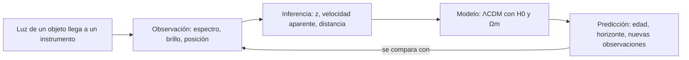

# B01-C01 — Naturaleza del universo

> **Clase aprobada por el autor del programa (2026-11-05)** bajo el estándar `clase-profunda-cientifica`. En el catálogo conserva el estado E0 hasta registrar la revisión disciplinar que exigen `AGENTS.md` y el estándar para avanzar de etapa.

<!-- nav:top -->
[🏠 Programa](../../../../README.md) · [📚 Bloque B01](../../../tronco-comun/B01-el-universo-y-el-pensamiento-cientifico.md) · [Siguiente: B01-C02 — Escalas desde la Tierra al cosmos observable →](../B01-C02-escalas-desde-la-tierra-al-cosmos-observable/CLASE.md)
<!-- /nav -->

[🧪 Laboratorio](laboratorio_edad_y_horizonte.py) · [📝 Ficha editorial](FICHA_EDITORIAL.md)

## 1. Ubicación, nivel y alcance

Esta es la primera clase del programa: la única que no da nada por supuesto, ni siquiera la astronomía. Estás en el Área A01, Bloque B01, clase 1 de 20. Empiezas en el nivel N0 (descubrir qué es el universo y cómo se habla de él) y terminas en N1 (usar unidades, hacer un cálculo sencillo y decir cuánto confías en el resultado).

Lo que verás: qué es el universo, qué parte de él podemos observar, y cómo se separa lo que se *mide* de lo que se *concluye* y de lo que se *supone* en un modelo. Lo que no verás todavía: la historia de la cosmología (bloque B02), la física detrás de la expansión ni la derivación de las ecuaciones del modelo. Aquí las usamos como herramientas y te decimos cuándo dejan de ser fiables.

## 2. Por qué esta clase existe

Seguramente has leído que «el universo tiene 13 800 millones de años» o que «el universo observable mide 93 000 millones de años luz». Son frases que se repiten con total seguridad. Pero ¿cómo se sabe? Nadie estuvo allí para medirlo con una regla ni con un reloj. Entonces, ¿qué hay detrás de esos números, y cuánto debemos fiarnos de ellos?

Esa es la pregunta de la clase, y de todo el programa: **¿qué puedo afirmar sobre el universo, y con qué evidencia?** Al final sabrás desmontar una cifra cosmológica en sus tres capas —lo que se observó, lo que se dedujo y lo que se asumió en un modelo— y acompañarla siempre de su unidad, su incertidumbre y su límite. Esta habilidad es el cimiento de las 19 clases siguientes: sin ella, las escalas (C02) y la expansión (C16) se aprenden como datos sueltos que hay que creer; con ella, se aprenden como conclusiones que puedes cuestionar.

## 3. Lo que podrás hacer al terminar

1. Clasificar afirmaciones sobre el universo como observación, inferencia o resultado de un modelo, y justificar por qué.
2. Calcular cuánto tarda la luz en recorrer una distancia, y convertir entre metros, unidades astronómicas, años luz y parsecs.
3. Estimar la distancia a una galaxia con la ley de Hubble y la escala de edad del universo con `1/H₀`, indicando cuánta incertidumbre arrastra el resultado.
4. Distinguir *universo* de *universo observable*, y explicar por qué la expansión no tiene un centro.
5. Ejecutar un cálculo reproducible y comprobar que el código acierta contra un caso con solución exacta.
6. Nombrar al menos un límite de cada método que uses.

La evidencia de todo esto es la **ficha de escala y edad** que armarás en el ejercicio 12 (se describe en la sección 20).

## 4. Con qué llegas y cómo comprobarlo

No necesitas saber astronomía. Sí necesitas manejar notación científica, hacer una regla de tres y despejar una incógnita en una ecuación sencilla. Comprueba tu punto de partida con cinco preguntas; las respuestas están justo debajo para que puedas autocorregirte.

1. Escribe 384 400 km en metros y en notación científica.
2. Un tren viaja a 80 km/h. ¿Cuánto tarda en recorrer 200 km?
3. En «67,4 ± 0,5», ¿qué significa el «±»?
4. Despeja `d` en `v = H·d`.
5. ¿Cuántos segundos tiene un año de 365,25 días?

<details>
<summary>Ver respuestas</summary>

1. 384 400 000 m = 3,844 × 10⁸ m. 2. 200 / 80 = 2,5 h. 3. El valor se estima como 67,4, y la incertidumbre es 0,5: el valor verdadero probablemente está entre 66,9 y 67,9. 4. `d = v / H`. 5. 365,25 × 24 × 3600 = 31 557 600 s.
</details>

Con cuatro o cinco aciertos, sigue. Con tres o menos, repasa primero B03 (matemática elemental): los ejercicios de esta clase se te harán cuesta arriba por la aritmética y no por la astronomía.

## 5. Un problema real y abierto: dos equipos, dos números

Para ver por qué importa separar medición, deducción y modelo, mira un caso vivo de la ciencia actual. La rapidez con que hoy se expande el universo se resume en un número llamado **constante de Hubble**, `H₀` (la definimos con cuidado más adelante). Dos grupos de investigación han medido `H₀` con métodos distintos y con mucho rigor.

El primero es la colaboración Planck, que analizó el fondo cósmico de microondas —una luz muy antigua que llena el cielo— y, dentro de un modelo cosmológico llamado ΛCDM, obtuvo `H₀ = 67,4 ± 0,5 km/s/Mpc` (fuente S1). El segundo es el equipo SH0ES, que midió distancias a galaxias relativamente cercanas, paso a paso, y obtuvo `H₀ = 73,04 ± 1,04 km/s/Mpc` (fuente S2). Ambos números llevan su incertidumbre, y aun así no coinciden. A esta discrepancia se la llama la *tensión de Hubble*, y sigue sin resolverse: puede deberse a un error sistemático no detectado, o a que el modelo está incompleto.

Lo valioso para ti no es quién tiene razón, sino lo que esto enseña: una cifra cosmológica no es un dato grabado en la naturaleza, es **el resultado de un método**, con sus supuestos y su margen de error. Cuando termines esta clase podrás explicar con tus propias palabras por qué dos mediciones serias pueden discrepar. Ten presente el límite: usaremos el modelo ΛCDM como herramienta de enseñanza; esta clase no decide cuál medición es la correcta ni reemplaza la literatura especializada.

## 6. El vocabulario que vamos a usar

Antes de calcular, hay que ponerse de acuerdo en las palabras, porque en cosmología los términos cercanos se confunden con facilidad.

El **universo** es todo: el espacio, la materia, la energía y el tiempo. No sabemos cuán grande es en total, y puede que sea mucho mayor que lo que vemos. El **universo observable** es solo la parte de la que ha tenido tiempo de llegarnos luz desde que empezó la expansión. Fíjate en la diferencia: lo que no vemos no necesariamente «no existe»; simplemente su luz aún no nos alcanza. Más adelante veremos que, en el modelo que usaremos, el borde del universo observable está hoy a unos 46 mil millones de años luz.

Para pensar con orden vamos a distinguir tres tipos de afirmaciones, que acompañarán todo el programa. Una **observación** es lo que un instrumento registra: un dato con su instrumento, fecha y calibración. Una **inferencia** es una conclusión que se saca de ese dato añadiendo un método o un supuesto. Un **modelo** es una representación simplificada del mundo, con reglas y parámetros, que sirve para predecir y que sólo vale dentro de ciertos límites.

Un ejemplo que usaremos durante toda la clase. Un astrónomo apunta un espectrógrafo a una galaxia y registra que una línea característica del hidrógeno, llamada **Hα**, aparece en 662,9 nm. Esa es la *observación*: un número, medido con un instrumento. Sabemos por experimentos de laboratorio que Hα, en reposo, está en 656,3 nm. Que la línea esté corrida hacia el rojo es un dato; interpretar ese corrimiento como que la galaxia se aleja a cierta velocidad es una *inferencia*; y decir que esa velocidad implica tal distancia usando una constante de expansión es apoyarse en un *modelo*. Tres capas, un mismo objeto. Mantén esa galaxia en mente: volverá varias veces.

Dos términos más que ya aparecieron. El **desplazamiento al rojo** o *redshift*, `z`, mide cuánto se ha estirado la luz; lo definimos en la sección 8. Y la **incertidumbre** es la forma honesta de decir cuánto conocemos un valor: un intervalo asociado a la medida, no un defecto de la medida.

## 7. Un modelo mental: de la luz a la conclusión

Casi todo lo que sabemos del universo lejano nos llega como luz. Por eso conviene tener presente un recorrido que siempre se repite: la luz de un objeto llega a nuestro instrumento; el instrumento registra una *observación*; a partir de ella hacemos *inferencias* (un corrimiento al rojo, una velocidad, una distancia); esas inferencias se integran en un *modelo* que predice cosas nuevas (una edad, un horizonte); y esas predicciones se vuelven a comparar con nuevas observaciones. Es un círculo: el modelo se pone a prueba con datos.



*Descripción textual del diagrama:* cinco cajas en cadena (la luz llega, observación, inferencia, modelo, predicción) y una flecha que devuelve la predicción a la observación para contrastarla. Cada paso añade supuestos y, con ellos, incertidumbre.

Hay además una imagen que ayuda a imaginar la expansión del universo. Piensa en una masa de pan con pasas que fermenta en el horno: a medida que la masa crece, **cada pasa se aleja de todas las demás**, y las más lejanas se alejan más rápido, porque hay más masa entre ellas. Ninguna pasa es el centro: desde la perspectiva de cualquiera, las otras se alejan. Con las galaxias pasa algo parecido: es el espacio entre ellas el que se estira. Esta imagen tiene un límite que debes recordar: la masa de pan tiene un borde y un exterior, y el universo no necesita ninguno de los dos para expandirse. La analogía sirve para visualizar las *distancias*, no para describir la geometría completa.

## 8. La explicación, paso a paso

### 8.1 Mirar lejos es mirar al pasado

La luz es muy rápida, pero no instantánea: viaja a `c = 299 792 458 m/s`. Eso significa que cuando miras algo, lo ves como era cuando la luz salió de él. Si divides una distancia `d` por `c`, obtienes el tiempo `t = d / c` que la luz tardó en llegar.

Algunos casos concretos. El Sol está a 1 unidad astronómica (1 au = 149 597 870 700 m, la distancia media Tierra–Sol): su luz tarda unos 499 segundos, es decir, 8,3 minutos; ves el Sol de hace 8 minutos. La Luna está a unos 384 400 km: su luz tarda 1,28 s. Próxima Centauri, la estrella más cercana al Sol, está a 4,244 años luz (1,301 pc; fuente S6): su luz salió hace 4,244 años. Y la galaxia de Andrómeda está a unos 2,5 millones de años luz (765 ± 28 kpc; fuente S7): la ves como era hace 2,5 millones de años. Cuanto más lejos miras, más atrás en el tiempo estás mirando. Esta idea, simple, es la que convierte a los telescopios en máquinas del tiempo.

De aquí sale una unidad cómoda para distancias enormes: el **año luz**, que es la *distancia* que recorre la luz en un año (no una unidad de tiempo, aunque lleve «año» en el nombre). Vale 9,4607 × 10¹⁵ m. Los astrónomos también usan el **parsec** (1 pc ≈ 3,0857 × 10¹⁶ m ≈ 3,26 años luz) y su millón de veces mayor, el **megaparsec** (1 Mpc = 10⁶ pc ≈ 3,0857 × 10¹⁹ km).

> **Pausa para pensar.** Si Andrómeda explotara hoy, ¿cuándo nos enteraríamos? ¿Y si nos enviaran un mensaje de radio desde allí, cuánto tardaría en llegar?
>
> <details><summary>Ver respuesta</summary>Ambas cosas tardarían lo mismo: unos 2,5 millones de años, porque la luz y la radio son ondas electromagnéticas que viajan a `c`. Lo que ves de Andrómeda es lo que ocurrió allí hace 2,5 millones de años.</details>

### 8.2 La luz que se estira: el corrimiento al rojo

Los átomos de cada elemento emiten y absorben luz solo en longitudes de onda muy precisas, como una huella dactilar. Para el hidrógeno, una de esas «huellas» es la línea Hα, que en un laboratorio aparece en 656,3 nm. Si miramos una galaxia lejana y vemos esa misma línea en una longitud de onda mayor, decimos que está **corrida hacia el rojo**: la luz se estiró mientras viajaba.

Se mide con el **desplazamiento al rojo** `z`:

```text
z = (λ_observada − λ_emitida) / λ_emitida          (adimensional)
```

donde `λ` es la longitud de onda. En nuestra galaxia: `λ_observada = 662,9 nm` y `λ_emitida = 656,3 nm`, así que `z = (662,9 − 656,3)/656,3 = 0,0101`. Un `z` positivo es un corrimiento al rojo; uno negativo, al azul. Equivale a decir `λ_observada = (1 + z) · λ_emitida`: la luz se alargó por un factor `1 + z`.

¿Por qué se estira? Porque, mientras la luz viaja, el espacio entre la galaxia y nosotros se expande y se lleva consigo a la onda. Es un detalle que importa: este `z` cosmológico **no es un efecto Doppler**, como el cambio de tono de una sirena que pasa. En el Doppler hay un objeto que se mueve *a través* del espacio; aquí el espacio mismo se estira. Aun así, cuando `z` es pequeño, ambas descripciones dan casi el mismo número y se suele escribir una velocidad aparente:

```text
v ≈ c · z          (válida solo si z ≪ 1)
```

Para nuestra galaxia, `v ≈ 299 792 km/s × 0,0101 ≈ 3,0 × 10³ km/s`. Anotamos solo dos cifras significativas porque la longitud de onda se midió con precisión de décimas de nanómetro; escribir más cifras sugeriría una exactitud que no tenemos.

### 8.3 La ley de Hubble: a más distancia, más velocidad

A comienzos del siglo XX se vio que, en promedio, las galaxias más lejanas muestran mayor corrimiento al rojo. A distancias cosmológicas «pequeñas» (hasta unos cientos de megaparsecs) esa relación es una proporción directa, la **ley de Hubble**:

```text
v = H₀ · d          →    d = v / H₀
```

`H₀` es la **constante de Hubble**: cuántos km/s adicionales de velocidad aparente corresponden a cada megaparsec de distancia, hoy. Se expresa en km/s/Mpc. Con `H₀ = 70 km/s/Mpc`, una galaxia a 1 Mpc se alejaría a 70 km/s, una a 10 Mpc a 700 km/s, etc.

Apliquémoslo a nuestra galaxia, con `v ≈ 3,0 × 10³ km/s` y `H₀ = 70`: `d = 3000 / 70 ≈ 43 Mpc`. Convertido a años luz (1 Mpc ≈ 3,26 millones de años luz), eso son unos 140 millones de años luz: la luz que recibimos salió de allí hace unos 140 millones de años, cuando en la Tierra dominaban los dinosaurios. Fíjate cómo se encadenan las tres capas: Hα en 662,9 nm (observación) → `z` y `v` (inferencia) → `d` con `H₀` (modelo).

La ley de Hubble tiene un límite importante. Solo describe objetos que acompañan la expansión. Los que están ligados por la gravedad no se separan: Andrómeda, por ejemplo, forma parte del mismo grupo de galaxias que la Vía Láctea (el *Grupo Local*) y de hecho se nos *acerca*, así que su luz está corrida hacia el azul. Aplicarle `d = v/H₀` daría un sinsentido.

### 8.4 De la constante de Hubble a la edad del universo

Si hoy la expansión sigue un ritmo `H₀`, hay una escala de tiempo natural: `t_H = 1/H₀`, el **tiempo de Hubble**. Para entenderlo con una analogía: si un coche ha recorrido una distancia a velocidad constante `v`, el tiempo transcurrido es distancia/velocidad; con la expansión, `1/H₀` hace el papel de «tiempo transcurrido si la expansión hubiera ido siempre al ritmo de hoy».

Con las unidades de `H₀` hay un atajo cómodo. Como `1 Mpc = 3,0857 × 10¹⁹ km`, resulta que `t_H = 977,8 / H₀` en miles de millones de años (Gyr) cuando `H₀` está en km/s/Mpc. Por ejemplo, con `H₀ = 70`, `t_H = 977,8/70 = 13,97 Gyr`.

Pero `t_H` **no es exactamente la edad del universo**: la expansión no ha tenido siempre el mismo ritmo. En el modelo ΛCDM la expansión se frenó al principio por la atracción de la materia, y más tarde se aceleró por la llamada energía oscura; ambos efectos se compensan en parte, y por eso `1/H₀` queda cerca de la edad, pero sin igualarla. Para obtener la edad hay que *integrar* esa historia, y eso hace el laboratorio de la sección 17: con `H₀ = 67,4` y `Ωm = 0,315` (la fracción de materia hoy) da 13,79 Gyr, mientras que `1/H₀` daría 14,51 Gyr. El análisis completo de Planck publica 13,797 ± 0,023 Gyr (fuente S1, Tabla 1): nuestro cálculo simplificado coincide con él dentro de esa incertidumbre.

Para fijar ideas hay un caso límite con solución exacta: un universo hecho *solo de materia* (el llamado modelo de Einstein–de Sitter). En él la edad es exactamente `2/(3H₀)`, es decir, dos tercios del tiempo de Hubble: 9,31 Gyr para `H₀ = 70`. Lo usaremos como referencia para verificar que nuestro código no se equivoca.

### 8.5 El horizonte: lo que alcanzamos a ver

Si el universo tiene unos 13,8 Gyr, uno esperaría que lo observable llegara a 13,8 mil millones de años luz de distancia. Sin embargo, el modelo da cerca de 46 mil millones de años luz de radio. ¿Contradicción? No. Mientras la luz viajaba hacia nosotros, el espacio que atravesaba se expandía: el lugar de donde salió esa luz *hoy* está mucho más lejos que el camino que la luz recorrió. Lo que llamamos **distancia comóvil** es justamente la distancia *de hoy* a un punto, descontando el efecto de la expansión que ya ocurrió; es la que describe el borde del universo observable, el **horizonte de partículas**. De ahí que el diámetro observable sea del orden de 92 mil millones de años luz, y que no viole ningún límite de velocidad: nada se mueve localmente más rápido que `c`; es el espacio entre las cosas el que crece.

### 8.6 Cómo viaja la incertidumbre

Cada resultado depende de datos con incertidumbre, y esa incertidumbre se traslada al resultado. Para el tiempo de Hubble, como `t_H = 977,8 / H₀`, el *error relativo* se conserva: `δt/t = δH/H`. Con `H₀ = 67,4 ± 0,5`, el error relativo es 0,5/67,4 = 0,74 %, y por tanto `t_H = 14,51 ± 0,11 Gyr`.

Para saber si dos mediciones discrepan, no basta mirar la diferencia: hay que compararla con su incertidumbre conjunta. Si las dos son independientes, se combinan «en cuadratura»: `σ = √(σ₁² + σ₂²)`. Con 67,4 ± 0,5 y 73,04 ± 1,04, la diferencia es 5,64 y `σ = √(0,5² + 1,04²) = 1,15`; el cociente, 5,64/1,15 ≈ 4,9, indica que la diferencia es unas cinco veces mayor que la incertidumbre combinada. Es un cálculo simplificado (supone errores independientes y de forma gaussiana); los artículos originales hacen un análisis más fino, pero la idea es esa: **una discrepancia solo es significativa en relación con su incertidumbre**.

## 9. Magnitudes, símbolos y unidades

Todo símbolo usado aparece aquí con su unidad; ya fueron introducidos en el texto.

| Símbolo | Qué es | Unidad | Valor o nota |
|---|---|---|---|
| `c` | velocidad de la luz en el vacío | m/s | 299 792 458 (exacto, SI) |
| `au` | unidad astronómica | m | 149 597 870 700 (exacto, IAU 2012) |
| `ly` | año luz = `c` × 1 año juliano | m | ≈ 9,4607 × 10¹⁵ |
| `pc` | parsec | m | ≈ 3,0857 × 10¹⁶ (≈ 3,2616 ly) |
| `Mpc` | megaparsec = 10⁶ pc | km | ≈ 3,0857 × 10¹⁹ |
| `λ` | longitud de onda | nm (10⁻⁹ m) | Hα en reposo: 656,3 |
| `z` | desplazamiento al rojo | adimensional | `z ≪ 1` para usar `v ≈ cz` |
| `v` | velocidad de recesión aparente | km/s | — |
| `d` | distancia | Mpc | — |
| `H₀` | constante de Hubble | km/s/Mpc | 67,4 ± 0,5 (S1); 73,04 ± 1,04 (S2) |
| `Ωm` | fracción de materia hoy | adimensional | 0,315 ± 0,007 (S1, base-ΛCDM) |
| `t_H` | tiempo de Hubble `1/H₀` | Gyr (10⁹ años) | `977,8 / H₀` |

Un año juliano son 365,25 días, o sea 31 557 600 s.

## 10. Convenciones y puntos de referencia

Trabajamos en la época actual (`z = 0`) y con el *tiempo cósmico* que mide el modelo desde el inicio de la expansión. Para la ley de Hubble usamos distancias *propias* de hoy; para el horizonte, distancias *comóviles* (sección 8.5). Un `z` positivo significa corrimiento al rojo; uno negativo, al azul. Usamos unidades SI, salvo las astronómicas (ly, pc, Mpc, Gyr), que se justifican por la escala de los objetos.

## 11. De dónde sale lo que afirmamos

Cada cifra importante de esta clase tiene un origen declarado. La tabla indica qué se consultó y qué falta.

| ID | Fuente | Localizador | Respalda | Estado de verificación |
|---|---|---|---|---|
| S1 | Planck Collaboration (Aghanim, N. et al.), *Planck 2018 results. VI. Cosmological parameters*, A&A 641, A6 (2020) | DOI 10.1051/0004-6361/201833910 · arXiv:1807.06209 | Resumen: `H₀ = 67,4 ± 0,5`; `Ωm = 0,315 ± 0,007` (base-ΛCDM). Tabla 1 (TT,TE,EE+lowE+lensing): `H₀ = 67,36 ± 0,54`, `Ωm = 0,3153 ± 0,0073`, edad `13,797 ± 0,023 Gyr` | Resumen y Tabla 1 del manuscrito arXiv (versión del 10 de agosto de 2021) leídos el 2026-11-05. La edad publicada sirve para contrastar el cálculo del laboratorio; el resto del artículo no se usó |
| S2 | Riess, A. G. et al., *A Comprehensive Measurement of the Local Value of the Hubble Constant with 1 km/s/Mpc Uncertainty from the Hubble Space Telescope and the SH0ES Team*, ApJL (2022) | DOI 10.3847/2041-8213/ac5c5b · arXiv:2112.04510 | Resultado base de la muestra cefeidas–SN Ia: `H₀ = 73,04 ± 1,04` (incluye sistemáticos) | Resumen y texto del manuscrito (versión del 20 de julio de 2022) consultados el 2026-11-05; no se reprodujo su análisis |
| S3 | BIPM, *The International System of Units (SI)*, 9.ª edición (2019), texto bilingüe | https://www.bipm.org/en/measurement-units/si-defining-constants · PDF de la 9.ª ed. | Definición del segundo; `c = 299 792 458 m/s`; `1 au = 149 597 870 700 m` (tabla de unidades no SI aceptadas) | Página y PDF consultados el 2026-11-05 |
| S4 | IAU, Resolución B2 de 2012, *on the re-definition of the astronomical unit of length* (XXVIII Asamblea General); IAU, Resolución B2 de 2015, nota 4 (definición de parsec) | Textos enlazados desde https://www.iau.org/Iau/Publications/List-of-Resolutions.aspx | 2012: `1 au = 149 597 870 700 m` exactamente (recomendación 1). 2015: `1 pc = (648 000/π) au` exactamente, ≈ 3,085 677 581… × 10¹⁶ m | Textos de ambas resoluciones leídos el 2026-11-05 |
| S5 | Hubble, E., *A relation between distance and radial velocity among extra-galactic nebulae*, PNAS 15(3), 168–173 (1929) | DOI 10.1073/pnas.15.3.168 · PMCID PMC522427 | Referencia histórica de la relación distancia–velocidad | Ficha bibliográfica confirmada el 2026-11-05 en PubMed Central; el artículo no se usa para ninguna cifra de la clase |
| S6 | NASA Exoplanet Archive, tabla `ps` (consulta TAP: host «Proxima Cen») | https://exoplanetarchive.ipac.caltech.edu | Distancia 1,30119 pc; paralaje 768,5 ± 0,2 mas | Consulta del 2026-11-05; archivo mutable, se cita la fecha |
| S7 | Riess, A. G., Fliri, J., Valls-Gabaud, D., *Cepheid Period-Luminosity Relations in the Near-Infrared and the Distance to M31 from the HST WFC3* (2012) | arXiv:1110.3769 · DOI 10.1088/0004-637X/745/2/156 | Distancia a M31 de 765 ± 28 kpc (módulo 24,42 ± 0,05 ± 0,03) | Resumen consultado el 2026-11-05 |

Lo que **no** respaldan estas fuentes: que ΛCDM sea la descripción definitiva del universo. Se citan resultados y se parafrasean; no se reproduce texto ni figuras. S5 es de interés histórico y no sostiene ninguna cifra de esta clase.

## 12. Cómo ver las escalas

Las distancias del universo abarcan tantos órdenes de magnitud que solo se pueden comparar en escala logarítmica, donde cada paso equivale a multiplicar por diez. Esta tabla es la versión accesible de esa figura:

| Objeto | Distancia (m) | Orden de magnitud (log₁₀) |
|---|---|---|
| Tierra–Luna | 3,844 × 10⁸ | 8,6 |
| Tierra–Sol | 1,496 × 10¹¹ | 11,2 |
| Próxima Centauri | ≈ 4,01 × 10¹⁶ | 16,6 |
| Andrómeda | ≈ 2,4 × 10²² | 22,4 |
| Horizonte observable (ΛCDM) | ≈ 4,4 × 10²⁶ | 26,6 |

Del primero al último hay unos 18 órdenes de magnitud; y respecto de tu propia estatura, 1 m, el borde observable está a más de 26. Si dibujas este gráfico, rotula el eje logarítmico y distingue los puntos por forma, no solo por color.

## 13. Ejemplo trabajado: la galaxia de la línea Hα, de principio a fin

Recorramos toda la cadena observación → inferencia → modelo con nuestra galaxia, explicando el porqué de cada paso.

**Datos observados.** `λ_obs(Hα) = 662,9 nm`, con una precisión de unos 0,1 nm. En el laboratorio, `λ_emit = 656,3 nm`.

**Paso 1 · Calcular `z` (inferencia).** `z = (662,9 − 656,3)/656,3 = 0,0101`. Comprobación: es positivo (corrimiento al rojo) y mucho menor que 1, así que la aproximación de la sección 8.2 es aceptable.

**Paso 2 · Velocidad aparente.** `v ≈ c·z = 299 792 km/s × 0,0101 ≈ 3,0 × 10³ km/s`. Dos cifras significativas, porque los datos no dan más.

**Paso 3 · Distancia con la ley de Hubble (modelo).** Con `H₀ = 70 km/s/Mpc`: `d = 3000/70 ≈ 43 Mpc`. Comprobación de unidades: `(km/s)/(km/s/Mpc) = Mpc`. ✓.

**Paso 4 · Tiempo de luz.** 43 Mpc ≈ 43 × 3,26 ≈ 140 millones de años luz: la luz salió hace unos 140 millones de años.

**Paso 5 · Escala de edad del universo.** `t_H = 977,8/70 = 13,97 Gyr` (comprobación: `1/(s⁻¹) = s`; con `H₀ = 2,268 × 10⁻¹⁸ s⁻¹` sale `4,408 × 10¹⁷ s = 13,97 Gyr`).

**Paso 6 · Incertidumbre.** Si en vez de 70 usamos `H₀ = 67,4 ± 0,5`, `t_H = 14,51 ± 0,11 Gyr` y la distancia pasa a `d = 3000/67,4 = 44,5 Mpc`. Cambiar `H₀` de 70 a 67,4 cambia la distancia en casi un 4 %: el modelo arrastra su incertidumbre hasta la distancia.

**Sentido físico.** Una galaxia a ~140 millones de años luz, con la luz de hace ~140 Myr, en un universo cuya escala de edad es ~14 Gyr: todo es coherente en orden de magnitud. Fíjate también en qué parte del resultado es sólida (la observación de 662,9 nm) y cuál depende de lo que supusimos (`H₀`).

## 14. Distintas formas de llegar, y cuándo dejan de servir

Hemos usado varios métodos y conviene saber cuándo fallan. El tiempo de Hubble `1/H₀` se calcula en una línea y no requiere modelo, pero ignora cómo cambió el ritmo de expansión, así que sirve para dimensionar y no para dar una edad precisa. Integrar el modelo ΛCDM da una edad y un horizonte reproducibles, pero depende de los parámetros (`H₀`, `Ωm`) y asume un universo plano; no sirve para decidir entre modelos alternativos. La distancia por `d = v/H₀` es rápida pero solo vale para `z` pequeño y objetos que acompañan la expansión. Y las distancias medidas objeto por objeto (la «escalera de distancias»), como las del equipo SH0ES, no dependen del modelo cosmológico, pero arrastran incertidumbres de calibración en cada peldaño; justamente ahí se discute el origen de la tensión de Hubble.

## 15. Práctica guiada

Estos tres ejercicios te acompañan con apoyos que van disminuyendo. Intenta resolverlos antes de abrir la solución.

**Ejercicio 1 · con los pasos indicados.** ¿Cuánto tarda la luz del Sol (1 au) y la de la Luna (384 400 km) en llegar a la Tierra? *Pasos:* usa `t = d / c` (sección 8.1), expresa ambas distancias en metros y divide por `c = 2,99792458 × 10⁸ m/s`.

<details><summary>Solución comentada</summary>

Sol: `1,495978707 × 10¹¹ m / 2,99792458 × 10⁸ m/s = 499,0 s = 8,32 min`. Luna: `3,844 × 10⁸ m / 2,998 × 10⁸ m/s = 1,282 s`. Ves el Sol como era hace ~8 min y la Luna como era hace ~1,3 s. Si te salió un número absurdo, revisa que la distancia esté en metros y la velocidad en m/s: mezclar km con m es el error más común.
</details>

**Ejercicio 2 · con una pista.** Próxima Centauri está a 4,244 años luz. Calcula su distancia en metros y en parsecs, y di cuánto tarda en llegarnos su luz. *Pista:* 1 ly = 9,4607 × 10¹⁵ m y 1 pc ≈ 3,2616 ly.

<details><summary>Solución comentada</summary>

`4,244 × 9,4607 × 10¹⁵ = 4,015 × 10¹⁶ m`; en parsecs, `4,244 / 3,2616 = 1,301 pc`. La luz tarda 4,244 años, porque un año luz es, por definición, lo que la luz recorre en un año.
</details>

**Ejercicio 3 · casi autónomo.** Andrómeda está a unos 2,5 × 10⁶ años luz. Calcula su distancia en metros y explica por qué no corresponde estimarla con `d = v/H₀` (sección 8.3).

<details><summary>Solución comentada</summary>

`2,5 × 10⁶ × 9,4607 × 10¹⁵ = 2,37 × 10²² m`. No corresponde aplicar la ley de Hubble porque Andrómeda está ligada por la gravedad al Grupo Local y se acerca a nosotros (su luz está corrida hacia el azul); su movimiento no sigue la expansión.
</details>

## 16. Práctica autónoma, transferencia e integrador

**Ejercicio 4.** Una galaxia se aleja a 3000 km/s. Estima su distancia con `H₀ = 67,4`, `70` y `73,04` km/s/Mpc, y comenta la dispersión. Usa la sección 8.3.

<details><summary>Solución comentada</summary>

`3000/67,4 = 44,5 Mpc`; `3000/70 = 42,9 Mpc`; `3000/73,04 = 41,1 Mpc`. La dispersión es de ≈ 3,4 Mpc (≈ 8 %): la incertidumbre de `H₀` se traslada a la distancia. Para 70, son unos 140 millones de años luz.
</details>

**Ejercicio 5.** Calcula `t_H` para `H₀ = 67,4 ± 0,5` y para `73,04 ± 1,04`, con su incertidumbre, y cuántas veces mayor que la incertidumbre combinada es la diferencia entre los dos `H₀`. Usa las secciones 8.4 y 8.6.

<details><summary>Solución comentada</summary>

`t_H = 977,8/67,4 = 14,51 ± 0,11 Gyr` y `977,8/73,04 = 13,39 ± 0,19 Gyr` (el error relativo se conserva: `0,5/67,4` y `1,04/73,04`). La diferencia de `H₀` es 5,64; la incertidumbre combinada, `√(0,5² + 1,04²) = 1,15`; el cociente, ≈ 4,9. Recuerda la advertencia de la sección 8.6: es un cálculo simplificado.
</details>

**Ejercicio 6.** Clasifica cada frase como observación (O), inferencia (I), resultado de un modelo (M) o afirmación sin respaldo (N), y justifica (sección 6): (a) «el espectro de la galaxia muestra Hα en 662,9 nm»; (b) «la galaxia se aleja a unos 3000 km/s»; (c) «el universo tiene 13,8 Gyr»; (d) «el universo se expande desde un punto central»; (e) «el universo es espacialmente plano».

<details><summary>Solución comentada</summary>

(a) **O**: es una medida con instrumento. (b) **I**: sale de `z` y de la aproximación `v ≈ cz`. (c) **M**: depende de ΛCDM y de sus parámetros ajustados. (d) **N**: el modelo no tiene un centro; la expansión ocurre en todos los puntos (masa de pan con pasas). (e) **I/M**: se concluye dentro del modelo con su incertidumbre; no se observa directamente.
</details>

**Ejercicio 7.** El laboratorio da un radio observable de 46,13 Gly. Calcula ese radio en metros, cuántas veces es el radio terrestre (6,371 × 10⁶ m) y el diámetro en Gly.

<details><summary>Solución comentada</summary>

`46,13 × 10⁹ × 9,4607 × 10¹⁵ = 4,36 × 10²⁶ m`; dividido por 6,371 × 10⁶ m da `6,85 × 10¹⁹` veces el radio terrestre; el diámetro es `2 × 46,13 = 92,3 Gly`.
</details>

**Ejercicio 8.** Una línea Hα se observa en 689,1 nm. Calcula `z`, la velocidad aparente `v ≈ cz` y la distancia con `H₀ = 70`. Luego explica por qué esa aproximación sería inaceptable si la línea apareciera en 1312,6 nm (secciones 8.2 y 8.3).

<details><summary>Solución comentada</summary>

`z = (689,1 − 656,3)/656,3 = 0,050`; `v ≈ 3 × 10⁵ × 0,05 = 1,5 × 10⁴ km/s`; `d = 15 000/70 ≈ 214 Mpc`. Con 1312,6 nm, `z = 1`: `v = cz` daría exactamente `c`, lo que no tiene sentido físico, porque el `z` cosmológico mide el estiramiento del espacio y no un movimiento a través de él; la aproximación solo vale para `z ≪ 1`. Ya en `z = 0,05` es solo aproximada.
</details>

**Ejercicio 9 · transferencia.** Un compañero dice: «si todo se aleja de nosotros, estamos en el centro del universo». Respóndele con la imagen de la masa con pasas (sección 7) e indica una limitación de esa imagen.

<details><summary>Solución comentada</summary>

En la masa que fermenta, desde cualquier pasa todas las demás se alejan y ninguna es el centro; las más lejanas se alejan más rápido, como dice la ley de Hubble. La limitación: la masa tiene borde y exterior, y el universo no los necesita; la imagen muestra distancias, no la geometría completa.
</details>

**Ejercicio 10 · transferencia.** Compara tres cifras con `H₀ = 70`: el tiempo de Hubble, la edad del modelo ΛCDM con `Ωm = 0,3` (ejecuta el laboratorio) y la edad de un universo solo de materia, `2/(3H₀)`. Explica el orden entre ellas (sección 8.4).

<details><summary>Solución comentada</summary>

`t_H = 13,97 Gyr`; ΛCDM ≈ 13,46 Gyr; solo materia = 9,31 Gyr. Un universo con solo materia se frena todo el tiempo, por eso es el más joven; en ΛCDM el frenado inicial se compensa en parte con la aceleración posterior, por eso queda cerca de `t_H`. Que 13,97 y 13,46 estén tan próximos es casi una coincidencia de estos parámetros. Para decidir entre modelos se necesitan observaciones independientes, como la edad de las estrellas más antiguas (bloque B17).
</details>

**Ejercicio 11 · transferencia.** Un titular dice: «el universo mide 93 000 millones de años luz de diámetro pero tiene 13 800 millones de años: imposible». Evalúa la afirmación (sección 8.5).

<details><summary>Solución comentada</summary>

93 000 millones es aproximadamente `2 × 46`, el diámetro *comóvil* del universo observable hoy. No es imposible: la luz viajó 13,8 Gyr, pero durante el trayecto el espacio se expandió, así que el lugar de origen está hoy más lejos que el camino recorrido. Nada supera `c` localmente. El titular confunde la distancia que recorrió la luz con la distancia comóvil actual.
</details>

**Ejercicio 12 · integrador.** Elabora la *ficha de escala y edad* (descrita en la sección 20) con dos objetos de tu elección: uno cercano con distancia publicada (para el tiempo de luz) y una galaxia lejana con corrimiento al rojo publicado (para la parte que usa `H₀`). Debe incluir: el tiempo de luz con su conversión de unidades; la clasificación O/I/M de tres afirmaciones; una estimación de distancia o edad que dependa de `H₀`, con su incertidumbre; un límite de lo que hiciste; y una ejecución del laboratorio con una variación de parámetros, explicando qué cambió.

<details><summary>Solución modelo</summary>

Una ficha completa puede usar Próxima Centauri o Andrómeda para el tiempo de luz (ejercicios 2 y 3; ninguna sirve para la ley de Hubble, y la ficha debe decirlo) y repetir el ejemplo trabajado de la sección 13 con una galaxia lejana. Se acepta cualquier par de objetos si cada cifra lleva unidad, fuente y límite, y si distingue qué fue observado, qué inferido y qué supuesto.
</details>

## 17. Laboratorio: tú calculas la edad del universo

**Qué vas a hacer.** El script [laboratorio_edad_y_horizonte.py](laboratorio_edad_y_horizonte.py) calcula, para un universo plano con materia, radiación y energía oscura (ΛCDM), su edad y el radio del universo observable. Hace dos integrales numéricas que suman la historia de la expansión. Los datos de entrada son parámetros **estimados** publicados (S1, S2); los resultados son **simulados**: no hay datos observados procesados aquí.

**Antes de ejecutarlo, predice.** Con lo visto en la sección 8.4, ¿la edad debería subir o bajar si aumentamos `H₀` manteniendo `Ωm`? (Debería bajar: un universo que se expande más rápido hoy ha tenido menos tiempo.)

**Cómo se sabe que el código funciona.** Antes de calcular nada, el script se prueba contra el universo Einstein–de Sitter, que tiene solución exacta (edad `2/(3H₀)` y horizonte `2c/H₀`). Si el resultado numérico se aparta más de una parte en diez mil, el script se detiene con un error. Así evitas confiar a ciegas en un cálculo.

**Resultados (ejecución del 2026-11-05, Python 3.12.9, NumPy 2.4.4, SciPy 1.17.1):**

| `H₀` (km/s/Mpc) | `Ωm` | Edad (Gyr) | Radio observable (Gly) |
|---|---|---|---|
| 67,40 | 0,315 | 13,791 | 46,13 |
| 73,04 | 0,315 | 12,726 | 42,57 |
| 70,00 | 0,300 | 13,461 | 45,28 |

**Contraste con una fuente.** La primera fila (13,791 Gyr) coincide con la edad publicada por Planck, 13,797 ± 0,023 Gyr (S1, Tabla 1): la diferencia es de 0,006 Gyr, menor que la incertidumbre publicada. Es una buena señal para el código, aunque no prueba el modelo.

**Cómo leerlos.** Al subir `H₀`, el universo resulta más joven y más pequeño: tu predicción se cumple. Cuidado con la segunda fila: **no** es un resultado del equipo SH0ES, sino el efecto de poner su `H₀` en un modelo cuyo `Ωm` viene de Planck, mezclando parámetros de dos mediciones. Sirve para ver la sensibilidad del modelo, no como cosmología.

**Límites.** No es un ajuste a datos; no incluye neutrinos masivos ni curvatura; no se debe usar como cálculo de investigación. Es un experimento de cálculo sin riesgos físicos; si más adelante lo amplías con observaciones reales, nunca mires al Sol sin un filtro certificado.

Para ejecutarlo (requiere `numpy` y `scipy`):

```bash
python programa/clases/B01/B01-C01-naturaleza-del-universo/laboratorio_edad_y_horizonte.py
```

## 18. Errores frecuentes y cómo corregirlos

**Confundir año luz con un tiempo.** El nombre engaña porque lleva «año», pero es una distancia. Se nota cuando un resultado en años aparece donde debía haber metros. Corrige repitiendo el ejercicio 2, convirtiendo siempre a metros.

**Pensar que hay un centro del universo.** Viene de imaginar una explosión que se expande desde un punto. Se detecta cuando alguien dibuja un punto de origen. Corrige con el ejercicio 9 y la imagen de la masa con pasas, y pide después un ejemplo en que esa imagen falle.

**Aplicar `d = v/H₀` a Andrómeda.** Se generaliza la ley a todo objeto. Se nota cuando sale una velocidad positiva para algo que se acerca. Corrige con el ejercicio 3 y repasa la idea de objetos ligados (sección 8.3).

**Usar `v = cz` con `z` grande.** Se aplica la fórmula de memoria. Se nota cuando sale `v ≥ c`. Corrige con el ejercicio 8.

**Dar una cifra sin unidad ni incertidumbre.** Se copia de un titular tal cual. Se nota en un valor «desnudo» en la ficha. Corrige reescribiéndolo con unidad, `±` y fuente.

## 19. Cómo sabrás que vas bien

A lo largo de la clase hay momentos para comprobar tu avance y decidir qué hacer. Después del vocabulario (sección 6): ¿puedes explicar la diferencia entre universo y universo observable? Si no, relee la sección y haz el ejercicio 6 antes de seguir. Tras el ejemplo trabajado (sección 13): ¿puedes explicar por qué `t_H` no es exactamente la edad? Si no, haz el ejercicio 10 con apoyo. Tras las prácticas guiadas: ¿todas tus respuestas llevan unidad? Si no, repite los ejercicios 1 y 2. Tras el laboratorio: ¿sabes qué prueba valida el script? Si no, lee su cabecera. Y al final: ¿qué parte de tu ficha es observación, cuál inferencia y cuál modelo? Si dudas, rehaz el ejercicio 6.

## 20. Qué entregas y cómo se evalúa

El producto de la clase es la **ficha de escala y edad** (una o dos páginas), con la salida del laboratorio. Debe mostrar, para un objeto cercano y una galaxia lejana con datos publicados, el tiempo de luz con sus conversiones, tres afirmaciones clasificadas en observación/inferencia/modelo, al menos una estimación que dependa de `H₀` con su incertidumbre, y un límite. Guarda la primera versión, la retroalimentación que recibas y los cambios que hagas; eso forma parte del portafolio.

La rúbrica se publica antes de empezar, para que sepas qué se valora:

| Criterio | Inicial | En desarrollo | Logrado | Destacado |
|---|---|---|---|---|
| Unidades y conversiones | Errores frecuentes | Algún error corregido | Todas correctas | Además verifica dimensionalmente |
| Clasificación O/I/M | Confunde | Acierta la mayoría | Acierta y justifica | Detecta supuestos ocultos |
| Incertidumbre | Ausente | Cita pero no propaga | Propaga y comenta | Compara con la tensión de Hubble |
| Reproducibilidad | No ejecuta | Ejecuta sin validar | Ejecuta y valida con Einstein–de Sitter | Variación documentada de parámetros |
| Fuentes y límites | Sin fuente | Fuente sin límite | Fuente con límite | Distingue lo verificado de lo pendiente |

Hay tres condiciones críticas que **no se compensan con promedio**: no presentar una cifra simulada como observada; no afirmar que ΛCDM esté demostrado; y citar solo fuentes realmente consultadas.

## 21. Ética, seguridad y límites

La cosmología se presta a la exageración, así que la primera norma ética es la honestidad: distinguir lo observado, lo estimado y lo simulado, y no «resolver» la tensión de Hubble por preferencia personal. Esta clase presenta la cosmología científica; las cosmovisiones indígenas y culturales sobre el origen del cielo se estudian en el bloque B02 como saberes propios, sin tratarlas como errores ni confundirlas con ciencia moderna.

En cuanto a accesibilidad: las matemáticas están escritas también en texto, el diagrama tiene descripción, se usan tablas en lugar de figuras y no se depende del color; todos los ejercicios se pueden hacer sin conexión a internet. Este borrador fue asistido por IA y requiere revisión humana antes de usarse con estudiantes. Es material educativo: no sirve para investigación, datación ni certificación de ningún tipo.

## 22. Para cerrar y seguir

Mirar lejos es mirar al pasado, y toda cifra cosmológica es el resultado de un método, con unidad, incertidumbre y límite. Aprendiste a descomponer una afirmación en observación, inferencia y modelo, a pasar de un corrimiento al rojo a una distancia y a una escala de edad, y a medir cuán fiable es el resultado. Quedan abiertas dos preguntas que la ciencia aún discute: ¿por qué difieren las mediciones de `H₀`? y ¿qué extensión tiene el universo más allá de lo observable?

**Glosario español–inglés.** universo observable · *observable universe*; desplazamiento al rojo · *redshift*; constante de Hubble · *Hubble constant*; tiempo de Hubble · *Hubble time*; año luz · *light-year*; horizonte de partículas · *particle horizon*; incertidumbre · *uncertainty*.

**Continuidad.** La clase B01-C02 reutiliza lo que acabas de practicar: convertir unidades y expresar un orden de magnitud con su incertidumbre, para construir una escalera de escalas desde la Tierra hasta el cosmos observable. Más adelante, B01-C16 retomará la clasificación observación/inferencia/modelo, aplicada a la expansión.

**Referencias:** ver sección 11. De S1 y S2 se usaron el resumen y las tablas citadas; para avanzar de etapa falta una revisión disciplinar de cómo se usan.

<!-- nav:bottom -->
---

[← Inicio del bloque](../../../tronco-comun/B01-el-universo-y-el-pensamiento-cientifico.md) · [📚 Bloque B01](../../../tronco-comun/B01-el-universo-y-el-pensamiento-cientifico.md) · [Siguiente: B01-C02 — Escalas desde la Tierra al cosmos observable →](../B01-C02-escalas-desde-la-tierra-al-cosmos-observable/CLASE.md)
<!-- /nav -->
