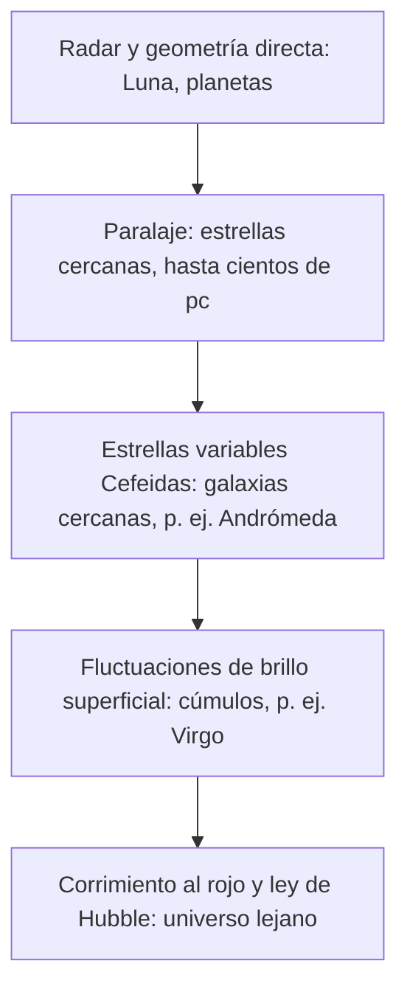

# B01-C02 — Escalas desde la Tierra al cosmos observable

<!-- nav:top -->
[🏠 Programa](../../../../README.md) · [📚 Bloque B01](../../../tronco-comun/B01-el-universo-y-el-pensamiento-cientifico.md) · [← Anterior: B01-C01 — Naturaleza del universo](../B01-C01-naturaleza-del-universo/CLASE.md) · [Siguiente: B01-C03 — Objetos celestes y sus diferencias →](../../../tronco-comun/B01-el-universo-y-el-pensamiento-cientifico.md#b01-c03)
<!-- /nav -->

## 1. Ubicación, nivel y alcance

Segunda clase del bloque B01. Retomas lo que aprendiste en la [clase anterior](../B01-C01-naturaleza-del-universo/CLASE.md): que toda cifra astronómica es un resultado con unidad e incertidumbre. Ahora la pregunta es otra: ¿cómo se *piensa* un número como 4,4 × 10²⁶ metros? Pasas de N1 a un N1 más sólido: usarás potencias de diez, logaritmos decimales y cocientes para comparar tamaños y distancias que no caben en la intuición.

Verás cómo se ordenan los objetos más conocidos, desde la Tierra hasta el borde del universo observable, y por qué cada peldaño de esa escalera se mide con un método distinto. No verás todavía la física de cada objeto (bloques A03 y A05) ni los instrumentos que miden esas distancias (bloques A04).

## 2. Por qué esta clase existe

Cuando alguien dice que Próxima Centauri está «a cuatro años luz» y que Andrómeda está «a dos millones y medio», es fácil oír solo «lejos» y «más lejos». Pero entre una y otra hay un factor de casi seis cien mil. Si no tienes una manera de *sentir* esa diferencia, las cifras se vuelven decoración y no puedes detectar un error, como cuando un titular se equivoca por un factor mil.

La decisión central de la clase es: **¿cómo comparo magnitudes que difieren en muchos órdenes de magnitud sin perder el sentido de cuánto son?** Aprenderás tres herramientas: la notación científica, la escala logarítmica y el cociente. Y aprenderás una lección de método: la escalera de distancias, donde cada peldaño se apoya en el anterior y hereda su incertidumbre. Lo necesitarás para cada clase posterior del programa, empezando por la próxima (los objetos celestes) y por la expansión (C16).

## 3. Lo que podrás hacer al terminar

1. Expresar cualquier distancia astronómica en notación científica y convertirla entre metros, au, años luz y parsecs.
2. Comparar dos magnitudes con un cociente y con una diferencia de logaritmos, y decir cuál de las dos es la pregunta correcta en cada caso.
3. Construir una escala de tamaño humano (modelo a escala) para el Sol, la Tierra y la estrella más cercana.
4. Obtener una distancia por paralaje y explicar por qué ese método deja de servir a mayor distancia.
5. Nombrar el método que se usa en cada peldaño de la escalera y su limitación.
6. Detectar, con un cálculo de orden de magnitud, un error de un factor 10 o más en una cifra publicada.

La evidencia es la **escalera de escalas personal** del ejercicio 12 (sección 20).

## 4. Con qué llegas y cómo comprobarlo

Necesitas lo de la clase anterior: notación científica, regla de tres y conversión de unidades, más saber que un año luz es una distancia. Cinco preguntas:

1. Escribe 4 515 000 000 000 m en notación científica.
2. ¿Cuántas veces mayor es 3 × 10⁸ que 3 × 10⁵?
3. ¿Qué número `x` cumple `10ˣ = 1000`?
4. Si algo mide 6,371 × 10⁶ m, ¿cuántos km son?
5. ¿Qué tarda más la luz: recorrer 1,5 × 10¹¹ m o 3,8 × 10⁸ m?

<details>
<summary>Ver respuestas</summary>

1. 4,515 × 10¹² m. 2. 1000 veces (10³). 3. `x = 3`: ese es el logaritmo decimal de 1000. 4. 6371 km. 5. La primera: 499 s frente a 1,28 s, porque `t = d / c`.
</details>

Con cuatro o cinco aciertos, sigue. Con tres o menos, repasa B03 antes de los ejercicios 4 a 12.

## 5. Un caso que cabe en una mano: el Sol del tamaño de una pelota

Para sentir las distancias, ayuda cambiar de escala. Imagina que el Sol es una pelota de 1 metro de diámetro, del tamaño de una pelota grande de ejercicio. En esa escala, la Tierra sería una cuenta de 9 milímetros de diámetro, como un guisante, y estaría a 107 metros de la pelota, más o menos un campo de fútbol. Neptuno, del tamaño de una pelota de ping-pong (3,6 cm), estaría a unos 3,2 km. Y la estrella más cercana, Próxima Centauri, estaría a casi **29 000 km** del Sol: más que el diámetro de la Tierra completa.

Fíjate en lo que pasa con esta imagen: de un solo golpe se entiende que el sistema solar es casi vacío y que las estrellas están enormemente separadas entre sí. Esa sensación es el objetivo de la clase, y las secciones siguientes enseñan a obtenerla con números que puedas comprobar. Los valores usados en este ejemplo salen de fuentes que verás en la sección 11; en la sección 13 repetimos el cálculo paso a paso.

## 6. Vocabulario

Un **orden de magnitud** es una potencia de diez: decir que dos cantidades difieren en «tres órdenes de magnitud» significa que una es unas mil veces la otra. La **notación científica** escribe un número como `a × 10ⁿ`, con `1 ≤ a < 10`; el exponente `n` indica el orden de magnitud. El **logaritmo decimal** `log₁₀(x)` es el exponente al que hay que elevar 10 para obtener `x`: `log₁₀(1000) = 3`. Si comparas dos cantidades por **cociente** preguntas «¿cuántas veces más grande?»; si comparas sus logaritmos y los restas preguntas «¿cuántos órdenes de magnitud de diferencia?». Ambas preguntas son válidas, pero responden cosas distintas.

La **unidad astronómica** (au) es la distancia convencional de 149 597 870 700 m, cercana a la distancia media entre la Tierra y el Sol. El **año luz** (ly) es la distancia que la luz recorre en un año juliano. El **parsec** (pc) es la distancia a la que 1 au subtiende un ángulo de 1 segundo de arco (1″); por eso vale exactamente `648 000/π` au. El **paralaje** es el pequeño cambio en la posición aparente de una estrella cercana, respecto de las lejanas, cuando la Tierra se mueve de un lado a otro de su órbita. La **escalera de distancias** es el conjunto de métodos que se encadenan para medir distancias cada vez mayores, de modo que cada uno se calibra con el anterior.

## 7. Modelo mental: una escalera, no una regla

Mide una mesa con una regla y listo. Para distancias astronómicas no existe una «regla» que funcione en todas partes: cada rango se mide con un método que solo vale dentro de un intervalo, y los intervalos se encadenan.



*Descripción textual:* cinco peldaños en cadena, de arriba abajo: geometría directa, paralaje, Cefeidas, fluctuaciones de brillo superficial y ley de Hubble. Cada peldaño se calibra con el anterior.

Que la escalera sea una cadena tiene una consecuencia importante: **si un peldaño tiene un error sistemático, ese error se propaga a todos los siguientes.** Es la raíz de debates como el de la tensión de Hubble que viste en C01. Una analogía: construir una escalera sin medir bien el primer escalón; no importa cuán precisos sean los demás, todos quedarán desplazados.

## 8. La explicación, paso a paso

### 8.1 Pensar en potencias de diez

Las distancias de esta clase van de unos 10⁶ m (el radio de la Tierra) a unos 10²⁶ m (el borde observable), es decir, de **veinte órdenes de magnitud**. Los humanos no tenemos intuición para esa diferencia, pero sí para contar ceros. Por eso escribimos `a × 10ⁿ` y miramos el exponente: el exponente de un número es, con buena aproximación, su `log₁₀`.

La regla práctica: para **multiplicar** potencias de diez se suman los exponentes, y para **dividir** se restan. Por ejemplo, el cociente entre el radio del Sol (6,957 × 10⁸ m) y el de la Tierra (6,371 × 10⁶ m) es `(6,957/6,371) × 10^(8−6) = 1,092 × 10² ≈ 109`. Comparar con el cociente da directamente el factor; los exponentes dan una estimación inmediata de orden de magnitud.

### 8.2 Escala lineal y escala logarítmica

Si dibujas en un papel de 10 cm de ancho la distancia a Neptuno (4,5 × 10¹² m), el radio de la Tierra (6,4 × 10⁶ m) mediría 14 *nanómetros* en ese mismo dibujo: invisible. En una **escala logarítmica**, cada marca equivale a multiplicar por diez, y los 20 órdenes de magnitud caben en el mismo papel con la misma separación entre marcas. Lo que se gana en espacio se pierde en intuición de proporciones: dos objetos que en la escala logarítmica se ven «cerca» pueden diferir en un factor 100. Por eso conviene leer siempre el eje.

### 8.3 La escalera de distancias, peldaño a peldaño

**Geometría directa y radar.** Para la Luna, el Sol y los planetas se dispone de mediciones muy precisas porque podemos enviar señales y medir su tiempo de ida y vuelta, o seguir naves. Por ejemplo, el valor de 1 au es *exacto por convención* (S1, S3) y el semieje mayor de la órbita lunar es 384,4 × 10³ km (S5).

**Paralaje.** Mira un dedo estirado primero con un ojo y luego con el otro: parece moverse respecto del fondo. Con las estrellas, los «dos ojos» son dos posiciones de la Tierra separadas seis meses, y el desplazamiento angular `p` de la estrella más cercana respecto de las lejanas permite obtener `d = 1/p`, con `d` en parsecs y `p` en segundos de arco. Para Próxima Centauri, `p = 768,5 ± 0,2 mas` (milisegundos de arco; S6), es decir `p = 0,7685″`, así que `d = 1/0,7685 = 1,301 pc`, que concuerda con el valor publicado. El método pierde fuerza cuando el ángulo se vuelve tan pequeño que se acerca a la incertidumbre de la medida.

**Cefeidas.** Hay estrellas, las Cefeidas, que pulsan con un periodo relacionado con su luminosidad real. Medir el periodo da la luminosidad; comparar con el brillo aparente da la distancia. Con este método, un equipo estimó la distancia a Andrómeda en 765 ± 28 kpc (S7).

**Fluctuaciones de brillo superficial.** En galaxias elípticas lejanas, la granularidad del brillo (cuántas estrellas caen en cada píxel) depende de la distancia. Con este método se obtuvo una distancia media al cúmulo de Virgo de 16,5 ± 0,1 (estadística) ± 1,1 (sistemática) Mpc (S8).

**Corrimiento al rojo y ley de Hubble.** Para el universo lejano, la clase anterior: `d = v/H₀`, con la salvedad de que `H₀` se calibra con los peldaños inferiores.

### 8.4 Qué pasa con la incertidumbre

Cada peldaño añade incertidumbre. En nuestro ejemplo: la distancia a Próxima tiene una incertidumbre relativa de 0,2/768,5 ≈ 0,03 %; la de Andrómeda, 28/765 ≈ 3,7 %; la de Virgo, la incertidumbre sistemática es 1,1/16,5 ≈ 6,7 %. A mayor distancia, mayor incertidumbre: una norma general, que debes recordar cuando leas una distancia sin su `±`.

## 9. Magnitudes, símbolos y unidades

| Símbolo | Qué es | Unidad | Valor o nota |
|---|---|---|---|
| `n` | exponente (orden de magnitud) | adimensional | — |
| `log₁₀(x)` | logaritmo decimal | adimensional | `log₁₀(10ⁿ) = n` |
| `au` | unidad astronómica | m | 149 597 870 700 (exacto) |
| `ly` | año luz | m | ≈ 9,4607 × 10¹⁵ |
| `pc` | parsec = `648 000/π` au | m | ≈ 3,0857 × 10¹⁶ (exacto por definición) |
| `p` | paralaje | segundos de arco (″) o mas | `1 mas = 10⁻³″` |
| `d` | distancia | pc | `d = 1/p` con `p` en ″ |
| `R_⊕` | radio medio de la Tierra | m | 6,371 × 10⁶ (S5) |
| `R_⊙` | radio nominal del Sol | m | 6,957 × 10⁸ (S9) |

## 10. Convenciones y referencias

Las distancias de esta clase son **medias**: no se consideran la excentricidad de las órbitas ni la época. Para el borde observable se usa la distancia comóvil *de hoy* calculada en C01. El paralaje se mide respecto del fondo de estrellas muy lejanas, y se expresa como ángulo positivo.

## 11. De dónde sale lo que afirmamos

| ID | Fuente | Localizador | Respalda | Estado |
|---|---|---|---|---|
| S1 | BIPM, *The International System of Units (SI)*, 9.ª ed. (2019) | Tabla de unidades no SI aceptadas; definición de `c` y del metro | `1 au = 149 597 870 700 m`; `c` exacta | PDF leído el 2026-11-05 |
| S2 | IAU, Resolución B2 de 2015, nota 4 | https://www.iau.org/Iau/Publications/List-of-Resolutions.aspx | `1 pc = (648 000/π) au` | Texto leído el 2026-11-05 |
| S3 | IAU, Resolución B2 de 2012 | idem | `1 au` exacta | Texto leído el 2026-11-05 |
| S4 | NASA NSSDC, *Planetary Fact Sheet – Metric* (actualizada el 18-mar-2025) | idem | Distancia Sol–Neptuno 4515 × 10⁶ km | Consultada el 2026-11-05 |
| S5 | NASA NSSDC, *Earth Fact Sheet* (actualizada el 15-nov-2024) y *Moon Fact Sheet* (actualizada el 11-ene-2024) | https://nssdc.gsfc.nasa.gov/planetary/factsheet/ | Radio medio de la Tierra 6371 km; semieje mayor lunar 384,4 × 10³ km | Consultadas el 2026-11-05 |
| S6 | NASA Exoplanet Archive, consulta TAP (host «Proxima Cen») | https://exoplanetarchive.ipac.caltech.edu | Paralaje 768,5 ± 0,2 mas; distancia 1,30119 pc | Consulta del 2026-11-05 (archivo mutable) |
| S7 | Riess, Fliri y Valls-Gabaud, arXiv:1110.3769 (2012) | DOI 10.1088/0004-637X/745/2/156 | M31: 765 ± 28 kpc por Cefeidas | Resumen consultado el 2026-11-05 |
| S8 | Mei, S. et al., *The ACS Virgo Cluster Survey. XIII*, ApJ 655, 144 (2007) | arXiv:astro-ph/0702510 | Virgo: 16,5 ± 0,1 ± 1,1 Mpc por fluctuaciones de brillo superficial | Resumen consultado el 2026-11-05 |
| S9 | IAU, Resolución B3 de 2015 (valores nominales), arXiv:1510.07674 | texto de la resolución | `R_⊙ = 6,957 × 10⁸ m` nominal | Texto leído el 2026-11-05 |

Límites: la clase usa cada fuente para el valor indicado; no se leyó el análisis completo de S7 ni S8. El valor del radio observable viene del cálculo de C01 (modelo), no de una medición directa.

## 12. Cómo ver las escalas

La tabla recoge los resultados del laboratorio; es la versión accesible de un gráfico logarítmico.

| Objeto | Distancia o radio (m) | log₁₀ | Cuántas veces el anterior |
|---|---|---|---|
| Radio medio de la Tierra | 6,371 × 10⁶ | 6,80 | — |
| Distancia Tierra–Luna | 3,844 × 10⁸ | 8,58 | 60,3 |
| Radio del Sol | 6,957 × 10⁸ | 8,84 | 1,81 |
| 1 au | 1,496 × 10¹¹ | 11,17 | 215 |
| Sol–Neptuno | 4,515 × 10¹² | 12,65 | 30,2 |
| Próxima Centauri | 4,015 × 10¹⁶ | 16,60 | 8,89 × 10³ |
| Andrómeda | 2,361 × 10²² | 22,37 | 5,88 × 10⁵ |
| Virgo | 5,091 × 10²³ | 23,71 | 21,6 |
| Radio observable (modelo) | 4,364 × 10²⁶ | 26,64 | 857 |

Si lo dibujas, usa un eje logarítmico rotulado con potencias de diez, marcadores de forma distinta y etiquetas directas en los puntos. Descripción larga: las distancias crecen con saltos desiguales; el mayor es de la estrella más cercana a Andrómeda (casi 6 × 10⁵), el menor entre el radio del Sol y la distancia a la Luna.

## 13. Ejemplo trabajado: el Sol de un metro

Datos (publicados): `R_⊙ = 6,957 × 10⁸ m`, `R_⊕ = 6,371 × 10⁶ m`, `1 au = 1,496 × 10¹¹ m`, Neptuno a `4,515 × 10¹² m`, Próxima a `4,015 × 10¹⁶ m`.

**Paso 1 · Factor de escala.** El Sol real tiene un diámetro `2R_⊙ = 1,391 × 10⁹ m`. Para que mida 1 m, multiplicamos todas las longitudes por `f = 1/(1,391 × 10⁹) = 7,19 × 10⁻¹⁰`. Comprobación: el factor es adimensional y mucho menor que 1, como corresponde a una reducción.

**Paso 2 · Aplicar `f` a la Tierra.** Diámetro terrestre `2R_⊕ = 1,274 × 10⁷ m` → `1,274 × 10⁷ × 7,19 × 10⁻¹⁰ = 9,2 × 10⁻³ m` = 9,2 mm.

**Paso 3 · Distancias.** 1 au → `107,5 m`; Neptuno → `3,25 km`; Próxima → `2,89 × 10⁷ m = 28 900 km`.

**Paso 4 · Sentido físico.** La Tierra es un guisante a un campo de fútbol del balón central, y la siguiente estrella queda a una distancia mayor que dos diámetros de la Tierra real. Lo que la intuición cotidiana llama «espacio» es casi vacío, y eso explica por qué las estrellas casi nunca chocan.

**Paso 5 · Incertidumbre.** Los datos de entrada tienen 3 a 4 cifras significativas, así que el resultado se debe dar con 2 o 3: «9 mm», «107 m», «29 000 km». Dar «28 861,4 km» sería afirmar una precisión que los datos no tienen.

## 14. Distintas formas de comparar, y cuándo dejan de servir

El **cociente** (`A/B`) dice cuántas veces cabe una magnitud en otra: sirve para modelos a escala. La **diferencia de logaritmos** (`log A − log B`) dice cuántos órdenes de magnitud las separan: sirve para ver el rango total, pero oculta si el factor es 11 o 99. La **resta** (`A − B`) solo tiene sentido si ambas están en la misma unidad y la diferencia absoluta importa (por ejemplo, la longitud de un viaje). El **modelo a escala** da intuición inmediata, pero requiere que no mezcles escalas distintas para distancias y tamaños (en nuestro modelo del Sol de un metro, el tamaño del planeta y su distancia usan la *misma* escala, lo que hace visible el vacío).

## 15. Práctica guiada

**Ejercicio 1 · con los pasos indicados.** Calcula cuántas veces cabe el radio de la Tierra en el radio del Sol, y cuántos radios solares caben en 1 au. *Pasos:* divide los valores de la tabla de la sección 9.

<details><summary>Solución comentada</summary>

`6,957 × 10⁸ / 6,371 × 10⁶ = 109,2`; `1,496 × 10¹¹ / 6,957 × 10⁸ = 215,0`. Al comparar exponentes (8−6 = 2, 11−8 = 3) ya sabías que los resultados andarían en torno a 10² y 10³: tu estimación de orden de magnitud acierta.
</details>

**Ejercicio 2 · con una pista.** ¿Cuánto tarda la luz en ir del Sol a Neptuno? *Pista:* `t = d/c`, con `d = 4,515 × 10¹² m`.

<details><summary>Solución comentada</summary>

`4,515 × 10¹² / 2,998 × 10⁸ = 1,506 × 10⁴ s ≈ 4,18 h`. Una señal de radio tardaría poco más de cuatro horas en cruzar el sistema solar hasta Neptuno, en comparación con 8 minutos hasta el Sol.
</details>

**Ejercicio 3 · casi autónomo.** Con `p = 768,5 mas` calcula la distancia a Próxima y su incertidumbre usando `δp = 0,2 mas`.

<details><summary>Solución comentada</summary>

`p = 0,7685″` → `d = 1/0,7685 = 1,3012 pc`. La incertidumbre relativa es `0,2/768,5 = 2,6 × 10⁻⁴`; así `δd ≈ 1,3012 × 2,6 × 10⁻⁴ = 3,4 × 10⁻⁴ pc`. Resultado: `1,3012 ± 0,0003 pc`, que equivale a 4,244 años luz. Concuerda con el valor publicado de 1,30119 pc.
</details>

## 16. Práctica autónoma, transferencia e integrador

**Ejercicio 4.** Convierte 765 kpc a millones de años luz y expresa la incertidumbre de ±28 kpc en las mismas unidades.

<details><summary>Solución comentada</summary>

`765 000 pc × 3,2616 ly/pc = 2,495 × 10⁶ ly ≈ 2,50 Mly`; `28 000 × 3,2616 = 9,1 × 10⁴ ly = 0,09 Mly`. Resultado `2,50 ± 0,09 Mly`: coherente con la cifra aproximada «2,5 millones de años luz» de C01.
</details>

**Ejercicio 5.** La galaxia de C01 está a unos 43 Mpc. ¿Cuántas veces más lejos está que el cúmulo de Virgo (16,5 Mpc)? ¿Qué diferencia de tiempo de luz hay entre ambas?

<details><summary>Solución comentada</summary>

Cociente `43/16,5 = 2,6`. Tiempos de luz: `43 Mpc × 3,26 Mly/Mpc = 140 Mly` y `16,5 × 3,26 = 53,8 Mly`; diferencia ≈ 86 millones de años. Nuestra galaxia está claramente más allá de Virgo, en pleno flujo de Hubble (C01).
</details>

**Ejercicio 6.** Rehaz el modelo de la sección 13 con una pelota de diámetro 10 cm. ¿A qué distancia quedaría la Tierra y qué tamaño tendría?

<details><summary>Solución comentada</summary>

El factor es `f = 0,1 / 1,391 × 10⁹ = 7,19 × 10⁻¹¹`. La Tierra mide `1,274 × 10⁷ × 7,19 × 10⁻¹¹ = 0,92 mm` y queda a `1,496 × 10¹¹ × 7,19 × 10⁻¹¹ = 10,8 m`. Todo es diez veces menor que en el modelo de 1 m: el factor de escala cambia, pero los cocientes entre objetos no.
</details>

**Ejercicio 7.** ¿Cuántos órdenes de magnitud hay entre el radio de la Tierra y el radio observable? ¿Y entre tu estatura (1,7 m) y el radio observable?

<details><summary>Solución comentada</summary>

`log₁₀(4,364 × 10²⁶) − log₁₀(6,371 × 10⁶) = 26,64 − 6,80 = 19,8` órdenes. Respecto de 1,7 m: `26,64 − 0,23 = 26,4` órdenes. La cifra de 19,8 coincide con la salida del laboratorio.
</details>

**Ejercicio 8.** Si dibujaras Neptuno a 10 cm del Sol en escala lineal, ¿qué tamaño tendría el radio de la Tierra? ¿Por qué se usa escala logarítmica?

<details><summary>Solución comentada</summary>

`6,371 × 10⁶ / 4,515 × 10¹² = 1,41 × 10⁻⁶` → `0,1 m × 1,41 × 10⁻⁶ = 1,4 × 10⁻⁷ m = 141 nm`. Es invisible; en escala logarítmica el mismo papel muestra ambos objetos. Pero ya no se ven las proporciones reales: hay que leer el eje.
</details>

**Ejercicio 9 · transferencia.** Un titular dice: «Neptuno está a 4500 millones de km del Sol, 100 veces más lejos que la Tierra». Evalúa la comparación.

<details><summary>Solución comentada</summary>

`4515 × 10⁶ km / 149,6 × 10⁶ km = 30,2` veces, no 100. El valor absoluto del titular es correcto; el factor está inflado más de tres veces. Detectarlo no requiere calculadora: 4500/150 = 30.
</details>

**Ejercicio 10 · transferencia.** Un cartel muestra «el universo en escala» con un eje lineal que incluye la Luna y las galaxias. Señala tres razones por las que esa imagen no puede ser fiel.

<details><summary>Solución comentada</summary>

(1) La Luna está a ~10⁸ m y las galaxias a ~10²² m: un eje lineal no puede mostrar ambas a la vez. (2) Si el cartel usa un truco (cambio de escala a mitad del eje), debe indicarlo; si no, confunde. (3) Mezcla distancias con tamaños: el radio de una galaxia y la distancia a ella son magnitudes distintas. Un buen cartel declara el eje, la unidad y el cambio de escala.
</details>

**Ejercicio 11 · transferencia.** ¿Se podría medir la distancia a Virgo (16,5 Mpc) con paralaje? Calcula el ángulo y compáralo con la incertidumbre de la medida de Próxima.

<details><summary>Solución comentada</summary>

`p = 1/(16,5 × 10⁶) ″ = 6,06 × 10⁻⁸″`. La incertidumbre de la paralaje de Próxima es 0,2 mas = `2 × 10⁻⁴″`. El ángulo buscado es unas 3300 veces menor que esa incertidumbre, así que no se mediría. Por eso hacen falta peldaños superiores (Cefeidas, fluctuaciones de brillo superficial).
</details>

**Ejercicio 12 · integrador.** Elabora tu *escalera de escalas personal* (sección 20): elige seis objetos de la tabla de la sección 12 (al menos uno de cada rango: planetario, estelar, galáctico y cosmológico) y para cada uno da: distancia con unidad e incertidumbre, `log₁₀`, el método con que se mide, su limitación y la fuente.

<details><summary>Solución modelo</summary>

Una escalera completa tiene 6 filas con las columnas pedidas, un eje logarítmico dibujado (o su tabla equivalente) y un párrafo que señale dónde crece más la incertidumbre y por qué. Se acepta cualquier selección si cada cifra lleva unidad, `±` o aviso de que no hay, y fuente.
</details>

## 17. Laboratorio: tu escalera en 40 líneas de código

El script [escalera_de_escalas.py](escalera_de_escalas.py) imprime la tabla de la sección 12 a partir de valores publicados y comprueba antes las constantes con pruebas: que el parsec valga `648 000/π` au, que un año luz mida lo que debe, que la luz del Sol tarde 499,0 s y que el cociente Sol/Tierra sea 109. Si una constante estuviera mal escrita, el script se detiene.

**Datos:** publicados (observados o estimados), salvo el radio observable, que es del modelo (simulado) de C01. **Predice antes de ejecutar:** ¿qué cociente esperas entre Andrómeda y Próxima? (Unas 5,9 × 10⁵ veces.) **Ejecución del 2026-11-05 (Python 3.12.9):** el último renglón dice que del radio terrestre al radio observable hay un factor de 6,85 × 10¹⁹, es decir, 19,8 órdenes de magnitud.

Para ejecutarlo:

```bash
python programa/clases/B01/B01-C02-escalas-desde-la-tierra-al-cosmos-observable/escalera_de_escalas.py
```

**Límites:** son valores medios, sin excentricidad ni época; las incertidumbres no se propagan en el script. No es una herramienta de astrometría.

## 18. Errores frecuentes y cómo corregirlos

**Confundir diferencia y cociente.** Alguien dice que 10²⁶ es «cuatro veces» 10²² porque 26 es casi 4 veces 6. Se detecta cuando se divide el exponente en vez de restarlo. Se corrige con el ejercicio 7: la diferencia de exponentes dice cuántos órdenes, no cuántas veces.

**Leer mal un eje logarítmico.** Se interpreta como si las marcas estuvieran separadas por sumas y no por multiplicaciones. Se detecta cuando alguien estima «a la mitad» entre 10⁸ y 10¹⁰ como 5 × 10⁹. Se corrige con el ejercicio 8.

**Mezclar escalas en un modelo.** Reducir los tamaños con un factor y las distancias con otro produce una imagen engañosa. Se corrige con el ejercicio 6, que fija el mismo factor para todo.

**Creer que un método vale en todo rango.** Por ejemplo, usar paralaje para Virgo. Se corrige con el ejercicio 11.

**Dar demasiadas cifras.** Copiar «28 861,4 km» de una calculadora. Se corrige con la sección 13, paso 5.

## 19. Cómo sabrás que vas bien

Después de la sección 8.1: ¿puedes decir cuántos órdenes de magnitud separan 10⁶ de 10²⁶? Si no, repite el diagnóstico. Después de la 8.3: ¿puedes explicar por qué el paralaje no sirve para Virgo? Si no, haz el ejercicio 11 antes de seguir. Tras el ejemplo trabajado: ¿puedes rehacerlo con otro diámetro de pelota sin mirar? Si no, haz el ejercicio 6. Tras el laboratorio: ¿qué comprueba el script antes de calcular? Si no lo sabes, lee su cabecera. Al final: ¿cuál de tus seis filas tiene la mayor incertidumbre y por qué? Si dudas, vuelve a la sección 8.4.

## 20. Qué entregas y cómo se evalúa

El producto es tu **escalera de escalas personal**: una tabla de seis objetos (planetario, estelar, galáctico, cosmológico) con distancia, `log₁₀`, método, limitación y fuente, más un párrafo que explique dónde crece más la incertidumbre. Guarda la primera versión, la retroalimentación y los cambios.

| Criterio | Inicial | En desarrollo | Logrado | Destacado |
|---|---|---|---|---|
| Notación y unidades | Errores frecuentes | Algún error | Correctas | Además usa órdenes de magnitud para estimar |
| Cociente vs. diferencia | Confunde | Distingue con ayuda | Distingue y aplica | Explica cuál conviene en cada caso |
| Método por peldaño | No lo nombra | Nombra sin limitación | Nombra con limitación | Explica la propagación del error |
| Incertidumbre | Ausente | Cita sin comentar | Incluye y compara | Identifica el peldaño que más aporta |
| Fuentes | Sin fuente | Fuente sin fecha | Fuente con fecha y límite | Distingue publicado de modelado |

**Condiciones críticas (no se compensan con promedio):** no presentar un valor de modelo como medición; no omitir la unidad; citar solo fuentes consultadas.

## 21. Ética, seguridad y límites

La honestidad numérica es el eje: unidades, incertidumbres y límites visibles. Los carteles de «escala del universo» son populares y a menudo engañosos; evaluar uno críticamente (ejercicio 10) forma parte de la alfabetización científica. Accesibilidad: ecuaciones en texto, diagramas con descripción, tablas equivalentes a los gráficos, ejercicios sin conexión. Es material educativo, no sirve para astrometría profesional.

## 22. Para cerrar y seguir

Las distancias del universo se ordenan en una escalera: cada peldaño mide un rango con un método distinto y hereda la incertidumbre del anterior. Para pensarlas se usan potencias de diez, cocientes y logaritmos, y un buen modelo a escala devuelve la intuición que los números solos no dan. Queda abierta una pregunta: ¿cómo se calibra el primer peldaño con la precisión suficiente para que los demás no hereden un error sistemático?

**Glosario español–inglés.** orden de magnitud · *order of magnitude*; notación científica · *scientific notation*; escala logarítmica · *logarithmic scale*; unidad astronómica · *astronomical unit*; paralaje · *parallax*; parsec · *parsec*; Cefeida · *Cepheid*; escalera de distancias · *distance ladder*.

**Continuidad.** La clase B01-C03 usa tu capacidad de **comparar tamaños y distancias con cocientes** para clasificar objetos celestes según sus propiedades físicas. B01-C16 retomará la escalera para ver qué peldaño sostiene la ley de Hubble.

**Referencias:** ver sección 11. De S7 y S8 solo se usó el resumen; la revisión disciplinar debe confirmar cómo se emplean.

<!-- nav:bottom -->
---

[← Anterior: B01-C01 — Naturaleza del universo](../B01-C01-naturaleza-del-universo/CLASE.md) · [📚 Bloque B01](../../../tronco-comun/B01-el-universo-y-el-pensamiento-cientifico.md) · [Siguiente: B01-C03 — Objetos celestes y sus diferencias →](../../../tronco-comun/B01-el-universo-y-el-pensamiento-cientifico.md#b01-c03)
<!-- /nav -->
