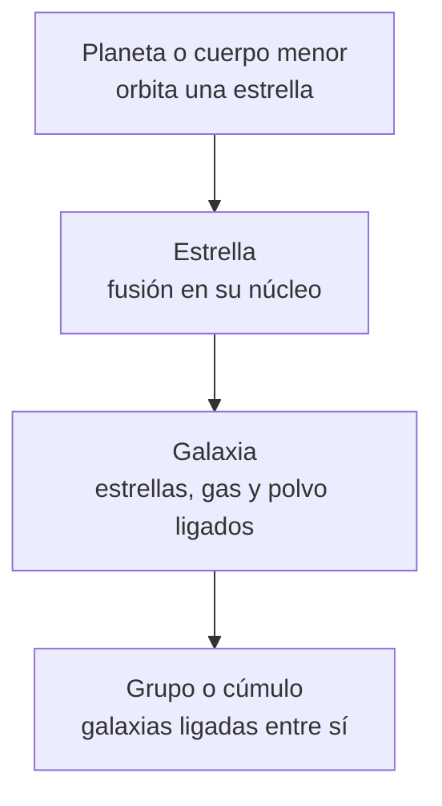

# B01-C03 — Objetos celestes y sus diferencias

<!-- nav:top -->
[🏠 Programa](../../../../README.md) · [📚 Bloque B01](../../../tronco-comun/B01-el-universo-y-el-pensamiento-cientifico.md) · [← Anterior: B01-C02 — Escalas desde la Tierra al cosmos observable](../B01-C02-escalas-desde-la-tierra-al-cosmos-observable/CLASE.md) · [Siguiente: B01-C04 — Espacio y tiempo en ciencia →](../B01-C04-espacio-y-tiempo-en-ciencia/CLASE.md)
<!-- /nav -->

## 1. Ubicación, nivel y alcance

Tercera clase del bloque B01. En la [clase anterior](../B01-C02-escalas-desde-la-tierra-al-cosmos-observable/CLASE.md) ordenaste los objetos por distancia; ahora los ordenas por **lo que son**. Pasas de usar nombres («planeta», «estrella», «galaxia») de oído a usarlos con un criterio que puedes aplicar y defender. Mantienes el nivel N1.

Verás cómo se distinguen planetas, planetas enanos, cuerpos menores, satélites, estrellas, galaxias y agrupaciones de galaxias, y por qué las definiciones pueden cambiar cuando cambia el conocimiento. No verás todavía la física interior de cada objeto (bloques A03 y A05) ni los detalles de su formación.

## 2. Por qué esta clase existe

En 2006 la Asamblea General de la Unión Astronómica Internacional votó una definición de planeta y, desde entonces, Plutón dejó de contarse como el noveno planeta. Muchas personas sintieron que «se había cambiado la realidad». No fue así: el objeto es el mismo; lo que cambió es el criterio con que lo clasificamos. Entender esa diferencia entre *el objeto* y *la etiqueta que le damos* es lo que esta clase enseña.

La decisión central es: **dado un objeto celeste, ¿qué observaciones necesito para decir qué es y qué tan segura es esa clasificación?** Aprenderás a aplicar criterios escritos (los de la Unión Astronómica Internacional y los usados por convención en astronomía), a reconocer cuándo un criterio es cuantitativo y cuándo es cualitativo, y a detectar los casos frontera. Esto sostiene las clases siguientes, que hablan de planetas, estrellas y galaxias sin volver a definirlos.

## 3. Lo que podrás hacer al terminar

1. Aplicar los tres criterios de la IAU de 2006 para clasificar un cuerpo del sistema solar como planeta, planeta enano o cuerpo menor.
2. Explicar por qué los satélites no entran en esas tres categorías y por qué esa definición se limita a nuestro sistema solar.
3. Distinguir estrella, galaxia, grupo y cúmulo de galaxias por sus propiedades físicas y su escala.
4. Pasar de un tamaño angular y una distancia a un tamaño físico, y usarlo para decidir qué clase de objeto es.
5. Construir una clave de clasificación con criterios observables y señalar sus casos frontera.
6. Distinguir un cambio en el objeto de un cambio en su clasificación.

La evidencia es la **clave de clasificación** del ejercicio 12 (sección 20).

## 4. Con qué llegas y cómo comprobarlo

Necesitas lo de C01 y C02: unidades, cocientes y la idea de que una cifra viene de un método. Cinco preguntas:

1. ¿Cuántos kilómetros son 100 000 años luz? (Usa 1 ly ≈ 9,46 × 10¹² km.)
2. Si una cosa mide 12 000 pc y otra 30 000 ly, ¿cuál es mayor?
3. ¿Qué distancia es mayor: 1 Mpc o 1000 kpc?
4. ¿Qué es un cociente y qué es una diferencia? Da un ejemplo de cada uno.
5. ¿Qué te dice un corrimiento al rojo `z = 0,01` sobre una galaxia?

<details>
<summary>Ver respuestas</summary>

1. 9,46 × 10¹⁷ km. 2. 12 000 pc ≈ 39 000 ly, mayor que 30 000 ly. 3. Son iguales: 1 Mpc = 1000 kpc. 4. El cociente dice cuántas veces cabe una cantidad en otra (6,957 × 10⁸ / 6,371 × 10⁶ ≈ 109); la diferencia, cuánto se separan en una misma unidad. 5. Que su luz se estiró 1 %, y que su velocidad aparente de recesión es ≈ 3 × 10³ km/s (C01).
</details>

Con cuatro o cinco aciertos, sigue; con tres o menos, repasa C01 y C02.

## 5. Un caso real: la votación de la IAU en 2006

La Asamblea General de la IAU de 2006 aprobó, entre otras, dos resoluciones: la B5, *Definición de planeta en el sistema solar*, y la B6, *Plutón* (fuente S1). La B5 dice que en nuestro sistema solar los objetos que no son satélites se agrupan en tres categorías, según tres criterios escritos. La B6 aplica esos criterios a Plutón y lo declara «planeta enano».

Lo notable es el método: en vez de debatir si Plutón «merece» ser planeta, la IAU escribió criterios y comprobó si Plutón los cumplía. El resto de la clase te enseña a hacer lo mismo con cualquier objeto: leer el criterio, buscar el dato que lo decide, y reconocer cuándo ese dato falta. Fíjate también en la nota al pie de la B5: dice que se creará un proceso para asignar los casos fronterizos. La propia definición admite que no resuelve todo.

## 6. Vocabulario

Un **planeta** (según la IAU, en nuestro sistema solar) es un cuerpo que orbita el Sol, tiene masa suficiente para que su gravedad lo vuelva casi redondo y ha *despejado la vecindad* de su órbita. Un **planeta enano** orbita el Sol y es casi redondo, pero no ha despejado su vecindad y no es satélite. Un **cuerpo menor del sistema solar** es cualquier otro objeto que orbita el Sol y no es satélite (la IAU incluye a la mayoría de los asteroides, la mayoría de los objetos transneptunianos y los cometas). Un **satélite** orbita un objeto distinto del Sol; la definición de 2006 lo deja fuera de las tres categorías.

Una **estrella** es una bola de gas caliente, en su mayor parte hidrógeno y helio, cuya energía viene de la fusión nuclear en su núcleo, que compensa su propia gravedad (S2). Una **galaxia** es un conjunto de estrellas, planetas y nubes de gas y polvo unidos por la gravedad (S3). Un **grupo** de galaxias tiene unas cien o menos; un **cúmulo** puede contener miles (S3). Un **tamaño angular** `θ` es el ángulo que un objeto ocupa en el cielo, y el **tamaño físico** `s` es su longitud real.

## 7. Modelo mental: la jerarquía de lo que está ligado

El universo no es un conjunto desordenado de objetos: se organiza en niveles unidos por la gravedad. Los planetas orbitan estrellas; las estrellas forman galaxias; las galaxias forman grupos y cúmulos. Lo que pasa a una escala (por ejemplo, la expansión) casi no afecta a las escalas inferiores ligadas, y eso explica por qué Andrómeda se acerca a nosotros mientras las galaxias lejanas se alejan (C01).



*Descripción textual:* cuatro niveles encadenados, de abajo hacia arriba: planetas y cuerpos menores, estrellas, galaxias, y grupos o cúmulos. Cada nivel está ligado gravitacionalmente a una estructura mayor.

Una pregunta práctica para clasificar: **¿de qué está ligado este objeto y qué energía lo sostiene?** Un planeta orbita una estrella y brilla por luz reflejada; una estrella brilla por fusión; una galaxia es un sistema ligado de estrellas.

## 8. La explicación, paso a paso

### 8.1 Los tres criterios de la IAU, uno por uno

La resolución B5 enumera tres condiciones (S1). El primer criterio, **orbitar el Sol**, separa los objetos de nuestro sistema solar de los de otras estrellas. El segundo, **tener masa suficiente para ser casi redondo** (equilibrio hidrostático), separa los cuerpos grandes de los pequeños y de forma irregular: bajo su propia gravedad, un cuerpo suficientemente masivo se deforma hasta ser casi esférico. El tercero, **haber despejado la vecindad de su órbita**, pide que el cuerpo domine la región por la que se mueve. Una forma de entenderlo es que, con el tiempo, los demás objetos de esa órbita han sido incorporados, desviados o expulsados por él; la resolución, sin embargo, no lo detalla.

Planeta cumple (a), (b) y (c). Planeta enano cumple (a) y (b), pero no (c), y no es satélite. Cuerpo menor cumple (a) y no cumple (b). Con esas reglas, Plutón es un planeta enano porque la propia resolución B6 lo declara así al aplicarlas (S1). Fíjate en una consecuencia: los criterios (a) y (c) son comprobables con datos orbitales, pero el (c) no trae un umbral numérico. Por eso el caso fronterizo existe.

### 8.2 Los satélites y los otros mundos

La definición excluye explícitamente a los satélites («except satellites»). La Luna, que orbita la Tierra, queda fuera del esquema de tres categorías. Además, la B5 dice «en nuestro sistema solar»: no define qué es un planeta alrededor de otras estrellas. Esa limitación es una de las razones por las que los exoplanetas se discuten con definiciones propias, que no se tratan en esta clase.

### 8.3 Estrellas, galaxias y agrupaciones

Para el resto de los objetos no hay resoluciones de la IAU tan precisas, sino criterios de uso. Una estrella se reconoce porque la fusión nuclear de hidrógeno en su núcleo le suministra energía; el Sol y Próxima Centauri son estrellas (S2). Una galaxia es un sistema ligado de estrellas, gas y polvo; las hay espirales, elípticas e irregulares, de unas pocas miles de estrellas a billones de ellas (S3). Nuestra Vía Láctea es un disco de más de 100 000 años luz. Un grupo reúne a unas cien galaxias o menos (la Vía Láctea y Andrómeda pertenecen al Grupo Local, con más de 50 galaxias), y un cúmulo puede reunir miles, como el de Virgo de C02 (S3).

### 8.4 De un tamaño angular a un tamaño físico

A veces solo ves una mancha pequeña en el cielo y quieres saber si es una nube de gas cercana o una galaxia lejana. Lo que decide es el **tamaño físico**. Si el objeto subtiende un ángulo pequeño `θ` (en radianes) y está a una distancia `d`, su tamaño es aproximadamente

```text
s ≈ d · θ          (válida para θ ≪ 1 rad)
```

Un arco de 1′ (un minuto de arco) equivale a `2,909 × 10⁻⁴ rad`. Retoma la galaxia de la línea Hα de C01, a unos 43 Mpc, y supón que ocupa 1′: `s ≈ 43 × 10⁶ pc × 2,909 × 10⁻⁴ = 1,25 × 10⁴ pc ≈ 12,5 kpc`, es decir, unos 41 000 años luz. Un tamaño de varios kiloparsecs es el de una galaxia (el disco de la Vía Láctea supera los 30 kpc), no el de una nube de gas del vecindario del Sol. La distancia convierte lo que parece una mancha en un sistema de miles de millones de estrellas.

## 9. Magnitudes, símbolos y unidades

| Símbolo | Qué es | Unidad | Nota |
|---|---|---|---|
| `θ` | tamaño angular | rad (o ″, ′) | `1′ = 2,909 × 10⁻⁴ rad` |
| `d` | distancia | pc | de C02 |
| `s` | tamaño físico | pc (o ly) | `s ≈ dθ` si `θ ≪ 1` |
| `z` | desplazamiento al rojo | adimensional | de C01 |
| `kpc` | kiloparsec = 10³ pc | pc | — |

Un grado tiene 60′, un minuto de arco tiene 60″, y `1 rad = 206 265″`.

## 10. Convenciones y referencias

Las categorías de la IAU valen para el sistema solar y a la fecha de 2006. Los tamaños angulares se miden en el cielo, sin importar la distancia. La aproximación `s ≈ dθ` es válida para ángulos pequeños; para ángulos grandes se usa geometría, que no vemos aquí.

## 11. De dónde sale lo que afirmamos

| ID | Fuente | Localizador | Respalda | Estado |
|---|---|---|---|---|
| S1 | IAU, Asamblea General de 2006, Resoluciones B5 y B6 | Texto enlazado desde https://www.iau.org/Iau/Publications/List-of-Resolutions.aspx | Los tres criterios de planeta, planeta enano y cuerpo menor; Plutón como planeta enano; nota sobre casos fronterizos | Texto leído el 2026-11-05 |
| S2 | NASA Science, «Stars» | https://science.nasa.gov/universe/stars/ | Estrella: bola de gas caliente, hidrógeno y helio, fusión nuclear en el núcleo; el Sol como estrella de secuencia principal | Página consultada el 2026-11-05 (mutable) |
| S3 | NASA Science, «Galaxies» | https://science.nasa.gov/universe/galaxies/ | Galaxia: estrellas, planetas, gas y polvo ligados por la gravedad; tipos; Vía Láctea > 100 000 ly; Grupo Local > 50 galaxias; grupos ≈ 100 o menos; cúmulos con miles | Página consultada el 2026-11-05 (mutable) |
| S4 | Mei, S. et al., ApJ 655, 144 (2007), arXiv:astro-ph/0702510 | Resumen | Virgo a 16,5 Mpc (C02) | Resumen consultado el 2026-11-05 |
| S5 | Riess, A. G., Fliri y Valls-Gabaud, arXiv:1110.3769 | Resumen | Andrómeda a 765 ± 28 kpc (C02) | Resumen consultado el 2026-11-05 |
| S6 | NASA NSSDC, *Earth Fact Sheet* (actualizada el 15-nov-2024) | https://nssdc.gsfc.nasa.gov/planetary/factsheet/earthfact.html | Masa de la Tierra 5,9722 × 10²⁴ kg | Página consultada el 2026-11-05 |

Límites: las definiciones de estrella y galaxia son de uso; sus páginas son divulgativas y sirven para localizar el criterio, no para fijar umbrales. No se revisó la literatura sobre el debate de la definición de planeta.

## 12. Cómo ver las diferencias

La tabla resume lo que distingue cada tipo de objeto; es la versión accesible de un esquema de jerarquía.

| Tipo | Ligado a | Fuente de luz típica | Ejemplo de esta serie |
|---|---|---|---|
| Planeta | orbita el Sol | luz reflejada | Tierra, Neptuno |
| Planeta enano | orbita el Sol | luz reflejada | Plutón |
| Cuerpo menor | orbita el Sol | luz reflejada | cometas, la mayoría de los asteroides |
| Satélite natural | orbita un planeta u otro cuerpo | luz reflejada | Luna |
| Estrella | ligada a una galaxia | fusión nuclear | Sol, Próxima Centauri |
| Galaxia | ligada a un grupo o cúmulo | estrellas | Vía Láctea, Andrómeda |
| Grupo o cúmulo | ligado por su propia gravedad | suma de galaxias | Grupo Local, Virgo |

## 13. Ejemplo trabajado: clasificar con criterios

Clasifiquemos cuatro objetos que ya conoces, mostrando el razonamiento, no solo la respuesta.

**La Tierra.** (a) Orbita el Sol. (b) Su masa (5,97 × 10²⁴ kg, S6) es de sobra suficiente para ser casi esférica. (c) Domina su órbita. Cumple los tres criterios: planeta. La propia nota de la B5 lista a la Tierra entre los ocho planetas (S1).

**La Luna.** Orbita la Tierra. La definición excluye satélites, así que no entra en las tres categorías. Es un satélite natural.

**Plutón.** Orbita el Sol y es casi redondo, pero no ha despejado su vecindad; la B6 lo declara planeta enano (S1).

**Próxima Centauri.** No orbita el Sol; es una estrella ligada a la Vía Láctea, a 1,30119 pc. Por criterio de uso es una estrella (S2).

**Paso final · incertidumbre.** Para los tres primeros usamos criterios escritos y datos orbitales sólidos. Para el último usamos un criterio de uso, y para un objeto frontera (digamos, un cuerpo pequeño casi redondo con vecinos de tamaño parecido) tendríamos que remitirnos al proceso que la propia nota de la resolución anuncia. Una clasificación es tan fuerte como la solidez del criterio y del dato.

## 14. Distintos criterios para clasificar, y cuándo dejan de servir

Se puede clasificar por **propiedades físicas** (masa, forma, fuente de energía), por **relación orbital** (de qué está ligado) o por **tamaño**. La relación orbital es lo que distingue planeta de satélite, pero no dice nada de qué es el objeto por dentro. La fuente de energía distingue estrella de planeta, pero no sirve para clasificar un cuerpo que no emite luz propia. El tamaño solo no basta: un satélite grande no se convierte en planeta por su tamaño. Un buen sistema combina criterios y declara cuáles tienen umbral numérico y cuáles no.

## 15. Práctica guiada

**Ejercicio 1 · con los pasos indicados.** Clasifica la Tierra, la Luna y un cometa usando los tres criterios de la IAU y la regla de los satélites. *Pasos:* para cada uno anota (a), (b), (c) y si es satélite (sección 8.1).

<details><summary>Solución comentada</summary>

Tierra: (a) sí, (b) sí, (c) sí → planeta. Luna: orbita la Tierra → satélite, fuera de las tres categorías. Cometa: orbita el Sol, no es casi redondo → cuerpo menor del sistema solar (nota 3 de la B5: los cometas son cuerpos menores). Si dudaste con la Luna, recuerda que «satélite» es una relación orbital, no un tamaño.
</details>

**Ejercicio 2 · con una pista.** ¿Cuántos diámetros de la Vía Láctea (≈ 100 000 ly) hay hasta Andrómeda (765 kpc)? *Pista:* 1 kpc = 3261,6 ly.

<details><summary>Solución comentada</summary>

`765 × 3261,6 = 2,495 × 10⁶ ly`; dividido por `10⁵` da `≈ 25`. Andrómeda, la gran galaxia vecina, está a unos 25 diámetros galácticos: las galaxias están cerca unas de otras en comparación con las estrellas (ver C02).
</details>

**Ejercicio 3 · casi autónomo.** Un grupo tiene «unas cien galaxias o menos» y un cúmulo «miles». ¿Por qué el Grupo Local, con más de 50, es un grupo y Virgo un cúmulo?

<details><summary>Solución comentada</summary>

El Grupo Local entra en el rango de ≈ 100 o menos (más de 50, S3). Virgo es un cúmulo por tener un número de galaxias mucho mayor, del orden de los miles. La distinción es de grado y no tiene un umbral oficial en las fuentes consultadas: es otro ejemplo de criterio cualitativo.
</details>

## 16. Práctica autónoma, transferencia e integrador

**Ejercicio 4.** Una mancha ocupa 30″ en el cielo. Calcula su tamaño físico si está a 43 Mpc y a 1,3 pc, y clasifícala en cada caso.

<details><summary>Solución comentada</summary>

`30″ = 30/206 265 rad = 1,454 × 10⁻⁴ rad`. A 43 Mpc: `s ≈ 43 × 10⁶ × 1,454 × 10⁻⁴ ≈ 6,3 × 10³ pc ≈ 6,3 kpc`: tamaño de galaxia. A 1,3 pc: `s ≈ 1,3 × 1,454 × 10⁻⁴ = 1,9 × 10⁻⁴ pc ≈ 39 au`: tamaño de un sistema planetario o de un disco, nunca de una galaxia. El mismo ángulo da dos objetos totalmente distintos según la distancia.
</details>

**Ejercicio 5.** Un objeto orbita el Sol, es casi esférico y comparte su órbita con muchos objetos de tamaño parecido. ¿Qué es según la IAU? ¿Qué dato falta para estar seguro?

<details><summary>Solución comentada</summary>

Cumple (a) y (b); si no ha despejado su vecindad ni es satélite, es planeta enano. Falta confirmar (c) con datos sobre los demás cuerpos de su órbita. Si fuera un caso difícil, la propia B5 remite a un proceso de asignación.
</details>

**Ejercicio 6.** La B5 dice «en nuestro sistema solar». ¿Qué implica para un objeto que orbita otra estrella?

<details><summary>Solución comentada</summary>

La resolución no lo clasifica: su alcance se limita a nuestro sistema. Para otros sistemas se usan definiciones distintas, que no se tratan en esta clase. Afirmar que «la IAU dice que un exoplaneta es un planeta» a partir de la B5 es un error de alcance.
</details>

**Ejercicio 7.** Ordena de menor a mayor por escala: Grupo Local, estrella, planeta, galaxia, cúmulo. Indica qué relación gravitatoria une cada nivel con el siguiente.

<details><summary>Solución comentada</summary>

Planeta < estrella < galaxia < grupo (Grupo Local) < cúmulo. Un planeta orbita una estrella; las estrellas forman galaxias; las galaxias forman grupos y cúmulos. Cada nivel está ligado gravitacionalmente al siguiente.
</details>

**Ejercicio 8.** ¿Qué observación te permitiría distinguir entre una estrella y un planeta cercano en una foto del cielo? Da una prueba y su límite.

<details><summary>Solución comentada</summary>

Prueba: el espectro. Una estrella muestra la luz de su propia superficie caliente; un planeta refleja la del Sol. Límite: un espectro de baja calidad puede no distinguirlos, y un planeta que emite en el infrarrojo no se aísla fácilmente de su estrella a gran distancia.
</details>

**Ejercicio 9 · transferencia.** Un titular dice: «Plutón dejó de existir en 2006». Evalúalo con lo que leíste en la sección 5.

<details><summary>Solución comentada</summary>

El objeto no cambió: se siguió observando y orbitando el Sol. Cambió la categoría con que se lo clasifica (B6: planeta enano). Confundir cambio de etiqueta con cambio del objeto es la raíz del titular.
</details>

**Ejercicio 10 · transferencia.** Un compañero dice que la Luna debería ser un planeta «porque es redonda». Arma una respuesta con los criterios.

<details><summary>Solución comentada</summary>

La Luna cumple (b) en buena medida, pero no orbita el Sol como cuerpo principal: orbita la Tierra y, para la definición de 2006, los satélites no entran en las tres categorías. Ser redondo es una condición necesaria, no suficiente. La respuesta distingue condición necesaria de suficiente.
</details>

**Ejercicio 11 · transferencia.** Redacta un criterio cuantitativo posible para «haber despejado la vecindad» y señala dos dificultades. (No existe uno en la B5.)

<details><summary>Solución comentada</summary>

Ejemplo: «la masa del cuerpo debe ser al menos cien veces la masa total de lo que comparte su órbita». Dificultades: hay que conocer la masa de todos los demás objetos (incluidos los aún no descubiertos) y elegir un umbral (cien, mil) sin una justificación única. Por eso la B5 deja el criterio sin número y el proceso de asignación abierto.
</details>

**Ejercicio 12 · integrador.** Construye tu *clave de clasificación*: un diagrama o tabla de decisión con al menos seis tipos de objetos (de planeta a cúmulo), el criterio observable que decide cada rama, un ejemplo de la serie y un caso frontera con su límite.

<details><summary>Solución modelo</summary>

Una clave válida tiene preguntas de sí/no ordenadas («¿orbita el Sol?», «¿es casi esférico?», «¿ha despejado su vecindad?», «¿hay fusión en su núcleo?», «¿es un sistema ligado de estrellas?»), ejemplos de cada hoja, y un caso frontera (por ejemplo, un cuerpo de tamaño intermedio) con la dificultad declarada. Se acepta cualquier clave coherente que cite sus criterios.
</details>

## 17. Actividad de laboratorio (sin código): la clave con tarjetas

**Objetivo.** Poner a prueba tu clave con objetos reales. **Recursos:** papel o una hoja de cálculo; la tabla de la sección 12 y las fichas de la NASA (S6) para el sistema solar. **Procedimiento:** 1) haz 10 tarjetas con nombres de objetos (Tierra, Luna, Neptuno, Plutón, un cometa, Sol, Próxima Centauri, Vía Láctea, Andrómeda, Virgo); 2) mezcla y clasifica cada una con tu clave sin mirar la tabla; 3) compara con la tabla; 4) en cada error, anota qué criterio fallaba. **Datos:** publicados (observados o estimados), no simulados. **Resultado esperado:** 10 de 10 aciertos con la clave bien hecha. **Límites:** la clave no resuelve casos fronterizos; no sirve para clasificar objetos con datos insuficientes. **Seguridad:** ninguna especial.

## 18. Errores frecuentes y cómo corregirlos

**Confundir tamaño con categoría.** «La Luna es mayor que Plutón, entonces es un planeta». Se detecta cuando el argumento solo menciona tamaño. Se corrige con el ejercicio 10.

**Pensar que la IAU define cualquier planeta.** Se aplica la B5 a otras estrellas. Se corrige con el ejercicio 6.

**Creer que cambiar la clasificación cambia el objeto.** Se detecta en titulares como el del ejercicio 9. Se corrige releyendo la sección 5.

**Usar la apariencia para decidir el tipo de objeto.** Dos manchas parecidas pueden ser una nube cercana o una galaxia lejana. Se corrige con el ejercicio 4.

**Tratar un criterio cualitativo como numérico.** «Despejar la vecindad» no tiene umbral. Se corrige con el ejercicio 11.

## 19. Cómo sabrás que vas bien

Tras la sección 8.1: ¿puedes enunciar los tres criterios sin mirar? Si no, rehaz el ejercicio 1. Tras la 8.3: ¿distingues grupo de cúmulo y galaxia? Si no, haz el ejercicio 3. Tras el ejemplo trabajado: ¿puedes clasificar un quinto objeto, como Neptuno, sin ayuda? Si no, repite el ejemplo con él. Tras la actividad: ¿en qué criterio fallaste más? Eso es lo que debes reforzar. Al final: ¿qué parte de tu clave usa un criterio sin umbral numérico? Si no lo identificas, revisa la sección 8.1.

## 20. Qué entregas y cómo se evalúa

El producto es tu **clave de clasificación** (una página): al menos seis tipos de objetos, el criterio observable de cada decisión, un ejemplo de cada hoja, un caso frontera con su límite y las fuentes de cada criterio.

| Criterio | Inicial | En desarrollo | Logrado | Destacado |
|---|---|---|---|---|
| Aplicación de criterios | Usa solo el tamaño | Usa algunos criterios | Aplica los tres criterios y los de uso | Señala cuáles tienen umbral y cuáles no |
| Tamaño físico | No lo calcula | Calcula con error | Calcula y clasifica | Compara dos distancias posibles |
| Casos frontera | No los menciona | Los menciona | Los explica | Propone cómo resolverlos |
| Fuentes y alcance | Sin fuente | Fuente sin alcance | Fuente con alcance | Distingue resolución, uso y divulgación |

**Condiciones críticas:** no atribuir a la IAU lo que no dice (por ejemplo, definir exoplanetas); no presentar un criterio de uso como resolución; citar solo fuentes consultadas.

## 21. Ética, seguridad y límites

La clasificación es una herramienta humana: se acuerda, se revisa y puede cambiar. Conviene recordar que los nombres, además de científicos, tienen una dimensión cultural; este bloque trata la astronomía cultural en B02, sin tratarla como un error. Accesibilidad: diagramas con descripción, tablas, ejercicios sin conexión. Material educativo, no sirve para catalogación profesional.

## 22. Para cerrar y seguir

Clasificar un objeto celeste es aplicar criterios escritos a datos observados; la etiqueta puede cambiar sin que cambie el objeto. Los tres criterios de la IAU de 2006 separan planeta, planeta enano y cuerpo menor en nuestro sistema solar; el resto de las categorías se apoya en criterios de uso. El tamaño físico, obtenido de un tamaño angular y una distancia, ayuda a decidir qué clase de objeto es. Queda abierta una pregunta: ¿cómo debe definirse «despejar la vecindad» para que el criterio sea medible?

**Glosario español–inglés.** planeta · *planet*; planeta enano · *dwarf planet*; cuerpo menor del sistema solar · *small solar system body*; satélite · *satellite / moon*; estrella · *star*; galaxia · *galaxy*; cúmulo de galaxias · *galaxy cluster*; tamaño angular · *angular size*.

**Continuidad.** La clase B01-C04 usa tu capacidad de **distinguir un objeto de su etiqueta y un criterio de un dato** para tratar el espacio y el tiempo como marcos de referencia que también se acuerdan y se declaran. B01-C13 y B01-C14 desarrollarán el sistema solar y las estrellas con estas categorías ya claras.

**Referencias:** ver sección 11. De S4 y S5 se usaron solo los resúmenes; S2 y S3 son páginas divulgativas mutables.

<!-- nav:bottom -->
---

[← Anterior: B01-C02 — Escalas desde la Tierra al cosmos observable](../B01-C02-escalas-desde-la-tierra-al-cosmos-observable/CLASE.md) · [📚 Bloque B01](../../../tronco-comun/B01-el-universo-y-el-pensamiento-cientifico.md) · [Siguiente: B01-C04 — Espacio y tiempo en ciencia →](../B01-C04-espacio-y-tiempo-en-ciencia/CLASE.md)
<!-- /nav -->
