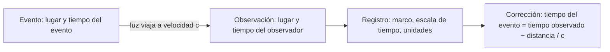

# B01-C04 — Espacio y tiempo en ciencia

<!-- nav:top -->
[🏠 Programa](../../../../README.md) · [📚 Bloque B01](../../../tronco-comun/B01-el-universo-y-el-pensamiento-cientifico.md) · [← Anterior: B01-C03 — Objetos celestes y sus diferencias](../B01-C03-objetos-celestes-y-sus-diferencias/CLASE.md) · [Siguiente: B01-C05 — Observación frente a interpretación →](../../../tronco-comun/B01-el-universo-y-el-pensamiento-cientifico.md#b01-c05)
<!-- /nav -->

## 1. Ubicación, nivel y alcance

Cuarta clase del bloque B01 y cierre de su primer tramo. En las tres clases anteriores usaste distancias y tiempos con naturalidad (años luz, 499 segundos, 140 millones de años). Aquí te detienes a preguntar qué significan en ciencia las palabras «dónde» y «cuándo», y qué hay que declarar para que otra persona entienda tu medida. Sigues en el nivel N1.

Verás cómo se mide el tiempo con ciclos, cómo se define hoy el segundo, por qué un día no dura lo mismo según lo midas respecto del Sol o de las estrellas, y por qué una posición solo existe respecto de un marco de referencia. No verás todavía la relatividad ni los sistemas de coordenadas celestes en detalle (bloques A02 y A06).

## 2. Por qué esta clase existe

En 1999 la sonda Mars Climate Orbiter se perdió en la atmósfera de Marte. Según la NASA, el programa en tierra trabajaba en unidades inglesas y el de la sonda en métricas, y esa discrepancia la dirigió demasiado cerca del planeta (S1). Nadie midió mal en sí: dos grupos hablaron de «lo mismo» sin haber acordado la convención.

La decisión central es: **¿qué debo declarar junto a un lugar y a un instante para que otra persona obtenga la misma observación?** Aprenderás a distinguir un ciclo natural de una unidad definida, a separar el tiempo en que ocurre un evento del tiempo en que lo observas, y a escribir un registro (lugar, hora, escala, marco, unidades) que no admita ambigüedad. Es la base de toda observación posterior del bloque, desde el movimiento del Sol (C11) hasta el proyecto final (C20).

## 3. Lo que podrás hacer al terminar

1. Explicar cómo la rotación y la órbita de la Tierra producen el día solar, el día sidéreo y el año.
2. Calcular cuánto difieren el día solar y el sidéreo, y deducir el período sinódico lunar a partir de dos ciclos.
3. Enunciar cómo se define el segundo en el Sistema Internacional y qué consecuencia tiene para el metro.
4. Separar el tiempo del evento del tiempo de la observación, restando el tiempo de luz.
5. Describir un marco de referencia con origen, ejes, unidad y convención de signo.
6. Redactar un registro de observación que otra persona pueda reproducir.

La evidencia es la **ficha de marco de referencia** del ejercicio 12 (sección 20).

## 4. Con qué llegas y cómo comprobarlo

Necesitas lo de C01 a C03: unidades, tiempo de luz y notación científica. Cinco preguntas:

1. Si la luz del Sol tarda 499 s en llegar, ¿cuántos minutos y segundos son?
2. ¿Cuántas horas tiene 1 día? ¿Y cuántos segundos?
3. Si algo se repite cada 27,3 días y otro cada 365,26 días, ¿cuál se repite más veces en un año?
4. ¿Qué significa «respecto de»? Da un ejemplo cotidiano (un tren y un pasajero).
5. ¿Para qué sirve declarar la unidad junto a un número?

<details>
<summary>Ver respuestas</summary>

1. 8 min 19 s. 2. 24 h; 86 400 s. 3. El de 27,3 días: se repite unas 13 veces por año. 4. Un pasajero sentado está quieto respecto del tren y se mueve respecto del andén. 5. Para que el número tenga significado y se pueda comparar y reproducir.
</details>

Con cuatro o cinco aciertos, sigue. Con tres o menos, repasa C01 y C02.

## 5. Un caso real: la unidad que se perdió en el camino

La NASA resume el caso de Mars Climate Orbiter así: la sonda se perdió en 1999, unos nueve meses después de su lanzamiento; la causa fue «un error de navegación causado por no traducir unidades inglesas a métricas», con un programa en tierra en unidades inglesas y otro a bordo en métricas (S1). El resultado fue que la nave pasó demasiado cerca de Marte y se quemó en su atmósfera.

No era un error de ciencia: las leyes de la mecánica funcionaron bien. Era un error de **convención**: los números iban sin la unidad correcta. En esta clase aprenderás a evitar esa clase de error, y en la sección 13 aplicarás la misma disciplina a una observación de la galaxia de la línea Hα (C01). Ten presente el límite: este caso sirve para ilustrar la importancia de declarar convenciones; no hace falta que conozcas la ingeniería de la misión.

## 6. Vocabulario

Un **ciclo** es un fenómeno que se repite, como una vuelta de la Tierra sobre su eje o de la Luna alrededor de la Tierra. Un **período** es el tiempo que dura un ciclo. El **día solar medio** es el intervalo entre dos pasos consecutivos del Sol por el mismo punto del cielo, en promedio, y dura 24 horas. El **día sidéreo** es el intervalo en que la Tierra gira una vez respecto de las estrellas lejanas, y dura 23,9345 horas (S2). El **año sidéreo** es el período orbital de la Tierra respecto de las estrellas (365,256 días), mientras que el **año trópico** (365,242 días) se mide respecto de las estaciones (S2). El **período sinódico** de la Luna es el tiempo entre dos fases iguales (29,53 días), y el **sidéreo** es el que tarda en volver a la misma posición respecto de las estrellas (27,3217 días) (S3).

Un **marco de referencia** es el conjunto de convenciones que permite asignar una posición: un origen, unos ejes, una unidad y un sentido positivo. Una **escala de tiempo** es una manera de numerar los instantes. El **tiempo de luz** es el que tarda la luz en recorrer una distancia (C01).

## 7. Modelo mental: lugar, instante y quién mira

Piensa en un evento (una explosión, un paso de la Luna) como un punto con cuatro datos: dónde, cuándo, respecto de qué marco y medido con qué unidad. Para observarlo, la luz tiene que viajar hasta tu instrumento, y eso introduce dos tiempos distintos: el del evento y el de la observación.



*Descripción textual:* una cadena de cuatro cajas. Un evento ocurre en un lugar y un tiempo; la luz viaja y llega al observador; se hace un registro declarando marco, escala de tiempo y unidades; y se corrige restando el tiempo de luz para obtener el tiempo del evento.

Una analogía: el eco. Si gritas ante un cerro y oyes el eco tres segundos después, el grito ocurrió tres segundos antes de que lo oigas. Con la luz pasa lo mismo, pero a una velocidad cerca de un millón de veces mayor que la del sonido; por eso solo se nota con distancias astronómicas. El límite de la analogía: el sonido necesita aire y depende del viento; la luz va a `c` en el vacío sin importar el movimiento de la fuente (esto último, un resultado de la relatividad, queda fuera de esta clase).

## 8. La explicación, paso a paso

### 8.1 Medir el tiempo con ciclos

El tiempo se mide contando ciclos regulares. La Tierra gira y da la sucesión de días; orbita al Sol y da los años; la Luna orbita la Tierra y da los meses. Pero cada ciclo se puede medir de más de una manera, y eso produce unidades distintas.

El **día solar** dura 24,0000 h porque lo medimos de mediodía a mediodía; el **día sidéreo** dura 23,9345 h, porque lo medimos respecto de las estrellas (S2). La diferencia, `24 − 23,9345 = 0,0655 h`, son **3,93 minutos**. ¿Por qué hay diferencia? Porque, mientras la Tierra gira, también avanza en su órbita; para que el Sol vuelva al mismo punto del cielo, la Tierra debe girar un poco más que una vuelta completa. Eso significa que en un año sidéreo la Tierra da una vuelta más sobre su eje respecto de las estrellas que días solares ha contado: `365,256 × 24/23,9345 = 366,26` días sidéreos frente a 365,256 días solares.

### 8.2 Dos ciclos que se combinan: el mes lunar

La Luna da una vuelta alrededor de la Tierra respecto de las estrellas en 27,3217 días (el período sidéreo, S3). Pero entre dos lunas llenas pasan 29,53 días (el sinódico). La razón es la misma que antes: mientras la Luna da su vuelta, la Tierra se desplaza en su órbita, y la Luna necesita un poco más de tiempo para alcanzar de nuevo la misma posición respecto del Sol. Sumando las «velocidades» de giro, en vueltas por día:

```text
1/T_sinódico = 1/T_Luna − 1/T_Tierra          (T en días; T_Tierra = 365,256 d)
```

Con los valores publicados, `1/27,3217 − 1/365,256 = 0,033863` y `T_sinódico = 29,531 d`, que coincide con el valor de la NASA. Ese resultado te dice que dos ciclos observables bastan para deducir un tercero.

### 8.3 El segundo: de un ciclo de la Tierra a un átomo

Durante siglos el segundo se definió como una fracción del día. Hoy el Sistema Internacional lo define con un átomo: el **segundo** es la duración de 9 192 631 770 períodos de la radiación asociada a la transición hiperfina del estado fundamental del cesio 133 (S4). Esa cifra queda fija por definición: no se mide, se adopta. Y la consecuencia es notable: como el metro se define a partir de la velocidad de la luz fijada en 299 792 458 m/s y del segundo, **1 m es la distancia que recorre la luz en 1/299 792 458 s** (S4). En 1 nanosegundo la luz recorre unos 30 cm.

### 8.4 El tiempo del evento y el tiempo de la observación

Cuando observas un evento lejano, lo que registras es el momento en que la luz llega. El evento ocurrió antes: `t_evento = t_observado − d/c`. Por ejemplo, si un telescopio solar registra una llamarada a las 12:00:00 de su reloj, la luz tardó 499,0 s (8 min 19 s) en recorrer 1 au, así que la llamarada ocurrió a las 11:51:41. Para la galaxia de C01, a unos 43 Mpc, la diferencia es de unos 140 millones de años: no se puede hablar del «ahora» de esa galaxia, solo de lo que se observa hoy, que sucedió hace mucho.

### 8.5 Lugar: sin marco no hay posición

Decir que algo está «a 10 metros al norte» no es una posición hasta decir de qué punto y qué significa norte. Un **marco de referencia** fija cuatro cosas: un origen, la orientación de sus ejes, una unidad y un sentido positivo. Para el cielo se usan marcos distintos según la pregunta: unos están atados al lugar del observador y otros a las estrellas lejanas; los veremos en C11 y en los bloques de astrodinámica. Lo importante ahora es la regla: **toda posición se acompaña de su marco**, igual que toda distancia se acompaña de su unidad.

## 9. Magnitudes, símbolos y unidades

| Símbolo | Qué es | Unidad | Valor o nota |
|---|---|---|---|
| `t` | tiempo | s, h, d | — |
| `T` | período | s, h, d | — |
| `c` | velocidad de la luz | m/s | 299 792 458 (exacto) |
| `Δν_Cs` | frecuencia del cesio 133 | Hz | 9 192 631 770 (exacto) |
| `d` | distancia | m, au, pc | de C02 |
| `t_evento` | tiempo del evento | s | `t_observado − d/c` |
| día solar | — | h | 24,0000 |
| día sidéreo | — | h | 23,9345 |
| año sidéreo / trópico | — | d | 365,256 / 365,242 |
| mes sinódico / sidéreo | — | d | 29,53 / 27,3217 |

## 10. Convenciones y referencias

En esta clase los períodos son valores medios publicados, no efemérides. Un año juliano son 365,25 días exactos (como en C01 y C02); no coincide con el año trópico ni con el sidéreo, y por eso se fija por convención. El tiempo se registra en una escala declarada (por ejemplo, hora local o tiempo universal) y siempre con su unidad.

## 11. De dónde sale lo que afirmamos

| ID | Fuente | Localizador | Respalda | Estado |
|---|---|---|---|---|
| S1 | NASA Science, «Mars Climate Orbiter» | https://science.nasa.gov/mars-climate-orbiter/ | Pérdida de la sonda en 1999 por traducción de unidades inglesas a métricas | Página consultada el 2026-11-05 |
| S2 | NASA NSSDC, *Earth Fact Sheet* (actualizada el 15-nov-2024) | https://nssdc.gsfc.nasa.gov/planetary/factsheet/earthfact.html | Rotación sidérea 23,9345 h; día 24,0000 h; año sidéreo 365,256 d; año trópico 365,242 d | Página consultada el 2026-11-05 |
| S3 | NASA NSSDC, *Moon Fact Sheet* (actualizada el 11-ene-2024) | https://nssdc.gsfc.nasa.gov/planetary/factsheet/moonfact.html | Período sidéreo 27,3217 d; sinódico 29,53 d | Página consultada el 2026-11-05 |
| S4 | BIPM, *The International System of Units (SI)*, 9.ª ed. (2019) | Definiciones del segundo y del metro | Segundo: 9 192 631 770 períodos del cesio 133; `c = 299 792 458 m/s`; definición del metro | PDF leído el 2026-11-05 |

Límites: S1 es una página divulgativa que resume la causa; no se leyó el informe de la comisión de investigación. Las explicaciones geométricas de las secciones 8.1 y 8.2 son nuestras y se contrastan con los datos de S2 y S3.

## 12. Cómo ver los ciclos

Esta tabla es la versión accesible de un diagrama de ciclos encadenados.

| Ciclo | Período | Qué mide | Fuente |
|---|---|---|---|
| Rotación de la Tierra (sidérea) | 23,9345 h | una vuelta respecto de las estrellas | S2 |
| Día solar medio | 24,0000 h | de mediodía a mediodía | S2 |
| Revolución lunar (sidérea) | 27,3217 d | una vuelta respecto de las estrellas | S3 |
| Mes sinódico | 29,53 d | entre dos fases iguales | S3 |
| Año trópico | 365,242 d | ciclo de las estaciones | S2 |
| Año sidéreo | 365,256 d | una órbita respecto de las estrellas | S2 |

Si dibujas los ciclos, usa una escala logarítmica en el eje del tiempo y distingue cada ciclo por forma y no solo por color. Descripción larga: los ciclos van de unas 24 horas a poco más de un año; el mes sinódico y el sidéreo difieren en unos dos días.

## 13. Ejemplo trabajado: registrar la observación de la galaxia

Imagina que registras la línea Hα de la galaxia de C01. Un buen registro no es «662,9 nm»: es un registro completo.

**Paso 1 · Evento y observación.** La galaxia está a unos 43 Mpc (C01). La luz salió hace unos 140 millones de años; tú la registras hoy. Anota los dos tiempos por separado: el tiempo de observación, con su escala y su hora, y el tiempo de luz estimado, con su incertidumbre.

**Paso 2 · Marco.** Declara el lugar del observador (coordenadas y altitud) y el marco en que está dada la dirección de la galaxia (por ejemplo, coordenadas celestes con su época), aunque aquí no calculemos las coordenadas.

**Paso 3 · Unidades.** `λ_obs = 662,9 nm` (unidad: nanómetros, 10⁻⁹ m); `λ_emit = 656,3 nm`; `z = 0,0101` (adimensional). La velocidad aparente se da en km/s y la distancia en Mpc, con `H₀` explícito (km/s/Mpc).

**Paso 4 · Correcciones.** Si el instrumento mide en el aire, la longitud de onda es distinta que en el vacío; el valor de reposo de Hα (656,3 nm) corresponde a una de las dos convenciones, y mezclar convenciones introduce un error. Declara cuál usaste.

**Paso 5 · Incertidumbre.** Cada cifra lleva su `±`: la longitud de onda (±0,1 nm), `z` (±0,00015) y la distancia (la de `H₀`).

**Sentido físico.** Con este registro, otra persona puede repetir tu cálculo y detectar si un mismo número significa lo mismo para ambos. Es la disciplina que evitó, en la sonda de la sección 5, una convención dicha en voz baja.

## 14. Distintas formas de medir el tiempo, y cuándo dejan de servir

El **ciclo natural** (día, mes, año) es fácil de observar pero cambia según el modo de medirlo: día solar o sidéreo, año sidéreo o trópico. El **reloj atómico**, que cuenta los períodos del cesio, se fija por definición y es el mismo en cualquier laboratorio, pero no está atado a ningún fenómeno del cielo. Para fechar eventos históricos conviene el ciclo natural; para medir intervalos con precisión, el reloj atómico. Conviene saber con cuál estás trabajando y declararlo.

## 15. Práctica guiada

**Ejercicio 1 · con los pasos indicados.** ¿Cuántos minutos más corto es el día sidéreo que el solar? *Pasos:* resta 23,9345 h de 24,0000 h y convierte a minutos (sección 8.1).

<details><summary>Solución comentada</summary>

`24,0000 − 23,9345 = 0,0655 h = 3,93 min`. Cada día, las estrellas salen unos 4 minutos antes que el día anterior respecto de tu reloj. Si te salió 0,0655 minutos, olvidaste multiplicar por 60.
</details>

**Ejercicio 2 · con una pista.** ¿Cuántos días sidéreos hay en un año sidéreo? *Pista:* `365,256 × 24 / 23,9345`.

<details><summary>Solución comentada</summary>

`366,26`. Hay un día sidéreo más que días solares en el año: la vuelta extra que da la Tierra sobre su eje por orbitar al Sol (sección 8.1).
</details>

**Ejercicio 3 · casi autónomo.** ¿Qué distancia recorre la luz en 1 nanosegundo? ¿Y en 1 microsegundo?

<details><summary>Solución comentada</summary>

`299 792 458 m/s × 10⁻⁹ s = 0,2998 m` (unos 30 cm); en 1 µs, `299,8 m`. Un reloj que se equivoque en 1 µs sitúa una señal luminosa unos 300 m más allá.
</details>

## 16. Práctica autónoma, transferencia e integrador

**Ejercicio 4.** Deduce el período sinódico lunar con la fórmula de la sección 8.2 y compáralo con el publicado.

<details><summary>Solución comentada</summary>

`1/27,3217 = 0,036601`; `1/365,256 = 0,0027379`; la resta es `0,033863` y su inverso, `29,531 d`. El valor publicado es 29,53 d: coinciden dentro de la precisión de los datos (cuatro cifras). Si te salió 27,3217 − 365,256, recuerda que se restan *frecuencias*, no períodos.
</details>

**Ejercicio 5.** Un telescopio solar registra una llamarada a las 12:00:00 (hora del reloj del observatorio). ¿A qué hora ocurrió en el Sol? Usa 1 au y `c`.

<details><summary>Solución comentada</summary>

`t = 1,496 × 10¹¹ m / 2,998 × 10⁸ m/s = 499,0 s = 8 min 19 s`; `12:00:00 − 8:19 = 11:51:41`. El evento y su observación quedan separados por poco más de 8 minutos.
</details>

**Ejercicio 6.** El año juliano son 365,25 d; el trópico, 365,242 d. ¿Qué diferencia relativa hay y qué efecto tendría en el valor de un año luz?

<details><summary>Solución comentada</summary>

`(365,25 − 365,242)/365,25 = 2,2 × 10⁻⁵`. Un año luz cambiaría por el mismo factor: `9,4607 × 10¹⁵ × 2,2 × 10⁻⁵ ≈ 2 × 10¹¹ m`. Por eso se fija el año juliano por convención: así el año luz es el mismo para todos.
</details>

**Ejercicio 7.** ¿Cuántos períodos de la radiación del cesio caben en un día de 86 400 s?

<details><summary>Solución comentada</summary>

`9 192 631 770 × 86 400 = 7,9424 × 10¹⁴`. Ese número alto es lo que permite que el reloj atómico mida intervalos pequeñísimos con precisión.
</details>

**Ejercicio 8.** Nombra tres datos que faltan en este registro: «Se observó la galaxia el martes, línea en 662,9, a 43 de distancia».

<details><summary>Solución comentada</summary>

Faltan, entre otros: la unidad de la longitud de onda (nm), la unidad de la distancia (Mpc) y de dónde viene `H₀`, la hora con su escala de tiempo, el lugar de observación, y la incertidumbre de cada cifra. Un registro así no se puede reproducir.
</details>

**Ejercicio 9 · transferencia.** Un artículo dice: «un año dura 365,25 días». Explica en qué sentido es correcto y en cuál no, con los tres «años» de la sección 6.

<details><summary>Solución comentada</summary>

Es exacto para el año juliano, que es una convención. El año sidéreo dura 365,256 d y el trópico 365,242 d: difieren en unos 0,014 d (20 min). La cifra del artículo es correcta solo si se declara qué año se usa.
</details>

**Ejercicio 10 · transferencia.** Un compañero pregunta: «¿qué está pasando ahora mismo en Andrómeda?». Responde usando el tiempo de luz de C02.

<details><summary>Solución comentada</summary>

Andrómeda está a unos 2,5 millones de años luz: lo que observas ocurrió hace 2,5 millones de años. Lo que pasa «ahora» allí no se puede observar; solo se puede inferir con un modelo. Una pregunta bien formulada sería «¿qué observamos hoy de Andrómeda y de qué época es?».
</details>

**Ejercicio 11 · transferencia.** Con el caso de la sonda de la sección 5, escribe tres reglas de registro que habrían evitado el error.

<details><summary>Solución comentada</summary>

(1) Todo número lleva su unidad escrita, no sobreentendida. (2) Los equipos acuerdan un sistema de unidades antes de intercambiar datos. (3) Se revisa la interfaz entre programas con casos de prueba de unidades conocidas. Las tres reglas son sobre convención y comunicación, no sobre física.
</details>

**Ejercicio 12 · integrador.** Elabora la *ficha de marco de referencia* (sección 20) para la observación de un objeto de tu elección: tiempo de observación con escala, tiempo de luz estimado y tiempo del evento, lugar y marco declarados, unidades de cada cifra, incertidumbres y fuente.

<details><summary>Solución modelo</summary>

Una ficha completa sigue el ejemplo trabajado de la sección 13 con otro objeto: separa el tiempo del evento del de la observación, declara marco y escala de tiempo, y da unidad y `±` a cada cifra. Se acepta cualquier objeto con distancia publicada y fuente citada.
</details>

## 17. Laboratorio: ciclos y tiempos en 50 líneas

El script [ciclos_y_tiempos.py](ciclos_y_tiempos.py) calcula, a partir de valores publicados, la diferencia entre día solar y sidéreo, los días sidéreos por año, el período sinódico lunar deducido, la diferencia entre año sidéreo y trópico, los períodos del cesio en un día y la distancia que recorre la luz en 1 ns. Antes comprueba que el período sinódico calculado coincida con el publicado dentro de 0,01 d y que haya exactamente un día sidéreo extra por año; si no, se detiene.

**Datos:** publicados (NASA, SI). **Predice antes de ejecutar:** ¿cuántos minutos más corto es el día sidéreo? (Cerca de 4.) **Resultados (2026-11-05, Python 3.12.9):** 3,93 min; 366,26 días sidéreos por año; período sinódico 29,531 d; 20,2 min de diferencia entre año sidéreo y trópico; 7,9424 × 10¹⁴ períodos de cesio por día; 0,2998 m por nanosegundo.

```bash
python programa/clases/B01/B01-C04-espacio-y-tiempo-en-ciencia/ciclos_y_tiempos.py
```

**Límites:** son períodos medios, no efemérides; el script no calcula posiciones ni fechas. No sirve para predecir fenómenos con precisión.

## 18. Errores frecuentes y cómo corregirlos

**Mezclar día solar y sidéreo.** Se piensa que las estrellas salen a la misma hora cada noche. Se detecta cuando se predice mal la hora de salida. Se corrige con el ejercicio 1.

**Restar períodos en vez de frecuencias.** En el mes lunar se resta 27,3 − 365,3. Se corrige con el ejercicio 4.

**Usar la hora de observación como hora del evento.** Se corrige con el ejercicio 5.

**Dar una posición sin marco.** «A 10 m al norte» sin origen. Se corrige con el ejercicio 8.

**Creer que «un año» es una sola cosa.** Se corrige con el ejercicio 9.

## 19. Cómo sabrás que vas bien

Tras la sección 8.1: ¿puedes explicar por qué hay más días sidéreos que solares en un año? Si no, repite el ejercicio 2. Tras la 8.3: ¿qué fija la definición del segundo y qué consecuencia tiene para el metro? Si no lo recuerdas, relee. Tras el ejemplo: ¿puedes escribir el registro de otro objeto sin mirar? Si no, haz el ejercicio 12 con apoyo. Tras el laboratorio: ¿qué comprueba el script antes de calcular? Si no lo sabes, lee su cabecera. Al final: ¿qué dato falta más a menudo en un registro? Si dudas, vuelve al ejercicio 8.

## 20. Qué entregas y cómo se evalúa

El producto es tu **ficha de marco de referencia**: una página que registre una observación con lugar, hora y escala de tiempo, tiempo de luz y tiempo del evento, marco declarado, unidades y fuentes, para un objeto de tu elección.

| Criterio | Inicial | En desarrollo | Logrado | Destacado |
|---|---|---|---|---|
| Separación de tiempos | Los confunde | Los separa con ayuda | Los separa y calcula | Propaga la incertidumbre del tiempo de luz |
| Marco y escala | Ausentes | Declara uno | Declara ambos | Compara con otro marco posible |
| Unidades | Faltan | Algunas | Todas | Verifica dimensionalmente |
| Reproducibilidad | No se puede repetir | Con ayuda | Se puede repetir | Otra persona la reproduce sin consultar |
| Fuentes y alcance | Sin fuente | Fuente sin alcance | Con alcance | Distingue convención de dato |

**Condiciones críticas:** no omitir unidades ni marco; no presentar la hora de observación como la del evento; citar solo fuentes consultadas.

## 21. Ética, seguridad y límites

Declarar convenciones es una forma de honestidad científica y, en misiones reales, de seguridad. El caso de la sección 5 muestra que un error de convención puede perder una misión; esta clase es educativa y no sirve para operar naves ni para navegación. Accesibilidad: ecuaciones en texto, diagramas descritos, tablas equivalentes, sin conexión. Los calendarios y las medidas del tiempo tienen además una dimensión cultural que se trata en B02.

## 22. Para cerrar y seguir

Medir el tiempo es contar ciclos, y hoy el segundo se define con un átomo; situar algo en el espacio exige un marco de referencia. Un evento lejano y su observación están separados por el tiempo de luz, y todo registro serio declara marco, escala, unidades e incertidumbre. Queda abierta una pregunta que verás en otros bloques: ¿cómo cambia todo esto cuando los observadores se mueven entre sí a velocidades altas?

**Glosario español–inglés.** día solar · *solar day*; día sidéreo · *sidereal day*; año trópico · *tropical year*; período sinódico · *synodic period*; marco de referencia · *reference frame*; escala de tiempo · *time scale*; tiempo de luz · *light-travel time*.

**Continuidad.** La clase B01-C05 usa tu capacidad de **registrar una medida con su marco, unidad e incertidumbre** para separar, con rigor, lo que se observa de lo que se interpreta. B01-C11 retomará los ciclos del Sol y las estrellas con estas definiciones.

**Referencias:** ver sección 11. S1 es divulgativa; las demás son datos oficiales consultados.

<!-- nav:bottom -->
---

[← Anterior: B01-C03 — Objetos celestes y sus diferencias](../B01-C03-objetos-celestes-y-sus-diferencias/CLASE.md) · [📚 Bloque B01](../../../tronco-comun/B01-el-universo-y-el-pensamiento-cientifico.md) · [Siguiente: B01-C05 — Observación frente a interpretación →](../../../tronco-comun/B01-el-universo-y-el-pensamiento-cientifico.md#b01-c05)
<!-- /nav -->
