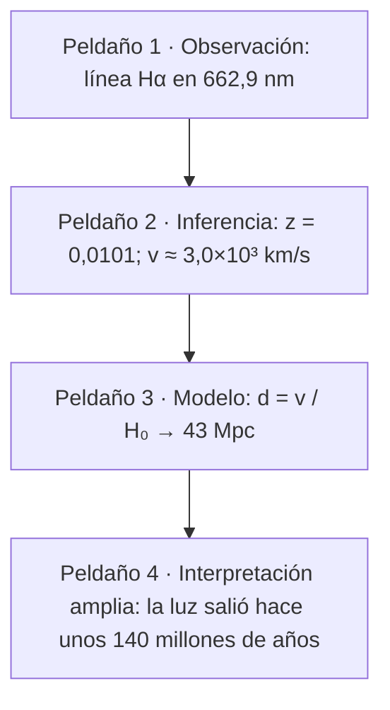

# B01-C05 — Observación frente a interpretación

<!-- nav:top -->
[🏠 Programa](../../../../README.md) · [📚 Bloque B01](../../../tronco-comun/B01-el-universo-y-el-pensamiento-cientifico.md) · [← Anterior: B01-C04 — Espacio y tiempo en ciencia](../B01-C04-espacio-y-tiempo-en-ciencia/CLASE.md) · [Siguiente: B01-C06 — Preguntas investigables en astronomía →](../B01-C06-preguntas-investigables-en-astronomia/CLASE.md)
<!-- /nav -->

## 1. Ubicación, nivel y alcance

Quinta clase del bloque B01 y primera del tramo sobre método de observación y medida (C05–C10). Hasta C04 usaste cifras con naturalidad; ahora te preguntas de qué tipo es cada cifra y cada frase que se dice sobre ella. Sigues en el nivel N1.

Verás cómo separar lo que un instrumento registró de lo que alguien deduce de ese registro y de lo que un modelo agrega. No verás todavía cómo se formulan hipótesis (C07) ni cómo se calcula la incertidumbre (C18).

## 2. Por qué esta clase existe

En septiembre de 2011 la colaboración OPERA publicó que neutrinos enviados desde el CERN habían llegado a su detector, a unos 730 km, 60,7 ns antes de lo que tardaría la luz (S1, versión 1). Una cifra medida pasó rápidamente a titulares que decían otra cosa. En la versión final del mismo trabajo, el adelanto es de 6,5 ns y es compatible con cero (S1, versión 4). El instrumento registró tiempos; lo que cambió fue lo que se podía afirmar con ellos.

La decisión central es: **¿qué parte de lo que leo o digo es un registro, qué parte una deducción y qué parte depende de un modelo?** Aprenderás a rotular cada afirmación como observación, inferencia o modelo, y a decir qué evidencia la sostendría. Esa disciplina sostiene C06 a C20.

## 3. Lo que podrás hacer al terminar

1. Definir observación, inferencia y modelo con un ejemplo de cada uno.
2. Clasificar afirmaciones astronómicas en O (observada), I (inferida) o M (dependiente de modelo).
3. Reconstruir la cadena de capas de un resultado, indicando qué supuesto agrega cada una.
4. Explicar con un caso real cómo una interpretación puede cambiar sin que cambien los instrumentos.
5. Reescribir un titular separando lo registrado de lo interpretado.
6. Elaborar una **tabla O/I/M** de una noticia o artículo breve.

La evidencia es la tabla O/I/M del ejercicio 12 (sección 20).

## 4. Con qué llegas y cómo comprobarlo

Necesitas C01 (corrimiento al rojo, ley de Hubble) y C04 (registrar con unidades e incertidumbre). Cinco preguntas:

1. Si Hα se mide en 662,9 nm y en reposo es 656,3 nm, ¿cuánto vale `z`?
2. ¿Qué unidad lleva `H₀`?
3. ¿Para qué sirve el símbolo `±` junto a un número?
4. ¿Qué distingue una medida de un cálculo hecho con ella?
5. ¿Qué significa «en el vacío» al hablar de `c`?

Ver respuestas

1. `z = (662,9 − 656,3)/656,3 = 0,0101`. 2. km/s/Mpc. 3. Indica la incertidumbre: cuánto puede variar el valor razonablemente. 4. La medida sale de un instrumento; el cálculo la combina con otras cifras o supuestos. 5. Que la velocidad se da cuando la luz no atraviesa ningún medio material.

Con cuatro o cinco aciertos, sigue; con tres o menos, repasa C01 y C04.

## 5. Un caso real: neutrinos que parecían correr más que la luz

OPERA midió el tiempo de vuelo de neutrinos entre el CERN y el laboratorio del Gran Sasso. La versión 1 de su artículo (22 de septiembre de 2011) informa un adelanto de 60,7 ns, con incertidumbres de ±6,9 ns (estadística) y ±7,4 ns (sistemática); la versión 4 (12 de julio de 2012) informa 6,5 ns, con ±7,4 ns y entre +8,3 y −8,0 ns (S1). Con esas cifras, el primer resultado está a unas 6 incertidumbres combinadas de cero y el segundo a menos de una (cálculo nuestro, sección 13).

Lo que debes retener es la estructura, no la física: hubo un **registro** (tiempos de llegada), una **comparación** (con lo que tardaría la luz) y una **lectura** (¿llegaron antes?). Las fuentes consultadas informan los dos resultados; **no leímos** el análisis de por qué difieren, de modo que no explicamos aquí la causa. Este caso solo muestra que la cifra publicada y la afirmación que se le cuelga no son lo mismo.

## 6. Vocabulario

Una **observación** es un registro hecho con los sentidos o con un instrumento, en condiciones declaradas: «la línea apareció en 662,9 nm». Un **dato** es el resultado de una observación, con su unidad e incertidumbre. Una **inferencia** es una conclusión que se obtiene del dato mediante razonamiento o cálculo: «la galaxia se aleja a unos 3 000 km/s». Un **modelo** es una simplificación que permite pasar de datos a magnitudes que no se miden directamente: «la distancia es `v/H₀`». Un **supuesto** es una condición que se acepta sin comprobarla en ese momento. Una **evidencia** es un dato que apoya o contradice una afirmación. Un **sesgo de confirmación** es la tendencia a notar lo que coincide con lo que ya creemos.

## 7. Modelo mental: la escalera de capas

Imagina una escalera. El primer peldaño es lo que el instrumento registró; cada peldaño siguiente agrega un supuesto, y cuanto más arriba, más cosas hay que creer para sostener la frase.

*Descripción textual:* una escalera de cuatro peldaños. El primero es el registro de la línea; el segundo, el cálculo de `z` y de la velocidad aparente; el tercero, la distancia con la ley de Hubble; el cuarto, la época de la luz. Cada peldaño depende del anterior y suma supuestos.

Analogía: un termómetro clínico marca 38,5 °C (observación); decimos «tiene fiebre» (inferencia, según un umbral convenido); decimos «tiene gripe» (modelo del cuadro clínico). Límite: en medicina hay pruebas que bajan de peldaño; en astronomía a menudo no podemos repetir el experimento sobre el objeto y solo cambiar de instrumento o de método.

## 8. La explicación, paso a paso

### 8.1 Qué cuenta como observación

Una observación declara lo que se hizo y lo que se registró, sin adjetivos que den un veredicto. «La línea Hα cae en 662,9 ± 0,1 nm en un espectro tomado con tal instrumento el día tal» es observación. «La galaxia se aleja muy rápido» ya incluye un juicio («muy rápido») y un modelo (alejamiento). Fíjate en que **también un dato instrumental ya viene procesado**: el espectrógrafo calibra longitudes de onda con lámparas conocidas. Ese procesamiento es parte del registro y debe declararse.

### 8.2 Qué agrega una inferencia

De 662,9 nm y 656,3 nm se calcula `z = (λ_obs − λ_rep)/λ_rep = 0,0101`. Hasta aquí hay solo aritmética. Convertir `z` en velocidad con `v ≈ c·z` agrega un supuesto: que `z` es pequeño y que el corrimiento se interpreta como movimiento aparente. Para `z = 0,0101`: `v = 299 792 km/s × 0,0101 ≈ 3,0 × 10³ km/s`. Dos cifras significativas, porque la longitud de onda se midió al 0,1 nm (C01).

### 8.3 Qué agrega un modelo

`d = v/H₀` agrega un modelo completo: que la galaxia sigue la expansión y no está ligada a un grupo local (C01), y un valor de `H₀`. Con 70 km/s/Mpc, `d = 3 000/70 ≈ 43 Mpc`. Si cambias a 67,4 o a 73,04 (los valores de Planck y de SH0ES que viste en C01; S2 y S3), la distancia pasa a unos 45 y 41 Mpc: el dato no cambió; el modelo y su parámetro sí.

### 8.4 Cuando la interpretación cambia y los datos no

La historia de la ciencia está llena de casos en que el mismo registro se leyó de otro modo. Lo sano es que cada capa pueda revisarse sin tirar las de abajo. Por eso se **publican los datos de abajo** además de las conclusiones: otros pueden recalcular desde el peldaño que quieran. Un caso útil: el análisis de la expedición de 1919 que midió la desviación de la luz estelar cerca del Sol fue cuestionado por quienes sostenían que se habían descartado datos con razones dudosas; el artículo que consultamos defiende que los organizadores tenían buenas razones, y aclara que esa es la postura de su autor, no un consenso (S4). El ejemplo enseña cómo se discute: señalando qué placas se usaron, con qué criterio y con qué re-análisis.

### 8.5 Un procedimiento para clasificar

Ante una frase, pregunta: (1) ¿alguien podría haberla *registrado* tal cual con un instrumento? Entonces es **O**. (2) ¿Se obtiene de datos mediante razonamiento o cálculo que cualquiera puede repetir con los mismos supuestos? Entonces es **I**. (3) ¿Depende de un modelo o parámetro que podría cambiar? Entonces es **M**. Muchas frases mezclan capas; la regla es **dividirlas** hasta que cada trozo tenga una sola.

## 9. Magnitudes, símbolos y unidades

| Símbolo | Qué es | Unidad | Valor o nota |
|---|---|---|---|
| `λ_obs`, `λ_rep` | longitud de onda observada y en reposo | nm | 662,9 y 656,3 (C01) |
| `z` | corrimiento al rojo | adimensional | `(λ_obs − λ_rep)/λ_rep` |
| `v` | velocidad aparente | km/s | `≈ c·z` (z pequeño) |
| `H₀` | constante de Hubble | km/s/Mpc | 67,4 ± 0,5 (S2); 73,04 ± 1,04 (S3) |
| `d` | distancia | Mpc | `v/H₀` |
| `σ_tot` | incertidumbre combinada de dos fuentes independientes | misma unidad que la medida | `√(σ₁² + σ₂²)` (sección 13) |
| O / I / M | clases de afirmación | — | convención de esta clase |

## 10. Convenciones y referencias

En esta clase **O**, **I** y **M** son etiquetas didácticas, no categorías de una norma. Los datos de la galaxia de Hα son de ejemplo coherente con C01 (valores **estimados** para docencia, no un objeto catalogado). Los números de OPERA son **observados** (publicados en S1). La combinación de incertidumbres en cuadratura supone que son independientes; se justifica en C18.

## 11. De dónde sale lo que afirmamos

| ID | Fuente | Localizador | Respalda | Estado |
|---|---|---|---|---|
| S1 | OPERA Collaboration (T. Adam et al.), *Measurement of the neutrino velocity with the OPERA detector in the CNGS beam* | arXiv:1109.4897 (v1 del 22-sep-2011 y v4 del 12-jul-2012) | v1: adelanto 60,7 ns, ±6,9 (est.) ±7,4 (sist.); v4: 6,5 ns, ±7,4 (est.), +8,3/−8,0 (sist.); base ≈ 730 km | Resúmenes de v1 y v4 consultados el 2026-11-05; no se leyó el cuerpo del artículo ni el análisis de la discrepancia |
| S2 | Planck Collaboration, *Planck 2018 results. VI*, arXiv:1807.06209 | https://arxiv.org/abs/1807.06209 | `H₀ = 67,4 ± 0,5` km/s/Mpc (base-ΛCDM) | Resumen consultado el 2026-11-05 |
| S3 | Riess, A. G. et al., arXiv:2112.04510 | https://arxiv.org/abs/2112.04510 | `H₀ = 73,04 ± 1,04` km/s/Mpc | Resumen consultado el 2026-11-05 |
| S4 | Kennefick, D., *Not Only Because of Theory: Dyson, Eddington and the Competing Myths of the 1919 Eclipse Expedition* | arXiv:0709.0685 | Controversia sobre el análisis de datos de 1919; postura del autor | Resumen consultado el 2026-11-05 (no se leyó el artículo completo) |
| S5 | NASA NSSDC, *Moon Fact Sheet* (actualizada el 11-ene-2024) | https://nssdc.gsfc.nasa.gov/planetary/factsheet/moonfact.html | Semieje mayor 384 400 km; perigeo medio 363 300 km; apogeo medio 405 500 km | Página consultada el 2026-11-05 |

Límites: las cifras de OPERA se citan de los resúmenes; la lectura de «6 sigma» y «menos de 1 sigma» es cálculo nuestro con suma en cuadratura y no una cifra publicada.

## 12. Cómo ver la escalera

Versión accesible del diagrama de la sección 7:

| Peldaño | Contenido | Qué agrega | Clase |
|---|---|---|---|
| 1 | Línea Hα en 662,9 nm | Nada: es el registro (más calibración declarada) | O |
| 2 | `z = 0,0101`; `v ≈ 3,0×10³ km/s` | Aritmética y supuesto `v ≈ c·z` | I |
| 3 | `d ≈ 43 Mpc` | Ley de Hubble y valor de `H₀` | M |
| 4 | «La luz salió hace ~140 millones de años» | Que `c` es constante y que `d` es correcta | M |

Si lo dibujas, que cada peldaño tenga una etiqueta de texto y un símbolo distinto (O, I, M), no solo colores. Descripción larga: cuatro bloques apilados con flechas hacia arriba; el número de supuestos crece con la altura.

## 13. Ejemplo trabajado: la tabla O/I/M de la galaxia de Hα

**Frase de partida (titular):** «Astrónomos descubren una galaxia que huye de nosotros a 3 000 km/s y que vemos como era hace 140 millones de años».

**Paso 1 · Dividir.** (a) «Su línea Hα aparece en 662,9 nm.» (b) «En reposo, Hα está en 656,3 nm.» (c) «Se aleja a unos 3 000 km/s.» (d) «Está a unos 43 Mpc.» (e) «Vemos su luz de hace unos 140 millones de años.»

**Paso 2 · Clasificar.** (a) **O**: es el registro. (b) **O** de laboratorio, obtenido en otro lugar: dato de referencia. (c) **I**: `z = 0,0101`, `v ≈ c·z`; supone que el corrimiento se interpreta como velocidad aparente. (d) **M**: usa `H₀ = 70`; con 67,4 o 73,04 cambia a ~45 o ~41 Mpc. (e) **M**: depende de `d` y de que `c` sea constante; con 43 Mpc, `43 × 3,26 ≈ 140` millones de años luz.

**Paso 3 · Qué falta.** El titular dice «huye»: palabra que suena a observación y es modelo. No dice la unidad de `H₀` ni su valor, ni la incertidumbre de ninguna cifra.

**Paso 4 · Reescribir.** «Se registró la línea Hα en 662,9 ± 0,1 nm (referencia 656,3 nm), lo que da `z = 0,0101`. Con `H₀ = 70 km/s/Mpc` la distancia estimada es ≈ 43 Mpc, que implica un tiempo de luz de ≈ 140 millones de años.»

**Paso 5 · Verificar con OPERA.** Combinando en cuadratura: v1, `√(6,9² + 7,4²) = 10,1 ns` y `60,7/10,1 ≈ 6,0`. v4, `√(7,4² + 8,3²) = 11,1 ns` (tomando la sistemática mayor) y `6,5/11,1 ≈ 0,6`. Un mismo método de lectura da «lejos de cero» y «compatible con cero» según el registro.

**Sentido físico.** Los números de arriba no son lo débil de la cadena; lo débil es afirmar el peldaño 4 como si fuera el 1.

## 14. Distintas formas de separar lo observado

Hay tres hábitos útiles: **dividir frases** (como en la sección 13), **mirar el verbo** (los verbos de acción sobre un objeto lejano —«huye», «atrae», «explota»— suelen esconder inferencias) y **pedir el peldaño más bajo** (¿qué número se registró?). Los dos primeros son rápidos pero dependen de tu criterio; el tercero es más fiable pero exige acceso a los datos. Usa el rápido al leer y el fiable al decidir.

## 15. Práctica guiada

**Ejercicio 1 · con los pasos indicados.** Clasifica como O, I o M: «el espectrógrafo registró 662,9 nm»; «`z = 0,0101`»; «la edad del universo es 13,8 Gyr». *Pasos:* aplica la sección 8.5.

Solución comentada

La primera es O (registro). La segunda es I: sale de aritmética sobre dos longitudes de onda. La tercera es M: depende de ΛCDM y de sus parámetros (C01). Si marcaste la segunda como O, recuerda que `z` ya es un cálculo.

**Ejercicio 2 · con una pista.** Con `H₀ = 73,04` calcula la distancia de la galaxia de Hα. *Pista:* `d = v/H₀` con `v = 3 015 km/s`.

Solución comentada

`d = 3 015/73,04 = 41,3 Mpc`. Frente a 43 Mpc con `H₀ = 70`, el cambio es del 4 %: el dato fue el mismo, el parámetro del modelo distinto (sección 8.3).

**Ejercicio 3 · casi autónomo.** Reescribe «Neutrinos más rápidos que la luz» como una frase que separe lo registrado de lo interpretado, usando S1 (v1).

Solución comentada

Por ejemplo: «OPERA registró neutrinos llegando 60,7 ns antes del tiempo de vuelo de la luz, con incertidumbres ±6,9 ns (estadística) y ±7,4 ns (sistemática); la lectura de que superan a la luz requiere que ese tiempo esté bien medido». El adelanto es O; «más rápidos que la luz» es I, que depende de todo el sistema de medida.

## 16. Práctica autónoma, transferencia e integrador

**Ejercicio 4.** Divide en afirmaciones simples y clasifica: «La estrella parpadea porque su energía fluctúa, como lo muestra su brillo cambiante.»

Solución comentada

(a) «El brillo registrado cambia con el tiempo»: O. (b) «Su energía emitida fluctúa»: I/M, porque el parpadeo visible a simple vista puede venir de la atmósfera. (c) «Como lo muestra su brillo»: la frase usa un registro para sostener algo que el registro no distingue. Falta decir con qué instrumento y si se descartó la atmósfera.

**Ejercicio 5.** Con S1: ¿es correcto afirmar que la versión 4 «refuta» a la versión 1? Explica qué sí se puede afirmar con los dos resúmenes.

Solución comentada

Solo podemos afirmar que las cifras publicadas difieren (60,7 ns frente a 6,5 ns) y que la última es compatible con cero. «Refuta» exigiría saber por qué cambió; los resúmenes no lo dicen (sección 5). Distinguir lo que se afirma de lo que no se leyó es parte del ejercicio.

**Ejercicio 6.** Calcula la velocidad aparente y la distancia de otra galaxia con `λ_obs = 665,0 nm` para Hα (referencia 656,3 nm) y `H₀ = 70`. Indica la clase de cada resultado.

Solución comentada

`z = 8,7/656,3 = 0,01326`; `v = 299 792 × 0,01326 = 3 975 km/s` (I); `d = 3 975/70 = 56,8 Mpc` (M). Con dos cifras: 4,0 × 10³ km/s y 57 Mpc.

**Ejercicio 7.** Elige una afirmación de este texto y busca cuál es su peldaño más bajo: «La Luna está a 384 400 km».

Solución comentada

La cifra es un valor medio del semieje de la órbita (S5), obtenido de mediciones repetidas (por ejemplo, tiempo de ida y vuelta de señales) más un modelo de órbita; el peldaño bajo son esos tiempos. La frase «está a» omite que la distancia varía entre ~363 000 y ~406 000 km a lo largo de la órbita.

**Ejercicio 8.** Un compañero dice: «Mi telescopio muestra manchas en Marte, o sea, hay agua». Marca el salto de peldaños.

Solución comentada

Registro: «veo manchas oscuras y claras». Inferencia posible: «son variaciones de brillo de la superficie». Salto a «hay agua»: exige un modelo y datos que su telescopio no da. La conclusión sobra respecto de la evidencia.

**Ejercicio 9 · transferencia.** Aplica la escalera a un termómetro doméstico: ¿qué es O, I y M cuando «hace 35 °C»?

Solución comentada

O: la columna de líquido llega a la marca 35 (o el sensor da 35,0 en cierta escala). I: la temperatura del aire es 35 °C si el aparato está calibrado y a la sombra. M: «hace calor» según un criterio humano. La misma escalera sirve fuera de la astronomía.

**Ejercicio 10 · transferencia.** Un artículo afirma «la expansión del universo se está acelerando». Sin consultar más fuentes, di qué parte parece O, qué parte I y qué parte M, y qué preguntarías para bajar de peldaño.

Solución comentada

O: brillos y corrimientos al rojo de objetos lejanos. I: distancias derivadas de esos brillos. M: la lectura «aceleración» depende de un modelo cosmológico. Preguntarías: ¿qué objetos?, ¿qué calibración de distancias?, ¿con qué incertidumbre? (C16 y C18 retoman esto).

**Ejercicio 11 · transferencia.** Dos grupos obtienen `H₀ = 67,4 ± 0,5` y `73,04 ± 1,04`. ¿Qué pasos de la escalera podrían explicar la diferencia?

Solución comentada

Combinando en cuadratura, la diferencia es `5,64` y `σ = √(0,5² + 1,04²) = 1,15`, es decir ≈ 4,9σ. Podría deberse a un error sistemático en las distancias (peldaño 1–2), a un supuesto del modelo (peldaño 3) o a ambos. La tensión se discute en C01; aquí se nombra el procedimiento, no la causa (S2, S3).

**Ejercicio 12 · integrador.** Elabora la **tabla O/I/M** de una noticia espacial de tu elección: transcribe el titular, divídelo en afirmaciones simples, clasifica cada una, anota qué dato o supuesto sostiene cada I y M, y reescribe el titular con solo lo registrado y lo inferido con su supuesto declarado.

Solución modelo

Una buena tabla sigue la sección 13: al menos cinco afirmaciones, cada una con clase, sustento y, para I y M, el supuesto principal. El titular reescrito conserva cifras con unidad e incertidumbre. Se acepta cualquier noticia si se cita su fuente.

## 17. Actividad sin código: la escalera de una cifra publicada

Esta clase no calcula nada nuevo, así que no tiene script. La actividad: elige una cifra de la ficha NASA (S5) o de C01 a C04 y escribe su escalera de cuatro peldaños con la cifra, el instrumento o método que la origina, el supuesto que agrega cada peldaño y la incertidumbre. **Datos:** publicados o de ejemplo, rotulados. **Predice antes de hacerlo:** ¿en qué peldaño aparece el primer supuesto? (Casi siempre en el segundo, aunque el primero ya incluye calibración.) **Límites:** no se verifica la fuente original de la cifra.

## 18. Errores frecuentes y cómo corregirlos

**Creer que un dato es «puro».** Todo dato incluye calibración; se corrige con la sección 8.1.

**Usar verbos de acción como si fueran registro.** «Huye», «explota», «atrae»; se corrige con el ejercicio 4.

**Confundir cálculo con medida.** `z` se calcula; la longitud de onda se mide; ejercicio 1.

**Atribuir a un resultado la autoridad del dato.** El peldaño 4 no hereda la solidez del 1; ejercicio 3.

**Afirmar de más sobre lo que no se leyó.** Ejercicio 5.

## 19. Cómo sabrás que vas bien

Tras la sección 8.2: ¿qué supuesto agrega `v ≈ c·z`? Si no lo recuerdas, repite el ejercicio 6. Tras 8.3: ¿cambió el dato al pasar de `H₀ = 70` a 73,04? Si respondes que sí, repite el ejercicio 2. Tras el ejemplo: ¿puedes dividir un titular en cinco frases? Si no, haz el ejercicio 4. Al final: ¿por qué «refuta» no estaba permitido en el ejercicio 5? Si dudas, relee la sección 5.

## 20. Qué entregas y cómo se evalúa

El producto es tu **tabla O/I/M**: una página con el titular, sus afirmaciones divididas, su clase, su sustento y el titular reescrito.

| Criterio | Inicial | En desarrollo | Logrado | Destacado |
|---|---|---|---|---|
| División de afirmaciones | No divide | Divide parte | Divide cada frase | Detecta frases que mezclan capas |
| Clasificación | Errónea | Parcial | Correcta | Justifica cada clase con un supuesto |
| Sustento | Ausente | Genérico | Específico | Propone cómo bajar de peldaño |
| Reescritura | Igual al original | Más cauta | Separa registro e inferencia | Añade unidades e incertidumbre |
| Fuentes | Sin cita | Cita sin alcance | Cita lo consultado | Declara lo que no leyó |

**Condiciones críticas:** no presentar una inferencia como observación; no afirmar sobre fuentes no consultadas; citar solo lo consultado.

## 21. Ética, seguridad y límites

Separar capas es una forma de honestidad: evita atribuir al dato lo que pertenece al modelo. Las conclusiones sobre personas o equipos (por ejemplo, el debate sobre 1919) se presentan como posturas con su fuente, no como veredictos. Clase educativa: no sustituye la lectura de los artículos. Accesibilidad: ecuaciones en texto, diagrama con descripción, tablas equivalentes, sin conexión.

## 22. Para cerrar y seguir

Observar es registrar; inferir es calcular con supuestos; modelar es suponer una estructura. Un resultado sólido deja visibles los tres peldaños y sus incertidumbres. Queda abierta una pregunta práctica: ¿qué preguntas podemos formular de modo que los datos disponibles puedan responderlas? (C06).

**Glosario español–inglés.** observación · *observation*; inferencia · *inference*; modelo · *model*; supuesto · *assumption*; sesgo de confirmación · *confirmation bias*; incertidumbre · *uncertainty*.

**Continuidad.** B01-C06 usa tu capacidad de **rotular qué es registro, inferencia y modelo** para decidir qué preguntas se pueden responder con datos y cuáles no. B01-C17 retomará los modelos como peldaño explícito.

**Referencias:** ver sección 11. S1 a S4 son resúmenes; S5 es la ficha NASA de la Luna, consultada para el ejercicio 7.

<!-- nav:bottom -->
---

[← Anterior: B01-C04 — Espacio y tiempo en ciencia](../B01-C04-espacio-y-tiempo-en-ciencia/CLASE.md) · [📚 Bloque B01](../../../tronco-comun/B01-el-universo-y-el-pensamiento-cientifico.md) · [Siguiente: B01-C06 — Preguntas investigables en astronomía →](../B01-C06-preguntas-investigables-en-astronomia/CLASE.md)
<!-- /nav -->
