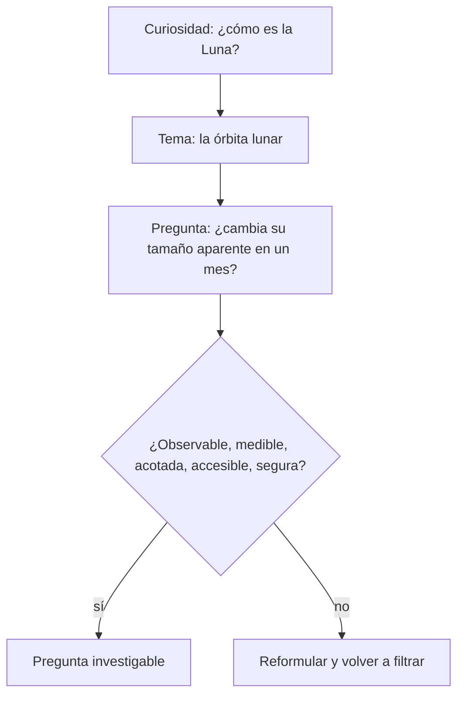

# B01-C06 — Preguntas investigables en astronomía

<!-- nav:top -->
[🏠 Programa](../../../../README.md) · [📚 Bloque B01](../../../tronco-comun/B01-el-universo-y-el-pensamiento-cientifico.md) · [← Anterior: B01-C05 — Observación frente a interpretación](../B01-C05-observacion-frente-a-interpretacion/CLASE.md) · [Siguiente: B01-C07 — Hipótesis y predicciones falsables →](../B01-C07-hipotesis-y-predicciones-falsables/CLASE.md)
<!-- /nav -->

## 1. Ubicación, nivel y alcance

Sexta clase del bloque B01. En C05 aprendiste a separar registro, inferencia y modelo. Ahora usas esa separación para decidir qué preguntas pueden responderse con datos que tengas a mano y cuáles no. Sigues en el nivel N1.

Verás qué hace «investigable» a una pregunta, cómo reducir una curiosidad grande a una pregunta acotada y cómo estimar, antes de empezar, si los datos disponibles alcanzan. No verás todavía cómo se formula la hipótesis que acompaña a la pregunta (C07) ni cómo se calcula el error (C18).

## 2. Por qué esta clase existe

«¿Hay vida en otros planetas?» es una pregunta legítima y apasionante, pero nadie puede responderla con un cuaderno y una cámara de teléfono. «¿Cambia el tamaño aparente de la Luna a lo largo de un mes?» sí puede responderse con una cámara y un trípode, y su respuesta enseña algo real sobre la órbita lunar. La diferencia no es la importancia de la pregunta: es su forma.

La decisión central es: **¿esta pregunta se puede responder con datos que puedo obtener, con la precisión que necesito y en el tiempo que tengo?** Aprenderás un filtro de cinco criterios, a reformular preguntas que no lo pasan y a estimar la viabilidad con un cálculo rápido. Es el primer paso del ciclo pregunta → hipótesis → predicción de C07 y del proyecto de C20.

## 3. Lo que podrás hacer al terminar

1. Distinguir una pregunta investigable de una que no lo es y justificar la diferencia.
2. Aplicar cinco criterios (observable, medible, acotada, accesible, segura) a una pregunta.
3. Reformular una pregunta amplia en otra acotada que conserve su motivación.
4. Estimar con un cálculo si un instrumento sencillo puede detectar el efecto buscado.
5. Citar la fuente de un dato de partida y rotular si es observado, estimado o de ejemplo.
6. Armar un **banco de preguntas con criterio de viabilidad**.

La evidencia es el banco del ejercicio 12 (sección 20).

## 4. Con qué llegas y cómo comprobarlo

Necesitas C02 (escalas), C04 (tiempos y unidades) y C05 (O/I/M). Cinco preguntas:

1. ¿Qué es una incertidumbre?
2. Si un objeto mide 3 475 km y está a 384 400 km, ¿bajo qué ángulo aproximado se ve, en radianes? (ángulo ≈ tamaño/distancia).
3. ¿Qué es el período sinódico de la Luna?
4. Clasifica «la Luna orbita la Tierra en 27,3 días respecto de las estrellas»: ¿O, I o M?
5. ¿Por qué es importante escribir las unidades?

Ver respuestas

1. El rango en que razonablemente puede estar el valor. 2. `3 475/384 400 = 0,00904 rad` (unos 1 860″, es decir, ~0,5°). 3. El tiempo entre dos fases iguales: 29,53 d (C04). 4. I/M: se obtiene de varias observaciones y un modelo de órbita. 5. Porque sin unidad la cifra no se puede comparar ni reproducir.

Con cuatro o cinco aciertos, sigue; con tres o menos, repasa C02, C04 y C05.

## 5. Un caso real: ¿cuánto cambia el tamaño aparente de la Luna?

La ficha de la Luna de la NASA informa que su distancia media al perigeo es de 363 300 km, la media al apogeo de 405 500 km, su semieje mayor de 384 400 km, su excentricidad de 0,0549 y su radio medio de 1 737,4 km (S1). Si la distancia cambia, el tamaño angular debería cambiar. La pregunta «¿cambia el tamaño aparente de la Luna a lo largo de un mes?» nace de aquí.

Fíjate en qué la hace buena: hay un objeto visible, una magnitud que se puede medir (el diámetro angular), un ciclo de tiempo conocido (27,32 días respecto de las estrellas, 29,53 entre fases; S1) y un instrumento accesible. Es nuestro **ejemplo conductor**, y volverá en C11, C12 y C20. Límite del caso: las cifras de S1 son valores medios del conjunto de la órbita; no te dicen qué día será perigeo ni cuánto cambia cada noche.

## 6. Vocabulario

Una **pregunta investigable** es una pregunta cuya respuesta puede apoyarse en datos que se pueden obtener. Una **variable** es una magnitud que cambia o puede medirse. La **variable dependiente** es la que se mide como resultado; la **independiente**, la que se cambia o se deja evolucionar (por ejemplo, el día del mes). Una **magnitud observable** es la que algún instrumento puede registrar directamente. Un **proxy** es una magnitud medible que sustituye a otra que no se puede medir (el diámetro en píxeles como sustituto del diámetro angular). La **resolución** es el cambio más pequeño que el instrumento distingue. La **viabilidad** es la posibilidad real de responder con los recursos y el tiempo disponibles. El **alcance** es hasta dónde pretende llegar la respuesta.

## 7. Modelo mental: el embudo de la pregunta

Imagina un embudo: arriba entra la curiosidad amplia; en cada nivel pasas un filtro y queda algo más estrecho; abajo sale una pregunta que puedes responder.

*Descripción textual:* una cadena vertical. La curiosidad se concreta en un tema y luego en una pregunta; un filtro con cinco criterios decide si es investigable; si no lo es, se reformula y se vuelve a pasar el filtro.

Analogía: un mapa. «Quiero viajar» no es un destino; «ir a tal ciudad el viernes» sí. Límite: en ciencia, a veces una pregunta «mala» hoy se vuelve investigable cuando aparece un instrumento nuevo; el filtro depende de los medios del momento.

## 8. La explicación, paso a paso

### 8.1 Los cinco criterios

Una pregunta es investigable en tu situación cuando cumple, a la vez:

1. **Observable:** habla de algo que un instrumento puede registrar (un brillo, una posición, una hora), no de una opinión ni de un propósito («para qué existe»).
2. **Medible:** existe una magnitud con unidad que responde la pregunta, o un proxy justificado.
3. **Acotada:** dice qué objeto, qué magnitud, qué intervalo de tiempo y qué lugar.
4. **Accesible:** los datos pueden obtenerse (los tuyos o los publicados con fuente) con tus medios.
5. **Segura y ética:** no exige riesgo físico (por ejemplo, mirar el Sol sin filtro certificado) ni uso indebido de datos ajenos.

### 8.2 Tipos de pregunta

Hay preguntas de **descripción** («¿cuánto mide?»), de **comparación** («¿es A mayor que B?»), de **relación** («¿cambia X cuando cambia Y?») y de **causa** («¿por qué?»). Las tres primeras se responden con datos directamente; las de causa suelen requerir un modelo y varias líneas de evidencia (C07 y C17). Empieza por las de descripción, comparación y relación.

### 8.3 Reformular: de lo amplio a lo acotado

Tomamos «¿Hay vida en otros planetas?». No pasa el criterio 1 ni el 3. Reformulaciones investigables: «¿qué temperaturas superficiales publica la NASA para los planetas del sistema solar y cuáles caen entre 0 y 100 °C?» (descripción con datos publicados, S2); o «¿qué cantidad de agua líquida se infiere en tal cuerpo según tal misión?» (necesita fuente). Observa que la reformulación **cambia la pregunta**: ya no responde si hay vida; responde algo que la rodea. Es honesto decirlo.

### 8.4 Estimar la viabilidad con un cálculo

Para la Luna, el diámetro angular es `θ ≈ D/d`, con `D = 2 × 1 737,4 = 3 474,8 km` (S1). En perigeo medio: `θ = 3 474,8/363 300 = 0,009565 rad = 1 972,8″`. En apogeo medio: `3 474,8/405 500 = 0,008569 rad = 1 767,5″`. La razón es `405 500/363 300 = 1,116`: el diámetro cambia hasta un 12 %.

¿Puede una cámara detectarlo? Supón (dato de ejemplo, no de un modelo concreto) un teléfono de 4 000 píxeles de ancho que cubre 65°. Cada píxel abarca `65 × 3 600/4 000 = 58,5″`. La Luna ocupa `1 767,5/58,5 = 30,2 px` en apogeo y `33,7 px` en perigeo: una diferencia de 3,5 px. Sí se detecta, pero con poco margen: hay que fijar el zoom, medir en varias fotos y declarar la incertidumbre (C18). Ese cálculo es la **estimación de viabilidad**, y se hace *antes* de salir a observar.

### 8.5 Declarar qué respondería la pregunta

Una pregunta investigable dice qué dato la contestaría. «¿Cambia el tamaño?» queda contestada por una serie de diámetros angulares en función del día. Si ninguna serie de datos podría contestarla, vuelve al filtro.

## 9. Magnitudes, símbolos y unidades

| Símbolo | Qué es | Unidad | Valor o nota |
|---|---|---|---|
| `D` | diámetro de la Luna | km | 3 474,8 (2 × radio medio 1 737,4; S1) |
| `d` | distancia Tierra–Luna | km | perigeo medio 363 300; apogeo medio 405 500; semieje 384 400 (S1) |
| `θ` | diámetro angular | rad, ″ | `D/d`; 1 rad = 206 265″ |
| `p` | escala de la cámara | ″/px | 58,5 (ejemplo supuesto) |
| `N` | diámetro en píxeles | px | `θ/p` |
| `e` | excentricidad | adimensional | 0,0549 (S1) |

## 10. Convenciones y referencias

La conversión 1 rad = 206 265″ sale de `180° × 3 600/π`. Los valores de S1 son **observados y derivados por NASA**; los diámetros angulares de la sección 8.4 son **estimados por nosotros** con la aproximación de ángulo pequeño; la cámara es **hipotética** (sintética). La aproximación `θ ≈ D/d` es buena porque `θ` es del orden de 0,01 rad.

## 11. De dónde sale lo que afirmamos

| ID | Fuente | Localizador | Respalda | Estado |
|---|---|---|---|---|
| S1 | NASA NSSDC, *Moon Fact Sheet* (actualizada el 11-ene-2024) | https://nssdc.gsfc.nasa.gov/planetary/factsheet/moonfact.html | Perigeo medio 363 300 km; apogeo medio 405 500 km; semieje 384 400 km; excentricidad 0,0549; radio medio 1 737,4 km; períodos 27,3217 y 29,53 d | Página consultada el 2026-11-05 |
| S2 | NASA NSSDC, *Planetary Fact Sheet – Metric* (actualizada el 18-mar-2025) | https://nssdc.gsfc.nasa.gov/planetary/factsheet/ | Tabla de masas, diámetros, distancias y número de lunas de los planetas | Página consultada el 2026-11-05 (solo masas, diámetros, distancias y lunas) |
| S3 | NASA Science, «Eclipse safety» | https://science.nasa.gov/eclipses/safety/ | Visores con norma ISO 12312-2; las gafas comunes no son seguras; los instrumentos ópticos necesitan filtro solar propio al frente | Página consultada el 2026-11-05 |

Límites: S2 no se usó para temperaturas (la reformulación sobre temperaturas de 8.3 es solo un ejemplo de método y exigiría consultar esa tabla); la reformulación de 8.3 es un ejemplo de método, no un resultado.

## 12. Cómo ver el embudo y el banco

Versión accesible del diagrama:

| Nivel | Contenido | Pregunta de control |
|---|---|---|
| Curiosidad | «¿Cómo es la Luna?» | ¿Qué me intriga? |
| Tema | Órbita lunar | ¿Qué se puede observar? |
| Pregunta | ¿Cambia su tamaño aparente en un mes? | ¿Pasa los cinco criterios? |
| Viabilidad | 3,5 px de diferencia | ¿El instrumento lo detecta? |

Descripción larga: de cada nivel al siguiente el contenido se vuelve más específico; el último contiene un número que decide si se sigue.

## 13. Ejemplo trabajado: del «¿cómo es la Luna?» a una pregunta con plan

**Paso 1 · Curiosidad.** «¿Cómo es la Luna?» Demasiado amplia.

**Paso 2 · Tema.** La Luna cambia de forma (fases, C12) y de tamaño aparente. Elegimos el tamaño.

**Paso 3 · Pregunta.** «¿Cambia el diámetro angular de la Luna llena entre un mes y el siguiente, al fotografiarla desde mi balcón?»

**Paso 4 · Filtro.** Observable: sí (foto). Medible: sí (px → ″ con la escala `p`). Acotada: sí (Luna llena, un lugar, dos meses). Accesible: sí (cámara y trípode). Segura: sí (se observa de noche, sin riesgo; nada que ver con el Sol).

**Paso 5 · Viabilidad.** Del cálculo de 8.4, la diferencia máxima entre perigeo y apogeo es 3,5 px; la diferencia entre dos lunas llenas cualesquiera suele ser menor. Conclusión: con 4 000 px de ancho solo se detectará si una luna llena cae cerca del perigeo y la otra cerca del apogeo; hay que ampliar con teleobjetivo (por ejemplo, 5×) o repetir en meses distintos.

**Paso 6 · Qué responde.** Una serie de dos o más diámetros angulares con su incertidumbre.

**Sentido físico.** La pregunta no se volvió «menos interesante» al acotarse: se volvió **respondible**. Y el cálculo de viabilidad nos advirtió antes de gastar noches de observación.

## 14. Distintas formas de elegir una pregunta

Hay tres estrategias. **Partir de la curiosidad** da motivación, pero exige reformular. **Partir del dato disponible** (por ejemplo, una tabla publicada) garantiza accesibilidad, pero la pregunta puede quedar pobre. **Partir del instrumento** («¿qué puedo medir con mi cámara?») asegura viabilidad, pero puede alejarte de lo que te importa. Lo habitual es combinar: curiosidad arriba, datos e instrumento abajo.

## 15. Práctica guiada

**Ejercicio 1 · con los pasos indicados.** Aplica los cinco criterios a: «¿Es el cielo de mi ciudad más oscuro los fines de semana?» *Pasos:* sección 8.1; di qué magnitud mediría la pregunta.

Solución comentada

Observable: sí, el brillo del cielo. Medible: con un proxy (fotos con ajustes fijos). Acotada: falta lugar, hora e intervalo. Accesible: sí. Segura: sí. Falla la tercera: reformula «¿cambia el brillo del cielo, medido con tal cámara y ajustes, a las 23:00 entre sábados y miércoles durante un mes?».

**Ejercicio 2 · con una pista.** Calcula el diámetro angular de la Luna en perigeo medio. *Pista:* `θ = D/d`, con `D = 3 474,8 km` y `d = 363 300 km`.

Solución comentada

`θ = 0,009565 rad`; multiplicado por 206 265 da `1 972,8″` (unos 33 minutos de arco). Si olvidaste pasar a segundos de arco, quedaste en radianes (sección 8.4).

**Ejercicio 3 · casi autónomo.** Con la cámara hipotética (58,5″/px), ¿cuántos píxeles mide la Luna en perigeo medio y en apogeo medio? ¿Cuántos píxeles de diferencia?

Solución comentada

Perigeo: `1 972,8/58,5 = 33,7 px`; apogeo: `1 767,5/58,5 = 30,2 px`; diferencia `3,5 px`. Con una incertidumbre de ±1 px en cada borde, la diferencia es detectable, pero con poco margen.

## 16. Práctica autónoma, transferencia e integrador

**Ejercicio 4.** Clasifica cada pregunta como investigable o no y justifica con un criterio: (a) «¿Cuál es el planeta más bonito?»; (b) «¿Cuántas lunas publica la NASA para Marte y para Júpiter?»; (c) «¿Para qué existe el Sol?»

Solución comentada

(a) No: «bonito» no es observable ni medible. (b) Sí: descripción con dato publicado (S2: 2 y 95 lunas, a la fecha de consulta; el número cambia con nuevos descubrimientos). (c) No: pregunta por un propósito, no por una magnitud.

**Ejercicio 5.** Reformula «¿Cómo se formó el sistema solar?» en una pregunta acotada que pueda responderse con la ficha de planetas (S2).

Solución comentada

Por ejemplo: «¿Las masas de los planetas del sistema solar se agrupan en dos familias según S2?» (compara 0,330 a 5,97 ×10²⁴ kg con 86,8 a 1 898 ×10²⁴ kg). Es una pregunta descriptiva derivada del tema; no responde «cómo se formó» y debe decirlo.

**Ejercicio 6.** Estima cuántos píxeles mediría la Luna en perigeo medio con un teléfono de 3 000 px de ancho que cubre 70°. ¿Detectas la diferencia con el apogeo?

Solución comentada

`p = 70 × 3 600/3 000 = 84″/px`; perigeo `1 972,8/84 = 23,5 px`; apogeo `1 767,5/84 = 21,0 px`; diferencia 2,5 px. Es más difícil de detectar; conviene ampliar con teleobjetivo o aceptar solo diferencias grandes.

**Ejercicio 7.** ¿Por qué «¿cambia el tamaño de la Luna?» es ambigua? Reescríbela.

Solución comentada

Mezcla el tamaño *físico* (no cambia) con el *aparente* (sí). Reescritura: «¿Cambia el diámetro angular de la Luna medido desde mi ciudad?». Distinguir físico de aparente es parte de la pregunta.

**Ejercicio 8.** Un compañero propone medir con un telescopio «cuánto brilla el Sol en un día». Aplica el criterio 5.

Solución comentada

No es segura salvo con filtros solares certificados (ISO 12312-2 para visores; los instrumentos requieren su propio filtro frontal; S3). La pregunta debe reformularse o sustituirse por una observación indirecta (por ejemplo, medir la longitud de una sombra, C11).

**Ejercicio 9 · transferencia.** Elige un fenómeno que hayas visto en el cielo y construye una pregunta de relación entre dos variables con unidades.

Solución comentada

Ejemplo: «¿Cambia la hora de la puesta del Sol (min) en mi ciudad al avanzar el mes (días)?». Variable independiente: día; dependiente: hora de puesta. Se cumplen observable, medible, acotada (ciudad, mes), accesible (reloj o tabla publicada) y segura.

**Ejercicio 10 · transferencia.** Una pregunta de causa: «¿Por qué cambia el tamaño aparente de la Luna?» ¿Se puede investigar con lo visto? ¿Qué parte sí?

Solución comentada

La parte observable (cambia en cierta proporción) sí. La parte causal necesita el modelo de órbita elíptica (excentricidad 0,0549; S1) y se contrasta calculando si la razón perigeo/apogeo (1,116) coincide con la razón de diámetros medida. Eso es relación entre modelo y dato; se profundiza en C17.

**Ejercicio 11 · transferencia.** El criterio 4 falla si no tienes cámara. Propón una variante que use solo datos publicados.

Solución comentada

«¿Qué razón hay entre apogeo y perigeo medios de la Luna según S1?»: `405 500/363 300 = 1,116`. La pregunta cambia de medir a calcular con datos publicados; sigue siendo investigable y declara su alcance.

**Ejercicio 12 · integrador.** Elabora tu **banco de preguntas**: seis preguntas (dos descriptivas, dos de comparación o relación, dos que no pasen el filtro) con su resultado en los cinco criterios, la reformulación de las que fallen y la estimación de viabilidad de la mejor.

Solución modelo

Cada fila lleva la pregunta, un «sí/no» por criterio con motivo breve, la reformulación (si falla) y, para la mejor, un cálculo como el de 8.4 con unidades y fuente. Se acepta cualquier tema si los datos de partida citan fuente.

## 17. Actividad sin código: el banco de preguntas

Esta clase no calcula nada propio, así que su laboratorio es una actividad. Anota diez curiosidades que tengas sobre el cielo. Pásalas por el filtro y clasifícalas en una tabla de tres columnas (cumple los cinco / necesita reformular / no investigable con mis medios). **Datos:** tus preguntas; si usas cifras, cítalas con fuente. **Predice antes:** ¿cuántas de tus diez pasarán a la primera? (Suelen ser pocas.) **Límites:** el resultado depende de los instrumentos que tengas hoy.

## 18. Errores frecuentes y cómo corregirlos

**Confundir importancia con investigabilidad.** Se corrige con la sección 2 y el ejercicio 4.

**Preguntar «por qué» demasiado pronto.** Se corrige con la sección 8.2 y el ejercicio 10.

**Confundir tamaño físico con tamaño aparente.** Ejercicio 7.

**No estimar la viabilidad.** Se salen a observar sin saber si el instrumento detecta el efecto: ejercicios 3 y 6.

**Ignorar la seguridad.** Ejercicio 8.

## 19. Cómo sabrás que vas bien

Tras la sección 8.1: ¿puedes enumerar los cinco criterios sin mirar? Si no, repasa. Tras 8.4: ¿qué hace falta saber para decir si una cámara detecta un efecto? (la escala en ″/px y el tamaño del efecto en ″). Si no lo sabes, repite el ejercicio 3. Tras el ejemplo: ¿qué cambió al acotar la pregunta? Al final: ¿qué diferencia hay entre reformular y abandonar? Si dudas, relee 8.3.

## 20. Qué entregas y cómo se evalúa

El producto es tu **banco de preguntas con criterio de viabilidad**.

| Criterio | Inicial | En desarrollo | Logrado | Destacado |
|---|---|---|---|---|
| Aplicación del filtro | No lo usa | Aplica parte | Aplica los cinco | Justifica cada «no» |
| Reformulación | Sin cambios | Cambios vagos | Acotada y observable | Declara qué dejó de responder |
| Viabilidad | Sin cálculo | Cálculo sin unidades | Cálculo con unidades | Compara con el tamaño del efecto e incluye márgenes |
| Datos de partida | Sin fuente | Fuente sin fecha | Fuente con fecha | Rotula observado/estimado/hipotético |
| Seguridad | No considerada | Mencionada | Aplicada | Propone alternativa segura |

**Condiciones críticas:** no proponer observación solar sin filtro certificado; no presentar un dato hipotético como medido; citar solo lo consultado.

## 21. Ética, seguridad y límites

Elegir una pregunta también es decidir qué dejas fuera, y debes decirlo. La seguridad de la observación forma parte del filtro: para el Sol, solo visores con norma ISO 12312-2 y filtros frontales propios en instrumentos ópticos, según NASA (S3); no se inventan certificaciones. Clase educativa. Accesibilidad: ecuaciones en texto, diagrama con descripción, tablas equivalentes, sin conexión.

## 22. Para cerrar y seguir

Una buena pregunta es observable, medible, acotada, accesible y segura, y viene con una estimación de que los datos alcanzarán. Reformular no es rendirse: es elegir lo que puedes responder. Falta aún decir qué esperas encontrar y qué resultado te haría cambiar de idea (C07).

**Glosario español–inglés.** pregunta investigable · *researchable question*; variable dependiente · *dependent variable*; proxy · *proxy*; resolución · *resolution*; viabilidad · *feasibility*; diámetro angular · *angular diameter*.

**Continuidad.** B01-C07 usa tu capacidad de **convertir una pregunta acotada en un plan de datos** para añadir una hipótesis, una predicción y un criterio de refutación. B01-C20 la usará para elegir la pregunta del proyecto.

**Referencias:** ver sección 11. S1 y S2 son datos oficiales consultados; S3 es una guía oficial de seguridad.

<!-- nav:bottom -->
---

[← Anterior: B01-C05 — Observación frente a interpretación](../B01-C05-observacion-frente-a-interpretacion/CLASE.md) · [📚 Bloque B01](../../../tronco-comun/B01-el-universo-y-el-pensamiento-cientifico.md) · [Siguiente: B01-C07 — Hipótesis y predicciones falsables →](../B01-C07-hipotesis-y-predicciones-falsables/CLASE.md)
<!-- /nav -->
