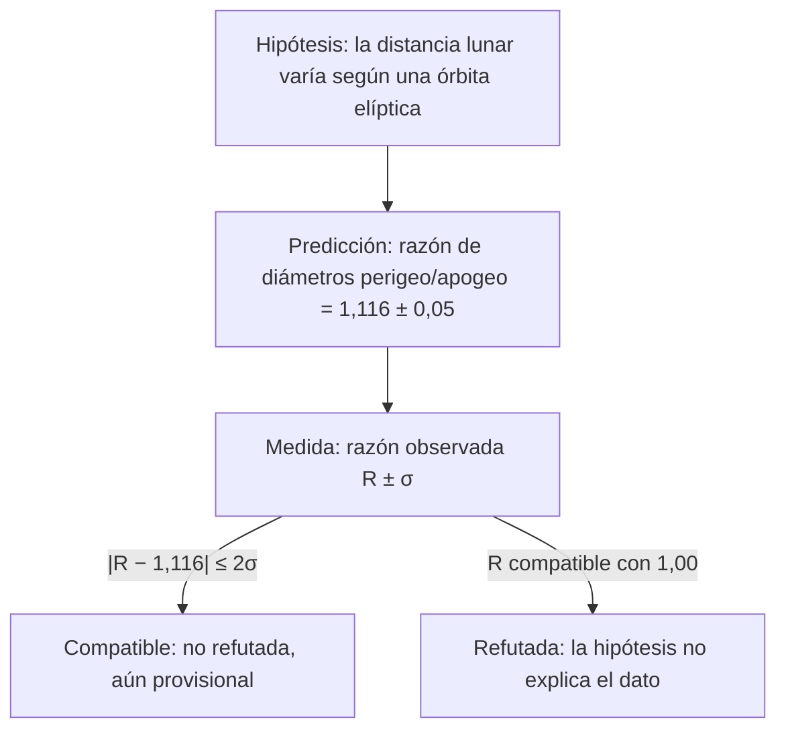

# B01-C07 — Hipótesis y predicciones falsables

<!-- nav:top -->
[🏠 Programa](../../../../README.md) · [📚 Bloque B01](../../../tronco-comun/B01-el-universo-y-el-pensamiento-cientifico.md) · [← Anterior: B01-C06 — Preguntas investigables en astronomía](../B01-C06-preguntas-investigables-en-astronomia/CLASE.md) · [Siguiente: B01-C08 — Mediciones y unidades astronómicas →](../B01-C08-mediciones-y-unidades-astronomicas/CLASE.md)
<!-- /nav -->

## 1. Ubicación, nivel y alcance

Séptima clase del bloque B01. En C06 elegiste una pregunta acotada con una estimación de viabilidad. Ahora conviertes la pregunta en una **hipótesis** que se pueda poner a prueba: dices qué esperas ver y qué resultado te obligaría a cambiar de idea. Sigues en el nivel N1.

Verás cómo se pasa de hipótesis a predicción cuantitativa y a criterio de refutación, y por qué una hipótesis que no puede fallar no sirve como ciencia. No verás todavía la propagación formal de errores (C18) ni la construcción de modelos (C17).

## 2. Por qué esta clase existe

Una afirmación que ningún resultado posible contradice no enseña nada. Si dices «la Luna cambia de tamaño aparente» y, ocurra lo que ocurra, tu frase queda a salvo, no has dicho gran cosa. En cambio, «el diámetro angular de la Luna llena en perigeo es 1,12 veces el del apogeo, con un margen de ±0,05» puede resultar falso, y por eso vale algo.

La decisión central es: **¿qué resultado medible me haría abandonar esta hipótesis?** Aprenderás a escribir una hipótesis con alcance, a derivar de ella una predicción numérica con unidades, a fijar un criterio de refutación antes de medir y a comprobar si tu instrumento puede distinguir tu hipótesis de la alternativa. Es el paso que une la pregunta de C06 con el proyecto de C20.

## 3. Lo que podrás hacer al terminar

1. Distinguir hipótesis, predicción y criterio de refutación.
2. Escribir una hipótesis con alcance, variables y supuestos declarados.
3. Derivar una predicción numérica con unidades a partir de datos publicados.
4. Fijar antes de medir un criterio de refutación y comprobar que el instrumento distingue la hipótesis de su alternativa.
5. Explicar con un caso real por qué una predicción arriesgada es una buena prueba.
6. Elaborar una **ficha de hipótesis con predicción y criterio de refutación**.

La evidencia es la ficha del ejercicio 12 (sección 20).

## 4. Con qué llegas y cómo comprobarlo

Necesitas C05 (O/I/M) y C06 (pregunta acotada, viabilidad). Cinco preguntas:

1. ¿Cuántos píxeles medía la Luna en perigeo medio en la cámara de 58,5″/px de C06?
2. ¿Qué razón hay entre apogeo y perigeo medios de la Luna (405 500 y 363 300 km)?
3. ¿Qué es una variable dependiente?
4. ¿Qué es una incertidumbre?
5. ¿«La Luna orbita la Tierra» es O, I o M?

Ver respuestas

1. 33,7 px. 2. 1,116. 3. La magnitud que se mide como resultado. 4. El rango en que razonablemente está el valor. 5. M (o I/M): resulta de muchas observaciones y un modelo de órbita.

Con cuatro o cinco aciertos, sigue; con tres o menos, repasa C06.

## 5. Un caso real: la prueba de 1919

En 1919 una expedición fotografió estrellas cercanas al Sol durante un eclipse para comprobar si su luz se desvía al pasar junto a él, como predice la relatividad general. Daniel Kennefick, en un artículo que resumimos (S1), cuenta que esa prueba se considera uno de los experimentos más célebres de la física y que, con los años, algunos críticos sostuvieron que los datos favorables a la predicción newtoniana se habían descartado con razones dudosas; el autor defiende que los organizadores tenían buenas razones y apunta a un re-análisis moderno de las placas. El propio resumen presenta eso como su postura, no como consenso (S1).

Lo que importa aquí es la estructura. Había dos teorías que predecían resultados distintos; una medida podía contradecir a una de ellas; y el debate posterior gira en torno a cómo se trataron los datos (qué placas, con qué criterio), no a si la prueba tenía sentido. **No leímos** el artículo completo ni las predicciones numéricas originales, por lo que aquí no se dan sus cifras. Es un buen ejemplo de **riesgo de la predicción**: la hipótesis se jugó algo concreto.

## 6. Vocabulario

Una **hipótesis** es una explicación tentativa que se compromete con algo que puede observarse. Una **predicción** es una consecuencia medible de la hipótesis en condiciones declaradas. Una **hipótesis alternativa** (o nula) es la que se espera si la tuya falla: aquí, «no hay cambio». Un **criterio de refutación** es el resultado que, de ocurrir, te hace rechazar la hipótesis. Una hipótesis es **falsable** si existe al menos un resultado posible que la contradiga. Una **prueba de discriminación** comprueba que el instrumento puede distinguir entre las predicciones de la hipótesis y de su alternativa. Una **hipótesis ad hoc** es un parche añadido solo para salvar la idea de un resultado adverso.

## 7. Modelo mental: la bifurcación

Piensa en una bifurcación. Antes de medir, escribes dos ramas: lo que verías si la hipótesis es cierta y lo que verías si no. Después mides y sigues la rama que corresponda; no puedes cambiar la bifurcación después de mirar.

*Descripción textual:* de la hipótesis sale una predicción con valor y margen; la medida da una razón R con su incertidumbre; si R coincide con la predicción dentro de dos incertidumbres, la hipótesis queda sin refutar (provisional); si R es compatible con 1,00, se rechaza.

Analogía: la apuesta con reglas escritas antes. Límite: en ciencia, «no refutada» nunca significa «demostrada»; una hipótesis solo sobrevive a las pruebas que le hiciste.

## 8. La explicación, paso a paso

### 8.1 Hipótesis con alcance

Una hipótesis útil dice sobre qué, bajo qué condiciones y con qué variables. Mal: «la Luna cambia de tamaño». Mejor: «Durante un mes, el diámetro angular de la Luna llena visto desde un punto fijo de la Tierra varía porque su distancia a la Tierra varía a lo largo de una órbita elíptica». Esa hipótesis nombra el objeto, la magnitud, el intervalo y el mecanismo propuesto.

### 8.2 De hipótesis a predicción

Con la ficha de la Luna (S2): radio medio 1 737,4 km, perigeo medio 363 300 km, apogeo medio 405 500 km. La predicción cuantitativa es `R_pred = d_apogeo/d_perigeo = 1,116`, porque `θ ≈ D/d` y `D` no cambia. Fíjate en que la predicción es un número con unidad (adimensional) que **no depende** de tu cámara.

### 8.3 Criterio de refutación

Antes de medir, escribe: «Si la razón observada `R` es compatible con 1,00 (es decir, `|R − 1| ≤ 2σ`), la hipótesis se rechaza; si `R` es compatible con 1,116 (`|R − 1,116| ≤ 2σ`) y no con 1,00, queda sin refutar». Los dos intervalos no deben solaparse; si lo hacen, la medida no discrimina y hay que cambiar de instrumento o de diseño.

### 8.4 Prueba de discriminación

La razón se obtiene de dos diámetros en píxeles, `N_perigeo` y `N_apogeo`. Si cada uno tiene incertidumbre de ±1 px y valen 33,7 y 30,2 px, la incertidumbre relativa de `R` es `√((1/30,2)² + (1/33,7)²) = 0,0445` y `σ_R = 1,116 × 0,0445 = 0,05` (la regla de suma relativa en cuadratura se justifica en C18). La diferencia con la alternativa es `0,116/0,05 ≈ 2,3σ`: apenas separable. Con un teleobjetivo que multiplique por 5 el tamaño (151 y 168,5 px), `σ_R = 0,0099` y la diferencia es de ≈ 12σ: distinguible con claridad. Conclusión: con la cámara sencilla la prueba es débil; hay que mejorar el instrumento antes de observar.

### 8.5 Buenas y malas hipótesis

Una hipótesis es mala cuando se acomoda a cualquier resultado («el tamaño cambia o no, según la atmósfera»). Un parche ad hoc («no cambió porque ese día el aire estaba raro») no es una prueba; si invocas una causa, debes poder medirla. La regla: **ninguna explicación de un resultado adverso vale si no habría valido igual para un resultado favorable**.

## 9. Magnitudes, símbolos y unidades

| Símbolo | Qué es | Unidad | Valor o nota |
|---|---|---|---|
| `d_ap`, `d_pe` | distancias lunares en apogeo y perigeo (medias) | km | 405 500 y 363 300 (S2) |
| `θ` | diámetro angular | ″ | `D/d` |
| `R` | razón `θ_perigeo/θ_apogeo` | adimensional | predicción 1,116 |
| `σ_R` | incertidumbre de la razón | adimensional | 0,05 (cámara sencilla); 0,0099 (con 5×) |
| `N` | diámetro en píxeles | px | 30,2 y 33,7 (ejemplo) |
| `k` | número de incertidumbres de la tolerancia | adimensional | 2 (convención de esta clase) |

## 10. Convenciones y referencias

El umbral de «2σ» es una convención de esta clase, no una norma; su significado estadístico se matiza en C18. Los diámetros en píxeles son **hipotéticos** (cámara supuesta de C06); los valores de distancia son **observados y publicados** por NASA (S2). La relación `θ ≈ D/d` se supone de ángulo pequeño. Las medias de perigeo y apogeo no corresponden a un mes concreto: un mes real puede quedar más cerca o más lejos de ellas.

## 11. De dónde sale lo que afirmamos

| ID | Fuente | Localizador | Respalda | Estado |
|---|---|---|---|---|
| S1 | Kennefick, D., *Not Only Because of Theory: Dyson, Eddington and the Competing Myths of the 1919 Eclipse Expedition* | arXiv:0709.0685 | La expedición de 1919 puso a prueba la desviación de la luz estelar; controversia sobre el tratamiento de los datos; postura del autor | Resumen consultado el 2026-11-05; no se leyó el artículo completo ni las cifras de la predicción |
| S2 | NASA NSSDC, *Moon Fact Sheet* (actualizada el 11-ene-2024) | https://nssdc.gsfc.nasa.gov/planetary/factsheet/moonfact.html | Radio medio 1 737,4 km; perigeo medio 363 300 km; apogeo medio 405 500 km | Página consultada el 2026-11-05 |
| S3 | NASA NSSDC, *Planetary Fact Sheet – Metric* (actualizada el 18-mar-2025) | https://nssdc.gsfc.nasa.gov/planetary/factsheet/ | Número de lunas: Marte 2, Júpiter 95 | Página consultada el 2026-11-05 |

Límites: las razones y sus incertidumbres son cálculo nuestro con datos hipotéticos; S1 no se usa para ninguna cifra.

## 12. Cómo ver la bifurcación

Versión accesible del diagrama:

| Resultado de la medida (con `σ_R` y `k = 2`) | Lectura | Acción |
|---|---|---|
| `R` compatible con 1,116 y no con 1,00 | Coincide con la predicción | Hipótesis sin refutar (provisional) |
| `R` compatible con 1,00 y no con 1,116 | Coincide con la alternativa | Hipótesis refutada |
| `R` compatible con ambos | No discrimina | Mejorar el instrumento |

Con la cámara sencilla (`σ_R = 0,05`) los intervalos [1,016; 1,216] y [0,90; 1,10] se solapan entre 1,016 y 1,10, así que ese diseño no discrimina. Descripción larga: dos franjas centradas en 1,00 y 1,116 con anchura ±0,10 se tocan; con `σ_R = 0,0099` (±0,02) quedan separadas.

## 13. Ejemplo trabajado: ficha de hipótesis de la Luna

**Paso 1 · Hipótesis.** «El diámetro angular de la Luna llena varía entre meses porque su distancia varía por la excentricidad de su órbita.»

**Paso 2 · Predicción.** `R_pred = 405 500/363 300 = 1,116`: si una luna llena cae cerca del perigeo y otra cerca del apogeo, el cociente de diámetros es ≈ 1,12.

**Paso 3 · Alternativa.** «El tamaño aparente no cambia»: `R = 1,00`.

**Paso 4 · Criterio de refutación.** Se rechaza si `|R − 1| ≤ 2σ_R`; se mantiene si `|R − 1,116| ≤ 2σ_R` y no es compatible con 1.

**Paso 5 · Discriminación.** Cámara sencilla: `σ_R = 0,05`, intervalos solapados → **no sirve**. Con 5×: `σ_R = 0,0099`, `2σ = 0,02` → intervalos [0,98; 1,02] y [1,096; 1,136]: separados. Se usará el 5×.

**Paso 6 · Registro previo.** Se anota la ficha con fecha **antes** de fotografiar.

**Sentido físico.** El valor de la hipótesis está en que *podía fallar* y en que ya sabes de antemano cómo se vería el fallo. Si, al medir, saliera `R = 1,00 ± 0,01`, la hipótesis, tal como está escrita, quedaría refutada.

## 14. Distintas formas de poner a prueba

**Comparar con una alternativa** (esta clase) es directa. **Contrastar con un valor de referencia publicado** (por ejemplo, tu razón frente a 1,116) usa los datos de otros. **Buscar el caso extremo** (perigeo y apogeo) maximiza la diferencia. Se combinan: se elige el caso extremo, se compara con la alternativa y se contrasta con el valor publicado.

## 15. Práctica guiada

**Ejercicio 1 · con los pasos indicados.** Escribe la predicción de `R` para la Luna con `d_ap = 405 500 km` y `d_pe = 363 300 km`. *Pasos:* sección 8.2.

Solución comentada

`R_pred = 405 500/363 300 = 1,116`. Si obtuviste 0,896, invertiste la razón: el diámetro es mayor *en perigeo* (más cerca).

**Ejercicio 2 · con una pista.** ¿Es falsable «la Luna cambia de tamaño porque sí»? *Pista:* ¿qué resultado la contradiría?

Solución comentada

No: ningún resultado la contradice porque no dice cuánto, cuándo ni por qué. Hay que añadir alcance y mecanismo (sección 8.1).

**Ejercicio 3 · casi autónomo.** Con `σ_R = 0,05` y la predicción 1,116, ¿cuántas incertidumbres separan esa predicción de la alternativa 1,00?

Solución comentada

`0,116/0,05 = 2,3`. Es poco: los intervalos de ±2σ se solapan (sección 8.4).

## 16. Práctica autónoma, transferencia e integrador

**Ejercicio 4.** Calcula `σ_R` para diámetros de 151 y 168,5 px con ±1 px cada uno y di si discrimina entre 1,00 y 1,116.

Solución comentada

`σ_R/R = √((1/151)² + (1/168,5)²) = 0,00889`; `σ_R = 1,116 × 0,00889 = 0,0099`. Diferencia `0,116/0,0099 ≈ 12σ`: sí discrimina.

**Ejercicio 5.** Reescribe como hipótesis falsable: «el Sol sale a distinta hora cada día».

Solución comentada

«En mi ciudad, durante un mes, la hora de salida del Sol (min, hora local) cambia de modo monótono con el día del mes». Se contradice si la hora oscila sin tendencia o no cambia. Falta la predicción numérica, que llega en C11.

**Ejercicio 6.** Una persona obtiene `R = 1,03 ± 0,05`. ¿Qué concluyes con el criterio de la sección 8.3?

Solución comentada

`|1,03 − 1| = 0,03 ≤ 2σ = 0,10`: compatible con 1,00. También `|1,03 − 1,116| = 0,086 ≤ 0,10`: compatible con 1,116. No discrimina; no se puede refutar ni sostener. Hay que mejorar la medida.

**Ejercicio 7.** Otra persona obtiene `R = 1,00 ± 0,01`. ¿Qué concluyes? ¿Qué pregunta harías antes de refutar?

Solución comentada

`|1,00 − 1,116| = 0,116 = 11,6σ`: incompatible con la predicción; la hipótesis queda refutada para esas fotos. Antes: ¿son lunas llenas lejanas entre sí en distancia? Si ambas están casi a la misma distancia, el resultado no refuta la hipótesis, solo muestra que se eligieron mal los casos.

**Ejercicio 8.** ¿Por qué «el aire estaba raro» es una hipótesis ad hoc en este contexto?

Solución comentada

Porque se invoca solo después del resultado adverso y sin medir esa causa. Para ser válida debería predecir qué efecto tiene la atmósfera sobre el diámetro medido y comprobarse con datos.

**Ejercicio 9 · transferencia.** Diseña una predicción falsable para «Júpiter tiene más lunas conocidas que Marte» usando la ficha de planetas (S3).

Solución comentada

Predicción: el número de lunas de Júpiter es mayor que el de Marte en la tabla. S3 da 95 y 2 a la fecha de consulta; la hipótesis sobrevive. Es débil porque el dato publicado cambia con los descubrimientos; por eso se anota la fecha.

**Ejercicio 10 · transferencia.** Con S1: ¿por qué es útil que la prueba de 1919 enfrentara dos predicciones distintas?

Solución comentada

Porque una medida podía favorecer a una de ellas; si ambas predijeran lo mismo, la medida no discriminaría. Es la prueba de discriminación de la sección 8.4 a gran escala. Sobre las cifras exactas no hay aquí fuente consultada.

**Ejercicio 11 · transferencia.** Un compañero fija el criterio *después* de ver sus datos. ¿Qué riesgo corre y cómo lo evitas?

Solución comentada

Puede elegir un criterio que haga «pasar» su hipótesis con cualquier dato (sesgo de confirmación, C05). Se evita escribiendo y fechando la ficha antes de medir.

**Ejercicio 12 · integrador.** Elabora tu **ficha de hipótesis**: hipótesis con alcance, hipótesis alternativa, predicción numérica con unidades y fuente de los datos, criterio de refutación, prueba de discriminación con el instrumento que tendrás, y fecha de registro anterior a la medida.

Solución modelo

La ficha sigue la sección 13 con otro fenómeno: debe incluir un número esperado, uno alternativo, la incertidumbre estimada y la regla de decisión escrita antes de medir. Se acepta cualquier fenómeno medible si los datos de partida citan fuente.

## 17. Actividad sin código: registra una predicción antes de medir

Esta clase no calcula nada que requiera script. Actividad: escribe en una hoja la ficha del ejercicio 12 para tu proyecto, fírmala con la fecha y guárdala; recién entonces mide. **Datos:** los tuyos; las distancias lunares son publicadas (S2). **Predice antes:** ¿tu instrumento discrimina? (calcula `σ_R` como en 8.4). **Límites:** la ficha no garantiza que la hipótesis sea cierta; solo que la prueba es honesta.

## 18. Errores frecuentes y cómo corregirlos

**Hipótesis que nada contradice.** Ejercicio 2.

**Predicción sin número ni unidad.** Ejercicio 1.

**Fijar el criterio después de medir.** Ejercicio 11.

**Medir sin saber si el instrumento discrimina.** Ejercicios 3, 4 y 6.

**Confundir «no refutada» con «demostrada».** Se corrige con la sección 7 y el ejercicio 7.

## 19. Cómo sabrás que vas bien

Tras 8.2: ¿tu predicción es un número con unidad? Si no, repite el ejercicio 1. Tras 8.4: ¿puedes calcular cuántas incertidumbres separan hipótesis y alternativa? Si no, ejercicio 3. Tras el ejemplo: ¿qué se decide antes de medir? Si dudas, relee 8.3. Al final: ¿qué diferencia hay entre hipótesis refutada y no refutada? Si no la ves, relee 8.5.

## 20. Qué entregas y cómo se evalúa

El producto es tu **ficha de hipótesis con predicción y criterio de refutación**.

| Criterio | Inicial | En desarrollo | Logrado | Destacado |
|---|---|---|---|---|
| Hipótesis | Vaga | Con objeto | Con alcance y mecanismo | Declara supuestos |
| Predicción | Sin número | Número sin unidad | Número con unidad y fuente | Con incertidumbre estimada |
| Refutación | Ausente | Genérica | Numérica y previa | Con regla para resultados ambiguos |
| Discriminación | No evaluada | Cualitativa | Cuantitativa | Mejora el diseño si falla |
| Honestidad | Datos mezclados | Rotula parte | Rotula todo | Registro fechado |

**Condiciones críticas:** fijar el criterio antes de medir; no presentar datos hipotéticos como medidos; citar solo lo consultado.

## 21. Ética, seguridad y límites

Escribir de antemano qué te haría cambiar de idea es una forma de honestidad: protege contra el sesgo de confirmación y contra el uso interesado de los datos. Los debates sobre cómo se trataron datos históricos (S1) se presentan como posturas con fuente, nunca como veredictos sobre personas. Para observar, recuerda la seguridad de C06. Accesibilidad: ecuaciones en texto, diagrama descrito, tablas equivalentes, sin conexión.

## 22. Para cerrar y seguir

Una hipótesis vale por lo que arriesga: lleva una predicción con número, una alternativa, un criterio de refutación escrito antes y una prueba de que el instrumento distingue ambas. Queda pendiente aprender a manejar las unidades con las que se escriben esas predicciones, sobre todo en distancias astronómicas (C08).

**Glosario español–inglés.** hipótesis · *hypothesis*; predicción · *prediction*; falsable · *falsifiable*; hipótesis nula · *null hypothesis*; criterio de refutación · *refutation criterion*; ad hoc · *ad hoc*.

**Continuidad.** B01-C08 usa tu capacidad de **escribir predicciones con número y unidad** para entrenarte en conversiones y análisis dimensional. B01-C18 retomará el significado de «±» y el umbral de 2σ.

**Referencias:** ver sección 11. S1 es un resumen; S2 y S3 son fichas oficiales consultadas.

<!-- nav:bottom -->
---

[← Anterior: B01-C06 — Preguntas investigables en astronomía](../B01-C06-preguntas-investigables-en-astronomia/CLASE.md) · [📚 Bloque B01](../../../tronco-comun/B01-el-universo-y-el-pensamiento-cientifico.md) · [Siguiente: B01-C08 — Mediciones y unidades astronómicas →](../B01-C08-mediciones-y-unidades-astronomicas/CLASE.md)
<!-- /nav -->
