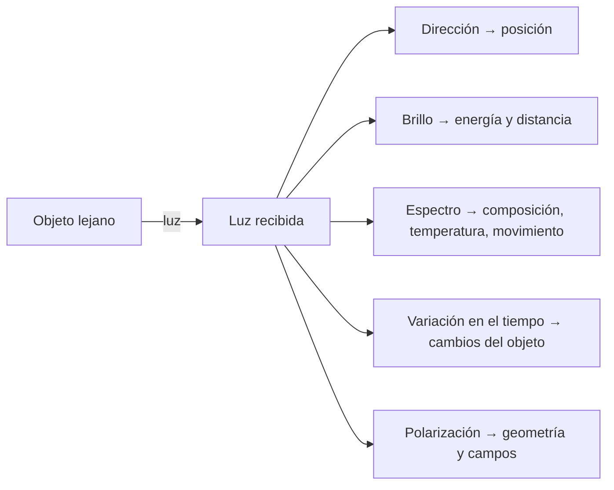

# B01-C09 — Luz como fuente de información

<!-- nav:top -->
[🏠 Programa](../../../../README.md) · [📚 Bloque B01](../../../tronco-comun/B01-el-universo-y-el-pensamiento-cientifico.md) · [← Anterior: B01-C08 — Mediciones y unidades astronómicas](../B01-C08-mediciones-y-unidades-astronomicas/CLASE.md) · [Siguiente: B01-C10 — Limitaciones de los sentidos humanos →](../B01-C10-limitaciones-de-los-sentidos-humanos/CLASE.md)
<!-- /nav -->

## 1. Ubicación, nivel y alcance

Novena clase del bloque B01. Sabes registrar con unidades (C08) y separar registro e inferencia (C05). Ahora preguntas cómo llega la información desde objetos que nunca tocarás: casi toda por la luz. Sigues en el nivel N1.

Verás qué propiedades de la luz se miden (dirección, brillo, color, espectro, variación en el tiempo), cómo se relaciona la longitud de onda con la temperatura y qué dice un espectro de líneas. No verás la física cuántica de las líneas ni fotometría calibrada (bloques A07 y siguientes).

## 2. Por qué esta clase existe

Sobre una galaxia a 43 Mpc solo tienes luz. De esa luz sale su dirección, cuánto brilla, de qué color es y qué líneas aparecen en su espectro; de las líneas sale `z = 0,0101` (C01). Sin entender qué contiene la luz, no sabrías qué puedes y qué no puedes concluir.

La decisión central es: **¿qué propiedad de la luz mido para responder esta pregunta y qué no me dice?** Aprenderás a distinguir las propiedades medibles, a interpretar un espectro sencillo con sus límites y a estimar una temperatura a partir del color dominante, sabiendo cuándo esa estimación falla.

## 3. Lo que podrás hacer al terminar

1. Enumerar cinco propiedades medibles de la luz y qué información da cada una.
2. Describir el espectro electromagnético y situar la luz visible (380 a 700 nm).
3. Distinguir espectro continuo, de emisión y de absorción.
4. Calcular `z` y la velocidad aparente a partir de líneas de un espectro.
5. Estimar una temperatura con la ley de Wien y decir cuándo no aplica.
6. Elaborar una **interpretación de un espectro sencillo** con O/I/M.

La evidencia es la interpretación del ejercicio 12 (sección 20).

## 4. Con qué llegas y cómo comprobarlo

Necesitas C01 (`z`), C05 (O/I/M) y C08 (unidades, nm). Cinco preguntas:

1. ¿Cuánto es 1 nm en metros?
2. Calcula `z` si una línea de 600,0 nm se observa en 612,0 nm.
3. ¿Qué es el tiempo de luz?
4. ¿Qué etiqueta (O, I o M) tiene «la galaxia está a 43 Mpc»?
5. ¿Qué significa una incertidumbre de ±0,1 nm?

<details>
<summary>Ver respuestas</summary>

1. 10⁻⁹ m. 2. `12,0/600,0 = 0,0200`. 3. El tiempo que tarda la luz en recorrer una distancia. 4. M: depende de la ley de Hubble y de `H₀`. 5. Que el valor puede variar razonablemente en esa cantidad.
</details>

Con cuatro o cinco aciertos, sigue; con tres o menos, repasa C01 y C08.

## 5. Un caso real: el Sol visto como un cuerpo caliente

NASA describe el espectro electromagnético como la gama que va de ondas de radio muy largas a rayos gamma muy cortos, y señala que el ojo detecta solo una pequeña parte, la luz visible (S1). En su página de luz visible indica que el ojo detecta típicamente longitudes de onda de 380 a 700 nm, que los objetos más calientes emiten más luz de longitud de onda corta, y que el Sol, a unos 5 500 °C, se ve amarillo, una estrella de unos 3 000 °C se vería rojiza y una de 12 000 °C, azul (S2).

Ese enunciado contiene una idea potente: **el color de un objeto caliente dice algo de su temperatura**. Nuestro **ejemplo conductor** en esta clase es el Sol y la galaxia de Hα: del Sol aprenderás a pasar del color a la temperatura; de la galaxia, de las líneas al corrimiento. Límite: los datos de NASA son divulgación (S1, S2); los valores precisos del Sol vienen de una ficha oficial (S3).

## 6. Vocabulario

La **longitud de onda** `λ` es la distancia entre dos crestas de la onda; la **frecuencia** `ν`, cuántas pasan por segundo; se relacionan con `c = λ·ν`. El **espectro** es la luz descompuesta por longitud de onda. Un **espectro continuo** tiene luz en todas las longitudes de onda; uno de **emisión** muestra líneas brillantes sobre fondo oscuro; uno de **absorción** muestra líneas oscuras sobre un fondo continuo. Una **línea espectral** es una longitud de onda concreta donde hay más o menos luz. Un **cuerpo negro** es un emisor ideal cuyo espectro depende solo de su temperatura. La **ley de Wien** relaciona la longitud de onda del máximo con la temperatura, `λ_max·T = b`. El **flujo** es la energía de luz recibida por unidad de área y tiempo; el **brillo** aparente es lo que percibimos de él.

## 7. Modelo mental: la luz como mensaje con cinco campos

Piensa en un sobre con cinco campos. Cada propiedad de la luz es un campo del mensaje: de dónde vino (dirección), cuánta llegó (brillo), de qué colores (espectro), si cambia (tiempo) y cómo vibra (polarización).



*Descripción textual:* un objeto emite luz; de la luz recibida salen cinco campos de información: la dirección da la posición, el brillo la energía y la distancia, el espectro la composición, la temperatura y el movimiento, la variación temporal los cambios, y la polarización la geometría.

Analogía: una carta con remitente, peso, idioma, fecha y letra. Límite: en una carta el contenido es voluntario; la luz solo trae lo que el objeto emitió y lo que encontró en el camino (polvo, atmósfera), y debes separar ambas cosas.

## 8. La explicación, paso a paso

### 8.1 Dirección y brillo

La dirección de donde llega la luz da la posición en el cielo. El brillo da el flujo recibido, pero un objeto débil puede estar lejos o ser intrínsecamente poco luminoso: **brillo y distancia están mezclados**. Para separarlos hace falta otra información (C14).

### 8.2 Espectro: la huella digital

Descompón la luz con un prisma y obtienes un arcoíris con líneas. Los átomos de cada elemento absorben o emiten en longitudes de onda precisas, de modo que reconocer un patrón identifica elementos. En C01 viste Hα (656,3 nm en reposo, valor que tomamos de C01 y que no reconsultamos aquí). Observa que el **patrón** (la distancia relativa entre líneas) se conserva aunque todo el espectro se corra.

### 8.3 Corrimiento: el espectro se desplaza

Si el patrón de líneas aparece desplazado, calculas `z = (λ_obs − λ_rep)/λ_rep` en cada línea. Si todas dan el mismo `z` dentro del error, el corrimiento es de todo el espectro, no un error de identificación. Con Hα, `z = (662,9 − 656,3)/656,3 = 0,0101` y `v ≈ c·z = 3,0 × 10³ km/s` (I, como en C05).

### 8.4 Color y temperatura: Wien

Un cuerpo caliente emite en todas las longitudes de onda, con un máximo que se desplaza hacia el azul al subir la temperatura. La relación es `λ_max = b/T`. La constante `b` se puede **derivar** de constantes SI exactas (`h`, `c`, `k`; S4) resolviendo la ecuación `x = 5(1 − e⁻ˣ)` y haciendo `b = hc/(kx)`: da `b = 2,8978 × 10⁻³ m·K`, como calcula el laboratorio. Para el Sol, con `T_eff = 5 772 K` (S3): `λ_max = 2,8978 × 10⁻³/5 772 = 502,0 nm`: en el verde-azul. NASA describe al Sol como amarillo (S2); el máximo no es «el color» que ves, porque el ojo suma todo el espectro visible (explicación nuestra).

### 8.5 Qué no dice la luz

La luz no trae etiquetas de distancia ni de masa. Se mezcla con lo que hay en el camino: el polvo enrojece, la atmósfera absorbe. El espectro puede ser una combinación de varios objetos si el instrumento los mezcla. Y el cuerpo negro es una aproximación: las estrellas tienen líneas y la temperatura de Wien es solo una estimación del color dominante. Por eso toda interpretación de un espectro se acompaña de sus supuestos (C05).

## 9. Magnitudes, símbolos y unidades

| Símbolo | Qué es | Unidad | Valor o nota |
|---|---|---|---|
| `λ` | longitud de onda | nm | visible 380–700 (S2) |
| `ν` | frecuencia | Hz | `c/λ` |
| `c` | velocidad de la luz | m/s | 299 792 458 (S4) |
| `z` | corrimiento al rojo | adimensional | `(λ_obs − λ_rep)/λ_rep` |
| `T` | temperatura | K | Sol: 5 772 (S3) |
| `b` | constante de Wien | m·K | 2,8978 × 10⁻³ (derivada) |
| `λ_max` | máximo del cuerpo negro | nm | 502,0 para el Sol |
| `h`, `k` | constantes de Planck y de Boltzmann | J·s, J/K | 6,626 070 15 × 10⁻³⁴; 1,380 649 × 10⁻²³ (S4) |

## 10. Convenciones y referencias

La longitud de onda de reposo de Hα se da en aire o en vacío según la convención (C04); aquí se usa el valor de C01 sin distinguir, lo que importa a la cuarta cifra. Los datos del Sol son **observados y publicados**; el espectro del laboratorio es **sintético** (un «elemento X» inventado); el cálculo de `λ_max` es **derivado** y supone un cuerpo negro.

## 11. De dónde sale lo que afirmamos

| ID | Fuente | Localizador | Respalda | Estado |
|---|---|---|---|---|
| S1 | NASA Science, «Introduction to the Electromagnetic Spectrum» | https://science.nasa.gov/ems/01_intro/ | Espectro de ondas de radio a rayos gamma; el ojo ve solo una parte; ventanas atmosféricas | Página consultada el 2026-11-05 |
| S2 | NASA Science, «Visible Light» | https://science.nasa.gov/ems/09_visiblelight/ | Visible: 380–700 nm; objetos más calientes emiten más luz corta; Sol ≈ 5 500 °C, amarillo | Página consultada el 2026-11-05 |
| S3 | NASA NSSDC, *Sun Fact Sheet* (actualizada el 9-may-2024) | https://nssdc.gsfc.nasa.gov/planetary/factsheet/sunfact.html | Temperatura efectiva 5 772 K | Página consultada el 2026-11-05 |
| S4 | BIPM, *The International System of Units (SI)*, 9.ª ed. (2019) | https://www.bipm.org/documents/20126/41483022/SI-Brochure-9.pdf | `h`, `c`, `k` exactos | PDF leído (texto extraído) el 2026-11-05 |

Límites: S1 y S2 son divulgación; el valor de Hα viene de C01; la ley de Wien se **deriva** en el laboratorio, no se cita; no consultamos una referencia de datos atómicos.

## 12. Cómo ver el espectro

Versión accesible del diagrama:

| Región | Longitud de onda | Qué estudia (ejemplo) |
|---|---|---|
| Radio | las más largas del espectro (S1) | (sin cifras en S1) |
| Visible | 380–700 nm (S2) | estrellas, planetas |
| Rayos gamma | las más cortas del espectro (S1) | (sin cifras en S1) |

La tabla es parcial: S1 no da números para las demás regiones, por lo que no los damos. Descripción larga: de izquierda a derecha, las longitudes de onda decrecen y la energía de los fotones crece; el visible es una franja angosta. Si dibujas un espectro, rotula los ejes con unidad y evita distinguir por color únicamente.

## 13. Ejemplo trabajado: leer un espectro sintético

**Datos (sintéticos):** un «elemento X» tiene líneas de reposo en 500,0, 600,0 y 700,0 nm; las observadas son 509,99, 612,03 y 713,99 nm (generadas con `z = 0,020` y ruido de 0,05 nm).

**Paso 1 · Patrón.** Las razones entre líneas se conservan: `612,03/509,99 = 1,2001` frente a `600/500 = 1,2000`. Es el mismo patrón desplazado.

**Paso 2 · Corrimientos.** `z₁ = 9,99/500 = 0,01998`; `z₂ = 12,03/600 = 0,02005`; `z₃ = 13,99/700 = 0,01999`.

**Paso 3 · Consistencia.** Media 0,02001; la dispersión (4 × 10⁻⁵) es del tamaño del ruido: un solo `z` explica las tres.

**Paso 4 · Velocidad aparente.** `v ≈ c·z = 299 792 × 0,0200 ≈ 6,0 × 10³ km/s` (I).

**Paso 5 · Temperatura.** Si el continuo tiene máximo en 502 nm, `T = b/λ_max = 2,8978 × 10⁻³/502 × 10⁻⁹ = 5 773 K`: es el Sol, como se esperaba (verificación circular: el cálculo del laboratorio parte de ese valor).

**Sentido físico.** La luz permitió identificar un patrón, medir un corrimiento y estimar una temperatura, **con tres supuestos declarados**: líneas bien identificadas, corrimiento común, cuerpo negro.

## 14. Distintas formas de leer la luz

**Fotometría** (brillo) es simple y sensible, pero mezcla distancia y luminosidad. **Espectroscopía** da composición y movimiento, pero requiere más luz. **Imagen** da posición y forma, pero poca información física. Se combinan: la imagen localiza, la fotometría mide el brillo, el espectro identifica.

## 15. Práctica guiada

**Ejercicio 1 · con los pasos indicados.** Calcula `z` para una línea de 500,0 nm observada en 505,0 nm. *Pasos:* sección 8.3.

<details><summary>Solución comentada</summary>

`z = 5,0/500,0 = 0,0100`; `v ≈ 3,0 × 10³ km/s`. Si dividiste por 505,0, usaste la longitud observada en lugar de la de reposo.
</details>

**Ejercicio 2 · con una pista.** Calcula `λ_max` de una estrella de 3 000 K. *Pista:* `λ_max = b/T`, con `b = 2,8978 × 10⁻³ m·K`.

<details><summary>Solución comentada</summary>

`2,8978 × 10⁻³/3 000 = 9,66 × 10⁻⁷ m = 966 nm`: en el infrarrojo cercano. Se ve rojiza porque emite menos luz azul (S2).
</details>

**Ejercicio 3 · casi autónomo.** Verifica que `c = λ·ν`: calcula `ν` de 656,3 nm.

<details><summary>Solución comentada</summary>

`ν = 299 792 458/656,3 × 10⁻⁹ = 4,568 × 10¹⁴ Hz`.
</details>

## 16. Práctica autónoma, transferencia e integrador

**Ejercicio 4.** Una estrella de 12 000 K: calcula `λ_max` y compáralo con el visible.

<details><summary>Solución comentada</summary>

`2,8978 × 10⁻³/12 000 = 2,415 × 10⁻⁷ m = 241,5 nm`: en el ultravioleta, fuera del visible; la parte visible es la cola azul, de ahí que parezca azul (S2).
</details>

**Ejercicio 5.** Tres líneas de reposo 400,0, 500,0 y 600,0 nm se observan en 408,0, 510,0 y 612,0 nm. ¿Hay un `z` común?

<details><summary>Solución comentada</summary>

`8/400 = 0,0200`; `10/500 = 0,0200`; `12/600 = 0,0200`. Sí: `z = 0,0200`, `v ≈ 6,0 × 10³ km/s`.
</details>

**Ejercicio 6.** Otras líneas: 400,0→408,0 y 500,0→505,0. ¿Qué concluyes?

<details><summary>Solución comentada</summary>

`z₁ = 0,0200`, `z₂ = 0,0100`: no hay `z` común. O las líneas están mal identificadas, o hay dos componentes con velocidades distintas. No se puede afirmar un solo corrimiento.
</details>

**Ejercicio 7.** Distingue emisión de absorción: un espectro muestra un fondo brillante con tres líneas oscuras. ¿De qué tipo es y qué indica?

<details><summary>Solución comentada</summary>

De absorción. Indica que entre la fuente continua y el observador hay un gas más frío que absorbe en esas longitudes. La identidad del gas surge de comparar con patrones de laboratorio.
</details>

**Ejercicio 8.** Dos estrellas se ven igual de brillantes. ¿Están a la misma distancia? Explica con 8.1.

<details><summary>Solución comentada</summary>

No necesariamente: brillo y distancia están mezclados; una estrella más luminosa y más lejana puede verse como una más débil y cercana. Hace falta la luminosidad o la distancia independiente (C14).
</details>

**Ejercicio 9 · transferencia.** El Sol tiene `T_eff = 5 772 K`. Según Wien, `λ_max = 502 nm` (verde-azul). ¿Por qué lo vemos amarillo-blanco?

<details><summary>Solución comentada</summary>

El máximo está en el visible, pero el ojo suma todas las longitudes del visible: el Sol emite en todo el rango y la mezcla se percibe como casi blanca; NASA lo describe como amarillo (S2). Además, la atmósfera dispersa más el azul. Wien da el pico, no el color percibido.
</details>

**Ejercicio 10 · transferencia.** Un espectro de una galaxia muestra Hα en 662,9 nm. ¿Por qué no basta una línea para afirmar un corrimiento?

<details><summary>Solución comentada</summary>

Porque la línea podría ser otra en otra posición de reposo. Con una sola línea no hay patrón con el cual comprobar un `z` común (ejercicio 6). Se refuerza con una segunda línea del mismo elemento o de otro.
</details>

**Ejercicio 11 · transferencia.** El polvo enrojece la luz. ¿Cómo afecta a una estimación de temperatura por color?

<details><summary>Solución comentada</summary>

Sesga la estimación hacia temperaturas menores: el objeto parece más rojo que lo que es. Hay que declarar el supuesto «sin polvo» o corregirlo con información adicional (C18).
</details>

**Ejercicio 12 · integrador.** Elabora tu **interpretación de un espectro sencillo**: con un espectro sintético dado (o uno que construyas con tres líneas), calcula `z` por línea, verifica un corrimiento común, estima velocidad aparente, indica una estimación de temperatura si hay continuo y rotula cada resultado O, I o M con supuestos.

<details><summary>Solución modelo</summary>

Sigue la sección 13: tabla de líneas, `z` por línea con consistencia, velocidad con una cifra coherente, temperatura con Wien y declaración de supuestos (identificación, corrimiento común, cuerpo negro). Debe rotular sintético si lo es.
</details>

## 17. Laboratorio: un espectro sintético en 80 líneas

El script [espectro_sencillo.py](espectro_sencillo.py) genera un espectro sintético con `z = 0,02`, recupera `z` por línea, deriva la constante de Wien de `h`, `c`, `k` y calcula `λ_max` del Sol. Antes comprueba que el `λ_max` de Wien coincida con el máximo numérico de la función de Planck (dentro del 0,2 %) y que el `z` recuperado coincida con el de entrada (dentro de 5 × 10⁻⁴); si no, se detiene.

**Datos:** espectro sintético; `T = 5 772 K` (S3); constantes SI exactas (S4). **Predice antes:** ¿en qué longitud de onda cae el máximo del Sol? (Cerca de 500 nm.) **Resultados (2026-11-05, Python 3.12.9, Windows):** `z` por línea 0,01997, 0,02004 y 0,01998; `z` medio 0,02000 (dispersión 4 × 10⁻⁵); `v ≈ 5 996 km/s`; `b = 2,897772 × 10⁻³ m·K`; `λ_max = 502,0 nm`; Hα de C01: `z = 0,01006`, `v ≈ 3 015 km/s`.

```bash
python programa/clases/B01/B01-C09-luz-como-fuente-de-informacion/espectro_sencillo.py
```

**Límites:** el espectro es inventado; el Sol no es un cuerpo negro perfecto; no calcula composición real.

## 18. Errores frecuentes y cómo corregirlos

**Usar la longitud de onda observada como denominador de `z`.** Ejercicio 1.

**Creer que «el color de máximo» es el color percibido.** Ejercicio 9.

**Afirmar un corrimiento con una sola línea.** Ejercicio 10.

**Confundir brillo con cercanía.** Ejercicio 8.

**Olvidar el polvo y la atmósfera.** Ejercicio 11.

## 19. Cómo sabrás que vas bien

Tras 8.3: ¿qué compruebas antes de afirmar un `z` común? Si no lo sabes, repite el ejercicio 6. Tras 8.4: ¿puedes calcular `λ_max` de una estrella de 3 000 K? Si no, ejercicio 2. Tras el ejemplo: ¿qué tres supuestos aparecen? Al final: ¿qué dice la luz y qué no? Si dudas, relee 8.5.

## 20. Qué entregas y cómo se evalúa

El producto es tu **interpretación de un espectro sencillo**.

| Criterio | Inicial | En desarrollo | Logrado | Destacado |
|---|---|---|---|---|
| Identificación | Sin patrón | Una línea | Patrón de varias | Verifica consistencia de `z` |
| Cálculo | Con errores | Con ayuda | Correcto con unidades | Con incertidumbre |
| Temperatura | No estima | Estima sin supuestos | Con Wien y supuestos | Discute polvo y no-negro |
| Rotulado | Sin O/I/M | Parcial | Completo | Con alternativas |
| Fuentes | Sin cita | Sin fecha | Con fecha | Distingue sintético de real |

**Condiciones críticas:** rotular lo sintético como sintético; no concluir con una sola línea; citar solo lo consultado.

## 21. Ética, seguridad y límites

No se debe presentar un espectro sintético como observado. Seguridad: para observar el Sol, solo con filtros certificados (C06, C11); esta clase se hace con datos. Accesibilidad: ecuaciones en texto, diagrama descrito, tablas equivalentes, sin conexión.

## 22. Para cerrar y seguir

La luz trae dirección, brillo, color, variación y polarización; el espectro permite identificar patrones, medir corrimientos y estimar temperaturas con supuestos. No dice distancia ni masa por sí sola. Falta mirar el otro extremo: ¿qué ve y qué no ve el instrumento más cercano a ti, tu propio ojo? (C10).

**Glosario español–inglés.** longitud de onda · *wavelength*; espectro · *spectrum*; línea espectral · *spectral line*; cuerpo negro · *blackbody*; ley de Wien · *Wien's law*; flujo · *flux*.

**Continuidad.** B01-C10 usa tu capacidad de **relacionar longitud de onda, energía y región del espectro** para comparar el ojo con los instrumentos. B01-C14 usará `λ_max` y el brillo para clasificar estrellas.

**Referencias:** ver sección 11. S1 y S2 son divulgación oficial; S3 y S4 son datos oficiales consultados.

<!-- nav:bottom -->
---

[← Anterior: B01-C08 — Mediciones y unidades astronómicas](../B01-C08-mediciones-y-unidades-astronomicas/CLASE.md) · [📚 Bloque B01](../../../tronco-comun/B01-el-universo-y-el-pensamiento-cientifico.md) · [Siguiente: B01-C10 — Limitaciones de los sentidos humanos →](../B01-C10-limitaciones-de-los-sentidos-humanos/CLASE.md)
<!-- /nav -->
