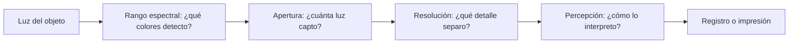

# B01-C10 — Limitaciones de los sentidos humanos

<!-- nav:top -->
[🏠 Programa](../../../../README.md) · [📚 Bloque B01](../../../tronco-comun/B01-el-universo-y-el-pensamiento-cientifico.md) · [← Anterior: B01-C09 — Luz como fuente de información](../B01-C09-luz-como-fuente-de-informacion/CLASE.md) · [Siguiente: B01-C11 — Movimiento aparente del Sol y las estrellas →](../B01-C11-movimiento-aparente-del-sol-y-las-estrellas/CLASE.md)
<!-- /nav -->

## 1. Ubicación, nivel y alcance

Décima clase del bloque B01 y cierre del tramo de método (C05–C10). Aprendiste que la luz trae información (C09); ahora examinas el primer instrumento que usas para recibirla, tu ojo, y por qué la astronomía necesita otros. Sigues en el nivel N1.

Verás cuatro límites —rango de colores, sensibilidad, resolución y percepción— y cómo se calculan con un modelo sencillo. No verás la fisiología del ojo ni el diseño de telescopios (bloques posteriores).

## 2. Por qué esta clase existe

Si el ojo bastara, no habría observatorios. La luz visible es una franja pequeña del espectro electromagnético (S1, S2); además, tu pupila recoge poca luz, separa detalles hasta cierto tamaño y puede engañarte. Lo que no ves no es lo que no existe: es lo que tu instrumento actual no registra.

La decisión central es: **¿qué limitación de mi instrumento (o de mis sentidos) afecta a esta medida, y qué instrumento la supera?** Aprenderás a cuantificar cada límite con un cálculo y a elegir entre ojo, cámara y telescopio sabiendo qué ganas y qué sigues sin ver.

## 3. Lo que podrás hacer al terminar

1. Enumerar cuatro limitaciones de los sentidos y un ejemplo astronómico de cada una.
2. Situar el visible en el espectro y explicar por qué hay objetos «invisibles» para el ojo.
3. Calcular el límite de resolución por difracción `θ = 1,22·λ/D` y su detalle lunar.
4. Calcular la ganancia de luz de un instrumento mediante la razón de áreas y su equivalente en magnitudes.
5. Distinguir una limitación del instrumento de un efecto de percepción.
6. Elaborar una **comparación sentido–instrumento**.

La evidencia es la comparación del ejercicio 12 (sección 20).

## 4. Con qué llegas y cómo comprobarlo

Necesitas C04 y C08 (unidades), C06 (diámetro angular) y C09 (espectro). Cinco preguntas:

1. ¿Qué rango de longitudes de onda es visible?
2. Convierte 1,38″ a radianes (1″ = 4,848 × 10⁻⁶ rad).
3. ¿Qué es el diámetro angular de la Luna aproximadamente?
4. ¿Cuánto es 550 nm en metros?
5. Si el área aumenta 100 veces, ¿cuántas veces más luz se capta?

<details>
<summary>Ver respuestas</summary>

1. 380 a 700 nm (NASA, C09). 2. `6,69 × 10⁻⁶ rad`. 3. Unos 1 865″ (0,52°), C06. 4. `5,5 × 10⁻⁷ m`. 5. 100 veces (proporcional al área).
</details>

Con cuatro o cinco aciertos, sigue; con tres o menos, repasa C06 a C09.

## 5. Un caso real: lo que sabe NASA del espectro y de la atmósfera

NASA señala que el ojo humano detecta solo una pequeña porción del espectro electromagnético, la luz visible, típicamente de 380 a 700 nm (S1, S2). También explica que la luz visible atraviesa en buena parte la atmósfera terrestre, que algunas microondas atraviesan las nubes y que la atmósfera bloquea muchas longitudes de onda de mayor energía, de modo que ciertos instrumentos deben colocarse por encima de ella (S1).

Dos limitaciones distintas aparecen aquí: la **del ojo** (qué colores detecta) y la **del entorno** (qué longitudes de onda llegan al suelo). Nuestro **ejemplo conductor** es la Luna: la miras con el ojo (diámetro angular ≈ 1 865″) y te preguntas qué detalles distingues a simple vista y con un telescopio pequeño. Límite: los diámetros de pupila y de telescopio de esta clase son **hipotéticos**; no son medidas de una persona ni de un aparato concreto.

## 6. Vocabulario

El **rango espectral** es el intervalo de longitudes de onda que un detector registra. La **sensibilidad** es la luz mínima que detecta. La **apertura** `D` es el diámetro de la abertura que recoge la luz (pupila o espejo). La **resolución angular** es el menor ángulo entre dos puntos que se ven separados. La **difracción** es la dispersión de la luz al pasar por una abertura, que fija un límite mínimo a la resolución. El **límite de Rayleigh** estima ese mínimo como `θ = 1,22·λ/D`. La **magnitud** es una escala de brillo en la que una diferencia de 5 magnitudes equivale a un factor 100 en flujo; mayor magnitud = más débil. La **percepción** es la interpretación que el cerebro hace de la señal del ojo; puede producir ilusiones. Un **detector** es un sensor que registra luz (ojo, película, sensor digital).

## 7. Modelo mental: cuatro cuellos de botella

Imagina la luz pasando por cuatro cuellos de botella en serie: el rango de colores, la cantidad de luz que entra, el detalle que se separa y la lectura que hace el cerebro. Un instrumento puede ensanchar los tres primeros; el cuarto solo se vigila.



*Descripción textual:* una cadena de cuatro cuellos de botella. La luz del objeto pasa por el rango espectral del detector, por la apertura que fija cuánta luz entra, por la resolución que decide qué detalle se separa y por la percepción que interpreta; al final hay un registro o una impresión.

Analogía: una manguera con cuatro estrechamientos. Límite: los cuellos no son independientes; por ejemplo, ampliar la apertura mejora a la vez la luz captada y la resolución.

## 8. La explicación, paso a paso

### 8.1 Rango espectral

El ojo detecta de 380 a 700 nm (S2). Fuera de ese intervalo hay luz, pero el ojo no la registra: el calor del infrarrojo o los rayos X no se «ven». Por eso la astronomía usa detectores para otras regiones, algunos solo desde el espacio por el bloqueo atmosférico (S1). El rango es el primer límite y el más absoluto.

### 8.2 Sensibilidad: cuánta luz se capta

La luz que recoge una abertura es proporcional a su área, es decir, a `D²`. Un telescopio de 100 mm frente a una pupila de 7 mm (hipotéticos) capta `(100/7)² = 204` veces más luz. En magnitudes, `Δm = 2,5·log₁₀(204) = 5,77`: ve objetos 5,8 magnitudes más débiles. El detector también importa: uno digital puede acumular luz durante segundos o minutos en una exposición, algo que el ojo no hace de la misma manera (explicación nuestra).

### 8.3 Resolución: cuánto detalle separas

La difracción impone `θ = 1,22·λ/D`. Con `λ = 550 nm`: para `D = 7 mm`, `θ = 9,59 × 10⁻⁵ rad = 19,8″`; para `D = 100 mm`, `θ = 6,71 × 10⁻⁶ rad = 1,38″`. A la distancia de la Luna (384 400 km, S3), eso equivale a detalles de `9,59 × 10⁻⁵ × 384 400 = 36,8 km` con el ojo y `2,6 km` con el telescopio. El resultado es una **cota inferior**: el ojo real y la atmósfera empeoran la resolución, así que no esperes alcanzar esas cifras (explicación nuestra).

### 8.4 Percepción

El cerebro interpreta. Un ejemplo muy conocido es que la Luna parece más grande cerca del horizonte; tal afirmación pertenece a la literatura de percepción, que **no consultamos**, así que no la damos como hecho; si te interesa, **mídela**: fotografía la Luna alta y baja con el mismo zoom y compara los diámetros en píxeles (C06, C07). Recuerda la regla de C05: lo que *te parece* es una impresión; lo que *mide un instrumento* es el registro.

### 8.5 Elegir el instrumento

Para una pregunta dada: ¿en qué región del espectro está la información? ¿Qué brillo tiene el objeto? ¿Qué detalle necesito separar? Con las tres respuestas eliges ojo, cámara, binocular o telescopio, y sabes qué seguirá fuera de alcance.

## 9. Magnitudes, símbolos y unidades

| Símbolo | Qué es | Unidad | Valor o nota |
|---|---|---|---|
| `λ` | longitud de onda | nm, m | 550 nm (referencia en el visible) |
| `D` | apertura | mm, m | 7 mm (ojo, hipotético); 100 mm (telescopio, hipotético) |
| `θ` | resolución angular | rad, ″ | `1,22·λ/D` |
| `Δm` | diferencia de magnitudes | mag | `2,5·log₁₀(razón de flujos)` |
| `d_L` | distancia Tierra–Luna | km | 384 400 (S3) |
| 1″ | segundo de arco | rad | 4,848 × 10⁻⁶ |

## 10. Convenciones y referencias

El coeficiente 1,22 viene del primer cero de la función de Airy (3,8317/π = 1,2197), que contrastamos en el laboratorio. Los valores de apertura son **hipotéticos** (supuestos de la clase); los de la Luna, **publicados**; los resultados, **calculados**. La escala de magnitudes (5 mag ↔ factor 100) es una definición de la escala, no una medida. Se usa λ = 550 nm como valor representativo del visible.

## 11. De dónde sale lo que afirmamos

| ID | Fuente | Localizador | Respalda | Estado |
|---|---|---|---|---|
| S1 | NASA Science, «Introduction to the Electromagnetic Spectrum» | https://science.nasa.gov/ems/01_intro/ | El ojo ve solo una porción; la atmósfera bloquea muchas longitudes de mayor energía; algunas microondas atraviesan nubes | Página consultada el 2026-11-05 |
| S2 | NASA Science, «Visible Light» | https://science.nasa.gov/ems/09_visiblelight/ | Visible típico: 380–700 nm | Página consultada el 2026-11-05 |
| S3 | NASA NSSDC, *Moon Fact Sheet* (actualizada el 11-ene-2024) | https://nssdc.gsfc.nasa.gov/planetary/factsheet/moonfact.html | Semieje mayor 384 400 km; radio medio 1 737,4 km | Página consultada el 2026-11-05 |

Límites: la fórmula de Rayleigh y la escala de magnitudes son conocimiento estándar que **no citamos** de una fuente consultada; se verifican con el caso analítico del laboratorio. No usamos datos de fisiología del ojo.

## 12. Cómo ver los límites

Versión accesible del diagrama:

| Límite | Ojo (hipotético) | Telescopio de 100 mm (hipotético) | Qué sigue sin verse |
|---|---|---|---|
| Rango | 380–700 nm (S2) | según detector | otras regiones sin detector |
| Luz | referencia | 204× más área; 5,77 mag | objetos aún más débiles |
| Resolución | 19,8″ (cota) | 1,38″ (cota) | detalles menores al límite |
| Percepción | ilusiones posibles | menos, pero hay sesgos | — |

Descripción larga: de izquierda a derecha, el instrumento mejora la luz y la resolución; el rango depende del detector. Evita distinguir solo por color.

## 13. Ejemplo trabajado: ¿qué detalles lunares distingo?

**Paso 1 · Datos.** `d = 384 400 km` (S3); `λ = 550 nm`; `D_ojo = 7 mm`; `D_tel = 100 mm` (hipotéticos).

**Paso 2 · Ojo.** `θ = 1,22 × 550 × 10⁻⁹/0,007 = 9,59 × 10⁻⁵ rad`; en km, `θ·d = 36,8 km`.

**Paso 3 · Telescopio.** `θ = 1,22 × 550 × 10⁻⁹/0,100 = 6,71 × 10⁻⁶ rad = 1,38″`; en km, `2,6 km`.

**Paso 4 · Mejora.** `36,8/2,6 = 14,3`: la resolución mejora en la misma razón que `D` (`100/7`).

**Paso 5 · Luz.** `Δm = 2,5·log₁₀(204) = 5,77` magnitudes.

**Paso 6 · Interpretación.** Como cotas, son solo el mejor caso: la atmósfera y el ojo no alcanzarán esas cifras. La **conclusión honesta** es que el telescopio puede mostrar detalles lunares unas 14 veces menores que el ojo en el caso ideal, si todo lo demás funciona.

**Sentido físico.** Cada límite se calcula con una fórmula sencilla y se reporta como cota, no como promesa.

## 14. Distintas formas de superar los límites

**Ojo con ayuda** (binoculares): barato, sin registro objetivo. **Cámara**: acumula luz y deja registro, pero tiene rango y resolución propios. **Telescopio con detector**: mejora los tres, a mayor costo. **Instrumentos en otras regiones del espectro**: abren información invisible al ojo, a veces desde el espacio (S1). Elige según la pregunta, no según la herramienta más potente.

## 15. Práctica guiada

**Ejercicio 1 · con los pasos indicados.** Calcula `θ` para `D = 50 mm` y `λ = 550 nm`. *Pasos:* sección 8.3.

<details><summary>Solución comentada</summary>

`θ = 1,22 × 550 × 10⁻⁹/0,05 = 1,342 × 10⁻⁵ rad = 2,77″`. Si usaste 50 sin convertir a metros, quedó 0,0000134 dividido por mil; usa la unidad correcta.
</details>

**Ejercicio 2 · con una pista.** ¿Cuántas veces más luz capta una abertura de 50 mm que una pupila de 7 mm? *Pista:* razón de `D²`.

<details><summary>Solución comentada</summary>

`(50/7)² = 51,0`. En magnitudes, `2,5·log₁₀(51) = 4,27`.
</details>

**Ejercicio 3 · casi autónomo.** ¿A qué detalle lunar equivale `θ = 2,77″`? *Pista:* `θ` en rad por la distancia.

<details><summary>Solución comentada</summary>

`2,77 × 4,848 × 10⁻⁶ = 1,343 × 10⁻⁵ rad`; `× 384 400 km = 5,2 km`.
</details>

## 16. Práctica autónoma, transferencia e integrador

**Ejercicio 4.** Calcula `θ` en segundos de arco para `D = 200 mm` y `λ = 550 nm`, y el detalle lunar.

<details><summary>Solución comentada</summary>

`θ = 1,22 × 550 × 10⁻⁹/0,2 = 3,355 × 10⁻⁶ rad = 0,692″`; detalle lunar `1,29 km`.
</details>

**Ejercicio 5.** ¿Cuántos kilómetros de la Luna ocupan 1″? (Usa 384 400 km.)

<details><summary>Solución comentada</summary>

`4,848 × 10⁻⁶ × 384 400 = 1,86 km`. Cada segundo de arco cubre unos 1,9 km de la superficie lunar.
</details>

**Ejercicio 6.** Con la Luna de 1 865″ de diámetro angular, ¿cuántos «elementos de resolución» de 19,8″ caben en su diámetro?

<details><summary>Solución comentada</summary>

`1 865/19,8 = 94,2`: unos 94 elementos de resolución a lo largo del diámetro, como cota en el caso ideal.
</details>

**Ejercicio 7.** Un instrumento ve objetos 10 magnitudes más débiles que el ojo. ¿Qué razón de flujos es?

<details><summary>Solución comentada</summary>

Cinco magnitudes son 100×, así que diez son `100² = 10⁴`: 10 000 veces más sensible.
</details>

**Ejercicio 8.** Un compañero dice: «con mi telescopio de 100 mm veré detalles de 2,6 km en la Luna». Corrige.

<details><summary>Solución comentada</summary>

2,6 km es una **cota teórica** de difracción; la atmósfera, el enfoque y la óptica real la empeoran. Debe decir «no mejor que ~2,6 km» y medirlo.
</details>

**Ejercicio 9 · transferencia.** ¿Por qué una cámara infrarroja ve cosas que el ojo no? ¿Qué sigue sin ver?

<details><summary>Solución comentada</summary>

Detecta longitudes de onda fuera de 380–700 nm (S2). Sigue sin ver las regiones que su detector no cubre y las que la atmósfera bloquea (S1).
</details>

**Ejercicio 10 · transferencia.** Propón un experimento para decidir si la ilusión de la Luna en el horizonte es del cielo o del ojo.

<details><summary>Solución comentada</summary>

Fotografiar la Luna alta y baja con el mismo zoom y medir el diámetro en píxeles. Si coinciden, el cambio de tamaño que «ves» es percepción; si no, hay otro efecto. La hipótesis y el criterio se escriben antes (C07).
</details>

**Ejercicio 11 · transferencia.** Un instrumento de mayor apertura siempre mejora la imagen. Argumenta a favor y en contra.

<details><summary>Solución comentada</summary>

A favor: más luz y menor límite de difracción. En contra: la atmósfera puede limitar la resolución antes que la difracción; y más apertura cuesta más y pesa más. Depende de la pregunta (sección 8.5).
</details>

**Ejercicio 12 · integrador.** Elabora tu **comparación sentido–instrumento**: elige un objeto, tres instrumentos (el ojo y dos más) y calcula para cada uno rango, luz relativa, resolución angular y detalle lineal; indica qué sigue sin verse y qué datos son hipotéticos o publicados.

<details><summary>Solución modelo</summary>

Una tabla como la de la sección 12 con cálculos como los de la sección 13, con unidades, cotas declaradas y fuente de la distancia. Se acepta cualquier objeto con distancia publicada y fuente.
</details>

## 17. Laboratorio: ojo frente a instrumento en 60 líneas

El script [ojo_frente_a_instrumento.py](ojo_frente_a_instrumento.py) calcula el límite de Rayleigh para una pupila de 7 mm y un telescopio de 100 mm (ambos hipotéticos), el detalle lunar correspondiente, la razón de luz y las magnitudes. Antes comprueba que el coeficiente 1,22 coincide con el primer cero de Airy (3,8317/π) al 0,3 %, el caso analítico `θ(0,1 m) = 6,71 × 10⁻⁶ rad` y la razón de áreas; si no, se detiene.

**Datos:** distancia y radio lunares publicados (S3); aperturas hipotéticas. **Predice antes:** ¿cuántas veces mejora la resolución con 100 mm frente a 7 mm? (Unas 14.) **Resultados (2026-11-05, Python 3.12.9, Windows):** ojo `θ = 9,586 × 10⁻⁵ rad = 19,77″`, detalle `36,8 km`; telescopio `θ = 6,710 × 10⁻⁶ rad = 1,38″`, detalle `2,6 km`; razón de áreas `204,1×` (5,77 mag); diámetro angular medio de la Luna `1 865″ (0,518°)`.

```bash
python programa/clases/B01/B01-C10-limitaciones-de-los-sentidos-humanos/ojo_frente_a_instrumento.py
```

**Límites:** son cotas de difracción; no incluye atmósfera, aberraciones ni la fisiología del ojo.

## 18. Errores frecuentes y cómo corregirlos

**Tomar la cota de difracción como resolución real.** Ejercicio 8.

**Confundir `D` con `D²`.** La luz sube con el área; ejercicio 2.

**Mezclar unidades (mm y m).** Ejercicio 1.

**Creer que «invisible» significa «inexistente».** Ejercicio 9.

**Confundir percepción con medida.** Ejercicio 10.

## 19. Cómo sabrás que vas bien

Tras 8.2: ¿qué pasa con la luz si duplicas `D`? Si no lo sabes, ejercicio 2. Tras 8.3: ¿qué significa «cota»? Si dudas, ejercicio 8. Tras el ejemplo: ¿qué cambia al pasar de ojo a telescopio? Al final: ¿qué limitación no mejora un telescopio óptico? (El rango espectral.) Si no lo ves, relee 8.1.

## 20. Qué entregas y cómo se evalúa

El producto es tu **comparación sentido–instrumento**.

| Criterio | Inicial | En desarrollo | Logrado | Destacado |
|---|---|---|---|---|
| Límites | Menciona uno | Menciona varios | Cuantifica tres | Cuantifica y justifica supuestos |
| Cálculo | Errores | Con ayuda | Correcto con unidades | Con cotas y verificación |
| Instrumento | Sin criterio | Preferencia | Elegido según la pregunta | Compara costo/beneficio |
| Honestidad | Mezcla datos | Rotula parte | Rotula todo | Declara qué no se ve |
| Fuentes | Sin cita | Sin fecha | Con fecha | Distingue publicado de hipotético |

**Condiciones críticas:** no presentar cotas como resultados; rotular lo hipotético; citar solo lo consultado.

## 21. Ética, seguridad y límites

Ningún instrumento óptico debe apuntarse al Sol sin filtro solar certificado propio de ese instrumento (guía de seguridad de NASA, ver la sección 11 de C06 y de C11). Un instrumento más potente no hace más verdadera una conclusión. Accesibilidad: ecuaciones en texto, diagrama descrito, tablas equivalentes, sin conexión; los límites de la visión no deben excluir a quien observa de otras maneras (por ejemplo, con datos o con sonificación).

## 22. Para cerrar y seguir

El ojo ve una franja angosta del espectro, capta poca luz, separa detalles hasta un límite y puede equivocarse al interpretar. Los instrumentos ensanchan unas cosas y no otras. Con esto cierras el método (C05–C10); el siguiente tramo lo aplica al cielo real, empezando por cómo se mueven el Sol y las estrellas para un observador fijo (C11).

**Glosario español–inglés.** apertura · *aperture*; resolución angular · *angular resolution*; difracción · *diffraction*; magnitud · *magnitude*; sensibilidad · *sensitivity*; percepción · *perception*.

**Continuidad.** B01-C11 usa tu capacidad de **elegir un instrumento sabiendo sus límites** para observar el movimiento aparente del cielo con ojo y cámara. B01-C20 la usará para diseñar el proyecto.

**Referencias:** ver sección 11. S1 y S2 son divulgación oficial; S3 es un dato oficial consultado.

<!-- nav:bottom -->
---

[← Anterior: B01-C09 — Luz como fuente de información](../B01-C09-luz-como-fuente-de-informacion/CLASE.md) · [📚 Bloque B01](../../../tronco-comun/B01-el-universo-y-el-pensamiento-cientifico.md) · [Siguiente: B01-C11 — Movimiento aparente del Sol y las estrellas →](../B01-C11-movimiento-aparente-del-sol-y-las-estrellas/CLASE.md)
<!-- /nav -->
