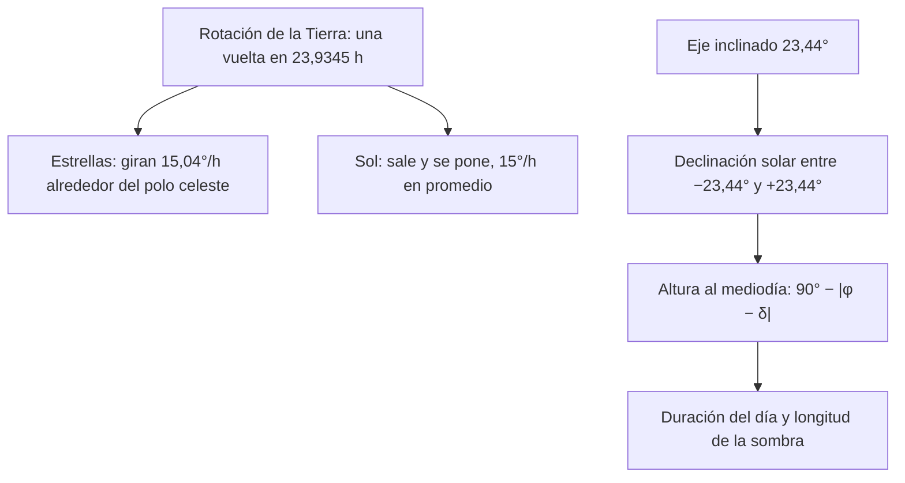

# B01-C11 — Movimiento aparente del Sol y las estrellas

<!-- nav:top -->
[🏠 Programa](../../../../README.md) · [📚 Bloque B01](../../../tronco-comun/B01-el-universo-y-el-pensamiento-cientifico.md) · [← Anterior: B01-C10 — Limitaciones de los sentidos humanos](../B01-C10-limitaciones-de-los-sentidos-humanos/CLASE.md) · [Siguiente: B01-C12 — Fases lunares y ciclos celestes →](../B01-C12-fases-lunares-y-ciclos-celestes/CLASE.md)
<!-- /nav -->

## 1. Ubicación, nivel y alcance

Undécima clase del bloque B01 y primera del tramo que recorre el cielo real (C11–C16). Ya sabes preguntar, predecir y medir (C05–C10); ahora aplicas todo a lo que cualquiera puede observar desde su casa: cómo se mueve el Sol y cómo se mueven las estrellas. Sigues en el nivel N1.

Verás cómo la rotación de la Tierra produce el movimiento diario aparente, cómo la inclinación del eje produce las estaciones y cómo se calculan la altura del Sol al mediodía, la duración del día y la sombra de un palo. No verás todavía coordenadas celestes completas (bloque A06) ni efemérides precisas.

## 2. Por qué esta clase existe

Antes de cualquier telescopio, la humanidad dedujo mucho del cielo a simple vista. Que el Sol «salga» y «se ponga» es una observación; que la Tierra gire es una interpretación (C05) que explica además el movimiento de todas las estrellas. Una sombra que se alarga o se acorta a lo largo del año es un dato que cualquiera puede registrar con un palo y una regla.

La decisión central es: **¿qué movimiento del cielo depende de dónde estoy y cuándo, y cómo lo registro y lo predigo?** Aprenderás a declarar lugar y fecha como parte de la observación (C04), a calcular tres magnitudes del Sol con un modelo geométrico sencillo y a comprobarlas con una medición propia.

## 3. Lo que podrás hacer al terminar

1. Explicar el movimiento diario del Sol y de las estrellas como consecuencia de la rotación terrestre.
2. Explicar las estaciones por la inclinación del eje (oblicuidad) y no por la distancia al Sol.
3. Calcular la altura del Sol al mediodía en un solsticio o equinoccio para una latitud dada.
4. Calcular la duración del día y la longitud de la sombra de un gnomon.
5. Decir si una estrella sale y se pone o es circumpolar para una latitud.
6. Elaborar un **registro de trayectorias con fecha y lugar**.

La evidencia es el registro del ejercicio 12 (sección 20).

## 4. Con qué llegas y cómo comprobarlo

Necesitas C04 (día solar/sidéreo, marco de referencia) y C06–C07 (pregunta y predicción). Cinco preguntas:

1. ¿Cuánto más corto es el día sidéreo que el solar?
2. ¿Cuántos grados giran 24 h si hay 360° en una vuelta?
3. ¿Qué es un marco de referencia?
4. ¿Qué diferencia hay entre observación e interpretación?
5. ¿Qué tangente tiene 45°?

<details>
<summary>Ver respuestas</summary>

1. 3,93 min (C04). 2. 360°, es decir, 15° por hora. 3. Origen, ejes, unidad y sentido positivo. 4. La observación es el registro; la interpretación lo explica con supuestos. 5. 1.
</details>

Con cuatro o cinco aciertos, sigue; con tres o menos, repasa C04 y C05.

## 5. Un caso real: la inclinación de la Tierra en una ficha

La ficha de la Tierra de NASA indica una oblicuidad (inclinación del eje respecto del plano de la órbita) de 23,44°, una rotación sidérea de 23,9345 h, un día de 24,0000 h y un año trópico de 365,242 días (S1). Con solo esos números puedes predecir mucho: cuánto sube el Sol en un solsticio, cuánto dura el día, qué sombra proyecta un palo.

Nuestro **ejemplo conductor** es un lugar de la clase, una ciudad hipotética a **33,45° S** (valor de ejemplo; en Chile hay ciudades en latitudes parecidas, pero no tomamos datos de ninguna), con un palo vertical de 1 m. Allí predecimos tres cosas y te proponemos medir una. Límite: el modelo usa solo fechas de solsticio y equinoccio, sin refracción ni efemérides.

## 6. Vocabulario

El **horizonte** es el límite del cielo visible; el **cénit**, el punto justo encima; el **meridiano** es la línea imaginaria que une norte, cénit y sur. La **altura** de un astro es su ángulo sobre el horizonte. La **culminación** es el paso por el meridiano, el punto más alto del día. La **latitud** `φ` es el ángulo norte–sur del lugar, con signo negativo al sur. La **declinación** `δ` de un astro es su ángulo norte–sur en el cielo; la del Sol varía entre `−23,44°` y `+23,44°` a lo largo del año. La **oblicuidad** es la inclinación del eje de la Tierra (23,44°, S1). El **solsticio** es el día de mayor o menor altura del Sol; el **equinoccio**, el día en que `δ = 0`. Un **gnomon** es un palo vertical cuya sombra mide la altura solar. Un astro **circumpolar** nunca se pone para ese lugar. El **polo celeste** es el punto en torno al cual giran las estrellas.

## 7. Modelo mental: el cielo como esfera que gira

Imagina que el cielo es una gran esfera con las estrellas pegadas. Tú estás en el centro, sobre un punto de la Tierra, y la esfera da una vuelta cada 23,9345 h. El Sol está en esa esfera, pero se desplaza lentamente entre las estrellas a lo largo del año.



*Descripción textual:* la rotación terrestre produce el giro aparente de las estrellas (15,04° por hora) y el ciclo del Sol (15° por hora en promedio); la inclinación del eje da una declinación solar entre −23,44° y +23,44°, de la que salen la altura al mediodía, la duración del día y la sombra.

Analogía: estar en un carrusel; los edificios «giran» alrededor de ti. Límite: en el carrusel el centro está quieto; la Tierra además orbita al Sol, y por eso el Sol y las estrellas no giran a la misma velocidad aparente (C04).

## 8. La explicación, paso a paso

### 8.1 Movimiento diario

La Tierra gira de oeste a este, de modo que los astros parecen salir por el este y ponerse por el oeste. Una vuelta respecto de las estrellas toma 23,9345 h (S1), es decir `360°/23,9345 h = 15,041°/h`. El Sol parece moverse a 15°/h en promedio porque se mide de mediodía a mediodía (24 h). La diferencia, 3,93 minutos por día, hace que las estrellas salgan unos 4 minutos antes cada noche (C04).

### 8.2 Latitud y polo celeste

El eje de rotación apunta a un lugar del cielo, el polo celeste, y todos los astros giran en torno a él. Su altura sobre el horizonte es igual a la latitud: `|φ| = 33,45°` para nuestro lugar. Por geometría (nuestra), las estrellas de declinación `|δ| > 90° − |φ| = 56,55°`, en el mismo hemisferio que el polo visible, son circumpolares: nunca se ponen.

### 8.3 Estaciones: la inclinación, no la distancia

Si el eje no estuviera inclinado, `δ_Sol` sería siempre 0. Por estar inclinado 23,44°, `δ_Sol` oscila entre `−23,44°` en el solsticio de diciembre y `+23,44°` en el de junio. La distancia al Sol varía entre 147,1 y 152,1 millones de km (S2), unos ±1,7 %, sin relación con la estación: el hemisferio sur tiene verano cuando el norte tiene invierno, y la distancia es una sola. Esta es una explicación nuestra y puedes verificarla con el ejercicio 9.

### 8.4 Altura al mediodía y duración del día

La altura meridiana es `h = 90° − |φ − δ|`. Para `φ = −33,45°`: en el solsticio de diciembre, `δ = −23,44°` y `h = 90° − 10,01° = 79,99°`; en el equinoccio, `h = 56,55°`; en el de junio, `h = 33,11°`. La duración del día se obtiene de `cos H₀ = −tan φ · tan δ`, con `H₀` el semiángulo horario del Sol en el horizonte y `día = 2H₀/15° por hora`: da 14,22 h en diciembre, 12,00 h en el equinoccio y 9,78 h en junio. El modelo ignora la refracción y el tamaño del disco solar, que alargan un poco el día.

### 8.5 La sombra de un gnomon

Con un palo vertical de altura `g`, la sombra mide `L = g/tan(h)`. Con `g = 1 m`: 0,177 m en diciembre, 0,661 m en el equinoccio y 1,533 m en junio. Esta es la forma más segura de medir el Sol: **jamás mires al Sol directamente**; la sombra lo hace por ti. Cuando la sombra es la más corta del día, es mediodía solar local.

## 9. Magnitudes, símbolos y unidades

| Símbolo | Qué es | Unidad | Valor o nota |
|---|---|---|---|
| `ε` | oblicuidad de la Tierra | ° | 23,44 (S1) |
| `T_sid` | rotación sidérea | h | 23,9345 (S1) |
| `φ` | latitud | ° | −33,45 (ejemplo hipotético) |
| `δ` | declinación del Sol | ° | `±ε` en solsticios, 0 en equinoccios |
| `h` | altura meridiana | ° | `90° − |φ − δ|` |
| `H₀` | semiángulo horario | ° | `arccos(−tan φ tan δ)` |
| `g`, `L` | altura del gnomon y su sombra | m | `L = g/tan h` |

## 10. Convenciones y referencias

Latitud negativa al sur. La declinación del Sol se toma de los valores de solsticio y equinoccio, **aproximación del modelo** (no efeméride). La latitud de 33,45° S es un valor de **ejemplo** (sintético); la oblicuidad y la rotación son **publicadas**; las alturas, duraciones y sombras son **calculadas**. El modelo vale para `|φ| < 66,56°` (sin sol de medianoche).

## 11. De dónde sale lo que afirmamos

| ID | Fuente | Localizador | Respalda | Estado |
|---|---|---|---|---|
| S1 | NASA NSSDC, *Earth Fact Sheet* (actualizada el 15-nov-2024) | https://nssdc.gsfc.nasa.gov/planetary/factsheet/earthfact.html | Oblicuidad 23,44°; rotación sidérea 23,9345 h; día 24,0000 h; año trópico 365,242 d | Página consultada el 2026-11-05 |
| S2 | NASA NSSDC, *Sun Fact Sheet* (actualizada el 9-may-2024) | https://nssdc.gsfc.nasa.gov/planetary/factsheet/sunfact.html | Distancia Tierra–Sol: mínima 147,1; máxima 152,1 (10⁶ km) | Página consultada el 2026-11-05 |
| S3 | NASA Science, «Eclipse safety» | https://science.nasa.gov/eclipses/safety/ | Nunca mirar al Sol sin protección; las gafas comunes no son seguras; visores con ISO 12312-2; sin filtro propio, no usar cámaras/telescopios/binoculares | Página consultada el 2026-11-05 |

Límites: las fórmulas geométricas son nuestras y se comprueban con casos analíticos en el laboratorio; no usamos efemérides.

## 12. Cómo ver las trayectorias

Versión accesible del diagrama (latitud 33,45° S, ejemplo):

| Fecha | `δ` | Altura al mediodía | Día | Sombra de 1 m |
|---|---|---|---|---|
| Solsticio de diciembre | −23,44° | 79,99° | 14,22 h | 0,177 m |
| Equinoccio | 0° | 56,55° | 12,00 h | 0,661 m |
| Solsticio de junio | +23,44° | 33,11° | 9,78 h | 1,533 m |

Descripción larga: el arco solar es más alto y más largo en diciembre, intermedio en el equinoccio y bajo y corto en junio. Si dibujas, rotula ejes con ° y h y usa trazos distintos, no solo color.

## 13. Ejemplo trabajado: predecir y comprobar una sombra

**Paso 1 · Hipótesis.** «La sombra al mediodía de un palo de 1 m a 33,45° S es más corta en diciembre que en junio, por la inclinación del eje.»

**Paso 2 · Predicción.** `L_dic = 0,177 m` y `L_jun = 1,533 m`: razón `8,7`.

**Paso 3 · Criterio.** Se refuta si la razón medida es compatible con 1 (C07).

**Paso 4 · Medición.** Con un palo vertical (usa plomada), mide con regla la sombra cada cinco minutos alrededor del mediodía y toma el mínimo; repite en las dos fechas. Anota lugar, fecha, hora y escala de tiempo (C04).

**Paso 5 · Registro.** «Palo 1,000 ± 0,002 m; sombra mínima ... ± 0,005 m» (valores que tomas tú).

**Paso 6 · Contraste.** Calcula `h = arctan(g/L)` y compara con 79,99° y 33,11°.

**Sentido físico.** El resultado es independiente del instrumento caro: un palo y una regla bastan. Y no miras al Sol.

## 14. Distintas formas de registrar el movimiento

**Gnomon:** barato y seguro, da altura solar. **Fotografía de estelas** con trípode: muestra el giro de las estrellas, pero exige exposiciones largas y cielo oscuro. **Tablas publicadas:** precisas, pero no son tuyas. Para aprender, combina gnomon y fotos; para comprobar, contrasta con tablas citadas.

## 15. Práctica guiada

**Ejercicio 1 · con los pasos indicados.** Calcula la altura meridiana del Sol a `φ = −33,45°` en el equinoccio. *Pasos:* sección 8.4 con `δ = 0`.

<details><summary>Solución comentada</summary>

`h = 90° − |−33,45° − 0°| = 56,55°`. Si te salió 33,45°, restaste la latitud de 0° en lugar de restar de 90°.
</details>

**Ejercicio 2 · con una pista.** Calcula la sombra de un gnomon de 1 m en el equinoccio. *Pista:* `L = 1/tan(56,55°)`.

<details><summary>Solución comentada</summary>

`tan 56,55° = 1,512`; `L = 0,661 m`.
</details>

**Ejercicio 3 · casi autónomo.** ¿A cuántos grados por hora giran las estrellas? ¿Y cuántos minutos adelantan por día?

<details><summary>Solución comentada</summary>

`360/23,9345 = 15,041°/h`; el adelanto es `24 − 23,9345 = 0,0655 h = 3,93 min` (C04).
</details>

## 16. Práctica autónoma, transferencia e integrador

**Ejercicio 4.** Calcula la duración del día en el solsticio de diciembre a `φ = −33,45°`.

<details><summary>Solución comentada</summary>

`cos H₀ = −tan(−33,45°)·tan(−23,44°) = −0,6597 × 0,4338 = −0,2862`; `H₀ = 106,63°`; día = `2 × 106,63/15 = 14,22 h`.
</details>

**Ejercicio 5.** Calcula la altura meridiana del Sol en el solsticio de junio a `φ = −33,45°`.

<details><summary>Solución comentada</summary>

`h = 90° − |−33,45° − 23,44°| = 90° − 56,89° = 33,11°`; la sombra de 1 m es 1,533 m.
</details>

**Ejercicio 6.** ¿A qué altura está el polo celeste a `φ = −33,45°`? ¿Qué estrellas son circumpolares?

<details><summary>Solución comentada</summary>

A `33,45°` sobre el horizonte (el polo sur celeste). Las de declinación `δ < −56,55°` no se ponen nunca, porque `90° − 33,45° = 56,55°` (sección 8.2).
</details>

**Ejercicio 7.** En el ecuador (`φ = 0°`), ¿cuánto dura el día en el solsticio? ¿Y la altura meridiana en el equinoccio?

<details><summary>Solución comentada</summary>

`cos H₀ = −tan 0° · tan δ = 0`, `H₀ = 90°`: día de 12 h todo el año. Altura meridiana en el equinoccio: `90° − 0 = 90°`: el Sol pasa por el cénit.
</details>

**Ejercicio 8.** Una sombra mide 0,40 m con un gnomon de 1 m. ¿Qué altura tiene el Sol?

<details><summary>Solución comentada</summary>

`h = arctan(1/0,40) = arctan(2,5) = 68,2°`. Compárala con las alturas de la tabla de la sección 12 para saber en qué época del año estás.
</details>

**Ejercicio 9 · transferencia.** Usa los datos de S2 para refutar «es verano porque la Tierra está más cerca del Sol». ¿Qué observarías?

<details><summary>Solución comentada</summary>

La distancia varía solo entre 147,1 y 152,1 × 10⁶ km (±1,7 %), y ambos hemisferios están a la misma distancia pero tienen estaciones opuestas. Con la inclinación (`δ` de ±23,44°) se explica el cambio de altura y duración del día. Es un argumento, no una medición directa.
</details>

**Ejercicio 10 · transferencia.** Un estudiante mira el Sol con binoculares para medir su altura. Explica el error y propón alternativa.

<details><summary>Solución comentada</summary>

Mirar el Sol con binoculares sin filtro solar propio es peligroso; las gafas comunes y las gafas de eclipse no reemplazan el filtro frontal del instrumento (S3). La alternativa segura es el gnomon (sombra) o la proyección indirecta.
</details>

**Ejercicio 11 · transferencia.** Una foto de 4 horas muestra estelas de 60° de arco. ¿Es compatible con la rotación de 15,04°/h?

<details><summary>Solución comentada</summary>

`15,04 × 4 = 60,2°`: sí, compatible. Si la estela fuera de 30°, habría que suponer una exposición de 2 h; el arco mide tiempo.
</details>

**Ejercicio 12 · integrador.** Elabora tu **registro de trayectorias con fecha y lugar**: declara latitud, fecha, escala de tiempo, método; mide la sombra de un gnomon al menos cinco veces alrededor del mediodía, toma el mínimo, calcula la altura del Sol y contrasta con la predicción del modelo para tu latitud y fecha.

<details><summary>Solución modelo</summary>

Una ficha con latitud (de tu lugar, con fuente), fecha, gnomon con su incertidumbre, serie de sombras, mínimo, altura calculada y comparación con `90° − |φ − δ|` (δ por fecha). Si la fecha no es solsticio o equinoccio, declara que el modelo es aproximado. Se acepta cualquier lugar con latitud conocida.
</details>

## 17. Laboratorio: trayectoria solar en 60 líneas

El script [trayectoria_solar.py](trayectoria_solar.py) calcula altura meridiana, duración del día y sombra de un gnomon de 1 m para los solsticios y el equinoccio en 33,45° S. Antes comprueba que en el ecuador la altura del equinoccio es 90°, que el día de equinoccio dura 12 h a 45°, que el día en el ecuador dura 12 h todo el año, que un gnomon a 45° da sombra igual a su altura y que `360/T_sid = 15,04°/h`; si falla, se detiene.

**Datos:** oblicuidad y rotación publicadas (S1); latitud de ejemplo. **Predice antes:** ¿qué día es más largo, diciembre o junio, en el hemisferio sur? (Diciembre.) **Resultados (2026-11-05, Python 3.12.9, Windows):** diciembre: altura 79,99°, día 14,22 h, sombra 0,177 m; equinoccio: 56,55°, 12,00 h, 0,661 m; junio: 33,11°, 9,78 h, 1,533 m; polo a 33,45°; giro estelar 15,0410°/h; adelanto diario 3,93 min.

```bash
python programa/clases/B01/B01-C11-movimiento-aparente-del-sol-y-las-estrellas/trayectoria_solar.py
```

**Límites:** sin refracción ni efemérides; solo tres fechas; latitud hipotética.

## 18. Errores frecuentes y cómo corregirlos

**Atribuir las estaciones a la distancia al Sol.** Ejercicio 9.

**Olvidar el signo de la latitud.** Ejercicio 1.

**Mirar el Sol directamente.** Ejercicio 10.

**Confundir sombra corta con Sol lejano.** Sombra corta = Sol alto; ejercicio 8.

**Mezclar día solar y sidéreo.** Ejercicio 3.

## 19. Cómo sabrás que vas bien

Tras 8.1: ¿cuánto giran las estrellas en una hora? Si no lo sabes, ejercicio 3. Tras 8.4: ¿qué da la altura meridiana en el equinoccio a tu latitud? Si no, ejercicio 1. Tras 8.5: ¿cómo mides la altura del Sol sin mirarlo? Si dudas, relee. Al final: ¿qué causa las estaciones? Si respondes «la distancia», ejercicio 9.

## 20. Qué entregas y cómo se evalúa

El producto es tu **registro de trayectorias con fecha y lugar**.

| Criterio | Inicial | En desarrollo | Logrado | Destacado |
|---|---|---|---|---|
| Lugar y fecha | Faltan | Uno | Ambos con escala de tiempo | Con fuente de latitud |
| Medición | Una sola | Varias sin criterio | Serie con mínimo | Con incertidumbre |
| Cálculo | Errores | Con ayuda | Correcto con unidades | Contrasta con el modelo |
| Seguridad | Ignorada | Mencionada | Sombra, no mirar el Sol | Propone alternativa |
| Honestidad | Mezcla datos | Rotula parte | Rotula todo | Declara límites del modelo |

**Condiciones críticas:** no mirar al Sol sin filtro certificado; no presentar valores del modelo como medidos; citar solo lo consultado.

## 21. Ética, seguridad y límites

**Nunca mires directamente al Sol ni con instrumentos sin filtro solar propio.** NASA indica que las gafas comunes no son seguras, que los visores deben cumplir ISO 12312-2, que ninguna gafa sustituye al filtro frontal de un instrumento y que la proyección por estenopo se hace de espaldas al Sol (S3). Esta clase **no certifica ningún filtro**; si tienes uno, verifica su norma y su estado. Accesibilidad: ecuaciones en texto, diagrama descrito, tablas equivalentes, sin conexión.

## 22. Para cerrar y seguir

El cielo gira porque la Tierra gira; las estaciones existen porque el eje está inclinado; y con latitud y fecha se predicen la altura, el día y la sombra. Ahora que viste el ciclo diario y el anual, falta el ciclo de la Luna, que combina dos movimientos (C12).

**Glosario español–inglés.** horizonte · *horizon*; cénit · *zenith*; altura · *altitude*; declinación · *declination*; oblicuidad · *obliquity*; solsticio · *solstice*; equinoccio · *equinox*; gnomon · *gnomon*; circumpolar · *circumpolar*.

**Continuidad.** B01-C12 usa tu capacidad de **registrar posición y ángulo con fecha y lugar** para predecir una fase lunar. B01-C20 reutilizará el gnomon y el registro con escala de tiempo.

**Referencias:** ver sección 11. S1 y S2 son datos oficiales; S3 es una guía de seguridad oficial.

<!-- nav:bottom -->
---

[← Anterior: B01-C10 — Limitaciones de los sentidos humanos](../B01-C10-limitaciones-de-los-sentidos-humanos/CLASE.md) · [📚 Bloque B01](../../../tronco-comun/B01-el-universo-y-el-pensamiento-cientifico.md) · [Siguiente: B01-C12 — Fases lunares y ciclos celestes →](../B01-C12-fases-lunares-y-ciclos-celestes/CLASE.md)
<!-- /nav -->
