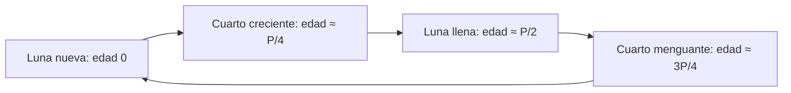

# B01-C12 — Fases lunares y ciclos celestes

<!-- nav:top -->
[🏠 Programa](../../../../README.md) · [📚 Bloque B01](../../../tronco-comun/B01-el-universo-y-el-pensamiento-cientifico.md) · [← Anterior: B01-C11 — Movimiento aparente del Sol y las estrellas](../B01-C11-movimiento-aparente-del-sol-y-las-estrellas/CLASE.md) · [Siguiente: B01-C13 — Sistema solar como sistema físico →](../B01-C13-sistema-solar-como-sistema-fisico/CLASE.md)
<!-- /nav -->

## 1. Ubicación, nivel y alcance

Duodécima clase del bloque B01. Ya registras el movimiento diario y anual del Sol (C11); ahora sumas el ciclo de la Luna, que combina su órbita con la posición del Sol, y lo usas para construir y comparar calendarios. Sigues en el nivel N1.

Verás por qué la Luna cambia de forma, cómo se predice una fase con un modelo periódico, por qué no hay eclipse todos los meses y por qué el calendario lunar y el solar no coinciden. No verás cálculo de eclipses ni efemérides precisas (bloque A06).

## 2. Por qué esta clase existe

La Luna es el reloj más a mano del cielo: cada noche cambia, y cada 29,5 días vuelve a empezar. Pero «a mano» no significa «fácil de explicar»: muchas personas creen que las fases son la sombra de la Tierra sobre la Luna. Es un error que se descarta con una observación simple y un modelo.

La decisión central es: **¿qué ciclo regula esta observación y cómo predigo cuándo se repetirá?** Aprenderás a explicar las fases con geometría, a predecir fechas con un período, a estimar cuánto se acumula de error y a compararlo con una observación.

## 3. Lo que podrás hacer al terminar

1. Explicar las fases lunares por la geometría Sol–Tierra–Luna.
2. Predecir fechas de lunas llenas y la fracción iluminada con un modelo periódico.
3. Explicar por qué no hay eclipses todos los meses usando la inclinación de la órbita lunar.
4. Comparar ciclos lunar y solar con un cálculo (12 meses frente a un año).
5. Estimar el error acumulado de una predicción periódica.
6. Elaborar una **predicción de una fase y su comprobación**.

La evidencia es la predicción del ejercicio 12 (sección 20).

## 4. Con qué llegas y cómo comprobarlo

Necesitas C04 (período sinódico, sidéreo), C07 (predicción con criterio) y C11 (registro con fecha y lugar). Cinco preguntas:

1. ¿Cuánto vale el período sinódico lunar publicado?
2. ¿Cuántos días hay entre dos lunas llenas, aproximadamente?
3. ¿Qué es una predicción falsable?
4. ¿Cuánto vale el año trópico en días?
5. Si una cifra tiene incertidumbre ±0,005 d y se repite 12 veces, ¿cuánto se acumula?

<details>
<summary>Ver respuestas</summary>

1. 29,53 d. 2. Unos 29,5 d. 3. Una predicción con número y criterio de refutación previos (C07). 4. 365,242 d. 5. Hasta `12 × 0,005 = 0,06 d` si se suma linealmente.
</details>

Con cuatro o cinco aciertos, sigue; con tres o menos, repasa C04 y C07.

## 5. Un caso real: dos ciclos que no cuadran

La ficha de la Luna de NASA da un período sinódico de 29,53 d, un período sidéreo de 27,3217 d, una inclinación orbital de 5,145° respecto de la eclíptica, un semieje de 384 400 km y una excentricidad de 0,0549 (S1); la de la Tierra, un año trópico de 365,242 d (S2). Con eso se puede preguntar algo concreto: ¿cuántos meses lunares caben en un año?

`365,242/29,53 = 12,37`. No son 12 ni 13: es un número no entero, y de ahí que los calendarios lunares y solares se desfasen. Esa es la estructura de la clase: dos ciclos reales, una razón no entera y una consecuencia práctica. Nuestro **ejemplo conductor** es la predicción de las próximas lunas llenas a partir de **una fecha de partida hipotética** (2026-09-26, dato de ejemplo, no efeméride). Límite: la fecha de partida no es real; sirve para el método.

## 6. Vocabulario

La **fase** es la parte del disco lunar iluminada que vemos. La **luna nueva** ocurre cuando la Luna está entre la Tierra y el Sol (no se ve el lado iluminado); la **luna llena**, cuando la Tierra está entre la Luna y el Sol; los **cuartos**, cuando el ángulo Sol–Tierra–Luna es de 90°. La **edad** de la Luna es el tiempo transcurrido desde la luna nueva. La **fracción iluminada** `f` es la parte del disco que se ve iluminada. El **período sinódico** (29,53 d) es el tiempo entre dos fases iguales; el **sidéreo** (27,3217 d), el de una vuelta respecto de las estrellas (C04). Un **eclipse** es el alineamiento en que un cuerpo proyecta su sombra sobre otro. La **inclinación** orbital es el ángulo entre dos planos de órbita. Un **calendario** es un sistema para numerar los días a partir de ciclos astronómicos. Un **error acumulado** es el que crece al repetir una predicción.

## 7. Modelo mental: la Luna que da vueltas bajo el Sol

Imagina el Sol lejos y a un lado, iluminando siempre la mitad de la Luna que mira hacia él. La Luna da una vuelta alrededor de la Tierra; según dónde esté en esa vuelta, tú ves más o menos de su mitad iluminada.



*Descripción textual:* un ciclo de cuatro estaciones: luna nueva (edad 0), cuarto creciente (un cuarto del período), luna llena (la mitad) y cuarto menguante (tres cuartos); luego vuelve a la luna nueva. El tiempo entre dos pasos iguales es el período sinódico, 29,53 d.

Analogía: un reloj con una sola aguja que da la vuelta cada 29,53 días. Límite: la aguja no marcha con regularidad perfecta (la excentricidad de 0,0549 y los efectos del Sol hacen que el ciclo real varíe), así que el reloj es un modelo.

## 8. La explicación, paso a paso

### 8.1 Por qué hay fases

La Luna no tiene luz propia: refleja la del Sol, y siempre está iluminada la mitad que mira al Sol. Desde la Tierra vemos una porción de esa mitad que depende del ángulo entre el Sol y la Luna. Con el Sol y la Luna del mismo lado, vemos el lado oscuro (luna nueva); con ángulo de 180°, el lado completo iluminado (luna llena). **No es la sombra de la Tierra**: esa sombra solo cae sobre la Luna en un eclipse lunar, que es raro, y las fases ocurren todos los meses.

### 8.2 Un modelo periódico

El ciclo se repite cada `P = 29,53 d`. Si la edad es `a`, el ángulo es `2π·a/P` y la fracción iluminada es `f = (1 − cos(2π·a/P))/2`. Compruebas: `a = 0` da `f = 0`; `a = P/4` da `f = 0,5`; `a = P/2` da `f = 1`. Con `P = 29,53`: a 3,7 d, `f = 0,15`; a 11,1 d, `f = 0,86`. Esta es una aproximación (Luna en el plano de la eclíptica, órbita circular).

### 8.3 Predecir fechas y estimar el error

Desde una luna llena de partida, la siguiente es `+29,53 d`, y la `n`-ésima, `+n·29,53 d`. Con partida hipotética en 2026-09-26 a las 00:00, el laboratorio da: 2026-10-25 12:43; 2026-11-24 01:26; 2026-12-23 14:09; 2027-01-22 02:52. El redondeo de `P` a 0,005 d introduce un error de `n × 0,005 d`, que tras cuatro ciclos es 0,02 d (menos de 30 minutos). Hay además variaciones reales del ciclo que este modelo **no** captura; por eso **comprobar** con una observación o con una tabla publicada y citada es parte del método.

### 8.4 Por qué no hay eclipse todos los meses

La órbita de la Luna está inclinada 5,145° respecto del plano de la órbita terrestre (S1). Eso significa que, en luna nueva o llena, la Luna suele quedar *arriba* o *abajo* de la línea Sol–Tierra. A 384 400 km de distancia, el desvío vertical máximo es `384 400 × sin 5,145° = 34 470 km`, varias veces el radio de la Tierra (6 371 km, C02). Solo cuando la luna nueva o llena ocurre cerca de donde los dos planos se cruzan hay eclipse. Es una explicación geométrica nuestra; no se calculan fechas.

### 8.5 Calendarios: ciclos que no cuadran

Doce meses sinódicos suman `12 × 29,53 = 354,36 d`, `10,88 d` menos que el año trópico de 365,242 d (S2): un calendario de 12 meses lunares se corre unos 11 días por año respecto de las estaciones. Un hecho curioso: `235 × 29,53 = 6 939,55 d` y `19 × 365,242 = 6 939,60 d`, una diferencia de 0,05 d (1,2 h): 19 años solares contienen casi exactamente 235 meses lunares. Esa coincidencia (que verificamos con estos números, sin consultar ninguna fuente sobre su historia) explica que se haya usado para reconciliar ambos ciclos.

## 9. Magnitudes, símbolos y unidades

| Símbolo | Qué es | Unidad | Valor o nota |
|---|---|---|---|
| `P` | período sinódico | d | 29,53 (S1) |
| `P_sid` | período sidéreo | d | 27,3217 (S1) |
| `a` | edad de la Luna | d | 0 a `P` |
| `f` | fracción iluminada | adimensional | `(1 − cos(2πa/P))/2` |
| `i` | inclinación orbital | ° | 5,145 (S1) |
| `a_L` | semieje de la órbita | km | 384 400 (S1) |
| `T_trop` | año trópico | d | 365,242 (S2) |

## 10. Convenciones y referencias

La **edad** se mide desde la luna nueva. La fecha de partida es **hipotética** (sintética); los períodos y la inclinación son **publicados**; las fechas predichas, las fracciones y las comparaciones de ciclos son **calculadas**. Una fase concreta no se produce en un instante nítido: se habla de la fecha y hora de la conjunción o la oposición; en esta clase solo se usa el modelo periódico. Las horas se dan en tiempo local de ejemplo sin zona declarada: en tu registro debes declarar la escala (C04).

## 11. De dónde sale lo que afirmamos

| ID | Fuente | Localizador | Respalda | Estado |
|---|---|---|---|---|
| S1 | NASA NSSDC, *Moon Fact Sheet* (actualizada el 11-ene-2024) | https://nssdc.gsfc.nasa.gov/planetary/factsheet/moonfact.html | Sinódico 29,53 d; sidéreo 27,3217 d; inclinación 5,145°; semieje 384 400 km; excentricidad 0,0549 | Página consultada el 2026-11-05 |
| S2 | NASA NSSDC, *Earth Fact Sheet* (actualizada el 15-nov-2024) | https://nssdc.gsfc.nasa.gov/planetary/factsheet/earthfact.html | Año trópico 365,242 d; radio medio 6 371 km | Página consultada el 2026-11-05 |

Límites: no consultamos efemérides de fases reales; por eso la fecha de partida es hipotética. La historia de los calendarios no se trató: la coincidencia 235/19 es un cálculo, no una afirmación histórica.

## 12. Cómo ver el ciclo

Versión accesible del diagrama:

| Edad (d) | Fase | Fracción iluminada |
|---|---|---|
| 0 | Luna nueva | 0,00 |
| 7,4 | Cuarto creciente | 0,50 |
| 14,8 | Luna llena | 1,00 |
| 22,1 | Cuarto menguante | 0,51 |
| 29,53 | Luna nueva | 0,00 |

(El cuarto menguante cae en 22,1 d, no exactamente en `3P/4 = 22,15 d`, por el redondeo de la edad.) Descripción larga: la fracción iluminada sube de 0 a 1 en medio ciclo y baja de nuevo. Si dibujas, usa formas (círculos rellenos parcialmente) además del color.

## 13. Ejemplo trabajado: predecir y comprobar una luna llena

**Paso 1 · Dato de partida.** Luna llena observada el 2026-09-26 (hipotética).

**Paso 2 · Modelo.** `P = 29,53 d` (S1).

**Paso 3 · Predicción.** Próxima luna llena: `2026-09-26 + 29,53 d = 2026-10-25 12:43`; la tercera, `+88,59 d = 2026-12-23 14:09`.

**Paso 4 · Incertidumbre.** Redondeo ±0,005 d por ciclo; tras tres ciclos ±0,015 d (≈ 22 min). La variación real del ciclo es mayor y **no se cuantifica aquí**.

**Paso 5 · Criterio de comprobación (previo, C07).** «Si la luna llena observada cae a más de 1 día de lo predicho, el modelo no sirve para ese lapso.»

**Paso 6 · Comprobación.** Observa la fase cada noche cerca de la fecha; anota la noche en que el disco se ve completo; compara con la predicción y con una tabla publicada que cites.

**Sentido físico.** El modelo simple da una predicción en el orden de horas; su valor está en que se puede comprobar con un cielo claro.

## 14. Distintas formas de predecir una fase

**Modelo periódico** (esta clase): simple, error pequeño en pocos ciclos. **Efemérides publicadas:** precisas, pero son de otros. **Observación directa:** definitiva, pero depende del clima. Usa el modelo para planificar, la observación para comprobar y las tablas para contrastar.

## 15. Práctica guiada

**Ejercicio 1 · con los pasos indicados.** Calcula la fracción iluminada a los 7,4 d de edad con `P = 29,53 d`. *Pasos:* `f = (1 − cos(2π·a/P))/2`.

<details><summary>Solución comentada</summary>

`2π·7,4/29,53 = 1,5745 rad`; `cos = −0,0037`; `f = 0,50`. Es un cuarto: media Luna.
</details>

**Ejercicio 2 · con una pista.** ¿Cuántos meses sinódicos hay en un año trópico? *Pista:* `365,242/29,53`.

<details><summary>Solución comentada</summary>

`12,37`. Por eso 12 meses quedan cortos y 13 largos.
</details>

**Ejercicio 3 · casi autónomo.** ¿Cuánto falta para que 12 meses sinódicos sumen un año trópico?

<details><summary>Solución comentada</summary>

`365,242 − 354,36 = 10,88 d`. El desfase respecto de las estaciones es de casi 11 días por año.
</details>

## 16. Práctica autónoma, transferencia e integrador

**Ejercicio 4.** Con partida el 2026-09-26 00:00 (hipotética), ¿qué fecha y hora predice el modelo para la segunda luna llena posterior?

<details><summary>Solución comentada</summary>

`2 × 29,53 = 59,06 d`: 2026-09-26 + 59 d = 2026-11-24, más 0,06 d = 1,44 h → 2026-11-24 01:26.
</details>

**Ejercicio 5.** ¿Cuál es el error por redondeo tras 10 ciclos si `P` está redondeado a ±0,005 d? ¿Es mucho?

<details><summary>Solución comentada</summary>

`10 × 0,005 = 0,05 d = 1,2 h`. Es poco comparado con 1 día de tolerancia, pero ignora la variación real del ciclo.
</details>

**Ejercicio 6.** Calcula el desvío vertical máximo de la Luna con `i = 5,145°` y `a = 384 400 km`. Compáralo con el radio de la Tierra (6 371 km).

<details><summary>Solución comentada</summary>

`384 400 × sin 5,145° = 34 470 km`, unas 5,4 veces el radio terrestre. Por eso la Luna suele pasar por encima o por debajo de la línea Sol–Tierra.
</details>

**Ejercicio 7.** Verifica `235 × 29,53` y `19 × 365,242` y compara.

<details><summary>Solución comentada</summary>

`6 939,55` y `6 939,60` d: difieren en 0,05 d (≈ 1,2 h), es decir, 7 partes en un millón.
</details>

**Ejercicio 8.** Un estudiante dice: «las fases son la sombra de la Tierra sobre la Luna». Refútalo con un dato de esta clase.

<details><summary>Solución comentada</summary>

Si fuera la sombra de la Tierra, habría eclipse lunar todos los meses y la forma sería siempre un arco de radio fijo. Pero la órbita está inclinada 5,145° (S1) y los eclipses no ocurren cada mes; las fases sí. Además, el cuarto creciente se ve a plena luz del día, con el Sol y la Luna a 90°.
</details>

**Ejercicio 9 · transferencia.** Un calendario con 12 meses de 29,5 d (354 d) se usa 3 años. ¿Cuánto se ha desfasado respecto del año trópico?

<details><summary>Solución comentada</summary>

`3 × (365,242 − 354) = 33,7 d`: más de un mes. Por eso los calendarios lunares añaden meses intercalares (explicación nuestra).
</details>

**Ejercicio 10 · transferencia.** La Luna tarda 27,3217 d en dar una vuelta respecto de las estrellas, pero 29,53 d en volver a la misma fase. ¿Por qué?

<details><summary>Solución comentada</summary>

Porque mientras la Luna da su vuelta, la Tierra avanza en su órbita y el Sol se «mueve» en el cielo; la Luna necesita unos 2 días más para alcanzar la misma posición respecto del Sol (C04: `1/29,53 = 1/27,3217 − 1/365,256`).
</details>

**Ejercicio 11 · transferencia.** ¿Qué debe cambiar en el modelo para predecir una luna llena con precisión de minutos?

<details><summary>Solución comentada</summary>

Incluir la excentricidad de la órbita, las perturbaciones del Sol y de los planetas, y usar efemérides. Un período constante (modelo de esta clase) tiene un error de horas. Esas correcciones corresponden a bloques de mecánica celeste.
</details>

**Ejercicio 12 · integrador.** Elabora tu **predicción de una fase y su comprobación**: elige una luna llena o un cuarto real que vayas a observar; usa una tabla publicada citada con fecha de consulta para tu punto de partida (si no la tienes, declara que usas una fecha hipotética); predice la próxima fase con `P = 29,53 d`; escribe un criterio de refutación antes; compara con tu observación y con la tabla.

<details><summary>Solución modelo</summary>

Una ficha con fuente de la fecha de partida, cálculo con unidades, error estimado, criterio previo, observación (noche en que el disco se ve completo o a medias) y conclusión acotada. Se acepta cualquier fase si fecha y fuente están declaradas.
</details>

## 17. Laboratorio: fases y ciclos en 60 líneas

El script [fases_y_ciclos.py](fases_y_ciclos.py) predice cuatro lunas llenas desde una fecha hipotética, calcula fracciones iluminadas, compara 12 meses sinódicos con el año trópico, la relación 235/19 y el desvío vertical por la inclinación. Antes comprueba `f(0) = 0`, `f(P/2) = 1`, `f(P/4) = 0,5` y la diferencia 235 meses − 19 años (−0,05 d); si falla, se detiene.

**Datos:** períodos e inclinación publicados (S1, S2); partida **hipotética**. **Predice antes:** ¿cuántas lunas llenas caben en 118 días? (Cuatro.) **Resultados (2026-11-05, Python 3.12.9, Windows):** lunas llenas predichas 2026-10-25 12:43; 2026-11-24 01:26; 2026-12-23 14:09; 2027-01-22 02:52; `f` = 0,00, 0,15, 0,50, 0,86, 1,00, 0,51 para edades 0, 3,7, 7,4, 11,1, 14,8 y 22,1 d; 12 meses = 354,36 d (faltan 10,88 d); 235 meses = 6 939,55 d y 19 años = 6 939,60 d; desvío vertical 34 472 km.

```bash
python programa/clases/B01/B01-C12-fases-lunares-y-ciclos-celestes/fases_y_ciclos.py
```

**Límites:** la partida es hipotética; no son efemérides; el modelo ignora variaciones reales del ciclo.

## 18. Errores frecuentes y cómo corregirlos

**Atribuir las fases a la sombra de la Tierra.** Ejercicio 8.

**Confundir período sidéreo con sinódico.** Ejercicio 10.

**Suponer que el año tiene 12 meses lunares.** Ejercicios 2 y 3.

**No estimar el error acumulado.** Ejercicio 5.

**Tomar una fecha hipotética como real.** Se corrige rotulando (sección 10).

## 19. Cómo sabrás que vas bien

Tras 8.1: ¿por qué hay fases? Si dices «la sombra de la Tierra», relee. Tras 8.3: ¿cuál es el error de redondeo tras `n` ciclos? Si no lo sabes, ejercicio 5. Tras 8.4: ¿por qué no hay eclipses mensuales? Ejercicio 6. Al final: ¿cuál es el criterio de comprobación de tu predicción? Si no lo escribiste antes, vuelve a C07.

## 20. Qué entregas y cómo se evalúa

El producto es tu **predicción de una fase y su comprobación**.

| Criterio | Inicial | En desarrollo | Logrado | Destacado |
|---|---|---|---|---|
| Modelo | Sin modelo | Cualitativo | Periódico con `P` y fuente | Con error acumulado |
| Predicción | Sin fecha | Fecha sin criterio | Fecha y criterio previos | Con incertidumbre |
| Comprobación | Ausente | Informal | Con observación fechada | Con tabla citada |
| Explicación | Errónea | Parcial | Geométrica correcta | Explica el límite del modelo |
| Honestidad | Mezcla datos | Rotula parte | Rotula todo | Declara partida hipotética |

**Condiciones críticas:** rotular fechas hipotéticas; fijar el criterio antes; citar solo lo consultado.

## 21. Ética, seguridad y límites

Observar la Luna es seguro a simple vista o con instrumentos de noche; los eclipses solares **no** lo son: requieren visores con ISO 12312-2 o filtros propios (guía de NASA en C06 y C11). Los calendarios tienen dimensión cultural y religiosa que esta clase no trata (B02); no se presentan como correctos o incorrectos. Accesibilidad: ecuaciones en texto, diagrama descrito, tablas equivalentes, sin conexión.

## 22. Para cerrar y seguir

Las fases nacen de la geometría Sol–Tierra–Luna y se repiten cada 29,53 días; un modelo periódico simple predice fechas con un error de horas, siempre que lo compares con una observación. Los calendarios son compromisos entre ciclos que no cuadran. Con el cielo cercano visto, el siguiente paso sale al sistema solar completo (C13).

**Glosario español–inglés.** fase · *phase*; luna nueva · *new Moon*; luna llena · *full Moon*; fracción iluminada · *illuminated fraction*; eclipse · *eclipse*; inclinación orbital · *orbital inclination*; calendario · *calendar*.

**Continuidad.** B01-C13 usa tu capacidad de **predecir con un período y comprobar con un criterio previo** para estudiar el sistema solar. B01-C20 la reutilizará para planificar la observación.

**Referencias:** ver sección 11. S1 y S2 son datos oficiales consultados.

<!-- nav:bottom -->
---

[← Anterior: B01-C11 — Movimiento aparente del Sol y las estrellas](../B01-C11-movimiento-aparente-del-sol-y-las-estrellas/CLASE.md) · [📚 Bloque B01](../../../tronco-comun/B01-el-universo-y-el-pensamiento-cientifico.md) · [Siguiente: B01-C13 — Sistema solar como sistema físico →](../B01-C13-sistema-solar-como-sistema-fisico/CLASE.md)
<!-- /nav -->
