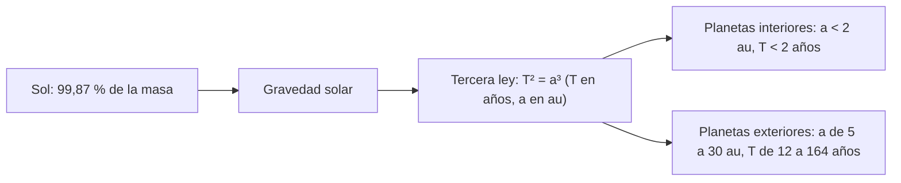

# B01-C13 — Sistema solar como sistema físico

<!-- nav:top -->
[🏠 Programa](../../../../README.md) · [📚 Bloque B01](../../../tronco-comun/B01-el-universo-y-el-pensamiento-cientifico.md) · [← Anterior: B01-C12 — Fases lunares y ciclos celestes](../B01-C12-fases-lunares-y-ciclos-celestes/CLASE.md) · [Siguiente: B01-C14 — Estrellas y sus principales propiedades →](../B01-C14-estrellas-y-sus-principales-propiedades/CLASE.md)
<!-- /nav -->

## 1. Ubicación, nivel y alcance

Decimotercera clase del bloque B01. Has visto cómo se mueven el Sol y la Luna (C11, C12); ahora miras todo el sistema solar a la vez como un sistema físico: componentes, escalas y la regla que ordena sus movimientos. Sigues en el nivel N1.

Verás las masas y distancias de los componentes, cómo construir un modelo a escala y cómo la tercera ley de Kepler resume los períodos de todos los planetas. No verás todavía la mecánica orbital completa ni la formación del sistema solar (bloques A03 y A04).

## 2. Por qué esta clase existe

Se dice que el sistema solar «está vacío», y es verdad en un sentido preciso: si el Sol midiera 9 mm, la Tierra sería un grano de 0,085 mm a un metro de distancia, y la estrella más cercana quedaría a más de 260 km. Pero esa imagen solo se entiende si la construyes tú con números. Y el sistema no es un montón de objetos sueltos: sus períodos obedecen una regla común.

La decisión central es: **¿cómo represento un sistema de escalas tan distintas de modo que mi modelo sea fiel y declare su límite?** Aprenderás a hacer un modelo a escala con tabla de datos, a contrastarlo con una regla física (Kepler) y a decir qué mantiene y qué distorsiona.

## 3. Lo que podrás hacer al terminar

1. Nombrar los componentes principales del sistema solar y comparar sus masas.
2. Construir un modelo a escala lineal con una unidad de referencia declarada.
3. Calcular `T²/a³` para un planeta y explicar qué significa que valga 1 en años y au.
4. Contrastar un período calculado con el publicado, con un caso de referencia independiente.
5. Decir qué conserva y qué distorsiona un modelo a escala.
6. Elaborar un **modelo a escala con tabla de datos**.

La evidencia es el modelo del ejercicio 12 (sección 20).

## 4. Con qué llegas y cómo comprobarlo

Necesitas C02 (escalas), C03 (planetas y objetos), C08 (au y conversiones), C12 (predicción periódica). Cinco preguntas:

1. ¿Cuántas au hay en 1 pc, aproximadamente?
2. ¿Cuántos planetas reconoce la IAU en el sistema solar?
3. ¿Qué es un período orbital?
4. Convierte 149,6 millones de km a au.
5. Si algo mide 12 756 km y la escala es 1 au = 1 m, ¿cuánto mide el modelo en mm?

<details>
<summary>Ver respuestas</summary>

1. Unas 206 265. 2. Ocho, más planetas enanos (C03). 3. El tiempo de una vuelta alrededor del Sol. 4. 1,000 au. 5. `12 756/1,496 × 10⁸ = 8,5 × 10⁻⁵ m = 0,085 mm`.
</details>

Con cuatro o cinco aciertos, sigue; con tres o menos, repasa C02, C03 y C08.

## 5. Un caso real: lo que dice la ficha de planetas

La ficha de planetas de NASA (actualizada el 18 de marzo de 2025) tabula masa, diámetro, densidad, período orbital, distancia al Sol, excentricidad y número de lunas para los ocho planetas y Plutón (S1). NASA indica además que el sistema solar tiene ocho planetas y cinco planetas enanos reconocidos, y que la definición de la IAU de 2006 llevó el conteo de nueve a ocho al reclasificar a Plutón (S2). La ficha del Sol da su masa en 1,9884 × 10³⁰ kg y su radio medio volumétrico en 695 700 km (S3).

Con esos datos puedes calcular, por ejemplo, que los ocho planetas suman `2 666,6 × 10²⁴ kg`, el 0,134 % de la masa del Sol, y que Júpiter aporta el 71 % de esa masa planetaria. Nuestro **ejemplo conductor** es un modelo a escala con **1 au = 1 m**, donde el Sol mide 9,30 mm. Límite: las cifras de la ficha tienen tres o cuatro cifras, y la distancia que tabula no se rotula como semieje mayor; eso importa en la sección 8.4.

## 6. Vocabulario

El **sistema solar** es el conjunto del Sol y los cuerpos ligados a él por la gravedad. El **semieje mayor** `a` es la mitad del eje largo de una órbita elíptica; si la órbita es casi circular, es casi su radio. El **período orbital** `T` es el tiempo de una vuelta. La **excentricidad** `e` mide cuánto se aparta la órbita de un círculo (0 es círculo). La **tercera ley de Kepler** dice que `T²` es proporcional a `a³` para todos los cuerpos que orbitan el mismo astro. Una **escala lineal** multiplica todas las longitudes por el mismo factor. La **escala de distancias** y la de **tamaños** pueden ser distintas en un modelo, pero entonces hay que declararlo. La **densidad** es masa por volumen. El **parámetro gravitacional** `GM` del Sol es el producto de la constante de gravitación por la masa solar; su valor nominal es `1,3271244 × 10²⁰ m³/s²` (S4).

## 7. Modelo mental: un sistema ordenado por el Sol

Imagina un gran sol en el centro con casi toda la masa, y planetas pequeños y livianos en órbitas casi circulares y casi en un mismo plano. El Sol manda por masa; los planetas se ordenan por distancia, y la distancia fija el período.



*Descripción textual:* el Sol concentra casi toda la masa; su gravedad genera una regla común, la tercera ley, que dice que `T²` es igual a `a³` en años y au; de ella salen los planetas interiores con períodos cortos y los exteriores con períodos largos.

Analogía: un tiovivo con caballos a distintas distancias del eje; los más lejanos tardan más. Límite: en un tiovivo todos giran con el mismo período; en el sistema solar cada cuerpo tiene el suyo, regulado por la gravedad y no por un eje rígido.

## 8. La explicación, paso a paso

### 8.1 Componentes y masas

El Sol tiene `1 988 400 × 10²⁴ kg` (S3). Los ocho planetas suman `0,330 + 4,87 + 5,97 + 0,642 + 1 898 + 568 + 86,8 + 102 = 2 666,6 × 10²⁴ kg` (S1), es decir, `2 666,6/1 988 400 = 0,134 %` de la masa solar. Eso significa que el Sol contiene el 99,87 % de la masa total de esos nueve cuerpos (los asteroides, cometas y demás se ignoran: el cálculo es una cota). Esa es la razón de que los planetas orbiten el Sol y no al revés.

### 8.2 Modelo a escala

Fija una escala: `1 au = 1 m`. Entonces un tamaño `L` en km se vuelve `L/149 597 870,7` m. El Sol (`D = 2 × 695 700 = 1 391 400 km`) pasa a `9,30 mm`; la Tierra (`12 756 km`), a `0,085 mm`; Júpiter (`142 984 km`), a `0,956 mm`; y las distancias: Mercurio `0,39 m`, Tierra `1,00 m`, Júpiter `5,20 m`, Neptuno `30,2 m`. La distancia a la estrella más cercana de C01 (1,30119 pc, valor de C01 sin reconsultar) sería `1,30119 × 206 265 = 2,68 × 10⁵ au`: 268 km en el mismo modelo.

### 8.3 Tercera ley de Kepler

Si `T` está en años y `a` en au, para cada planeta `T²/a³ ≈ 1`. Con la ficha: Tierra, `T = 365,2/365,25 = 0,9999 año` y `a = 1,000 au` dan `0,9997`; Júpiter, `T = 4 331/365,25 = 11,86 años` y `a = 5,204 au` dan `0,998`. La regla vale porque los planetas son livianos frente al Sol y las órbitas casi circulares; para otro astro central cambia la constante.

### 8.4 Una referencia independiente

Para una órbita circular de radio `a` alrededor de una masa con parámetro `GM`, `T = 2π√(a³/GM)`. Con `a = 1 au = 1,495979 × 10¹¹ m` y `GM = 1,3271244 × 10²⁰ m³/s²` (S4), resulta `T = 3,1558 × 10⁷ s = 365,26 d`, que coincide con los 365,256 d de la ficha de la Tierra (S5) dentro de 0,001 %. No es un círculo exacto, y la coincidencia sirve como comprobación independiente del cálculo de Kepler. Ahora, un resultado honesto: con la fila «distancia al Sol» de la ficha, Neptuno da `T²/a³ = 0,975`, un 2,5 % de desvío, mayor que en los otros planetas. La ficha no rotula esa fila como semieje mayor, así que no sabemos si es el mismo número; el ejemplo enseña a **comprobar qué magnitud mide una tabla** antes de usarla.

### 8.5 Qué distorsiona un modelo a escala

Un modelo lineal conserva proporciones, pero no se puede dibujar en papel: los planetas son granos. Por eso los dibujos escolares **cambian** la escala de tamaños y la de distancias, y deben decirlo. Un modelo de distancias a escala con planetas «agrandados» es honesto si lo declara; uno que no lo declara engaña. La regla: **un modelo declara qué conserva y qué distorsiona** (C17).

## 9. Magnitudes, símbolos y unidades

| Símbolo | Qué es | Unidad | Valor o nota |
|---|---|---|---|
| `M_⊙` | masa del Sol | 10²⁴ kg | 1 988 400 (S3) |
| `a` | distancia al Sol / semieje | 10⁶ km, au | Tierra 149,6 (S1); 1 au = 149 597 870 700 m (exacto) |
| `T` | período orbital | d, años | Tierra 365,2 (S1) |
| `T²/a³` | razón de Kepler | años²/au³ | ≈ 1 |
| `GM_⊙` | parámetro gravitacional nominal | m³/s² | 1,3271244 × 10²⁰ (S4) |
| `R_⊙` | radio solar | km | 695 700 (S3) |
| `e` | excentricidad | adimensional | 0,017 (Tierra, S1) |

## 10. Convenciones y referencias

La conversión usa `1 au = 149 597 870 700 m` (C08). Los períodos de la ficha son sidéreos en días; el año juliano (365,25 d) es la unidad de tiempo. Los datos de la ficha son **observados y publicados**; los de escala y `T²/a³`, **calculados**; `GM` es un valor **nominal** convenido por la IAU. El modelo 1 au = 1 m es **sintético** (una escala de ejemplo).

## 11. De dónde sale lo que afirmamos

| ID | Fuente | Localizador | Respalda | Estado |
|---|---|---|---|---|
| S1 | NASA NSSDC, *Planetary Fact Sheet – Metric* (actualizada el 18-mar-2025) | https://nssdc.gsfc.nasa.gov/planetary/factsheet/ | Masas, diámetros, períodos y distancias al Sol de los planetas, excentricidades, lunas | Página consultada el 2026-11-05 |
| S2 | NASA Science, «Planets» | https://science.nasa.gov/solar-system/planets/ | Ocho planetas y cinco planetas enanos reconocidos; la IAU 2006 redujo el conteo de nueve a ocho | Página consultada el 2026-11-05 (resumen) |
| S3 | NASA NSSDC, *Sun Fact Sheet* (actualizada el 9-may-2024) | https://nssdc.gsfc.nasa.gov/planetary/factsheet/sunfact.html | Masa 1 988 400 × 10²⁴ kg; radio medio volumétrico 695 700 km | Página consultada el 2026-11-05 |
| S4 | Mamajek, E. E. et al., *IAU 2015 Resolution B3*, arXiv:1510.07674 | https://arxiv.org/abs/1510.07674 | `(GM)_⊙ nominal = 1,3271244 × 10²⁰ m³ s⁻²`; `R_⊙ nominal = 6,957 × 10⁸ m`; 1 au = 149 597 870 700 m | Texto del PDF leído el 2026-11-05 |
| S5 | NASA NSSDC, *Earth Fact Sheet* (actualizada el 15-nov-2024) | https://nssdc.gsfc.nasa.gov/planetary/factsheet/earthfact.html | Período sidéreo 365,256 d | Página consultada el 2026-11-05 |

Límites: la fila «distancia al Sol» de S1 no se rotula como semieje mayor; la distancia a la estrella más cercana se toma de C01 sin reconsultar; no se consultaron fuentes sobre asteroides ni cometas.

## 12. Cómo ver el modelo

Versión accesible del diagrama (escala 1 au = 1 m):

| Cuerpo | Distancia al Sol | Diámetro en el modelo |
|---|---|---|
| Sol | 0 | 9,30 mm |
| Mercurio | 0,39 m | 0,033 mm |
| Venus | 0,72 m | 0,081 mm |
| Tierra | 1,00 m | 0,085 mm |
| Marte | 1,52 m | 0,045 mm |
| Júpiter | 5,20 m | 0,956 mm |
| Saturno | 9,57 m | 0,806 mm |
| Urano | 19,16 m | 0,342 mm |
| Neptuno | 30,18 m | 0,331 mm |

Descripción larga: ocho puntos a distancias crecientes del Sol, más de 30 m en total; el mayor planeta mide menos de 1 mm. Si lo dibujas, usa una escala logarítmica en las distancias y dilo en el eje.

## 13. Ejemplo trabajado: Júpiter en el modelo y en Kepler

**Paso 1 · Datos (S1).** Júpiter: `a = 778,5 × 10⁶ km`, `T = 4 331 d`, `D = 142 984 km`.

**Paso 2 · Distancia en el modelo.** `778,5 × 10⁶/149 597 870,7 = 5,204 au → 5,204 m`.

**Paso 3 · Tamaño en el modelo.** `142 984/149 597 870,7 = 9,56 × 10⁻⁴ m = 0,956 mm`.

**Paso 4 · Kepler.** `T = 4 331/365,25 = 11,858 años`; `T² = 140,6`; `a³ = 140,9`; `T²/a³ = 0,998`.

**Paso 5 · Comparación con la referencia.** Con `GM` nominal, `T = 2π√(a³/GM)` con `a = 778,5 × 10⁹ m` da `3,75 × 10⁸ s = 4 335 d`, a 0,1 % de los 4 331 d de la ficha.

**Paso 6 · Lectura.** El sistema se comporta como un sistema físico: una regla simple, deducida de la gravedad, explica los períodos de todos los planetas.

**Sentido físico.** Con un metro de cuerda y una regla ves que el Sol es un grano y los planetas, polvo; la tercera ley te dice que ese polvo está ordenado.

## 14. Distintas formas de representar el sistema

**Modelo a escala lineal:** fiel, pero poco visible. **Modelo con tamaños agrandados:** visible, pero distorsiona. **Tabla de datos:** precisa, pero abstracta. **Simulación:** muestra el movimiento, pero depende de supuestos (C17). Usa la tabla para el rigor, el modelo para la intuición y declara siempre la escala.

## 15. Práctica guiada

**Ejercicio 1 · con los pasos indicados.** Calcula la distancia de Marte (228,0 × 10⁶ km) en au y en metros del modelo 1 au = 1 m. *Pasos:* sección 8.2.

<details><summary>Solución comentada</summary>

`228,0 × 10⁶/149 597 870,7 = 1,524 au` → 1,524 m. Si te salió 1,5239 × 10⁻³, olvidaste que los 10⁶ km del dato multiplican.
</details>

**Ejercicio 2 · con una pista.** ¿Qué razón `T²/a³` da la Tierra? *Pista:* `T = 365,2/365,25`, `a = 1,000`.

<details><summary>Solución comentada</summary>

`T = 0,99986`; `T² = 0,99973`; `a³ = 1,000`; razón `0,9997`.
</details>

**Ejercicio 3 · casi autónomo.** Calcula `T²/a³` para Mercurio (57,9 × 10⁶ km; 88,0 d).

<details><summary>Solución comentada</summary>

`a = 0,3870 au`, `a³ = 0,05797`; `T = 0,2409 años`, `T² = 0,05805`; razón `1,001`.
</details>

## 16. Práctica autónoma, transferencia e integrador

**Ejercicio 4.** ¿Qué porcentaje de la masa planetaria aporta Júpiter?

<details><summary>Solución comentada</summary>

`1 898/2 666,6 = 71,2 %`. Casi tres cuartas partes; si sumas Saturno, el 92,5 %.
</details>

**Ejercicio 5.** Calcula `T²/a³` para Saturno (1 432,0 × 10⁶ km; 10 747 d). ¿Qué desvío tiene respecto de 1?

<details><summary>Solución comentada</summary>

`a = 9,572 au`, `a³ = 877,0`; `T = 29,42 años`, `T² = 865,7`; razón `0,987`: desvío del 1,3 %, atribuible a la precisión de la tabla.
</details>

**Ejercicio 6.** Calcula `T²/a³` para Neptuno (4 515 × 10⁶ km; 59 800 d). ¿Qué conclusión sacas?

<details><summary>Solución comentada</summary>

`a = 30,18 au`, `a³ = 27 490`; `T = 163,7 años`, `T² = 26 810`; razón `0,975`. El desvío (2,5 %) es mayor que en los demás; la fila de la ficha no se rotula como semieje mayor, por lo que antes de afirmar que Kepler falla hay que averiguar qué tabula esa fila (sección 8.4).
</details>

**Ejercicio 7.** ¿Qué período predice Kepler para un cuerpo a 4 au del Sol?

<details><summary>Solución comentada</summary>

`T² = 4³ = 64`; `T = 8,0 años`. Sirve para estimar, con la salvedad de que es una regla.
</details>

**Ejercicio 8.** ¿A qué distancia del Sol, en el modelo 1 au = 1 m, quedaría Neptuno? ¿Y a qué escala de tamaño tendría que dibujarse para verse a 1 mm?

<details><summary>Solución comentada</summary>

A 30,18 m. Para verse a 1 mm, `0,331 mm` pasa a 1 mm: factor 3,0 (agrandado), declarando que la escala de tamaños cambia.
</details>

**Ejercicio 9 · transferencia.** Un dibujo escolar muestra la Tierra a 10 cm del Sol, con un Sol de 5 cm. ¿Qué distorsiona?

<details><summary>Solución comentada</summary>

Con 10 cm = 1 au, la escala es 0,1 m por au y el Sol real mediría `9,30 mm × 0,1 = 0,93 mm`. Un Sol de 5 cm está agrandado unas 54 veces (`50/0,93`). El dibujo respeta las distancias pero distorsiona los tamaños, y debe decirlo.
</details>

**Ejercicio 10 · transferencia.** El período de un exoplaneta que orbita una estrella de masa solar a 0,05 au, según la tercera ley en años y au, ¿qué da? ¿Qué supuesto haces?

<details><summary>Solución comentada</summary>

`T² = 0,05³ = 1,25 × 10⁻⁴`; `T = 0,0112 años = 4,1 días`. Supone masa estelar solar y masa planetaria despreciable; para otra estrella cambia la constante.
</details>

**Ejercicio 11 · transferencia.** ¿Por qué `T²/a³ = 1` no vale para las lunas de Júpiter?

<details><summary>Solución comentada</summary>

Porque la constante depende de la masa del astro central; para Júpiter es distinta de la del Sol. La forma `T² ∝ a³` se conserva, pero la constante cambia: es la forma general `T² = 4π²a³/GM`.
</details>

**Ejercicio 12 · integrador.** Elabora tu **modelo a escala con tabla de datos**: elige una escala lineal (declarada), construye la tabla de distancia y diámetro de los ocho planetas con fuente y fecha, añade `T²/a³` para cada uno, contrasta con la referencia `2π√(a³/GM)` para al menos dos, y declara qué conserva y qué distorsiona tu modelo.

<details><summary>Solución modelo</summary>

La tabla sigue la sección 12 con cifras de la ficha, la columna `T²/a³`, una comprobación independiente y un párrafo de límites (escala, tablas con 3–4 cifras, magnitud tabulada). Se acepta cualquier escala si se declara.
</details>

## 17. Laboratorio: sistema solar a escala y Kepler en 70 líneas

El script [modelo_a_escala_y_kepler.py](modelo_a_escala_y_kepler.py) escala distancias y diámetros a 1 au = 1 m, calcula `T²/a³` para los ocho planetas y la fracción de masa planetaria. Antes comprueba que `T²/a³` esté a menos del 3 % de 1 para todos, que el período circular a 1 au con `GM` nominal coincida con 365,256 d dentro de 0,1 % y que la masa planetaria sea el 0,134 % de la solar; si no, se detiene.

**Datos:** publicados (S1, S3, S5; `GM` de S4). **Predice antes:** ¿cuál será el planeta con peor `T²/a³`? (Neptuno.) **Resultados (2026-11-05, Python 3.12.9, Windows):** Sol 9,30 mm; razones `T²/a³`: Mercurio 1,0012, Venus 1,0003, Tierra 0,9997, Marte 0,9993, Júpiter 0,9977, Saturno 0,9871, Urano 0,9964, Neptuno 0,9750; período circular a 1 au 365,26 d; masa planetaria 2 666,6 × 10²⁴ kg = 0,134 % de la solar, con Júpiter 71,2 % de los planetas.

```bash
python programa/clases/B01/B01-C13-sistema-solar-como-sistema-fisico/modelo_a_escala_y_kepler.py
```

**Límites:** órbitas circulares; cifras de 3–4 cifras; no incluye asteroides ni cometas; no valida la magnitud tabulada como semieje.

## 18. Errores frecuentes y cómo corregirlos

**Mezclar la escala de tamaños con la de distancias.** Ejercicio 9.

**Aplicar `T² = a³` con unidades que no son años y au.** Ejercicios 2 y 11.

**Confiar en una tabla sin saber qué magnitud tabula.** Ejercicio 6.

**Olvidar que el Sol domina la masa.** Ejercicio 4.

**Pensar que un modelo a escala es una foto.** Sección 8.5.

## 19. Cómo sabrás que vas bien

Tras 8.2: ¿cuánto mide la Tierra en el modelo? Si no lo recuerdas, ejercicio 1. Tras 8.3: ¿qué vale `T²/a³` en años y au? Si no, ejercicio 2. Tras 8.4: ¿por qué Neptuno se aparta más? Si dudas, ejercicio 6. Al final: ¿qué distorsiona tu modelo? Si no lo sabes, relee 8.5.

## 20. Qué entregas y cómo se evalúa

El producto es tu **modelo a escala con tabla de datos**.

| Criterio | Inicial | En desarrollo | Logrado | Destacado |
|---|---|---|---|---|
| Escala | Sin declarar | Declarada, con errores | Declarada y consistente | Declara qué distorsiona |
| Tabla | Sin fuente | Fuente sin fecha | Fuente con fecha | Con magnitud tabulada comprobada |
| Kepler | No calcula | Calcula uno | Calcula todos | Contrasta con referencia independiente |
| Unidades | Faltan | Algunas | Todas | Verificadas dimensionalmente |
| Honestidad | Mezcla datos | Rotula parte | Rotula todo | Declara límites de las cifras |

**Condiciones críticas:** declarar la escala; no presentar un modelo distorsionado como a escala; citar solo lo consultado.

## 21. Ética, seguridad y límites

Un modelo a escala mal rotulado enseña ideas falsas; declarar qué distorsiona es honestidad. Clase educativa: no sirve para navegación. Accesibilidad: ecuaciones en texto, diagrama descrito, tablas equivalentes, sin conexión; el modelo puede construirse con cuerda y cuentas, y quien no ve puede recorrerlo con el tacto.

## 22. Para cerrar y seguir

El sistema solar es casi todo Sol, con planetas livianos ordenados por una regla común, `T² ∝ a³`. Un modelo a escala es útil mientras diga qué conserva y qué distorsiona. Ahora pasamos de nuestra estrella a las demás: qué propiedades tienen y cómo se relacionan (C14).

**Glosario español–inglés.** semieje mayor · *semi-major axis*; período orbital · *orbital period*; excentricidad · *eccentricity*; tercera ley de Kepler · *Kepler's third law*; escala lineal · *linear scale*; parámetro gravitacional · *gravitational parameter*.

**Continuidad.** B01-C14 usa tu capacidad de **contrastar una regla con datos publicados e identificar qué magnitud tabula una fuente** para comparar estrellas. B01-C17 retomará «qué conserva y qué distorsiona» como definición de modelo.

**Referencias:** ver sección 11. S1 a S5 son fuentes oficiales; S2 es una página de divulgación.

<!-- nav:bottom -->
---

[← Anterior: B01-C12 — Fases lunares y ciclos celestes](../B01-C12-fases-lunares-y-ciclos-celestes/CLASE.md) · [📚 Bloque B01](../../../tronco-comun/B01-el-universo-y-el-pensamiento-cientifico.md) · [Siguiente: B01-C14 — Estrellas y sus principales propiedades →](../B01-C14-estrellas-y-sus-principales-propiedades/CLASE.md)
<!-- /nav -->
