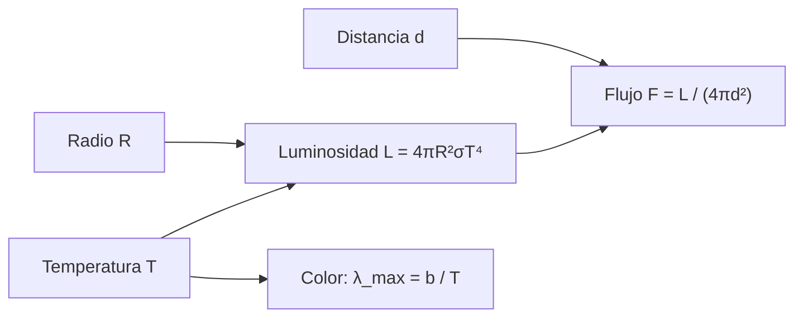

# B01-C14 — Estrellas y sus principales propiedades

<!-- nav:top -->
[🏠 Programa](../../../../README.md) · [📚 Bloque B01](../../../tronco-comun/B01-el-universo-y-el-pensamiento-cientifico.md) · [← Anterior: B01-C13 — Sistema solar como sistema físico](../B01-C13-sistema-solar-como-sistema-fisico/CLASE.md) · [Siguiente: B01-C15 — Galaxias y agrupaciones cósmicas →](../B01-C15-galaxias-y-agrupaciones-cosmicas/CLASE.md)
<!-- /nav -->

## 1. Ubicación, nivel y alcance

Decimocuarta clase del bloque B01. Conoces el Sol como estrella (C03) y sabes leer la luz (C09). Ahora comparas varias estrellas con datos publicados y relacionas cuatro propiedades: temperatura, tamaño, luminosidad y distancia. Sigues en el nivel N1.

Verás cómo una temperatura y un radio fijan la luminosidad con la ley de Stefan–Boltzmann, cómo el brillo aparente depende de la distancia y por qué «brillante en el cielo» no significa «intrínsecamente luminosa». No verás la evolución estelar ni diagramas H–R completos (bloque A07).

## 2. Por qué esta clase existe

Dos estrellas pueden verse igual de brillantes y ser totalmente distintas: una pequeña y cercana, otra enorme y lejana (C09). Para saber cómo es una estrella necesitas separar lo que ves (flujo) de lo que ella es (luminosidad, temperatura, radio) y de dónde está (distancia).

La decisión central es: **¿qué propiedad de una estrella puedo deducir de qué dato, y con qué relación?** Aprenderás a calcular luminosidades, a comparar estrellas con datos de una base publicada y a comprobar que esos datos son coherentes entre sí.

## 3. Lo que podrás hacer al terminar

1. Definir temperatura efectiva, radio, luminosidad y distancia de una estrella.
2. Aplicar `L = 4πR²σT⁴` y su forma relativa al Sol.
3. Pasar de luminosidad y distancia a flujo con la ley del cuadrado inverso.
4. Estimar el color dominante con la ley de Wien (C09).
5. Detectar si los datos de una tabla son coherentes entre sí.
6. Elaborar una **comparación de estrellas con datos publicados**.

La evidencia es la comparación del ejercicio 12 (sección 20).

## 4. Con qué llegas y cómo comprobarlo

Necesitas C08 (unidades), C09 (Wien, flujo) y C13 (datos del Sol). Cinco preguntas:

1. ¿Cuánto vale la temperatura efectiva del Sol?
2. ¿Qué dice la ley de Wien?
3. ¿Cuántos años luz tiene 1 pc, aproximadamente?
4. ¿Qué pasa con el flujo si duplicas la distancia?
5. ¿Qué significa «logaritmo en base 10 de 100»?

<details>
<summary>Ver respuestas</summary>

1. 5 772 K. 2. `λ_max·T = b`: a más temperatura, el máximo está a menor longitud de onda. 3. 3,26 ly. 4. Cae a la cuarta parte (cuadrado inverso). 5. 2.
</details>

Con cuatro o cinco aciertos, sigue; con tres o menos, repasa C08 y C09.

## 5. Un caso real: cinco estrellas anfitrionas

El NASA Exoplanet Archive publica, para estrellas que tienen planetas conocidos, su temperatura efectiva, radio, masa, luminosidad y distancia (S1). Consultamos cinco: TRAPPIST-1 (2 566 K, 0,1192 R⊙, 12,43 pc), Proxima Cen (2 900 K, 0,141 R⊙, 1,30119 pc), tau Cet (5 310 K, 0,83 R⊙, 3,603 pc), Kepler-452 (5 757 K, 1,11 R⊙, 551,7 pc) y HD 209458 (6 091 K, 1,19 R⊙, 48,30 pc). Del Sol usamos los valores nominales de la IAU: 5 772 K, `6,957 × 10⁸ m` y `3,828 × 10²⁶ W` (S2).

Nuestro **ejemplo conductor** es la pregunta: *¿cuánto más luminosa que Proxima Cen es tau Cet, y se puede saber solo con temperatura y radio?* Límite: el archivo es mutable y la consulta es del 2026-11-05; los valores pueden cambiar con nuevas mediciones.

## 6. Vocabulario

La **temperatura efectiva** `T_eff` es la temperatura de un cuerpo negro que emitiría la misma energía por unidad de superficie que la estrella. La **luminosidad** `L` es la energía total que emite por segundo (W). El **radio** `R` es el de la superficie visible. La **constante de Stefan–Boltzmann** `σ` liga la energía emitida por unidad de superficie con `T⁴`. El **flujo** `F` es la energía recibida por unidad de área y tiempo (W/m²) y cae con el cuadrado de la distancia. La **magnitud** es una escala logarítmica de brillo (C10). El **logaritmo decimal de la luminosidad** (`log L`) expresa `L` en potencias de diez respecto del Sol. Una **estrella enana roja** es fría y pequeña; una **estrella tipo solar**, de unos 5 000 a 6 000 K. La **secuencia principal** es la etapa en que una estrella fusiona hidrógeno en su núcleo (S3, ver C03). Un **dex** es una diferencia de un factor 10 en una escala logarítmica.

## 7. Modelo mental: cuatro propiedades, tres relaciones

Piensa en un triángulo con vértices temperatura, radio y luminosidad: dos de ellos fijan el tercero por Stefan–Boltzmann. Aparte, la luminosidad y la distancia fijan el flujo por el cuadrado inverso; y la temperatura fija el color por Wien.



*Descripción textual:* temperatura y radio determinan la luminosidad; luminosidad y distancia determinan el flujo recibido; la temperatura determina el color por la ley de Wien.

Analogía: una lámpara; potencia (luminosidad), tamaño de la bombilla (radio) y brillo de la superficie (temperatura) se relacionan; lo que ves depende además de a qué distancia estés. Límite: una bombilla tiene un filamento, una estrella una atmósfera con líneas; el cuerpo negro es una aproximación.

## 8. La explicación, paso a paso

### 8.1 Stefan–Boltzmann

Un cuerpo negro de temperatura `T` emite por unidad de superficie `σT⁴`; con superficie `4πR²`, `L = 4πR²σT⁴`. La constante se puede **derivar** de las constantes SI exactas: `σ = 2π⁵k⁴/(15c²h³) = 5,670374 × 10⁻⁸ W m⁻² K⁻⁴`, que coincide con el valor CODATA 2014 que cita la IAU (`5,670367 × 10⁻⁸`, S2) dentro de 1,2 × 10⁻⁶. Para el Sol (`R = 6,957 × 10⁸ m`, `T = 5 772 K`), `L = 3,8280 × 10²⁶ W`, que coincide con el valor nominal de la IAU (S2).

### 8.2 Forma relativa

Dividiendo por los valores del Sol: `L/L⊙ = (R/R⊙)²(T/5 772 K)⁴`. Para tau Cet (`R = 0,83`, `T = 5 310`): `0,83² × (5 310/5 772)⁴ = 0,6889 × 0,7162 = 0,493`: la mitad de luminosa que el Sol. En logaritmo, `−0,307`; la tabla publica `−0,305`: coincide dentro de 0,002 dex. Observa lo que pasa con la temperatura: al estar a la cuarta potencia, una estrella 10 % más fría emite un 34 % menos por unidad de superficie.

### 8.3 Flujo y distancia

`F = L/(4πd²)`. Para el Sol a 1 au: `3,828 × 10²⁶/(4π(1,496 × 10¹¹)²) = 1 361 W/m²`, que coincide con la irradiancia solar total nominal de la IAU (S2). La ley del cuadrado inverso explica que duplicar `d` divida `F` por 4. Si dos estrellas dan el mismo flujo, la más lejana debe ser más luminosa en la razón de los cuadrados de las distancias.

### 8.4 Coherencia de una tabla

Calculamos `log L` de cada estrella con `R` y `T` y comparamos con el `log L` publicado: TRAPPIST-1, `−3,256` frente a `−3,257`; Proxima Cen, `−2,897` frente a `−2,821`; tau Cet, `−0,307` frente a `−0,305`; Kepler-452, `0,086` frente a `0,084`; HD 209458, `0,245` frente a `0,231`. Cuatro coinciden a 0,015 dex; Proxima Cen se desvía 0,076 dex (19 %). No decidimos cuál es la correcta: la tabla compila valores de distintos estudios y puede mezclar métodos. Lo que sí hacemos es **marcar** la incoherencia y no usar ese valor sin verificar su origen.

### 8.5 Color y distancia en años luz

Con `λ_max = b/T` (C09): TRAPPIST-1 ≈ 1 129 nm (infrarrojo), Proxima Cen ≈ 999 nm, tau Cet ≈ 546 nm (verde), Kepler-452 ≈ 503 nm, HD 209458 ≈ 476 nm. Las estrellas frías emiten sobre todo en el infrarrojo, aunque se vean rojizas. Las distancias en años luz, `d(pc) × 3,26`: Proxima Cen 4,24; tau Cet 11,75; TRAPPIST-1 40,5; HD 209458 157,5; Kepler-452 1 799. El brillo aparente no te dice cuál es cuál sin distancia.

## 9. Magnitudes, símbolos y unidades

| Símbolo | Qué es | Unidad | Valor o nota |
|---|---|---|---|
| `T` | temperatura efectiva | K | Sol 5 772 (S2) |
| `R` | radio | m, `R⊙` | Sol `6,957 × 10⁸ m` (S2) |
| `L` | luminosidad | W, `L⊙` | Sol `3,828 × 10²⁶ W` (S2) |
| `σ` | constante de Stefan–Boltzmann | W m⁻² K⁻⁴ | 5,670374 × 10⁻⁸ (derivada) |
| `F` | flujo | W/m² | `L/(4πd²)` |
| `d` | distancia | pc, ly | 1 pc = 3,2616 ly |
| `log L` | logaritmo decimal de `L/L⊙` | dex | tabla S1 |

## 10. Convenciones y referencias

Las cifras de las estrellas son **publicadas** (archivo mutable; consulta del 2026-11-05). Los valores del Sol son **nominales** (convenidos por la IAU). Las luminosidades calculadas, las razones y los colores son **derivados**. Tratamos como supuesto que `log L` del archivo es el logaritmo decimal de `L/L⊙`; el archivo no lo documentó en la consulta, y lo **verificamos** comprobando que sus valores coinciden con `R²T⁴` para cuatro de las cinco estrellas. El coeficiente 4,9651 de Wien es la raíz de `x = 5(1 − e⁻ˣ)` (C09).

## 11. De dónde sale lo que afirmamos

| ID | Fuente | Localizador | Respalda | Estado |
|---|---|---|---|---|
| S1 | NASA Exoplanet Archive, tabla `pscomppars` (consulta TAP: TRAPPIST-1, Proxima Cen, tau Cet, Kepler-452, HD 209458) | https://exoplanetarchive.ipac.caltech.edu/TAP | `T_eff`, `R`, masa, `log L` y distancia de cinco estrellas (ver sección 5) | Consulta del 2026-11-05; archivo mutable; las unidades de las columnas se verificaron por coherencia, no por documentación |
| S2 | Mamajek, E. E. et al., *IAU 2015 Resolution B3*, arXiv:1510.07674 | https://arxiv.org/abs/1510.07674 | `R⊙ = 6,957 × 10⁸ m`, `L⊙ = 3,828 × 10²⁶ W`, `T_eff,⊙ = 5 772 K`, `S⊙ = 1 361 W/m²` nominales; `σ = 5,670367 × 10⁻⁸` (CODATA 2014) | Texto del PDF leído el 2026-11-05 |
| S3 | NASA Science, «Stars» (C03) | https://science.nasa.gov/universe/stars/ | Fusión de hidrógeno en el núcleo (secuencia principal) | Fuente de C03, no reconsultada aquí |
| S4 | BIPM, *The International System of Units (SI)*, 9.ª ed. (2019) | https://www.bipm.org/documents/20126/41483022/SI-Brochure-9.pdf | `h`, `c`, `k` exactos | PDF leído el 2026-11-05 |

Límites: S3 se cita de C03; la tabla S1 compila estudios distintos; no consultamos los artículos originales de cada estrella.

## 12. Cómo ver la comparación

Versión accesible del diagrama:

| Estrella | `T` (K) | `R` (`R⊙`) | `log L` calculado | `log L` publicado | Distancia (ly) |
|---|---|---|---|---|---|
| TRAPPIST-1 | 2 566 | 0,119 | −3,256 | −3,257 | 40,5 |
| Proxima Cen | 2 900 | 0,141 | −2,897 | −2,821 | 4,24 |
| tau Cet | 5 310 | 0,830 | −0,307 | −0,305 | 11,75 |
| Kepler-452 | 5 757 | 1,110 | 0,086 | 0,084 | 1 799 |
| HD 209458 | 6 091 | 1,190 | 0,245 | 0,231 | 157,5 |

Descripción larga: las estrellas están ordenadas por temperatura; las frías son mucho menos luminosas porque son más pequeñas y más frías; las de tipo solar rondan 1 `L⊙`. Si dibujas `log L` frente a `T`, invierte el eje de `T` (convención de la astronomía) y rotula.

## 13. Ejemplo trabajado: tau Cet frente a Proxima Cen

**Paso 1 · Datos (S1).** tau Cet: `T = 5 310 K`, `R = 0,83 R⊙`, `d = 3,603 pc`. Proxima Cen: `T = 2 900 K`, `R = 0,141 R⊙`, `d = 1,30119 pc`.

**Paso 2 · Luminosidades relativas.** tau Cet: `0,83² × (5 310/5 772)⁴ = 0,493 L⊙`. Proxima Cen: `0,141² × (2 900/5 772)⁴ = 1,27 × 10⁻³ L⊙`.

**Paso 3 · Razón.** `0,493/1,27 × 10⁻³ = 389`: tau Cet es unas 390 veces más luminosa.

**Paso 4 · Flujos relativos.** `F ∝ L/d²`: tau Cet, `0,493/3,603² = 0,0380`; Proxima Cen, `1,27 × 10⁻³/1,30119² = 7,5 × 10⁻⁴`. Razón de flujos: `50,7`. Visto desde la Tierra, tau Cet ofrece unas 51 veces más flujo, no 390: la distancia compensa en parte.

**Paso 5 · Coherencia.** Con la luminosidad publicada de Proxima Cen (`log L = −2,821`, es decir `1,51 × 10⁻³`), la razón sería `326`; la diferencia entre 389 y 326 es el resultado de esa incoherencia de la tabla (sección 8.4).

**Paso 6 · Incertidumbre.** Declaramos 2 cifras significativas: «unas 400 (330 a 390 según qué `L` se use)».

**Sentido físico.** Temperatura y radio explican la luminosidad; la distancia explica el flujo. Una enana roja cercana puede verse tan o más brillante que una estrella mucho más luminosa y lejana.

## 14. Distintas formas de obtener una propiedad

**Por Stefan–Boltzmann** (de `T` y `R`): directa, requiere medir el radio. **Por flujo y distancia** (de `F` y `d`): requiere la distancia. **Por comparación con otras estrellas de tipo parecido:** rápida, pero menos precisa. Se combinan para detectar incoherencias, como la de Proxima Cen en nuestra tabla.

## 15. Práctica guiada

**Ejercicio 1 · con los pasos indicados.** Calcula `L/L⊙` de una estrella con `R = 1,11 R⊙` y `T = 5 757 K`. *Pasos:* sección 8.2.

<details><summary>Solución comentada</summary>

`1,11² × (5 757/5 772)⁴ = 1,2321 × 0,9897 = 1,219`; `log = 0,086`. Es una estrella de tipo solar algo mayor.
</details>

**Ejercicio 2 · con una pista.** ¿Qué flujo recibe un planeta a 0,05 au de una estrella de `L = 1 L⊙`? *Pista:* `F = L/(4πd²)`, `1 L⊙ ↔ 1 361 W/m² a 1 au`.

<details><summary>Solución comentada</summary>

`F = 1 361/0,05² = 5,44 × 10⁵ W/m²`: unas 400 veces el valor a 1 au (`1/0,05² = 400`).
</details>

**Ejercicio 3 · casi autónomo.** ¿Cuánto cambia `L` si `T` sube 10 % con `R` constante?

<details><summary>Solución comentada</summary>

`1,1⁴ = 1,464`: sube un 46 %.
</details>

## 16. Práctica autónoma, transferencia e integrador

**Ejercicio 4.** Calcula `L/L⊙` de TRAPPIST-1 (`R = 0,1192`, `T = 2 566`).

<details><summary>Solución comentada</summary>

`0,1192² × (2 566/5 772)⁴ = 0,014209 × 0,03906 = 5,55 × 10⁻⁴`; `log = −3,256`, igual al publicado.
</details>

**Ejercicio 5.** Calcula `λ_max` de tau Cet con `b = 2,8978 × 10⁻³ m·K`.

<details><summary>Solución comentada</summary>

`2,8978 × 10⁻³/5 310 = 5,457 × 10⁻⁷ m = 546 nm`: verde.
</details>

**Ejercicio 6.** ¿A cuántos años luz está HD 209458 si `d = 48,30 pc`?

<details><summary>Solución comentada</summary>

`48,30 × 3,2616 = 157,5 ly`.
</details>

**Ejercicio 7.** Con luminosidades del Sol y de Proxima Cen (`1,27 × 10⁻³ L⊙`), calcula a qué distancia del Sol vería un observador el mismo flujo que recibimos nosotros del Sol a 1 au si se acercara a Proxima Cen. Interpreta.

<details><summary>Solución comentada</summary>

`F ∝ L/d²`, igual a `1` cuando `d² = 1,27 × 10⁻³`, `d = 0,0356 au` ≈ 5,3 millones de km: un planeta tan cerca de Proxima Cen recibiría el flujo que la Tierra recibe del Sol. Es una estimación con la `L` calculada; con la publicada, `0,039 au`.
</details>

**Ejercicio 8.** ¿Por qué Proxima Cen es la más cercana pero no la más brillante en el cielo? Usa los datos.

<details><summary>Solución comentada</summary>

Su `L ≈ 1,3 × 10⁻³ L⊙`: muy poco luminosa. Aunque está a 1,30 pc, su flujo es `7,5 × 10⁻⁴` frente a `0,038` de tau Cet (unidades relativas): unas 50 veces menor.
</details>

**Ejercicio 9 · transferencia.** Una estrella tiene el doble del radio y la misma temperatura que otra. ¿Cuántas veces más luminosa es?

<details><summary>Solución comentada</summary>

`L ∝ R²`: cuatro veces. Si además fuera la mitad de temperatura, `4 × (1/2)⁴ = 0,25`: la cuarta parte.
</details>

**Ejercicio 10 · transferencia.** Un estudiante dice «Kepler-452 es una estrella casi igual al Sol». Evalúa con datos.

<details><summary>Solución comentada</summary>

`T = 5 757 K` (−15 K), `R = 1,11 R⊙`, `L ≈ 1,22 L⊙`: parecida, algo mayor y más luminosa. Está a 1 799 ly, lo que dificulta medirla: sus valores tienen más incertidumbre (la tabla no la da en lo que consultamos).
</details>

**Ejercicio 11 · transferencia.** Un titular dice: «la estrella X es mucho más brillante que Y, luego está más cerca». Explica por qué no se sigue.

<details><summary>Solución comentada</summary>

Brillo y distancia están mezclados (C09): X puede ser más luminosa y estar más lejos. Hace falta la luminosidad o la distancia independiente.
</details>

**Ejercicio 12 · integrador.** Elabora tu **comparación de estrellas con datos publicados**: elige tres estrellas con datos de una base citada con fecha, calcula `L` por Stefan–Boltzmann, compara con el valor publicado, calcula el flujo relativo y el color, marca incoherencias y rotula qué es publicado, derivado o supuesto.

<details><summary>Solución modelo</summary>

Una tabla como la de la sección 12 para tres estrellas, con cálculos como los de la 13, una columna de coherencia y un párrafo de límites (archivo mutable, valores de estudios distintos). Se acepta cualquier estrella con datos y fuente.
</details>

## 17. Laboratorio: comparar estrellas en 70 líneas

El script [comparar_estrellas.py](comparar_estrellas.py) deriva `σ`, calcula la luminosidad del Sol y su flujo a 1 au, y compara el `log L` calculado con el publicado para cinco estrellas. Antes comprueba que `σ` derivada coincide con CODATA 2014 (1 × 10⁻⁵), que la luminosidad solar calculada coincide con la nominal (0,2 %), que el flujo a 1 au es 1 361 W/m² (±2) y que las cinco estrellas coinciden en menos de 0,10 dex; si no, se detiene.

**Datos:** publicados (S1) y nominales (S2). **Predice antes:** ¿cuál estrella tiene mayor discrepancia? (Proxima Cen.) **Resultados (2026-11-05, Python 3.12.9, Windows):** `σ = 5,670374 × 10⁻⁸`; Sol `L = 3,8280 × 10²⁶ W`, flujo 1 361,2 W/m²; `log L` calculado/publicado: TRAPPIST-1 −3,256/−3,257; Proxima Cen −2,897/−2,821; tau Cet −0,307/−0,305; Kepler-452 0,086/0,084; HD 209458 0,245/0,231; colores `λ_max` 1 129, 999, 546, 503 y 476 nm.

```bash
python programa/clases/B01/B01-C14-estrellas-y-sus-principales-propiedades/comparar_estrellas.py
```

**Límites:** cuerpo negro; datos de un archivo mutable; no valida las mediciones originales.

## 18. Errores frecuentes y cómo corregirlos

**Olvidar la cuarta potencia de `T`.** Ejercicios 1 y 3.

**Confundir brillo con luminosidad.** Ejercicio 11.

**Usar un dato de tabla sin comprobar su coherencia.** Se corrige con la sección 8.4.

**Mezclar `R` en `R⊙` con `R` en metros.** Ejercicio 1.

**Creer que «más caliente» significa «más luminosa».** Ejercicio 9.

## 19. Cómo sabrás que vas bien

Tras 8.2: ¿qué pasa con `L` si `T` sube 10 %? Si no sabes, ejercicio 3. Tras 8.3: ¿qué pasa con `F` si duplicas `d`? Tras 8.4: ¿qué haces con un valor incoherente? (Lo marcas, no lo usas sin verificar.) Al final: ¿cómo decides cuál de dos estrellas es más luminosa? Si dudas, relee la sección 13.

## 20. Qué entregas y cómo se evalúa

El producto es tu **comparación de estrellas con datos publicados**.

| Criterio | Inicial | En desarrollo | Logrado | Destacado |
|---|---|---|---|---|
| Datos | Sin fuente | Fuente sin fecha | Fuente con fecha | Verifica unidades por coherencia |
| Cálculo | Errores | Con ayuda | Correcto con unidades | Con propagación sencilla |
| Coherencia | No revisa | Revisa una | Revisa todas | Interpreta una discrepancia |
| Interpretación | Confunde brillo y luminosidad | Parcial | Correcta | Cuantifica flujo frente a luminosidad |
| Honestidad | Mezcla datos | Rotula parte | Rotula todo | Declara límites de la tabla |

**Condiciones críticas:** rotular publicado, derivado y supuesto; no usar valores incoherentes sin avisar; citar solo lo consultado.

## 21. Ética, seguridad y límites

Los datos de archivos cambian: citar la fecha de consulta es parte de la honestidad. No se usan datos de personas. Clase educativa. Accesibilidad: ecuaciones en texto, diagrama descrito, tablas equivalentes, sin conexión.

## 22. Para cerrar y seguir

Una estrella se describe con temperatura, radio, luminosidad y distancia, ligadas por Stefan–Boltzmann y el cuadrado inverso; las tablas se usan comprobando su coherencia. Pasamos ahora a escalas mayores, donde las estrellas se agrupan en galaxias (C15).

**Glosario español–inglés.** temperatura efectiva · *effective temperature*; luminosidad · *luminosity*; flujo · *flux*; ley de Stefan–Boltzmann · *Stefan–Boltzmann law*; enana roja · *red dwarf*; secuencia principal · *main sequence*; dex · *dex*.

**Continuidad.** B01-C15 usa tu capacidad de **comparar objetos con datos publicados y marcar incoherencias** para describir galaxias y su entorno. B01-C18 retomará las incertidumbres de estos datos.

**Referencias:** ver sección 11. S1 es un archivo mutable; S2 y S4 son textos oficiales leídos; S3 se cita de C03.

<!-- nav:bottom -->
---

[← Anterior: B01-C13 — Sistema solar como sistema físico](../B01-C13-sistema-solar-como-sistema-fisico/CLASE.md) · [📚 Bloque B01](../../../tronco-comun/B01-el-universo-y-el-pensamiento-cientifico.md) · [Siguiente: B01-C15 — Galaxias y agrupaciones cósmicas →](../B01-C15-galaxias-y-agrupaciones-cosmicas/CLASE.md)
<!-- /nav -->
