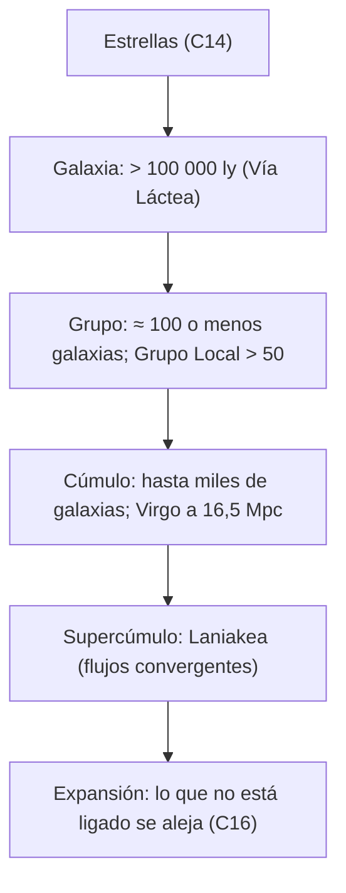

# B01-C15 — Galaxias y agrupaciones cósmicas

<!-- nav:top -->
[🏠 Programa](../../../../README.md) · [📚 Bloque B01](../../../tronco-comun/B01-el-universo-y-el-pensamiento-cientifico.md) · [← Anterior: B01-C14 — Estrellas y sus principales propiedades](../B01-C14-estrellas-y-sus-principales-propiedades/CLASE.md) · [Siguiente: B01-C16 — Expansión del universo como observación →](../B01-C16-expansion-del-universo-como-observacion/CLASE.md)
<!-- /nav -->

## 1. Ubicación, nivel y alcance

Decimoquinta clase del bloque B01. Has comparado estrellas con datos (C14); ahora subes de escala: las estrellas forman galaxias, las galaxias forman grupos y cúmulos, y estos forman estructuras mayores. Sigues en el nivel N1.

Verás tipos de galaxias, cómo se agrupan, qué dice la observación sobre su entorno y cómo comparar distancias y tamaños con las unidades de C08. No verás dinámica galáctica, materia oscura ni cosmología (bloques posteriores).

## 2. Por qué esta clase existe

La galaxia de la línea Hα (C01) está a 43 Mpc, pero ¿qué significa eso comparado con lo que ya conoces? ¿Está más lejos o más cerca que Andrómeda? ¿Que el cúmulo de Virgo? ¿Es una galaxia «solitaria» o pertenece a un grupo? Responder exige situarla en una jerarquía y en una escala.

La decisión central es: **¿en qué nivel de agrupación está este objeto y cómo lo comparo con otros usando solo datos publicados?** Aprenderás a distinguir galaxia, grupo, cúmulo y estructura mayor, a comparar distancias y tiempos de luz y a declarar la incertidumbre de cada distancia.

## 3. Lo que podrás hacer al terminar

1. Definir galaxia, grupo, cúmulo y supercúmulo con un ejemplo de cada uno.
2. Nombrar los tipos morfológicos principales de galaxias.
3. Comparar la distancia de una galaxia con la de Andrómeda y la de Virgo, en Mpc y en tiempo de luz.
4. Expresar la incertidumbre relativa de una distancia publicada.
5. Explicar por qué dos conteos de «galaxias cercanas» pueden diferir sin contradecirse.
6. Elaborar una **ficha de una galaxia y su entorno**.

La evidencia es la ficha del ejercicio 12 (sección 20).

## 4. Con qué llegas y cómo comprobarlo

Necesitas C01 (ley de Hubble), C02 (escalas), C03 (galaxia, grupo, cúmulo) y C08 (conversiones). Cinco preguntas:

1. ¿Cuántos años luz tiene 1 Mpc, aproximadamente?
2. ¿Qué es el Grupo Local?
3. ¿A qué distancia está Andrómeda según C02?
4. ¿Cómo se calcula una incertidumbre relativa?
5. ¿Por qué `d = v/H₀` no vale para Andrómeda?

Ver respuestas

1. 3,26 millones. 2. El grupo de galaxias al que pertenece la Vía Láctea. 3. 765 ± 28 kpc. 4. Incertidumbre dividida por el valor. 5. Porque está ligada gravitacionalmente al Grupo Local y no sigue la expansión (C01).

Con cuatro o cinco aciertos, sigue; con tres o menos, repasa C01 a C03.

## 5. Un caso real: tres distancias y una jerarquía

NASA describe una galaxia como un conjunto de estrellas, planetas y nubes de gas y polvo ligados por la gravedad; las mayores tienen billones de estrellas y pueden superar el millón de años luz, las menores tienen unos miles de estrellas; la Vía Láctea tiene un disco de más de 100 000 años luz y pertenece a un grupo de más de 50 galaxias; los grupos tienen típicamente unos cien miembros o menos y los cúmulos pueden contener miles (S1). Para dos objetos concretos hay distancias publicadas con incertidumbre: Andrómeda (M31), 765 kpc con ±28 kpc, medida con estrellas Cefeidas del telescopio espacial Hubble (S2), y el cúmulo de Virgo, 16,5 Mpc con ±0,1 Mpc aleatorio y ±1,1 Mpc sistemático, medida por fluctuaciones de brillo superficial (S3).

Nuestro **ejemplo conductor** es la galaxia de Hα de C01, a 43 Mpc (estimada con `H₀ = 70`), y la pregunta es dónde queda entre Andrómeda y Virgo. Límite: 43 Mpc es un valor de docencia; si la galaxia fuera miembro de un cúmulo, la ley de Hubble no valdría para ella (C01).

## 6. Vocabulario

Una **galaxia** es un sistema de estrellas, gas y polvo ligado por la gravedad (S1). Los tipos **espiral**, **elíptica** e **irregular** describen su forma (S1). Un **grupo de galaxias** reúne típicamente cien o menos (S1); un **cúmulo**, hasta miles (S1). Un **supercúmulo** es una estructura mayor que reúne grupos y cúmulos; Tully y colaboradores definen el supercúmulo local, **Laniakea**, por la región donde los movimientos de las galaxias convergen una vez restada la expansión media (S4). La **velocidad peculiar** es la que queda de una galaxia tras restar la expansión (S4). El **Grupo Local** es el grupo de la Vía Láctea y Andrómeda. Una **galaxia enana** es una galaxia pequeña y de poca masa. Una **distancia por Cefeidas** usa estrellas variables cuya luminosidad se relaciona con su período (S2); una **distancia por fluctuaciones de brillo superficial** usa la granularidad de la imagen de una galaxia elíptica (S3). La **incertidumbre sistemática** afecta a todos los datos del mismo método por igual; la **aleatoria** varía de un dato a otro.

## 7. Modelo mental: una jerarquía de agrupaciones

Imagina muñecas rusas: estrellas dentro de galaxias, galaxias dentro de grupos, grupos dentro de cúmulos, y todos dentro de estructuras mayores. En cada nivel, la gravedad une lo que está cerca; a escalas mayores, domina la expansión.

*Descripción textual:* una jerarquía de cinco niveles ligados por la gravedad: estrellas, galaxia, grupo, cúmulo y supercúmulo; más allá, la expansión domina y lo no ligado se aleja.

Analogía: ciudades, regiones y países; cada nivel agrupa a los anteriores. Límite: las fronteras de un país son convenciones políticas; los límites de grupos y cúmulos son criterios científicos que cambian según el método (sección 8.4).

## 8. La explicación, paso a paso

### 8.1 Tipos de galaxias

NASA agrupa las galaxias en espirales, elípticas e irregulares (S1). Esa clasificación es morfológica: describe cómo se ven, no cómo se formaron. Dentro de cada tipo hay un enorme rango de tamaño, desde unos miles de estrellas hasta billones (S1).

### 8.2 Grupos y cúmulos

El Grupo Local contiene más de 50 galaxias según NASA (S1); un trabajo que compila galaxias enanas a menos de 3 Mpc identifica más de 100 galaxias cercanas (S5). No hay contradicción: S5 incluye galaxias que están **fuera** del Grupo Local pero dentro de 3 Mpc; el recuento depende del criterio de pertenencia y del radio. Esa es la lección: antes de comparar números, compara **definiciones**.

### 8.3 Comparar distancias

Andrómeda, `0,765 Mpc`, es 25 diámetros de la Vía Láctea (`765 kpc × 3 261,6 ly/kpc = 2,495 × 10⁶ ly`, frente a más de `10⁵ ly` de disco: `≈ 25`). Virgo, `16,5 Mpc`, está 21,6 veces más lejos que Andrómeda (`16,5/0,765`). La galaxia de Hα, `43 Mpc`, está 2,6 veces más lejos que Virgo (`43/16,5`) y 56 veces más lejos que Andrómeda. En tiempo de luz: Andrómeda, 2,5 millones de años; Virgo, `16,5 × 3,2616 = 53,8` millones; la galaxia de Hα, 140 millones. Cada paso de escala multiplica por varias veces el tiempo de luz.

### 8.4 Incertidumbres de las distancias

La distancia de M31 tiene `±28/765 = 3,7 %`. La de Virgo tiene un error aleatorio de `0,1/16,5 = 0,6 %` y uno sistemático de `1,1/16,5 = 6,7 %`; combinados en cuadratura, `√(0,1² + 1,1²) = 1,10 Mpc` (6,7 %). Para 43 Mpc con `H₀ = 70` ± 5 %, la incertidumbre relativa de la galaxia de Hα es al menos esa del `H₀` (5 %, supuesto de la clase). La conclusión «Hα está más lejos que Virgo» es **robusta**: 43 frente a 16,5 con errores del 5–7 % no se cruzan. La conclusión «está exactamente a 2,6 veces» no lo es.

### 8.5 Estructura a gran escala

Tully y colaboradores definen Laniakea como la región en que los movimientos peculiares de las galaxias apuntan hacia adentro una vez restada la expansión media; la frontera es una superficie donde los flujos divergen (S4). Es una definición por **dinámica**, no por forma. Nuestra fuente es el resumen: no leímos el artículo ni usamos sus cifras de tamaño.

## 9. Magnitudes, símbolos y unidades

| Símbolo | Qué es | Unidad | Valor o nota |
|---|---|---|---|
| `d_M31` | distancia a Andrómeda | kpc | 765 ± 28 (S2) |
| `d_Virgo` | distancia al cúmulo de Virgo | Mpc | 16,5 ± 0,1 (aleat.) ± 1,1 (sist.) (S3) |
| `d_Hα` | distancia de la galaxia de C01 | Mpc | ≈ 43 (estimada, `H₀ = 70`) |
| `t_luz` | tiempo de luz | años | `d` en años luz |
| `N_cerc` | galaxias a < 3 Mpc | — | más de 100 (S5) |
| `N_GL` | galaxias del Grupo Local | — | más de 50 (S1) |
| 1 Mpc | megaparsec | ly | 3,2616 × 10⁶ |

## 10. Convenciones y referencias

Las distancias de M31 y Virgo son **publicadas** con su método; la de la galaxia de Hα es **estimada para docencia**; las razones y los tiempos de luz son **calculados**. Los conteos de galaxias son **publicados** y dependen del criterio. El 5 % de incertidumbre de `H₀` es un **supuesto de la clase** (cercano a las incertidumbres relativas de S2 y S3 de C01: 0,74 % y 1,4 %, no idéntico). El disco de la Vía Láctea se toma como «más de 100 000 ly» (cota inferior, S1).

## 11. De dónde sale lo que afirmamos

| ID | Fuente | Localizador | Respalda | Estado |
|---|---|---|---|---|
| S1 | NASA Science, «Galaxies» | https://science.nasa.gov/universe/galaxies/ | Definición, tipos, tamaños, Vía Láctea > 100 000 ly, Grupo Local > 50 galaxias, grupos ≈ 100 o menos, cúmulos con miles | Página consultada el 2026-11-05 (mutable) |
| S2 | Riess, A. G., Fliri, J., Valls-Gabaud, D., arXiv:1110.3769 (2012) | DOI 10.1088/0004-637X/745/2/156 | M31: μ₀ = 24,42, ≈ 765 kpc, ±0,05 (est.) ±0,03 (sist.) mag, ≈ ±28 kpc; Cefeidas | Resumen consultado el 2026-11-05 |
| S3 | Mei, S. et al., *The ACS Virgo Cluster Survey. XIII*, ApJ 655, 144 (2007), arXiv:astro-ph/0702510 | https://arxiv.org/abs/astro-ph/0702510 | Virgo: 16,5 Mpc, ±0,1 aleatorio, ±1,1 sistemático; profundidad 2,4 ± 0,4 Mpc; SBF | Resumen consultado el 2026-11-05 |
| S4 | Tully, R. B., Courtois, H., Hoffman, Y., Pomarède, D., *The Laniakea supercluster of galaxies* | arXiv:1409.0880 | Definición de Laniakea por flujos peculiares | Resumen consultado el 2026-11-05; sin cifras de tamaño |
| S5 | McConnachie, A. W., *The observed properties of dwarf galaxies in and around the Local Group*, arXiv:1204.1562 (2012) | https://arxiv.org/abs/1204.1562 | Más de 100 galaxias a menos de 3 Mpc | Resumen consultado el 2026-11-05 |

Límites: todo S2 a S5 son resúmenes; el 5 % de incertidumbre de `H₀` es supuesto.

## 12. Cómo ver la jerarquía

Versión accesible del diagrama:

| Objeto | Nivel | Distancia | Tiempo de luz | Fuente |
|---|---|---|---|---|
| Vía Láctea | Galaxia | — | — | S1 (disco > 100 000 ly) |
| Andrómeda (M31) | Galaxia del Grupo Local | 0,765 Mpc | 2,5 millones de años | S2 |
| Cúmulo de Virgo | Cúmulo | 16,5 Mpc | 53,8 millones de años | S3 |
| Galaxia de Hα | por determinar | ≈ 43 Mpc | ≈ 140 millones de años | estimada |

Descripción larga: de arriba hacia abajo, la distancia crece más de 50 veces; el último objeto está más lejos que Virgo. Dibuja con escala logarítmica.

## 13. Ejemplo trabajado: situar la galaxia de Hα

**Paso 1 · Datos.** M31: `0,765 ± 0,028 Mpc` (S2). Virgo: `16,5 ± 1,1 Mpc` (S3). Hα: `43 Mpc` (estimada).

**Paso 2 · Razones.** `43/16,5 = 2,6`; `43/0,765 = 56`.

**Paso 3 · Tiempos de luz.** `0,765 × 3,2616 = 2,50 millones`; `16,5 × 3,2616 = 53,8 millones`; `43 × 3,2616 = 140 millones` de años.

**Paso 4 · Incertidumbre.** Virgo, 6,7 %; Hα, 5 % (supuesto). La razón `2,6` tiene una incertidumbre relativa de `√(0,067² + 0,05²) = 0,084`: `2,6 ± 0,2`.

**Paso 5 · Conclusión acotada.** «La galaxia de Hα está unas 2,6 ± 0,2 veces más lejos que el cúmulo de Virgo, así que **no** pertenece a él»; ¿es esto seguro? Solo si la distancia de Hα es correcta. Si la galaxia fuera miembro de otro cúmulo, la ley de Hubble no aplicaría (C01), y habría que medir su distancia con otro método.

**Paso 6 · Qué pregunta queda.** Para decidir si pertenece a un grupo, hacen falta las posiciones y velocidades de las galaxias vecinas, que aquí no tenemos.

**Sentido físico.** Situar una galaxia no es solo dar una distancia: es decir con qué comparamos, con qué incertidumbre y qué decisión no se puede tomar con los datos disponibles.

## 14. Distintas formas de agrupar

**Por forma** (espiral, elíptica): visual, pero superficial. **Por distancia y posición** (grupo, cúmulo): usa la geometría. **Por dinámica** (flujos de Laniakea, S4): usa velocidades. Cada criterio da fronteras distintas; por eso hay que declarar cuál usas.

## 15. Práctica guiada

**Ejercicio 1 · con los pasos indicados.** Convierte 0,765 Mpc a años luz. *Pasos:* `× 3,2616 × 10⁶`.

Solución comentada

`0,765 × 3,2616 × 10⁶ = 2,495 × 10⁶ ly`: unos 2,5 millones de años luz.

**Ejercicio 2 · con una pista.** ¿Cuántas veces más lejos está Virgo que Andrómeda? *Pista:* `16,5/0,765`.

Solución comentada

`21,6`. Casi 22 veces.

**Ejercicio 3 · casi autónomo.** Calcula la incertidumbre relativa de la distancia a M31.

Solución comentada

`28/765 = 3,7 %`.

## 16. Práctica autónoma, transferencia e integrador

**Ejercicio 4.** Combina en cuadratura los errores aleatorio (0,1 Mpc) y sistemático (1,1 Mpc) de Virgo.

Solución comentada

`√(0,1² + 1,1²) = 1,10 Mpc`; relativo `6,7 %`. El sistemático domina: medir más galaxias no lo reduce.

**Ejercicio 5.** ¿A cuántos diámetros de la Vía Láctea está Andrómeda si el disco mide 100 000 ly?

Solución comentada

`2,495 × 10⁶/10⁵ ≈ 25`. Como el diámetro real es mayor que 100 000 ly, la cifra real es un poco menor: 25 es una cota superior.

**Ejercicio 6.** Compara las distancias entre estrellas y entre galaxias: la estrella más cercana (4,24 ly) frente al diámetro del Sol (1,39 × 10⁶ km) y Andrómeda frente a la Vía Láctea.

Solución comentada

`4,24 ly = 4,01 × 10¹³ km`; `/1,39 × 10⁶ = 2,9 × 10⁷` diámetros solares. Para las galaxias, 25 diámetros. Las galaxias están «mucho más apretadas» que las estrellas, en proporción.

**Ejercicio 7.** ¿Por qué no se puede comparar sin más «más de 50 galaxias» con «más de 100 galaxias»?

Solución comentada

Son criterios distintos: uno cuenta miembros del Grupo Local (S1); el otro, galaxias a menos de 3 Mpc, dentro y fuera del grupo (S5). Hay que comparar definiciones antes que números.

**Ejercicio 8.** Virgo tiene profundidad 2,4 ± 0,4 Mpc (S3). ¿Qué fracción de la distancia es? ¿Qué implica para tratar al cúmulo como «un punto»?

Solución comentada

`2,4/16,5 = 15 %`. Si una galaxia está en el cúmulo, su distancia puede diferir ±7 % solo por su posición; tratarlo como punto simplifica y debe declararse.

**Ejercicio 9 · transferencia.** La galaxia de Hα estaría a 43 Mpc. Si un día se determinara que está en un cúmulo, ¿qué cambia?

Solución comentada

La ley de Hubble dejaría de ser válida para ella (C01); su velocidad incluiría movimiento dentro del cúmulo. La distancia habría que obtenerla por otro método (Cefeidas, SBF).

**Ejercicio 10 · transferencia.** Un titular dice «Laniakea mide X años luz». ¿Qué preguntarías antes de aceptarlo?

Solución comentada

¿Cómo se define la frontera (flujos, S4)? ¿Qué incertidumbre tiene? ¿Es una medida o una definición? La fuente de esta clase no da cifras de tamaño, así que no podemos aceptar ni rechazar ninguna.

**Ejercicio 11 · transferencia.** Dos catálogos dan para el mismo cúmulo 16,5 y 18,0 Mpc. ¿Hay contradicción con ±1,1 Mpc?

Solución comentada

La diferencia es 1,5 Mpc; con incertidumbre de ±1,1 en uno (y suponiendo similar en el otro), `σ = √(1,1² + 1,1²) = 1,6 Mpc`: 1,5/1,6 ≈ 0,9σ. No hay contradicción estadística; sí podría haber diferencia de método.

**Ejercicio 12 · integrador.** Elabora tu **ficha de una galaxia y su entorno**: elige una galaxia con distancia publicada y fuente; indica tipo, distancia con incertidumbre, nivel (galaxia, grupo, cúmulo) y criterio, compárala con M31 y Virgo en Mpc y en tiempo de luz, y escribe una conclusión acotada.

Solución modelo

La ficha sigue la sección 13: datos con fuente y fecha, razones con incertidumbre, nivel con criterio declarado y conclusión que distingue lo robusto de lo no determinable. Se acepta cualquier galaxia con distancia publicada.

## 17. Actividad sin código: ficha de una galaxia y su entorno

La clase no calcula nada que requiera script. Actividad: arma la ficha con una tabla de cinco filas (la galaxia, M31, Virgo, la Vía Láctea y una a tu elección) con columnas de nivel, distancia con incertidumbre, tiempo de luz y fuente; rotula estimado, publicado o calculado. **Datos:** los de S1 a S5 y los que tú cites. **Predice antes:** ¿qué distancia relativa tendrá tu galaxia respecto de Virgo? **Límites:** los resúmenes no dan todas las cifras; si no lo leíste, no lo uses.

## 18. Errores frecuentes y cómo corregirlos

**Comparar números sin comparar definiciones.** Ejercicio 7.

**Aplicar Hubble a galaxias ligadas.** Ejercicio 9.

**Olvidar los errores sistemáticos.** Ejercicio 4.

**Tratar un cúmulo como un punto.** Ejercicio 8.

**Citar cifras de un artículo cuyo texto no se leyó.** Ejercicio 10.

## 19. Cómo sabrás que vas bien

Tras 8.2: ¿por qué «más de 50» y «más de 100» no se contradicen? Si no lo ves, ejercicio 7. Tras 8.4: ¿qué error domina en Virgo? Ejercicio 4. Tras el ejemplo: ¿qué conclusión es robusta y cuál no? Al final: ¿qué dato falta para decidir si una galaxia pertenece a un cúmulo? Si dudas, relee 13.

## 20. Qué entregas y cómo se evalúa

El producto es tu **ficha de una galaxia y su entorno**.

| Criterio | Inicial | En desarrollo | Logrado | Destacado |
|---|---|---|---|---|
| Datos | Sin fuente | Fuente sin fecha | Fuente con fecha | Incluye método de la distancia |
| Comparación | Sin razones | Una | Varias con unidades | Con incertidumbre |
| Nivel y criterio | Sin nivel | Nivel sin criterio | Nivel con criterio | Discute criterios alternativos |
| Conclusión | Sin límites | Parcial | Acotada | Separa robusto de no determinable |
| Honestidad | Mezcla datos | Rotula parte | Rotula todo | Declara lo no leído |

**Condiciones críticas:** rotular estimado frente a publicado; no atribuir cifras a fuentes de las que solo se leyó el resumen sin decirlo; citar solo lo consultado.

## 21. Ética, seguridad y límites

Las distancias cósmicas dependen de métodos con supuestos; presentarlas como exactas es engañar. Clase educativa. Accesibilidad: ecuaciones en texto, diagramas descritos, tablas equivalentes, sin conexión.

## 22. Para cerrar y seguir

Las galaxias se agrupan en jerarquías ligadas por la gravedad, y comparar distancias exige declarar método, definición e incertidumbre. Lo que no está ligado se aleja, y de esa observación nace la cosmología (C16).

**Glosario español–inglés.** galaxia · *galaxy*; espiral · *spiral*; elíptica · *elliptical*; cúmulo · *cluster*; supercúmulo · *supercluster*; Grupo Local · *Local Group*; velocidad peculiar · *peculiar velocity*.

**Continuidad.** B01-C16 usa tu capacidad de **situar un objeto con distancia, tiempo de luz e incertidumbre** para estudiar la expansión. B01-C20 la reutilizará para presentar resultados.

**Referencias:** ver sección 11. Todas las fuentes son resúmenes o páginas de divulgación consultados.

<!-- nav:bottom -->
---

[← Anterior: B01-C14 — Estrellas y sus principales propiedades](../B01-C14-estrellas-y-sus-principales-propiedades/CLASE.md) · [📚 Bloque B01](../../../tronco-comun/B01-el-universo-y-el-pensamiento-cientifico.md) · [Siguiente: B01-C16 — Expansión del universo como observación →](../B01-C16-expansion-del-universo-como-observacion/CLASE.md)
<!-- /nav -->
