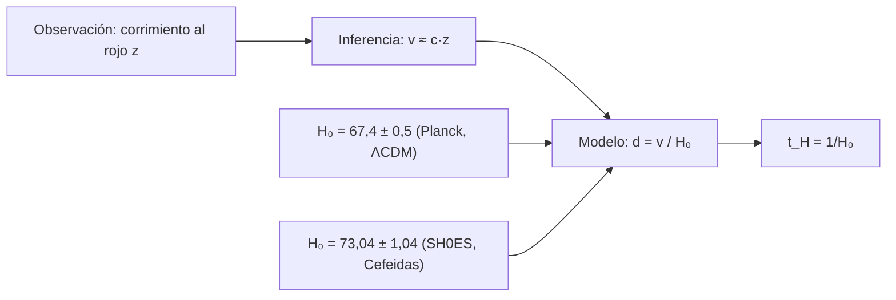

# B01-C16 — Expansión del universo como observación

<!-- nav:top -->
[🏠 Programa](../../../../README.md) · [📚 Bloque B01](../../../tronco-comun/B01-el-universo-y-el-pensamiento-cientifico.md) · [← Anterior: B01-C15 — Galaxias y agrupaciones cósmicas](../B01-C15-galaxias-y-agrupaciones-cosmicas/CLASE.md) · [Siguiente: B01-C17 — Construcción de modelos científicos →](../B01-C17-construccion-de-modelos-cientificos/CLASE.md)
<!-- /nav -->

## 1. Ubicación, nivel y alcance

Decimosexta clase del bloque B01 y cierre del tramo de recorrido por el cielo real (C11–C16). En C01 usaste la ley de Hubble como herramienta; aquí vuelves sobre ella como una *observación* con su incertidumbre: de qué datos sale, qué dice y qué no dice. Sigues en el nivel N1.

Verás cómo el corrimiento al rojo y la distancia se combinan en una relación, por qué esa relación no define un centro, cómo se propaga la incertidumbre de `H₀` a una distancia y a una escala de tiempo y qué significa que dos grupos midan valores distintos. No verás relatividad general ni cosmología completa (bloques A08 en adelante).

## 2. Por qué esta clase existe

En C01 «medimos» una distancia de 43 Mpc con `H₀ = 70`. Pero ese 70 no es un dato único: Planck 2018 da 67,4 ± 0,5 y SH0ES da 73,04 ± 1,04, ambos en km/s/Mpc (S1, S2). Con uno la galaxia de Hα queda a 44,7 Mpc; con el otro, a 41,3. ¿Cuál es «la» distancia? ¿Y qué le pasa a la edad que deduces?

La decisión central es: **¿cómo reporto una distancia o una escala de tiempo cuando el parámetro del que depende tiene valores discrepantes?** Aprenderás a calcular con cada valor, a propagar la incertidumbre, a medir la discrepancia en unidades de incertidumbre y a escribir una conclusión que no oculte el problema.

## 3. Lo que podrás hacer al terminar

1. Calcular `z`, la velocidad aparente y la distancia de una galaxia con la ley de Hubble.
2. Calcular el tiempo de Hubble `1/H₀` y su incertidumbre.
3. Cuantificar la discrepancia entre dos valores de `H₀` en unidades de incertidumbre combinada.
4. Explicar por qué una expansión uniforme no tiene centro.
5. Decidir cuándo la ley de Hubble no se aplica y qué hacer en ese caso.
6. Elaborar una **estimación de distancia o edad con error**.

La evidencia es la estimación del ejercicio 12 (sección 20).

## 4. Con qué llegas y cómo comprobarlo

Necesitas C01 (`z`, ley de Hubble, `t_H`), C08 (unidades), C15 (distancias con incertidumbre). Cinco preguntas:

1. ¿Cuánto vale `z` si 656,3 nm se observa en 662,9 nm?
2. ¿Qué unidad lleva `H₀`?
3. Si `d = v/H₀`, ¿qué pasa con `d` si `H₀` crece 10 %?
4. ¿Cuánto vale `1/H₀` con `H₀ = 70`, en Gyr?
5. ¿Qué es una incertidumbre relativa?

<details>
<summary>Ver respuestas</summary>

1. `z = 0,0101`. 2. km/s/Mpc. 3. `d` baja un 9,1 % (`1/1,1`). 4. `977,8/70 = 13,97` Gyr. 5. La incertidumbre dividida por el valor.
</details>

Con cuatro o cinco aciertos, sigue; con tres o menos, repasa C01 y C08.

## 5. Un caso real: dos medidas que no coinciden

El análisis final del satélite Planck del fondo cósmico de microondas, bajo el modelo ΛCDM de seis parámetros, da `H₀ = 67,4 ± 0,5 km/s/Mpc` (S1). El equipo SH0ES, midiendo con el telescopio Hubble Cefeidas en galaxias que albergan supernovas Ia, obtiene `H₀ = 73,04 ± 1,04 km/s/Mpc` con sistemáticos incluidos, y reporta una diferencia de 5σ respecto de la predicción de Planck+ΛCDM; sus autores dicen que la causa **sigue sin conocerse** y que no se explica por los errores de medida ni por unas 70 variantes de análisis que probaron (S2).

Nuestro **ejemplo conductor** es la galaxia de Hα de C01: calcularemos su distancia y el tiempo de Hubble con cada `H₀`. Límite: no evaluamos los análisis de Planck ni de SH0ES; solo usamos sus resultados publicados en los resúmenes y reproducimos la aritmética de la discrepancia.

## 6. Vocabulario

La **constante de Hubble** `H₀` es la razón entre la velocidad de recesión aparente y la distancia, hoy. La **ley de Hubble** es `v = H₀·d` para objetos que siguen la expansión. El **tiempo de Hubble** es `t_H = 1/H₀`. La **expansión** del universo es el aumento de las distancias entre galaxias no ligadas. La **velocidad peculiar** es la que queda tras restar la expansión (C15). El **fondo cósmico de microondas** es radiación antigua que llena el cielo; sirve para deducir parámetros cosmológicos bajo un modelo. Una **vela estándar** es un objeto de luminosidad conocida que permite medir distancias (Cefeidas, supernovas Ia). La **tensión de Hubble** es la discrepancia entre los valores de `H₀` de dos métodos. Un **error sistemático** afecta a todos los datos de un método en el mismo sentido; un **error estadístico** varía al azar.

## 7. Modelo mental: globo que se infla, con límites

Imagina puntos dibujados sobre un globo que se infla: cualquier punto ve cómo todos los demás se alejan, más rápido los más lejanos, y ninguno es el centro. Eso resume la ley de Hubble: `v ∝ d`.



*Descripción textual:* de un corrimiento observado se infiere una velocidad aparente; con la ley de Hubble y un valor de `H₀` se obtiene la distancia; hay dos valores de `H₀` en conflicto, cada uno con su método; de `H₀` se obtiene también el tiempo de Hubble.

Analogía: el globo. Límites: el globo se infla en un espacio dentro del cual vive; no hay un «afuera» al que se expanda el universo, y en el globo la superficie es 2D. Además, los puntos del globo no se atraen: las galaxias ligadas por la gravedad **no** se separan (C15).

## 8. La explicación, paso a paso

### 8.1 Del corrimiento a la distancia

Con `z = 0,01006` (C01), `v ≈ c·z = 299 792 × 0,01006 = 3 015 km/s`. Si se usara la fórmula relativista del efecto Doppler, resultarían 3 000 km/s: una diferencia de 0,5 %, menor que la incertidumbre de `H₀`; para `z << 1` ambas coinciden prácticamente. Entonces `d = v/H₀`: con 67,4, `d = 44,7 Mpc`; con 73,04, `d = 41,3 Mpc`.

### 8.2 Propagar la incertidumbre

Con `v` fija, `d = v/H₀` implica `δd/d = δH₀/H₀`. Con `H₀ = 67,4 ± 0,5`: `0,74 %`, `d = 44,7 ± 0,3 Mpc`. Con `73,04 ± 1,04`: `1,42 %`, `d = 41,3 ± 0,6 Mpc`. El resultado acarrea la incertidumbre relativa de `H₀`; la de `z` (±0,1 nm sobre 6,6 nm, es decir, ±1,5 %) también cuenta y suma en cuadratura, lo que corregiremos en C18. Aquí lo ignoramos y lo declaramos.

### 8.3 La discrepancia en unidades de incertidumbre

`ΔH₀ = 73,04 − 67,4 = 5,64`. La incertidumbre combinada, suponiendo independencia, es `√(0,5² + 1,04²) = 1,15`; luego `ΔH₀/σ = 4,9`: la discrepancia es de casi 5 incertidumbres. Esa cifra es coherente con la de 5σ que informa SH0ES respecto de Planck+ΛCDM (S2), aunque su cálculo usa más detalle. La discrepancia **no desaparece** con más datos del mismo método: es una señal de que algo puede estar mal (un sistemático) o de que el modelo no es completo; hoy no se sabe cuál (S2).

### 8.4 Tiempo de Hubble

`t_H = 977,8/H₀` Gyr (C01): con 67,4, `14,51 ± 0,11 Gyr`; con 73,04, `13,39 ± 0,19 Gyr`. No son la edad del universo: la expansión no ha tenido siempre el mismo ritmo; el análisis de Planck publica 13,797 ± 0,023 Gyr (C01), distinto de ambos `t_H`. Lo importante para esta clase es que **la incertidumbre en `H₀` se convierte en incertidumbre en toda escala derivada**, y que dos valores en tensión dan dos respuestas distintas, que no se deben mezclar sin avisar.

### 8.5 Por qué no hay centro

Si en cada punto de una red unidimensional con posiciones 0, 10, 25 y 40 Mpc rige `v = H₀·d` respecto del primero, el segundo ve al tercero alejarse con `H₀ × (25 − 10) = H₀ × 15`, exactamente la misma ley. Cualquier observador deduce la misma `H₀` y se ve «en el centro»: la ley lineal es la única que lo permite (comprobado en el laboratorio). La conclusión «nuestra posición es especial» no se sigue de que todo se aleje de nosotros.

## 9. Magnitudes, símbolos y unidades

| Símbolo | Qué es | Unidad | Valor o nota |
|---|---|---|---|
| `z` | corrimiento al rojo | adimensional | 0,01006 (C01) |
| `v` | velocidad aparente | km/s | `c·z = 3 015` |
| `H₀` | constante de Hubble | km/s/Mpc | 67,4 ± 0,5 (S1); 73,04 ± 1,04 (S2) |
| `d` | distancia | Mpc | `v/H₀` |
| `t_H` | tiempo de Hubble | Gyr | `977,8/H₀` |
| `ΔH₀/σ` | discrepancia | adimensional | 4,9 (calculada) |
| 1 Mpc | megaparsec | km | 3,0857 × 10¹⁹ |

## 10. Convenciones y referencias

Las cifras de `H₀` son **publicadas** (resúmenes); la galaxia de Hα es **de docencia**; `d`, `t_H` y `ΔH₀/σ` son **calculados**. Se supone independencia de las incertidumbres de Planck y SH0ES al combinarlas; es una simplificación. Se usa `v ≈ c·z` (válida para `z << 1`). El **tiempo de Hubble no es la edad del universo** (C01).

## 11. De dónde sale lo que afirmamos

| ID | Fuente | Localizador | Respalda | Estado |
|---|---|---|---|---|
| S1 | Planck Collaboration, *Planck 2018 results. VI. Cosmological parameters*, arXiv:1807.06209 (A&A 641, A6, 2020) | https://arxiv.org/abs/1807.06209 | `H₀ = 67,4 ± 0,5 km/s/Mpc` en base-ΛCDM; datos consistentes con ΛCDM plano de seis parámetros | Resumen consultado el 2026-11-05 |
| S2 | Riess, A. G. et al., arXiv:2112.04510 (ApJL, 2022) | https://arxiv.org/abs/2112.04510 | `H₀ = 73,04 ± 1,04` (42 hospedadoras de SN Ia, Cefeidas); 72,53 ± 0,99 (TRGB); 73,30 ± 1,04 (con SN Ia de alto z); diferencia de 5σ respecto de Planck+ΛCDM; causa desconocida | Resumen consultado el 2026-11-05 |
| S3 | Hubble, E., PNAS 15(3), 168–173 (1929) | DOI 10.1073/pnas.15.3.168 | Referencia histórica de la relación distancia–velocidad | Citada de C01; no reconsultada ni usada para cifras |

Límites: solo resúmenes; no evaluamos los análisis; el tiempo de Hubble no se contrasta con una fuente de edad aquí (se usa la de C01).

## 12. Cómo ver los resultados

Versión accesible del diagrama:

| `H₀` (km/s/Mpc) | `d` (Mpc) | `t_H` (Gyr) | Fuente |
|---|---|---|---|
| 67,4 ± 0,5 | 44,7 ± 0,3 | 14,51 ± 0,11 | Planck 2018 (S1) |
| 73,04 ± 1,04 | 41,3 ± 0,6 | 13,39 ± 0,19 | SH0ES (S2) |
| 70 (de docencia) | 43,1 | 13,97 | C01 |

Descripción larga: los intervalos de `d` con ±1σ no se solapan (44,4–45,0 frente a 40,7–41,9); la discrepancia es de unos 4,9σ. Dibuja con barras de error y distingue las series por marcador, no solo por color.

## 13. Ejemplo trabajado: dos distancias y qué decir de ellas

**Paso 1 · Observación.** `λ_obs = 662,9 nm`, `λ_rep = 656,3 nm` (C01).

**Paso 2 · Inferencia.** `z = 6,6/656,3 = 0,01006`; `v = 3 015 km/s` (3 000 con Doppler relativista; diferencia 0,5 %).

**Paso 3 · Modelo con cada `H₀`.** Planck: `d = 3 015/67,4 = 44,7 Mpc`. SH0ES: `d = 3 015/73,04 = 41,3 Mpc`.

**Paso 4 · Incertidumbres.** Planck: `44,7 × 0,74 % = 0,3 Mpc`; SH0ES: `41,3 × 1,42 % = 0,6 Mpc`.

**Paso 5 · Discrepancia.** `44,7 − 41,3 = 3,4 Mpc`; `σ = √(0,3² + 0,6²) = 0,67 Mpc`; `3,4/0,67 = 5,1σ`. (La cifra coincide aproximadamente con los 4,9σ de `H₀` porque `d ∝ 1/H₀`; la leve diferencia se debe al redondeo.)

**Paso 6 · Reporte honesto.** «La galaxia de Hα está a 41 a 45 Mpc, según el valor de `H₀`; el rango refleja una discrepancia aún sin resolver entre dos métodos publicados (S1, S2)». Dar «43 ± 3 Mpc» ocultaría la estructura del problema, pero resume el rango.

**Sentido físico.** El número que más usas, la distancia, hereda un problema abierto de la cosmología; un buen reporte lo declara.

## 14. Distintas formas de medir `H₀`

**Método directo (SH0ES):** usa velas estándar escalonadas (paralajes → Cefeidas → supernovas Ia). **Método indirecto (Planck):** deduce `H₀` del fondo cósmico bajo un modelo. El primero depende de una cadena de calibraciones; el segundo, de que el modelo sea completo. Que den resultados distintos es información, no un fallo de uno de los grupos (S2 lo plantea como pregunta abierta).

## 15. Práctica guiada

**Ejercicio 1 · con los pasos indicados.** Calcula `z` y `v` si una línea de 656,3 nm se observa en 670,0 nm. *Pasos:* sección 8.1.

<details><summary>Solución comentada</summary>

`z = 13,7/656,3 = 0,02087`; `v = 299 792 × 0,02087 = 6 258 km/s`. Con Doppler relativista, 6 190 km/s (1 % menos): para `z` pequeño la aproximación basta.
</details>

**Ejercicio 2 · con una pista.** Calcula `d` con `v = 6 258 km/s` y `H₀ = 67,4`. *Pista:* `d = v/H₀`.

<details><summary>Solución comentada</summary>

`d = 6 258/67,4 = 92,8 Mpc`.
</details>

**Ejercicio 3 · casi autónomo.** Calcula la incertidumbre de `d` para `H₀ = 73,04 ± 1,04` y `v = 6 258` (error de `v` ignorado).

<details><summary>Solución comentada</summary>

`d = 85,7 Mpc`; `δd/d = 1,04/73,04 = 1,42 %`; `δd = 1,2 Mpc`: `85,7 ± 1,2 Mpc`.
</details>

## 16. Práctica autónoma, transferencia e integrador

**Ejercicio 4.** Calcula `t_H` con `H₀ = 73,04` y su incertidumbre.

<details><summary>Solución comentada</summary>

`977,8/73,04 = 13,39 Gyr`; relativo `1,42 %`: `±0,19 Gyr`.
</details>

**Ejercicio 5.** ¿A cuántas incertidumbres combinadas están 67,4 ± 0,5 y 73,04 ± 1,04?

<details><summary>Solución comentada</summary>

`5,64/√(0,25 + 1,0816) = 5,64/1,154 = 4,9`.
</details>

**Ejercicio 6.** Con `H₀ = 72,53 ± 0,99` (el valor TRGB de S2), ¿está más cerca de Planck o de SH0ES base en unidades de σ?

<details><summary>Solución comentada</summary>

Frente a Planck: `5,13/√(0,25 + 0,98) = 5,13/1,109 = 4,6σ`. Frente a SH0ES base: `0,51/√(1,0816 + 0,98) = 0,36σ`. Más cerca de SH0ES.
</details>

**Ejercicio 7.** Una galaxia está a 5 Mpc y se mueve a −100 km/s (se acerca). ¿Qué dice la ley de Hubble? ¿Qué explica el dato?

<details><summary>Solución comentada</summary>

Con `H₀ = 70`, `v = 350 km/s` (se alejaría). Observamos −100: la velocidad peculiar domina, la galaxia está ligada a un grupo y no sigue la expansión (C01, C15). Hubble no aplica.
</details>

**Ejercicio 8.** Con cuatro galaxias en 0, 10, 25 y 40 Mpc y `H₀ = 70`, calcula las velocidades relativas vistas desde la de 10 Mpc.

<details><summary>Solución comentada</summary>

Respecto de la de 10 Mpc: hacia 0, `−10 × 70 = −700 km/s`; hacia 25, `+1 050 km/s`; hacia 40, `+2 100 km/s`. La relación sigue siendo lineal con la distancia: ese observador también se ve en el centro (sección 8.5).
</details>

**Ejercicio 9 · transferencia.** Un artículo dice: «el universo se expande hacia un lugar vacío». ¿Qué observación contradice o apoya?

<details><summary>Solución comentada</summary>

Ninguna observación de esta clase habla de un «afuera»: la ley de Hubble solo describe que las distancias entre galaxias no ligadas crecen. La frase añade una interpretación que no sale de la observación (C05); hay que pedir qué dato la sostiene.
</details>

**Ejercicio 10 · transferencia.** Un compañero reporta «`d = 43 Mpc`» sin más. ¿Qué le falta?

<details><summary>Solución comentada</summary>

El valor de `H₀`, su incertidumbre, la de `z`, y qué supone sobre si la galaxia sigue la expansión. Mejor: «41–45 Mpc según `H₀` entre 67,4 y 73,04; supone que no está ligada».
</details>

**Ejercicio 11 · transferencia.** La discrepancia entre 67,4 y 73,04 se debe a un error sistemático oculto. ¿Qué observación lo apoyaría?

<details><summary>Solución comentada</summary>

Que repetir la medición con otro calibrador independiente diera un valor cercano al de Planck, o que la discrepancia desapareciera al corregir un efecto identificado. S2 informa que ni 70 variantes de análisis la eliminan; aún no hay evidencia a favor.
</details>

**Ejercicio 12 · integrador.** Elabora tu **estimación de distancia o edad con error**: toma una galaxia con `z` publicado y fuente, calcula `v`, `d` y `t_H` con los dos valores de `H₀`, propaga la incertidumbre relativa, cuantifica la discrepancia y escribe un reporte que declare supuestos y límites.

<details><summary>Solución modelo</summary>

Una ficha como la sección 13 para otra galaxia, con la tabla de la sección 12, el cálculo de σ combinada, la aclaración de que `t_H` no es la edad y una frase final que da el rango. Se acepta cualquier galaxia con `z` publicado.
</details>

## 17. Laboratorio: distancia y edad con error en 70 líneas

El script [distancia_y_edad_con_error.py](distancia_y_edad_con_error.py) calcula `z`, `v`, `d` y `t_H` para ambos valores de `H₀` y la discrepancia. Antes comprueba que `t_H` coincide con el atajo `977,8/H₀` (0,01 %), que la ley lineal da la misma velocidad relativa desde cualquier observador de una red y que `d ∝ 1/H₀`; si no, se detiene.

**Datos:** `z` de C01; `H₀` publicados (S1, S2). **Predice antes:** ¿qué distancia sale con 73,04? (Unos 41 Mpc.) **Resultados (2026-11-05, Python 3.12.9, Windows):** `z = 0,01006`, `v = 3 015 km/s` (3 000 con Doppler relativista); Planck: `d = 44,7 ± 0,3 Mpc`, `t_H = 14,51 ± 0,11 Gyr`; SH0ES: `d = 41,3 ± 0,6 Mpc`, `t_H = 13,39 ± 0,19 Gyr`; `ΔH₀ = 5,64`, `σ = 1,15`, `ΔH₀/σ = 4,9`; 1 Mpc = 3,085678 × 10¹⁹ km.

```bash
python programa/clases/B01/B01-C16-expansion-del-universo-como-observacion/distancia_y_edad_con_error.py
```

**Límites:** no incluye la incertidumbre de `z`; supone que la galaxia sigue la expansión; `t_H` no es la edad.

## 18. Errores frecuentes y cómo corregirlos

**Aplicar Hubble a galaxias ligadas.** Ejercicio 7.

**Reportar una distancia sin `H₀`.** Ejercicio 10.

**Confundir `t_H` con la edad del universo.** Se corrige con la sección 8.4.

**Mezclar valores de `H₀` en tensión.** Se corrige con el ejercicio 5.

**Creer que el universo tiene un centro.** Ejercicio 8.

## 19. Cómo sabrás que vas bien

Tras 8.2: ¿qué incertidumbre relativa hereda `d`? Si no lo sabes, ejercicio 3. Tras 8.3: ¿cuántas σ separan los dos `H₀`? Ejercicio 5. Tras 8.5: ¿por qué no hay centro? Ejercicio 8. Al final: ¿qué dice un buen reporte de distancia? Si dudas, relee 13.

## 20. Qué entregas y cómo se evalúa

El producto es tu **estimación de distancia o edad con error**.

| Criterio | Inicial | En desarrollo | Logrado | Destacado |
|---|---|---|---|---|
| Cálculo | Con errores | Un `H₀` | Dos `H₀` | Con σ combinada |
| Incertidumbre | Ausente | Sin propagar | Propagada | Incluye la de `z` |
| Discrepancia | No la ve | La nombra | La cuantifica | La interpreta con cautela |
| Reporte | Sin supuestos | Con algunos | Con supuestos y rango | Distingue `t_H` de edad |
| Fuentes | Sin cita | Sin fecha | Con fecha | Declara que son resúmenes |

**Condiciones críticas:** no ocultar la discrepancia; no presentar `t_H` como edad; citar solo lo consultado.

## 21. Ética, seguridad y límites

Reportar un solo número cuando hay dos valores en tensión es una forma de engaño por omisión. Los debates abiertos se presentan como abiertos. Clase educativa. Accesibilidad: ecuaciones en texto, diagrama descrito, tablas equivalentes, sin conexión.

## 22. Para cerrar y seguir

La ley de Hubble es una relación observada entre corrimiento y distancia; sus parámetros tienen incertidumbre y, hoy, dos valores en tensión; la expansión no tiene centro y no aplica a lo ligado. Lo que hace falta ahora es un lenguaje sobre cómo se construyen y se limitan esas representaciones: los modelos (C17).

**Glosario español–inglés.** constante de Hubble · *Hubble constant*; tiempo de Hubble · *Hubble time*; expansión · *expansion*; vela estándar · *standard candle*; tensión de Hubble · *Hubble tension*; error sistemático · *systematic error*.

**Continuidad.** B01-C17 usa tu capacidad de **llevar una cadena observación → inferencia → modelo con incertidumbre** para definir qué es un modelo científico y su dominio de validez. B01-C18 sistematizará la propagación de errores.

**Referencias:** ver sección 11. S1 y S2 son resúmenes consultados; S3 es una referencia histórica de C01.

<!-- nav:bottom -->
---

[← Anterior: B01-C15 — Galaxias y agrupaciones cósmicas](../B01-C15-galaxias-y-agrupaciones-cosmicas/CLASE.md) · [📚 Bloque B01](../../../tronco-comun/B01-el-universo-y-el-pensamiento-cientifico.md) · [Siguiente: B01-C17 — Construcción de modelos científicos →](../B01-C17-construccion-de-modelos-cientificos/CLASE.md)
<!-- /nav -->
