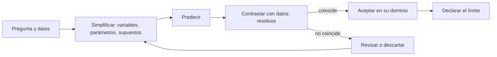

# B01-C17 — Construcción de modelos científicos

<!-- nav:top -->
[🏠 Programa](../../../../README.md) · [📚 Bloque B01](../../../tronco-comun/B01-el-universo-y-el-pensamiento-cientifico.md) · [← Anterior: B01-C16 — Expansión del universo como observación](../B01-C16-expansion-del-universo-como-observacion/CLASE.md) · [Siguiente: B01-C18 — Incertidumbre y errores elementales →](../B01-C18-incertidumbre-y-errores-elementales/CLASE.md)
<!-- /nav -->

## 1. Ubicación, nivel y alcance

Decimoséptima clase del bloque B01 y primera del cierre (C17–C20). Has usado modelos sin nombrarlos: la ley de Hubble, el período lunar, Stefan–Boltzmann, la tercera ley de Kepler. Ahora los examinas como objetos propios: qué es un modelo, cómo se construye, cómo se contrasta con datos y cuándo deja de servir. Sigues en el nivel N1.

Verás las partes de un modelo, un procedimiento para construirlo y compararlo, el criterio de residuos y el concepto de dominio de validez. No verás ajuste estadístico avanzado ni simulación numérica (bloques posteriores).

## 2. Por qué esta clase existe

Al final de C13, la tercera ley de Kepler daba `T²/a³ = 1` para siete planetas con error menor al 1,5 %, y 0,975 para Neptuno. ¿Falla el modelo con Neptuno? ¿Es un modelo «verdadero» o solo «útil»? ¿Y por qué no sirve para las lunas de Júpiter sin cambiar una constante?

La decisión central es: **¿cómo construyo un modelo, cómo decido si describe bien los datos y qué declaro sobre dónde sirve?** Aprenderás a separar variables, parámetros y supuestos, a comparar dos modelos con un criterio fijado de antemano y a escribir el dominio de validez.

## 3. Lo que podrás hacer al terminar

1. Definir modelo, variable, parámetro, supuesto y dominio de validez con un ejemplo astronómico.
2. Construir un modelo simple a partir de una pregunta y de datos.
3. Ajustar un exponente por mínimos cuadrados logarítmicos y calcular residuos.
4. Comparar dos modelos con un criterio declarado antes de mirar los datos.
5. Detectar un uso del modelo fuera de su dominio.
6. Elaborar un **modelo simple con su límite declarado**.

La evidencia es el modelo del ejercicio 12 (sección 20).

## 4. Con qué llegas y cómo comprobarlo

Necesitas C05 (O/I/M), C07 (predicción y refutación), C13 (Kepler) y C16 (propagación). Cinco preguntas:

1. ¿Qué valor da `T²/a³` para la Tierra en años y au?
2. ¿Qué es una predicción falsable?
3. ¿Cuál es la relación entre `d` y `H₀` en la ley de Hubble?
4. ¿Qué es un residuo?
5. ¿Qué es un supuesto?

<details>
<summary>Ver respuestas</summary>

1. Aproximadamente 1. 2. Una predicción con número y criterio de refutación fijado antes (C07). 3. `d = v/H₀`. 4. La diferencia entre el dato y lo que predice el modelo. 5. Una condición que se acepta sin comprobar en ese momento (C05).
</details>

Con cuatro o cinco aciertos, sigue; con tres o menos, repasa C05, C07 y C13.

## 5. Un caso real: Planck y el modelo de seis parámetros

El análisis final de Planck concluye que los datos del fondo cósmico de microondas «concuerdan bien» con el modelo ΛCDM plano de seis parámetros, ya se analicen la temperatura, la polarización o la lente gravitacional por separado o combinadas, y que no hay evidencia fuerte a favor de extensiones del modelo (S1). Mientras tanto, la medición local de `H₀` de SH0ES difiere de la predicción de ese modelo en 5σ, sin causa conocida (S2).

Fíjate en el vocabulario: el modelo tiene **seis parámetros** (lo que se ajusta), hace **predicciones** (por ejemplo, `H₀`), se **contrasta** con datos distintos, y tiene un **dominio** (el universo en gran escala). Que un modelo describa bien un conjunto de datos y mal otro es una señal sobre su límite, no un fracaso de la ciencia. Nuestro **ejemplo conductor** es más modesto: modelar los períodos de los planetas con Kepler. Límite: no evaluamos ΛCDM; solo citamos lo que dicen los resúmenes (S1, S2).

## 6. Vocabulario

Un **modelo científico** es una representación simplificada que permite predecir y que se contrasta con datos. Una **variable** es lo que cambia en el modelo (aquí `a` y `T`). Un **parámetro** es un número fijo del modelo que se ajusta (la constante `k` o el exponente `p`). Un **supuesto** es una condición aceptada (órbitas circulares, masa del planeta despreciable). El **dominio de validez** es el rango en que el modelo se ha comprobado y se puede usar. Un **residuo** es la diferencia entre el dato y la predicción. El **ajuste** es el procedimiento que elige los parámetros que dejan menores residuos. Un **criterio de comparación** es la regla que decide qué modelo describe mejor los datos. El **sobreajuste** ocurre cuando un modelo con demasiados parámetros reproduce el ruido en lugar de la tendencia. Una **extrapolación** es usar el modelo fuera de su dominio.

## 7. Modelo mental: el ciclo de modelado

Piensa en un bucle: pregunta, simplificación, predicción, contraste y revisión. El modelo nunca «termina»; se acepta mientras resiste el contraste y se acota cuando falla.



*Descripción textual:* un ciclo que empieza con la pregunta y los datos, sigue con la simplificación (variables, parámetros y supuestos), la predicción y el contraste mediante residuos; si coincide, se acepta en su dominio y se declara el límite; si no, se revisa o descarta y se vuelve a simplificar.

Analogía: un mapa del metro. Conserva el orden de las estaciones y desprecia las distancias reales. Límite: un mapa del metro no se contrasta con mediciones, un modelo científico sí; y un mapa puede ser «correcto» sin ser escala, mientras que un modelo cuantitativo se evalúa por sus residuos.

## 8. La explicación, paso a paso

### 8.1 Variables, parámetros, supuestos

En el modelo `T = k·a^p`: las variables son `a` (en au) y `T` (en años); los parámetros son `k` y `p`; los supuestos, que los planetas orbitan el Sol, que sus masas son despreciables frente a la solar y que los datos son comparables entre sí. Escribir esas tres listas es la mitad de construir un modelo.

### 8.2 Ajuste por mínimos cuadrados logarítmicos

Si `T = k·a^p`, entonces `ln T = ln k + p·ln a`: una recta. Con 8 planetas (S3), el ajuste da `p = 1,4978` y `k = 0,9998`, es decir, `T = 0,9998·a^1,4978`. El exponente ajustado coincide con 1,5 a dos milésimas, y `k` con 1 a dos diezmilésimas. Es un resultado empírico: los datos *sugieren* `T² ∝ a³`; que tenga base física (la gravedad, C13) es otra capa de la escalera (C05).

### 8.3 Residuos

Con el exponente fijo en 1,5 (modelo de Kepler), el error relativo de la predicción es de −0,06 % (Mercurio), 0,02 % (Tierra), 0,65 % (Saturno) y 1,27 % (Neptuno). El residuo cuadrático medio de los logaritmos es 0,0051. Con el exponente ajustado, 0,0027. El ajuste mejora apenas, a costa de un parámetro más: no hay motivo para preferirlo. **Que Neptuno tenga el mayor residuo no desprestigia al modelo**: puede deberse a la magnitud tabulada (C13), y lo correcto es investigarlo.

### 8.4 Un modelo rival

Propongamos un modelo B, `T = c·a` (período proporcional a la distancia), con `c` ajustado a 1,796. Su residuo es `0,7519`: más de cien veces el del modelo de Kepler. Ese es el **criterio de comparación**: el que deje menor residuo en escala logarítmica, **declarado antes de calcular**. B queda descartado para este dominio. Es importante que la regla se fije antes (C07): de lo contrario puedes elegir el criterio que favorece a tu modelo favorito.

### 8.5 Dominio de validez y extrapolación

El modelo de Kepler en años y au vale para cuerpos que orbitan el Sol. Si lo aplicas a una luna que orbita Júpiter, la constante `k` cambia (depende de la masa del astro central, C13): estás **extrapolando** fuera del dominio. Del mismo modo, `v = c·z` vale para `z << 1` y la ley de Hubble no se aplica a galaxias ligadas (C15, C16). Todo modelo debe llevar su frase de límite: «vale para..., se ha contrastado con..., no se aplica a...».

## 9. Magnitudes, símbolos y unidades

| Símbolo | Qué es | Unidad | Valor o nota |
|---|---|---|---|
| `a` | distancia al Sol | au | 0,387 (Mercurio) a 30,18 (Neptuno) |
| `T` | período orbital | años | 0,241 a 163,7 |
| `k`, `p` | parámetros del modelo | — | `0,9998`, `1,4978` (ajustados) |
| `c` | parámetro del modelo B | años/au | 1,796 |
| `ε` | error relativo | % | `(T_modelo/T_dato − 1) × 100` |
| RMS(ln) | residuo cuadrático medio logarítmico | — | 0,0051 (Kepler); 0,0027 (ajustado); 0,7519 (B) |

## 10. Convenciones y referencias

Los datos son **publicados** (ficha NASA, 3–4 cifras); los parámetros ajustados, los residuos y las razones son **calculados**; los modelos A, K y B son **sintéticos** en el sentido de que los proponemos nosotros. El criterio de comparación (RMS del logaritmo) es una **convención declarada** de la clase y no un estándar. El año usado es 365,25 d y 1 au = 149 597 870 700 m (C08).

## 11. De dónde sale lo que afirmamos

| ID | Fuente | Localizador | Respalda | Estado |
|---|---|---|---|---|
| S1 | Planck Collaboration, *Planck 2018 results. VI. Cosmological parameters*, arXiv:1807.06209 | https://arxiv.org/abs/1807.06209 | Datos en buen acuerdo con ΛCDM plano de seis parámetros; sin evidencia fuerte de extensiones | Resumen consultado el 2026-11-05 |
| S2 | Riess, A. G. et al., arXiv:2112.04510 | https://arxiv.org/abs/2112.04510 | `H₀ = 73,04 ± 1,04`; diferencia de 5σ respecto de Planck+ΛCDM; causa desconocida | Resumen consultado el 2026-11-05 |
| S3 | NASA NSSDC, *Planetary Fact Sheet – Metric* (actualizada el 18-mar-2025) | https://nssdc.gsfc.nasa.gov/planetary/factsheet/ | Distancias al Sol y períodos orbitales de los 8 planetas | Página consultada el 2026-11-05 |

Límites: S1 y S2 son resúmenes; la fila «distancia al Sol» de S3 no se rotula como semieje mayor; el ajuste es didáctico.

## 12. Cómo ver los residuos

Versión accesible del diagrama:

| Planeta | `a` (au) | `T` dato (años) | `T` modelo K (años) | Error |
|---|---|---|---|---|
| Mercurio | 0,387 | 0,241 | 0,241 | −0,06 % |
| Venus | 0,723 | 0,615 | 0,615 | −0,01 % |
| Tierra | 1,000 | 1,000 | 1,000 | +0,02 % |
| Marte | 1,524 | 1,881 | 1,882 | +0,03 % |
| Júpiter | 5,204 | 11,858 | 11,871 | +0,12 % |
| Saturno | 9,572 | 29,424 | 29,616 | +0,65 % |
| Urano | 19,165 | 83,748 | 83,898 | +0,18 % |
| Neptuno | 30,181 | 163,723 | 165,805 | +1,27 % |

Descripción larga: los errores del modelo K son menores del 1,3 % en todo el rango de 0,4 a 30 au; los mayores están en los planetas exteriores. Si dibujas `ln T` frente a `ln a`, obtienes casi una recta de pendiente 1,5. Distingue por marcadores.

## 13. Ejemplo trabajado: elegir entre dos modelos

**Paso 1 · Pregunta.** ¿Cómo depende el período orbital de la distancia al Sol?

**Paso 2 · Modelos.** K: `T = a^1,5`. B: `T = c·a`.

**Paso 3 · Criterio previo.** «Gana el modelo con menor RMS del logaritmo de la razón dato/modelo, y se descarta uno con RMS mayor a 0,05.» (Se fija antes de calcular.)

**Paso 4 · Cálculo.** K: 0,0051. B (con `c = 1,796` ajustado): 0,7519.

**Paso 5 · Decisión.** K cumple (0,0051 < 0,05); B queda descartado (0,7519 > 0,05).

**Paso 6 · Dominio y límite.** «Vale para planetas del Sol entre 0,39 y 30 au con errores < 1,3 %; no se contrastó para lunas ni exoplanetas; el mayor residuo es el de Neptuno, cuya causa no se investigó.»

**Sentido físico.** El modelo gana por pasar un criterio dicho de antemano, y su límite es parte del resultado. Si el modelo B hubiera ganado, habría que cuestionarlo con la misma severidad.

## 14. Distintas formas de elegir un modelo

**Por simplicidad:** se prefiere el que tiene menos parámetros si ajusta casi igual. **Por residuos:** el de menor error. **Por base física:** el que se deduce de principios (gravedad). Los tres deben coincidir idealmente; si no, se declara el conflicto. En esta clase, Kepler gana en los tres.

## 15. Práctica guiada

**Ejercicio 1 · con los pasos indicados.** Lista variables, parámetros y supuestos del modelo `T = k·a^p`. *Pasos:* sección 8.1.

<details><summary>Solución comentada</summary>

Variables `a` y `T`; parámetros `k` y `p`; supuestos: órbitas alrededor del Sol, masa del planeta despreciable, datos comparables. Si pusiste `c` como variable, recuerda que es un número fijo del modelo B.
</details>

**Ejercicio 2 · con una pista.** Calcula el error relativo del modelo K para Júpiter (`a = 5,204`, `T = 11,858`). *Pista:* `a^1,5`.

<details><summary>Solución comentada</summary>

`5,204^1,5 = 11,871`; error `11,871/11,858 − 1 = +0,11 %`.
</details>

**Ejercicio 3 · casi autónomo.** Calcula `ln` de `a` y `T` de la Tierra y de Júpiter y la pendiente entre ambos.

<details><summary>Solución comentada</summary>

Tierra: `ln 1 = 0`, `ln 1 = 0`. Júpiter: `ln 5,204 = 1,6492`, `ln 11,858 = 2,4731`. Pendiente `2,4731/1,6492 = 1,4996`. Cerca de 1,5.
</details>

## 16. Práctica autónoma, transferencia e integrador

**Ejercicio 4.** Calcula el error relativo del modelo K para Neptuno y di qué conclusión sacas.

<details><summary>Solución comentada</summary>

`30,181^1,5 = 165,81`; `165,81/163,72 − 1 = +1,27 %`. No basta para descartar el modelo: pudiera deberse a la magnitud tabulada (C13). Se anota como pregunta abierta.
</details>

**Ejercicio 5.** ¿Qué período predice el modelo K para un cuerpo a 4 au del Sol? ¿Está dentro del dominio?

<details><summary>Solución comentada</summary>

`4^1,5 = 8,0 años`. Sí: 4 au está entre 0,39 y 30 au y orbita el Sol; es una **interpolación**.
</details>

**Ejercicio 6.** ¿Qué período predice el modelo K para un cuerpo a 500 au del Sol? ¿Qué problema hay?

<details><summary>Solución comentada</summary>

`500^1,5 = 11 180 años`. Está muy fuera del rango contrastado (máx. 30 au): es **extrapolación**; hay que declararlo y no dar el resultado con la confianza del dominio.
</details>

**Ejercicio 7.** Con el modelo B (`c = 1,796`), calcula el período para la Tierra y Neptuno y el error relativo.

<details><summary>Solución comentada</summary>

Tierra: `1,796 × 1 = 1,796` años frente a 1: `+80 %`. Neptuno: `1,796 × 30,18 = 54,2` años frente a 163,7: `−67 %`. Un modelo cuyos errores cambian de signo con la escala no describe la tendencia.
</details>

**Ejercicio 8.** ¿Por qué el criterio de comparación se escribe antes de calcular?

<details><summary>Solución comentada</summary>

Para evitar elegir, después de ver los datos, el criterio que favorece al modelo preferido (sesgo de confirmación, C05, C07). Un criterio previo hace honesta la comparación.
</details>

**Ejercicio 9 · transferencia.** Si pasas de 1,5 a un exponente libre, el RMS baja de 0,0051 a 0,0027. ¿Aceptarías el exponente libre? Argumenta.

<details><summary>Solución comentada</summary>

No necesariamente: la mejora es pequeña y cuesta un parámetro; además el exponente libre (1,4978) coincide con 1,5 dentro de dos milésimas. Se prefiere el modelo más simple con base física, salvo que el residuo mejorara mucho.
</details>

**Ejercicio 10 · transferencia.** Aplica «vale para..., se contrastó con..., no se aplica a...» a la ley de Hubble de C16.

<details><summary>Solución comentada</summary>

«Vale para galaxias que siguen la expansión con `z << 1`; se contrastó con distancias medidas por Cefeidas y supernovas Ia (S2) y con el modelo ΛCDM (S1); no se aplica a galaxias ligadas (Andrómeda) ni a `z` grandes sin corrección.»
</details>

**Ejercicio 11 · transferencia.** Un estudiante dice: «un modelo que no coincide perfectamente con los datos es un modelo falso». Responde.

<details><summary>Solución comentada</summary>

Todo modelo es una simplificación; lo que importa es que sus residuos sean pequeños frente a la incertidumbre de los datos en su dominio y que declare su límite. Los errores de hasta 1,3 % no lo invalidan para predicciones de esa precisión, y un residuo mayor sirve para localizar qué simplificación falla.
</details>

**Ejercicio 12 · integrador.** Elabora tu **modelo simple con su límite declarado**: elige un fenómeno con datos publicados (por ejemplo, períodos de las lunas de Marte frente a su distancia, o el tiempo de luz frente a la distancia), escribe variables, parámetros y supuestos, define un criterio previo, ajusta, calcula residuos, compara con un modelo rival y redacta el dominio de validez.

<details><summary>Solución modelo</summary>

Una ficha con fuente y fecha de los datos, listas de variables, parámetros y supuestos, criterio escrito antes, tabla de residuos, comparación con un rival y frase de límite («vale para..., se contrastó con..., no se aplica a...»). Se acepta cualquier fenómeno con datos citados.
</details>

## 17. Laboratorio: contrastar dos modelos en 70 líneas

El script [contrastar_modelo_y_dato.py](contrastar_modelo_y_dato.py) ajusta `T = k·a^p` en escala logarítmica con los 8 planetas, calcula residuos del modelo K (`p = 1,5`) y del modelo B (`T = c·a`) y los errores relativos. Antes comprueba que el ajuste recupera `p = 1,5` y `k = 1` con datos sintéticos `T = a^1,5` (tolerancia 10⁻⁹), que el exponente con datos reales está a menos de 0,01 de 1,5 y que K tiene menor residuo que B; si no, se detiene.

**Datos:** publicados (S3). **Predice antes:** ¿qué planeta tendrá el mayor error? (Neptuno.) **Resultados (2026-11-05, Python 3.12.9, Windows):** `T = 0,9998·a^1,4978`; RMS(ln): K 0,0051; ajustado 0,0027; B 0,7519; errores de K: −0,06 %, −0,01 %, +0,02 %, +0,03 %, +0,12 %, +0,65 %, +0,18 %, +1,27 % (Mercurio a Neptuno).

```bash
python programa/clases/B01/B01-C17-construccion-de-modelos-cientificos/contrastar_modelo_y_dato.py
```

**Límites:** ocho puntos; datos de 3–4 cifras; el criterio es una convención; no es un análisis estadístico completo.

## 18. Errores frecuentes y cómo corregirlos

**Confundir parámetro con variable.** Ejercicio 1.

**Elegir el criterio después de ver los datos.** Ejercicio 8.

**Extrapolar sin avisar.** Ejercicio 6.

**Exigir un ajuste perfecto.** Ejercicio 11.

**Preferir más parámetros por pequeñas mejoras.** Ejercicio 9.

## 19. Cómo sabrás que vas bien

Tras 8.1: ¿qué parámetros tiene tu modelo? Si no sabes, ejercicio 1. Tras 8.3: ¿cómo calculas un residuo? Ejercicio 2. Tras 8.5: ¿qué es extrapolar? Ejercicio 6. Al final: ¿qué frase de límite acompaña a tu modelo? Si no la escribiste, relee el ejemplo de la sección 13.

## 20. Qué entregas y cómo se evalúa

El producto es tu **modelo simple con su límite declarado**.

| Criterio | Inicial | En desarrollo | Logrado | Destacado |
|---|---|---|---|---|
| Estructura | Sin separar | Parcial | Variables, parámetros y supuestos | Con justificación de cada supuesto |
| Criterio | Ausente | Posterior | Previo y numérico | Previo y compara con rival |
| Contraste | Sin datos | Sin residuos | Residuos calculados | Interpreta el mayor residuo |
| Límite | Ausente | Genérico | Con dominio explícito | Distingue interpolación de extrapolación |
| Fuentes | Sin cita | Sin fecha | Con fecha | Declara resúmenes y cifras tabulares |

**Condiciones críticas:** fijar el criterio antes; declarar el dominio; citar solo lo consultado.

## 21. Ética, seguridad y límites

Un modelo presentado sin su límite engaña. Un modelo exitoso en un dominio no es un hecho universal. Clase educativa; sus modelos no se usan para predecir trayectorias de misión. Accesibilidad: ecuaciones en texto, diagrama descrito, tablas equivalentes, sin conexión.

## 22. Para cerrar y seguir

Un modelo tiene variables, parámetros, supuestos y dominio; se contrasta con residuos y un criterio fijado antes; se acepta mientras resista y se acota cuando falle. Falta ahora un lenguaje preciso para la incertidumbre que cada dato y cada residuo arrastran: los errores y su propagación (C18).

**Glosario español–inglés.** modelo · *model*; parámetro · *parameter*; supuesto · *assumption*; residuo · *residual*; dominio de validez · *domain of validity*; extrapolación · *extrapolation*; sobreajuste · *overfitting*.

**Continuidad.** B01-C18 usa tu capacidad de **comparar modelo y dato con residuos** para cuantificar errores y su propagación. B01-C20 la usará para concluir con límites.

**Referencias:** ver sección 11. S1 y S2 son resúmenes; S3 es una ficha oficial.

<!-- nav:bottom -->
---

[← Anterior: B01-C16 — Expansión del universo como observación](../B01-C16-expansion-del-universo-como-observacion/CLASE.md) · [📚 Bloque B01](../../../tronco-comun/B01-el-universo-y-el-pensamiento-cientifico.md) · [Siguiente: B01-C18 — Incertidumbre y errores elementales →](../B01-C18-incertidumbre-y-errores-elementales/CLASE.md)
<!-- /nav -->
