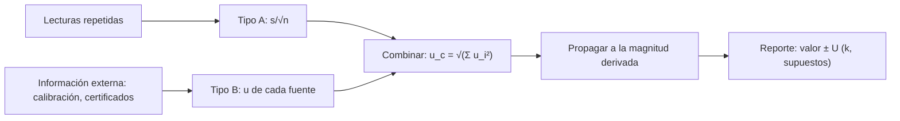

# B01-C18 — Incertidumbre y errores elementales

<!-- nav:top -->
[🏠 Programa](../../../../README.md) · [📚 Bloque B01](../../../tronco-comun/B01-el-universo-y-el-pensamiento-cientifico.md) · [← Anterior: B01-C17 — Construcción de modelos científicos](../B01-C17-construccion-de-modelos-cientificos/CLASE.md) · [Siguiente: B01-C19 — Fuentes confiables y desinformación espacial →](../B01-C19-fuentes-confiables-y-desinformacion-espacial/CLASE.md)
<!-- /nav -->

## 1. Ubicación, nivel y alcance

Decimoctava clase del bloque B01. Desde C04 pones «±» junto a las cifras y desde C07 usas «2σ» para decidir; aquí por fin los defines. Sigues en el nivel N1.

Verás la diferencia entre error aleatorio y sistemático, cómo se calcula la incertidumbre de una medición repetida, cómo se propaga a una magnitud derivada, cuántas cifras escribir y cómo reportar un resultado. No verás distribuciones estadísticas avanzadas ni correlaciones (bloques posteriores).

## 2. Por qué esta clase existe

En C05 dijiste que un resultado de OPERA estaba «a unas 6 incertidumbres de cero» y otro «a menos de una». En C07 dijiste que dos intervalos de ±2σ no debían solaparse. En C16 combinaste incertidumbres en cuadratura y calculaste «4,9σ» entre dos valores de `H₀`. Todo eso presupone que sabes qué es una incertidumbre y cómo se obtiene.

La decisión central es: **¿cómo cuantifico cuánto me puedo fiar de un número y cómo lo comunico?** Aprenderás a distinguir errores aleatorios y sistemáticos, a estimar la incertidumbre de una media, a propagarla con la regla de la GUM y a redactar el resultado con su intervalo y sus supuestos.

## 3. Lo que podrás hacer al terminar

1. Distinguir error aleatorio, error sistemático e incertidumbre.
2. Calcular la media, la desviación estándar experimental y la incertidumbre de la media de una serie.
3. Propagar incertidumbres a una magnitud derivada con la ley de propagación para entradas independientes.
4. Elegir cifras significativas coherentes con la incertidumbre.
5. Comparar dos resultados en unidades de incertidumbre combinada.
6. Elaborar un **reporte de medición con incertidumbre**.

La evidencia es el reporte del ejercicio 12 (sección 20).

## 4. Con qué llegas y cómo comprobarlo

Necesitas C05 (O/I/M), C07 (criterio de 2σ), C16 (propagación relativa) y C17 (residuos). Cinco preguntas:

1. ¿Qué significa `±0,1 nm`?
2. Si `d = v/H₀` y `H₀` tiene 1 % de incertidumbre, ¿cuál es la de `d` (con `v` fija)?
3. Calcula `√(3² + 4²)`.
4. ¿Qué es un criterio de refutación?
5. ¿Qué diferencia hay entre medir y calcular?

<details>
<summary>Ver respuestas</summary>

1. El valor puede razonablemente variar en esa cantidad. 2. 1 %. 3. 5. 4. El resultado que, de ocurrir, te hace rechazar la hipótesis (C07). 5. Medir da un registro del instrumento; calcular combina medidas con supuestos (C05).
</details>

Con cuatro o cinco aciertos, sigue; con tres o menos, repasa C05, C07 y C16.

## 5. Un caso real: una guía internacional y un resultado de laboratorio

La *Guía para la expresión de la incertidumbre de medida* (JCGM 100:2008, la «GUM») define la **incertidumbre estándar** como la incertidumbre de un resultado expresada como una desviación estándar; distingue la evaluación **tipo A** (por análisis estadístico de series de observaciones) de la **tipo B** (por otros medios); y señala que el error aleatorio no puede compensarse pero se reduce habitualmente con más observaciones, mientras que el error sistemático tampoco puede eliminarse del todo pero a menudo puede reducirse corrigiendo el efecto reconocido (S1). La guía también permite una incertidumbre **expandida** `U = k·u_c`, con `k` un factor de cobertura (S1, 3.3.7), y da la ley de propagación para una función de varias entradas (S1, 5.1.2).

Nuestro **ejemplo conductor** vuelve a la línea Hα: simulamos (datos sintéticos) diez lecturas de la longitud de onda observada y propagamos su incertidumbre al corrimiento `z`. Límite: es una simulación; no sustituye una medición real ni toda la complejidad de la GUM.

## 6. Vocabulario

El **error** de una medición es la diferencia entre el valor medido y el verdadero (desconocido). La **incertidumbre** es la estimación de qué tan lejos puede estar el valor medido del verdadero. La **incertidumbre estándar** `u` se expresa como una desviación estándar (S1, 2.3.1). La **evaluación tipo A** estima `u` de una serie de lecturas (S1, 2.3.2); la **tipo B**, de información como certificados, hojas técnicas o juicio (S1, 2.3.3). El **error aleatorio** varía de lectura a lectura y se reduce con más lecturas. El **error sistemático** se repite igual en cada lectura (por ejemplo, un cero mal calibrado). La **media** es la suma dividida por el número de lecturas; la **desviación estándar experimental** `s` mide su dispersión; la **incertidumbre de la media** es `s/√n`. La **incertidumbre combinada** `u_c` agrupa varias fuentes. La **incertidumbre expandida** `U = k·u_c`. Las **cifras significativas** son las que aporta la medida; la incertidumbre dice dónde cortar.

## 7. Modelo mental: dos tipos de fallo, un intervalo

Imagina disparar a una diana: un grupo de impactos muy juntos pero lejos del centro es **preciso con error sistemático**; impactos dispersos alrededor del centro es **exacto con error aleatorio**. La incertidumbre cubre ambos y se expresa como un intervalo alrededor del valor.



*Descripción textual:* de las lecturas repetidas sale una incertidumbre tipo A; de la información externa, una tipo B; ambas se combinan en cuadratura, se propagan a la magnitud derivada y se reportan como valor ± incertidumbre con su factor de cobertura y sus supuestos.

Analogía: la diana. Límite: en una diana ves dónde está el centro; en una medición el valor verdadero no se conoce, por lo que el error sistemático se estima con información externa (tipo B), no se ve.

## 8. La explicación, paso a paso

### 8.1 Media, desviación y incertidumbre de la media

Para `n` lecturas `x_i`: `media = Σx_i/n`; `s = √(Σ(x_i − media)²/(n − 1))`; `u(media) = s/√n`. Caso analítico: `{1, 2, 3, 4, 5}` da `media = 3`, `s = 1,581`, `u = 0,707`. La media de diez lecturas simuladas de Hα (662,97; 662,96; 662,74; 662,89; 662,95; 662,93; 662,82; 662,84; 662,92; 662,80 nm) es `662,882 nm`, `s = 0,078 nm` y `u(media) = 0,078/√10 = 0,025 nm`. Con cuatro veces más lecturas (40), `u` se reduciría a la mitad: va con `1/√n`.

### 8.2 Error aleatorio frente a sistemático

Repetir lecturas reduce el error aleatorio, no el sistemático (S1). Si el espectrógrafo tiene una calibración que desplaza todas las longitudes 0,05 nm, la media no lo detecta: hay que tener información externa (la incertidumbre de calibración, de tipo B). Por eso un reporte serio **declara ambos**: la repetibilidad (tipo A) y la calibración (tipo B).

### 8.3 Propagación a una magnitud derivada

Si `z = (λ_obs − λ_rep)/λ_rep`, la ley de propagación para entradas independientes es `u_c² = (∂z/∂λ_obs)²·u²(λ_obs) + (∂z/∂λ_rep)²·u²(λ_rep)` (S1, 5.1.2). Las derivadas son `1/λ_rep` y `−λ_obs/λ_rep²`. Con `u(λ_obs) = 0,025 nm` y `u(λ_rep) = 0,05 nm` (tipo B, supuesto de la clase): `∂z/∂λ_obs = 1/656,3 = 1,524 × 10⁻³ nm⁻¹`; `∂z/∂λ_rep = −662,88/656,3² = −1,539 × 10⁻³ nm⁻¹`. Luego `u_c² = (1,524 × 10⁻³ × 0,025)² + (1,539 × 10⁻³ × 0,05)² = (3,8 × 10⁻⁵)² + (7,7 × 10⁻⁵)²`, es decir, `u_c = 8,6 × 10⁻⁵`. Resultado: `z = 0,01003 ± 0,00009`, un `0,9 %` relativo. Observa que domina la incertidumbre de la longitud de onda **de reposo**: repetir más lecturas de `λ_obs` ya no ayuda.

### 8.4 Reglas de bolsillo

Para sumas y restas, las incertidumbres absolutas se suman en cuadratura. Para productos y cocientes, las **relativas** se suman en cuadratura. Para una potencia `x^p`, la relativa se multiplica por `|p|`. Son casos particulares de la fórmula general, válidos para entradas independientes y pequeñas incertidumbres. Ejemplo: `d = v/H₀` con `v` fija da `δd/d = δH₀/H₀` (C16).

### 8.5 Reportar: cifras y cobertura

Se escribe la incertidumbre con una o dos cifras significativas y el valor se corta en la misma posición decimal: `z = 0,01003 ± 0,00009`, no `0,010034567 ± 0,00009`. Se declara si `±` es una incertidumbre estándar (`k = 1`) o expandida (`k = 2`): `0,01003 ± 0,00017 (k = 2)`. Y se comparan dos resultados con la razón `|a − b|/√(u_a² + u_b²)`: para OPERA, `60,7/√(6,9² + 7,4²) = 6,0` y `6,5/√(7,4² + 8,3²) = 0,6` (S2).

## 9. Magnitudes, símbolos y unidades

| Símbolo | Qué es | Unidad | Valor o nota |
|---|---|---|---|
| `n` | número de lecturas | — | 10 |
| `s` | desviación estándar experimental | nm | 0,078 |
| `u` | incertidumbre estándar | misma que la magnitud | 0,025 nm (media) |
| `u_c` | incertidumbre combinada | ídem | `8,6 × 10⁻⁵` (de `z`) |
| `U`, `k` | expandida y factor de cobertura | ídem, — | `k = 2` |
| `z` | corrimiento al rojo | adimensional | `0,01003 ± 0,00009` |
| `∂f/∂x` | sensibilidad | unidad de `f`/unidad de `x` | `1/λ_rep` |

## 10. Convenciones y referencias

Las lecturas son **sintéticas** (generadas con semilla fija); las incertidumbres tipo B de `λ_rep` son un **supuesto de la clase**; el criterio `k = 2` es una **convención** (S1 la permite); los resultados son **calculados**. Las cifras de OPERA son **publicadas** en los resúmenes (S2). Se supone independencia entre entradas. La regla de redondeo de cifras es una convención de la clase, no una cita de la GUM.

## 11. De dónde sale lo que afirmamos

| ID | Fuente | Localizador | Respalda | Estado |
|---|---|---|---|---|
| S1 | JCGM, *Evaluation of measurement data — Guide to the expression of uncertainty in measurement* (JCGM 100:2008, GUM 1995 con correcciones menores) | https://www.bipm.org/documents/20126/2071204/JCGM_100_2008_E.pdf | Incertidumbre estándar (2.3.1); tipo A y B (2.3.2, 2.3.3); error aleatorio y sistemático (cláusula 3); incertidumbre expandida (3.3.7); ley de propagación, ecuación (10) (5.1.2) | PDF leído (texto extraído) el 2026-11-05; no se leyó la guía completa |
| S2 | OPERA Collaboration, arXiv:1109.4897, v1 y v4 | https://arxiv.org/abs/1109.4897 | v1: 60,7 ns ± 6,9 ± 7,4; v4: 6,5 ns ± 7,4 y +8,3/−8,0 | Resúmenes consultados el 2026-11-05 (ver C05) |

Límites: la GUM es extensa; solo se usaron los apartados citados. La regla de cifras y la suma en cuadratura de sistemática asimétrica son simplificaciones de la clase.

## 12. Cómo ver la incertidumbre

Versión accesible del diagrama:

| Fuente | Tipo | `u` | Contribución a `u_c(z)` |
|---|---|---|---|
| Repetibilidad de `λ_obs` | A | 0,025 nm | `3,8 × 10⁻⁵` |
| Longitud de onda de reposo | B | 0,05 nm | `7,7 × 10⁻⁵` |
| Combinada | — | — | `8,6 × 10⁻⁵` |

Descripción larga: dos barras de contribución; la de la longitud de onda de reposo es el doble de la de la repetibilidad; la combinada es algo mayor que la mayor. Dibuja las contribuciones con marcadores distintos.

## 13. Ejemplo trabajado: el `z` de la galaxia de Hα con incertidumbre

**Paso 1 · Lecturas.** Diez valores simulados (sección 8.1).

**Paso 2 · Tipo A.** `media = 662,882 nm`, `s = 0,078 nm`, `u = 0,025 nm`.

**Paso 3 · Tipo B.** `u(λ_rep) = 0,05 nm` (supuesto).

**Paso 4 · Propagar.** `z = (662,882 − 656,3)/656,3 = 0,01003`; `u_c(z) = 8,6 × 10⁻⁵`.

**Paso 5 · Velocidad.** `v = c·z = 3 007 ± 26 km/s` (`299 792,458 × 8,6 × 10⁻⁵ = 25,8`).

**Paso 6 · Reporte.** «`z = 0,01003 ± 0,00009` (`k = 1`); `z = 0,01003 ± 0,00017` (`k = 2`); dominada por la incertidumbre de la longitud de onda de reposo (supuesto)».

**Paso 7 · Verificación.** Una simulación Monte Carlo independiente (200 000 tiradas con las mismas incertidumbres, para el caso `u(λ_obs) = 0,03`) coincide con la fórmula en menos del 3 % (comprobación del laboratorio).

**Sentido físico.** El dato ya no es «0,0100»: es un intervalo con una fuente dominante identificada, y eso dice dónde conviene invertir el esfuerzo.

## 14. Distintas formas de obtener la incertidumbre

**Repetir lecturas** (tipo A): objetiva y reproducible, pero ve solo lo aleatorio. **Usar información externa** (tipo B): cubre calibraciones y límites del instrumento, pero depende de la calidad de la información. **Simular** (Monte Carlo): sirve para comprobar la propagación cuando la fórmula es difícil. En la práctica se combinan los tres, y se declara cada uno.

## 15. Práctica guiada

**Ejercicio 1 · con los pasos indicados.** Calcula la media, `s` y `u` de `{10, 12, 11, 13}`. *Pasos:* sección 8.1.

<details><summary>Solución comentada</summary>

`media = 11,5`; desviaciones `−1,5, 0,5, −0,5, 1,5`; `Σ² = 2,25 + 0,25 + 0,25 + 2,25 = 5`; `s = √(5/3) = 1,29`; `u = 1,29/√4 = 0,645`. Si dividiste por `n` en vez de `n − 1`, tu `s` sale 1,12.
</details>

**Ejercicio 2 · con una pista.** Una longitud de onda se mide 100 veces con `s = 0,08 nm`. ¿Cuál es `u(media)`? *Pista:* `s/√n`.

<details><summary>Solución comentada</summary>

`0,08/10 = 0,008 nm`: mejor 10 veces que una sola lectura, no 100.
</details>

**Ejercicio 3 · casi autónomo.** Propaga: `d = v/H₀` con `H₀ = 73,04 ± 1,04` y `v = 3 007 ± 26 km/s`.

<details><summary>Solución comentada</summary>

Relativas: `26/3 007 = 0,86 %`; `1,04/73,04 = 1,42 %`. En cuadratura: `√(0,86² + 1,42²) = 1,66 %`. `d = 41,17 Mpc`; `u = 0,68 Mpc`.
</details>

## 16. Práctica autónoma, transferencia e integrador

**Ejercicio 4.** Calcula `u` si `a = 10,0 ± 0,3` y `b = 4,0 ± 0,4`, y `c = a − b`.

<details><summary>Solución comentada</summary>

`c = 6,0`; `u = √(0,3² + 0,4²) = 0,5`. Resultado: `6,0 ± 0,5`. (Para una resta, las absolutas se combinan en cuadratura; no se restan.)
</details>

**Ejercicio 5.** Calcula la incertidumbre relativa de `T² ∝ a³` si `a` tiene 1 % y `T` 0,5 %.

<details><summary>Solución comentada</summary>

`T²/a³`: relativas `2 × 0,5 % = 1 %` y `3 × 1 % = 3 %`; en cuadratura, `√(1² + 3²) = 3,2 %`.
</details>

**Ejercicio 6.** Expresa `z = 0,010034567 ± 0,00009` con las cifras correctas.

<details><summary>Solución comentada</summary>

`z = 0,01003 ± 0,00009`. La incertidumbre fija el corte en la quinta cifra decimal.
</details>

**Ejercicio 7.** Compara 67,4 ± 0,5 con 73,04 ± 1,04 en unidades de incertidumbre combinada. ¿Qué concluyes?

<details><summary>Solución comentada</summary>

`5,64/√(0,5² + 1,04²) = 4,9`. La diferencia es grande frente a las incertidumbres declaradas: no es consistente con un error aleatorio; sugiere un sistemático o un modelo incompleto (C16).
</details>

**Ejercicio 8.** Un instrumento tiene un cero desplazado 0,2 unidades. ¿Reducen las repeticiones ese error? ¿Cómo lo corriges?

<details><summary>Solución comentada</summary>

No: es sistemático. Se corrige midiendo el cero (información externa) y restándolo, y se incluye la incertidumbre de esa corrección como tipo B.
</details>

**Ejercicio 9 · transferencia.** Con `n = 10` lecturas y `s = 0,08`, ¿cuántas lecturas hacen falta para que `u(media) = 0,01`?

<details><summary>Solución comentada</summary>

`0,08/√n = 0,01` → `√n = 8` → `n = 64`. Cuanto más pequeña la incertidumbre buscada, el costo crece con el cuadrado.
</details>

**Ejercicio 10 · transferencia.** Un titular dice «medido con 0,001 % de precisión» y el artículo habla de repetibilidad solamente. ¿Qué preguntas haces?

<details><summary>Solución comentada</summary>

¿Se incluyó la calibración y otras fuentes sistemáticas? ¿Es incertidumbre estándar o expandida? ¿Qué supuestos? La repetibilidad por sí sola puede subestimar la incertidumbre total (S1).
</details>

**Ejercicio 11 · transferencia.** Dos mediciones de la misma distancia dan `16,5 ± 1,1` y `18,0 ± 0,9` Mpc. ¿Son compatibles?

<details><summary>Solución comentada</summary>

`1,5/√(1,1² + 0,9²) = 1,5/1,42 = 1,06`: compatibles (cerca de una incertidumbre combinada). Si fueran 5 incertidumbres, habría que buscar un sistemático.
</details>

**Ejercicio 12 · integrador.** Elabora tu **reporte de medición con incertidumbre**: realiza al menos diez lecturas de una magnitud (por ejemplo, el diámetro de la Luna en píxeles, o la longitud de una sombra), calcula media, `s` y `u`, añade una incertidumbre tipo B declarada, propágala a una magnitud derivada, reporta con cifras correctas y `k` declarado, y señala la fuente dominante.

<details><summary>Solución modelo</summary>

Un reporte con tabla de lecturas, `media ± u`, la fuente tipo B justificada, la propagación con derivadas escritas, el resultado con `k` y una frase sobre cuál contribución domina y qué haría reducirla. Se acepta cualquier magnitud medible.
</details>

## 17. Laboratorio: incertidumbre de `z` en 80 líneas

El script [incertidumbre_de_z.py](incertidumbre_de_z.py) simula diez lecturas de Hα, calcula media, `s`, `u`, propaga a `z` y a `v`, y compara resultados de OPERA. Antes comprueba el caso analítico `{1,…,5}` (`media = 3`, `s = √2,5`, `u = √0,5`) y que la propagación de la fórmula coincide con una simulación Monte Carlo independiente de 200 000 tiradas dentro del 3 %; si no, se detiene.

**Datos:** sintéticos (lecturas) y publicados (OPERA, resúmenes). **Predice antes:** ¿qué fuente domina la incertidumbre de `z`? (La longitud de onda de reposo, según el supuesto.) **Resultados (2026-11-05, Python 3.12.9, Windows):** media `662,882 nm`; `s = 0,078 nm`; `u = 0,025 nm`; `z = 0,01003 ± 0,00009`; `v = 3 007 ± 26 km/s`; con `k = 2`, `± 0,00017`; OPERA v1 razón 6,0; v4 razón 0,6.

```bash
python programa/clases/B01/B01-C18-incertidumbre-y-errores-elementales/incertidumbre_de_z.py
```

**Límites:** entradas independientes, ruido gaussiano, sin error sistemático en las lecturas, incertidumbre de reposo supuesta.

## 18. Errores frecuentes y cómo corregirlos

**Dividir por `n` en vez de `n − 1`.** Ejercicio 1.

**Creer que más lecturas eliminan todo error.** Ejercicio 8.

**Restar incertidumbres en lugar de combinarlas en cuadratura.** Ejercicio 4.

**Dar demasiadas cifras.** Ejercicio 6.

**No declarar `k`.** Se corrige con la sección 8.5.

## 19. Cómo sabrás que vas bien

Tras 8.1: ¿qué pasa con `u(media)` si cuadruplicas las lecturas? Ejercicio 2. Tras 8.2: ¿qué error no baja repitiendo? Ejercicio 8. Tras 8.3: ¿cómo se propaga una resta? Ejercicio 4. Al final: ¿qué incluye un reporte completo? Si dudas, relee 8.5.

## 20. Qué entregas y cómo se evalúa

El producto es tu **reporte de medición con incertidumbre**.

| Criterio | Inicial | En desarrollo | Logrado | Destacado |
|---|---|---|---|---|
| Lecturas | Menos de 10 | 10 sin tabla | 10 o más con tabla | Con criterio de rechazo declarado |
| Tipo A y B | Ninguna | Solo A | A y B | Justifica la B |
| Propagación | Sin hacer | Con errores | Correcta | Verifica con simulación |
| Reporte | Sin `±` | Sin `k` | Con `k` y cifras correctas | Señala la fuente dominante |
| Fuentes | Sin cita | Sin fecha | Con fecha | Declara supuestos y límites |

**Condiciones críticas:** no omitir la incertidumbre; declarar `k`; citar solo lo consultado.

## 21. Ética, seguridad y límites

Reportar una incertidumbre menor que la real engaña; reportar una mayor sin motivo oculta información. Un error sistemático no detectado es un riesgo ético: se declara lo que no se pudo controlar. Clase educativa; no sustituye la GUM completa. Accesibilidad: ecuaciones en texto, diagrama descrito, tablas equivalentes, sin conexión.

## 22. Para cerrar y seguir

La incertidumbre es la cuantificación honesta de cuánto confiar en un número: la media tiene `s/√n`, los sistemáticos se estiman con información externa, la propagación combina fuentes en cuadratura y el reporte declara `k`, cifras y supuestos. Con esto puedes juzgar no solo tus datos, sino lo que otros afirman: ¿en qué fuentes confiar y cómo detectar afirmaciones sin respaldo? (C19).

**Glosario español–inglés.** incertidumbre · *uncertainty*; error aleatorio · *random error*; error sistemático · *systematic error*; desviación estándar · *standard deviation*; propagación · *propagation*; factor de cobertura · *coverage factor*; cifras significativas · *significant figures*.

**Continuidad.** B01-C19 usa tu capacidad de **pedir la incertidumbre y el método detrás de una cifra** para evaluar fuentes y titulares. B01-C20 la integrará en el proyecto.

**Referencias:** ver sección 11. S1 es una guía internacional consultada parcialmente; S2 son resúmenes.

<!-- nav:bottom -->
---

[← Anterior: B01-C17 — Construcción de modelos científicos](../B01-C17-construccion-de-modelos-cientificos/CLASE.md) · [📚 Bloque B01](../../../tronco-comun/B01-el-universo-y-el-pensamiento-cientifico.md) · [Siguiente: B01-C19 — Fuentes confiables y desinformación espacial →](../B01-C19-fuentes-confiables-y-desinformacion-espacial/CLASE.md)
<!-- /nav -->
