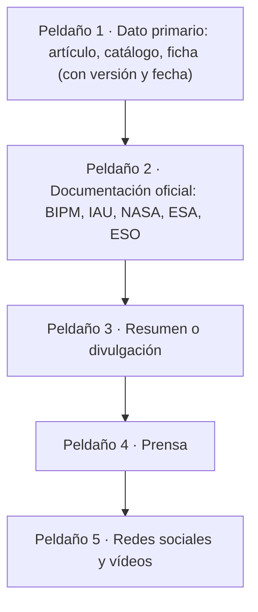

# B01-C19 — Fuentes confiables y desinformación espacial

<!-- nav:top -->
[🏠 Programa](../../../../README.md) · [📚 Bloque B01](../../../tronco-comun/B01-el-universo-y-el-pensamiento-cientifico.md) · [← Anterior: B01-C18 — Incertidumbre y errores elementales](../B01-C18-incertidumbre-y-errores-elementales/CLASE.md) · [Siguiente: B01-C20 — Proyecto de observación científica inicial →](../B01-C20-proyecto-de-observacion-cientifica-inicial/CLASE.md)
<!-- /nav -->

## 1. Ubicación, nivel y alcance

Decimonovena clase del bloque B01. Ya sabes separar observación de interpretación (C05), exigir predicciones (C07), manejar unidades (C08) y pedir incertidumbres (C18). Ahora los aplicas a lo que lees: titulares, publicaciones en redes, vídeos y artículos. Sigues en el nivel N1.

Verás una jerarquía de fuentes, cómo seguir una afirmación hasta su origen, señales de alerta de desinformación y un procedimiento de verificación. No verás análisis de medios ni de comunicación en profundidad; es una herramienta práctica para la astronomía.

## 2. Por qué esta clase existe

Un titular dice: «Neutrinos superan la velocidad de la luz: Einstein estaba equivocado». Es una afirmación fuerte. En septiembre de 2011 el artículo original de OPERA informaba un adelanto de 60,7 ns; la versión final informa 6,5 ns, compatible con cero (C05). Quien solo vio el titular se quedó con la primera lectura.

La decisión central es: **¿esta afirmación tiene una fuente primaria que la respalda, con qué versión y con qué incertidumbre, y qué dice realmente esa fuente?** Aprenderás a rastrear el origen de una cifra, a distinguir fuentes primarias de secundarias, a detectar señales de alerta y a escribir un informe de verificación honesto, que también diga lo que no pudiste verificar.

## 3. Lo que podrás hacer al terminar

1. Clasificar fuentes en primarias, oficiales y secundarias, y decir qué sostiene cada una.
2. Rastrear una afirmación hasta su fuente original y anotar versión y fecha.
3. Comprobar una cifra contra una ficha oficial y contra un cálculo propio.
4. Reconocer cinco señales de alerta de desinformación espacial.
5. Distinguir «no verificado» de «falso».
6. Elaborar un **informe de verificación de una noticia**.

La evidencia es el informe del ejercicio 12 (sección 20).

## 4. Con qué llegas y cómo comprobarlo

Necesitas C05 (O/I/M), C08 (unidades), C16 y C18 (incertidumbre, discrepancia). Cinco preguntas:

1. ¿Qué diferencia hay entre «refutado» y «no verificado»?
2. ¿Cuántos planetas hay en el sistema solar según la IAU (C03)?
3. ¿Qué es una cifra «con incertidumbre»?
4. ¿Cuántos km son 4 515 × 10⁶ km en notación científica con 10⁹?
5. ¿Qué es un preprint?

Ver respuestas

1. «Refutado» exige evidencia en contra; «no verificado» solo indica que no se pudo comprobar. 2. Ocho (más planetas enanos). 3. Una cifra con `±` y su significado. 4. `4,515 × 10⁹ km`. 5. Una versión de un artículo difundida antes de la revisión por pares (puede cambiar, como las versiones de OPERA).

Con cuatro o cinco aciertos, sigue; con tres o menos, repasa C03, C05 y C18.

## 5. Un caso real: un artículo que cambió de versión

La página de arXiv del trabajo de OPERA sobre la velocidad de los neutrinos muestra cuatro versiones: v1 del 22 de septiembre de 2011, v2 del 17 de noviembre de 2011, v3 del 11 de julio de 2012 y v4 del 12 de julio de 2012, con el aviso «esta versión reemplaza a todas las anteriores», y un DOI relacionado de la revista (S1). El resumen de la v1 informa un adelanto de 60,7 ns con incertidumbres de ±6,9 ns y ±7,4 ns; el de la v4, 6,5 ns con ±7,4 ns y +8,3/−8,0 ns (S1, C05).

Quien cita «60,7 ns» sin decir la versión cita un número que su propia fuente reemplazó. Esa es una forma común de desinformación **sin mentira**: una cifra real, descontextualizada. Nuestro **ejemplo conductor** es un titular hipotético sobre estos neutrinos, que verificaremos. Límite: no leímos los artículos completos ni el análisis de por qué cambió la cifra (C05); aquí solo verificamos lo que consta en las páginas.

## 6. Vocabulario

Una **fuente primaria** es el origen del dato: el artículo con la medición, el catálogo, la ficha de la misión. Una **fuente oficial** es la de una institución responsable de un estándar o de datos (BIPM, IAU, NASA, ESA, ESO). Una **fuente secundaria** resume o comenta (prensa, divulgación, enciclopedias). Un **preprint** es una versión difundida antes de la revisión por pares; puede cambiar. La **trazabilidad** es la capacidad de seguir una afirmación hasta su origen. La **desinformación** es información falsa o engañosa difundida; puede ser intencionada o no. Una **señal de alerta** es una característica que aumenta la probabilidad de un engaño (sin probarlo). La **verificación** es el procedimiento de contrastar una afirmación con fuentes primarias u oficiales y con un cálculo propio. Un **conflicto de interés** es un incentivo que puede sesgar a quien informa.

## 7. Modelo mental: una escalera de confianza

Imagina una escalera en la que cada peldaño es una fuente: abajo, el dato primario con su método y su versión; encima, la documentación oficial; después, los resúmenes y la prensa; arriba del todo, una publicación en redes. Cuanto más arriba, más lejos del dato y más pasos de interpretación.

*Descripción textual:* cinco peldaños de fuentes, del más cercano al dato (primario) al más lejano (redes). Cada peldaño añade interpretación; verificar es bajar hasta el peldaño 1.

Analogía: el juego del teléfono descompuesto. Límite: no todas las fuentes de arriba son malas ni todas las de abajo son buenas; una divulgación excelente puede ser más clara que un artículo mal escrito. Lo que decide es la **trazabilidad**, no el peldaño.

## 8. La explicación, paso a paso

### 8.1 La jerarquía no es un veredicto

Una ficha de NASA es una fuente oficial de datos, pero tiene fecha de actualización (la del planeta es del 18 de marzo de 2025) y su fila de distancia no se rotula como semieje mayor (C13): oficial no significa infalible. Un archivo de exoplanetas es mutable (C14): hay que citar la fecha. Un resumen de arXiv es un resumen. Por eso en las clases de este programa cada fuente lleva **localizador, qué respalda, fecha y estado**.

### 8.2 Rastrear una afirmación

Pasos: (1) copia la afirmación textual; (2) identifica qué número o hecho contiene; (3) busca la fuente que la prensa dice usar; (4) abre la fuente primaria; (5) anota versión y fecha; (6) compara; (7) calcula lo calculable. Si en algún paso no hay enlace, el hecho está **no verificado** hasta que lo encuentres. «No pude verificar» es una conclusión legítima, distinta de «es falso».

### 8.3 Señales de alerta

Cinco señales: (a) **sin fuente** o con una fuente que no dice lo que se afirma; (b) **cifra sin unidad ni incertidumbre** (C08, C18); (c) **«confirmado», «definitivo», «prueba»** donde la fuente dice «consistente con» o «sugiere»; (d) **urgencia o miedo** («¡se acerca!») sin un cálculo que lo respalde; (e) **imagen o gráfico sin procedencia**. Una señal no prueba el engaño; obliga a verificar.

### 8.4 Verificar con una ficha y con un cálculo

Ejemplo: «Neptuno está a 4 515 000 km del Sol». La ficha de planetas da `4 515 × 10⁶ km` (S2); `4 515 × 10⁶ = 4,515 × 10⁹ km`, mil veces la cifra del titular: error de unidades (prefijo). Con el cálculo propio: la luz tarda `4,515 × 10¹² m/2,998 × 10⁸ m/s = 15 060 s ≈ 4,2 h` (C08), lo que concuerda con 4,5 × 10⁹ km y no con 4,5 × 10⁶.

### 8.5 Informar con honestidad

Un informe de verificación tiene: la afirmación, la fuente rastreada con versión y fecha, lo que la fuente dice, lo que no dice, el cálculo propio, el veredicto en una de cuatro categorías (respaldada, parcialmente respaldada, no respaldada, **no verificada**) y las limitaciones. Si tu veredicto es «no verificada» o «parcial», dilo; es mejor que un «falso» sin pruebas.

## 9. Magnitudes, símbolos y unidades

| Símbolo | Qué es | Unidad | Valor o nota |
|---|---|---|---|
| `Δt` | adelanto del neutrino respecto de la luz | ns | v1: 60,7; v4: 6,5 (S1) |
| `σ` | incertidumbre combinada | ns | v1: 10,1; v4: 11,1 (cálculo C05) |
| `Δt/σ` | razón | adimensional | 6,0; 0,6 |
| `d_Nep` | distancia a Neptuno | 10⁶ km | 4 515 (S2) |
| `t_luz` | tiempo de luz | s, h | 15 060 s ≈ 4,2 h |
| versión | número de revisión | — | v1 a v4 (S1) |

## 10. Convenciones y referencias

Los titulares de esta clase son **hipotéticos** (inventados para el ejercicio, sin atribuirlos a ningún medio real). Las cifras de las fuentes son **publicadas**; los cálculos son **propios**. Los veredictos son una convención de la clase en cuatro categorías. No se juzga a ninguna persona ni medio real; el caso de OPERA se trata solo por lo que consta en sus páginas.

## 11. De dónde sale lo que afirmamos

| ID | Fuente | Localizador | Respalda | Estado |
|---|---|---|---|---|
| S1 | OPERA Collaboration (T. Adam et al.), *Measurement of the neutrino velocity with the OPERA detector in the CNGS beam* | arXiv:1109.4897 (DOI 10.48550/arXiv.1109.4897; DOI relacionado 10.1007/JHEP10(2012)093) | Cuatro versiones (22-sep-2011, 17-nov-2011, 11-jul-2012, 12-jul-2012); v1: 60,7 ns ±6,9 ±7,4; v4: 6,5 ns ±7,4 +8,3/−8,0; «esta versión reemplaza a todas las anteriores»; 34 páginas, 22 figuras | Página y resúmenes consultados el 2026-11-05; no se leyó el artículo ni la versión de la revista |
| S2 | NASA NSSDC, *Planetary Fact Sheet – Metric* (actualizada el 18-mar-2025) | https://nssdc.gsfc.nasa.gov/planetary/factsheet/ | Distancia de Neptuno 4 515 × 10⁶ km; masas, períodos | Página consultada el 2026-11-05 |
| S3 | NASA Science, «Planets» | https://science.nasa.gov/solar-system/planets/ | Ocho planetas y cinco planetas enanos reconocidos; la IAU 2006 pasó de nueve a ocho | Página consultada el 2026-11-05 (resumen) |
| S4 | NASA Science, «Eclipse safety» | https://science.nasa.gov/eclipses/safety/ | Las gafas de sol comunes no son seguras para mirar el Sol; visores ISO 12312-2; sin filtro propio no usar cámaras o telescopios | Página consultada el 2026-11-05 |
| S5 | Planck Collaboration, arXiv:1807.06209, y Riess et al., arXiv:2112.04510 | https://arxiv.org/abs/1807.06209 · https://arxiv.org/abs/2112.04510 | `H₀ = 67,4 ± 0,5` y `73,04 ± 1,04` km/s/Mpc | Resúmenes consultados el 2026-11-05 (ver C16) |

Límites: ninguna fuente se leyó completa; no consultamos ninguna noticia real. Se intentó consultar una página de NASA sobre un rumor de colisión de un planeta oculto, pero la dirección no abrió (404) y **no se usa**.

## 12. Cómo ver la verificación

Versión accesible del diagrama:

| Afirmación (hipotética) | Fuente de contraste | Hallazgo | Veredicto |
|---|---|---|---|
| «Plutón es el noveno planeta» | S3 | Ocho planetas; Plutón es planeta enano desde 2006 | No respaldada |
| «Neptuno está a 4 515 000 km del Sol» | S2 | 4 515 × 10⁶ km: mil veces más | No respaldada (unidades) |
| «Neutrinos más rápidos que la luz, confirmado» | S1 | v4: 6,5 ns compatible con cero; v1 reemplazada | No respaldada |
| «Gafas de sol oscuras bastan para ver un eclipse» | S4 | No son seguras; ISO 12312-2 | No respaldada |
| «`H₀` vale 70» | S5 | Dos valores: 67,4 y 73,04 | Parcialmente respaldada |

Descripción larga: cinco filas con la afirmación, la fuente, el hallazgo y el veredicto; cuatro no están respaldadas y una lo está parcialmente. Marca el veredicto con texto, no solo con color.

## 13. Ejemplo trabajado: verificar un titular hipotético

**Titular (hipotético):** «Confirmado: neutrinos más rápidos que la luz; la relatividad, refutada.»

**Paso 1 · Descomponer.** (a) «Neutrinos más rápidos que la luz» (cifra y versión), (b) «confirmado», (c) «la relatividad, refutada».

**Paso 2 · Rastrear (a).** El trabajo es de OPERA, arXiv:1109.4897 (S1). La v1 informó 60,7 ns de adelanto; la v4 informa 6,5 ns.

**Paso 3 · Calcular.** v1: `60,7/√(6,9² + 7,4²) = 6,0`. v4: `6,5/√(7,4² + 8,3²) = 0,6`. En v4 el valor es compatible con cero.

**Paso 4 · Contrastar (b).** «Confirmado»: la v4 dice que la última versión reemplaza a las anteriores; con 0,6σ no hay base para decir «confirmado».

**Paso 5 · (c).** La refutación de una teoría requiere más que una medida; la fuente consultada no la plantea. No verificada.

**Paso 6 · Veredicto.** (a) Parcialmente respaldada (existió la cifra de v1, reemplazada); (b) no respaldada; (c) no respaldada con las fuentes consultadas.

**Paso 7 · Limitaciones.** No leímos el artículo ni la versión de la revista; no sabemos por qué cambió la cifra (C05).

**Sentido físico.** El informe distingue lo que consta, lo que no y lo que no pudiste verificar; una cifra real puede formar parte de una afirmación falsa si se la pone fuera de contexto.

## 14. Distintas formas de comprobar

**Contrastar con una ficha oficial:** rápido para cifras, depende de la actualización de la ficha. **Recalcular:** detecta errores de unidades y de orden de magnitud. **Rastrear versiones y fechas:** detecta cifras reemplazadas. **Preguntar por la incertidumbre:** detecta el exceso de certeza. Usa varias, porque ninguna atrapa todo.

## 15. Práctica guiada

**Ejercicio 1 · con los pasos indicados.** Clasifica en primaria, oficial o secundaria: (a) la página de arXiv de OPERA; (b) la ficha de planetas de NASA; (c) una nota de prensa sobre el tema. *Pasos:* sección 6.

Solución comentada

(a) Primaria (el artículo con la medición, con versiones). (b) Oficial (datos de una institución). (c) Secundaria. Que sea primaria no la hace infalible: la v1 fue reemplazada.

**Ejercicio 2 · con una pista.** Verifica «Neptuno está a 4 515 000 km del Sol». *Pista:* compara con S2 y convierte.

Solución comentada

S2: `4 515 × 10⁶ km = 4 515 000 000 km`. El titular tiene tres ceros menos: mil veces menos. Error de prefijo.

**Ejercicio 3 · casi autónomo.** Calcula el tiempo de luz de `4,515 × 10⁹ km` y de `4,515 × 10⁶ km`. ¿Cuál corresponde a Neptuno?

Solución comentada

`4,515 × 10¹² m/2,998 × 10⁸ = 15 060 s = 4,2 h`; y el otro, `15 s`. Neptuno corresponde a 4,2 h, que es coherente con las dimensiones del sistema solar (C02).

## 16. Práctica autónoma, transferencia e integrador

**Ejercicio 4.** Un titular dice: «El sistema solar tiene nueve planetas». Verifícalo.

Solución comentada

S3: ocho planetas y cinco planetas enanos reconocidos; la IAU de 2006 redujo de nueve a ocho al reclasificar a Plutón. Veredicto: no respaldada con la definición vigente. Aclaración: el titular puede reflejar una convención anterior.

**Ejercicio 5.** Un titular dice: «La Tierra tiene estaciones porque está más cerca del Sol en verano». Contrasta con datos de C11.

Solución comentada

La distancia varía de 147,1 a 152,1 millones de km (C11), un ±1,7 %, y los hemisferios tienen estaciones opuestas a la misma distancia. Veredicto: no respaldada; la explicación es la inclinación de 23,44° (C11).

**Ejercicio 6.** «`H₀` es exactamente 70 km/s/Mpc». Verifica con S5.

Solución comentada

Hay al menos dos valores con incertidumbre, 67,4 ± 0,5 y 73,04 ± 1,04, que difieren en 4,9σ (C16); 70 es un valor de uso didáctico. Veredicto: no respaldada («exactamente»).

**Ejercicio 7.** «Con gafas de sol muy oscuras puedes mirar un eclipse solar parcial». Verifica con S4.

Solución comentada

S4: las gafas de sol comunes no son seguras; se requieren visores con ISO 12312-2. Veredicto: no respaldada y **peligrosa**; conviene corregirla con la fuente.

**Ejercicio 8.** Enumera las señales de alerta del titular: «¡Última hora! Científicos prueban sin duda que el universo tiene un centro».

Solución comentada

Urgencia («¡Última hora!»), «prueban sin duda» (certeza excesiva), ausencia de fuente y de cifras; además contradice lo que dicen las observaciones de C16 (no hay centro). Se verificaría rastreando a qué artículo se refiere.

**Ejercicio 9 · transferencia.** Te comparten una imagen «de un planeta visto desde la Luna». ¿Qué pides antes de aceptarla?

Solución comentada

Procedencia (misión, instrumento, fecha), si es observación o simulación (C05, C10), el procesado aplicado y la fuente original. Sin procedencia, queda como «no verificada».

**Ejercicio 10 · transferencia.** Un artículo cita «60,7 ns» sin versión. ¿Qué haces?

Solución comentada

Voy a la fuente (S1), compruebo las versiones: v1 la tiene, v4 informa 6,5 ns. Pregunto qué versión usa el artículo y si conoce la actualización; anoto la fecha de cada una.

**Ejercicio 11 · transferencia.** Una cifra aparece en una ficha oficial y en un titular con valores distintos (por ejemplo, los valores hipotéticos 4 515 y 4 495 millones de km para Neptuno). ¿Qué haces?

Solución comentada

Averiguo qué magnitud mide cada una (distancia media, semieje mayor, afelio), su fecha y su fuente (C13). Pueden ser magnitudes distintas. Declaro la diferencia sin descalificar a ninguna hasta saber qué mide cada una.

**Ejercicio 12 · integrador.** Elabora tu **informe de verificación de una noticia**: transcribe un titular (real o hipotético, rotulado), descomponlo en afirmaciones, rastrea cada una hasta una fuente primaria u oficial con versión y fecha, haz un cálculo propio, asigna un veredicto de cuatro categorías y escribe las limitaciones y lo que no pudiste verificar.

Solución modelo

Una ficha como la de la sección 13: afirmaciones numeradas, fuentes con localizador, versión y fecha, cálculo con unidades, veredicto por afirmación y párrafo de limitaciones. Se acepta cualquier noticia si se rotula su origen y se cita lo realmente consultado.

## 17. Actividad sin código: informe de verificación

La clase no calcula nada que requiera script. Actividad: arma el informe del ejercicio 12 con una noticia que hayas visto. **Datos:** los de las fuentes que consultes, con fecha. **Predice antes:** ¿qué porcentaje de afirmaciones del titular podrás respaldar con una fuente primaria? **Límites:** una fuente que no abre no se usa ni se inventa su localizador; si no pudiste consultarla, dilo.

## 18. Errores frecuentes y cómo corregirlos

**Confundir «no verificado» con «falso».** Ejercicio 4 y la sección 8.5.

**Aceptar una cifra sin versión ni fecha.** Ejercicio 10.

**Fiarse de una ficha oficial sin entender qué magnitud mide.** Ejercicio 11.

**Ignorar los errores de unidades.** Ejercicios 2 y 3.

**Citar una fuente que no se consultó.** Se corrige con la sección 8.2.

## 19. Cómo sabrás que vas bien

Tras 8.2: ¿puedes enumerar los siete pasos de rastreo? Si no, relee. Tras 8.3: ¿cuántas señales de alerta ves en un titular dado? Ejercicio 8. Tras 8.4: ¿detectas el error de prefijo? Ejercicio 2. Al final: ¿qué incluye un informe honesto? Si dudas, relee 8.5.

## 20. Qué entregas y cómo se evalúa

El producto es tu **informe de verificación de una noticia**.

| Criterio | Inicial | En desarrollo | Logrado | Destacado |
|---|---|---|---|---|
| Descomposición | Sin dividir | Parcial | Afirmaciones simples | Detecta las que mezclan capas |
| Rastreo | Sin fuente | Fuente secundaria | Fuente primaria u oficial | Con versión y fecha |
| Cálculo | Ausente | Sin unidades | Con unidades | Recalcula y detecta errores |
| Veredicto | Sin categoría | «Verdadero/falso» | Cuatro categorías | Incluye «no verificada» justificada |
| Limitaciones | Ausentes | Genéricas | Específicas | Declara lo que no pudo abrir |

**Condiciones críticas:** no inventar localizadores; distinguir «no verificada» de «falsa»; citar solo lo consultado.

## 21. Ética, seguridad y límites

Corregir una afirmación peligrosa (como mirar el Sol con gafas comunes) tiene prioridad sobre la discusión. No difundas rumores sin verificar ni atribuyas intención a personas o medios reales; los titulares de esta clase son hipotéticos. No se debe presentar una fuente como consultada si no se abrió. Clase educativa. Accesibilidad: tablas equivalentes, diagrama descrito, sin conexión.

## 22. Para cerrar y seguir

Verificar es bajar por la escalera hasta el dato primario, anotar versión y fecha, recalcular y decir con honestidad qué consta, qué no y qué no pudiste comprobar. Con todo lo aprendido (preguntas, hipótesis, unidades, luz, modelos, incertidumbre y fuentes) puedes diseñar tu propia observación (C20).

**Glosario español–inglés.** fuente primaria · *primary source*; fuente secundaria · *secondary source*; preprint · *preprint*; trazabilidad · *traceability*; desinformación · *misinformation/disinformation*; verificación · *verification*; señal de alerta · *red flag*.

**Continuidad.** B01-C20 usa tu capacidad de **citar solo lo consultado y reportar con versión, fecha e incertidumbre** para presentar el proyecto final.

**Referencias:** ver sección 11. S1 a S5 son páginas y resúmenes consultados; ninguna se leyó completa.

<!-- nav:bottom -->
---

[← Anterior: B01-C18 — Incertidumbre y errores elementales](../B01-C18-incertidumbre-y-errores-elementales/CLASE.md) · [📚 Bloque B01](../../../tronco-comun/B01-el-universo-y-el-pensamiento-cientifico.md) · [Siguiente: B01-C20 — Proyecto de observación científica inicial →](../B01-C20-proyecto-de-observacion-cientifica-inicial/CLASE.md)
<!-- /nav -->
