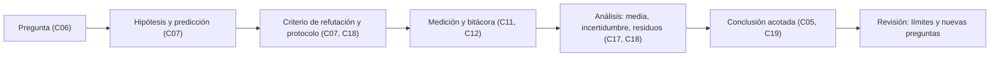

# B01-C20 — Proyecto de observación científica inicial

<!-- nav:top -->
[🏠 Programa](../../../../README.md) · [📚 Bloque B01](../../../tronco-comun/B01-el-universo-y-el-pensamiento-cientifico.md) · [← Anterior: B01-C19 — Fuentes confiables y desinformación espacial](../B01-C19-fuentes-confiables-y-desinformacion-espacial/CLASE.md) · [Siguiente: B02-C01 — Calendarios astronómicos en civilizaciones antiguas →](../../B02/B02-C01-calendarios-astronomicos-en-civilizaciones-antiguas/CLASE.md)
<!-- /nav -->

## 1. Ubicación, nivel y alcance

Vigésima y última clase del bloque B01. Integras en un solo trabajo lo que aprendiste desde C01: pregunta, hipótesis, predicción, instrumento, medición, incertidumbre, fuentes y conclusión. Sigues en el nivel N1.

Verás cómo planificar una observación real, llevar una bitácora, analizar los datos con su incertidumbre y escribir una conclusión que no vaya más allá de la evidencia. No hay conceptos nuevos: es el ensayo general del método. La rúbrica se publica **antes** (sección 20), de modo que sabes cómo se evalúa mientras trabajas.

## 2. Por qué esta clase existe

Entender el método no es lo mismo que aplicarlo. Cuando mides de verdad, aparecen problemas que los ejercicios no tienen: el cielo se nubla, el palo no está del todo vertical, la regla se mueve, los datos no coinciden con lo que predijiste. Un proyecto te enfrenta a eso, y lo que se evalúa no es que el resultado «salga bien», sino que cada paso sea honesto.

La decisión central es: **¿qué observación puedo hacer yo, con mis medios, que responda una pregunta concreta, y cómo comunico el resultado con la incertidumbre y los límites que le corresponden?** Aprenderás a elegir un proyecto viable, a escribir el protocolo y el criterio de refutación antes de medir, y a redactar una conclusión acotada.

## 3. Lo que podrás hacer al terminar

1. Elegir entre cuatro proyectos y justificar su viabilidad con un cálculo.
2. Escribir pregunta, hipótesis, predicción numérica y criterio de refutación antes de medir.
3. Llevar una bitácora con lugar, fecha, escala de tiempo, instrumentos, condiciones e incidencias.
4. Analizar los datos con media, incertidumbre tipo A y B, y propagación.
5. Escribir una conclusión acotada que distinga observado, inferido y modelo.
6. Elaborar un **proyecto con bitácora, datos y conclusión acotada**.

La evidencia es el proyecto del ejercicio 12 (sección 20).

## 4. Con qué llegas y cómo comprobarlo

Necesitas todo el bloque; en particular C06 (pregunta y viabilidad), C07 (hipótesis falsable), C11–C12 (observación), C17–C18 (modelo e incertidumbre) y C19 (fuentes). Cinco preguntas:

1. ¿Cuáles son los cinco criterios de una pregunta investigable?
2. ¿Qué debe decir un criterio de refutación y cuándo se escribe?
3. ¿Cómo se calcula la incertidumbre de la media de `n` lecturas?
4. ¿Qué altura tiene el Sol al mediodía en el equinoccio a `φ = −33,45°`?
5. ¿Cómo se mira el Sol de forma segura en esta clase?

<details>
<summary>Ver respuestas</summary>

1. Observable, medible, acotada, accesible y segura (C06). 2. El resultado numérico que haría rechazar la hipótesis, antes de medir (C07). 3. `s/√n` (C18). 4. `90° − 33,45° = 56,55°` (C11). 5. **No se mira**: se usa la sombra de un gnomon; para eclipses, visores ISO 12312-2 (C11).
</details>

Con cuatro o cinco aciertos, sigue; con tres o menos, repasa el bloque antes de medir.

## 5. Un caso real: cuando un resultado sobrevive a su prueba

En C07 viste una prueba famosa: en 1919 se puso a prueba la desviación de la luz de las estrellas por el Sol, y el debate posterior se centró en cómo se trataron los datos, no en si la prueba tenía sentido (S1). Un buen proyecto escolar comparte esa estructura en pequeño: una predicción que puede fallar, un procedimiento dicho de antemano, datos tratados con criterio declarado y una conclusión cuyo alcance se discute con franqueza.

Nuestro **ejemplo conductor** es el proyecto que puedes hacer con un palo y una regla: predecir y medir la altura del Sol al mediodía con un gnomon (C11). La NASA da la oblicuidad de la Tierra (23,44°), la ficha de la Luna da las cifras para el proyecto lunar, y la guía de seguridad de eclipses recuerda que **nunca se debe mirar directamente al Sol** y que las gafas de sol comunes no son seguras (S2, S3, S4). Límite: los datos de esta clase son de ejemplo; tu proyecto usará los tuyos.

## 6. Vocabulario

Un **protocolo** es la descripción previa de cómo se medirá: qué, cuándo, con qué instrumento, cuántas veces y qué se descarta. La **bitácora** es el registro cronológico de lo que hiciste y viste, con fecha, hora, escala de tiempo, lugar y condiciones. Una **incidencia** es lo que se desvió del protocolo (nubes, movimiento del soporte). Un **criterio de rechazo de datos** es la regla, escrita antes, para descartar una lectura. Una **conclusión acotada** afirma solo lo que los datos permiten, con su incertidumbre y supuestos. La **reproducibilidad** es la posibilidad de que otra persona repita tu procedimiento y obtenga un resultado compatible. Un **dato sintético** es el generado por una simulación; **observado**, el medido; **estimado**, el calculado a partir de otros con supuestos; **simulado**, el producido por un modelo. Un **hito** es un punto de control del proyecto.

## 7. Modelo mental: el proyecto como una cadena de compromisos

Imagina una cadena en la que cada eslabón es un compromiso que tomas **antes** de mirar el resultado: una pregunta, una hipótesis, una predicción, un criterio. Después viene la medición, y al final el análisis y la conclusión, que deben respetar los compromisos.



*Descripción textual:* siete pasos encadenados: pregunta, hipótesis y predicción, criterio y protocolo, medición con bitácora, análisis, conclusión acotada y revisión. Los tres primeros se escriben antes de medir; los últimos tres respetan lo escrito.

Analogía: una receta con la fotografía del plato esperado. Límite: en cocina el plato se juzga a ojo; en ciencia el criterio es numérico y se fija antes.

## 8. La explicación, paso a paso

### 8.1 Elegir el proyecto

Cuatro opciones con material accesible: **A. Altura del Sol con un gnomon** (palo, regla, plomada, reloj): predicción `h = 90° − |φ − δ|` (C11). **B. Diámetro angular de la Luna** (cámara, trípode, regla): predicción de la razón perigeo/apogeo 1,116 (C06, C07), que exige un teleobjetivo (C07). **C. Giro de las estrellas** (cámara, trípode): una estela de 15,04° por hora (C11). **D. Fase de la Luna** (ojo y calendario): predicción de la próxima luna llena con `P = 29,53 d` (C12). Elige según el clima, el horario y tus medios; **calcula la viabilidad** como en C06 antes de salir.

### 8.2 Escribir el protocolo y el criterio

El protocolo dice cuántas lecturas (al menos 5 a 10), cada cuánto, con qué instrumento, qué incertidumbre tipo B asignas (regla, vertical, tiempo) y cuándo se descarta una lectura. El criterio dice: «se refuta la hipótesis si `|h_medida − h_modelo| > 2·u_c`». Todo se firma con fecha **antes** de medir.

### 8.3 La bitácora

Cada entrada lleva: fecha y hora con escala (por ejemplo, hora local), lugar con latitud y fuente, instrumento y su estado, condiciones (nubes, viento), lectura con unidad, incidencias y quién midió. La bitácora es un documento cronológico: no se reescribe; si te equivocas, tachas y anotas la corrección. De la bitácora salen los datos **observados**; lo que calcules a partir de ellos es **estimado**.

### 8.4 Análisis con incertidumbre

Para el proyecto A con `g = 1,000 ± 0,002 m` y cinco sombras mínimas simuladas (0,664; 0,664; 0,653; 0,660; 0,663 m): `media = 0,6607 m`; `s = 0,0048 m`; `u = 0,0021 m`. La altura es `h = arctan(g/L) = 56,55°` y su incertidumbre, con la regla de propagación de la GUM (S5), `u_h = 0,10°` (`k = 1`), `0,20°` con `k = 2`. Las derivadas son `∂h/∂g = L/(g²+L²)` y `∂h/∂L = −g/(g²+L²)`. Con el modelo (`h = 56,55°`), la diferencia es 0,00° y el criterio `2·u = 0,20°` se cumple: compatible. **Advertencia:** estos datos son sintéticos y se generaron alrededor del modelo, de modo que el acuerdo es por construcción; con datos reales, el resultado puede ser otro.

### 8.5 Conclusión acotada

Una conclusión acotada tiene tres frases: lo que se midió («`h = 56,55° ± 0,20°`, `k = 2`, en [lugar] el [fecha]»), lo que se infiere con supuestos («compatible con `90° − |φ − δ|` si `δ = 0`») y lo que **no** se puede decir («no se puede afirmar que el modelo valga en otros días ni latitudes»). Si algo falló, se dice. Una conclusión que «confirma» sin límites es peor que una honesta de «compatible, con estas limitaciones».

## 9. Magnitudes, símbolos y unidades

| Símbolo | Qué es | Unidad | Valor o nota |
|---|---|---|---|
| `g` | altura del gnomon | m | 1,000 ± 0,002 (ejemplo) |
| `L` | sombra mínima | m | 0,6607 (media sintética) |
| `h` | altura del Sol | ° | `arctan(g/L)` = 56,55 |
| `u_h` | incertidumbre de `h` | ° | 0,10 (`k = 1`) |
| `φ`, `δ` | latitud y declinación | ° | −33,45 (ejemplo); 0 en equinoccio |
| `ε` | oblicuidad | ° | 23,44 (S2) |
| `k` | factor de cobertura | — | 2 |

## 10. Convenciones y referencias

Los datos de la bitácora de ejemplo son **sintéticos**; la latitud es **hipotética**; los cálculos son **estimados**; la oblicuidad y los datos lunares son **publicados**. En tu proyecto, rotula cada dato como observado, estimado, sintético o simulado, **sin mezclarlos**: **no presentar lo simulado como observado** es condición crítica. Los tiempos se registran con escala declarada (C04).

## 11. De dónde sale lo que afirmamos

| ID | Fuente | Localizador | Respalda | Estado |
|---|---|---|---|---|
| S1 | Kennefick, D., arXiv:0709.0685 | https://arxiv.org/abs/0709.0685 | La prueba de 1919 de la desviación de la luz y el debate sobre el tratamiento de los datos; postura del autor | Resumen consultado el 2026-11-05 |
| S2 | NASA NSSDC, *Earth Fact Sheet* (actualizada el 15-nov-2024) | https://nssdc.gsfc.nasa.gov/planetary/factsheet/earthfact.html | Oblicuidad 23,44°; rotación sidérea 23,9345 h | Página consultada el 2026-11-05 |
| S3 | NASA NSSDC, *Moon Fact Sheet* (actualizada el 11-ene-2024) | https://nssdc.gsfc.nasa.gov/planetary/factsheet/moonfact.html | Período sinódico 29,53 d; perigeo y apogeo medios 363 300 y 405 500 km | Página consultada el 2026-11-05 |
| S4 | NASA Science, «Eclipse safety» | https://science.nasa.gov/eclipses/safety/ | No mirar al Sol sin protección; gafas comunes no son seguras; ISO 12312-2; filtro propio en instrumentos; pinhole de espaldas al Sol | Página consultada el 2026-11-05 |
| S5 | JCGM 100:2008 (GUM) | https://www.bipm.org/documents/20126/2071204/JCGM_100_2008_E.pdf | Ley de propagación de incertidumbres, ecuación (10), 5.1.2; incertidumbre estándar, tipo A y B | PDF leído (texto extraído) el 2026-11-05; no se leyó completo |

Límites: ninguna fuente dice cómo hacer tu proyecto; el procedimiento es didáctico. Esta clase **no certifica ningún filtro, visor ni instrumento**.

## 12. Cómo ver el proyecto

Versión accesible del diagrama (una bitácora de ejemplo, **sintética**):

| N.º | Hora (escala declarada) | Lectura | Unidad | Incidencia |
|---|---|---|---|---|
| 1 | 13:05 (hora local) | 0,664 | m | ninguna |
| 2 | 13:10 | 0,664 | m | ninguna |
| 3 | 13:15 | 0,653 | m | nube pasajera |
| 4 | 13:20 | 0,660 | m | ninguna |
| 5 | 13:25 | 0,663 | m | ninguna |

Descripción larga: cinco entradas cronológicas, cada una con hora, lectura, unidad e incidencia; la lectura 3 tiene una incidencia que el protocolo debería tratar (criterio de rechazo). Las horas del ejemplo son ilustrativas.

## 13. Ejemplo trabajado: el proyecto A completo (datos sintéticos)

**Paso 1 · Pregunta.** ¿Coincide la altura del Sol al mediodía en el equinoccio, medida con un gnomon en un lugar a 33,45° S (hipotético), con la prevista por el modelo geométrico?

**Paso 2 · Hipótesis y predicción.** `h = 90° − |φ − 0°| = 56,55°`; sombra esperada `0,661 m` para `g = 1 m`.

**Paso 3 · Criterio (antes de medir).** Se refuta si `|h_medida − 56,55°| > 2·u_c(h)`. Protocolo: cinco lecturas, una cada 5 minutos alrededor del mediodía solar; se descarta una lectura solo si la sombra no está nítida o el palo se movió (anotado).

**Paso 4 · Datos.** Cinco sombras: 0,664; 0,664; 0,653; 0,660; 0,663 m (sintéticas).

**Paso 5 · Análisis.** `media = 0,6607 m`; `u_L = 0,0021 m`; con `u_g = 0,002 m`, `u_h = 0,10°`; `h = 56,55°`.

**Paso 6 · Decisión.** `|56,55 − 56,55| = 0,00° ≤ 0,20°`: compatible.

**Paso 7 · Conclusión acotada.** «Se midió `h = 56,55° ± 0,20°` (`k = 2`). Es compatible con la predicción geométrica para `δ = 0`. No se puede extender a otros días ni a otras latitudes con estos datos; un resultado compatible no demuestra el modelo, solo que sobrevivió a esta prueba.»

**Paso 8 · Revisión.** Fuente dominante de incertidumbre: la dispersión de las sombras (`0,0021 m`) frente a la altura del gnomon (`0,002 m`), de tamaño similar; mejorar ambas reduciría `u_h`. Nueva pregunta: ¿cómo cambia `h` entre dos semanas?

**Sentido físico.** El resultado importa menos que la cadena: cada paso es verificable y la conclusión no excede los datos.

## 14. Distintas formas de hacer el proyecto

**Individual con material mínimo** (gnomon): barato, seguro y reproducible. **Con cámara** (Luna, estrellas): produce imágenes y exige más análisis. **Con datos publicados**: sin instrumentos, pero la medición no es tuya. Para tu primer proyecto prioriza la honestidad del proceso sobre la sofisticación del instrumento.

## 15. Práctica guiada

**Ejercicio 1 · con los pasos indicados.** Escribe la predicción numérica y el criterio de refutación del proyecto A para tu latitud (usa 33,45° S si no la conoces). *Pasos:* sección 8.2.

<details><summary>Solución comentada</summary>

Predicción: `h = 56,55°`; sombra `0,661 m` con `g = 1 m`. Criterio: se refuta si `|h − 56,55°| > 2·u_c`. Si tu latitud es otra, usa `90° − |φ − δ|` con `δ = 0` en el equinoccio.
</details>

**Ejercicio 2 · con una pista.** Calcula `h` y `u_h` para `g = 1,000 ± 0,002` y `L = 0,661 ± 0,005`. *Pista:* derivadas de 8.4.

<details><summary>Solución comentada</summary>

`h = arctan(1/0,661) = 56,55°`. `g² + L² = 1,437`; `∂h/∂g = 0,661/1,437 = 0,460`; `∂h/∂L = −1/1,437 = −0,696`. `u_h² = (0,460 × 0,002)² + (0,696 × 0,005)² = (9,2 × 10⁻⁴)² + (3,48 × 10⁻³)²`; `u_h = 3,6 × 10⁻³ rad = 0,21°`. Domina `u_L`.
</details>

**Ejercicio 3 · casi autónomo.** Una bitácora tiene lecturas 0,660; 0,662; 0,658; 0,661; 0,659 m. Calcula media, `s` y `u`.

<details><summary>Solución comentada</summary>

`media = 0,660`; desviaciones `0, 0,002, −0,002, 0,001, −0,001`; `Σ² = 1 × 10⁻⁵ × 1 + ...`: `0 + 4 + 4 + 1 + 1 = 10 × 10⁻⁶`; `s = √(10 × 10⁻⁶/4) = 1,58 × 10⁻³ m`; `u = 1,58 × 10⁻³/√5 = 7,1 × 10⁻⁴ m`.
</details>

## 16. Práctica autónoma, transferencia e integrador

**Ejercicio 4.** Con las lecturas del ejercicio 3 y `g = 1,000 ± 0,002`, calcula `h ± u_h`.

<details><summary>Solución comentada</summary>

`h = arctan(1/0,660) = 56,57°`; `g² + L² = 1,4356`; `∂h/∂g = 0,4598`; `∂h/∂L = −0,6966`. `u_h² = (0,4598 × 0,002)² + (0,6966 × 0,00071)² = (9,2 × 10⁻⁴)² + (4,9 × 10⁻⁴)²`; `u_h = 1,04 × 10⁻³ rad = 0,060°`. Resultado: `56,57° ± 0,06°` (`k = 1`).
</details>

**Ejercicio 5.** Con ese resultado y el modelo (56,55°), ¿se refuta la hipótesis con el criterio de la sección 8.2?

<details><summary>Solución comentada</summary>

`|56,57 − 56,55| = 0,02° ≤ 2 × 0,06° = 0,12°`: no se refuta (compatible).
</details>

**Ejercicio 6.** Si el palo estuviera inclinado 1° hacia el Sol, ¿qué tipo de error introduce? ¿Lo reducen más lecturas?

<details><summary>Solución comentada</summary>

Sistemático: todas las sombras salen sesgadas igual; repetir no lo reduce (C18). Se corrige con plomada y se asigna una incertidumbre tipo B a la verticalidad.
</details>

**Ejercicio 7.** Calcula la viabilidad del proyecto B (Luna) con una cámara de 58,5″/px y un teleobjetivo ×5: ¿cuántos píxeles de diferencia entre perigeo y apogeo?

<details><summary>Solución comentada</summary>

Con 5×, los diámetros son `151` y `168,5 px` (C07): diferencia de `17,5 px`; con ±1 px, `σ_R = 0,0099` y la diferencia con la alternativa es ≈ 12σ: viable.
</details>

**Ejercicio 8.** Una lectura de la bitácora tiene la incidencia «nube pasajera». ¿Qué haces según el protocolo y qué NO haces?

<details><summary>Solución comentada</summary>

Aplicas el criterio de rechazo escrito antes: si la sombra no es nítida, se descarta y se anota el motivo. NO se descarta después de ver que la lectura «desentona»; eso sería ajustar los datos a la hipótesis.
</details>

**Ejercicio 9 · transferencia.** Un compañero obtiene `h = 60° ± 0,2°` donde el modelo da 56,55°. ¿Qué haces antes de concluir que el modelo falla?

<details><summary>Solución comentada</summary>

Reviso la fecha (¿δ ≠ 0?), la latitud, la verticalidad del palo, la horizontalidad del suelo y la hora del mediodía solar. La discrepancia de 3,45° es de 17σ: algo es sistemático, pero puede estar en el protocolo y no en el modelo.
</details>

**Ejercicio 10 · transferencia.** Redacta la frase de límite de un proyecto de la fase lunar (proyecto D).

<details><summary>Solución comentada</summary>

«La luna llena observada coincide con la predicha a ±X h con `P = 29,53 d`; el modelo es periódico y no incluye la variación real del ciclo; no se afirma validez para más de unos pocos ciclos.»
</details>

**Ejercicio 11 · transferencia.** Con S4, escribe la regla de seguridad que incluirás en tu protocolo si observas un eclipse solar.

<details><summary>Solución comentada</summary>

«Solo visores con ISO 12312-2 en buen estado durante toda la fase parcial; ningún instrumento óptico sin su propio filtro frontal; no mirar a través de cámara, telescopio o binoculares con gafas de eclipse puestas; proyección por estenopo dando la espalda al Sol; supervisión de menores.» No se certifica ningún visor aquí.
</details>

**Ejercicio 12 · integrador.** Elabora tu **proyecto con bitácora, datos y conclusión acotada**: elige uno de los cuatro proyectos (o uno propio equivalente); escribe pregunta, hipótesis, predicción numérica con fuente, criterio de refutación y protocolo antes de medir; lleva la bitácora con al menos cinco lecturas; analiza con media, incertidumbre tipo A y B y propagación; decide con tu criterio; escribe una conclusión acotada de tres frases, rotula cada dato como observado, estimado, sintético o simulado, y cita solo lo consultado.

<details><summary>Solución modelo</summary>

Un dosier con: ficha de planificación fechada, bitácora cronológica, tabla de datos con unidades, análisis con fórmulas, decisión frente al criterio, conclusión acotada, fuentes con fecha y estado, y un párrafo de «qué haría distinto». Se acepta cualquier proyecto viable con datos propios o, si no se pudo observar, datos sintéticos claramente rotulados.
</details>

## 17. Laboratorio: analizar tu bitácora en 80 líneas

El script [analizar_bitacora_gnomon.py](analizar_bitacora_gnomon.py) analiza la bitácora **sintética** de la sección 12: calcula media, `s`, `u`, `h`, `u_h` y aplica el criterio de refutación. Antes comprueba el caso analítico `g = L → 45°`, la propagación de `u_h` para `g = L` con `u = 0,01` y la comparación con una simulación Monte Carlo independiente de 200 000 tiradas dentro del 3 %; si no, se detiene. Puedes adaptarlo cambiando las lecturas por las tuyas (y quitando el rótulo sintético).

**Datos:** sintéticos (cinco sombras generadas alrededor del modelo con ruido de 0,004 m; lugar hipotético). **Predice antes:** ¿se refutará el modelo? (No: los datos se generaron desde él.) **Resultados (2026-11-05, Python 3.12.9, Windows):** modelo `h = 56,55°`, sombra `0,661 m`; sombras 0,664, 0,664, 0,653, 0,660, 0,663 m; `media = 0,6607 m`, `s = 0,0048 m`, `u = 0,0021 m`; `h = 56,55° ± 0,10°` (`k = 1`), `± 0,20°` (`k = 2`); `|h − h_modelo| = 0,00°` y compatible con el modelo.

```bash
python programa/clases/B01/B01-C20-proyecto-de-observacion-cientifica-inicial/analizar_bitacora_gnomon.py
```

**Límites:** datos sintéticos; supone gnomon vertical y suelo horizontal; no corrige refracción; el acuerdo con el modelo es por construcción.

## 18. Errores frecuentes y cómo corregirlos

**Escribir la hipótesis o el criterio después de medir.** Se corrige con 8.2 y el ejercicio 8.

**Descartar lecturas «que desentonan».** Ejercicio 8.

**Mezclar datos sintéticos con observados.** Se corrige con la sección 10.

**Concluir más de lo que muestran los datos.** Se corrige con 8.5 y el ejercicio 9.

**Descuidar la seguridad.** Se corrige con el ejercicio 11 y la sección 21.

## 19. Cómo sabrás que vas bien

Antes de medir: ¿tienes escritos pregunta, predicción numérica, criterio y protocolo, con fecha? Si no, no midas. Durante: ¿tu bitácora tiene fecha, hora con escala, lugar, instrumento e incidencias? Después: ¿puedes explicar la fuente dominante de incertidumbre? Al final: ¿tu conclusión dice lo que **no** se puede afirmar? Si dudas, relee 8.5.

## 20. Qué entregas y cómo se evalúa

La rúbrica se **publica antes** de que empieces. El producto es tu **proyecto con bitácora, datos y conclusión acotada**.

| Criterio | Inicial | En desarrollo | Logrado | Destacado |
|---|---|---|---|---|
| Pregunta y viabilidad | Vaga | Acotada sin cálculo | Acotada con cálculo de viabilidad | Compara opciones |
| Hipótesis y criterio | Posteriores a medir | Sin número | Numéricos y previos | Con prueba de discriminación |
| Bitácora | Incompleta | Sin escala de tiempo o lugar | Completa y cronológica | Con incidencias tratadas por el protocolo |
| Datos e incertidumbre | Sin `±` | Solo tipo A | Tipo A y B con propagación | Verifica con simulación y señala la fuente dominante |
| Conclusión | Excede los datos | Parcialmente acotada | Tres frases acotadas | Propone una nueva pregunta |
| Fuentes y honestidad | Sin cita o datos mezclados | Cita sin fecha | Cita lo consultado y rotula los datos | Declara lo que no pudo abrir o verificar |

**Condiciones críticas (no se compensan con promedio):** no presentar lo simulado como observado; citar solo lo consultado; no omitir la incertidumbre; fijar hipótesis y criterio antes de medir; respetar las reglas de seguridad solar.

## 21. Ética, seguridad y límites

**Nunca mires directamente al Sol, ni con instrumentos sin filtro propio.** Para el proyecto A basta la sombra. Para un eclipse, solo visores con ISO 12312-2 en buen estado y las reglas de S4; esta clase no certifica ningún filtro. Observa de noche en lugares seguros y acompañado; cuida la privacidad si fotografías lugares habitados. Reporta lo que ocurrió, incluidos fallos y datos descartados; no se manipulan datos. Si usas datos de otros, cítalos con fecha. Clase educativa. Accesibilidad: ecuaciones en texto, diagrama descrito, tablas equivalentes, sin conexión; el proyecto D puede hacerse con calendarios hablados o con ayuda de otra persona, y los proyectos A y C admiten registro táctil o sonoro.

## 22. Para cerrar y seguir

Un proyecto inicial es una cadena de compromisos honestos: pregunta viable, hipótesis y criterio previos, bitácora, incertidumbre calculada y conclusión acotada. Con esto cierras el bloque B01, «El universo y el pensamiento científico»: tienes el vocabulario, las escalas, el método y un proyecto propio. El tronco común sigue con el bloque B02.

**Glosario español–inglés.** protocolo · *protocol*; bitácora · *logbook*; incidencia · *incident*; conclusión acotada · *bounded conclusion*; reproducibilidad · *reproducibility*; dato sintético · *synthetic data*; criterio de rechazo · *rejection criterion*.

**Continuidad.** El bloque B02 usa tu capacidad de **plantear, medir y reportar una observación con incertidumbre y límites** como base de los contextos históricos y culturales de la astronomía. Los bloques técnicos (A02 en adelante) reutilizarán el criterio de rechazo previo, la propagación y los rótulos observado/estimado/sintético/simulado.

**Referencias:** ver sección 11. S1 es un resumen; S2 a S4 son datos y guías oficiales consultados; S5 es una guía internacional consultada parcialmente.

<!-- nav:bottom -->
---

[← Anterior: B01-C19 — Fuentes confiables y desinformación espacial](../B01-C19-fuentes-confiables-y-desinformacion-espacial/CLASE.md) · [📚 Bloque B01](../../../tronco-comun/B01-el-universo-y-el-pensamiento-cientifico.md) · [Siguiente: B02-C01 — Calendarios astronómicos en civilizaciones antiguas →](../../B02/B02-C01-calendarios-astronomicos-en-civilizaciones-antiguas/CLASE.md)
<!-- /nav -->
