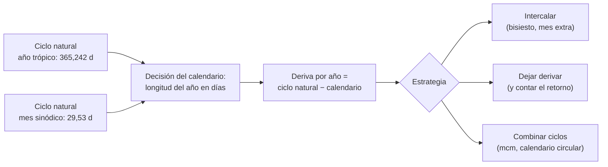

# B02-C01 — Calendarios astronómicos en civilizaciones antiguas

<!-- nav:top -->
[🏠 Programa](../../../../README.md) · [📚 Bloque B02](../../../tronco-comun/B02-historia-arqueoastronomia-y-culturas-del-cielo.md) · [← Anterior: B01-C20 — Proyecto de observación científica inicial](../../B01/B01-C20-proyecto-de-observacion-cientifica-inicial/CLASE.md) · [Siguiente: B02-C02 — Observación mesopotámica y egipcia →](../B02-C02-observacion-mesopotamica-y-egipcia/CLASE.md)
<!-- /nav -->

## 1. Ubicación, nivel y alcance

Primera clase del bloque B02. En B01 aprendiste que un ciclo natural (día, mes, año) se mide de varias maneras y que cada una da un número distinto (B01-C04). Aquí das el paso siguiente: ¿qué hace una sociedad cuando necesita **contar los días a lo largo de años y siglos** con ciclos que no encajan entre sí? Nivel N1.

Verás por qué ningún calendario puede ser a la vez simple y exacto, cómo se mide su desajuste con el cielo y cómo algunas tradiciones resolvieron el problema: ajustando (intercalando), dejando que el calendario derive, o combinando varios ciclos. No verás todavía la observación de cada pueblo en detalle (C02 a C07) ni los métodos para fechar monumentos (C08 y C09).

## 2. Por qué esta clase existe

Un calendario es una promesa: «dentro de tantos días ocurrirá tal cosa en el cielo o en la tierra». Esa promesa solo se cumple si el calendario sigue algún ciclo natural. El problema es que el año trópico (365,242 días, B01-C04) y el mes sinódico (29,53 días) no son múltiplos enteros de un día ni uno del otro. Todo calendario es, por tanto, una **decisión** sobre qué ciclo respetar y qué error tolerar.

La pregunta motivadora es: **¿cuánto se desajusta un calendario respecto del cielo, y qué se hace con ese desajuste?** Al terminar sabrás calcular la deriva de cualquier calendario simple, y sabrás distinguir lo que las fuentes dicen de un calendario concreto de lo que nosotros inferimos.

## 3. Lo que podrás hacer al terminar

1. Explicar por qué un año de días enteros se desfasa de las estaciones y calcular cuánto.
2. Calcular cada cuántos años se acumula un día de error para calendarios de 365; 365,25 y 365,2425 días.
3. Reconocer tres estrategias: intercalar, derivar y combinar ciclos.
4. Verificar que 19 años trópicos y 235 meses sinódicos casi coinciden (ciclo metónico).
5. Calcular el mínimo común múltiplo de dos ciclos y explicar qué significa en un calendario circular.
6. Separar, para un calendario concreto, lo que dice una fuente de lo que es interpretación.

La evidencia es la **ficha de deriva de un calendario** del ejercicio 12 (sección 20).

## 4. Con qué llegas y cómo comprobarlo

Necesitas B01-C04 (día, mes, año) y operaciones básicas con decimales. Cinco preguntas:

1. ¿Cuántos días tienen 4 años de 365 días? ¿Y 4 años trópicos de 365,242 días?
2. ¿Qué es el mes sinódico y cuánto dura?
3. Si algo se desfasa 0,25 días por año, ¿en cuántos años acumula 1 día?
4. ¿Qué es un múltiplo común de 6 y 4? ¿Cuál es el menor?
5. ¿Para qué sirve declarar el tipo de «año» que usas?

<details>
<summary>Ver respuestas</summary>

1. 1 460 d y 1 460,968 d. 2. El tiempo entre dos fases iguales de la Luna: 29,53 d. 3. En 4 años (1/0,25). 4. 12 es múltiplo común; el menor es 12. 5. Porque «año» puede ser sidéreo, trópico o juliano y difieren.
</details>

Con cuatro o cinco aciertos, sigue. Con tres o menos, repasa B01-C04.

## 5. Un caso real: el año nuevo que sigue al Sol

En una actividad de la Universidad de Chile se explicó que el solsticio de invierno inicia un nuevo ciclo y marca el año nuevo mapuche, el *We Tripantu* o *Wiñol Tripantu*, que se vincula con el «regreso del sol» (S1). La fuente es una nota de prensa universitaria que resume las charlas de dos académicas de la Universidad Católica de Temuco, Margarita Canío Llanquinao y Gabriel Pozo Menares, quienes presentan el trabajo *Wenumapu* sobre astronomía y cosmología mapuche; la nota indica que el conocimiento proviene de un proyecto de unos diez años que recogió relatos de familias mapuche de varios territorios (S1).

Fíjate en lo esencial para esta clase: ese calendario **ancla su inicio a un fenómeno del cielo** (el solsticio), no a un recuento fijo de días. Eso es una estrategia distinta de la de nuestro calendario civil, que fija la longitud del año y se corrige con días bisiestos. Ninguna es «mejor»: responden a preguntas diferentes. Ten presente el límite: la nota es divulgativa y no describe cómo se cuentan los días intermedios ni las variantes entre territorios; esos detalles deben consultarse con las fuentes de las propias comunidades y con la bibliografía especializada (clase C06).

## 6. Vocabulario

Un **calendario** es un sistema para numerar y agrupar días. Un **año trópico** es el ciclo de las estaciones (365,242 días, S2); un **mes sinódico** es el ciclo de las fases de la Luna (29,53 días, S3). La **deriva** es la diferencia acumulada entre un calendario y el fenómeno que pretende seguir. **Intercalar** es añadir un día o un mes de vez en cuando para corregir la deriva. Un **calendario lunisolar** intenta seguir a la vez la Luna y el Sol. Un **calendario circular** combina dos o más ciclos que se repiten juntos tras un número entero de vueltas; ese número es su **mínimo común múltiplo (mcm)**.

El **ciclo metónico** es la casi coincidencia entre 19 años trópicos y 235 meses sinódicos, que sirvió de base a calendarios lunisolares de la Antigüedad (la fuente que consultamos lo menciona en el mecanismo de Anticitera, S4).

## 7. Modelo mental: un engranaje de ciclos que casi encajan

Imagina dos ruedas dentadas: una gira una vez cada año y la otra una vez cada mes. Si los dientes encajaran exactamente, el calendario sería perfecto. Como no encajan, siempre sobra un poco, y ese «poco» se acumula.



*Descripción textual:* dos ciclos naturales (año y mes) entran en una decisión: cuántos días cuenta el calendario. De la diferencia sale la deriva por año, y de ella tres estrategias posibles: intercalar días o meses, dejar derivar y contar cuándo se cierra el ciclo completo, o combinar varios ciclos en uno mayor.

Una analogía: un reloj que adelanta un minuto al día. No está «roto»: si sabes cuánto adelanta, puedes corregirlo o contar con ello. El límite de la analogía: un reloj tiene un tiempo de referencia único; los calendarios pueden elegir referencias distintas (Sol, Luna, Venus, un ciclo ritual) y todas son legítimas para su propósito.

## 8. La explicación, paso a paso

### 8.1 Un año de días enteros se desfasa

Si un calendario cuenta 365 días por año y el año trópico dura 365,242 d (S2), cada año el calendario se queda corto en `365,242 − 365 = 0,242 d`. En cuatro años son 0,968 d, casi un día. Una fecha ligada a una estación, como el solsticio, se corre entonces un día cada cuatro años, aproximadamente (`1/0,242 = 4,13` años).

### 8.2 Intercalar: el año bisiesto

Una solución es añadir un día cada cierto número de años. El año juliano promedia 365,25 d (un día cada cuatro años); la deriva baja a `365,242 − 365,25 = −0,008 d` por año, es decir, un día de exceso cada 125 años. El calendario gregoriano usa 97 años bisiestos cada 400, con promedio `(97 × 366 + 303 × 365)/400 = 365,2425 d`, y su deriva baja a `−0,0005 d` por año, un día cada 2 000 años aproximadamente. Esta última cifra solo es indicativa: el año trópico se conoce aquí con tres decimales (S2), y esa precisión limita cuánto se puede afirmar.

### 8.3 Dejar derivar y contar la vuelta

Otra estrategia es no corregir y observar la deriva como un ciclo más. Un calendario civil de 365 días exactos recorre las estaciones completas en `365/0,25 ≈ 1 460` años si se compara con el año juliano de 365,25 d, un número que la tradición historiográfica asocia con el Egipto antiguo (esa asociación no la consultamos en una fuente primaria para esta clase; queda marcada como pendiente en la sección 11). Lo que importa aquí es el método: una deriva constante se convierte en un ciclo largo y medible.

### 8.4 Combinar ciclos: el calendario circular

Un resumen estructural del calendario maya, según el resumen de un artículo de matemática histórica, describe el *Haab'* (civil, 365 días), el *Tzolk'in* (religioso, 260 días) y una cuenta larga formada por unidades de 360, 7 200 y 144 000 días: el *tun*, el *katun* y el *baktun* (S5). Solo consultamos el resumen, y el artículo propone explicaciones sobre el origen de esos ciclos que son hipótesis de su autor, no consenso. Con la estructura basta para calcular: los dos ciclos de 260 y 365 días vuelven a coincidir tras `mcm(260, 365) = 18 980` días, que son `18 980/365 = 52` vueltas del ciclo de 365 y `18 980/260 = 73` del de 260. Esa coincidencia periódica es lo que hace circular al calendario. Ojo: el mcm es aritmética, no una afirmación sobre qué hacían los mayas con él.

### 8.5 Luna y Sol juntos: el ciclo metónico

Doce meses sinódicos suman `12 × 29,53 = 354,36 d`, once días menos que un año. Para que un calendario lunar siga a las estaciones hay que añadir un mes de vez en cuando. Una regularidad útil es que `19 × 365,242 = 6 939,60 d` y `235 × 29,53 = 6 939,55 d`, que difieren en solo 0,05 d. Por eso 19 años equivalen casi exactamente a 235 meses, y un calendario lunisolar puede repartir 7 meses extra en 19 años. Los autores del estudio sobre el mecanismo de Anticitera describen un dial de calendario metónico en ese aparato (S4); es un indicio de que el ciclo se conocía y se usaba, no una descripción general de todos los calendarios griegos.

### 8.6 El cielo como calendario: marcar el horizonte

Un calendario no tiene que ser un recuento escrito: puede ser un lugar. En Chankillo (costa de Perú) se ha propuesto que una hilera de 13 torres de unos 300 m funcionó como observatorio solar, con dos puntos de observación desde los cuales las torres aparecen en el horizonte y abarcan los arcos de salida y puesta del Sol a lo largo del año; los autores sostienen que el sitio data aproximadamente del siglo IV a. C. (S6). Esta información procede del comunicado de la universidad sobre el artículo de *Science* de 2007, no del artículo, y la lectura política («controlar el calendario») se presenta allí como propuesta. Volveremos a este caso en C08 y C09 con herramientas para evaluarlo.

## 9. Magnitudes, símbolos y unidades

| Símbolo | Qué es | Unidad | Valor o nota |
|---|---|---|---|
| `Y_t` | año trópico | d | 365,242 (S2) |
| `M_s` | mes sinódico | d | 29,53 (S3) |
| `L` | longitud del año del calendario | d | 365; 365,25; 365,2425 |
| `δ` | deriva por año `= Y_t − L` | d/año | signo: positivo si el calendario queda corto |
| `N` | años para acumular 1 día `= 1/|δ|` | años | indicativo |
| mcm | mínimo común múltiplo de dos ciclos | d | 18 980 para 260 y 365 |

## 10. Convenciones y referencias

Todos los períodos son valores medios publicados, no efemérides, y se redondean a la precisión de la fuente. Los años juliano (365,25 d) y gregoriano (365,2425 d) son **convenciones aritméticas** de los calendarios, no mediciones. Las fechas se escriben con la era habitual (a. C./d. C.); las correlaciones entre cuentas antiguas y nuestro calendario son un asunto aparte, con incertidumbre propia, que no se resuelve en esta clase.

## 11. De dónde sale lo que afirmamos

| ID | Fuente | Localizador | Respalda | Estado |
|---|---|---|---|---|
| S1 | Universidad de Chile, «Saberes mapuche iluminan el solsticio en la U. de Chile» (nota institucional) | https://uchile.cl/noticias/229431/saberes-mapuche-iluminan-el-solsticio-en-la-u-de-chile | Solsticio de invierno como inicio del ciclo y año nuevo *We Tripantu/Wiñol Tripantu*; proyecto de unos 10 años con familias mapuche; ponentes | Página consultada el 2026-11-05; fuente divulgativa |
| S2 | NASA NSSDC, *Earth Fact Sheet* | https://nssdc.gsfc.nasa.gov/planetary/factsheet/earthfact.html | Año trópico 365,242 d | Consultada el 2026-11-05 (act. 15-nov-2024) |
| S3 | NASA NSSDC, *Moon Fact Sheet* | https://nssdc.gsfc.nasa.gov/planetary/factsheet/moonfact.html | Mes sinódico 29,53 d | Consultada el 2026-11-05 (act. 11-ene-2024) |
| S4 | Freeth et al., «A Model of the Cosmos in the ancient Greek Antikythera Mechanism», *Sci. Rep.* 11, 5821 (2021), doi:10.1038/s41598-021-84310-w | https://pmc.ncbi.nlm.nih.gov/articles/PMC7955085 | Dial de calendario metónico; la reconstrucción es parcial | Texto consultado el 2026-11-05 (resumen y secciones indicadas por la herramienta) |
| S5 | T. Chanier, «The Mayan Long Count Calendar», arXiv:1312.1456 | https://arxiv.org/abs/1312.1456 | Estructura: Haab' 365 d, Tzolk'in 260 d, tun/katun/baktun | Solo el resumen, 2026-11-05; sus propuestas de origen son hipótesis del autor |
| S6 | Comunicado sobre Ghezzi y Ruggles, «Chankillo: a 2300-year-old solar observatory in coastal Peru», *Science* 315 (2007), doi:10.1126/science.1136415 | https://www.eurekalert.org/news-releases/735620 | 13 torres, dos puntos de observación, siglo IV a. C. según los autores | Comunicado consultado el 2026-11-05; el artículo no se leyó |

**Pendiente de fuente:** la asociación del calendario civil de 365 días con el Egipto antiguo y la regla gregoriana de 97 bisiestos cada 400 años son conocimiento general que no verificamos con una fuente consultada para esta clase. La regla gregoriana es aritmética verificable en el script; la asociación egipcia debe confirmarse antes de la revisión disciplinar. Las fuentes de orientación del bloque (NASA-DATA, IAU, ESO, ADS) son preliminares.

## 12. Cómo ver los calendarios

Esta tabla es la versión accesible de un gráfico de deriva.

| Calendario | Días por año `L` | Deriva `δ` (d/año) | Un día de error cada |
|---|---|---|---|
| Civil de 365 d | 365 | +0,242 | ≈ 4 años |
| Juliano | 365,25 | −0,008 | ≈ 125 años |
| Gregoriano | 365,2425 | −0,0005 | ≈ 2 000 años (indicativo) |

Si lo dibujas, usa escala logarítmica en el eje del tiempo y distingue las series por forma de marcador y no solo por color. Descripción larga: la deriva baja de unos 0,24 d/año a cerca de 0,0005 d/año, casi tres órdenes de magnitud.

## 13. Ejemplo trabajado: ¿cuándo se desfasa un solsticio?

**Planteamiento.** Un calendario civil de 365 días fija el solsticio en el día 355 del año. ¿Cuántos años pasan hasta que el solsticio cae en el día 354, y cuánto dura la vuelta completa de las estaciones?

**Paso 1 · Deriva.** `δ = 365,242 − 365 = 0,242 d/año` (sección 8.1): cada año el solsticio llega 0,242 d «más tarde» que el recuento.

**Paso 2 · Un día de corrimiento.** `N = 1/0,242 = 4,13` años. En un ejercicio idealizado, el solsticio se corre un día cada 4 años aproximadamente.

**Paso 3 · Vuelta completa.** Para recorrer los 365 días del calendario: `365/0,242 = 1 508` años con el año trópico; `365/0,25 = 1 460` años con el juliano. La diferencia entre ambas cifras es la que dejan los distintos «años» de referencia (B01-C04).

**Paso 4 · Incertidumbre.** El año trópico tiene tres decimales; la vuelta completa varía entre 1 460 y 1 508 años según la referencia. Declara cuál usaste.

**Sentido físico.** La deriva es lenta pero inexorable: una sociedad con un calendario fijo de 365 días habría notado, en una vida, un corrimiento de varios días, y en un par de siglos, de más de un mes. Es un cálculo nuestro; no afirma que ninguna sociedad concreta lo haya hecho.

## 14. Distintas estrategias, y cuándo dejan de servir

**Intercalar** mantiene el calendario cerca del cielo pero exige una regla (o una autoridad que decida cuándo). **Dejar derivar** es simple y el desajuste se vuelve un ciclo medible, pero las fechas estacionales se mueven. **Combinar ciclos** sirve para ordenar rituales o predecir coincidencias, pero no sigue por sí solo una estación. **Anclar al horizonte o a un fenómeno** (solsticio, orto de una estrella) no deriva, pero depende de poder observar y reconocer el fenómeno. Ninguna estrategia es superior en abstracto; se juzga por el propósito del calendario.

## 15. Práctica guiada

**Ejercicio 1 · con los pasos indicados.** ¿Cuánta deriva tiene un calendario de 365 días en 40 años? *Pasos:* multiplica `δ = 0,242 d/año` por 40 (sección 8.1).

<details><summary>Solución comentada</summary>

`0,242 × 40 = 9,68 d`: casi diez días. Es la razón de que los calendarios sin corrección se separen visiblemente de las estaciones en una vida.
</details>

**Ejercicio 2 · con una pista.** Calcula la longitud media del año con la regla de 97 bisiestos cada 400 años. *Pista:* `(97·366 + 303·365)/400`.

<details><summary>Solución comentada</summary>

`(35 502 + 110 595)/400 = 146 097/400 = 365,2425 d` (sección 8.2). Si te dio 365,25, usaste un bisiesto cada 4 años sin la excepción de los siglos.
</details>

**Ejercicio 3 · casi autónomo.** Comprueba que 19 años trópicos ≈ 235 meses sinódicos. ¿Cuántos días de diferencia hay?

<details><summary>Solución comentada</summary>

`19 × 365,242 = 6 939,60`; `235 × 29,53 = 6 939,55`; diferencia `0,05 d` (sección 8.5). Es una coincidencia aproximada: el mes sinódico tiene solo cuatro cifras, así que la diferencia real puede variar unas décimas.
</details>

## 16. Práctica autónoma, transferencia e integrador

**Ejercicio 4.** ¿Cuántos años tarda un calendario juliano en acumular 3 días de exceso respecto del año trópico?

<details><summary>Solución comentada</summary>

`3/0,008 = 375` años. Con tres decimales en `Y_t` es una cifra indicativa (sección 8.2).
</details>

**Ejercicio 5.** Calcula `mcm(260, 365)` y explica qué significa el resultado.

<details><summary>Solución comentada</summary>

`260 = 2²·5·13` y `365 = 5·73`; `mcm = 2²·5·13·73 = 18 980`. Después de 18 980 días ambos ciclos empiezan a la vez, tras 73 vueltas de 260 y 52 de 365 (sección 8.4).
</details>

**Ejercicio 6.** Doce meses sinódicos, ¿cuántos días faltan para un año trópico?

<details><summary>Solución comentada</summary>

`12 × 29,53 = 354,36`; `365,242 − 354,36 = 10,88 d`. Eso explica por qué un calendario lunar puro se corre por las estaciones unos 11 días al año (sección 8.5).
</details>

**Ejercicio 7.** Un calendario fija el año en 365,2422 d. ¿Cuál es su deriva respecto de `Y_t = 365,242`, y por qué conviene desconfiar de ese cálculo?

<details><summary>Solución comentada</summary>

`δ = −0,0002 d/año`, un día cada 5 000 años. Conviene desconfiar porque `Y_t` se conoce aquí con tres decimales: la diferencia está por debajo de la precisión del dato (sección 8.2).
</details>

**Ejercicio 8.** Los autores del estudio de Chankillo hablan de torres que cubren la salida del Sol a lo largo del año. ¿Qué parte de esa afirmación es dato del sitio y cuál es interpretación?

<details><summary>Solución comentada</summary>

Dato: existe una hilera de 13 torres y dos puntos de observación. Interpretación: que fueron construidos para observar el Sol y que sirvieron como calendario y con significado político (sección 8.6). La clase C08 enseña cómo se evalúa.
</details>

**Ejercicio 9 · transferencia.** Un compañero dice: «el calendario mapuche está mal porque no tiene bisiestos». Responde con lo aprendido.

<details><summary>Solución comentada</summary>

El enunciado confunde el criterio: un calendario anclado a un fenómeno del cielo (el solsticio, S1) no necesita bisiestos, porque se reinicia con el fenómeno. Además, la fuente consultada no describe cómo se cuentan los días intermedios, por lo que no podemos afirmar nada sobre su «exactitud»; habría que consultar a las comunidades y la bibliografía especializada.
</details>

**Ejercicio 10 · transferencia.** Un calendario circular combina ciclos de 20 y 13 días. ¿Cuándo vuelven a coincidir?

<details><summary>Solución comentada</summary>

`mcm(20, 13) = 260` (13 es primo y no divide a 20). Es un ejemplo de aritmética; la conexión histórica con el ciclo de 260 días (S5) es una observación del resumen que consultamos, no una prueba de cómo se formó.
</details>

**Ejercicio 11 · transferencia.** Un artículo afirma: «un calendario se descalibra un día cada 4 años». ¿Para qué calendario es aproximadamente cierto y para cuáles no?

<details><summary>Solución comentada</summary>

Para un calendario de 365 días exactos (`N ≈ 4,13` años). No para el juliano (125 años) ni el gregoriano (≈ 2 000), donde el bisiesto ya corrigió la mayor parte.
</details>

**Ejercicio 12 · integrador.** Elabora la *ficha de deriva de un calendario* (sección 20) para un calendario de tu elección (cívico, lunisolar o circular): longitud del año o ciclos, deriva y cada cuántos años se acumula un día, estrategia usada, qué dicen las fuentes y qué es interpretación tuya.

<details><summary>Solución modelo</summary>

Una ficha completa sigue el ejemplo de la sección 13: da `L`, calcula `δ` y `N`, nombra la estrategia (sección 14), cita fuentes con su estado y marca con claridad lo calculado frente a lo documentado. Se acepta cualquier calendario con fuente citada.
</details>

## 17. Laboratorio: deriva y ciclos en 50 líneas

El script [ciclos_de_calendario.py](ciclos_de_calendario.py) calcula la deriva de los tres calendarios, la vuelta completa de un año de 365 días, el mcm de 260 y 365 y la comparación metónica. Antes comprueba el mcm (18 980), la regla gregoriana (365,2425) y que 19 años trópicos y 235 meses sinódicos difieran menos de 0,3 d; si no, se detiene.

**Datos:** publicados (NASA) y convenciones aritméticas (rotulados en la cabecera). **Predice antes de ejecutar:** ¿cada cuántos años se acumula un día en el calendario juliano? (Unos 125.) **Resultados (2026-11-05, Python 3.12.9):** deriva civil +0,2420 d/año (1 día cada 4 años); juliano −0,0080 d/año (125 años); gregoriano −0,0005 d/año (2 000 años); vuelta del año de 365 d: 1 460 años; `mcm(260, 365) = 18 980` d = 52 años de 365 d; 19 años trópicos = 6 939,60 d, 235 meses = 6 939,55 d, diferencia +0,05 d.

```bash
python programa/clases/B02/B02-C01-calendarios-astronomicos-en-civilizaciones-antiguas/ciclos_de_calendario.py
```

**Límites:** usa períodos medios y no calcula fechas reales; la cifra gregoriana es indicativa por la precisión de `Y_t`. No sirve para convertir fechas históricas entre calendarios.

## 18. Errores frecuentes y cómo corregirlos

**Pensar que un calendario «exacto» existe.** Todo calendario elige un ciclo. Se corrige con el ejercicio 2.

**Creer que la deriva es un defecto.** Puede ser una estrategia (sección 8.3). Se corrige con el ejercicio 9.

**Confundir cálculo con registro histórico.** Calcular un mcm no prueba que una sociedad lo usara. Se corrige con los ejercicios 5 y 8.

**Atribuir cifras sin fuente.** Se corrige con la sección 11 y la ficha del ejercicio 12.

**Mezclar los «años».** Se corrige con el ejercicio 11 y B01-C04.

## 19. Cómo sabrás que vas bien

Tras 8.1: ¿puedes explicar por qué 365 días se quedan cortos? Si no, repite el ejercicio 1. Tras 8.4: ¿qué es el mcm de dos ciclos? Si dudas, rehaz el ejercicio 5. Tras el ejemplo trabajado: ¿puedes calcular `N` para otro calendario sin mirar? Si no, haz el ejercicio 4. Tras el laboratorio: ¿qué comprueba el script antes de calcular? Lee la cabecera. Al final: ¿puedes decir qué parte de la ficha es dato y cuál inferencia? Si no, vuelve al ejercicio 8.

## 20. Qué entregas y cómo se evalúa

El producto es tu **ficha de deriva de un calendario**: una página con longitud del año o ciclos, deriva, estrategia, cálculo, fuentes y límites.

| Criterio | Inicial | En desarrollo | Logrado | Destacado |
|---|---|---|---|---|
| Cálculo de deriva | Sin cálculo | Con errores | Correcto con unidades | Con incertidumbre del dato |
| Estrategia | No la nombra | La nombra | La nombra y la justifica | La compara con otra |
| Fuentes y alcance | Sin fuente | Fuente sin alcance | Fuente con alcance | Distingue dato, cálculo e interpretación |
| Respeto cultural | Juzga con criterio ajeno | Descriptivo | Contextualiza el propósito | Cita voces de las propias comunidades |

**Condiciones críticas:** citar solo fuentes consultadas; no presentar un cálculo propio como práctica histórica documentada; no tratar un calendario como «error» por no coincidir con el civil.

## 21. Ética, seguridad y límites

Los calendarios de los pueblos son saberes vivos, no curiosidades. En esta clase usamos ejemplos de comunidades vivas (mapuche) y de sociedades antiguas; no usamos material restringido ni inferimos ceremonias. Cuando una fuente es divulgativa (S1, S6), lo decimos. Los cálculos son educativos y no sirven para fechar hallazgos ni para fines religiosos. Accesibilidad: ecuaciones en texto, diagramas descritos, tablas equivalentes y script sin conexión.

## 22. Para cerrar y seguir

Un calendario es una decisión sobre qué ciclo respetar y qué error tolerar. Se calcula la deriva restando, se corrige intercalando, se acepta contando la vuelta, o se combina con otros ciclos; y siempre se distingue lo que una fuente documenta de lo que uno infiere. Queda abierta la pregunta de cómo se observó el cielo para construir esos ciclos, que abre C02.

**Glosario español–inglés.** calendario · *calendar*; deriva · *drift*; intercalar · *to intercalate*; calendario lunisolar · *lunisolar calendar*; ciclo metónico · *Metonic cycle*; mínimo común múltiplo · *least common multiple*; año trópico · *tropical year*.

**Continuidad.** B02-C02 usa tu capacidad de **calcular la deriva de un ciclo** para entender cómo se registraron y predijeron fenómenos en Mesopotamia y Egipto. B02-C08 retomará el caso de Chankillo.

**Referencias:** ver sección 11. S1 y S6 son divulgativas; S5 es solo resumen.

<!-- nav:bottom -->
---

[← Anterior: B01-C20 — Proyecto de observación científica inicial](../../B01/B01-C20-proyecto-de-observacion-cientifica-inicial/CLASE.md) · [📚 Bloque B02](../../../tronco-comun/B02-historia-arqueoastronomia-y-culturas-del-cielo.md) · [Siguiente: B02-C02 — Observación mesopotámica y egipcia →](../B02-C02-observacion-mesopotamica-y-egipcia/CLASE.md)
<!-- /nav -->
