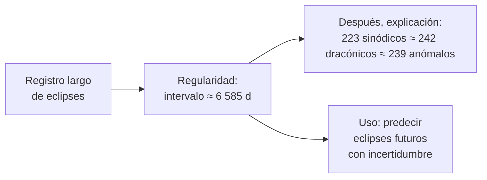

# B02-C02 — Observación mesopotámica y egipcia

<!-- nav:top -->
[🏠 Programa](../../../../README.md) · [📚 Bloque B02](../../../tronco-comun/B02-historia-arqueoastronomia-y-culturas-del-cielo.md) · [← Anterior: B02-C01 — Calendarios astronómicos en civilizaciones antiguas](../B02-C01-calendarios-astronomicos-en-civilizaciones-antiguas/CLASE.md) · [Siguiente: B02-C03 — Astronomía griega y helenística →](../B02-C03-astronomia-griega-y-helenistica/CLASE.md)
<!-- /nav -->

## 1. Ubicación, nivel y alcance

Segunda clase del bloque B02. En B02-C01 viste que un calendario es una decisión sobre qué ciclo seguir. Aquí preguntas **cómo se obtuvieron los números de los ciclos**: qué se anotaba, durante cuánto tiempo y qué se podía predecir con esos registros en Mesopotamia y en Egipto. Nivel N1.

Verás la diferencia entre llevar un registro continuo y deducir una regularidad, y harás tú mismo el cálculo que explica por qué el ciclo de Saros «cierra». No verás la astronomía griega que heredó estos datos (C03), ni la astrología mesopotámica más allá de situarla.

## 2. Por qué esta clase existe

Una predicción necesita una larga memoria. Para decir que un fenómeno volverá, alguien tuvo que anotarlo muchas veces y compararlo. La pregunta motivadora es: **¿qué se puede predecir sin saber por qué ocurre, solo con registros largos y cuidadosos?** La respuesta tiene aplicación hoy: los modelos estadísticos también predicen a partir de series largas, y los registros antiguos se siguen usando en la ciencia moderna.

Al terminar sabrás distinguir **registro**, **regularidad** y **explicación**, y podrás calcular con datos publicados por qué 223 meses lunares casi igualan a 242 meses de nodo a nodo.

## 3. Lo que podrás hacer al terminar

1. Distinguir un registro de observaciones de una regla de predicción.
2. Describir cómo funciona el ciclo de Saros con sus tres períodos lunares.
3. Calcular las diferencias entre 223, 239 y 242 meses de cada tipo.
4. Explicar por qué un eclipse se repite desplazado en longitud tras un Saros.
5. Describir la estructura del calendario civil egipcio y su deriva.
6. Separar, en un relato histórico, el testimonio de la fuente y la reconstrucción moderna.

La evidencia es la **ficha de registro y regla** del ejercicio 12 (sección 20).

## 4. Con qué llegas y cómo comprobarlo

Necesitas B02-C01 y B01-C04. Cinco preguntas:

1. ¿Qué es un mes sinódico y cuánto dura?
2. Si la Tierra gira 360° en 24 h, ¿cuántos grados gira en 8 h?
3. ¿Cuántos días tiene un calendario de 12 meses de 30 días más 5 días?
4. ¿Qué diferencia hay entre «lo observé» y «lo calculé»?
5. Si un ciclo se repite cada 18 años, ¿cuántas veces ocurre en 90 años?

<details>
<summary>Ver respuestas</summary>

1. Tiempo entre dos fases iguales, 29,53 d. 2. 120°. 3. 365. 4. Lo primero es un dato; lo segundo, una consecuencia de un modelo. 5. Cinco.
</details>

Con cuatro o cinco aciertos, sigue. Con tres o menos, repasa C01.

## 5. Un caso real: los diarios de Babilonia

Los *diarios astronómicos babilónicos* son textos cuneiformes que la edición de referencia, de Abraham Sachs completada por Hermann Hunger (Academia Austriaca de Ciencias, 1988), reúne en tres volúmenes: diarios de 652 a 262 a. C., de 261 a 165 a. C. y de 164 a 60 a. C. Su introducción cuenta unas 1 200 piezas, casi todas dañadas. Cada diario sigue un orden: Luna, planetas, solsticios, equinoccios y fenómenos de Sirio, meteoros y cometas, clima, precios de productos, nivel del río y hechos históricos. El nombre acadio de las tablillas significa «vigilancia regular», y la introducción documenta que el templo Esangila de Babilonia empleaba personas encargadas de observar de forma regular; las anotaciones se hacían día a día y luego se compilaban diarios de medio año (S1).

Lo importante: el registro continuo de siglos es lo que permite descubrir regularidades largas. La misma introducción señala que los informes de eclipses conservados en tablillas llegan hasta la segunda mitad del siglo VIII a. C., lo que concuerda con la afirmación de Ptolomeo de que disponía de registros de eclipses más o menos continuos desde Nabonassar (747–734 a. C.) (S1). Ten presente el límite: S1 es una introducción preliminar, redactada antes de terminar la edición, y la copia que leímos está alojada en un sitio particular; no dice que los diarios tuvieran un propósito único, sino que los mismos observadores probablemente preparaban almanaques y tablas.

## 6. Vocabulario

Un **registro** es una observación anotada con fecha. Una **regularidad** es un patrón que se repite en los registros. Un **eclipse** ocurre cuando el Sol, la Tierra y la Luna se alinean; en un eclipse lunar la Luna entra en la sombra de la Tierra y en uno solar la Luna tapa al Sol. El **mes sinódico** (29,53 d) va de luna nueva a luna nueva. El **mes dracónico** es el tiempo entre dos pasos de la Luna por el mismo nodo (punto donde su órbita cruza el plano de la órbita de la Tierra). El **mes anómalo** va de perigeo a perigeo (punto de mayor cercanía a la Tierra). El **Saros** es el intervalo de unos 6 585,3 días tras el cual los eclipses se repiten con geometría semejante (S2). El **calendario civil egipcio** tenía 365 días: tres estaciones de cuatro meses de 30 días y cinco días adicionales al final (S3).

## 7. Modelo mental: tres relojes lunares que casi se sincronizan

Piensa en tres relojes con agujas de velocidades ligeramente distintas. Casi nunca marcan lo mismo, pero hay un intervalo largo tras el cual vuelven a señalar casi la misma hora: ese es el Saros.



*Descripción textual:* de un registro largo de eclipses sale una regularidad (un intervalo de unos 6 585 días); de ella pueden surgir una explicación por casi-igualdad de tres períodos lunares y un uso predictivo con incertidumbre.

Analogía: un diente de engranaje que casi encaja. El límite: el Saros no es exacto, así que cada repetición se desvía un poco y, tras muchos ciclos, la serie de eclipses termina.

## 8. La explicación, paso a paso

### 8.1 Registrar durante siglos

Los diarios muestran una práctica: anotar día a día lo observado. Que el registro fuera la base de predicciones es una inferencia moderna que apoya la presencia de ciclos como el Saros en la tradición mesopotámica; la página de NASA que consultamos indica que los caldeos conocían un período tras el cual los eclipses parecían repetirse y que la palabra *saros* procede del término babilónico *sar*, un intervalo de 3 600 años, de modo que su uso como período de eclipses se debe a Edmund Halley (1691), quien lo tomó de un léxico del siglo XI (S2). Por eso hablamos del «Saros» con cautela: el nombre actual es una convención posterior.

### 8.2 El Saros como casi-igualdad

La página de NASA da, hacia el año 2000, tres cantidades casi iguales (S2): 223 meses sinódicos = 6 585,3223 d; 239 meses anómalos = 6 585,5375 d; 242 meses dracónicos = 6 585,3575 d. Las diferencias son `6 585,5375 − 6 585,3223 = 0,2152 d = 5,2 h` y `6 585,3575 − 6 585,3223 = 0,0352 d = 0,8 h`. Ese acuerdo en pocas horas sobre más de 18 años es lo que hace que la geometría del eclipse (Luna cerca del mismo nodo y a una distancia parecida) se repita.

### 8.3 La fracción de día desplaza el eclipse

Un Saros dura 6 585 días enteros más 0,3223 d (7,7 h). En ese tercio de día la Tierra gira `0,3223 × 360° = 116°`. Así, un eclipse se repite tras un Saros, pero **desplazado unos 116° en longitud** (hacia el oeste, porque la Tierra gira hacia el este). Tres Saros suman 19 755,97 d (≈ 54,1 años), casi un número entero de días (resto −0,033 d = −12°), de modo que el eclipse vuelve casi al mismo lugar. Esta aritmética es nuestra; no depende de una fuente histórica.

### 8.4 Egipto: un calendario civil sin bisiestos

El calendario civil egipcio tuvo 365 días (tres estaciones de cuatro meses de 30 días, más cinco días adicionales); según Parker, su introducción se sitúa entre unos 2937 y 2821 a. C., un rango de más de un siglo (S3). Como el año civil quedaba corto un cuarto de día, se desfasaba respecto de las estaciones; Parker indica que volvía a su posición original tras un ciclo sotíaco de 1 460 años, ligado al orto helíaco de Sirio, que anunciaba la crecida del Nilo, y advierte que las coincidencias sotíacas se calculan con tablas astronómicas y son «más probables», no seguras (S3). Gautschy (2024) añade que hacia la primera mitad del tercer milenio a. C. ya existía un calendario civil de 365 días, algo notable cuando las ciudades-estado de Mesopotamia mantenían calendarios lunares, y que los especialistas discrepan sobre si siguió operando un calendario lunar paralelo (S4). Parker indica también que el decreto de Canopo de 239 a. C. ordenó un día extra cada cuatro años, que fue ignorado, y que el año bisiesto no se estableció firmemente hasta hacia 30–26 a. C. (S3). Con B02-C01, la deriva del calendario de 365 d es `0,242 d/año`.

### 8.5 Lo que decimos y lo que no decimos

Con las fuentes consultadas no podemos describir instrumentos concretos, técnicas de medición ni el contenido de textos específicos más allá de lo citado. Esa laguna es información: indica qué falta consultar (bibliografía de egiptología y asiriología) antes de la revisión disciplinar.

## 9. Magnitudes, símbolos y unidades

| Símbolo | Qué es | Unidad | Valor o nota |
|---|---|---|---|
| `S` | Saros | d | 6 585,3223 (223 meses sinódicos, S2) |
| `A` | 239 meses anómalos | d | 6 585,5375 (S2) |
| `D` | 242 meses dracónicos | d | 6 585,3575 (S2) |
| `Δ` | diferencia entre múltiplos | h | 5,2 y 0,8 |
| `θ` | giro terrestre en la fracción de día | grados | 116 por Saros |

## 10. Convenciones y referencias

Los valores de S2 son aproximados «hacia el año 2000», con períodos medios; los meses reales varían. Las fechas antiguas se dan con la era habitual y con la incertidumbre que declare cada fuente. «Observado» significa publicado en una fuente consultada; «calculado» significa derivado por nosotros.

## 11. De dónde sale lo que afirmamos

| ID | Fuente | Localizador | Respalda | Estado |
|---|---|---|---|---|
| S1 | A. J. Sachs y H. Hunger, *Astronomical Diaries and Related Texts from Babylonia*, vols. I–III, Österreichische Akademie der Wissenschaften, Denkschriften 195 (Viena, 1988), «Introduction» | https://www.spirasolaris.ca/SHDiariesA12.pdf | Volúmenes y años cubiertos, ~1 200 piezas, contenido de los diarios, observadores del templo Esangila, registros de eclipses desde el siglo VIII a. C. | PDF (introducción preliminar) leído con PyMuPDF el 2026-11-05; copia alojada en un sitio particular, no en el editor |
| S2 | NASA Eclipse Web Site, «Saros» | https://eclipse.gsfc.nasa.gov/SEsaros/SEsaros.html | 223/239/242 meses; Saros ≈ 6 585,3 d; origen del término | Consultada el 2026-11-05 |
| S3 | R. A. Parker, «Egyptian Astronomy, Astrology, and Calendrical Reckoning», *Complete Dictionary of Scientific Biography* (reproducido en Encyclopedia.com) | https://www.encyclopedia.com/science/dictionaries-thesauruses-pictures-and-press-releases/egyptian-astronomy-astrology-and-calendrical-reckoning | Estructura del calendario civil, rango de introducción, ciclo sotíaco, decreto de Canopo (239 a. C.), incertidumbres | Consultada el 2026-11-05; enciclopedia académica (obra de referencia secundaria de un especialista) |
| S4 | R. Gautschy, «Lunar Calendar», *UCLA Encyclopedia of Egyptology* 1(1) (2024), doi:10.5070/G9.3898, CC BY 4.0, revisada por pares | https://escholarship.org/uc/item/4zq1z7q1 | Calendario civil de 365 días en la primera mitad del tercer milenio a. C.; orto helíaco de Sirio; debate sobre calendarios lunares | PDF leído con PyMuPDF el 2026-11-05 |

Límites: S1 es una introducción preliminar y no leímos los textos de las tablillas; S3 es una obra de referencia y S4 una síntesis enciclopédica; ninguna reemplaza fuentes primarias egipcias. Los cálculos de la sección 8.3 son nuestros.

## 12. Cómo ver el Saros

Esta tabla es la versión accesible de un gráfico de barras.

| Múltiplo | Días | Diferencia con 223 sinódicos |
|---|---|---|
| 223 sinódicos | 6 585,3223 | 0 |
| 242 dracónicos | 6 585,3575 | +0,8 h |
| 239 anómalos | 6 585,5375 | +5,2 h |

Si lo dibujas, usa un eje que empiece en 6 585 d para ver las diferencias y rotúlalo, porque un eje truncado exagera. Descripción larga: tres valores casi idénticos, con el anómalo unas cinco horas más largo.

## 13. Ejemplo trabajado: ¿dónde se repite un eclipse?

**Planteamiento.** Un eclipse lunar es visible desde el centro de un océano. ¿Dónde será visible el de un Saros después y el de tres Saros después?

**Paso 1.** `S = 6 585,3223 d`; la fracción es `0,3223 d`.

**Paso 2.** Giro de la Tierra: `0,3223 × 360° = 116°` (sección 8.3). Un Saros después, el mismo tipo de eclipse ocurrirá unos 116° al oeste.

**Paso 3.** Tres Saros: `3 × 0,3223 = 0,9669 d`, que equivale a `−0,033 d` de un día entero: `−12°`. El eclipse regresa casi al mismo lugar.

**Paso 4. Incertidumbre.** Los períodos son medios; el desplazamiento real varía unos grados.

**Sentido físico.** Con un registro de eclipses basta para ver este patrón sin entender la mecánica lunar. Es nuestro cálculo, con datos de NASA; no afirma que los babilonios lo calcularan así.

## 14. Distintas formas de predecir, y cuándo dejan de servir

La **regularidad empírica** (Saros) predice con registros pero no explica; deja de servir si el período cambia o el registro se rompe. El **modelo mecánico** explica pero exige más datos. La **efeméride moderna** predice con precisión, y es la que se debe usar hoy para cualquier decisión real. Esta clase es educativa y no sirve para predecir eclipses.

## 15. Práctica guiada

**Ejercicio 1 · con los pasos indicados.** ¿Cuántas horas difieren 242 meses dracónicos y 223 sinódicos? *Pasos:* resta y multiplica por 24 (sección 8.2).

<details><summary>Solución comentada</summary>

`6 585,3575 − 6 585,3223 = 0,0352 d × 24 = 0,84 h`, unos 51 minutos.
</details>

**Ejercicio 2 · con una pista.** ¿Cuántos grados gira la Tierra en la fracción 0,3223 d? *Pista:* `0,3223 × 360`.

<details><summary>Solución comentada</summary>

`116°` (sección 8.3).
</details>

**Ejercicio 3 · casi autónomo.** Calcula el mes sinódico implícito: `6 585,3223/223`.

<details><summary>Solución comentada</summary>

`29,5306 d`, compatible con 29,53 d. Los tres múltiplos permiten deducir los tres meses.
</details>

## 16. Práctica autónoma, transferencia e integrador

**Ejercicio 4.** Calcula el mes dracónico implícito.

<details><summary>Solución comentada</summary>

`6 585,3575/242 = 27,2122 d`.
</details>

**Ejercicio 5.** ¿Cuántos años son 6 585,3223 d con el año de 365,2425 d?

<details><summary>Solución comentada</summary>

`6 585,3223/365,2425 = 18,03` años; la página de NASA expresa «18 años, 11 días y 8 horas» (S2).
</details>

**Ejercicio 6.** Calcula el resto de tres Saros respecto de un número entero de días y su equivalente en grados.

<details><summary>Solución comentada</summary>

`19 755,97 d`; resto `−0,033 d`; `−12°`.
</details>

**Ejercicio 7.** El calendario civil egipcio tiene 365 d. Con el año de 365,25 d, ¿cuántos años tarda en recorrer las estaciones?

<details><summary>Solución comentada</summary>

`365/0,25 = 1 460` años, la cifra del ciclo sotíaco que da S3; Parker advierte que las coincidencias se calculan con tablas y son «más probables», no ciertas (sección 8.4).
</details>

**Ejercicio 8.** El texto dice «los babilonios predijeron los eclipses con el Saros». ¿Qué parte se apoya en nuestras fuentes y qué parte falta?

<details><summary>Solución comentada</summary>

S2 respalda que los caldeos conocían un período de repetición; no respalda cómo lo usaron ni con qué precisión. Para eso hay que consultar bibliografía especializada de asiriología. El texto debe suavizarse.
</details>

**Ejercicio 9 · transferencia.** Un registro muestra eclipses cada 6 585 d con una deriva de 0,32 d. ¿Cuántos Saros tarda en acumular un día?

<details><summary>Solución comentada</summary>

`1/0,32 ≈ 3` Saros, tras unos 54 años. Por eso los registros largos son necesarios para ver que el patrón se desplaza.
</details>

**Ejercicio 10 · transferencia.** Explica por qué un registro como el de S1 también sirve hoy para estudiar el pasado, aunque no fuera hecho para eso.

<details><summary>Solución comentada</summary>

Porque conserva fechas y observaciones con una continuidad de siglos que no puede reproducirse; sirve de dato histórico. La introducción de S1 no atribuye a los diarios un propósito único.
</details>

**Ejercicio 11 · transferencia.** Un divulgador escribe «los egipcios tenían un calendario más exacto que el nuestro». Evalúa con la deriva.

<details><summary>Solución comentada</summary>

El calendario civil de 365 d deriva 0,242 d/año; el gregoriano, 0,0005 d/año (C01). El enunciado es falso en ese sentido, pero el calendario civil egipcio tenía otro propósito (administrativo), por lo que «exacto» no es el criterio adecuado.
</details>

**Ejercicio 12 · integrador.** Elabora la *ficha de registro y regla* (sección 20): elige un ciclo (Saros u otro), anota qué se registró, qué regla se deduce, cuánto error acumula, qué fuente lo respalda y qué parte es tu cálculo.

<details><summary>Solución modelo</summary>

Una ficha completa sigue el ejemplo de la sección 13, separa dato (S2) de cálculo propio, declara la incertidumbre y marca como pendiente lo que no consultaste.
</details>

## 17. Laboratorio: por qué cierra el Saros

El script [ciclo_de_saros.py](ciclo_de_saros.py) calcula los tres meses implícitos, las diferencias entre los tres múltiplos y el desplazamiento en longitud tras uno y tres Saros. Antes comprueba que el valor se aproxime a «18 años, 11 días y 8 horas» y que los tres múltiplos difieran menos de 0,3 d.

**Datos:** publicados (NASA). **Predice antes de ejecutar:** ¿cuántos grados se desplaza el eclipse? (Cerca de 120.) **Resultados (2026-11-05, Python 3.12.9):** Saros = 6 585 d + 7,7 h; mes sinódico implícito 29,53059 d; anómalo 27,55455 d; dracónico 27,21222 d; diferencias de 5,2 h y 0,8 h; desplazamiento ≈ 116°; tres Saros = 19 755,97 d (≈ 54,1 años), resto −0,033 d = −12°.

```bash
python programa/clases/B02/B02-C02-observacion-mesopotamica-y-egipcia/ciclo_de_saros.py
```

**Límites:** períodos medios hacia el año 2000; no predice eclipses reales.

## 18. Errores frecuentes y cómo corregirlos

**Creer que el Saros es exacto.** Se corrige con el ejercicio 9.

**Olvidar la fracción de día.** Se corrige con el ejercicio 2.

**Atribuir métodos no documentados.** Se corrige con el ejercicio 8.

**Medir con otra vara.** Juzgar un calendario administrativo por exactitud (ejercicio 11).

**Confundir la fuente secundaria con la primaria.** Se corrige con la sección 11.

## 19. Cómo sabrás que vas bien

Tras 8.2: ¿puedes decir qué significa que 223, 239 y 242 meses coincidan? Si no, repite el ejercicio 1. Tras 8.3: ¿por qué se desplaza el eclipse? Haz el ejercicio 2. Tras el laboratorio: ¿qué comprueba el script antes de calcular? Lee su cabecera. Al final: ¿qué parte de lo que sabes de Babilonia viene de las tablillas y cuál de la reconstrucción moderna? Si dudas, ejercicio 8.

## 20. Qué entregas y cómo se evalúa

El producto es tu **ficha de registro y regla**: una página que distinga el registro, la regla deducida, el error acumulado, la fuente y lo que es tu cálculo.

| Criterio | Inicial | En desarrollo | Logrado | Destacado |
|---|---|---|---|---|
| Registro frente a regla | Los mezcla | Los nombra | Los separa | Explica cómo una pasa a la otra |
| Cálculo | Sin cálculo | Con errores | Correcto con unidades | Con incertidumbre |
| Fuentes | Sin fuente | Fuente sin alcance | Con alcance | Contrasta fuentes secundarias y primarias |
| Respeto | Anacronismos | Cuidadoso | Contextualiza el propósito | Declara los límites de la evidencia |

**Condiciones críticas:** no atribuir métodos sin fuente; citar solo lo consultado; no usar la clase para predecir eclipses.

## 21. Ética, seguridad y límites

Los textos antiguos no se interpretan para validar ideas actuales ni para exaltar o rebajar a un pueblo. Un eclipse solar nunca debe mirarse sin filtros certificados; esta clase no es una guía de observación. Accesibilidad: ecuaciones en texto, diagramas descritos, tablas equivalentes y script sin conexión.

## 22. Para cerrar y seguir

Un registro largo permite hallar regularidades y predecir sin explicar; el Saros funciona porque tres períodos lunares casi coinciden. Los calendarios, como el egipcio civil, se entienden por su propósito y su deriva. Queda por ver cómo los griegos usaron datos como estos para construir modelos geométricos, en C03.

**Glosario español–inglés.** eclipse · *eclipse*; nodo · *node*; perigeo · *perigee*; mes dracónico · *draconic month*; mes anómalo · *anomalistic month*; ciclo de Saros · *Saros cycle*; diarios astronómicos · *astronomical diaries*.

**Continuidad.** B02-C03 usa tu capacidad de **separar registro, regla y modelo** para ver cómo la astronomía griega pasó de las reglas a los modelos geométricos.

**Referencias:** ver sección 11. S1 es una introducción de edición académica; S3 y S4 son obras de referencia.

<!-- nav:bottom -->
---

[← Anterior: B02-C01 — Calendarios astronómicos en civilizaciones antiguas](../B02-C01-calendarios-astronomicos-en-civilizaciones-antiguas/CLASE.md) · [📚 Bloque B02](../../../tronco-comun/B02-historia-arqueoastronomia-y-culturas-del-cielo.md) · [Siguiente: B02-C03 — Astronomía griega y helenística →](../B02-C03-astronomia-griega-y-helenistica/CLASE.md)
<!-- /nav -->
