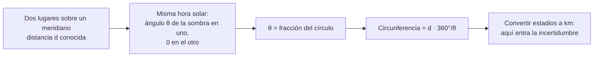

# B02-C03 — Astronomía griega y helenística

<!-- nav:top -->
[🏠 Programa](../../../../README.md) · [📚 Bloque B02](../../../tronco-comun/B02-historia-arqueoastronomia-y-culturas-del-cielo.md) · [← Anterior: B02-C02 — Observación mesopotámica y egipcia](../B02-C02-observacion-mesopotamica-y-egipcia/CLASE.md) · [Siguiente: B02-C04 — Astronomía de India, China y mundo islámico →](../B02-C04-astronomia-de-india-china-y-mundo-islamico/CLASE.md)
<!-- /nav -->

## 1. Ubicación, nivel y alcance

Tercera clase del bloque B02. En C02 viste que registros largos permiten reglas de predicción. Aquí ves el paso siguiente que da la tradición griega y helenística: **construir modelos geométricos** que reproduzcan los movimientos y medir con ellos cantidades como el tamaño de la Tierra. Nivel N1.

Verás tres ejemplos: la medición del tamaño de la Tierra por Eratóstenes, el trabajo de Hiparco con eclipses y precesión, y el mecanismo de Anticitera como evidencia material. No verás el sistema de Ptolomeo en detalle (C10) ni el debate heliocéntrico (C10 y C11).

## 2. Por qué esta clase existe

Un modelo geométrico responde a «¿qué figura reproduce estos movimientos?». Es una forma nueva de preguntar frente a la regla puramente numérica. La pregunta motivadora es: **¿qué se gana, y qué se arriesga, al convertir observaciones en un modelo geométrico?** Se gana poder de predicción y capacidad de medir cosas inaccesibles (como el contorno de la Tierra). Se arriesga confundir el modelo con la realidad.

Al terminar sabrás repetir el razonamiento de Eratóstenes con sus supuestos y su incertidumbre, y sabrás distinguir lo que sabemos de estos autores por documentos de lo que se infiere de fuentes tardías.

## 3. Lo que podrás hacer al terminar

1. Explicar cómo una diferencia de ángulos del Sol entre dos lugares da la circunferencia de la Tierra.
2. Calcular esa circunferencia con datos y comparar con el valor moderno, propagando la incertidumbre de la unidad.
3. Describir qué es la precesión y cómo se detecta comparando catálogos.
4. Explicar qué evidencia material respalda el mecanismo de Anticitera y qué es reconstrucción.
5. Distinguir fuente primaria, fuente tardía y reconstrucción moderna.
6. Redactar una ficha de un resultado antiguo con sus supuestos y errores.

La evidencia es la **ficha de un resultado antiguo** del ejercicio 12 (sección 20).

## 4. Con qué llegas y cómo comprobarlo

Necesitas ángulos y proporciones. Cinco preguntas:

1. ¿Qué fracción de la circunferencia es 7,2°?
2. Si 1/50 de un círculo mide 5 000 unidades, ¿cuánto mide el círculo completo?
3. ¿Cuántos kilómetros son 5 000 estadios si 1 estadio = 0,185 km?
4. ¿Qué es la incertidumbre de un resultado?
5. ¿Qué diferencia hay entre un hecho y una interpretación?

Ver respuestas

1. 7,2/360 = 1/50. 2. 250 000. 3. 925 km. 4. El rango en que puede estar el valor verdadero dadas las limitaciones de la medida. 5. El hecho se observa; la interpretación lo explica y puede cambiar.

## 5. Un caso real: una máquina del mar Egeo

El mecanismo de Anticitera es un aparato de bronce con engranajes, hallado en un naufragio, del que sobreviven 82 fragmentos y solo una tercera parte del original, entre ellos 30 ruedas dentadas corroídas. En 2021, un equipo propuso una reconstrucción de la cara delantera que muestra el Sol, la Luna y cinco planetas, y declara que no puede afirmar que su modelo sea una réplica del original (S1). Las partes mejor respaldadas por los restos son el mecanismo lunar y la predicción de eclipses de la cara trasera; el engranaje del Sol verdadero y de los planetas exteriores se infiere porque no hay evidencia directa que sobreviva (S1).

El caso muestra a la vez el poder y el límite de la evidencia: un objeto material prueba que existió una técnica, pero lo que no sobrevive se reconstruye con hipótesis. Ten presente el límite: S1 no fecha el aparato en su cuerpo principal; solo menciona una datación antigua («hacia 80 a. C.») en el título de una referencia, así que no la damos como resultado.

## 6. Vocabulario

La **circunferencia** es la longitud del contorno de un círculo; el **estadio** es una unidad antigua de longitud cuyo valor exacto se discute. Un **meridiano** es una línea norte–sur sobre la Tierra. La **precesión de los equinoccios** es el lento desplazamiento de los puntos de equinoccio sobre las estrellas; se detecta comparando posiciones de estrellas medidas con siglos de diferencia. Un **catálogo estelar** es una lista de estrellas con sus posiciones. Un **excéntrico** y un **epiciclo** son dos recursos geométricos para describir el movimiento de un cuerpo (C10). Una **fuente tardía** es un texto escrito mucho después del autor del que informa.

## 7. Modelo mental: de la sombra a la esfera

Si el Sol está tan lejos que sus rayos llegan paralelos, la diferencia entre el ángulo que forman los rayos con la vertical en dos ciudades es igual al ángulo que separa esas ciudades visto desde el centro de la Tierra.

*Descripción textual:* de dos lugares con distancia conocida y la diferencia de ángulos del Sol sale la fracción del círculo; multiplicando la distancia por la inversa de esa fracción se obtiene la circunferencia, y al convertir la unidad antigua a kilómetros aparece la mayor incertidumbre.

Analogía: medir la vuelta de una naranja contando una porción: si una cuña ocupa 1/50, la naranja mide 50 cuñas. El límite: la Tierra no es una esfera perfecta y las ciudades no están exactamente sobre el mismo meridiano.

## 8. La explicación, paso a paso

### 8.1 Eratóstenes: el método

Según el relato conservado, en Siene (actual Asuán) el Sol del mediodía del solsticio de verano iluminaba el fondo de un pozo, mientras que en Alejandría una vara vertical proyectaba sombra de unos 7,2°, o 1/50 de círculo. Con una distancia de unos 5 000 estadios entre ambas, la circunferencia sale `5 000 × 50 = 250 000` estadios (S2).

### 8.2 La unidad es el problema

Dependiendo del valor del estadio, que se discute entre unos 160 m y unos 210 m, el resultado va de `250 000 × 0,160 = 40 000 km` a `250 000 × 0,210 = 52 500 km`. El valor moderno, calculado con el radio ecuatorial de 6 378,137 km (S3), es `2π × 6 378,137 = 40 075 km`. El resultado antiguo es compatible con el moderno solo para ciertas elecciones de estadio, de modo que la «exactitud» depende de una conversión incierta (S2). Además, la fuente señala que sus dos supuestos geográficos eran inexactos (Siene no está exactamente en el trópico ni sobre el mismo meridiano) y que los errores se compensaron en parte (S2).

### 8.3 Cómo conocemos a Eratóstenes

Su libro *Sobre la medida de la Tierra* no se conserva; el método se conoce por una versión simplificada de Cleomedes (S2). Esto cambia el tipo de afirmación: no decimos «Eratóstenes midió 252 000 estadios» sin matiz, sino «una fuente tardía informa que...».

### 8.4 Hiparco: precesión y catálogo

Hiparco (hacia 190–120 a. C.) suele considerarse el descubridor de la precesión, hacia 127 a. C., al comparar longitudes de estrellas como Espiga con registros anteriores de Timocaris y Aristilo; concluyó que los equinoccios se desplazan al menos 1° por siglo. Su catálogo de unas 850 estrellas según fuentes romanas está perdido; el de Ptolomeo (1 025 estrellas) deriva de él y se discute cuánto copió de Hiparco (S4). También fue de los primeros en usar sistemáticamente datos babilónicos: ciertos períodos que Ptolomeo le atribuye ya aparecen en textos babilónicos. No está resuelto quién originó algunos valores (S4). Con esto, la astronomía griega se entiende como una herencia compartida, no como un origen aislado.

### 8.5 Anticitera como evidencia de ciclos

El estudio de 2021 indica que el mecanismo incluye un dial de calendario metónico y un dial de predicción de eclipses basado en el ciclo de Saros, y que la rotación de la línea de nodos se deriva de ambos (S1). Conecta con C01 y C02: los ciclos babilónicos aparecen incorporados en un artefacto griego (S1 señala que el diseño combina ciclos babilónicos, matemáticas ligadas a la Academia de Platón y teorías astronómicas griegas).

## 9. Magnitudes, símbolos y unidades

| Símbolo | Qué es | Unidad | Valor o nota |
|---|---|---|---|
| `θ` | diferencia angular del Sol | grados | 7,2 (relato, S2) |
| `d` | distancia entre ciudades | estadios | ≈ 5 000 (S2) |
| `C` | circunferencia | estadios o km | 250 000 estadios |
| `e` | longitud del estadio | m | 160–210 (discutido, S2) |
| `R_eq` | radio ecuatorial moderno | km | 6 378,137 (S3) |
| precesión | desplazamiento | °/siglo | ≥ 1 (Hiparco, S4) |

## 10. Convenciones y referencias

Los datos antiguos son relatos o reconstrucciones; los modernos son medidas. Los intervalos de conversión de estadios dependen de un estudio concreto. La circunferencia moderna es de ecuador, `2πR_eq`; la circunferencia meridiana es algo menor por el achatamiento, detalle que no tratamos.

## 11. De dónde sale lo que afirmamos

| ID | Fuente | Localizador | Respalda | Estado |
|---|---|---|---|---|
| S1 | Freeth et al., «A Model of the Cosmos in the ancient Greek Antikythera Mechanism», *Sci. Rep.* 11, 5821 (2021) | https://pmc.ncbi.nlm.nih.gov/articles/PMC7955085 | 82 fragmentos, un tercio sobrevive; dial metónico y de Saros; partes hipotéticas | Consultada el 2026-11-05 |
| S2 | «Eratosthenes», artículo enciclopédico (Wikipedia, en) | https://en.wikipedia.org/wiki/Eratosthenes | Método, 7,2°, 5 000 estadios, 250 000, incertidumbre del estadio, Cleomedes | Primeros ~100 000 caracteres, 2026-11-05; **secundaria** |
| S3 | NASA NSSDC, *Earth Fact Sheet* | https://nssdc.gsfc.nasa.gov/planetary/factsheet/earthfact.html | Radio ecuatorial 6 378,137 km | Consultada el 2026-11-05 |
| S4 | «Hipparchus», artículo enciclopédico (Wikipedia, en) | https://en.wikipedia.org/wiki/Hipparchus | Precesión, catálogo, datos babilónicos, incertidumbres | Primeros ~100 000 caracteres, 2026-11-05; **secundaria** |

Límites: S2 y S4 son secundarias; no se leyó a Cleomedes, Ptolomeo ni a los editores del catálogo. Los cálculos de 8.2 son nuestros. La datación del mecanismo no se afirma.

## 12. Cómo ver el resultado

Esta tabla es la versión accesible de un gráfico de barras.

| Estadio | Circunferencia (250 000 estadios) | Comparación con 40 075 km |
|---|---|---|
| 160 m | 40 000 km | −0,2 % |
| 185 m | 46 250 km | +15 % |
| 210 m | 52 500 km | +31 % |

Si lo dibujas, empieza el eje en cero y marca el valor moderno con una línea. Descripción larga: según el estadio elegido, el resultado va de casi exacto a un tercio mayor.

## 13. Ejemplo trabajado: ¿qué tan bueno fue el resultado?

**Paso 1 · Fracción.** `7,2°/360° = 1/50`.

**Paso 2 · Circunferencia.** `5 000 × 50 = 250 000` estadios.

**Paso 3 · Conversión.** Con 0,185 km: `250 000 × 0,185 = 46 250 km`.

**Paso 4 · Comparación.** Frente a `40 075 km`: `(46 250 − 40 075)/40 075 = +15,4 %`.

**Paso 5 · Incertidumbre.** El estadio tiene un rango de 160–210 m: el resultado va de −0,2 % a +31 % (sección 12).

**Sentido físico.** La conclusión no es «acertó» o «falló», sino que el método es sólido y que la medida antigua no puede juzgarse sin saber el valor de la unidad.

## 14. Distintas formas de saber lo que hicieron, y cuándo dejan de servir

Una **fuente primaria** (el texto del propio autor) es lo ideal; muchas se perdieron. Una **fuente tardía** transmite el método, pero puede simplificarlo. La **evidencia material** (el mecanismo) prueba que algo existió, pero no explica las intenciones. Una **reconstrucción moderna** completa los vacíos con hipótesis. Hay que declarar con cuál se trabaja.

## 15. Práctica guiada

**Ejercicio 1 · con los pasos indicados.** Calcula la circunferencia con 7,2° y 5 000 estadios. *Pasos:* fracción, multiplicar (sección 8.1).

Solución comentada

`250 000` estadios. Si usaste 7,2 en lugar de la fracción 1/50, revisa el cálculo: `360/7,2 = 50`.

**Ejercicio 2 · con una pista.** Convierte a km con 0,16 km por estadio. *Pista:* multiplica.

Solución comentada

`250 000 × 0,16 = 40 000 km`.

**Ejercicio 3 · casi autónomo.** Calcula la circunferencia moderna `2πR_eq` con 6 378,137 km.

Solución comentada

`2π × 6 378,137 = 40 075,0 km`.

## 16. Práctica autónoma, transferencia e integrador

**Ejercicio 4.** Calcula el error relativo para estadios de 0,185 km.

Solución comentada

`+15,4 %` (sección 13).

**Ejercicio 5.** Si la sombra en Alejandría fuese de 7,5°, ¿qué circunferencia saldría con 5 000 estadios?

Solución comentada

`360/7,5 = 48`; `5 000 × 48 = 240 000` estadios. Un cambio de 0,3° altera el resultado en un 4 %.

**Ejercicio 6.** ¿Qué distancia entre las ciudades daría 46 250 km con la misma sombra (7,2°)?

Solución comentada

`46 250/50 = 925 km`.

**Ejercicio 7.** Calcula cuánto se habría desplazado un equinoccio en 150 años con 1° por siglo.

Solución comentada

`1,5°` como mínimo, porque Hiparco dio «al menos» 1° por siglo (S4).

**Ejercicio 8.** Explica por qué es importante que el libro de Eratóstenes no se conserve.

Solución comentada

Porque lo que sabemos viene de un resumen posterior, de modo que cifras y detalles pudieron cambiar (S2). Hay que escribir «según Cleomedes».

**Ejercicio 9 · transferencia.** Un artículo dice: «los griegos descubrieron los ciclos de los eclipses». Matiza con C02 y S4.

Solución comentada

Los períodos que se atribuyen a Hiparco aparecen ya en textos babilónicos; los griegos los usaron y los integraron en modelos (S4, S1). Es herencia compartida.

**Ejercicio 10 · transferencia.** El estudio de Anticitera reconoce que no puede afirmar que su modelo sea una réplica. ¿Qué lección da sobre cómo presentar una reconstrucción?

Solución comentada

Que se debe rotular qué parte tiene evidencia directa y cuál es hipótesis, y no vender la reconstrucción como el original (S1).

**Ejercicio 11 · transferencia.** Diseña una medida moderna de la circunferencia con el método de Eratóstenes usando dos ciudades de Chile. ¿Qué datos necesitas?

Solución comentada

Ángulos solares simultáneos en dos lugares sobre un mismo meridiano y la distancia entre ellos en kilómetros (con su incertidumbre); la unidad deja de ser el problema. Los datos de latitud y distancia los debes obtener de una fuente que cites.

**Ejercicio 12 · integrador.** Elabora la *ficha de un resultado antiguo* (sección 20): método, datos, supuestos, resultado, comparación con el valor moderno, incertidumbre de la unidad y tipo de fuente.

Solución modelo

Sigue el ejemplo de la sección 13: fracción, circunferencia, conversión con rango, error relativo y tipo de fuente (tardía/primaria/material). Se acepta otro resultado antiguo con fuente citada.

## 17. Actividad sin código: el rango del estadio

Esta clase no usa script. Haz una tabla en papel o en una hoja de cálculo con estadios de 0,16 a 0,21 km, de a 0,01, calcula `250 000 × e` y el error relativo frente a 40 075 km. **Qué observar:** el error pasa por cero cerca de 0,16 km y crece linealmente. **Datos:** relato histórico (S2) y valor moderno (S3). **Resultado esperado:** 0,16 km → 40 000 km (−0,2 %); 0,185 km → 46 250 km (+15,4 %); 0,21 km → 52 500 km (+31,0 %).

## 18. Errores frecuentes y cómo corregirlos

**Decir que acertó con un error de 1 %.** Depende del estadio. Ejercicio 4.

**Olvidar que la fuente es tardía.** Ejercicio 8.

**Dar por sabida la fecha del mecanismo.** Sección 5.

**Confundir la reconstrucción con el original.** Ejercicio 10.

**Presentar a los griegos como origen de todo.** Ejercicio 9.

## 19. Cómo sabrás que vas bien

Tras 8.1: ¿puedes pasar de 7,2° a 1/50? Ejercicio 1. Tras 8.2: ¿por qué el resultado depende del estadio? Ejercicio 4. Tras 8.4: ¿cómo se detecta la precesión? Ejercicio 7. Al final: ¿qué parte de cada afirmación es fuente primaria y cuál reconstrucción? Ejercicio 12.

## 20. Qué entregas y cómo se evalúa

El producto es tu **ficha de un resultado antiguo**.

| Criterio | Inicial | En desarrollo | Logrado | Destacado |
|---|---|---|---|---|
| Método | Confuso | Descrito | Descrito y calculado | Propaga la incertidumbre |
| Tipo de fuente | No lo distingue | Lo nombra | Lo usa para matizar | Contrasta dos fuentes |
| Comparación con lo moderno | Sin comparación | Con error | Con error y rango | Explica la causa del rango |
| Respeto | Anacronismo | Cuidadoso | Contextualiza | Evita el «origen único» |

**Condiciones críticas:** declarar el tipo de fuente; no afirmar fechas no consultadas; no mezclar dato y reconstrucción.

## 21. Ética, seguridad y límites

La historia de la ciencia no es una carrera de «quién fue primero»: se trata con cautela la atribución, especialmente cuando las fuentes son tardías o se han perdido. Esta clase es educativa; no usar el método de Eratóstenes para medir sin precauciones ante el Sol (no mires directamente al Sol). Accesibilidad: cálculos en texto, diagrama descrito, tabla equivalente.

## 22. Para cerrar y seguir

Los griegos y helenísticos convirtieron registros en modelos geométricos y midieron con ellos; sabemos de ellos por fuentes de distinto tipo, y cada tipo permite afirmar cosas distintas. Queda por ver cómo se mantuvo y transformó esta tradición en otras culturas, en C04.

**Glosario español–inglés.** circunferencia · *circumference*; estadio · *stadion*; precesión · *precession*; catálogo estelar · *star catalogue*; excéntrico · *eccentric*; epiciclo · *epicycle*.

**Continuidad.** B02-C04 usa tu capacidad de **distinguir tipos de fuente** para recorrer la astronomía de India, China y el mundo islámico.

**Referencias:** ver sección 11. S2 y S4 son secundarias.

<!-- nav:bottom -->
---

[← Anterior: B02-C02 — Observación mesopotámica y egipcia](../B02-C02-observacion-mesopotamica-y-egipcia/CLASE.md) · [📚 Bloque B02](../../../tronco-comun/B02-historia-arqueoastronomia-y-culturas-del-cielo.md) · [Siguiente: B02-C04 — Astronomía de India, China y mundo islámico →](../B02-C04-astronomia-de-india-china-y-mundo-islamico/CLASE.md)
<!-- /nav -->
