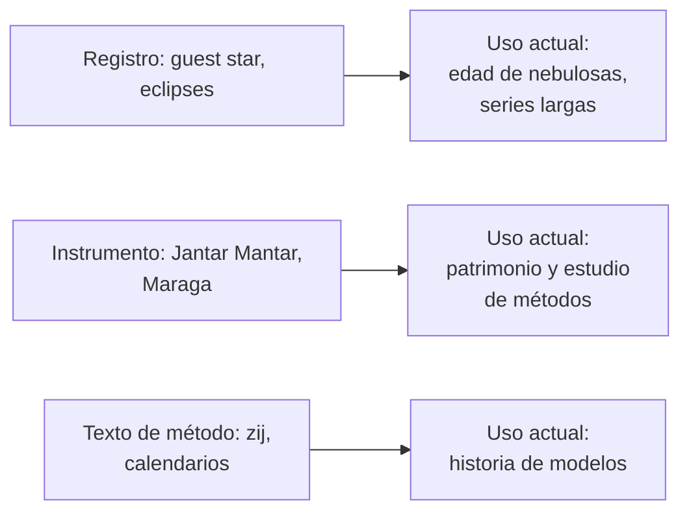

# B02-C04 — Astronomía de India, China y mundo islámico

<!-- nav:top -->
[🏠 Programa](../../../../README.md) · [📚 Bloque B02](../../../tronco-comun/B02-historia-arqueoastronomia-y-culturas-del-cielo.md) · [← Anterior: B02-C03 — Astronomía griega y helenística](../B02-C03-astronomia-griega-y-helenistica/CLASE.md) · [Siguiente: B02-C05 — Cosmovisiones andinas del cielo →](../../../tronco-comun/B02-historia-arqueoastronomia-y-culturas-del-cielo.md#b02-c05)
<!-- /nav -->

## 1. Ubicación, nivel y alcance

Cuarta clase del bloque B02. Hasta aquí seguiste una línea que va de Mesopotamia a Grecia. La astronomía no tuvo un solo cauce: en Asia y en el mundo islámico hubo tradiciones con instrumentos, calendarios y registros propios. Aquí recorres tres ejemplos con fuentes que sí consultamos. Nivel N1.

Verás un observatorio de piedra en India (Jantar Mantar), registros de «estrellas visitantes» chinos que hoy se usan para estudiar supernovas, y el observatorio de Maraga en el mundo islámico. No verás una historia completa de ninguna tradición: ni todas las culturas ni todos los autores caben en una clase.

## 2. Por qué esta clase existe

Contar la historia de la astronomía como una línea recta de Grecia a Europa deja fuera lo que otras sociedades observaron, calcularon y construyeron. La pregunta motivadora es: **¿qué sabemos con precisión de estas tradiciones, qué falta y cómo evitar contar la historia desde un solo lado?**

Al terminar sabrás ubicar tres casos, usarlos como evidencia cuantitativa o instrumental y declarar qué parte de cada relato está respaldada por las fuentes consultadas.

## 3. Lo que podrás hacer al terminar

1. Describir qué es un instrumento de observación fijo de gran tamaño y qué problema resuelve.
2. Explicar por qué los registros chinos de la supernova de 1054 son evidencia científica actual.
3. Situar el observatorio de Maraga (fundación, director, fechas).
4. Distinguir tradición, instrumento y registro como tres tipos de evidencia.
5. Reconocer cuándo una fuente es turística, enciclopédica o académica.
6. Redactar una ficha de caso con fuentes y límites.

La evidencia es la **ficha de un caso intercultural** del ejercicio 12 (sección 20).

## 4. Con qué llegas y cómo comprobarlo

Necesitas B02-C01 a C03. Cinco preguntas:

1. ¿Qué es una supernova?
2. ¿Qué hace un reloj de sol (gnomon)?
3. ¿Qué es un observatorio?
4. ¿Qué diferencia hay entre registrar y explicar?
5. ¿Qué es una fuente secundaria?

Ver respuestas

1. La explosión de una estrella que brilla de forma muy intensa durante semanas. 2. Una varilla proyecta una sombra cuyo largo y dirección dependen de la altura del Sol. 3. Un lugar con instrumentos para observar el cielo. 4. Registrar anota qué pasó; explicar dice por qué. 5. Una fuente que habla de otra en vez de ser el documento original.

Con cuatro o cinco aciertos, sigue. Con tres o menos, repasa C01 a C03.

## 5. Un caso real: una estrella visitante y una nebulosa

Los astrónomos chinos registraron en 1054 una «estrella visitante» que hoy se identifica con la supernova que produjo la nebulosa del Cangrejo. El centro de rayos X Chandra señala que los mejores registros de ese evento son los de China, y que los árabes y europeos probablemente existieron pero casi no sobrevivieron (S1). Una revisión de la literatura sobre supernovas históricas confirma que, para eventos anteriores a 1572, los registros proceden principalmente de fuentes de Asia oriental (S2).

Es un ejemplo de cómo un registro histórico se convierte en dato actual: la fecha del evento permite estimar la edad y la expansión de la nebulosa. Ten presente el límite: S1 es una página de preguntas frecuentes y S2 solo se consultó en su resumen; no leímos los textos chinos originales.

## 6. Vocabulario

Una **estrella visitante** (en chino, «huésped») es un objeto nuevo y transitorio en el cielo, generalmente una supernova o un cometa. Un **instrumento** es un dispositivo para medir la posición del Sol, la Luna o las estrellas; un **gnomon** es una varilla vertical que proyecta sombra, y un **cuadrante** mide ángulos con un arco. Un **observatorio** es el conjunto de instrumentos y personal. Un **zij** es una tabla astronómica de la tradición islámica. Una **fuente turística** es la de un portal de visitantes, útil para localizar pero débil como evidencia.

## 7. Modelo mental: tres tipos de evidencia

Para cada tradición necesitas distinguir qué tipo de evidencia tienes: un **registro** (qué se vio y cuándo), un **instrumento** (con qué se midió) y un **texto de método** (cómo se calculó).

*Descripción textual:* tres cajas de origen (registro, instrumento, texto de método) y, para cada una, el uso que tiene hoy: los registros alimentan estudios modernos, los instrumentos son patrimonio y objeto de estudio, y los textos de método permiten reconstruir cómo se calculaba.

Analogía: un archivo, un taller y un manual. El límite: en las culturas reales los tres están mezclados.

## 8. La explicación, paso a paso

### 8.1 India: Jantar Mantar

El portal oficial de turismo de India describe Jantar Mantar de Jaipur como un conjunto construido entre 1728 y 1734 por el maharajá Sawai Jai Singh II, quien estableció cinco observatorios en la India, y señala que el de Jaipur es el más grande y sofisticado. Entre sus instrumentos menciona el Samrat Yantra, un reloj de sol de 27 m de alto, y el Dhruva Yantra, que muestra la posición de la estrella polar (S3). Es un sitio del Patrimonio Mundial, según esa página (S3).

Qué podemos concluir y qué no: que existen instrumentos monumentales de piedra para medir el tiempo y posiciones; no que una cifra de exactitud (S3 menciona 2 segundos) sea verificable, porque la página es turística y no explica cómo se midió. La UNESCO sostiene su valor como expresión de las habilidades astronómicas de un príncipe erudito, pero no pudimos abrir la ficha oficial en esta redacción y no la citamos como consultada.

### 8.2 China: registros y calendario

Un artículo enciclopédico recoge que se registraron unos 1 600 eclipses solares y lunares desde el 750 a. C., que los nombres de las mansiones lunares aparecen en huesos oraculares de la dinastía Shang, y que Guo Shoujing diseñó instrumentos y el calendario Shoushi (1281) en el siglo XIII, además del Observatorio de Gaocheng (1276). El mismo texto advierte que algunas fechas necesitan mejor sustento, y que una posible influencia de la matemática islámica sobre Guo es posibilidad, no hecho (S4). Por eso estas cifras se usan solo como orientación.

### 8.3 El mundo islámico: Maraga

Según un artículo enciclopédico, el observatorio de Maraga fue patrocinado por el gobernante ilkhánida Hulagu y dirigido por Nasir al-Din al-Tusi; su construcción comenzó en 1259 y duró unos tres a cinco años; funcionó más de cincuenta años; Mu'ayyid al-Din al-'Urdi supervisó la construcción de instrumentos, y el *Zij-i Ilkhani* son tablas planetarias asociadas a ese centro (S5). La página también señala que el diseño influyó en observatorios posteriores como el de Ulugh Beg en Samarcanda. No dice nada sobre Copérnico, de modo que no afirmamos esa relación; es una hipótesis que requiere otras fuentes.

### 8.4 Comparar sin jerarquizar

Los tres casos usan evidencia de tipo distinto: un registro (supernova), un instrumento (Jantar Mantar) y una institución (Maraga). No se pueden comparar «quién fue más exacto» con estas fuentes. Se pueden comparar los **tipos de pregunta** que cada una permite responder.

## 9. Magnitudes, símbolos y unidades

| Símbolo | Qué es | Unidad | Valor o nota |
|---|---|---|---|
| `H` | altura del Samrat Yantra | m | 27 (S3, fuente turística) |
| años de construcción | Jantar Mantar | año | 1728–1734 (S3) |
| inicio de Maraga | construcción | año | 1259 (S5) |
| eclipses registrados en China | número | — | ≈ 1 600 desde el 750 a. C. (S4, secundaria) |
| evento | supernova | año | 1054 (S1) |

## 10. Convenciones y referencias

Las fechas son las que dan las fuentes; la mayoría son secundarias o divulgativas y deben contrastarse. No convertimos calendarios. No jerarquizamos tradiciones.

## 11. De dónde sale lo que afirmamos

| ID | Fuente | Localizador | Respalda | Estado |
|---|---|---|---|---|
| S1 | Chandra X-ray Center, «Supernova Remnants: SNR 30 (Crab)», FAQ | https://chandra.harvard.edu/resources/faq/sources/snr/snr-30.html | China tiene los mejores registros de la supernova de 1054; registros árabes y europeos casi no sobreviven | Consultada el 2026-11-05; FAQ institucional |
| S2 | D. A. Green y F. R. Stephenson, «The Historical Supernovae», arXiv:astro-ph/0301603 | https://arxiv.org/abs/astro-ph/0301603 | Registros de supernovas de hace dos milenios, mayoritariamente de Asia oriental para eventos antiguos | Solo el resumen, 2026-11-05 |
| S3 | Incredible India (portal de turismo del Gobierno de India), «Jantar Mantar» | https://www.incredibleindia.gov.in/en/rajasthan/jaipur/jantar-mantar | Constructor, fechas, instrumentos, estatus patrimonial | Consultada el 2026-11-05; **fuente turística** |
| S4 | «Chinese astronomy», artículo enciclopédico (Wikipedia, en) | https://en.wikipedia.org/wiki/Chinese_astronomy | Eclipses, mansiones lunares, Guo Shoujing, Su Song | Primeros ~100 000 caracteres, 2026-11-05; **secundaria**, con aviso de falta de citas |
| S5 | «Maragha observatory», artículo enciclopédico (Wikipedia, en) | https://en.wikipedia.org/wiki/Maragha_observatory | Fundación, directores, instrumentos, influencia | Consultada el 2026-11-05; **secundaria** |

Límites: no leímos textos originales ni bibliografía especializada (por ejemplo, de historia de la astronomía india o islámica); la ficha oficial de UNESCO para Jantar Mantar no abrió. La India antigua no se trata porque no consultamos fuentes sobre ella, y la sección no debe leerse como que no existiera.

## 12. Cómo ver los casos

Esta tabla es la versión accesible de un mapa de casos.

| Caso | Tipo de evidencia | Periodo | Fuente |
|---|---|---|---|
| Supernova de 1054 | Registro | 1054 | S1, S2 |
| Jantar Mantar | Instrumento monumental | 1728–1734 | S3 |
| Mansiones lunares y eclipses | Registro | desde ≈ 750 a. C. | S4 |
| Maraga | Institución | 1259 en adelante | S5 |

Descripción larga: cuatro casos repartidos en tres tipos de evidencia, ordenados por cronología.

## 13. Ejemplo trabajado: cuánto pesa cada fuente

**Planteamiento.** Quieres afirmar «el Samrat Yantra mide 27 m de alto y marca el tiempo con 2 s de exactitud».

**Paso 1.** La cifra de altura viene de S3, un portal turístico oficial; plausible, pero sin metodología.

**Paso 2.** La exactitud de 2 s no tiene método declarado; no puede usarse como dato.

**Paso 3.** Reformulación: «según el portal oficial de turismo, el Samrat Yantra tiene 27 m de alto; no verificamos su exactitud».

**Paso 4. Qué falta.** Una medición propia o un estudio académico con incertidumbre.

**Sentido físico.** Una cifra sin método es un dato por confirmar, aunque venga de una fuente oficial.

## 14. Distintas formas de contar esta historia

Una **historia lineal** (de una cultura a otra) es simple pero deforma. Una **historia por casos** (como esta clase) permite declarar la evidencia de cada uno. Una **historia por temas** (calendarios, instrumentos, registros) permite comparar sin jerarquizar. Aquí usamos casos con temas.

## 15. Práctica guiada

**Ejercicio 1 · con los pasos indicados.** Clasifica cada caso de la sección 12 por tipo de evidencia. *Pasos:* registro, instrumento o institución.

Solución comentada

Supernova y mansiones: registro; Jantar Mantar: instrumento; Maraga: institución.

**Ejercicio 2 · con una pista.** ¿Cuántos años duró la construcción de Jantar Mantar según S3? *Pista:* resta.

Solución comentada

`1734 − 1728 = 6` años.

**Ejercicio 3 · casi autónomo.** ¿Cuántos años funcionó Maraga según S5, como mínimo, desde 1259 si estuvo activo más de 50 años?

Solución comentada

Más de 50 años, es decir, hasta después de ≈ 1309; la página indica que estaba casi inactivo a principios del siglo XIV (S5).

## 16. Práctica autónoma, transferencia e integrador

**Ejercicio 4.** ¿Cuántos eclipses por siglo, en promedio, implica la cifra de 1 600 desde el 750 a. C.? Usa 2 800 años como estimación.

Solución comentada

`1 600/28 ≈ 57` por siglo. Es una cifra orientativa: la fuente no da fecha de término ni exactitud (S4).

**Ejercicio 5.** Si la supernova de 1054 está a unos 6 500 años luz (valor de divulgación, no consultado en nuestras fuentes), ¿cuándo ocurrió realmente la explosión?

Solución comentada

Hace unos `1054 + 6 500` años desde 1054, es decir, unos 5 500 años a. C.: lo registrado en 1054 es el momento en que llegó la luz. Esta cifra de distancia no se consultó; el cálculo ilustra la idea de B01-C04.

**Ejercicio 6.** Clasifica S1 a S5 por tipo de fuente (institucional, académica, turística, enciclopédica).

Solución comentada

S1 institucional (FAQ); S2 académica (resumen); S3 turística oficial; S4 y S5 enciclopédicas.

**Ejercicio 7.** Reescribe «Guo Shoujing aprendió trigonometría islámica» de acuerdo con S4.

Solución comentada

«Un artículo enciclopédico indica que la matemática islámica pudo haber influido en la trigonometría esférica de Guo Shoujing; no es un hecho establecido» (S4).

**Ejercicio 8.** ¿Por qué no podemos decir que Maraga influyó en Copérnico?

Solución comentada

Porque S5 no lo menciona; el vínculo, si existe, requiere otras fuentes que no consultamos.

**Ejercicio 9 · transferencia.** Un alumno dice: «los registros chinos son inventos». Responde con S1 y S2.

Solución comentada

S1 destaca que son los mejores registros del evento de 1054 y S2 los trata como datos históricos usados por los astrónomos modernos. No son «inventos»: son evidencia, con sus límites.

**Ejercicio 10 · transferencia.** Propón cómo comprobarías la exactitud del Samrat Yantra.

Solución comentada

Medir la sombra y el tiempo con un reloj de referencia a lo largo de varios días, repetir y calcular la desviación con incertidumbre, o consultar un estudio académico del instrumento. Con permisos del sitio.

**Ejercicio 11 · transferencia.** ¿Qué falta en esta clase para hablar de India antes de Jai Singh?

Solución comentada

Fuentes académicas sobre la astronomía india antigua y medieval, que no consultamos. La clase lo dice (sección 11).

**Ejercicio 12 · integrador.** Elabora la *ficha de un caso intercultural* (sección 20): elige un caso de la clase u otro, identifica tipo de evidencia, fechas, qué dicen las fuentes, límites y qué falta.

Solución modelo

Una ficha completa cita al menos dos fuentes de tipo distinto, rotula lo que es dato y lo que es secundario, y propone cómo reducir la incertidumbre.

## 17. Actividad sin código: auditoría de fuentes

Esta clase no usa script. Toma la tabla de la sección 11 y para cada fuente anota: tipo, qué respalda, qué no respalda y qué fuente primaria buscarías. **Qué observar:** cuántas de las afirmaciones críticas descansan solo en fuentes secundarias o turísticas. **Resultado esperado:** al menos cuatro de cinco fuentes requieren contraste con literatura especializada.

## 18. Errores frecuentes y cómo corregirlos

**Tomar cifras turísticas como datos.** Ejercicio 10.

**Atribuir influencias sin fuente.** Ejercicio 8.

**Jerarquizar tradiciones.** Sección 8.4.

**Confundir la fecha del evento con la del registro.** Ejercicio 5.

**Dar por completo un panorama parcial.** Ejercicio 11.

## 19. Cómo sabrás que vas bien

Tras 8.1: ¿puedes reformular una cifra turística como dato por confirmar? Ejercicio 7. Tras 8.3: ¿puedes decir qué sabemos de Maraga y qué no? Ejercicio 8. Al final: ¿qué parte de tu ficha es evidencia y cuál es interpretación? Ejercicio 12.

## 20. Qué entregas y cómo se evalúa

El producto es tu **ficha de un caso intercultural**.

| Criterio | Inicial | En desarrollo | Logrado | Destacado |
|---|---|---|---|---|
| Tipo de evidencia | Ausente | Nombrado | Nombrado y justificado | Cruzado con otro caso |
| Fuentes | Sin fuente | Una fuente | Dos fuentes de tipo distinto | Con fuente especializada |
| Límites | No declara | Declara alguno | Declara los principales | Propone cómo superarlos |
| Respeto | Jerarquiza | Cuidadoso | Contextualiza | Cita voces de la propia tradición |

**Condiciones críticas:** no jerarquizar culturas; citar solo lo consultado; no usar cifras turísticas como medidas.

## 21. Ética, seguridad y límites

Estos son sitios y legados vivos de pueblos con historia propia; la clase no los usa para compararlos entre sí ni como prueba de «precedencia». Los sitios patrimoniales se visitan respetando sus normas. Accesibilidad: descripciones textuales, tablas equivalentes y sin conexión.

## 22. Para cerrar y seguir

Registros, instrumentos y textos de método son tres tipos de evidencia; cada tradición los combina de modo distinto y las fuentes que tenemos cubren solo una parte. Queda por ver astronomías que viven hoy en América: C05 a C07.

**Glosario español–inglés.** estrella visitante · *guest star*; instrumento · *instrument*; observatorio · *observatory*; supernova · *supernova*; zij · *zij (astronomical tables)*; gnomon · *gnomon*.

**Continuidad.** B02-C05 usa tu capacidad de **declarar el tipo de evidencia** para acercarse a las cosmovisiones andinas con respeto.

**Referencias:** ver sección 11. S3 es turística y S4 y S5 son enciclopédicas.

<!-- nav:bottom -->
---

[← Anterior: B02-C03 — Astronomía griega y helenística](../B02-C03-astronomia-griega-y-helenistica/CLASE.md) · [📚 Bloque B02](../../../tronco-comun/B02-historia-arqueoastronomia-y-culturas-del-cielo.md) · [Siguiente: B02-C05 — Cosmovisiones andinas del cielo →](../../../tronco-comun/B02-historia-arqueoastronomia-y-culturas-del-cielo.md#b02-c05)
<!-- /nav -->
