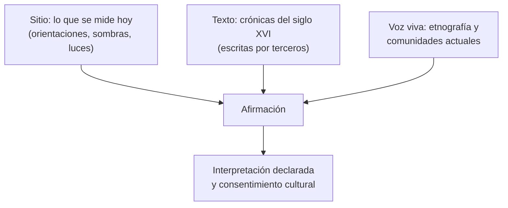

# B02-C05 — Cosmovisiones andinas del cielo

<!-- nav:top -->
[🏠 Programa](../../../../README.md) · [📚 Bloque B02](../../../tronco-comun/B02-historia-arqueoastronomia-y-culturas-del-cielo.md) · [← Anterior: B02-C04 — Astronomía de India, China y mundo islámico](../B02-C04-astronomia-de-india-china-y-mundo-islamico/CLASE.md) · [Siguiente: B02-C06 — Astronomía de pueblos originarios de Chile →](../B02-C06-astronomia-de-pueblos-originarios-de-chile/CLASE.md)
<!-- /nav -->

## 1. Ubicación, nivel y alcance

Quinta clase del bloque B02. En C01 a C04 recorriste tradiciones donde el cielo organiza el tiempo. Aquí entras en los Andes, donde el cielo también ordena la agricultura, el paisaje y la religión. Nivel N1.

Verás qué significa «cosmovisión», cómo se documentan las astronomías andinas (sitios, crónicas, etnografía) y por qué las fuentes a veces se contradicen. Verás ejemplos del Cusco inca, de la costa de Perú y de Machu Picchu. No verás todos los pueblos andinos ni los de Chile (C06) ni los métodos para medir alineaciones (C08 y C09).

## 2. Por qué esta clase existe

Hablar de «astronomía andina» en singular es un error: los Andes reúnen sociedades de épocas y regiones muy distintas. La pregunta motivadora es: **¿cómo se estudia respetuosamente un cielo que otra cultura leyó de otra manera, sin imponerle nuestras categorías y sin inventar lo que las fuentes no dicen?**

Al terminar sabrás separar tres cosas: lo que se mide en un sitio, lo que dicen las crónicas y la etnografía, y lo que interpretamos nosotros; y podrás señalar dónde las fuentes que consultamos se tensionan.

## 3. Lo que podrás hacer al terminar

1. Definir «cosmovisión» y distinguirla de «calendario» y de «mitología».
2. Describir ejemplos de alineaciones solares y de constelaciones oscuras en la literatura.
3. Distinguir evidencia de sitio, de crónica y de etnografía.
4. Detectar una tensión entre dos fuentes y formularla sin resolverla a la fuerza.
5. Calcular un orden de magnitud geométrico con una línea de torres y declararlo como ejercicio.
6. Redactar una ficha de caso con consentimiento y respeto cultural.

La evidencia es la **ficha de un caso andino** del ejercicio 12 (sección 20).

## 4. Con qué llegas y cómo comprobarlo

Necesitas C01 a C04. Cinco preguntas:

1. ¿Qué es un solsticio?
2. ¿Qué es la Vía Láctea?
3. ¿Qué diferencia hay entre una fuente primaria y una secundaria?
4. Si una hilera de 12 espacios mide 300 m, ¿cuánto mide cada espacio en promedio?
5. ¿Qué es un horizonte, en observación del cielo?

Ver respuestas

1. El momento del año en que el Sol alcanza su mayor distancia al ecuador celeste; marca el día más largo o más corto. 2. La banda de luz de las estrellas de nuestra galaxia vista desde dentro. 3. La primaria es el documento o dato original; la secundaria habla de él. 4. 25 m. 5. La línea donde el cielo parece tocar el paisaje.

Con cuatro o cinco aciertos, sigue. Con tres o menos, repasa C01 y C04.

## 5. Un caso real: dos fuentes que no coinciden

Un artículo de divulgación académica presentado en un simposio de la Unión Astronómica Internacional describe que el Cusco inca pudo tener hasta 16 torres en el horizonte para observar la salida del Sol, que fueron destruidas durante la extirpación española de la religión indígena, y que dos pilares sobreviven en el cerro Saywa, sobre Urubamba (S1). Un comunicado de 2007 sobre el sitio de Chankillo afirma, en cambio, que los «pilares solares» cercanos al Cusco descritos en textos del siglo XVI no habían sido localizados (S2).

La tesis doctoral de Gullberg (2009) coincide con S1 en lo esencial: según su resumen, los incas construyeron varias torres en los horizontes del Cusco para marcar salidas o puestas del Sol en fechas significativas, todas destruidas, y sobreviven dos pilares solares sobre el actual pueblo de Urubamba que, vistos desde un peñón de granito en el patio del palacio de Huayna Capac, marcan el amanecer del solsticio de junio (S6). Por lo tanto, la tensión con el comunicado de 2007 es parcial: el comunicado habla de los pilares descritos en textos del siglo XVI y su localización, y los pilares de Urubamba se han descrito después y por un autor que ya es la fuente de S1. No podemos decidir con lo consultado si se trata de los mismos pilares ni si hay contraste independiente; lo declaramos. Límites: S1 y S6 son del mismo autor, S1 es un texto breve y S2 es un comunicado de prensa.

## 6. Vocabulario

Una **cosmovisión** es la manera en que una sociedad entiende el mundo y su lugar en él, y la astronomía es una de las formas en que se expresa. Una **huaca** es un lugar sagrado en el mundo andino. Un **solsticio** es el momento de máximo alejamiento del Sol respecto del ecuador celeste. Una **constelación oscura** es una figura reconocida no en las estrellas sino en las zonas oscuras de la Vía Láctea, que corresponden a nubes de polvo (S1). El **orto helíaco** es la primera aparición de un astro en el alba tras un período de invisibilidad. Un **gnomon** es una varilla o saliente que proyecta sombra. Una **crónica** es un relato histórico escrito, aquí por cronistas del siglo XVI.

## 7. Modelo mental: tres capas de evidencia

Para cualquier afirmación sobre un cielo andino pregúntate en qué capa descansa.

*Descripción textual:* tres fuentes de evidencia (sitio, texto, voz viva) alimentan una afirmación, que debe ir acompañada de la declaración de qué es interpretación y del consentimiento cultural cuando corresponde.

Analogía: reconstruir un viaje con el diario del viajero, las huellas en el camino y el testimonio de quien vive allí. El límite: en los Andes, el «diario» de las crónicas fue escrito por quienes ocupaban el territorio, con sus propios sesgos.

## 8. La explicación, paso a paso

### 8.1 Una cosmovisión solar en el Cusco

Según S1, el Sol ocupaba el centro de la religión y la agricultura inca; los incas se consideraban hijos del Sol; y el ciclo de solsticios y equinoccios se usaba en el manejo de cultivos y la fecha de celebraciones. S1 cita a Bauer y Dearborn (1995) y a Zuidema (1964) para estas afirmaciones, obras que no consultamos. Es una síntesis, no una demostración.

### 8.2 Luz y sombra en las huacas

S1 describe tres lugares cerca del Cusco: en Kenko Grande, dos gnomones tallados forman al amanecer del solsticio de junio un efecto que se conoce como «el despertar del puma»; en Lacco, una cueva se orienta al amanecer del solsticio de junio e ilumina un altar; y en la Huaca 44 dos círculos tallados permitirían señalar las seis direcciones solares principales. Son afirmaciones del autor sobre alineaciones, apoyadas en su libro de 2020, que no consultamos; el resumen de su tesis de 2009 describe un estudio de 29 sitios cerca del Cusco, en el Valle Sagrado y entre Machu Picchu y Llactapata, en busca de alineaciones solares y de 25 motivos iconográficos (S6). No hemos podido comprobar ninguna con mediciones propias.

### 8.3 Constelaciones oscuras

S1 describe, citando a Urton (1981), que los incas reconocían figuras en las nubes oscuras de la Vía Láctea: una serpiente (Machacuay), un sapo (Hanp'atu), una perdiz (Yutu, identificada con el Saco de Carbón), una llama (Yacana, entre Centaurus y Escorpio), una cría de llama (Unallamacha) y un zorro (Atoq); y relaciona la salida del zorro con la época de nacimiento de zorros terrestres hacia el 15–23 de diciembre. Esta relación entre cielo y ciclo biológico es un ejemplo de lo que significa una cosmovisión: el cielo y la vida están conectados en una misma explicación. Un estudio de la Universidad del Cusco (S3) advierte que la identificación de constelaciones incas está lejos de ser exhaustiva, por la dificultad de obtener datos y la heterogeneidad de las fuentes.

Un estudio sobre una comunidad atacameña actual, la de Socaire (23°35′ S, 3 274 m, región de Antofagasta), recoge la misma idea con otra mirada: según Moyano (S7), allí el calendario combina fechas prehispánicas y cristianas (el 24 de junio coincide con San Juan, el mercado de ganado y el solsticio de invierno), la fecha más importante es la limpieza del canal de riego a fines de octubre, cuando se invoca a las montañas, y la vida social se organiza por el riego, la siembra y las fiestas. Para Socaire, Moyano sostiene que existe una relación entre observaciones astronómicas, culto a las montañas y prácticas agrícolas, y explica la percepción de una «mano gigante» en cinco volcanes con un marco psicológico propio (pareidolia, apofenia, hierofanía); esas interpretaciones son del autor, basadas en trabajo de campo entre diciembre de 2008 y octubre de 2009, y no una descripción hecha por la comunidad. Moyano cita también a otros autores para decir que en el Cusco se percibían un puma y una llama en la Vía Láctea cerca de α y β Centauri (S7), coherente con S1 pero de segunda mano.

### 8.4 Pléyades y lluvia

S1 señala que la brillantez o el apagamiento de las Pléyades cerca de su orto helíaco se usa hasta hoy para pronosticar cultivos ante una sequía por El Niño, citando a Orlove, Chiang y Cane (*Nature*, 2000). No consultamos ese artículo, pero el caso muestra una práctica viva con un estudio científico detrás, no un simple recuerdo.

### 8.5 Chankillo y Machu Picchu: sitios con lecturas distintas

Para Chankillo, un comunicado de 2007 afirma que 13 torres de unos 300 m, con dos puntos de observación, forman un observatorio solar del siglo IV a. C. con alineaciones a los solsticios de junio y diciembre (S2). Para Machu Picchu, un artículo propone reinterpretarlo como centro de peregrinación ligado a la cosmovisión inca, en lugar de residencia real de Pachacuti, analizando el entorno y los ciclos celestes (S4). Son interpretaciones publicadas, no consenso cerrado.

### 8.6 Un cálculo para ver la escala

Si 13 torres cubren 300 m, hay 12 espacios de `300/12 = 25 m` en promedio. Desde un punto de observación a una distancia `D` frente a la línea, un arco de salida del Sol de unos 47° (en un lugar a baja latitud, ver C08) subtendería `2 D tan(23,5°)`. Igualando a 300 m: `D = 300/(2 × 0,435) ≈ 345 m`. Es un ejercicio **sintético** para dimensionar la geometría, no una afirmación sobre el sitio real: las distancias reales requieren el levantamiento arqueológico.

## 9. Magnitudes, símbolos y unidades

| Símbolo | Qué es | Unidad | Valor o nota |
|---|---|---|---|
| `L` | longitud de la línea de torres | m | ≈ 300 (S2) |
| `n` | número de torres | — | 13 (S2) |
| `g` | espacio medio entre torres | m | `L/(n−1) ≈ 25` (cálculo propio) |
| `D` | distancia ficticia al punto de observación | m | ≈ 345 (ejercicio sintético) |
| fecha | alba del solsticio de diciembre | día | 21 de diciembre aprox. |

## 10. Convenciones y referencias

Los nombres quechuas se escriben como los dan las fuentes; la ortografía puede variar. Las fechas de sitios son las de las fuentes, con su incertidumbre. «Cosmovisión andina» no designa un sistema único: nombramos pueblo, sitio y época siempre que se pueda.

## 11. De dónde sale lo que afirmamos

| ID | Fuente | Localizador | Respalda | Estado |
|---|---|---|---|---|
| S1 | S. R. Gullberg, «Cultural Astronomy for Inspiration», *Proc. IAU* Symp. 367 (2020), doi:10.1017/S1743921321000612 (acceso abierto, CC BY 4.0) | https://doi.org/10.1017/S1743921321000612 | Huacas, torres del Cusco, constelaciones oscuras, Pléyades, Llactapata | Texto leído el 2026-11-05; artículo breve de divulgación; cita obras no consultadas |
| S2 | Comunicado sobre I. Ghezzi y C. Ruggles, *Science* 315 (2007) | https://www.eurekalert.org/news-releases/735620 | Chankillo; pilares del Cusco no localizados | Comunicado consultado el 2026-11-05; el artículo no se leyó |
| S3 | E. Pacheco, S. Flores y E. Salazar, «Some notes on the Inka constellations», *Proc. IAU* S260 (2011) | https://www.cambridge.org/core/journals/proceedings-of-the-international-astronomical-union/article/some-notes-on-the-inka-constellations/4EF980EAC67CC4BC78815551B9610A0E | Límites de la investigación sobre constelaciones incas | Solo el resumen, 2026-11-05 |
| S4 | G. Magli, «At the other end of the sun's path. A new interpretation of Machu Picchu», *Nexus Network J.* 12 (2010), arXiv:0904.4882 | https://arxiv.org/abs/0904.4882 | Interpretación como centro de peregrinación | Solo el resumen, 2026-11-05 |
| S5 | H. Neilson, «Overview of Indigenous rights and outer space for the IAU-CPS Policy Hub», arXiv:2412.06675 | https://arxiv.org/html/2412.06675v1 | Consentimiento libre, previo e informado; contaminación lumínica como pérdida cultural | Consultada el 2026-11-05 |
| S6 | S. R. Gullberg, *The cosmology of Inca huacas*, tesis doctoral, James Cook University (2009), doi:10.25903/43yn-6232 | https://researchonline.jcu.edu.au/10346/ | Estudio de 29 sitios; torres del Cusco destruidas; dos pilares sobre Urubamba; River Intihuatana en el eje del solsticio | Solo el resumen del repositorio, 2026-11-05; tesis completa (23 MB) no leída |
| S7 | R. Moyano, «Sub-tropical astronomy in the southern Andes: the ceque system in Socaire, Atacama, northern Chile», *Proc. IAU* Symp. 278 (2011), doi:10.1017/S1743921311012518 | https://doi.org/10.1017/S1743921311012518 | Comunidad atacameña (Lican Antay) de Socaire; calendario; culto a montañas; datos de campo 2008–2009; puma/llama del Cusco (citando a otros) | PDF (13 pp.) leído con PyMuPDF el 2026-11-05; ponencia de congreso; interpretaciones propias del autor |

Límites: no consultamos a Urton, Zuidema, Bauer y Dearborn, Orlove ni el libro de Gullberg (2020); S1 y S6 son del mismo autor. Las conversaciones con comunidades andinas actuales no están representadas en estas fuentes. Pendiente de fuente: ceques, calendario inca, y toda la astronomía de los Andes del sur.

## 12. Cómo ver el cielo andino

Esta tabla es la versión accesible de un esquema de la Vía Láctea con figuras oscuras.

| Figura (según S1) | Qué es | Posición descrita |
|---|---|---|
| Machacuay | serpiente | encabeza la procesión |
| Hanp'atu | sapo | cerca de la serpiente, a su izquierda |
| Yutu | perdiz (Saco de Carbón) | detrás del sapo |
| Yacana | llama | entre Centaurus y Escorpio |
| Unallamacha | cría de llama | bajo Yacana |
| Atoq | zorro | tras Yacana |

Si lo dibujas, señala que las figuras están en las zonas **oscuras**, usa contornos y no solo color. Descripción larga: una banda clara con manchas oscuras que forman animales en fila.

## 13. Ejemplo trabajado: ¿qué sabemos de los pilares del Cusco?

**Paso 1 · Afirmación A (S1, S6).** Hubo torres en los horizontes del Cusco, hasta 16 según S1; dos pilares sobreviven sobre Urubamba (cerro Saywa en S1).

**Paso 2 · Afirmación B (S2, 2007).** Los pilares descritos en textos del siglo XVI no habían sido localizados.

**Paso 3 · Posibles explicaciones.** Hallazgos posteriores a 2007 (S6 describe dos pilares en Urubamba, del mismo autor que S1); distintas definiciones de «pilar»; que S1 se refiera a otros; o error. No podemos decidir con lo consultado.

**Paso 4 · Redacción responsable.** «Un autor (Gullberg, 2009 y 2021) propone que dos pilares sobreviven sobre Urubamba; un comunicado de 2007 decía que los pilares descritos en las crónicas no habían sido localizados. Pendiente de contraste independiente con la literatura arqueológica.»

**Sentido físico.** Una afirmación se sostiene tanto como su fuente y su fecha; la honestidad es dejar la tensión visible.

## 14. Comparación de formas de documentar

El **sitio** permite medir pero no dice por qué se construyó. La **crónica** da contexto, pero fue escrita desde fuera. La **etnografía** recoge voces vivas, pero depende del consentimiento y del investigador. Ninguna basta sola; la fortaleza viene del cruce, y cuando falta una capa debe decirse.

## 15. Práctica guiada

**Ejercicio 1 · con los pasos indicados.** Calcula el espacio medio entre 13 torres en 300 m. *Pasos:* cuenta los espacios (n−1) y divide.

Solución comentada

`300/12 = 25 m`. Si dividiste por 13 te saldría 23 m: hay un espacio menos que torres.

**Ejercicio 2 · con una pista.** Calcula `D` de la sección 8.6 con un arco de 47°. *Pista:* `D = 300/(2 tan 23,5°)`.

Solución comentada

`tan 23,5° = 0,4348`; `D = 300/0,8697 = 345 m`. Es un ejercicio sintético.

**Ejercicio 3 · casi autónomo.** Clasifica cada afirmación de la sección 8.2 como «medida del sitio» o «interpretación».

Solución comentada

Que exista un gnomon tallado o una cueva con una orientación es observable en el sitio; que «se diseñó» para el solsticio y que representa un puma son interpretaciones.

## 16. Práctica autónoma, transferencia e integrador

**Ejercicio 4.** ¿Entre qué fechas nacen los zorros según S1 y qué dato del cielo se asocia?

Solución comentada

Hacia el 15–23 de diciembre; coincide con el ascenso de la Vía Láctea y Atoq con el Sol del solsticio de diciembre (S1, citando a Urton).

**Ejercicio 5.** Si el arco fuese de 50° en lugar de 47°, ¿cuánto cambiaría `D`?

Solución comentada

`tan 25° = 0,4663`; `D = 300/0,9326 = 322 m`: unos 23 m menos.

**Ejercicio 6.** ¿Por qué S3 advierte que la investigación sobre constelaciones incas no es exhaustiva?

Solución comentada

Por la dificultad de obtener datos y la heterogeneidad de las fuentes (S3). Por eso no hablamos de «el catálogo» de constelaciones incas.

**Ejercicio 7.** Distingue qué en S4 es dato y qué es interpretación.

Solución comentada

Dato: la ubicación y la traza del sitio; interpretación: que fue un centro de peregrinación y no una residencia real (solo conocemos el resumen).

**Ejercicio 8.** Señala un riesgo de usar crónicas del siglo XVI como única fuente.

Solución comentada

Fueron escritas desde la perspectiva de quienes conquistaron el territorio y pueden omitir o deformar prácticas; hay que cruzarlas con sitios y voces actuales.

**Ejercicio 9 · transferencia.** Un compañero dice: «los incas ya sabían lo mismo que nosotros». Responde.

Solución comentada

Sabían cosas distintas con propósitos distintos; lo que sí muestra S1 es observación sistemática ligada a la agricultura. Comparar «quién sabía más» no es el criterio; el criterio es entender qué hacían con el cielo.

**Ejercicio 10 · transferencia.** Propón cómo conseguir permiso antes de publicar fotos de una huaca en uso ritual.

Solución comentada

Contactar a la comunidad o autoridad cultural del lugar, explicar el propósito y obtener consentimiento libre, previo e informado, respetando que pueden decir que no (S5).

**Ejercicio 11 · transferencia.** El texto de S1 es de acceso abierto con licencia CC BY 4.0. ¿Qué permite eso a esta clase y qué no?

Solución comentada

Permite parafrasear y citar con atribución. No convierte las afirmaciones en verificadas: el artículo cita obras que no consultamos.

**Ejercicio 12 · integrador.** Elabora la *ficha de un caso andino* (sección 20): sitio o práctica, época, qué dicen las fuentes (con tipo), qué es medida y qué interpretación, tensiones y consentimiento.

Solución modelo

Una ficha completa sigue el ejemplo de la sección 13: dos o más fuentes de capas distintas, tensión visible, redacción responsable y una nota de consentimiento cultural.

## 17. Actividad sin código: auditoría de una afirmación

Esta clase no usa script. Elige una afirmación de la sección 8 y rellena una tabla: afirmación, fuente, tipo de fuente, capa (sitio/texto/voz viva), fecha de consulta, qué falta. **Qué observar:** cuántas afirmaciones descansan en obras no consultadas. **Resultado esperado:** la mayoría de las afirmaciones de S1 requieren contraste con las obras que cita.

## 18. Errores frecuentes y cómo corregirlos

**Hablar de «la astronomía andina».** Ejercicio 9.

**Elegir la fuente que conviene.** Secciones 5 y 13.

**Confundir interpretación con medida.** Ejercicio 3.

**Tomar crónicas como voz indígena.** Ejercicio 8.

**Publicar sin consentimiento.** Ejercicio 10.

## 19. Cómo sabrás que vas bien

Tras 8.2: ¿separas medida e interpretación? Ejercicio 3. Tras 8.5: ¿puedes decir por qué dos lecturas de un sitio coexisten? Ejercicio 7. Tras el ejemplo: ¿puedes redactar una tensión entre fuentes? Ejercicio 12. Al final: ¿qué falta en tu ficha? Si dudas, revisa la sección 11.

## 20. Qué entregas y cómo se evalúa

El producto es tu **ficha de un caso andino**.

| Criterio | Inicial | En desarrollo | Logrado | Destacado |
|---|---|---|---|---|
| Capas de evidencia | Una sola | Dos | Tres identificadas | Cruza las tres |
| Tensiones | Las oculta | Las nota | Las declara | Propone cómo resolverlas |
| Fuentes | Sin fuente | Con fuente | Con tipo y estado | Con fuente de la comunidad |
| Respeto y consentimiento | Ausente | Mencionado | Aplicado | Con plan de devolución |

**Condiciones críticas:** no inventar alineaciones; no generalizar a «los andinos»; citar solo lo consultado; no usar material sagrado o restringido sin permiso.

## 21. Ética, seguridad y límites

Los lugares y las prácticas descritas pertenecen a pueblos vivos; visitar, fotografiar o publicar sobre ellos exige respeto y, cuando corresponda, consentimiento libre, previo e informado. La contaminación lumínica puede borrar un conocimiento transmitido por tradición oral (S5, que lo plantea como argumento del autor). No se debe mirar al Sol sin filtros certificados. Accesibilidad: descripciones textuales, tablas equivalentes y sin conexión.

## 22. Para cerrar y seguir

Una cosmovisión andina articula cielo, cultivo y paisaje; se la estudia cruzando sitio, texto y voz viva, y se aceptan las tensiones entre fuentes. Queda ver, en C06, el caso de los pueblos originarios de Chile, con otras fuentes y otros límites.

**Glosario español–inglés.** cosmovisión · *worldview*; huaca · *huaca (sacred place)*; constelación oscura · *dark-cloud constellation*; orto helíaco · *heliacal rising*; solsticio · *solstice*; crónica · *chronicle*.

**Continuidad.** B02-C06 usa tu capacidad de **declarar las capas de evidencia** para abordar, con mayor cautela, los pueblos originarios de Chile.

**Referencias:** ver sección 11. S1 es breve y cita obras no consultadas; S6 es un resumen de tesis; S7 es una ponencia de congreso; S2 es comunicado; S3 y S4 son solo resúmenes.

<!-- nav:bottom -->
---

[← Anterior: B02-C04 — Astronomía de India, China y mundo islámico](../B02-C04-astronomia-de-india-china-y-mundo-islamico/CLASE.md) · [📚 Bloque B02](../../../tronco-comun/B02-historia-arqueoastronomia-y-culturas-del-cielo.md) · [Siguiente: B02-C06 — Astronomía de pueblos originarios de Chile →](../B02-C06-astronomia-de-pueblos-originarios-de-chile/CLASE.md)
<!-- /nav -->
