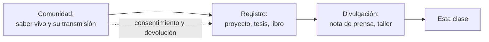

# B02-C06 — Astronomía de pueblos originarios de Chile

<!-- nav:top -->
[🏠 Programa](../../../../README.md) · [📚 Bloque B02](../../../tronco-comun/B02-historia-arqueoastronomia-y-culturas-del-cielo.md) · [← Anterior: B02-C05 — Cosmovisiones andinas del cielo](../B02-C05-cosmovisiones-andinas-del-cielo/CLASE.md) · [Siguiente: B02-C07 — Observaciones de Polinesia y navegación oceánica →](../B02-C07-observaciones-de-polinesia-y-navegacion-oceanica/CLASE.md)
<!-- /nav -->

## 1. Ubicación, nivel y alcance

Sexta clase del bloque B02. En C05 miraste el cielo andino. Aquí das un paso más cercano: los pueblos originarios que viven en el territorio de Chile. Es una clase deliberadamente cautelosa, porque las fuentes que pudimos consultar son pocas y no cubren a todos los pueblos. Nivel N1.

Verás el caso mapuche, documentado en una nota institucional y en un trabajo de diseño de la Universidad de Chile; verás por qué un observatorio moderno en el desierto de Atacama plantea preguntas de consentimiento; y aprenderás a decir con claridad qué **no** sabemos. No verás una síntesis de «la astronomía indígena de Chile»: esa síntesis no existe y no la vamos a inventar.

## 2. Por qué esta clase existe

Chile alberga algunos de los cielos más oscuros del mundo y los más grandes observatorios, y también pueblos que miraron esos cielos durante milenios. La pregunta motivadora es: **¿cómo hablar de saberes celestes de pueblos vivos sin generalizar, sin apropiarse y sin presentar como establecido lo que no hemos podido verificar?**

Al terminar sabrás leer una fuente sobre astronomía indígena distinguiendo quién habla (la comunidad, una universidad, un diseñador), qué documenta y qué le falta, y sabrás formular preguntas de consentimiento antes de usar o publicar un saber ajeno.

## 3. Lo que podrás hacer al terminar

1. Describir con exactitud lo que la fuente consultada dice sobre *Wenumapu* y *We Tripantu*.
2. Distinguir entre el conocimiento mismo, su registro y su divulgación.
3. Explicar por qué no se puede generalizar de un pueblo a otro.
4. Reconocer las preguntas de consentimiento libre, previo e informado.
5. Identificar qué falta en una fuente (voces, método, comunidades nombradas).
6. Redactar una ficha respetuosa, con límites explícitos.

La evidencia es la **ficha de fuente y consentimiento** del ejercicio 12 (sección 20).

## 4. Con qué llegas y cómo comprobarlo

Necesitas C01, C05 y la idea de fuente primaria y secundaria. Cinco preguntas:

1. ¿Qué es el solsticio de invierno en el hemisferio sur y aproximadamente en qué fecha cae?
2. ¿Qué diferencia hay entre «fuente primaria» y «divulgación»?
3. ¿Por qué no se puede decir «los pueblos indígenas creen X» a partir de un solo pueblo?
4. ¿Qué significa «consentimiento»?
5. ¿Qué es un observatorio?

Ver respuestas

1. El día más corto del año, hacia el 20–21 de junio. 2. La primaria es el testimonio o dato original; la divulgación lo resume para el público. 3. Porque cada pueblo tiene historia, lengua y saberes propios. 4. Aceptar libremente, con información suficiente, antes de que ocurra algo. 5. Un lugar con instrumentos para observar el cielo.

Con cuatro o cinco aciertos, sigue. Con tres o menos, repasa C05.

## 5. Un caso real: el regreso del sol

Una nota de la Universidad de Chile sobre una actividad con dos académicas de la Universidad Católica de Temuco, Margarita Canío Llanquinao y Gabriel Pozo Menares, relata que la astronomía y cosmología mapuche, llamada *Wenumapu* («cielo» en mapuzugun), es una observación larga y sistemática de estrellas, constelaciones, Sol, Luna y ciclos de la vida. Según la nota, ese conocimiento proviene de un proyecto de unos diez años que recogió relatos de familias mapuche de varios territorios; el solsticio de invierno inicia un nuevo ciclo y se celebra como año nuevo, *We Tripantu* o *Wiñol Tripantu*, «regreso del sol», entre el 21 y el 24 de junio (S1).

Ten presente lo que la nota no dice: no nombra a las familias, no describe cómo se registró el conocimiento ni qué se acordó con quienes lo compartieron, y es una nota de prensa universitaria, no el trabajo de las autoras. Por eso lo tratamos como indicio y no como descripción completa.

## 6. Vocabulario

*Wenumapu* es, según S1, el cielo en mapuzugun; *antü* es el Sol; *pukem* el invierno y *mawün* la lluvia (S1). *We Tripantu* o *Wiñol Tripantu* es el año nuevo mapuche asociado al solsticio de invierno (S1). Un **pueblo originario** es un pueblo con historia anterior a la formación del Estado actual. El **consentimiento libre, previo e informado** es el derecho de un pueblo a decidir, antes de un proyecto y con información suficiente, si acepta que afecte su territorio o su conocimiento (S3). La **contaminación lumínica** es el exceso de luz artificial que borra la visibilidad del cielo nocturno. Un **saber** es un conocimiento propio de una comunidad, con su forma de transmitirse.

## 7. Modelo mental: quién habla y desde dónde

Cualquier fuente sobre saberes indígenas se entiende mejor si identificas la cadena entre el saber y tú.

*Descripción textual:* una cadena de cuatro pasos desde la comunidad, pasando por el registro y la divulgación, hasta esta clase; una línea de puntos señala que el consentimiento y la devolución deben ir de la comunidad al registro.

Analogía: una receta familiar que llega a ti por un libro, que lo copió de una entrevista. El límite: en un saber vivo, lo que se transmite no es solo contenido sino también quién puede contarlo y cuándo.

## 8. La explicación, paso a paso

### 8.1 Lo que la fuente dice

S1 afirma que *Wenumapu* se describe como observación sistemática de estrellas, constelaciones, Sol, Luna y ciclos de vida; que algunas constelaciones se ligan a relatos y ceremonias y que algunas anuncian el regreso del Sol; que el Sol «comienza su regreso» el 24 de junio; y que el invierno (*pukem*) con sus lluvias (*mawün*) es tiempo de renovación. También registra que las académicas dieron una charla y un taller. Esto es todo lo que afirmamos.

### 8.2 Una tesis de diseño

Un trabajo de título de diseño gráfico de la Universidad de Chile (2016), de Francisca Cerda Escobar, propone una visualización interactiva del «planisferio astronómico cultural mapuche» para dispositivos móviles; el registro del repositorio no nombra fuentes, informantes ni colaboradores comunitarios (S2). Es un ejemplo de **registro derivado**: una traducción visual de un saber, cuya calidad depende de las fuentes que no vemos.

### 8.3 Qué no podemos decir

Con lo consultado no podemos describir constelaciones concretas mapuche, ni su cuenta de los días, ni el conocimiento de otros pueblos originarios de Chile (lickanantay, aymara, rapanui, kawésqar, yagán y otros). Tampoco podemos afirmar que exista un «calendario» único. Declarar esta ausencia es parte del conocimiento: la brecha está en nuestras fuentes, no en los pueblos.

### 8.4 Observatorios y territorio

ESO opera en Chile los observatorios de La Silla, Paranal y Chajnantor (donde opera ALMA con socios internacionales) y construye el ELT en Cerro Armazones (S4). ALMA tiene 66 antenas en la meseta de Chajnantor, a unos 5 000 m de altitud (S5). Estas fuentes institucionales no describen la relación con las comunidades indígenas cercanas, y la página de ALMA solo muestra un enlace titulado «apoyo a la comunidad local», que no leímos. Por eso no afirmamos nada sobre esa relación. Lo que sí puede decirse es el marco: la Declaración de la ONU sobre los derechos de los pueblos indígenas incluye el consentimiento libre, previo e informado, y un documento de la IAU lo propone como principio para actividades espaciales y astronómicas, planteando incluso la contaminación lumínica como pérdida de conocimiento transmitido oralmente (S3). Son argumentos del autor, no una norma vinculante, y el propio autor lo reconoce.

### 8.5 Un cálculo para entender qué es «solsticio»

El solsticio de invierno austral ocurre cuando el Sol está a unos 23,44° al norte del ecuador celeste, el extremo más alto de su declinación norte, y la oblicuidad de la Tierra es de 23,44° (S6). Por eso el día más corto en el hemisferio sur cae hacia el 20–21 de junio. Las fechas 21–24 de junio de S1 abarcan el solsticio y los días siguientes; la fuente no explica por qué se extiende el período, y no lo interpretamos.

## 9. Magnitudes, símbolos y unidades

| Símbolo | Qué es | Unidad | Valor o nota |
|---|---|---|---|
| `ε` | oblicuidad de la Tierra | grados | 23,44 (S6) |
| fechas de *We Tripantu* | período | día | 21–24 de junio (S1) |
| antenas de ALMA | número | — | 66 (S5) |
| altitud de Chajnantor | altura | m | ≈ 5 000 (S5) |

## 10. Convenciones y referencias

Los términos en mapuzugun se escriben como los da la fuente; la ortografía puede variar entre grafemarios. No traducimos más allá de lo que dice la fuente. Hablamos de pueblos concretos y no de «lo indígena».

## 11. De dónde sale lo que afirmamos

| ID | Fuente | Localizador | Respalda | Estado |
|---|---|---|---|---|
| S1 | Universidad de Chile, «Saberes mapuche iluminan el solsticio en la U. de Chile» | https://uchile.cl/noticias/229431/saberes-mapuche-iluminan-el-solsticio-en-la-u-de-chile | *Wenumapu*, *We Tripantu*, proyecto de ~10 años, ponentes, términos | Consultada el 2026-11-05; divulgación institucional |
| S2 | F. Cerda Escobar, *Wenu Kimun* (tesis de diseño, U. de Chile, 2016) | https://repositorio.uchile.cl/handle/2250/143254 | Existencia y objetivo de una visualización del planisferio cultural mapuche | Solo el registro del repositorio, 2026-11-05 |
| S3 | H. Neilson, arXiv:2412.06675 (IAU-CPS Policy Hub) | https://arxiv.org/html/2412.06675v1 | Consentimiento libre, previo e informado; UNDRIP; contaminación lumínica | Consultada el 2026-11-05; propuestas del autor, no norma |
| S4 | ESO, «About ESO» | https://www.eso.org/public/about-eso/ | Observatorios de ESO en Chile | Consultada el 2026-11-05 |
| S5 | ALMA Observatory, «About ALMA» | https://www.almaobservatory.org/en/about-alma/ | 66 antenas; Chajnantor a ~5 000 m | Consultada el 2026-11-05 |
| S6 | NASA NSSDC, *Earth Fact Sheet* | https://nssdc.gsfc.nasa.gov/planetary/factsheet/earthfact.html | Oblicuidad 23,44° | Consultada el 2026-11-05 |

Límites: no consultamos el libro *Wenumapu* ni publicaciones de las propias comunidades; el folleto de ALMA sobre etnoastronomía no se pudo abrir y no se usa; no hay fuentes consultadas sobre lickanantay, aymara, rapanui ni pueblos australes. **Pendiente para la revisión disciplinar:** incorporar bibliografía y voces de cada pueblo.

## 12. Cómo ver lo que sabemos

Esta tabla es la versión accesible de un mapa de cobertura.

| Pueblo | Fuente consultada | Cobertura |
|---|---|---|
| Mapuche | S1, S2 | Parcial: divulgación y un registro de tesis |
| Lickanantay (Atacama) | ninguna sobre su cielo | Sin cobertura |
| Aymara | ninguna | Sin cobertura |
| Rapanui | ninguna abierta | Sin cobertura |
| Kawésqar, yagán y otros | ninguna | Sin cobertura |

Descripción larga: un solo pueblo tiene cobertura parcial; los demás aparecen vacíos, y esa vacuidad es información sobre nuestras fuentes, no sobre los pueblos.

## 13. Ejemplo trabajado: leer una fuente con cuidado

**Planteamiento.** Quieres escribir: «el calendario mapuche empieza el 24 de junio».

**Paso 1.** S1 dice que el Sol «comienza su regreso» el 24 de junio y que el año nuevo se celebra del 21 al 24 de junio.

**Paso 2.** La frase propuesta confunde un día con un período y atribuye a todo «el calendario mapuche» una fecha única.

**Paso 3.** Reformulación: «según una nota de la U. de Chile, el solsticio de invierno inicia un nuevo ciclo y el año nuevo mapuche, *We Tripantu*, se celebra entre el 21 y el 24 de junio».

**Paso 4. Qué falta.** Las variantes por territorio; la voz de las comunidades; cómo se cuentan los días.

**Sentido físico.** La precisión es una forma de respeto: decir exactamente lo que la fuente dice evita atribuir a un pueblo lo que no afirmó.

## 14. Distintas formas de relacionarse con un saber

**Citar** (con fuente y alcance) es lo mínimo. **Co-investigar** con la comunidad, con acuerdos sobre autoría y beneficios, es lo deseable. **Apropiarse** (usar sin permiso ni reconocimiento) es lo que se debe evitar. Esta clase solo cita; no investiga.

## 15. Práctica guiada

**Ejercicio 1 · con los pasos indicados.** Reescribe «los mapuche creen que el Sol muere en invierno» con la información de S1. *Pasos:* cita, atribuye, evita «creen».

Solución comentada

«Según una nota de la U. de Chile, el solsticio de invierno inicia un nuevo ciclo; la fuente habla de "regreso del sol" (*Wiñol Tripantu*)». «Muere» no aparece en la fuente.

**Ejercicio 2 · con una pista.** ¿Qué días cubre *We Tripantu* según S1 y cuántos son? *Pista:* cuenta ambos extremos.

Solución comentada

Del 21 al 24 de junio: cuatro días.

**Ejercicio 3 · casi autónomo.** Señala tres cosas que la nota S1 no dice.

Solución comentada

No nombra a las familias; no describe el método ni los acuerdos con quienes compartieron el saber; no detalla constelaciones concretas.

## 16. Práctica autónoma, transferencia e integrador

**Ejercicio 4.** Calcula cuántos días hay entre el 21 de junio y el 24 de junio (sin contar el primero).

Solución comentada

3 días.

**Ejercicio 5.** Si el solsticio ocurre el 21 de junio, ¿qué porcentaje del período de 4 días de *We Tripantu* ocurre después del solsticio?

Solución comentada

3 de 4 días son posteriores: 75 %. Es aritmética; no interpreta el significado del período.

**Ejercicio 6.** Distingue saber, registro y divulgación en S1, S2 y la clase.

Solución comentada

El saber es de las familias mapuche; el registro es el proyecto de diez años y la tesis; la divulgación es la nota y esta clase.

**Ejercicio 7.** ¿Por qué no afirmamos nada sobre la relación de ALMA con las comunidades?

Solución comentada

Porque las páginas consultadas no la describen (solo muestran un enlace que no leímos). Afirmar sin fuente sería inventar.

**Ejercicio 8.** Formula tres preguntas de consentimiento antes de usar un saber comunitario en un proyecto escolar.

Solución comentada

¿Quién puede autorizar compartir este saber? ¿Para qué se usará y quién se beneficia? ¿Cómo se reconocerá la autoría y se devolverá el resultado? (en la línea de S3).

**Ejercicio 9 · transferencia.** Un compañero afirma: «los indígenas de Chile tenían un solo calendario». Responde.

Solución comentada

No hay fuente consultada que lo respalde; hay varios pueblos con historias y saberes propios. La afirmación generaliza desde un solo caso (el mapuche, parcial).

**Ejercicio 10 · transferencia.** El autor de S3 propone considerar la contaminación lumínica como pérdida cultural. ¿Qué argumento da y qué límite tiene?

Solución comentada

Argumenta que borrar el cielo puede borrar conocimiento transmitido oralmente. El mismo autor reconoce que sus propuestas no tienen todavía una base clara en el derecho internacional (S3).

**Ejercicio 11 · transferencia.** Diseña un protocolo breve para visitar un observatorio y a una comunidad cercana sin invadir.

Solución comentada

Coordinar a través de canales oficiales de la comunidad, pedir permiso para visitar o fotografiar, explicar el propósito, respetar las decisiones y no publicar sin autorización.

**Ejercicio 12 · integrador.** Elabora la *ficha de fuente y consentimiento* (sección 20) para un saber celeste de un pueblo originario de Chile: pueblo, fuente, quién habla, qué dice, qué falta y qué consentimiento necesitarías.

Solución modelo

Una ficha completa cita la fuente con su tipo, separa saber/registro/divulgación, declara lo que falta y propone cómo obtener permiso y devolver el resultado. Se acepta cualquier pueblo con fuente citada.

## 17. Actividad sin código: mapa de cobertura

Esta clase no usa script. Amplía la tabla de la sección 12 con fuentes que tú encuentres y consultes (publicaciones de comunidades, museos, universidades) y rotula su tipo. **Qué observar:** qué pueblos quedan sin cobertura y por qué. **Resultado esperado:** la tabla muestra los vacíos antes de intentar llenarlos con generalizaciones.

## 18. Errores frecuentes y cómo corregirlos

**Generalizar de un pueblo a todos.** Ejercicio 9.

**Presentar divulgación como investigación.** Ejercicio 6.

**Inventar la relación de un observatorio con una comunidad.** Ejercicio 7.

**Traducir de más.** Ejercicio 1.

**Publicar sin permiso.** Ejercicio 8.

## 19. Cómo sabrás que vas bien

Tras 8.1: ¿puedes decir qué afirma S1 sin añadir nada? Ejercicio 1. Tras 8.3: ¿puedes nombrar lo que no sabemos? Ejercicio 3. Al final: ¿qué permiso pedirías? Ejercicio 8.

## 20. Qué entregas y cómo se evalúa

El producto es tu **ficha de fuente y consentimiento**.

| Criterio | Inicial | En desarrollo | Logrado | Destacado |
|---|---|---|---|---|
| Fidelidad a la fuente | Añade contenido | Parafrasea con errores | Parafrasea con exactitud | Distingue tipos de fuente |
| Límites declarados | Ninguno | Algunos | Los principales | Propone cómo superarlos |
| Consentimiento | Ausente | Mencionado | Preguntas concretas | Plan de devolución |
| Generalización | Generaliza | Duda | Evita generalizar | Nombra pueblo y territorio |

**Condiciones críticas:** no generalizar; no usar material sagrado o restringido sin permiso; citar solo lo consultado; no atribuir a una comunidad lo que no dijo.

## 21. Ética, seguridad y límites

Esta es la clase donde la ética pesa más. Los saberes pertenecen a quienes los tienen; esta clase no los reproduce, los señala. Si compartes un saber en un trabajo, cita a quien lo compartió, pregunta antes y devuelve el resultado. Observar el Sol requiere filtros certificados. Accesibilidad: descripciones textuales, tablas equivalentes y sin conexión.

## 22. Para cerrar y seguir

Un saber celeste se lee según quién lo cuenta, cómo se registró y con qué permiso; en Chile las fuentes que consultamos cubren solo parcialmente un pueblo, y decirlo es parte del rigor. En C07 miramos otro océano: los navegantes de Polinesia y Micronesia, con un caso donde el consentimiento fue y sigue siendo tema de debate.

**Glosario español–inglés.** pueblo originario · *Indigenous people*; consentimiento libre, previo e informado · *free, prior and informed consent*; contaminación lumínica · *light pollution*; saber · *knowledge system*; solsticio · *solstice*; oblicuidad · *obliquity*.

**Continuidad.** B02-C07 usa tu capacidad de **identificar quién habla y con qué permiso** para estudiar la navegación oceánica.

**Referencias:** ver sección 11. S1 es divulgación; S2 solo un registro; S3 propone principios.

<!-- nav:bottom -->
---

[← Anterior: B02-C05 — Cosmovisiones andinas del cielo](../B02-C05-cosmovisiones-andinas-del-cielo/CLASE.md) · [📚 Bloque B02](../../../tronco-comun/B02-historia-arqueoastronomia-y-culturas-del-cielo.md) · [Siguiente: B02-C07 — Observaciones de Polinesia y navegación oceánica →](../B02-C07-observaciones-de-polinesia-y-navegacion-oceanica/CLASE.md)
<!-- /nav -->
