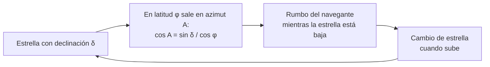

# B02-C07 — Observaciones de Polinesia y navegación oceánica

<!-- nav:top -->
[🏠 Programa](../../../../README.md) · [📚 Bloque B02](../../../tronco-comun/B02-historia-arqueoastronomia-y-culturas-del-cielo.md) · [← Anterior: B02-C06 — Astronomía de pueblos originarios de Chile](../B02-C06-astronomia-de-pueblos-originarios-de-chile/CLASE.md) · [Siguiente: B02-C08 — Arqueoastronomía y sus métodos →](../B02-C08-arqueoastronomia-y-sus-metodos/CLASE.md)
<!-- /nav -->

## 1. Ubicación, nivel y alcance

Séptima clase del bloque B02. Hasta aquí el cielo servía para contar el tiempo. Aquí sirve para **orientarse**: los navegantes del Pacífico cruzaron miles de kilómetros de mar abierto sin instrumentos. Nivel N1.

Verás cómo un horizonte de estrellas funciona como brújula, haces un cálculo propio de dónde sale una estrella según su declinación, y estudias el viaje de la canoa Hōkūle‘a en 1976 y el debate sobre quién tiene derecho a enseñar la navegación tradicional. No verás una descripción completa del «compás estelar» ni de las técnicas de cada isla: no tenemos fuentes para eso y no las inventamos.

## 2. Por qué esta clase existe

Se discutió durante décadas si los pueblos del Pacífico llegaron a las islas por azar o por navegación deliberada. La pregunta motivadora es: **¿cómo se orienta quien no puede ver tierra, y qué dice su método sobre el valor del conocimiento oral?**

Al terminar sabrás explicar por qué una estrella sirve de rumbo, calcular su punto de salida en el horizonte y analizar un caso donde la ciencia y la tradición se encontraron con tensiones reales.

## 3. Lo que podrás hacer al terminar

1. Explicar por qué una estrella sale siempre por el mismo punto del horizonte.
2. Calcular el azimut de salida de una estrella conocida su declinación y la latitud.
3. Describir el viaje de Hōkūle‘a de 1976 con sus fuentes y límites.
4. Distinguir navegación con instrumentos de navegación sin instrumentos.
5. Reconocer el debate sobre transmisión y apropiación del conocimiento.
6. Redactar una ficha de un método de navegación con sus fuentes.

La evidencia es la **ficha de rumbo estelar** del ejercicio 12 (sección 20).

## 4. Con qué llegas y cómo comprobarlo

Necesitas C01, C04 y trigonometría elemental. Cinco preguntas:

1. ¿Qué es el azimut?
2. ¿Por qué las estrellas parecen girar en el cielo?
3. ¿Qué es la latitud?
4. Si `cos A = 0,5`, ¿cuánto vale `A`?
5. ¿Qué es un instrumento de navegación?

Ver respuestas

1. El ángulo horizontal medido desde el norte hacia el este. 2. Porque la Tierra gira. 3. El ángulo de un lugar al norte o al sur del ecuador. 4. 60°. 5. Un aparato como brújula, sextante o GPS.

Con cuatro o cinco aciertos, sigue. Con tres o menos, repasa B01-C04.

## 5. Un caso real: Hōkūle‘a, 1976

La Sociedad de Navegación Polinesia (Polynesian Voyaging Society) fue fundada en 1973 por el antropólogo Ben Finney, el artista Herb Kane y Tommy Holmes, con el propósito de probar si los antiguos polinesios podían navegar deliberadamente grandes distancias sin instrumentos (S1). Su canoa Hōkūle‘a zarpó en su viaje inaugural el 1 de mayo de 1976 hacia Tahití, guiada por el navegante Mau Piailug (S1). El archivo de la sociedad indica que el viaje formó parte del Bicentenario de Estados Unidos y que su propósito oficial era mostrar que los viajes de ida y vuelta de las tradiciones orales hawaianas podían hacerse en una réplica de canoa antigua navegada «sin instrumentos»; quince personas navegaron de Hawái a Tahití (S2). Según un artículo de JSTOR Daily, el trayecto de ida duró 34 días y Mau fue el único tripulante con conocimiento de navegación tradicional; se orientó con memoria, estrellas y oleaje (S3).

Una advertencia: S1 y S3 dan datos que no siempre coinciden en detalles (fechas de llegada, número de días), y no leímos informes de la propia expedición; los usamos solo para lo central.

## 6. Vocabulario

La **navegación sin instrumentos** (*wayfinding*) usa la observación del cielo, las olas, el viento y los seres vivos para encontrar el rumbo y la posición (S1). El **compás estelar** es, según S1, una forma de organizar las direcciones mediante puntos de salida y puesta de estrellas; no desarrollamos su estructura porque no la consultamos. El **azimut** es el ángulo horizontal desde el norte. La **declinación** de una estrella es su ángulo al norte o al sur del ecuador celeste (C08). El **horizonte** es el límite del cielo visto desde el mar. Un **pwo** es un navegante maestro en la tradición de las islas Carolinas (S3).

## 7. Modelo mental: la estrella como rumbo

Una estrella sale, sube y se pone describiendo un arco; cada noche, sale por el mismo punto del horizonte. Mientras la estrella está baja, su dirección es un rumbo; cuando sube, se pierde el rumbo y se pasa a la siguiente estrella que sale en ese punto.

*Descripción textual:* una estrella de declinación dada sale en un azimut que depende de la latitud; ese punto sirve de rumbo mientras la estrella está baja; al subir, el navegante pasa a otra estrella que salga por el mismo punto, y el ciclo se repite.

Analogía: seguir un faro que cambia de faro en la noche. El límite: la analogía supone que el navegante ve el horizonte; con nubes, el método se apoya en las olas y otros indicios (S1, S4).

## 8. La explicación, paso a paso

### 8.1 Por qué sale siempre por el mismo punto

La Tierra gira de forma regular, y cada estrella tiene una declinación casi constante a lo largo de una noche. El triángulo esférico que une el polo, el cenit y el astro da, para un horizonte plano, `cos A = sin δ / cos φ` (el mismo cálculo de C08). Si una estrella tiene `δ = +20°` y el lugar está en el ecuador (`φ = 0°`), entonces `cos A = 0,342` y `A = 70,0°` desde el norte. Sale así hacia el este-noreste.

### 8.2 Una tabla de rumbos

Para `φ = 0°`: `δ = +20°` da `A = 70,0°`; `δ = 0°` da `A = 90,0°` (este exacto); `δ = −20°` da `A = 110,0°`. En el ecuador, las estrellas de declinación opuesta salen simétricas respecto del este. Estas cifras son un cálculo nuestro con la fórmula geométrica; no afirman que ningún navegante concreto haya usado esos valores.

### 8.3 El método más allá de las estrellas

S1 explica que los navegantes usan el compás estelar, el Sol, la Luna, las olas y los seres marinos para encontrar rumbo y posición sin instrumentos, y S4 menciona también el viento, las nubes y las aves. Esa diversidad importa porque el cielo se nubla. La fuente no detalla cómo se leen las olas ni qué estrellas se usan, y no lo reconstruimos.

### 8.4 Evidencia de navegación intencional

S1 señala que el debate sobre si los pueblos del Pacífico llegaron a las islas por accidente o por navegación planificada se vio apoyado por los viajes de revitalización, entre ellos el de 1976. Indica también que el viaje de 1985–87 recorrió 25 700 km y mostró que las canoas pueden navegar contra los vientos dominantes aprovechando cambios estacionales. Esta evidencia es **experimental**: muestra que algo es posible, no que ocurrió históricamente así.

### 8.5 Un cálculo de ritmo

En 2012–13, dos canoas neozelandesas navegaron unos 18 520 km (10 000 millas náuticas) en 10 meses entre Aotearoa y Rapa Nui y de regreso (S4). Con 1 milla náutica = 1,852 km, `10 000 × 1,852 = 18 520 km`, coherente. Dividir entre unos 300 días da unos `62 km/día` de promedio, **incluyendo estadías**, así que no es una velocidad de navegación.

### 8.6 Conocimiento, familia y debate

S3 relata que Mau Piailug nació en 1932 en Satawal y aprendió de su abuelo en un aprendizaje de décadas; que hacia 1970 era uno de los seis navegantes *pwo* vivos; que enseñar a navegantes no micronesios rompía la tradición de que el conocimiento se queda en la familia; y que algunas personas micronesias, entre ellas su medio hermano, critican a la Sociedad por apropiación cultural, argumentando que Mau transmitió el sistema a su hijo y que no corresponde que la Sociedad nombre sus propios *pwo* (S3). La fuente presenta ambas posiciones; no tomamos partido, pero registramos que el debate existe y que exige escuchar a las personas involucradas.

## 9. Magnitudes, símbolos y unidades

| Símbolo | Qué es | Unidad | Valor o nota |
|---|---|---|---|
| `δ` | declinación de la estrella | grados | ejemplo ±20° |
| `φ` | latitud del observador | grados | ejemplo 0° |
| `A` | azimut de salida desde el norte | grados | 70°; 90°; 110° |
| `d` | distancia navegada | km | 18 520 (S4) |
| duración | viaje de ida 1976 | día | 34 (S3) |
| milla náutica | 1 nmi | km | 1,852 |

## 10. Convenciones y referencias

El azimut se mide desde el norte hacia el este. Se usa un horizonte plano y sin refracción: es una simplificación. Los nombres hawaianos se escriben como en las fuentes (con ‘okina y macrón cuando las fuentes los usan).

## 11. De dónde sale lo que afirmamos

| ID | Fuente | Localizador | Respalda | Estado |
|---|---|---|---|---|
| S1 | Science Learning Hub (Nueva Zelanda), «Wayfinding revival» | https://www.sciencelearn.org.nz/resources/631-wayfinding-revival | Fundación en 1973, Hōkūle‘a 1976, 1985–87 (25 700 km), 2012–13 (18 520 km), métodos | Consultada el 2026-11-05; recurso educativo (2014) |
| S2 | Polynesian Voyaging Society, archivo «1976» | https://archive.hokulea.com/1976.html | Propósito del viaje, Mau Piailug, tripulación de 15 personas | Consultada el 2026-11-05; sin fechas ni días |
| S3 | JSTOR Daily, «Pius Mau Piailug, master navigator of Micronesia» | https://daily.jstor.org/pius-mau-piailug-master-navigator-of-micronesia | Biografía de Mau, 34 días, debate de apropiación | Consultada el 2026-11-05; divulgación académica |
| S4 | Hōkūle‘a / PVS, sitio principal | https://hokulea.com/ | Navegación sin instrumentos con estrellas, olas, viento, nubes y aves; Nainoa Thompson | Consultada el 2026-11-05; sitio institucional |

Límites: el recurso S1 es educativo; S3 es un artículo de divulgación; no consultamos las memorias de la expedición ni estudios de etnografía de la navegación. S3 menciona un viaje de «unas 6 000 millas náuticas» que no usamos: no coincide con el orden de magnitud esperable y no pudimos contrastarlo. Sin fuente consultada sobre Matariki y otros calendarios polinesios.

## 12. Cómo ver los rumbos

Esta tabla es la versión accesible de un diagrama de brújula estelar simplificada.

| Declinación `δ` | Azimut de salida (φ = 0°) | Dirección |
|---|---|---|
| +20° | 70,0° | este-noreste |
| 0° | 90,0° | este |
| −20° | 110,0° | este-sureste |

Si lo dibujas, usa un círculo con el norte arriba, marca el este y rotula los azimuts; distingue las estrellas por forma. Descripción larga: tres puntos en el arco oriental del horizonte, simétricos respecto del este.

## 13. Ejemplo trabajado: ¿por dónde sale una estrella?

**Planteamiento.** Una estrella con `δ = +20°` se observa desde el ecuador. ¿En qué rumbo sale y qué rumbo opuesto marca al ponerse?

**Paso 1.** `cos A = sin 20°/cos 0° = 0,3420`.

**Paso 2.** `A = arccos(0,3420) = 70,0°`.

**Paso 3.** La puesta es simétrica: `360° − 70,0° = 290,0°`.

**Paso 4. Incertidumbre.** Con refracción y horizonte irregular el punto real varía en el orden de medio grado; un navegante usa varias estrellas.

**Sentido físico.** La estrella marca el rumbo mientras está baja. Es un cálculo nuestro con modelo simple; no describe el método de ningún navegante concreto.

## 14. Comparación de métodos

La **navegación con instrumentos** (brújula, GPS) da precisión pero depende de aparatos. La **navegación sin instrumentos** depende de la memoria y la práctica, y es resistente a fallas técnicas, pero exige formación larga y transmisión. Ninguna es «más científica»: la segunda es conocimiento sistemático transmitido oralmente (S3). Esta clase no sirve para navegar.

## 15. Práctica guiada

**Ejercicio 1 · con los pasos indicados.** Calcula `A` para `δ = −20°`, `φ = 0°`. *Pasos:* `sin(−20°)`, divide por `cos 0°`, `arccos` (sección 8.1).

Solución comentada

`cos A = −0,3420`; `A = 110,0°`.

**Ejercicio 2 · con una pista.** ¿Qué `A` da `δ = 0°`? *Pista:* `sin 0 = 0`.

Solución comentada

`cos A = 0`, `A = 90°`: este exacto.

**Ejercicio 3 · casi autónomo.** Convierte 10 000 millas náuticas a km.

Solución comentada

`10 000 × 1,852 = 18 520 km` (S1 da el mismo valor).

## 16. Práctica autónoma, transferencia e integrador

**Ejercicio 4.** Calcula `A` para `δ = +10°` y `φ = −15°`.

Solución comentada

`sin 10° = 0,1736`; `cos(−15°) = 0,9659`; `cos A = 0,1798`; `A = 79,6°`.

**Ejercicio 5.** ¿Qué `δ` sale exactamente en el este a cualquier latitud?

Solución comentada

`δ = 0`: `cos A = 0`.

**Ejercicio 6.** Calcula el promedio de 18 520 km en 300 días y explica por qué no es velocidad de navegación.

Solución comentada

`61,7 km/día`; incluye estadías, y los 10 meses son una cifra redondeada (S1).

**Ejercicio 7.** Explica por qué el viaje de 1976 es evidencia experimental y no histórica.

Solución comentada

Prueba que es posible navegar así entre Hawái y Tahití sin instrumentos, no que los ancestros lo hicieron (S1). Complementa a la evidencia arqueológica y lingüística, que no consultamos.

**Ejercicio 8.** ¿Qué dos posiciones presenta S3 sobre la enseñanza a navegantes no micronesios?

Solución comentada

Una valora que Mau compartiera el conocimiento por responsabilidad de preservarlo; otra, de personas micronesias, critica apropiación y objeta que la Sociedad nombre navegantes *pwo* (S3).

**Ejercicio 9 · transferencia.** Un divulgador dice: «los polinesios navegaban con las estrellas porque no sabían de brújulas». Responde.

Solución comentada

El enunciado atribuye ignorancia; las fuentes describen un sistema de conocimiento sistemático, con años de aprendizaje (S3) y múltiples indicios (S4). No es ausencia de instrumentos sino otra tecnología del saber.

**Ejercicio 10 · transferencia.** Calcula `A` a la latitud de Santiago (usa −33,5°) para `δ = +20°`. Declara que es un ejemplo.

Solución comentada

`cos(33,5°) = 0,8339`; `cos A = 0,3420/0,8339 = 0,4101`; `A = 65,8°`. La latitud de Santiago es un valor de ejemplo no consultado en una fuente.

**Ejercicio 11 · transferencia.** Propón dos preguntas de consentimiento para usar la navegación tradicional en un taller escolar.

Solución comentada

¿Quién puede autorizar compartir este conocimiento? ¿Cómo se reconoce a quien lo transmite? (S3).

**Ejercicio 12 · integrador.** Elabora la *ficha de rumbo estelar* (sección 20): elige una latitud y tres declinaciones, calcula los azimuts de salida y puesta, di qué simplificaciones usaste y qué fuente respalda el contexto cultural.

Solución modelo

Sigue la sección 13 con tres estrellas, tabla de azimuts, simplificaciones declaradas (horizonte plano, sin refracción) y una nota cultural con fuente y consentimiento.

## 17. Actividad sin código: tabla de rumbos

Esta clase no usa script (la fórmula es la misma que el laboratorio de C08). Completa en una hoja de cálculo la tabla de azimuts de salida para `δ` de −30° a +30°, de 10 en 10, en `φ = 0°` y `φ = −15°`. **Qué observar:** la simetría respecto del este y cómo la latitud acerca las salidas al norte o al sur. **Resultado esperado:** en `φ = 0°` los azimuts son 120,0°; 110,0°; 100,0°; 90,0°; 80,0°; 70,0°; 60,0° para `δ` de −30° a +30°.

## 18. Errores frecuentes y cómo corregirlos

**Olvidar que la estrella sube.** El rumbo solo vale cerca del horizonte. Ejercicio 5.

**Usar la fórmula con latitud en radianes.** Ejercicios 1 y 4.

**Calificar de ignorancia la ausencia de instrumentos.** Ejercicio 9.

**Tomar el viaje de 1976 como prueba histórica.** Ejercicio 7.

**Ignorar el debate de apropiación.** Ejercicio 8.

## 19. Cómo sabrás que vas bien

Tras 8.1: ¿calculas `A` sin mirar? Ejercicio 1. Tras 8.4: ¿puedes explicar qué prueba y qué no prueba el viaje? Ejercicio 7. Al final: ¿puedes enunciar el debate de S3 sin tomar partido? Ejercicio 8.

## 20. Qué entregas y cómo se evalúa

El producto es tu **ficha de rumbo estelar**.

| Criterio | Inicial | En desarrollo | Logrado | Destacado |
|---|---|---|---|---|
| Cálculo | Sin cálculo | Con errores | Correcto con unidades | Con incertidumbre |
| Simplificaciones | No declara | Algunas | Las principales | Estima su efecto |
| Contexto cultural | Anacrónico | Con fuente | Con fuente y debate | Con voces de la tradición |
| Consentimiento | Ausente | Mencionado | Aplicado | Con plan de devolución |

**Condiciones críticas:** no presentar el cálculo como método de un navegante concreto; citar solo lo consultado; no usar la clase para navegar.

## 21. Ética, seguridad y límites

La navegación tradicional es un patrimonio vivo con titulares y reglas de transmisión; esta clase la estudia con respeto y reconoce un debate abierto sobre apropiación (S3). El cálculo es educativo y no sustituye cartas ni equipos de seguridad: nadie debe navegar basándose en esta clase. Accesibilidad: fórmulas en texto, diagrama descrito, tablas equivalentes.

## 22. Para cerrar y seguir

Un horizonte de estrellas puede ser una brújula; el azimut de salida lo calculas con la declinación y la latitud; y el caso de Hōkūle‘a muestra tanto la fuerza del conocimiento oral como las tensiones sobre quién lo transmite. En C08 sistematizas cómo se estudia, con métodos, lo que los sitios y las orientaciones dicen del cielo.

**Glosario español–inglés.** navegación sin instrumentos · *wayfinding*; compás estelar · *star compass*; azimut · *azimuth*; declinación · *declination*; horizonte · *horizon*; apropiación cultural · *cultural appropriation*.

**Continuidad.** B02-C08 usa tu capacidad de **pasar de una orientación a una declinación** para presentar los métodos de la arqueoastronomía.

**Referencias:** ver sección 11. S1 y S3 son divulgativas.

<!-- nav:bottom -->
---

[← Anterior: B02-C06 — Astronomía de pueblos originarios de Chile](../B02-C06-astronomia-de-pueblos-originarios-de-chile/CLASE.md) · [📚 Bloque B02](../../../tronco-comun/B02-historia-arqueoastronomia-y-culturas-del-cielo.md) · [Siguiente: B02-C08 — Arqueoastronomía y sus métodos →](../B02-C08-arqueoastronomia-y-sus-metodos/CLASE.md)
<!-- /nav -->
