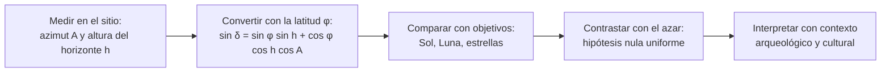

# B02-C08 — Arqueoastronomía y sus métodos

<!-- nav:top -->
[🏠 Programa](../../../../README.md) · [📚 Bloque B02](../../../tronco-comun/B02-historia-arqueoastronomia-y-culturas-del-cielo.md) · [← Anterior: B02-C07 — Observaciones de Polinesia y navegación oceánica](../B02-C07-observaciones-de-polinesia-y-navegacion-oceanica/CLASE.md) · [Siguiente: B02-C09 — Alineaciones arqueológicas y sesgos →](../B02-C09-alineaciones-arqueologicas-y-sesgos/CLASE.md)
<!-- /nav -->

## 1. Ubicación, nivel y alcance

Octava clase del bloque B02. Hasta aquí conociste casos. Esta clase los ordena en un método: **cómo se pasa de una pared, una torre o una cueva a una afirmación sobre el cielo**. Nivel N1.

Verás las etapas del trabajo arqueoastronómico, la fórmula que convierte una orientación medida en una declinación, un laboratorio con datos sintéticos que la comprueba, y las advertencias que los propios especialistas hacen. No verás todavía el problema estadístico de las coincidencias por azar (C09) ni la historia de la ciencia europea (C10 en adelante).

## 2. Por qué esta clase existe

Decir «esta puerta mira al solsticio» es fácil; demostrarlo es difícil. Hay que medir bien, conocer el horizonte, descartar el azar y entender el contexto cultural. La pregunta motivadora es: **¿qué hay que declarar para que una afirmación sobre una alineación pueda ser evaluada por otra persona?**

Al terminar sabrás describir el flujo de trabajo, convertir azimut y altura del horizonte en declinación y distinguir un resultado respaldado de uno sugerente.

## 3. Lo que podrás hacer al terminar

1. Definir arqueoastronomía y astronomía cultural como campos interdisciplinarios.
2. Describir las etapas: medir, convertir, comparar, contrastar con el azar e interpretar.
3. Calcular la declinación a partir de latitud, azimut y altura del horizonte.
4. Calcular el azimut de salida del Sol en los solsticios y el equinoccio.
5. Reconocer la importancia de la altura real del horizonte.
6. Redactar una ficha de método con sus incertidumbres.

La evidencia es la **ficha de orientación** del ejercicio 12 (sección 20).

## 4. Con qué llegas y cómo comprobarlo

Necesitas C05, C07 y trigonometría. Cinco preguntas:

1. ¿Qué es la declinación de un astro?
2. ¿Qué es el azimut?
3. Si `sin x = 0,5`, ¿cuánto vale `x`?
4. ¿Por qué importa la altura del horizonte?
5. ¿Qué es una hipótesis nula?

<details>
<summary>Ver respuestas</summary>

1. El ángulo del astro al norte o al sur del ecuador celeste. 2. El ángulo horizontal desde el norte hacia el este. 3. 30°. 4. Porque un cerro hace que el astro aparezca más tarde y en otro punto. 5. La suposición de que no hay efecto, contra la cual se contrasta el resultado.
</details>

Con cuatro o cinco aciertos, sigue. Con tres o menos, repasa C07.

## 5. Un caso real: iglesias jesuitas sin patrón

Un estudio de 2023 midió las orientaciones de 41 capillas e iglesias de las misiones jesuitas del noroeste de Nueva España, de los siglos XVII y XVIII. Usó imágenes satelitales y modelos digitales de elevación para obtener el azimut del eje principal y la altura del horizonte hacia donde mira el altar, y analizó los resultados con un diagrama de orientaciones y un histograma de declinaciones. Concluyó que no se identifica un patrón con suficiente confianza y que probablemente los edificios no se orientaron según una regla definida (S1).

Lo valioso de este caso es el **resultado negativo**: un método bien aplicado puede decir que no hay patrón. Ten presente el límite: es un estudio de iglesias coloniales, no de monumentos indígenas; lo usamos por la claridad de su método, no por su tema.

## 6. Vocabulario

La **arqueoastronomía** estudia las prácticas astronómicas de culturas antiguas, incluidas las orientaciones de sitios y estructuras; la **astronomía cultural** es el término más amplio, que incluye también tradiciones vivas (S2). Es un campo interdisciplinario: participan astrónomos, antropólogos, arqueólogos y especialistas indígenas (S2). La **orientación** es la dirección hacia donde apunta un eje o una abertura. El **azimut** `A` se mide desde el norte hacia el este. La **altura del horizonte** `h` es el ángulo sobre el horizonte matemático de la línea visible hacia esa dirección. La **declinación** `δ` es la coordenada celeste norte–sur. El **horizonte** real es el perfil del paisaje, no una línea plana. Una **hipótesis nula** es la suposición de que las orientaciones se distribuyen al azar (S1).

## 7. Modelo mental: de la piedra al cielo y de vuelta

Cada etapa del método transforma un dato y arrastra su incertidumbre.



*Descripción textual:* cinco etapas encadenadas: se mide azimut y altura del horizonte; se convierte a declinación con la latitud; se compara con astros relevantes; se contrasta con la hipótesis de azar; y solo al final se interpreta con el contexto arqueológico y cultural.

Analogía: un análisis de laboratorio con muestra, cálculo, comparación y control. El límite: aquí la «muestra» no se puede repetir, y el contexto cultural puede importar más que el cálculo.

## 8. La explicación, paso a paso

### 8.1 Medir

El estudio de S1 midió el azimut de cada eje con imágenes satelitales y el ángulo de altura del horizonte con un modelo digital de elevación (SRTM) con una aproximación de unos 0,5°; cuando el horizonte estaba muy cerca, usó una herramienta de perfil de elevación para precisar (S1). Es un recordatorio de que la incertidumbre de partida es de medio grado o más.

### 8.2 Convertir

Con un horizonte de altura `h`, la declinación sale de `sin δ = sin φ sin h + cos φ cos h cos A` (fórmula de la geometría esférica; el laboratorio la comprueba). Con horizonte plano (`h = 0`) se reduce a `sin δ = cos φ cos A`. El estudio S1 indica además que corrigió `h` por refracción atmosférica; en este curso la ignoramos y la declaramos.

### 8.3 Objetivos astronómicos

En un lugar de latitud `φ`, el Sol sale con `δ = +ε` en el solsticio de junio, `δ = 0` en los equinoccios y `δ = −ε` en el de diciembre, con `ε = 23,44°` (S3). El azimut geométrico de salida es `cos A = sin δ / cos φ`. En el sitio **sintético** a `φ = −10°` del laboratorio, la salida cae en 66,18° (junio), 90,00° (equinoccio) y 113,82° (diciembre).

### 8.4 Contrastar con el azar

S1 compara el histograma de declinaciones, suavizado con un núcleo de Epanechnikov de ancho aproximado el doble del error en declinación, con lo esperado si las orientaciones se repartieran de manera uniforme por el horizonte (hipótesis nula), siguiendo a González-García y Šprajc (2016); un máximo solo es relevante si supera de forma clara esa referencia (S1). En C09 haces este contraste con una simulación.

### 8.5 Interpretar

Un resultado numérico no explica por qué. Para Chankillo, un comunicado indica que los autores combinaron el levantamiento de las torres con puntos de observación, años de trabajo de campo para fechar las estructuras y objetos hallados cerca de los puntos que sugieren reuniones rituales; uno de los autores señala que la mayoría de los supuestos observatorios antiguos no convencen (S4). La interpretación política de «controlar el calendario» se presenta allí como propuesta. La lección: la cifra es la mitad del argumento; la otra mitad es el contexto.

### 8.6 El horizonte es un dato del sitio

La altura del horizonte no es una variable aleatoria: es un hecho de cada lugar, y por eso S1 la obtiene para cada edificio en lugar de suponer un horizonte plano. Es la práctica que adoptamos. Un trabajo que propone alineaciones astronómicas en monumentos de Gran Bretaña (S5) sirve como ejemplo del tipo de afirmación que debe someterse a este método; solo consultamos su resumen, que no describe cómo se midió ni se contrastó, de modo que no podemos evaluarla ni la usamos como evidencia.

## 9. Magnitudes, símbolos y unidades

| Símbolo | Qué es | Unidad | Valor o nota |
|---|---|---|---|
| `φ` | latitud del sitio | grados | negativa al sur |
| `A` | azimut del eje (desde el norte) | grados | 0–360 |
| `h` | altura del horizonte | grados | ≥ 0 típicamente |
| `δ` | declinación | grados | −90 a +90 |
| `ε` | oblicuidad | grados | 23,44 (S3) |
| error en `h` | aproximación SRTM | grados | ≈ 0,5 (S1) |

## 10. Convenciones y referencias

Azimut desde el norte hacia el este. Se ignoran refracción, semidiámetro solar y paralaje lunar en el laboratorio; son correcciones de orden 0,5° o menos y deben incluirse en un trabajo real. La latitud del sitio sintético es inventada y no corresponde a ningún lugar.

## 11. De dónde sale lo que afirmamos

| ID | Fuente | Localizador | Respalda | Estado |
|---|---|---|---|---|
| S1 | M. F. Muratore, A. Di Paolo y A. Gangui, «Archaeoastronomy and the orientation of churches in the Jesuit missions of north-western New Spain», arXiv:2311.02134 | https://arxiv.org/abs/2311.02134 | 41 iglesias; medición con SRTM (~0,5°); corrección por refracción; núcleo de Epanechnikov; hipótesis nula uniforme; sin patrón claro | Texto leído (PDF, PyMuPDF) el 2026-11-05 |
| S2 | S. R. Gullberg, «Cultural Astronomy for Inspiration», *Proc. IAU* Symp. 367, doi:10.1017/S1743921321000612 | https://doi.org/10.1017/S1743921321000612 | Definición e interdisciplinariedad | Texto leído el 2026-11-05 |
| S3 | NASA NSSDC, *Earth Fact Sheet* | https://nssdc.gsfc.nasa.gov/planetary/factsheet/earthfact.html | Oblicuidad 23,44° | Consultada el 2026-11-05 |
| S4 | Comunicado sobre Ghezzi y Ruggles, *Science* 315 (2007) | https://www.eurekalert.org/news-releases/735620 | Chankillo; método y cautelas | Comunicado consultado el 2026-11-05; artículo no leído |
| S5 | G. Higginbottom y R. Clay, «Connections…», arXiv:1505.07322 | https://arxiv.org/abs/1505.07322 | Ejemplo de afirmaciones de alineación en Gran Bretaña | Solo el resumen; el resumen no describe el método |

Límites: la fórmula de conversión es geometría esférica estándar que verificamos en el laboratorio con casos analíticos, pero no citamos un manual; no consultamos el manual de arqueoastronomía de Ruggles ni los artículos de González-García y Šprajc citados por S1. La sección 8.6 se apoya en la práctica de S1; S5 solo ilustra un tipo de afirmación.

## 12. Cómo ver una conversión

Esta tabla es la versión accesible de un gráfico de declinación frente a azimut, para un sitio sintético a `φ = −10°`.

| Azimut `A` | Altura `h` | Declinación `δ` |
|---|---|---|
| 66,2° | 0° | +23,42° |
| 66,2° | 1° | +23,22° |
| 90,0° | 0° | 0,00° |
| 113,8° | 0° | −23,42° |

Si lo dibujas, rotula ambos ejes con unidades y marca ±23,44° como objetivos. Descripción larga: la declinación baja de +23° a −23° cuando el azimut va de 66° a 114°; un horizonte elevado 1° cambia la declinación en 0,2°.

## 13. Ejemplo trabajado: ¿a qué mira una abertura?

**Planteamiento.** En un sitio **sintético** a `φ = −10°` una abertura apunta al azimut 66,2° con horizonte plano. ¿A qué fecha del Sol corresponde?

**Paso 1.** `sin δ = cos(−10°) cos(66,2°) = 0,9848 × 0,4035 = 0,3974`.

**Paso 2.** `δ = arcsin(0,3974) = 23,42°`.

**Paso 3.** Es casi `+ε = 23,44°` (S3): el Sol sale por ahí en el solsticio de junio.

**Paso 4. Incertidumbre.** Si el horizonte real está 1° más alto, `δ` baja a 23,22°; con 0,5° de error en `A`, `δ` varía unos 0,2°. Para decir «solsticio» hay que decidir qué tolerancia se acepta antes de mirar.

**Sentido físico.** La declinación coincide con la del Sol en el solsticio, dentro de un cuarto de grado. Eso es compatible con una orientación solsticial, pero no la prueba: puede ser casualidad (C09).

## 14. Comparación de enfoques

El enfoque **positivista** mide y contrasta con el azar. El enfoque **etnográfico** parte de lo que la comunidad dice del cielo. El enfoque **contextual** integra arqueología, paisaje y fuentes escritas. Se complementan, y las afirmaciones más sólidas cruzan al menos dos. Ninguno basta solo.

## 15. Práctica guiada

**Ejercicio 1 · con los pasos indicados.** Calcula `δ` para `φ = −10°`, `A = 90°`, `h = 0°`. *Pasos:* `cos 90° = 0`, luego `arcsin 0`.

<details><summary>Solución comentada</summary>

`δ = 0°`: salida en el equinoccio (sección 8.3).
</details>

**Ejercicio 2 · con una pista.** Calcula el azimut de salida del Sol en el solsticio de diciembre a `φ = −10°`. *Pista:* `δ = −23,44°`.

<details><summary>Solución comentada</summary>

`cos A = sin(−23,44°)/cos(−10°) = −0,3977/0,9848 = −0,4038`; `A = 113,8°`.
</details>

**Ejercicio 3 · casi autónomo.** ¿Cuánto cambia `δ` si la abertura de 66,2° tiene el horizonte a 1° (misma latitud)?

<details><summary>Solución comentada</summary>

De +23,42° a +23,22°: baja unos 0,2° (sección 12).
</details>

## 16. Práctica autónoma, transferencia e integrador

**Ejercicio 4.** En el ecuador y horizonte plano, ¿qué azimut tiene la salida solar en el solsticio de junio?

<details><summary>Solución comentada</summary>

`cos A = sin 23,44° = 0,3977`; `A = 66,56°` (= 90° − 23,44°).
</details>

**Ejercicio 5.** ¿Qué azimut y qué declinación tiene el norte verdadero a `φ = −30°`?

<details><summary>Solución comentada</summary>

`A = 0°`; `sin δ = cos 30° = 0,866`; `δ = 60°`: que es 90° − 30°.
</details>

**Ejercicio 6.** Explica por qué una orientación a «solsticio» necesita una tolerancia declarada de antemano.

<details><summary>Solución comentada</summary>

Porque si la tolerancia se elige después de ver los datos, casi cualquier valor puede ajustarse a algún objetivo (C09).
</details>

**Ejercicio 7.** ¿Qué hizo S1 para tratar un horizonte muy cercano?

<details><summary>Solución comentada</summary>

Usó la herramienta de perfil de elevación de Google Earth para obtener la altura con más precisión cuando el modelo digital no bastaba (S1).
</details>

**Ejercicio 8.** ¿Qué significa que S1 no haya hallado un patrón? ¿Es un fracaso?

<details><summary>Solución comentada</summary>

No es un fracaso: es un resultado. Indica que, con esos datos, las iglesias probablemente no siguieron una regla de orientación (S1).
</details>

**Ejercicio 9 · transferencia.** Un artículo dice: «la puerta apunta exactamente al solsticio». Reescríbelo con incertidumbre.

<details><summary>Solución comentada</summary>

«La puerta apunta a una declinación de +23,4° ± 0,3°, compatible con el Sol del solsticio dentro de la incertidumbre medida; no se puede excluir una coincidencia.»
</details>

**Ejercicio 10 · transferencia.** El comunicado de Chankillo (S4) indica que los autores usaron años de trabajo de campo para fechar las estructuras. ¿Por qué importa la fecha?

<details><summary>Solución comentada</summary>

Porque una alineación solar solo se atribuye a quienes construyeron si la estructura y su uso son contemporáneos, y porque la posición del Sol cambia lentamente con los siglos (efecto de la oblicuidad).
</details>

**Ejercicio 11 · transferencia.** Propón una regla para decidir la tolerancia antes de medir.

<details><summary>Solución comentada</summary>

Fijar la tolerancia a partir de la incertidumbre de medición (por ejemplo, dos veces el error estimado en `δ`) y registrarla antes de comparar con objetivos, como en S1 con el ancho del núcleo.
</details>

**Ejercicio 12 · integrador.** Elabora la *ficha de orientación* (sección 20) para un sitio **sintético** o real (con permiso y fuente): latitud, azimut, altura, declinación calculada con incertidumbre, objetivos comparados, tolerancia declarada y contexto.

<details><summary>Solución modelo</summary>

Una ficha completa sigue la sección 13, declara `h` y su error, la tolerancia definida de antemano y distingue el cálculo de la interpretación.
</details>

## 17. Laboratorio: de la orientación a la declinación

El script [azimut_a_declinacion.py](azimut_a_declinacion.py) calcula `δ` desde `φ`, `A` y `h`, y los azimuts de salida solar de un sitio **sintético** a `φ = −10°`. Antes comprueba cuatro casos analíticos (este = equinoccio; norte a `φ = −30°` da 60°; solsticio ecuatorial 66,56°; ida y vuelta) y se detiene si fallan.

**Datos:** sintéticos; solo la oblicuidad es publicada (NASA). **Predice antes de ejecutar:** ¿qué `δ` tendrá un horizonte 1° más alto? (Algo menor que +23,4°.) **Resultados (2026-11-05, Python 3.12.9):** salida en azimut 66,18° (junio), 90,00° (equinoccio), 113,82° (diciembre); `A = 66,2°, h = 0°` → `δ = +23,42°`; con `h = 1°`, `δ = +23,22°`; `A = 90°` → `δ = 0,00°`; `A = 113,8°` → `δ = −23,42°`.

```bash
python programa/clases/B02/B02-C08-arqueoastronomia-y-sus-metodos/azimut_a_declinacion.py
```

**Límites:** geometría esférica sin refracción ni semidiámetro; no sirve para fechar ni para afirmar alineaciones de sitios reales.

## 18. Errores frecuentes y cómo corregirlos

**Usar horizonte plano en un paisaje de cerros.** Ejercicio 3.

**Elegir la tolerancia después.** Ejercicios 6 y 11.

**Confundir cálculo con interpretación.** Ejercicio 9.

**Olvidar el signo de la latitud.** Ejercicios 2 y 5.

**Tomar un resultado negativo por un fracaso.** Ejercicio 8.

## 19. Cómo sabrás que vas bien

Tras 8.2: ¿conviertes `A` en `δ` sin mirar? Ejercicio 1. Tras 8.4: ¿qué contrasta la hipótesis nula? Ejercicio 6. Tras el laboratorio: ¿qué comprueba el script antes de calcular? Lee la cabecera. Al final: ¿qué parte de tu ficha es cálculo y cuál interpretación? Ejercicio 9.

## 20. Qué entregas y cómo se evalúa

El producto es tu **ficha de orientación**.

| Criterio | Inicial | En desarrollo | Logrado | Destacado |
|---|---|---|---|---|
| Conversión | Con errores | Correcta sin incertidumbre | Correcta con unidades | Con propagación de error |
| Tolerancia | No declarada | Declarada después | Declarada antes | Justificada con el error |
| Horizonte | Plano sin aviso | Plano declarado | Medido | Con su error |
| Interpretación | Afirma sin base | Con cautela | Separa cálculo e interpretación | Integra contexto cultural |

**Condiciones críticas:** no afirmar una alineación sin tolerancia declarada; rotular los datos sintéticos; citar solo lo consultado; no tratar un sitio vivo como objeto sin consentimiento.

## 21. Ética, seguridad y límites

Medir un sitio exige permiso de quienes lo cuidan y respeto por su uso ritual o sagrado; muchos lugares están en tierras de pueblos vivos (S2 menciona la participación de especialistas indígenas en el campo). En terreno, evita el Sol directo sin filtros certificados y no alteres estructuras. Accesibilidad: fórmulas en texto, diagrama descrito, tablas equivalentes y script sin conexión.

## 22. Para cerrar y seguir

El método arqueoastronómico mide, convierte con la latitud, compara con objetivos, contrasta con el azar y solo entonces interpreta; un resultado negativo también es resultado. En C09 profundizas en el contraste con el azar y en los sesgos que hacen aparecer alineaciones donde no las hay.

**Glosario español–inglés.** arqueoastronomía · *archaeoastronomy*; astronomía cultural · *cultural astronomy*; azimut · *azimuth*; declinación · *declination*; hipótesis nula · *null hypothesis*; orientación · *orientation*.

**Continuidad.** B02-C09 usa tu capacidad de **calcular la declinación de una orientación** para estimar cuántas coincidencias son esperables por azar.

**Referencias:** ver sección 11. S4 es un comunicado; S5 solo resumen.

<!-- nav:bottom -->
---

[← Anterior: B02-C07 — Observaciones de Polinesia y navegación oceánica](../B02-C07-observaciones-de-polinesia-y-navegacion-oceanica/CLASE.md) · [📚 Bloque B02](../../../tronco-comun/B02-historia-arqueoastronomia-y-culturas-del-cielo.md) · [Siguiente: B02-C09 — Alineaciones arqueológicas y sesgos →](../B02-C09-alineaciones-arqueologicas-y-sesgos/CLASE.md)
<!-- /nav -->
