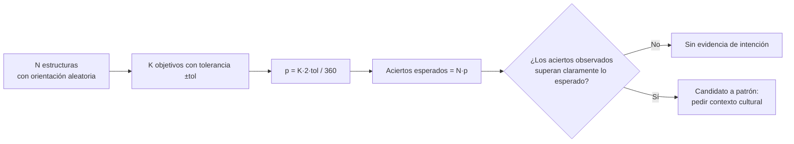

# B02-C09 — Alineaciones arqueológicas y sesgos

<!-- nav:top -->
[🏠 Programa](../../../../README.md) · [📚 Bloque B02](../../../tronco-comun/B02-historia-arqueoastronomia-y-culturas-del-cielo.md) · [← Anterior: B02-C08 — Arqueoastronomía y sus métodos](../B02-C08-arqueoastronomia-y-sus-metodos/CLASE.md) · [Siguiente: B02-C10 — Geocentrismo y heliocentrismo →](../B02-C10-geocentrismo-y-heliocentrismo/CLASE.md)
<!-- /nav -->

## 1. Ubicación, nivel y alcance

Novena clase del bloque B02. En C08 aprendiste a convertir una orientación en una declinación. Aquí enfrentas el peligro principal del campo: **encontrar alineaciones donde solo hay azar**. Nivel N1.

Verás cuántas «coincidencias» aparecen en estructuras orientadas al azar, qué sesgos las producen y cómo se declara de antemano lo que se va a probar. No verás pruebas estadísticas avanzadas (llegan en el bloque de estadística) ni juzgarás sitios reales.

## 2. Por qué esta clase existe

Con suficientes estructuras, suficientes objetivos celestes y una tolerancia generosa, siempre aparece alguna «alineación». La pregunta motivadora es: **¿cuántas alineaciones esperaríamos si nadie hubiese mirado el cielo?** Si el resultado observado no supera esa referencia, no hay base para afirmar intención.

Al terminar sabrás calcular la probabilidad de azar para un conjunto de estructuras, explicar los sesgos de selección, y redactar una afirmación de alineación con su control.

## 3. Lo que podrás hacer al terminar

1. Calcular la probabilidad de que una orientación al azar caiga en una ventana de ±tol° de algún objetivo.
2. Calcular cuántos aciertos se esperan por azar y la probabilidad de obtener al menos m.
3. Explicar el sesgo de elegir objetivos y tolerancia después de ver los datos.
4. Explicar el efecto de muchas comparaciones.
5. Distinguir alineación estadística de intención cultural.
6. Redactar una afirmación de alineación con su control de azar.

La evidencia es la **ficha de control de azar** del ejercicio 12 (sección 20).

## 4. Con qué llegas y cómo comprobarlo

Necesitas C08 y proporciones. Cinco preguntas:

1. Si una ventana ocupa 4° de 360°, ¿qué fracción es?
2. Si la probabilidad de acertar es 0,05 en una prueba, ¿cuántos aciertos esperas en 100 pruebas?
3. ¿Qué es una hipótesis nula?
4. ¿Por qué lanzar una moneda 10 veces y obtener 7 caras no prueba una moneda trucada?
5. ¿Qué significa «seleccionar después de mirar»?

<details>
<summary>Ver respuestas</summary>

1. 4/360 = 1,1 %. 2. 5. 3. La suposición de que no hay efecto. 4. Porque 7 caras es esperable por azar con una moneda justa. 5. Elegir el criterio una vez que se conocen los resultados, de modo que siempre se encuentre algo.
</details>

Con cuatro o cinco aciertos, sigue. Con tres o menos, repasa C08.

## 5. Un caso real: iglesias que no seguían una regla

El estudio de las iglesias jesuitas de Nueva España (C08) contrastó las declinaciones de 41 edificios con la hipótesis de orientaciones repartidas de forma uniforme por el horizonte, y no encontró un patrón con suficiente confianza (S1). Si los autores hubiesen buscado después los pocos edificios que miran a un solsticio, habrían podido anunciar una alineación; el control con la hipótesis nula impide ese espejismo. Un especialista en arqueoastronomía comenta sobre otro tema, Chankillo, que la mayoría de los supuestos observatorios antiguos no convence (S2).

Ten presente el límite: S1 es un estudio de iglesias coloniales y S2 un comunicado; los usamos para ilustrar una actitud de rigor, no para juzgar sitios.

## 6. Vocabulario

Una **ventana de tolerancia** es el intervalo `±tol` alrededor de una dirección objetivo. Un **objetivo** es una dirección con significado astronómico (salida del Sol en un solsticio, por ejemplo). La **probabilidad por azar** `p` es la probabilidad de que una orientación aleatoria caiga en alguna ventana. Los **aciertos** son las estructuras dentro de una ventana. El **sesgo de selección** ocurre al elegir objetivos, tolerancias o muestras después de ver los datos. El **problema de las comparaciones múltiples** es que, al probar muchas hipótesis, algunas pasan por azar. La **distribución binomial** da la probabilidad de `m` aciertos entre `N` intentos con probabilidad `p`. Una **hipótesis nula** uniforme supone orientaciones repartidas por igual en el horizonte (S1).

## 7. Modelo mental: la lotería de las alineaciones

Cada estructura es un boleto con una probabilidad `p` de «acertar» un objetivo. Con muchos boletos y muchos objetivos, alguien siempre gana.



*Descripción textual:* de N estructuras y K objetivos con una tolerancia se obtiene la probabilidad de acierto por azar y el número esperado de aciertos; si lo observado no supera claramente lo esperado no hay evidencia de intención, y si lo supera es un candidato a patrón que requiere contexto cultural.

Analogía: una lotería con muchos boletos. El límite: las estructuras reales no se orientan al azar uniforme (siguen el terreno, la calle, el camino), lo cual cambia la hipótesis nula.

## 8. La explicación, paso a paso

### 8.1 Probabilidad por azar

Si el azimut es uniforme en `[0°, 360°)` y hay `K` objetivos con ventanas disjuntas de `±tol`, la probabilidad de que una estructura acierte es `p = K·2·tol/360`. Con `K = 6` y `tol = 2°`, `p = 24/360 = 0,0667` (6,7 %). Es una fórmula de cálculo, no un hallazgo.

### 8.2 Aciertos esperados y su probabilidad

Con `N` estructuras, el número esperado de aciertos es `N·p`. Con `N = 40`, son `2,67`. El número de aciertos sigue una distribución binomial: `P(≥ 1) = 1 − (1−p)^N = 0,937`, es decir, casi seguro que al menos una estructura «acierta»; `P(≥ 4) = 0,276`. Cuatro aciertos de 40 no son sorprendentes.

### 8.3 Cuando la tolerancia o los objetivos crecen

El laboratorio varía `K` con `tol = 2°` y `N = 40`: `K = 1` da `P(≥1) = 0,36`; `K = 6`, `0,94`; `K = 12`, `0,997`; `K = 24`, `1,0`. A mayor número de objetivos, la existencia de al menos un acierto deja de ser informativa. Por eso la lista de objetivos y la tolerancia se fijan **antes** de mirar los datos.

### 8.4 Comparar con una referencia

S1 compara su histograma de declinaciones con lo esperado para una distribución uniforme y pide que un máximo supere claramente esa referencia para considerarlo relevante (S1). Esa es la lógica de la sección 8.2 aplicada a una distribución continua.

### 8.5 Sesgos que no son de azar

Además del azar hay sesgos: **de selección** (elegir los sitios que parecen alineados), **de confirmación** (buscar solo lo que apoya la idea), **de horizonte** (suponerlo plano cuando no lo es) y **de supervivencia** (solo vemos lo que no se destruyó: S3 recuerda que torres del Cusco se destruyeron durante la extirpación de la religión indígena). Un resultado estadísticamente significativo con una muestra seleccionada no vale.

### 8.6 Lo que el azar no puede decir

Aun cuando una alineación supere el azar, no prueba intención ni significado. Para decir algo sobre el sentido se necesitan contexto arqueológico, fuentes escritas y, cuando existen, las voces de las comunidades descendientes. Así lo plantea S2 para Chankillo: el análisis astronómico se combina con años de trabajo de campo y objetos en los puntos de observación, y la lectura política se presenta como propuesta.

## 9. Magnitudes, símbolos y unidades

| Símbolo | Qué es | Unidad | Valor o nota |
|---|---|---|---|
| `N` | número de estructuras | — | 40 (ejemplo sintético) |
| `K` | número de objetivos | — | 6 |
| `tol` | tolerancia en azimut | grados | 2 |
| `p` | probabilidad por azar | — | `K·2·tol/360` |
| `N·p` | aciertos esperados | — | 2,67 |
| `P(≥m)` | probabilidad de al menos `m` aciertos | — | binomial |

## 10. Convenciones y referencias

Las ventanas son disjuntas y se miden en azimut sobre un horizonte plano: una simplificación que, en un sitio real, se reemplaza por declinaciones con horizonte medido (C08). Los datos de esta clase son **sintéticos**.

## 11. De dónde sale lo que afirmamos

| ID | Fuente | Localizador | Respalda | Estado |
|---|---|---|---|---|
| S1 | M. F. Muratore, A. Di Paolo y A. Gangui, arXiv:2311.02134 | https://arxiv.org/abs/2311.02134 | Hipótesis nula uniforme; sin patrón claro en 41 iglesias | Texto leído (PDF) el 2026-11-05 |
| S2 | Comunicado sobre Ghezzi y Ruggles, *Science* 315 (2007) | https://www.eurekalert.org/news-releases/735620 | Cautela sobre «observatorios»; método de Chankillo | Comunicado consultado el 2026-11-05; artículo no leído |
| S3 | S. R. Gullberg, *Proc. IAU* Symp. 367, doi:10.1017/S1743921321000612 | https://doi.org/10.1017/S1743921321000612 | Destrucción de torres del Cusco | Texto leído el 2026-11-05 |

Límites: las fórmulas de probabilidad (binomial) son matemática estándar que verificamos con simulación; no citamos un texto de estadística. Los nombres de sesgos son categorías generales de la práctica científica, no atribuidas a S1.

## 12. Cómo ver el azar

Esta tabla es la versión accesible de un gráfico de `P(≥1)` frente a `K` (con `N = 40`, `tol = 2°`).

| Objetivos `K` | `p` por estructura | `P(≥1 acierto)` |
|---|---|---|
| 1 | 0,0111 | 0,3604 |
| 6 | 0,0667 | 0,9367 |
| 12 | 0,1333 | 0,9967 |
| 24 | 0,2667 | 1,0000 |

Si lo dibujas, usa un eje de 0 a 1 y marca el 5 % como referencia. Descripción larga: la probabilidad de al menos un acierto crece rápido hasta casi 1 con pocos objetivos.

## 13. Ejemplo trabajado: ¿es sorprendente encontrar 4 aciertos?

**Planteamiento.** En 40 estructuras **sintéticas** se encuentran 4 orientadas a alguno de 6 objetivos con tolerancia ±2°. ¿Es evidencia de intención?

**Paso 1.** `p = 6 × 2 × 2/360 = 0,0667`.

**Paso 2.** Esperados: `40 × 0,0667 = 2,67`.

**Paso 3.** `P(≥ 4) = 0,276` (laboratorio).

**Paso 4. Incertidumbre.** Una probabilidad del 27,6 % de ver al menos 4 por azar no permite rechazar la hipótesis nula.

**Sentido físico.** Cuatro aciertos es un resultado ordinario si se buscan seis objetivos con ±2°. Para que fuese notable harían falta muchos más: `P(≥ 8) = 0,0044`.

## 14. Comparación de estrategias

**Hipótesis previa** (fijar objetivos y tolerancia antes) reduce el sesgo; **exploración libre** sirve para generar ideas, no para confirmarlas. **Réplica** con una muestra nueva es la prueba más fuerte. Una **corrección por comparaciones múltiples** (por ejemplo, dividir el umbral por el número de pruebas) es una forma simple de compensar, aunque pierde sensibilidad.

## 15. Práctica guiada

**Ejercicio 1 · con los pasos indicados.** Calcula `p` para `K = 4`, `tol = 1°`. *Pasos:* `K·2·tol/360`.

<details><summary>Solución comentada</summary>

`4 × 2 × 1/360 = 0,0222` (2,2 %).
</details>

**Ejercicio 2 · con una pista.** Aciertos esperados en `N = 41` con `p = 0,0444`. *Pista:* multiplica.

<details><summary>Solución comentada</summary>

`41 × 0,0444 = 1,82`.
</details>

**Ejercicio 3 · casi autónomo.** Para `K = 1`, `tol = 1°`, `N = 41`: calcula `P(≥1) = 1 − (1−p)^N`.

<details><summary>Solución comentada</summary>

`p = 0,00556`; `P = 0,204`: un 20 % de ver un acierto por azar con un solo objetivo.
</details>

## 16. Práctica autónoma, transferencia e integrador

**Ejercicio 4.** Con `K = 4`, `tol = 2°`, `N = 41`, calcula `p` y `P(≥1)`.

<details><summary>Solución comentada</summary>

`p = 0,0444`; `P(≥1) = 0,845`.
</details>

**Ejercicio 5.** ¿Cuántos aciertos esperarías con `N = 100`, `K = 6`, `tol = 2°`?

<details><summary>Solución comentada</summary>

`100 × 0,0667 = 6,7`.
</details>

**Ejercicio 6.** Con 13 estructuras y 2 objetivos de ±1°, ¿qué probabilidad hay de ver al menos un acierto?

<details><summary>Solución comentada</summary>

`p = 0,0111`; `P(≥1) = 0,135`: 13,5 %.
</details>

**Ejercicio 7.** Con `N = 40`, `K = 6`, `tol = 1°`, ¿qué cambia respecto del ejemplo?

<details><summary>Solución comentada</summary>

`p = 0,0333`; esperados 1,33; `P(≥1) = 0,742`. Reducir la tolerancia a la mitad baja `p` a la mitad.
</details>

**Ejercicio 8.** Explica por qué elegir la tolerancia después de ver los datos invalida el cálculo.

<details><summary>Solución comentada</summary>

Porque se ajusta la ventana a los aciertos, de modo que `p` ya no representa la probabilidad antes de mirar y el control de azar subestima lo ocurrido.
</details>

**Ejercicio 9 · transferencia.** Un sitio tiene 13 torres y alguien dice: «dos coinciden con solsticios». Plantea el control.

<details><summary>Solución comentada</summary>

Define objetivos y tolerancias previos, calcula `p`, esperados y `P(≥2)`, y compara. Para Chankillo, los autores del estudio añaden fechado, puntos de observación y objetos asociados (S2), que van más allá del cálculo.
</details>

**Ejercicio 10 · transferencia.** Un compañero dice: «el 10 % de las iglesias miran al este, así que fue intencional». Evalúa.

<details><summary>Solución comentada</summary>

El este es un objetivo con la misma ventana que cualquier otra dirección; hay que comparar con lo esperado (`2·tol/360`). Además, las iglesias cristianas tienen razones litúrgicas para orientarse, que son parte del contexto (no consultadas aquí).
</details>

**Ejercicio 11 · transferencia.** ¿Qué es un sesgo de supervivencia en arqueoastronomía?

<details><summary>Solución comentada</summary>

Que solo estudiamos lo que sobrevivió; si estructuras se destruyeron (S3 menciona torres del Cusco destruidas), la muestra no representa lo que se construyó.
</details>

**Ejercicio 12 · integrador.** Elabora la *ficha de control de azar* (sección 20): define de antemano objetivos y tolerancia, calcula `p`, esperados y `P(≥m)`, ejecuta el laboratorio con tus parámetros, y escribe una conclusión con límites.

<details><summary>Solución modelo</summary>

Una ficha completa registra parámetros fijados antes, la fórmula, resultados del script, una conclusión que no sobrepasa la evidencia y una nota sobre contexto cultural y consentimiento.
</details>

## 17. Laboratorio: alineaciones por azar

El script [alineaciones_por_azar.py](alineaciones_por_azar.py) calcula `p`, los esperados y las probabilidades binomiales, y las compara con una simulación de Monte Carlo con semilla fija. Antes comprueba tres casos analíticos y que la simulación coincida con la fórmula dentro de tres desviaciones típicas; si no, se detiene.

**Datos:** sintéticos. **Predice antes de ejecutar:** ¿qué probabilidad hay de al menos un acierto con `K = 6`? (Muy alta, cerca de 0,9.) **Resultados (2026-11-05, Python 3.12.9):** `p = 0,0667`; esperados `2,67`; `P(≥1) = 0,9367`; `P(≥4) = 0,2759`; simulación (20 000 ensayos, semilla 2026): `p = 0,0669`, ensayos con ≥1 acierto `0,9373`; para `K = 1, 6, 12, 24`: `P(≥1) = 0,3604; 0,9367; 0,9967; 1,0000`.

```bash
python programa/clases/B02/B02-C09-alineaciones-arqueologicas-y-sesgos/alineaciones_por_azar.py
```

**Límites:** orientaciones uniformes e independientes, ventanas disjuntas; no modela terreno ni horizonte. No sirve para evaluar sitios reales.

## 18. Errores frecuentes y cómo corregirlos

**Elegir tolerancia después.** Ejercicio 8.

**Ignorar el número de objetivos.** Ejercicio 7.

**Confundir significancia con intención.** Sección 8.6.

**Muestra seleccionada.** Ejercicio 11.

**Hipótesis nula irreal.** Ejercicio 10.

## 19. Cómo sabrás que vas bien

Tras 8.1: ¿calculas `p` sin mirar? Ejercicio 1. Tras 8.3: ¿por qué crece `P(≥1)` con `K`? Ejercicio 4. Al final: ¿puedes escribir una conclusión que no sobrepase la evidencia? Ejercicio 12.

## 20. Qué entregas y cómo se evalúa

El producto es tu **ficha de control de azar**.

| Criterio | Inicial | En desarrollo | Logrado | Destacado |
|---|---|---|---|---|
| Parámetros previos | Ausentes | Después de los datos | Antes de los datos | Registrados y justificados |
| Cálculo | Con errores | Correcto sin simulación | Con simulación | Con sensibilidad a `K` y `tol` |
| Conclusión | Sobrepasa | Cautelosa | Acotada | Propone réplica |
| Contexto cultural | Ausente | Mencionado | Con fuente | Con consentimiento |

**Condiciones críticas:** no declarar significativo un resultado con parámetros elegidos después; rotular lo sintético; no afirmar intención sin contexto.

## 21. Ética, seguridad y límites

Un control estadístico protege a los pueblos de afirmaciones falsas sobre su pasado y protege al público de la desinformación. Pero la ausencia de significancia no invalida una tradición oral: solo dice que una medición no la confirma. Los sitios con uso vivo se estudian con permiso y respeto. Accesibilidad: fórmulas en texto, diagrama descrito, tablas equivalentes y script sin conexión.

## 22. Para cerrar y seguir

Con suficientes objetivos, el azar produce alineaciones; la defensa es fijar de antemano objetivos y tolerancia, comparar con lo esperado y pedir contexto. Con esto cierras el trayecto de las astronomías culturales; en C10 empieza el recorrido de los modelos del cosmos en la tradición europea.

**Glosario español–inglés.** ventana de tolerancia · *tolerance window*; sesgo de selección · *selection bias*; comparaciones múltiples · *multiple comparisons*; distribución binomial · *binomial distribution*; hipótesis nula · *null hypothesis*; réplica · *replication*.

**Continuidad.** B02-C10 usa tu capacidad de **comparar con una referencia** para evaluar modelos del cosmos frente a la observación. C20 retomará el consentimiento y el patrimonio.

**Referencias:** ver sección 11. S2 es un comunicado.

<!-- nav:bottom -->
---

[← Anterior: B02-C08 — Arqueoastronomía y sus métodos](../B02-C08-arqueoastronomia-y-sus-metodos/CLASE.md) · [📚 Bloque B02](../../../tronco-comun/B02-historia-arqueoastronomia-y-culturas-del-cielo.md) · [Siguiente: B02-C10 — Geocentrismo y heliocentrismo →](../B02-C10-geocentrismo-y-heliocentrismo/CLASE.md)
<!-- /nav -->
