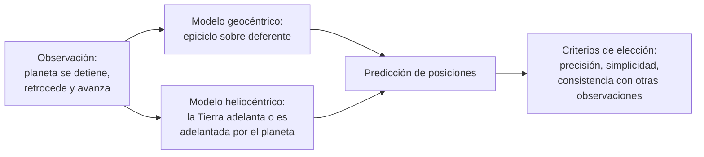

# B02-C10 — Geocentrismo y heliocentrismo

<!-- nav:top -->
[🏠 Programa](../../../../README.md) · [📚 Bloque B02](../../../tronco-comun/B02-historia-arqueoastronomia-y-culturas-del-cielo.md) · [← Anterior: B02-C09 — Alineaciones arqueológicas y sesgos](../B02-C09-alineaciones-arqueologicas-y-sesgos/CLASE.md) · [Siguiente: B02-C11 — Revolución copernicana y métodos →](../B02-C11-revolucion-copernicana-y-metodos/CLASE.md)
<!-- /nav -->

## 1. Ubicación, nivel y alcance

Décima clase del bloque B02 y apertura de su segundo tramo, que sigue una línea europea de ideas sobre el cosmos hasta Newton. Hasta C09 estudiaste cómo diversas culturas leyeron el cielo; ahora comparas dos **modelos del sistema solar** que compitieron durante siglos. Nivel N1.

Verás cómo funcionaba el modelo geocéntrico de Ptolomeo, qué problema de observación resolvía, qué cambió con el modelo heliocéntrico de Copérnico y por qué la elección no era tan evidente como hoy parece. No verás aún la revolución copernicana en detalle (C11) ni las observaciones que la decidieron (C12 a C15).

## 2. Por qué esta clase existe

La pregunta «¿se mueve la Tierra o el cielo?» se puede responder hoy en una línea, pero en 1500 una persona razonable podía defender cualquiera de las dos. La pregunta motivadora es: **¿con qué criterios se elige entre dos modelos que predicen casi lo mismo?** Aprenderás a compararlos por lo que explican, por lo que suponen y por lo que dejan sin explicar.

Esto vale más allá de la historia: es el patrón de cómo la ciencia decide entre modelos competidores.

## 3. Lo que podrás hacer al terminar

1. Describir deferente, epiciclo y ecuante y qué problema resuelve cada uno.
2. Explicar el movimiento retrógrado en los dos modelos.
3. Calcular qué precisión de observación haría falta para detectar paralaje estelar.
4. Enunciar tres criterios para comparar modelos: capacidad de predicción, simplicidad y consistencia con otras observaciones.
5. Distinguir lo que Copérnico cambió de lo que conservó.
6. Redactar una ficha de comparación de dos modelos.

La evidencia es la **ficha de comparación de modelos** del ejercicio 12 (sección 20).

## 4. Con qué llegas y cómo comprobarlo

Necesitas B01-C08 (pc, au) y C03. Cinco preguntas:

1. ¿Qué es un modelo científico?
2. ¿Qué es el movimiento retrógrado aparente de un planeta?
3. ¿Cuántos segundos de arco hay en un grado?
4. ¿Qué es un parsec en función de las unidades astronómicas?
5. ¿Qué diferencia hay entre predecir y explicar?

Ver respuestas

1. Una simplificación con dominio de validez. 2. Un planeta que parece detenerse y retroceder entre las estrellas durante un tiempo. 3. 3 600. 4. 1 pc ≈ 206 265 au. 5. Predecir da el resultado; explicar dice por qué.

Con cuatro o cinco aciertos, sigue. Con tres o menos, repasa B01-C08.

## 5. Un caso real: un círculo sobre otro

Una colección de materiales de historia de la ciencia de la Universidad Rice explica que el *Almagest* de Ptolomeo, del siglo II d. C., dio un conjunto completo de modelos matemáticos que reproducían el movimiento de cada cuerpo celeste. Las esferas anidadas de Aristóteles no explicaban los cambios de velocidad de los planetas, sus detenciones y retrocesos, ni las variaciones de brillo; Ptolomeo usó tres construcciones geométricas: el círculo excéntrico, el epiciclo y el ecuante (S1). El epiciclo hace que, con velocidades y sentidos adecuados, el planeta parezca detenerse, retroceder y volver a avanzar (S1).

Por qué importa: el modelo era **exitoso**. Predecía las posiciones con la precisión de su época. Su problema no era la predicción sino la consistencia con los principios que se querían conservar, como el movimiento circular uniforme: el ecuante rompía esa regla, y eso inquietó a pensadores posteriores (S1). Límite: S1 es un sitio de divulgación universitaria; no leímos el *Almagest*.

## 6. Vocabulario

Un modelo **geocéntrico** pone la Tierra en el centro; uno **heliocéntrico** pone el Sol. El **deferente** (en S1, el «círculo grande» o excéntrico) es el círculo sobre el cual se mueve el centro del epiciclo, y la Tierra está algo desplazada de su centro. El **epiciclo** es un círculo pequeño cuyo centro recorre el deferente, con el planeta sobre él. El **ecuante** es un punto desplazado respecto del cual el centro del epiciclo se mueve de manera uniforme (S1). El **movimiento retrógrado** es el retroceso aparente de un planeta entre las estrellas. El **paralaje estelar** es el desplazamiento aparente de una estrella cercana, respecto de las lejanas, causado por el movimiento de la Tierra en su órbita. Un **segundo de arco** es 1/3 600 de grado.

## 7. Modelo mental: dos formas de producir el mismo vaivén

Un planeta parece retroceder; el modelo geocéntrico lo produce con una rueda sobre otra; el heliocéntrico, con el hecho de que la Tierra y el planeta recorren órbitas distintas.

*Descripción textual:* una misma observación (el vaivén de un planeta) se explica en dos modelos: con epiciclo sobre deferente en el geocéntrico, y con el movimiento relativo de la Tierra y el planeta en el heliocéntrico; ambos predicen posiciones y se comparan según precisión, simplicidad y consistencia con otras observaciones.

Analogía: un coche que adelanta a otro en autopista; desde el segundo, el primero parece retroceder un instante cuando lo pasas. El límite: los planetas se mueven en elipses y a distintas velocidades, no en rectas.

## 8. La explicación, paso a paso

### 8.1 El modelo de Ptolomeo

Según S1, Ptolomeo combinó el excéntrico, el epiciclo y el ecuante para modelar el Sol, la Luna y los planetas, y el conjunto explicaba los movimientos observados dentro de la precisión de su época, incluido el retroceso aparente. Notable: el modelo no pretendía «ser» la realidad física sino reproducir posiciones; esta lectura es nuestra y requiere contraste con historiadores de la ciencia.

### 8.2 El modelo de Copérnico

Otra página de la misma colección indica que Copérnico puso al Sol en el centro y dio a la Tierra tres movimientos: rotación diaria, órbita anual y un lento movimiento cónico del eje (S2). El retroceso de los planetas aparece, en ese modelo, como consecuencia del movimiento anual de la Tierra proyectado sobre ellos; y el orden de los planetas, que era una convención en Ptolomeo, queda fijado (S2).

### 8.3 Lo que Copérnico conservó

S2 subraya que Copérnico mantuvo el movimiento circular, de modo que sus órbitas todavía usaban círculos sobre círculos, parecidos a los epiciclos y excéntricos de sus predecesores; sus tablas eran solo ligeramente mejores que las existentes. *De revolutionibus* se publicó en Núremberg en 1543, año de su muerte, con un prefacio anónimo añadido por Osiander que presentaba la teoría como hipótesis matemática (S2). La ruptura fue de posición del centro, no de la geometría completa.

### 8.4 El argumento del paralaje

Si la Tierra se mueve en una órbita, las estrellas cercanas deberían desplazarse respecto de las lejanas a lo largo del año. Para una estrella a `d` parsecs, el paralaje en segundos de arco es `p = 1/d`. Con la mejor precisión observacional de la época de Tycho, de unos 2 minutos de arco (120″) y en el mejor caso medio minuto (S3), un paralaje solo sería detectable si `1/d ≥ 120″`, es decir, `d ≤ 1/120 pc = 0,00833 pc ≈ 1 719 au`. Como las estrellas están mucho más lejos, no se podía detectar paralaje: la ausencia de paralaje era coherente con un cosmos de estrellas muy distantes, y se interpretó en su contra. Ese razonamiento es nuestro y su tamaño depende de la precisión que se tome.

### 8.5 Criterios de elección

En la época se podían comparar los modelos por precisión de las tablas (similar), por simplicidad (a favor de Copérnico en la explicación del retroceso, no en el número de círculos) y por consistencia con la física aceptada (a favor del geocentrismo, que se apoyaba en la física aristotélica). S3 añade que el sistema tychónico, con la Tierra en el centro y los planetas girando en torno al Sol, atrajo a quienes rechazaban el modelo ptolemaico sin poder aceptar a Copérnico (S3). La historia real fue un debate con razones de ambos lados.

## 9. Magnitudes, símbolos y unidades

| Símbolo | Qué es | Unidad | Valor o nota |
|---|---|---|---|
| `p` | paralaje | segundos de arco | `1/d` con `d` en pc |
| `d` | distancia a la estrella | pc | 1 pc ≈ 206 265 au (B01-C02) |
| precisión de Tycho | error angular | minutos de arco | ≈ 2; mejor ≈ 0,5 (S3) |
| `ε` | conversión | — | 1° = 60′ = 3 600″ |

## 10. Convenciones y referencias

Los años son los de las fuentes. «Geocentrismo» y «heliocentrismo» designan familias de modelos; no hay un único modelo de cada tipo. El cálculo de paralaje usa la definición de parsec y es aproximado.

## 11. De dónde sale lo que afirmamos

| ID | Fuente | Localizador | Respalda | Estado |
|---|---|---|---|---|
| S1 | The Galileo Project (Rice University), «Ptolemaic system» | https://galileo.library.rice.edu/sci/theories/ptolemaic_system.html | Almagest; excéntrico, epiciclo, ecuante; retroceso | Consultada el 2026-11-05; sitio de divulgación universitaria |
| S2 | The Galileo Project (Rice University), «Copernican system» | https://galileo.library.rice.edu/sci/theories/copernican_system.html | Tres movimientos; retroceso; *De revolutionibus* 1543; elementos conservados | Consultada el 2026-11-05 |
| S3 | The Galileo Project (Rice University), «Tycho Brahe» | https://galileo.library.rice.edu/sci/brahe.html | Precisión de ~2′ y mejor ~0,5′; sistema tychónico | Consultada el 2026-11-05 |

Límites: no leímos los textos de Ptolomeo, Copérnico ni a historiadores especializados; el sitio de Rice es una síntesis. La definición de parsec y el cálculo de paralaje son matemática estándar (B01-C02). La afirmación de que la elección «no era evidente» es una interpretación nuestra apoyada en la descripción de S2 y S3.

## 12. Cómo ver los modelos

Esta tabla es la versión accesible de un diagrama de órbitas.

| Aspecto | Geocéntrico (Ptolomeo) | Heliocéntrico (Copérnico) | Tychónico |
|---|---|---|---|
| Centro | Tierra | Sol | Tierra (Sol y Luna), Sol (planetas) |
| Retroceso | Epiciclo | Movimiento relativo | Epiciclo equivalente |
| Orden de planetas | Convención | Fijado por el modelo | Fijado |
| Paralaje esperado | Ninguno | Sí, muy pequeño | Ninguno |

Descripción larga: tres filas de modelos con el mismo vaivén aparente; la Tierra o el Sol en el centro cambia lo que predice cada uno sobre el paralaje.

## 13. Ejemplo trabajado: ¿por qué no se veía el paralaje?

**Planteamiento.** Con una precisión de 2′, ¿a qué distancia máxima estaría una estrella para que se detectara su paralaje?

**Paso 1.** `2′ = 120″`.

**Paso 2.** `p = 1/d` con `p = 120″` → `d = 1/120 pc = 0,00833 pc`.

**Paso 3.** En unidades astronómicas: `0,00833 × 206 265 ≈ 1 719 au`.

**Paso 4. Incertidumbre.** Con 0,5′ = 30″: `d = 1/30 pc = 6 875 au`. Ambos valores son diminutos frente a las distancias estelares reales (B01-C02).

**Sentido físico.** Para detectar paralaje hacía falta una precisión de miles de veces mejor. La ausencia de paralaje no refutaba a Copérnico, pero sí obligaba a aceptar estrellas inmensamente lejanas, algo difícil de aceptar entonces.

## 14. Comparación de métodos de decisión

**Por precisión:** empata (S2). **Por simplicidad:** depende de qué se cuente (círculos o ideas). **Por física:** ganaba el geocentrismo con la física aristotélica. **Por observación nueva:** lo que decide viene después (C13, Venus y Júpiter). La lección: los criterios pueden apuntar a lados distintos y la decisión llega con datos nuevos.

## 15. Práctica guiada

**Ejercicio 1 · con los pasos indicados.** Nombra qué problema resuelve cada construcción de S1. *Pasos:* excéntrico, epiciclo, ecuante (sección 8.1).

Solución comentada

El excéntrico desplaza el centro (cambios de velocidad); el epiciclo produce el retroceso; el ecuante ajusta la velocidad uniforme a las observaciones, a costa de romper la uniformidad respecto del centro (S1).

**Ejercicio 2 · con una pista.** Calcula el paralaje de una estrella a 4 pc. *Pista:* `p = 1/d`.

Solución comentada

`0,25″`, unas 480 veces menor que 120″.

**Ejercicio 3 · casi autónomo.** ¿A qué distancia máxima en au se detecta paralaje con 1′ de precisión?

Solución comentada

`60″ → d = 1/60 pc = 0,01667 pc ≈ 3 438 au`.

## 16. Práctica autónoma, transferencia e integrador

**Ejercicio 4.** Convierte 2′ en segundos de arco y en grados.

Solución comentada

`120″` y `0,0333°`.

**Ejercicio 5.** ¿Qué razón hay entre la precisión necesaria (por ejemplo 0,25″) y la de Tycho (120″)?

Solución comentada

`120/0,25 = 480`: se necesitaba una mejora de casi 500 veces.

**Ejercicio 6.** Explica por qué el orden de los planetas era una convención en Ptolomeo y no en Copérnico.

Solución comentada

En Ptolomeo cada planeta tiene un modelo independiente y el orden no sale de los datos; en Copérnico el orden y las escalas relativas quedan fijados por el movimiento común de la Tierra (S2).

**Ejercicio 7.** ¿Qué conservó Copérnico de la tradición?

Solución comentada

El movimiento circular y círculos sobre círculos; sus tablas eran solo un poco mejores (S2).

**Ejercicio 8.** ¿Por qué se llamaba «hipótesis» a la teoría de Copérnico en el prefacio de Osiander?

Solución comentada

Porque el prefacio la presentaba como instrumento matemático de cálculo y no como descripción física (S2).

**Ejercicio 9 · transferencia.** Un compañero dice: «los antiguos eran ignorantes por creer en el geocentrismo». Responde con 8.4 y 8.5.

Solución comentada

El geocentrismo predecía bien, se apoyaba en la física aceptada y la falta de paralaje era coherente con un cosmos geocéntrico; los criterios de elección no apuntaban todos hacia Copérnico.

**Ejercicio 10 · transferencia.** Propón dos observaciones que permitieran decidir entre los tres modelos de la sección 12.

Solución comentada

Las fases de Venus y las lunas de Júpiter (C13) y la medición del paralaje estelar (siglos después). Cada una afecta a modelos distintos.

**Ejercicio 11 · transferencia.** ¿Qué lección da esta comparación para evaluar un modelo actual?

Solución comentada

Declarar los criterios, buscar observaciones que los discriminen y recordar que dos modelos pueden predecir igual y diferir en lo que suponen.

**Ejercicio 12 · integrador.** Elabora la *ficha de comparación de modelos* (sección 20): dos modelos, qué explican, qué suponen, un criterio a favor de cada uno y una observación que los discriminaría.

Solución modelo

Una ficha completa usa la sección 12 como plantilla, cita fuentes con su estado y declara qué es interpretación.

## 17. Actividad sin código: tabla de paralajes

Esta clase no usa script. En una hoja de cálculo calcula `p = 1/d` para `d` = 1, 2, 4, 10 pc y la precisión necesaria (en segundos de arco) para medirlo. **Qué observar:** a más distancia, menor paralaje y mayor exigencia. **Resultado esperado:** 1,0″; 0,5″; 0,25″; 0,1″ (valores de definición).

## 18. Errores frecuentes y cómo corregirlos

**Pensar que el geocentrismo era un error tonto.** Ejercicio 9.

**Creer que Copérnico eliminó los círculos.** Ejercicio 7.

**Confundir paralaje con movimiento propio.** El paralaje es anual y periódico. Ejercicio 2.

**Olvidar la conversión ′ y ″.** Ejercicio 4.

**Pedir una prueba única.** Ejercicio 10.

## 19. Cómo sabrás que vas bien

Tras 8.1: ¿explicas el epiciclo? Ejercicio 1. Tras 8.4: ¿calculas el límite de paralaje? Ejercicio 3. Al final: ¿puedes defender cada modelo con sus razones? Ejercicio 12.

## 20. Qué entregas y cómo se evalúa

El producto es tu **ficha de comparación de modelos**.

| Criterio | Inicial | En desarrollo | Logrado | Destacado |
|---|---|---|---|---|
| Descripción de modelos | Confusa | Correcta para uno | Correcta para ambos | Con sus supuestos |
| Criterios | Uno | Dos | Tres | Con una observación discriminante |
| Cálculo | Ausente | Con errores | Correcto con unidades | Con incertidumbre |
| Fuentes | Sin fuente | Con fuente | Con tipo y estado | Contrasta fuentes |

**Condiciones críticas:** no juzgar con criterios posteriores; citar solo lo consultado; no atribuir intenciones no documentadas.

## 21. Ética, seguridad y límites

La historia no es una escalera de aciertos: tratamos a las personas del pasado con el contexto de su tiempo. Las controversias religiosas asociadas a estos modelos exceden esta clase y requieren fuentes que no consultamos. Accesibilidad: cálculos en texto, diagrama descrito, tablas equivalentes.

## 22. Para cerrar y seguir

Dos modelos pueden reproducir el mismo vaivén de los planetas con ideas distintas; se comparan por precisión, simplicidad y consistencia, y los datos nuevos deciden. En C11 ves cómo Copérnico construyó y defendió su modelo.

**Glosario español–inglés.** geocéntrico · *geocentric*; heliocéntrico · *heliocentric*; epiciclo · *epicycle*; deferente · *deferent*; ecuante · *equant*; paralaje estelar · *stellar parallax*; movimiento retrógrado · *retrograde motion*.

**Continuidad.** B02-C11 usa tu capacidad de **comparar modelos con criterios declarados** para estudiar la revolución copernicana y sus métodos.

**Referencias:** ver sección 11. Las tres fuentes son de divulgación universitaria.

<!-- nav:bottom -->
---

[← Anterior: B02-C09 — Alineaciones arqueológicas y sesgos](../B02-C09-alineaciones-arqueologicas-y-sesgos/CLASE.md) · [📚 Bloque B02](../../../tronco-comun/B02-historia-arqueoastronomia-y-culturas-del-cielo.md) · [Siguiente: B02-C11 — Revolución copernicana y métodos →](../B02-C11-revolucion-copernicana-y-metodos/CLASE.md)
<!-- /nav -->
