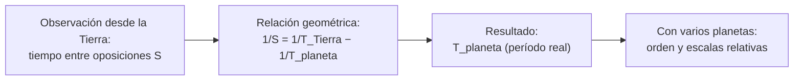

# B02-C11 — Revolución copernicana y métodos

<!-- nav:top -->
[🏠 Programa](../../../../README.md) · [📚 Bloque B02](../../../tronco-comun/B02-historia-arqueoastronomia-y-culturas-del-cielo.md) · [← Anterior: B02-C10 — Geocentrismo y heliocentrismo](../B02-C10-geocentrismo-y-heliocentrismo/CLASE.md) · [Siguiente: B02-C12 — Tycho Brahe y observaciones sistemáticas →](../B02-C12-tycho-brahe-y-observaciones-sistematicas/CLASE.md)
<!-- /nav -->

## 1. Ubicación, nivel y alcance

Undécima clase del bloque B02. En C10 comparaste dos modelos. Aquí ves cómo el modelo heliocéntrico se **construye y se usa**: qué datos necesita, qué cálculos permite y qué parte de su fuerza viene del método y no solo de la idea. Nivel N1.

Verás cómo, con el Sol en el centro, los períodos sinódicos (lo que se observa desde la Tierra) se convierten en períodos orbitales (lo que ocurre en el espacio), y harás ese cálculo con datos de Marte. No verás aún la mejora de las observaciones (C12) ni las órbitas elípticas (C14).

## 2. Por qué esta clase existe

La «revolución copernicana» suele resumirse como «el Sol en el centro». Pero lo que cambió la ciencia fue que el modelo permitió **calcular cosas nuevas**: convertir lo observado en lo real. La pregunta motivadora es: **¿qué se puede deducir desde la Tierra, que se mueve, sobre el movimiento de los demás planetas?**

Al terminar sabrás el método de pasar de períodos sinódicos a sidéreos, verificarlo con un dato publicado y evaluar qué parte de la «revolución» fue idea, qué parte método y cuánto tardó en consolidarse.

## 3. Lo que podrás hacer al terminar

1. Distinguir período sinódico de período sidéreo.
2. Deducir el sinódico de un planeta exterior desde los períodos orbitales.
3. Verificar el cálculo contra el valor publicado de Marte.
4. Explicar cómo el modelo heliocéntrico fija el orden de los planetas.
5. Resumir lo que Copérnico cambió y lo que conservó.
6. Redactar una ficha de método con fuente y límites.

La evidencia es la **ficha del método sinódico** del ejercicio 12 (sección 20).

## 4. Con qué llegas y cómo comprobarlo

Necesitas C10 y B01-C04. Cinco preguntas:

1. ¿Qué es un período sidéreo?
2. ¿Qué es un período sinódico?
3. Si dos corredores dan una vuelta en 10 y 15 minutos, ¿cada cuánto el primero adelanta al segundo?
4. ¿Qué es una oposición?
5. ¿Por qué se restan frecuencias y no períodos? (B01-C04)

<details>
<summary>Ver respuestas</summary>

1. El tiempo en volver a la misma posición respecto de las estrellas. 2. El tiempo entre dos configuraciones iguales respecto del Sol y la Tierra. 3. `1/(1/10−1/15) = 30` minutos. 4. Cuando un planeta exterior está en la dirección opuesta al Sol vista desde la Tierra. 5. Porque lo que se suma son vueltas por unidad de tiempo.
</details>

Con cuatro o cinco aciertos, sigue. Con tres o menos, repasa B01-C04.

## 5. Un caso real: la ruptura que conservó los círculos

La colección de la Universidad Rice indica que Copérnico publicó *De revolutionibus* en 1543, que salvo los primeros once capítulos del libro I la obra era un tratado matemático en la tradición del *Almagest*, y que sus órbitas siguieron basadas en círculos sobre círculos, con tablas solo algo mejores que las existentes. También señala que los astrónomos de la época necesitaban tablas más precisas para predecir eventos, navegar y corregir el calendario, que se había desfasado respecto del equinoccio (S1).

Es decir, la «revolución» fue menos un salto de precisión que un cambio de **organización**: el movimiento de la Tierra explicaba de forma natural el retroceso de los planetas y fijaba su orden (S1). Ten presente el límite: S1 resume; no leímos el texto de Copérnico ni a historiadores especializados.

## 6. Vocabulario

El **período sidéreo** `T` de un planeta es su tiempo de vuelta respecto de las estrellas; el **período sinódico** `S` es el tiempo entre dos configuraciones iguales vistas desde la Tierra (por ejemplo, dos oposiciones). Un **planeta exterior** orbita más lejos del Sol que la Tierra; uno **interior**, más cerca. La **oposición** ocurre cuando un planeta exterior está opuesto al Sol en el cielo. La **velocidad angular** es el ángulo recorrido por unidad de tiempo. Una **órbita circular coplanar** es la simplificación de Copérnico: círculos en un mismo plano (S1 señala que conservó los círculos).

## 7. Modelo mental: dos corredores en una pista

La Tierra y Marte son dos corredores que recorren pistas circulares alrededor del Sol; la Tierra, en la pista interior, es más rápida. El tiempo que la Tierra tarda en volver a alcanzar a Marte es el período sinódico.



*Descripción textual:* se observa el tiempo entre oposiciones desde la Tierra; la relación entre frecuencias permite despejar el período real del planeta; y con varios planetas se obtienen el orden y las escalas relativas del sistema.

Analogía: dos corredores en una pista. El límite: las órbitas reales son elípticas (C14); el modelo da el promedio, no cada oposición.

## 8. La explicación, paso a paso

### 8.1 Qué se observa y qué se quiere

Desde la Tierra se observa `S`: cuánto pasa entre dos oposiciones. Lo que se quiere es `T`, el período real. Ambos se relacionan porque la Tierra se mueve.

### 8.2 La relación

Las velocidades angulares son `360°/T_Tierra` y `360°/T_Marte`. La Tierra, más rápida, gana `360°/T_Tierra − 360°/T_Marte` cada día y necesita ganar una vuelta completa para volver a alinearse. Entonces `1/S = 1/T_Tierra − 1/T_Marte`. Con `T_Tierra = 365,256 d` y `T_Marte = 686,980 d`: `1/S = 0,0027379 − 0,0014557 = 0,0012822` y `S = 779,93 d`, que coincide con el valor publicado de 779,94 d (S2, S3).

### 8.3 Despejar el período real

Si lo que se mide es `S` (observable a simple vista, contando entre oposiciones) y se conoce `T_Tierra`, se puede despejar `T_Marte = 1/(1/T_Tierra − 1/S)`. Con `S = 779,94 d`: `T_Marte = 687,0 d`. Esa es la gracia del método: convierte un dato de observación en un dato del modelo. Funciona porque el modelo dice que la Tierra también se mueve.

### 8.4 Orden y escalas

S1 indica que el modelo fijó el orden de los planetas, que en Ptolomeo era una convención. Con las razones de períodos, y más tarde con la tercera ley de Kepler (C14), también se obtienen razones de distancias. Como verificación, la razón de semiejes de Marte y la Tierra publicada por NASA es 1,524 (227,956/149,598), y `(686,980/365,256)^(2/3) = 1,524` coincide (laboratorio).

### 8.5 Lo que el método no puede hacer

Con órbitas circulares y velocidad constante no se obtiene la precisión que se necesitaba. S4 indica que Kepler formuló en 1609 que los planetas se mueven en elipses con el Sol en un foco (C14); la mejora real de las predicciones llegó con mejores datos y con elipses.

### 8.6 La adopción fue lenta y discutida

S1 recuerda que el prefacio de Osiander presentó la teoría como hipótesis matemática. S3 (Galileo Project, Tycho) indica que el sistema tychónico, con la Tierra en el centro, gozó de popularidad entre quienes rechazaban a Ptolomeo sin aceptar a Copérnico. La palabra «revolución» abarca varias generaciones, no un año.

## 9. Magnitudes, símbolos y unidades

| Símbolo | Qué es | Unidad | Valor o nota |
|---|---|---|---|
| `T_T` | período sidéreo de la Tierra | d | 365,256 (S2) |
| `T_M` | período sidéreo de Marte | d | 686,980 (S3) |
| `S` | período sinódico de Marte | d | 779,94 publicado (S3) |
| `a_T`, `a_M` | semiejes mayores | 10⁶ km | 149,598; 227,956 |
| velocidad angular | `360°/T` | °/d | 0,9856; 0,5240 |

## 10. Convenciones y referencias

Órbitas circulares coplanares con velocidad constante (modelo copernicano simplificado). Los períodos son medios publicados. La distancia mínima en oposición del laboratorio (78,4 millones de km) es la diferencia de semiejes: el valor real varía porque la órbita es elíptica.

## 11. De dónde sale lo que afirmamos

| ID | Fuente | Localizador | Respalda | Estado |
|---|---|---|---|---|
| S1 | The Galileo Project (Rice), «Copernican system» | https://galileo.library.rice.edu/sci/theories/copernican_system.html | *De revolutionibus* 1543; círculos conservados; orden de planetas; motivaciones | Consultada el 2026-11-05 |
| S2 | NASA NSSDC, *Earth Fact Sheet* | https://nssdc.gsfc.nasa.gov/planetary/factsheet/earthfact.html | Período sidéreo de la Tierra y semieje mayor | Consultada el 2026-11-05 (act. 15-nov-2024) |
| S3 | NASA NSSDC, *Mars Fact Sheet* | https://nssdc.gsfc.nasa.gov/planetary/factsheet/marsfact.html | Período 686,980 d; sinódico 779,94 d; semieje 227,956 millones de km | Consultada el 2026-11-05 (act. 19-may-2025) |
| S4 | The Galileo Project (Rice), «Kepler» | https://galileo.library.rice.edu/sci/kepler.html | Elipses en *Astronomia Nova* (1609) | Consultada el 2026-11-05 |

Nota: el período sidéreo de la Tierra (365,256 d) proviene de la misma ficha de B01-C04, cuya consulta se registró allí. Límites: el cálculo de `S` es geometría estándar que contrastamos con S3; no leímos a Copérnico.

## 12. Cómo ver el método

Esta tabla es la versión accesible de un esquema de dos corredores.

| Cantidad | Tierra | Marte |
|---|---|---|
| Período sidéreo | 365,256 d | 686,980 d |
| Velocidad angular | 0,9856 °/d | 0,5240 °/d |
| Ventaja de la Tierra | — | 0,4616 °/d |
| Tiempo para ganar 360° | — | 779,9 d |

Descripción larga: la Tierra gana unos 0,46° por día a Marte; necesita 780 días para ganarle una vuelta completa.

## 13. Ejemplo trabajado: ¿cada cuánto hay oposiciones de Marte?

**Paso 1.** Frecuencias: `1/365,256 = 0,0027379`; `1/686,980 = 0,0014557`.

**Paso 2.** Resta: `0,0027379 − 0,0014557 = 0,0012822`.

**Paso 3.** Inversa: `S = 779,93 d` (2,135 años).

**Paso 4. Incertidumbre.** Diferencia con el publicado: 0,01 d, dentro de la precisión de los datos (seis cifras); la oposición real varía por la elipticidad.

**Sentido físico.** Marte se coloca en oposición cada poco más de dos años. Es una cifra media: las fechas reales requieren efemérides.

## 14. Comparación de métodos

El **método sinódico** parte de lo observable y es independiente de los instrumentos finos. El **método de la tercera ley** (C14) da distancias relativas a partir de períodos. El **método de efemérides** modernas da posiciones exactas. Cada uno sirve a un propósito.

## 15. Práctica guiada

**Ejercicio 1 · con los pasos indicados.** Calcula `S` para dos corredores de 10 y 15 minutos. *Pasos:* `1/10 − 1/15`, invierte.

<details><summary>Solución comentada</summary>

`1/10 − 1/15 = 1/30`; `S = 30` min.
</details>

**Ejercicio 2 · con una pista.** Calcula la velocidad angular de la Tierra en °/d. *Pista:* `360/365,256`.

<details><summary>Solución comentada</summary>

`0,9856 °/d`.
</details>

**Ejercicio 3 · casi autónomo.** Calcula `S` de Marte con los datos de la sección 9.

<details><summary>Solución comentada</summary>

`779,93 d` (sección 8.2).
</details>

## 16. Práctica autónoma, transferencia e integrador

**Ejercicio 4.** Despeja `T_Marte` desde `S = 779,94 d`.

<details><summary>Solución comentada</summary>

`1/T = 1/365,256 − 1/779,94 = 0,0027379 − 0,0012822 = 0,0014557`; `T = 687,0 d`.
</details>

**Ejercicio 5.** ¿Cuántos grados avanza Marte entre dos oposiciones?

<details><summary>Solución comentada</summary>

`0,5240 × 779,94 = 408,7°`: una vuelta más 48,7°. La Tierra da 2,135 vueltas.
</details>

**Ejercicio 6.** Calcula la razón `(T_M/T_T)^(2/3)` y compárala con `a_M/a_T`.

<details><summary>Solución comentada</summary>

`(1,8809)^(2/3) = 1,524`; `227,956/149,598 = 1,524`. Coinciden.
</details>

**Ejercicio 7.** Para un planeta interior, la fórmula es `1/S = 1/T_int − 1/T_T`. Con `T_int = 224,7 d`, ¿cuánto es `S`? (Dato de ejemplo.)

<details><summary>Solución comentada</summary>

`1/224,7 − 1/365,256 = 0,0044504 − 0,0027379 = 0,0017125`; `S = 583,9 d`. El valor de 224,7 d es un dato de ejemplo no consultado en estas fuentes.
</details>

**Ejercicio 8.** ¿Por qué el método necesita saber que la Tierra se mueve?

<details><summary>Solución comentada</summary>

Porque `1/S` depende de la diferencia entre las frecuencias de ambos planetas; en un modelo con la Tierra inmóvil, `S` sería el período mismo.
</details>

**Ejercicio 9 · transferencia.** Un compañero dice: «Copérnico acertó en todo». Responde con S1.

<details><summary>Solución comentada</summary>

Mantuvo círculos sobre círculos y sus tablas eran solo marginalmente mejores; la mejora llegó con elipses (S1, S4).
</details>

**Ejercicio 10 · transferencia.** Marte tiene una órbita elíptica, así que el tiempo entre oposiciones varía. ¿Cómo lo dirías en una ficha?

<details><summary>Solución comentada</summary>

«El valor de 779,9 d es un promedio; las oposiciones reales difieren según la posición de Marte en su órbita; para fechas se usan efemérides.»
</details>

**Ejercicio 11 · transferencia.** El Sol y la Tierra se mueven distinto en el modelo tychónico. ¿El método sinódico distingue modelos?

<details><summary>Solución comentada</summary>

No: el método usa solo movimientos relativos y es el mismo en los modelos equivalentes (heliocéntrico y tychónico). Distinguirlos requiere otras observaciones (C13).
</details>

**Ejercicio 12 · integrador.** Elabora la *ficha del método sinódico* (sección 20): elige un planeta exterior con datos publicados que consultes, calcula `S`, compara con el valor publicado y declara los supuestos.

<details><summary>Solución modelo</summary>

Sigue la sección 13: frecuencias, resta, inversa, comparación con la fuente, supuestos (órbitas circulares) y límites.
</details>

## 17. Laboratorio: el período sinódico de Marte

El script [periodo_sinodico_de_marte.py](periodo_sinodico_de_marte.py) calcula `S`, las velocidades angulares, la distancia mínima aproximada en oposición y la razón de semiejes. Antes comprueba que `S` coincida con el publicado dentro de 0,05 d, el caso analítico `T = 1` y `2` → `S = 2`, y que la tercera ley reproduzca la razón de semiejes.

**Datos:** publicados (NASA). **Predice antes de ejecutar:** ¿cuántos años hay entre oposiciones? (Poco más de 2.) **Resultados (2026-11-05, Python 3.12.9):** `S = 779,93 d = 2,135 años` (publicado 779,94 d); Tierra 0,9856 °/d, Marte 0,5240 °/d, ganancia 0,4616 °/d; distancia mínima aproximada 78,4 millones de km; razón de semiejes 1,524 y `(T_M/T_T)^(2/3) = 1,524`.

```bash
python programa/clases/B02/B02-C11-revolucion-copernicana-y-metodos/periodo_sinodico_de_marte.py
```

**Límites:** órbitas circulares y coplanares; no predice fechas de oposición.

## 18. Errores frecuentes y cómo corregirlos

**Restar períodos en lugar de frecuencias.** Ejercicio 1.

**Creer que el método da fechas exactas.** Ejercicio 10.

**Atribuir a Copérnico lo de Kepler.** Ejercicio 9.

**Olvidar la diferencia entre sidéreo y sinódico.** Ejercicios 3 y 4.

**Pensar que el sinódico distingue modelos.** Ejercicio 11.

## 19. Cómo sabrás que vas bien

Tras 8.2: ¿puedes deducir `S` sin mirar? Ejercicio 3. Tras 8.3: ¿puedes despejar `T`? Ejercicio 4. Al final: ¿puedes explicar qué hizo nuevo el modelo? Ejercicio 9.

## 20. Qué entregas y cómo se evalúa

El producto es tu **ficha del método sinódico**.

| Criterio | Inicial | En desarrollo | Logrado | Destacado |
|---|---|---|---|---|
| Cálculo | Con errores | Correcto sin comparar | Correcto y comparado | Con discusión de la elipticidad |
| Supuestos | Ausentes | Algunos | Los principales | Estima su efecto |
| Fuentes | Sin fuente | Con fuente | Con tipo y estado | Contrasta fuentes |
| Contexto histórico | Anacrónico | Neutral | Matizado | Con debate de adopción |

**Condiciones críticas:** no decir que el método da fechas reales; citar solo lo consultado; separar lo hecho por Copérnico de lo hecho por Kepler.

## 21. Ética, seguridad y límites

Atribuir a una persona los logros de una comunidad de ciencia es una distorsión; la «revolución» fue obra de muchas manos y lecturas. Esta clase es educativa y no sirve para predecir oposiciones. Accesibilidad: cálculos en texto, diagrama descrito, tablas equivalentes y script sin conexión.

## 22. Para cerrar y seguir

Con la Tierra en movimiento, los períodos observados desde ella se convierten en períodos reales; el método sinódico lo muestra con Marte, y su limitación (círculos) prepara el trabajo de mejores datos y de elipses. En C12 ves cómo Tycho Brahe mejoró las observaciones.

**Glosario español–inglés.** período sinódico · *synodic period*; período sidéreo · *sidereal period*; oposición · *opposition*; planeta exterior · *outer planet*; velocidad angular · *angular velocity*; tablas · *tables*.

**Continuidad.** B02-C12 usa tu capacidad de **llevar un dato observable a uno real** para valorar por qué la precisión de las observaciones cambió la historia.

**Referencias:** ver sección 11. S1 y S4 son divulgación universitaria; S2 y S3 son datos oficiales.

<!-- nav:bottom -->
---

[← Anterior: B02-C10 — Geocentrismo y heliocentrismo](../B02-C10-geocentrismo-y-heliocentrismo/CLASE.md) · [📚 Bloque B02](../../../tronco-comun/B02-historia-arqueoastronomia-y-culturas-del-cielo.md) · [Siguiente: B02-C12 — Tycho Brahe y observaciones sistemáticas →](../B02-C12-tycho-brahe-y-observaciones-sistematicas/CLASE.md)
<!-- /nav -->
