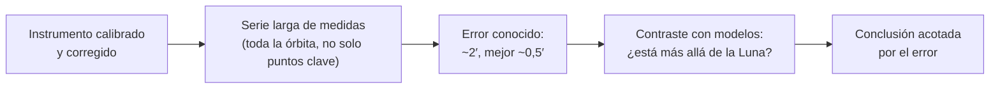

# B02-C12 — Tycho Brahe y observaciones sistemáticas

<!-- nav:top -->
[🏠 Programa](../../../../README.md) · [📚 Bloque B02](../../../tronco-comun/B02-historia-arqueoastronomia-y-culturas-del-cielo.md) · [← Anterior: B02-C11 — Revolución copernicana y métodos](../B02-C11-revolucion-copernicana-y-metodos/CLASE.md) · [Siguiente: B02-C13 — Galileo y primeras observaciones telescópicas →](../B02-C13-galileo-y-primeras-observaciones-telescopicas/CLASE.md)
<!-- /nav -->

## 1. Ubicación, nivel y alcance

Duodécima clase del bloque B02. En C11 viste que el modelo heliocéntrico necesitaba mejores datos. Aquí estudias a quien los produjo: Tycho Brahe, y lo que significa **observar de manera sistemática**: instrumentos calibrados, series continuas y control del error. Nivel N1.

Verás qué mejoró Tycho respecto de sus antecesores, cómo sus observaciones de una supernova y un cometa cambiaron las ideas sobre el cielo, y harás un presupuesto de error. No verás todavía cómo Kepler usó esos datos (C14).

## 2. Por qué esta clase existe

Una teoría solo es tan buena como los datos con que se contrasta. La pregunta motivadora es: **¿qué diferencia hay entre «mirar el cielo» y «observar sistemáticamente», y por qué esa diferencia cambió la astronomía?**

Al terminar sabrás describir una práctica de observación sistemática, convertir una precisión angular en un error de posición y explicar cómo una medida cuidadosa puede refutar una idea.

## 3. Lo que podrás hacer al terminar

1. Describir qué hizo sistemática la observación de Tycho.
2. Convertir un error angular en un error de posición en kilómetros.
3. Explicar cómo las observaciones de 1572 y 1577 mostraron que el cielo cambia.
4. Describir el sistema tychónico y por qué fue popular.
5. Distinguir paralaje de objeto cercano de uno lejano.
6. Redactar un presupuesto de error de una observación.

La evidencia es la **ficha de presupuesto de error** del ejercicio 12 (sección 20).

## 4. Con qué llegas y cómo comprobarlo

Necesitas C10 y trigonometría elemental. Cinco preguntas:

1. ¿Cuántos radianes son 2 minutos de arco?
2. Si un objeto está a 78 millones de km y el error angular es `θ` (en radianes), ¿qué error de posición produce?
3. ¿Qué es una supernova?
4. ¿Qué diferencia hay entre error aleatorio y sistemático?
5. ¿Por qué repetir una medida?

Ver respuestas

1. `2/60 × π/180 = 5,82 × 10⁻⁴` rad. 2. `d·θ`. 3. La explosión de una estrella. 4. El aleatorio varía en cada medida; el sistemático desplaza todas en el mismo sentido. 5. Para promediar el error aleatorio y detectar problemas.

Con cuatro o cinco aciertos, sigue. Con tres o menos, repasa C10 y B01.

## 5. Un caso real: una estrella nueva

El sitio de la Universidad Rice indica que, antes de Tycho, los astrónomos eran generalmente exactos hasta unos 15 minutos de arco; Tycho alcanzó unos 2 minutos y, en lo mejor, alrededor de medio minuto, y fue el primero en corregir por refracción atmosférica (S1). Observó los planetas y la Luna a lo largo de toda su órbita y no solo en puntos clave, lo que reveló anomalías que otros no habían visto (S1). Sus observaciones de la supernova de 1572 y del cometa de 1577 mostraron que ambos objetos estaban más allá de la Luna, de modo que los cielos cambian, y el movimiento del cometa mostró que no podían existir esferas celestes sólidas (S1).

Una revisión de supernovas históricas indica que, para las de 1572 y 1604, los registros europeos son los más precisos (S3). Límite: S1 es una síntesis de divulgación; no leímos las obras de Tycho.

## 6. Vocabulario

La **observación sistemática** es aquella con instrumentos calibrados, series largas y registro del error. La **precisión angular** es el error típico de una medida de posición, en minutos de arco (′). El **minuto de arco** es 1/60 de grado. La **refracción atmosférica** es la desviación de la luz al atravesar la atmósfera, que eleva aparentemente los astros cerca del horizonte. Una **supernova** es la explosión de una estrella que brilla durante semanas. Un **cometa** es un cuerpo pequeño que desarrolla una cola cerca del Sol. Las **esferas celestes sólidas** eran el modelo aristotélico de los cielos como capas de cristal. El **sistema tychónico** pone la Tierra en el centro, con el Sol y la Luna girando en torno a ella y los demás planetas en torno al Sol (S1).

## 7. Modelo mental: de la medida a la conclusión

Un dato sirve en proporción a su incertidumbre conocida.

*Descripción textual:* un instrumento calibrado produce una serie larga de medidas con un error conocido; con ese error se contrastan los modelos (por ejemplo, si un objeto está más allá de la Luna) y la conclusión queda acotada por el error.

Analogía: pesar con una balanza calibrada y repetir. El límite: aquí el instrumento es el ojo con instrumentos de mira, sin telescopio (que llega después, C13).

## 8. La explicación, paso a paso

### 8.1 Instrumentos y registro

Según S1, el rey Federico II financió el observatorio de Uraniborg, en la isla de Hven, cerca de Copenhague; Tycho diseñó y calibró instrumentos, observó cada noche, tuvo su propia imprenta y formó a jóvenes astrónomos. El hecho de calibrar y registrar, no solo de mirar, es lo que lo hace sistemático.

### 8.2 La precisión importa

Con 2′ de precisión, `θ = 2′ = 5,82 × 10⁻⁴` rad. A la distancia mínima aproximada de Marte en oposición, `78,4 × 10⁶ km` (C11), el error de posición lateral es `78,4 × 10⁶ × 5,82 × 10⁻⁴ ≈ 45 600 km`, algo menos de cuatro veces el diámetro de la Tierra; con 0,5′, `11 400 km`. Para comparar, con 15′: `342 000 km`, cerca de la distancia a la Luna. Esta es una estimación nuestra: la distancia real en oposición varía.

### 8.3 Una estrella más allá de la Luna

Si un objeto estuviera cerca de la Tierra, su posición respecto de las estrellas cambiaría según el lugar desde donde se mira (paralaje diurno). Las observaciones de S1 para la supernova de 1572 y el cometa de 1577 no mostraron un paralaje apreciable con la precisión de Tycho, por lo que los objetos estaban más allá de la Luna. Los límites del paralaje que Tycho pudo medir son los de su error: no se puede mostrar un desplazamiento menor que él.

### 8.4 Lo que refutó y lo que no

S1 indica que la supernova y el cometa socavaban la división aristotélica entre lo terrestre y lo celeste, y que el movimiento del cometa mostraba que no podían existir esferas sólidas, idea que fue desapareciendo entre 1575 y 1625. En cambio, nada de ello obligaba a mover la Tierra: Tycho mantuvo la Tierra en el centro y colocó los planetas girando en torno al Sol, lo que preservaba la física aristotélica; el sistema ganó popularidad en el siglo XVII (S1). Es un buen ejemplo de que un dato refuta una idea concreta y no necesariamente un modelo completo.

### 8.5 La herencia

S1 explica que Tycho contrató a Kepler en Praga para calcular órbitas y que los datos, controlados por sus herederos, fueron esenciales para el descubrimiento de las órbitas elípticas; las *Tablas Rudolfinas* de Kepler (1627) fueron mucho más precisas que las anteriores (S1, S2). Los datos largos y precisos permiten ver una pequeña discrepancia, y una pequeña discrepancia puede cambiar un modelo.

## 9. Magnitudes, símbolos y unidades

| Símbolo | Qué es | Unidad | Valor o nota |
|---|---|---|---|
| `θ` | error angular | minutos de arco o rad | 2′ = 5,82×10⁻⁴ rad |
| `d` | distancia al objeto | km | 78,4×10⁶ (ejemplo, C11) |
| `Δx` | error lateral `d·θ` | km | ≈ 45 600 |
| precisión previa | error típico | ′ | ≈ 15 (S1) |
| precisión de Tycho | error típico | ′ | ≈ 2; mejor ≈ 0,5 (S1) |

## 10. Convenciones y referencias

1′ = 1/60° = 2,909×10⁻⁴ rad. Usamos la aproximación `Δx = d·θ` válida para ángulos pequeños. Las cifras de precisión son las de S1, que describe órdenes de magnitud.

## 11. De dónde sale lo que afirmamos

| ID | Fuente | Localizador | Respalda | Estado |
|---|---|---|---|---|
| S1 | The Galileo Project (Rice), «Tycho Brahe» | https://galileo.library.rice.edu/sci/brahe.html | Uraniborg; precisión ~15′, ~2′, ~0,5′; supernova de 1572 y cometa de 1577; sistema tychónico; Kepler | Consultada el 2026-11-05; síntesis de divulgación |
| S2 | The Galileo Project (Rice), «Kepler» | https://galileo.library.rice.edu/sci/kepler.html | Invitación a Praga y uso de las observaciones; *Tabulae Rudolphinae* | Consultada el 2026-11-05 |
| S3 | D. A. Green y F. R. Stephenson, «The Historical Supernovae», arXiv:astro-ph/0301603 | https://arxiv.org/abs/astro-ph/0301603 | Registros europeos más precisos para 1572 y 1604 | Solo el resumen, 2026-11-05 |
| S4 | NASA NSSDC, Earth y Mars Fact Sheets (semiejes mayores) | https://nssdc.gsfc.nasa.gov/planetary/factsheet/marsfact.html | Semiejes 149,598 y 227,956 millones de km (distancia aproximada) | Consultadas el 2026-11-05 |

Límites: la conversión de ángulo a posición es trigonometría estándar. No leímos las obras de Tycho ni estudios sobre sus instrumentos. La afirmación de que «no se mostró paralaje» sigue la síntesis de S1; no hemos visto sus datos.

## 12. Cómo ver el error

Esta tabla es la versión accesible de un gráfico de barras logarítmico.

| Precisión | `θ` (rad) | Error lateral a 78,4×10⁶ km |
|---|---|---|
| 15′ | 4,36×10⁻³ | ≈ 342 000 km |
| 2′ | 5,82×10⁻⁴ | ≈ 45 600 km |
| 0,5′ | 1,45×10⁻⁴ | ≈ 11 400 km |

Si lo dibujas, usa escala logarítmica en el eje del error y etiqueta valores. Descripción larga: el error baja casi dos órdenes de magnitud entre las observaciones previas y las mejores de Tycho.

## 13. Ejemplo trabajado: ¿qué error cometía a la distancia de Marte?

**Paso 1.** `2′ = 2/60° = 0,03333° = 5,818×10⁻⁴` rad.

**Paso 2.** `Δx = 78,4×10⁶ km × 5,818×10⁻⁴ = 45 612 km`.

**Paso 3.** Para 0,5′: `Δx = 11 403 km`.

**Paso 4. Incertidumbre.** La distancia depende de la geometría real y del instante; es un orden de magnitud.

**Sentido físico.** Un error de unos 45 000 km a la distancia de Marte es pequeño comparado con las distancias planetarias, pero basta para ver discrepancias de órbitas si se acumulan muchas medidas.

## 14. Comparación de formas de observar

**Observar puntos clave** (oposiciones, eclipses) es eficiente pero deja huecos. **Observar toda la órbita** (S1) permite detectar anomalías, pero cuesta años. **Observar con instrumentos calibrados** permite cuantificar el error. La combinación es lo que hace útil la serie.

## 15. Práctica guiada

**Ejercicio 1 · con los pasos indicados.** Convierte 2′ a radianes. *Pasos:* minutos a grados, grados a radianes.

Solución comentada

`2/60 = 0,03333°`; `× π/180 = 5,818×10⁻⁴` rad.

**Ejercicio 2 · con una pista.** Error lateral a 78,4×10⁶ km con 2′. *Pista:* `d·θ`.

Solución comentada

`≈ 45 600 km`.

**Ejercicio 3 · casi autónomo.** ¿Cuántas veces mejor es 0,5′ que 15′?

Solución comentada

`15/0,5 = 30` veces.

## 16. Práctica autónoma, transferencia e integrador

**Ejercicio 4.** Calcula el error lateral a la distancia de la Luna (384 400 km) con 2′.

Solución comentada

`384 400 × 5,818×10⁻⁴ = 223,6 km`.

**Ejercicio 5.** Si el paralaje diurno de la Luna es de unos 57′ (dato de ejemplo), ¿lo habría detectado Tycho? Compara con 2′.

Solución comentada

Sí: 57′ es 28 veces mayor que 2′. El valor de 57′ es un dato de ejemplo no consultado en nuestras fuentes.

**Ejercicio 6.** Si un cometa mostrara paralaje menor que 2′, ¿qué puedes concluir sobre su distancia?

Solución comentada

Que está más lejos que cualquier objeto con paralaje mayor que el error; con un límite, no un valor exacto (como en 8.3).

**Ejercicio 7.** ¿Por qué observar toda la órbita revela anomalías que los puntos clave ocultan?

Solución comentada

Porque los modelos pueden coincidir en los puntos clave y diferir en los intermedios; sin datos entremedios no se ve la diferencia (S1).

**Ejercicio 8.** ¿Qué refuta el movimiento del cometa de 1577 según S1 y qué no refuta?

Solución comentada

Refuta la existencia de esferas celestes sólidas; no refuta la posición de la Tierra en el centro, que Tycho mantuvo.

**Ejercicio 9 · transferencia.** Un compañero dice: «Tycho se equivocó porque no aceptó a Copérnico». Responde.

Solución comentada

Su modelo era coherente con los datos de su época, preservaba la física aceptada y atrajo a muchos; sus datos permitieron a Kepler superar su propio modelo.

**Ejercicio 10 · transferencia.** ¿Qué haría falta para detectar paralaje estelar anual, de menos de 1″?

Solución comentada

Una precisión de al menos cientos de veces mejor que 2′ (120″): menos de 1″ requiere más de 120 veces mejora (C10).

**Ejercicio 11 · transferencia.** Registra un presupuesto de error para medir la altura del Sol con un cuadrante casero.

Solución comentada

Lista fuentes: lectura (±0,5°), nivelación, hora, refracción cerca del horizonte; combina en cuadratura si son independientes. Nunca mirar al Sol directamente: usa la sombra.

**Ejercicio 12 · integrador.** Elabora la *ficha de presupuesto de error* (sección 20): una observación (ángulo), fuentes de error, error combinado, distancia, error de posición y conclusión acotada.

Solución modelo

Sigue la sección 13: convierte unidades, calcula `d·θ`, declara supuestos y limita la conclusión al error.

## 17. Actividad sin código: presupuesto de error

Esta clase no usa script. En una hoja de cálculo, calcula el error lateral para `θ` = 15′, 5′, 2′, 1′, 0,5′ y `d` = Luna (384 400 km), Marte en oposición (78,4×10⁶ km). **Qué observar:** el error es proporcional a `θ` y a `d`. **Resultado esperado:** para 2′: 224 km (Luna) y 45 600 km (Marte).

## 18. Errores frecuentes y cómo corregirlos

**Confundir minuto de arco y de tiempo.** Ejercicio 1.

**Olvidar convertir a radianes.** Ejercicio 2.

**Creer que un dato refuta un modelo entero.** Ejercicio 8.

**Atribuir a Tycho el telescopio.** Ejercicio 9.

**Presentar una conclusión más fina que el error.** Ejercicio 6.

## 19. Cómo sabrás que vas bien

Tras 8.2: ¿conviertes ′ a km sin mirar? Ejercicio 2. Tras 8.4: ¿qué refuta cada observación? Ejercicio 8. Al final: ¿puedes escribir una conclusión acotada por el error? Ejercicio 12.

## 20. Qué entregas y cómo se evalúa

El producto es tu **ficha de presupuesto de error**.

| Criterio | Inicial | En desarrollo | Logrado | Destacado |
|---|---|---|---|---|
| Conversión de unidades | Con errores | Correcta | Correcta con unidades | Con verificación dimensional |
| Fuentes de error | Una | Dos | Varias con su tamaño | Combinadas en cuadratura |
| Conclusión | Sobrepasa el error | Cautelosa | Acotada | Propone cómo reducirlo |
| Contexto histórico | Anacrónico | Neutral | Matizado | Con fuente |

**Condiciones críticas:** no presentar una conclusión más fina que el error; no observar el Sol sin filtros certificados; citar solo lo consultado.

## 21. Ética, seguridad y límites

Los datos de Tycho, según S1, quedaron bajo control de sus herederos y Kepler los usó; la historia de la autoría y el acceso a datos es una lección sobre propiedad intelectual y ciencia abierta (no desarrollada por falta de fuentes). Cualquier medición solar exige filtros certificados. Accesibilidad: cálculos en texto, diagrama descrito, tablas equivalentes.

## 22. Para cerrar y seguir

Observar de manera sistemática es calibrar, registrar toda la serie y conocer el error; con él, una observación puede refutar una idea concreta. En C13 llega un instrumento que cambia la escala de lo observable: el telescopio.

**Glosario español–inglés.** minuto de arco · *arcminute*; refracción atmosférica · *atmospheric refraction*; observación sistemática · *systematic observation*; supernova · *supernova*; cometa · *comet*; presupuesto de error · *error budget*.

**Continuidad.** B02-C13 usa tu capacidad de **acotar una conclusión con el error** para estudiar las primeras observaciones telescópicas. B02-C14 retomará los datos de Tycho con Kepler.

**Referencias:** ver sección 11. S1 y S2 son divulgación universitaria; S3 solo resumen.

<!-- nav:bottom -->
---

[← Anterior: B02-C11 — Revolución copernicana y métodos](../B02-C11-revolucion-copernicana-y-metodos/CLASE.md) · [📚 Bloque B02](../../../tronco-comun/B02-historia-arqueoastronomia-y-culturas-del-cielo.md) · [Siguiente: B02-C13 — Galileo y primeras observaciones telescópicas →](../B02-C13-galileo-y-primeras-observaciones-telescopicas/CLASE.md)
<!-- /nav -->
