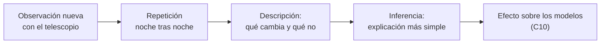

# B02-C13 — Galileo y primeras observaciones telescópicas

<!-- nav:top -->
[🏠 Programa](../../../../README.md) · [📚 Bloque B02](../../../tronco-comun/B02-historia-arqueoastronomia-y-culturas-del-cielo.md) · [← Anterior: B02-C12 — Tycho Brahe y observaciones sistemáticas](../B02-C12-tycho-brahe-y-observaciones-sistematicas/CLASE.md) · [Siguiente: B02-C14 — Kepler y reconstrucción de órbitas →](../../../tronco-comun/B02-historia-arqueoastronomia-y-culturas-del-cielo.md#b02-c14)
<!-- /nav -->

## 1. Ubicación, nivel y alcance

Decimotercera clase del bloque B02. Con Tycho viste el límite de observar a simple vista; con Galileo, un instrumento amplía lo observable y trae preguntas nuevas. Nivel N1.

Verás qué era el telescopio de 1609, qué vio Galileo en la Luna, en Júpiter y en el Sol, qué podía y no podía concluir de cada observación, y harás con datos actuales el cálculo que muestra por qué necesitó varias noches para entender las lunas de Júpiter. No verás la polémica judicial ni la física del movimiento de Galileo.

## 2. Por qué esta clase existe

Un instrumento nuevo da datos nuevos, pero los datos nuevos no se interpretan solos. La pregunta motivadora es: **¿qué podía concluir Galileo de lo que veía, y qué le faltaba para convencer a quienes no creían?** Esto sirve para cualquier instrumento: un telescopio, un detector o un sensor.

Al terminar sabrás separar lo observado de lo inferido en cada caso y calcular cuántas vueltas completan los satélites en la semana que Galileo los siguió.

## 3. Lo que podrás hacer al terminar

1. Describir el origen del telescopio y las capacidades del de Galileo.
2. Enumerar las observaciones de 1610 y qué implicaban para los modelos.
3. Distinguir lo que cada observación prueba y lo que solo apoya.
4. Calcular cuántas vueltas dan los satélites galileanos en 8 días.
5. Comprobar que la razón `T²/a³` es casi constante entre ellos.
6. Redactar una ficha de observación con su inferencia y su límite.

La evidencia es la **ficha de observación telescópica** del ejercicio 12 (sección 20).

## 4. Con qué llegas y cómo comprobarlo

Necesitas C10 y C12. Cinco preguntas:

1. ¿Qué es un satélite natural?
2. Si algo da una vuelta en 1,77 días, ¿cuántas da en 8 días?
3. ¿Qué diferencia hay entre un dato y una inferencia?
4. ¿Qué es el campo de visión de un instrumento?
5. ¿Qué es una fase de un astro?

<details>
<summary>Ver respuestas</summary>

1. Un cuerpo que orbita un planeta. 2. `8/1,77 = 4,5`. 3. El dato se observa; la inferencia lo interpreta. 4. La porción de cielo que se ve de una vez. 5. La parte iluminada visible de un astro desde un lugar.
</details>

Con cuatro o cinco aciertos, sigue. Con tres o menos, repasa C12.

## 5. Un caso real: cuatro «estrellas» que se movían

Según el sitio de la Universidad Rice, el 7 de enero de 1610 Galileo vio cerca de Júpiter lo que tomó por tres estrellas fijas en línea; el 8 las encontró todas al oeste de Júpiter, algo inesperado; en la semana siguiente vio que permanecían cerca del planeta, cambiaban de posición entre sí y eran cuatro; y el 15 de enero concluyó que no eran estrellas fijas sino cuerpos que giran en torno a Júpiter (S1). Publicó el hallazgo en el *Sidereus Nuncius* en Venecia, hacia mediados de marzo de 1610 (S1).

Ese relato muestra el método: una observación inesperada, repetida noche tras noche, hasta que la explicación más simple es la de cuerpos en órbita. Límite: S1 es una síntesis; no leímos el *Sidereus Nuncius*.

## 6. Vocabulario

El **telescopio refractor** usa lentes; el de Galileo combinaba una lente convexa y una cóncava (S2). La **ampliación** (o aumento) es cuántas veces se magnifica la imagen. El **campo de visión** es el ángulo de cielo visible. Los **satélites galileanos** son Ío, Europa, Ganimedes y Calisto, los cuatro mayores de Júpiter. Las **fases de Venus** son los cambios de la porción iluminada de Venus vista desde la Tierra. Las **manchas solares** son zonas oscuras en la superficie del Sol. Una **inferencia** es una conclusión que no se observa directamente.

## 7. Modelo mental: ver, repetir, inferir

Cada observación de Galileo sigue el mismo ciclo.



*Descripción textual:* una observación nueva con el telescopio se repite varias noches, se describe lo que cambia y lo que no, se infiere la explicación más simple y se evalúa su efecto sobre los modelos del cosmos.

Analogía: seguir a un animal en una cámara nocturna durante una semana. El límite: Galileo no tenía un modelo previo de lunas de Júpiter; tuvo que construirlo.

## 8. La explicación, paso a paso

### 8.1 El telescopio

S2 indica que en octubre de 1608 los Estados Generales de los Países Bajos consideraron patentes de Hans Lipperhey y Jacob Metius para un aparato que acercaba lo lejano, con una lente convexa y una cóncava y un aumento de tres o cuatro. Galileo construyó un aparato de tres aumentos a mediados de 1609, mostró uno de ocho al Senado veneciano en agosto, y a fines de 1609 tenía uno de veinte. Un telescopio galileano típico tenía unos 15–20 aumentos, un campo de unos 15 minutos de arco y un vidrio con burbujas y tinte verdoso (S2). Con él observó la Luna, descubrió cuatro satélites de Júpiter y resolvió manchas nebulosas en estrellas (S2).

### 8.2 La Luna

S3 indica que Galileo vio manchas pequeñas jamás vistas y observó que el ancho de las líneas oscuras que las rodean cambiaba con el ángulo de la luz solar, de lo que concluyó que eran sombras y que la superficie lunar tiene montañas y valles. La Luna no era esférica ni perfecta, lo que socavaba la idea aristotélica de cielos perfectos (S3).

### 8.3 Las lunas de Júpiter

La interpretación de S1: los cuatro cuerpos son lunas que giran en torno a Júpiter; la Tierra no es el único planeta con luna, lo que debilitaba una objeción aristotélica al sistema copernicano; y Júpiter se convertía en un segundo centro de movimiento. S1 aclara que esto no probaba el copernicanismo, pero lo apoyaba.

### 8.4 Las manchas solares

S4 recoge una polémica con Christoph Scheiner por las manchas solares: Scheiner sostuvo que eran satélites muy cercanos al Sol, preservando la perfección solar; Galileo, que estaban en la superficie o en la atmósfera solar y se parecían a nubes. Muestran cambio en el Sol, desafiando la idea de cielos inmutables. S4 indica también que en la última carta de Galileo hay una mención favorable al sistema copernicano, que algunos estudiosos consideran su primer apoyo público.

### 8.5 Lo que el laboratorio permite ver

Con los períodos actuales de la NASA (S5): Ío 1,769138 d, Europa 3,551181 d, Ganimedes 7,154553 d, Calisto 16,689017 d. En los 8 días entre el 7 y el 15 de enero de 1610 (S1), Ío da 4,52 vueltas, Europa 2,25, Ganimedes 1,12 y Calisto 0,48. Por eso Galileo no podía entender el movimiento con una o dos noches: Ío cambia de lado de Júpiter en menos de un día, y Calisto casi no se mueve. Se necesitaban varias noches para distinguir el movimiento de cada uno. Es un cálculo nuestro con datos modernos y no reconstruye lo que Galileo observó.

### 8.6 Una regularidad que Galileo no vio

La razón `T²/a³` es casi la misma para los cuatro satélites: 4,1706, 4,1724, 4,1738 y 4,1737 (×10⁻⁸ d²/(10³ km)³), una diferencia de 0,08 % entre el menor y el mayor. Esta es la tercera ley de Kepler aplicada a un nuevo sistema (C14), calculada con datos modernos; Galileo no la formuló. Además, `T_Europa/T_Ío = 2,007` y `T_Ganimedes/T_Europa = 2,015`: razones cercanas a 2.

## 9. Magnitudes, símbolos y unidades

| Símbolo | Qué es | Unidad | Valor o nota |
|---|---|---|---|
| `T` | período orbital | d | 1,769138; 3,551181; 7,154553; 16,689017 (S5) |
| `a` | semieje mayor | 10³ km | 421,8; 671,1; 1 070,4; 1 882,7 (S5) |
| `T²/a³` | razón de Kepler | d²/(10³ km)³ | ≈ 4,17×10⁻⁸ |
| vueltas | `8/T` | — | 4,52; 2,25; 1,12; 0,48 |
| aumento | del telescopio | — | 3 → 8 → 20 (S2) |

## 10. Convenciones y referencias

Las fechas son las de S1 (calendario gregoriano). «8 días» es del 7 al 15 de enero. Los períodos de S5 se rotulan «orbital period» sin precisar «sidéreo». No convertimos a posiciones en el cielo.

## 11. De dónde sale lo que afirmamos

| ID | Fuente | Localizador | Respalda | Estado |
|---|---|---|---|---|
| S1 | The Galileo Project (Rice), «Jupiter's satellites» | https://galileo.library.rice.edu/sci/observations/jupiter_satellites.html | Fechas de enero de 1610; conclusión; *Sidereus Nuncius*; implicaciones | Consultada el 2026-11-05 |
| S2 | The Galileo Project (Rice), «Telescope» | https://galileo.library.rice.edu/sci/instruments/telescope.html | Origen en 1608; aumentos de Galileo; campo de ~15′; limitaciones | Consultada el 2026-11-05 |
| S3 | The Galileo Project (Rice), «Moon» | https://galileo.library.rice.edu/sci/observations/moon.html | Montañas y valles; Luna imperfecta | Consultada el 2026-11-05 |
| S4 | The Galileo Project (Rice), «Sunspots» | https://galileo.library.rice.edu/sci/observations/sunspots.html | Polémica con Scheiner; manchas; apoyo copernicano | Consultada el 2026-11-05 |
| S5 | NASA NSSDC, *Jovian Satellite Fact Sheet* (act. 6-dic-2023) | https://nssdc.gsfc.nasa.gov/planetary/factsheet/joviansatfact.html | Semiejes y períodos de los satélites galileanos | Consultada el 2026-11-05 |

Límites: las cuatro fuentes de Rice son síntesis de divulgación universitaria; no leímos los textos de Galileo. No consultamos una fuente sobre las fases de Venus (la página no abrió), por lo que no las desarrollamos. Los cálculos de 8.5 y 8.6 son nuestros.

## 12. Cómo ver los satélites

Esta tabla es la versión accesible de un gráfico de posiciones.

| Satélite | `T` (d) | Vueltas en 8 d | Qué vería Galileo |
|---|---|---|---|
| Ío | 1,769 | 4,52 | cambia de lado en menos de un día |
| Europa | 3,551 | 2,25 | cambia de lado en ~1,8 días |
| Ganimedes | 7,155 | 1,12 | cambia de lado en ~3,6 días |
| Calisto | 16,689 | 0,48 | casi no se mueve en la semana |

Descripción larga: los períodos crecen aproximadamente al doble entre satélites contiguos, y por eso los más internos parecen «bailar» más rápido.

## 13. Ejemplo trabajado: ¿por qué hacían falta varias noches?

**Planteamiento.** Un observador ve en la primera noche tres puntos alineados junto a Júpiter. ¿Basta una noche para saber si son lunas?

**Paso 1.** Ío da `8/1,769 = 4,52` vueltas en 8 días: en un día cambia mucho de posición.

**Paso 2.** Calisto da `0,48` vueltas: casi no cambia en la semana.

**Paso 3.** Con una sola noche, ninguno parece moverse; con dos, algunos cambian de lado y otros no.

**Paso 4. Incertidumbre.** Los períodos son medios modernos; Galileo no los conocía.

**Sentido físico.** La conclusión «giran en torno a Júpiter» solo aparece al ver cuatro cuerpos que cambian de posición entre sí pero no se alejan del planeta, algo que requiere una serie.

## 14. Comparación de interpretaciones

La interpretación «son estrellas fijas» predice que no se mueven respecto de las estrellas; fue refutada por los cambios nocturnos. «Son cuerpos que giran en torno a Júpiter» predice cambios periódicos; coincide. Esta es la lógica de una prueba que puede fallar (B01).

## 15. Práctica guiada

**Ejercicio 1 · con los pasos indicados.** Calcula las vueltas de Europa en 8 días. *Pasos:* `8/3,551181`.

<details><summary>Solución comentada</summary>

`2,25` vueltas.
</details>

**Ejercicio 2 · con una pista.** Calcula `T²/a³` de Ío. *Pista:* `1,769138² / 421,8³`.

<details><summary>Solución comentada</summary>

`3,1300 / 75 044 000 ≈ 4,17×10⁻⁸`.
</details>

**Ejercicio 3 · casi autónomo.** Calcula `T_Ganimedes/T_Europa`.

<details><summary>Solución comentada</summary>

`7,154553/3,551181 = 2,0147`.
</details>

## 16. Práctica autónoma, transferencia e integrador

**Ejercicio 4.** ¿Cuánto tarda Ío en medio período? ¿Qué significa?

<details><summary>Solución comentada</summary>

`0,885 d` (unas 21 h): pasa de un lado de Júpiter al otro.
</details>

**Ejercicio 5.** Con un campo de 15′ (S2), ¿cuántas veces cabe el diámetro angular de la Luna (unos 30′, dato de ejemplo)?

<details><summary>Solución comentada</summary>

La Luna llena (30′) no cabe en el campo de 15′; S2 indica que solo cabía alrededor de un cuarto de la Luna llena. El 30′ es un valor de ejemplo.
</details>

**Ejercicio 6.** Calcula la diferencia relativa entre la mayor y la menor `T²/a³`.

<details><summary>Solución comentada</summary>

`(4,1738−4,1706)/4,1706 = 0,08 %`.
</details>

**Ejercicio 7.** ¿Qué observación de Galileo debilitaba la objeción de que la Tierra sería el único centro de movimiento?

<details><summary>Solución comentada</summary>

Los satélites de Júpiter: otro cuerpo con lunas, otro centro de movimiento (S1).
</details>

**Ejercicio 8.** ¿Por qué las manchas solares desafiaban la idea de cielos inmutables?

<details><summary>Solución comentada</summary>

Porque muestran cambio en el Sol: aparecen, se mueven y desaparecen (S4).
</details>

**Ejercicio 9 · transferencia.** Un compañero afirma: «el telescopio probó el heliocentrismo». Responde con S1 y S3.

<details><summary>Solución comentada</summary>

Las lunas de Júpiter no lo probaban, solo lo apoyaban (S1); las montañas lunares golpeaban la perfección celeste (S3). Ninguna decidía entre heliocéntrico y tychónico.
</details>

**Ejercicio 10 · transferencia.** El telescopio tenía vidrio con burbujas y campo estrecho (S2). ¿Cómo afectaría eso a una conclusión?

<details><summary>Solución comentada</summary>

Limita la resolución y el contraste, y obliga a repetir: una conclusión debe declarar esas limitaciones.
</details>

**Ejercicio 11 · transferencia.** Diseña un cuaderno de observación de Júpiter con tu telescopio o binoculares. ¿Qué anotarías cada noche?

<details><summary>Solución comentada</summary>

Fecha y hora con escala de tiempo, lugar, instrumento y aumento, posiciones relativas de los puntos, condiciones del cielo e incertidumbre. Observa con seguridad: nunca Sol sin filtro.
</details>

**Ejercicio 12 · integrador.** Elabora la *ficha de observación telescópica* (sección 20): elige una de las observaciones de 1610, separa lo observado de lo inferido, di qué modelos afecta y qué límites tenía el instrumento.

<details><summary>Solución modelo</summary>

Sigue la sección 13: dato, repetición, inferencia, modelos afectados y límites, con fuentes citadas.
</details>

## 17. Laboratorio: los satélites galileanos

El script [satelites_galileanos.py](satelites_galileanos.py) lee semiejes y períodos (NASA), calcula `T²/a³`, las vueltas en 8 días y las razones de períodos. Antes comprueba que `T²/a³` sea constante dentro de 0,5 % y que las razones de períodos sean cercanas a 2.

**Datos:** publicados (NASA). **Predice antes de ejecutar:** ¿cuántas vueltas da Ío en 8 días? (Alrededor de 4,5.) **Resultados (2026-11-05, Python 3.12.9):** `T²/a³` = 4,1706; 4,1724; 4,1738; 4,1737 (×10⁻⁸); vueltas 4,52; 2,25; 1,12; 0,48; `T_Eu/T_Ío = 2,0073`; `T_Gan/T_Eu = 2,0147`.

```bash
python programa/clases/B02/B02-C13-galileo-y-primeras-observaciones-telescopicas/satelites_galileanos.py
```

**Límites:** órbitas circulares, períodos medios; no reconstruye las posiciones de enero de 1610.

## 18. Errores frecuentes y cómo corregirlos

**Decir que el telescopio probó el heliocentrismo.** Ejercicio 9.

**Olvidar que Galileo no tenía los períodos.** Sección 13.

**Confundir dato e inferencia.** Ejercicio 12.

**Atribuir a Galileo la tercera ley de Kepler.** Sección 8.6.

**Mirar al Sol sin filtro.** Ejercicio 11.

## 19. Cómo sabrás que vas bien

Tras 8.3: ¿qué apoya y qué no prueba la observación de Júpiter? Ejercicio 9. Tras 8.5: ¿por qué hacían falta varias noches? Sección 13. Al final: ¿separas dato e inferencia? Ejercicio 12.

## 20. Qué entregas y cómo se evalúa

El producto es tu **ficha de observación telescópica**.

| Criterio | Inicial | En desarrollo | Logrado | Destacado |
|---|---|---|---|---|
| Dato frente a inferencia | Los mezcla | Los nombra | Los separa | Propone cómo comprobar la inferencia |
| Modelos afectados | Ninguno | Uno | Los relevantes | Con lo que no decide |
| Límites del instrumento | Ausentes | Mencionados | Con su efecto | Estimados |
| Fuentes | Sin fuente | Con fuente | Con tipo y estado | Contrasta fuentes |

**Condiciones críticas:** no afirmar que una observación «prueba» un modelo sin matizar; citar solo lo consultado; nunca observar el Sol sin filtros certificados.

## 21. Ética, seguridad y límites

La disputa con Scheiner (S4) muestra que la atribución de descubrimientos puede ser conflictiva; se cita cada afirmación a su fuente. **Seguridad:** observar el Sol con telescopio o binoculares sin filtro certificado puede causar ceguera permanente; esta clase no es una guía de observación solar. Accesibilidad: cálculos en texto, diagrama descrito, tablas equivalentes y script sin conexión.

## 22. Para cerrar y seguir

El telescopio mostró lo que no se veía y obligó a distinguir lo observado de lo inferido; las lunas de Júpiter, la Luna imperfecta y las manchas solares erosionaron una cosmología sin decidir entre los modelos. En C14 ves cómo Kepler convierte los datos de Tycho en órbitas elípticas.

**Glosario español–inglés.** telescopio · *telescope*; aumento · *magnification*; campo de visión · *field of view*; satélites galileanos · *Galilean moons*; manchas solares · *sunspots*; inferencia · *inference*.

**Continuidad.** B02-C14 usa tu capacidad de **calcular `T²/a³`** para entender la tercera ley de Kepler.

**Referencias:** ver sección 11. Las fuentes de Rice son divulgación universitaria; S5 es dato oficial.

<!-- nav:bottom -->
---

[← Anterior: B02-C12 — Tycho Brahe y observaciones sistemáticas](../B02-C12-tycho-brahe-y-observaciones-sistematicas/CLASE.md) · [📚 Bloque B02](../../../tronco-comun/B02-historia-arqueoastronomia-y-culturas-del-cielo.md) · [Siguiente: B02-C14 — Kepler y reconstrucción de órbitas →](../../../tronco-comun/B02-historia-arqueoastronomia-y-culturas-del-cielo.md#b02-c14)
<!-- /nav -->
