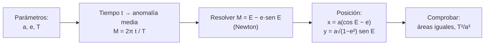

# B02-C14 — Kepler y reconstrucción de órbitas

<!-- nav:top -->
[🏠 Programa](../../../../README.md) · [📚 Bloque B02](../../../tronco-comun/B02-historia-arqueoastronomia-y-culturas-del-cielo.md) · [← Anterior: B02-C13 — Galileo y primeras observaciones telescópicas](../B02-C13-galileo-y-primeras-observaciones-telescopicas/CLASE.md) · [Siguiente: B02-C15 — Newton y gravitación universal →](../B02-C15-newton-y-gravitacion-universal/CLASE.md)
<!-- /nav -->

## 1. Ubicación, nivel y alcance

Decimocuarta clase del bloque B02. Tycho aportó datos precisos (C12); Galileo, un instrumento (C13). Kepler hace lo que cada uno no hizo: **ajustar un modelo a los datos y aceptar lo que los datos exigen**, incluso si contradice una idea querida. Nivel N1.

Verás las tres leyes de Kepler, cómo se reconstruye una órbita elíptica a partir de pocos parámetros y harás un laboratorio que resuelve la ecuación de Kepler y comprueba las leyes con datos de la NASA. No verás la física que explica las leyes (C15) ni mecánica orbital con fuerzas (bloques A05 en adelante).

## 2. Por qué esta clase existe

Para Kepler, como para todos antes, el círculo era la figura natural del cielo. Los datos de Tycho no se dejaban describir con círculos. La pregunta motivadora es: **¿qué hace una persona de ciencia cuando el modelo más elegante no encaja con el dato más fiable?** Kepler cambió el modelo, no el dato.

Al terminar sabrás enunciar las tres leyes, reconstruir la posición de un planeta en el tiempo a partir de `a`, `e` y `T`, y verificar las leyes numéricamente.

## 3. Lo que podrás hacer al terminar

1. Enunciar las tres leyes de Kepler en palabras y en fórmulas.
2. Calcular perihelio y afelio desde `a` y `e`.
3. Explicar por qué un planeta es más rápido en el perihelio.
4. Resolver la ecuación de Kepler para obtener una posición.
5. Verificar `T²/a³` con datos publicados.
6. Redactar una ficha de órbita con parámetros y límites.

La evidencia es la **ficha de órbita** del ejercicio 12 (sección 20).

## 4. Con qué llegas y cómo comprobarlo

Necesitas C11 y C12. Cinco preguntas:

1. ¿Qué es una elipse? ¿Y su semieje mayor?
2. ¿Qué mide la excentricidad `e`?
3. Si `a = 10` y `e = 0,2`, ¿cuánto vale `a(1−e)`?
4. ¿Qué significa «proporcional a»?
5. ¿Por qué se usan los datos de Tycho y no solo los de Copérnico?

<details>
<summary>Ver respuestas</summary>

1. Una curva cerrada en la que la suma de distancias a dos focos es constante; el semieje mayor es la mitad de su diámetro mayor. 2. Cuán achatada es la elipse (0 = círculo). 3. 8. 4. Que al multiplicar una cantidad por `k`, la otra se multiplica por `k`. 5. Porque eran más precisos (C12).
</details>

Con cuatro o cinco aciertos, sigue. Con tres o menos, repasa C11.

## 5. Un caso real: una forma que obligaron los datos

El sitio de la Universidad Rice indica que Kepler presentó en *Astronomia Nova* (1609) sus dos primeras leyes: los planetas se mueven en elipses con el Sol en un foco, y barren áreas iguales en tiempos iguales; y que su tercera ley, que relaciona los períodos con los radios medios, aparece en *Harmonice Mundi* (1619). Tycho invitó a Kepler a Praga para calcular nuevas órbitas con sus observaciones, y Kepler publicó en 1627 las *Tablas Rudolfinas*, calculadas con su astronomía elíptica (S1, S2). La página subraya que Kepler adoptó un enfoque dinámico, «introduciendo la física en los cielos» (S1).

Importa porque los datos de Tycho fueron esenciales: sin la precisión de unos minutos de arco, una desviación respecto del círculo no habría sido visible (C12). Límite: S1 no menciona Marte específicamente; la historia del cálculo de Marte la conocemos por fuentes que no consultamos.

## 6. Vocabulario

El **semieje mayor** `a` es la mitad del diámetro mayor de la elipse. La **excentricidad** `e` mide su achatamiento: la distancia entre focos es `2ae`. El **perihelio** es el punto más cercano al Sol (`a(1−e)`) y el **afelio**, el más lejano (`a(1+e)`). La **anomalía media** `M = 2π t/T` crece de manera uniforme con el tiempo. La **anomalía excéntrica** `E` es un ángulo auxiliar que cumple la **ecuación de Kepler**, `M = E − e sen E`. Una **ley empírica** resume lo observado sin explicarlo (C15 da la explicación).

## 7. Modelo mental: de tres números a una órbita

Tres parámetros (`a`, `e`, `T`) y el tiempo bastan para ubicar el planeta.



*Descripción textual:* con `a`, `e` y `T` se calcula la anomalía media en cada instante; se resuelve la ecuación de Kepler para hallar la anomalía excéntrica; de ella salen las coordenadas; y se comprueban las leyes de las áreas y del período.

Analogía: una pista elíptica con un corredor que acelera al acercarse al foco. El límite: el corredor no tiene un motivo físico para acelerar; en C15 aparece la gravedad.

## 8. La explicación, paso a paso

### 8.1 Las tres leyes

(1) La órbita es una elipse con el Sol en un foco. (2) La línea Sol–planeta barre áreas iguales en tiempos iguales. (3) `T²/a³` es la misma para todos los planetas. Las dos primeras corresponden a *Astronomia Nova* (1609) y la tercera a *Harmonice Mundi* (1619) (S1).

### 8.2 Perihelio, afelio y velocidad

Con `a = 227,956` millones de km (Marte, S3) y una excentricidad **sintética** `e = 0,2`: perihelio `a(1−e) = 182,4` y afelio `a(1+e) = 273,5` millones de km. Por la segunda ley, el planeta es más rápido cerca del Sol: la razón de velocidades `v_p/v_a = (1+e)/(1−e) = 1,5`. El laboratorio lo reproduce numéricamente.

### 8.3 La ecuación de Kepler

La anomalía media crece de manera uniforme: `M = 2π t/T`. La ecuación `M = E − e sen E` no tiene solución cerrada, pero se resuelve por el método de Newton. Con `E`, la posición respecto del Sol es `x = a(cos E − e)`, `y = a√(1−e²) sen E`. Para `e = 0`, `E = M` y el movimiento es circular uniforme.

### 8.4 Comprobar la segunda ley

El laboratorio calcula el área barrida durante un décimo del período partiendo del perihelio y durante otro décimo partiendo del afelio: ambas valen `1,5995×10⁴` (unidades de 10¹² km²) y su razón es `1,000000`. Las dos regiones tienen formas muy distintas (una corta y alta, otra larga y baja) pero igual área.

### 8.5 La tercera ley con datos de la NASA

La NASA da, relativos a la Tierra, el período y la distancia al Sol (S4). `T²/a³` vale: Mercurio 1,0021; Venus 1,0008; Marte 1,0064; Júpiter 1,0071; Saturno 0,9862. Con tres cifras en los datos, la constante es 1 con una dispersión de ±1,5 %. Esta es la ley que usaste en C11 y C13.

### 8.6 Lo que la ley no explica

Las leyes describen, no explican. No dicen por qué las órbitas son elipses ni por qué `T²/a³` es constante. S1 señala que Kepler buscó una explicación dinámica, pero la que hoy aceptamos viene de Newton (C15).

## 9. Magnitudes, símbolos y unidades

| Símbolo | Qué es | Unidad | Valor o nota |
|---|---|---|---|
| `a` | semieje mayor | 10⁶ km | 227,956 (Marte, S3) |
| `e` | excentricidad | — | 0,2 (sintética) |
| `T` | período | d | 686,980 (Marte, S3) |
| `M`, `E` | anomalías media y excéntrica | rad | `M = E − e sen E` |
| `T²/a³` | constante de Kepler | (año)²/(au)³ | ≈ 1 (S4) |

## 10. Convenciones y referencias

Las razones de S4 son respecto de la Tierra (1 año, 1 au). Usamos la ecuación de Kepler del problema de dos cuerpos con el Sol en un foco y el perihelio sobre el eje `x`. La excentricidad es sintética: no se afirma nada sobre la órbita real de Marte.

## 11. De dónde sale lo que afirmamos

| ID | Fuente | Localizador | Respalda | Estado |
|---|---|---|---|---|
| S1 | The Galileo Project (Rice), «Kepler» | https://galileo.library.rice.edu/sci/kepler.html | *Astronomia Nova* 1609 (dos leyes), *Harmonice Mundi* 1619 (tercera ley), uso de datos de Tycho, *Tablas Rudolfinas* | Consultada el 2026-11-05 |
| S2 | The Galileo Project (Rice), «Tycho Brahe» | https://galileo.library.rice.edu/sci/brahe.html | Kepler en Praga; datos esenciales | Consultada el 2026-11-05 |
| S3 | NASA NSSDC, *Mars Fact Sheet* | https://nssdc.gsfc.nasa.gov/planetary/factsheet/marsfact.html | Semieje 227,956×10⁶ km; período 686,980 d | Consultada el 2026-11-05 (act. 19-may-2025) |
| S4 | NASA NSSDC, *Planetary Fact Sheet – Ratio to Earth Values* | https://nssdc.gsfc.nasa.gov/planetary/factsheet/planet_table_ratio.html | Períodos y distancias relativos a la Tierra | Consultada el 2026-11-05 (act. 18-mar-2025) |

Límites: la ecuación de Kepler y las fórmulas de posición son mecánica estándar que verificamos en el laboratorio con casos analíticos; no citamos un texto. No leímos a Kepler. No consultamos la historia del ajuste de Marte.

## 12. Cómo ver la órbita

Esta tabla es la versión accesible de un diagrama de la elipse.

| Punto | Distancia al Sol (10⁶ km) | Velocidad relativa |
|---|---|---|
| Perihelio | 182,4 | 1,5 |
| Afelio | 273,5 | 1,0 |

Si lo dibujas, marca el Sol en un foco (no en el centro), usa líneas distintas para las dos regiones de igual área y rotula ejes con unidades. Descripción larga: una elipse suave con el Sol desplazado; el planeta recorre más arco cerca del Sol.

## 13. Ejemplo trabajado: ¿dónde está el planeta a un cuarto de período?

**Paso 1.** `M = 2π × 0,25 = 1,5708` rad.

**Paso 2.** Resolver `E − 0,2 sen E = 1,5708`: `E ≈ 1,7670` rad (Newton), es decir, 101,2°.

**Paso 3.** `x = 227,956 (cos 1,7670 − 0,2) = 227,956 (−0,1949 − 0,2) = −90,0`; `y = 227,956 × √(1−0,04) × sen 1,7670 = 227,956 × 0,9798 × 0,9808 = 219,1` (millones de km, con el Sol en el origen).

**Paso 4. Incertidumbre.** Con `e` sintética no tiene significado físico; el método es el que cuenta.

**Sentido físico.** A un cuarto de período el planeta ya pasó el semieje menor (E > 90°): ha recorrido más de un cuarto del arco, porque cerca del perihelio va más rápido.

## 14. Comparación de modelos

El **círculo uniforme** (Copérnico) es simple pero falla con los datos de Tycho. Los **epiciclos** reproducen cualquier movimiento a costa de parámetros. La **elipse kepleriana** usa pocos parámetros y se ajusta mejor. Se prefiere la que describe más con menos, siempre que lo confirme el dato.

## 15. Práctica guiada

**Ejercicio 1 · con los pasos indicados.** Calcula perihelio y afelio para `a = 10`, `e = 0,3`. *Pasos:* `a(1−e)` y `a(1+e)`.

<details><summary>Solución comentada</summary>

7 y 13.
</details>

**Ejercicio 2 · con una pista.** Razón de velocidades perihelio/afelio para `e = 0,3`. *Pista:* `(1+e)/(1−e)`.

<details><summary>Solución comentada</summary>

`1,3/0,7 = 1,857`.
</details>

**Ejercicio 3 · casi autónomo.** Calcula `T²/a³` de Júpiter con `T = 11,9`, `a = 5,20`.

<details><summary>Solución comentada</summary>

`141,61/140,61 = 1,0071`.
</details>

## 16. Práctica autónoma, transferencia e integrador

**Ejercicio 4.** Para `e = 0`, ¿cuánto vale `E` si `M = 1`?

<details><summary>Solución comentada</summary>

`E = 1`: la ecuación se reduce a `M = E`.
</details>

**Ejercicio 5.** Un cometa tiene `T = 76` años. Con la tercera ley, ¿cuánto vale `a` en au?

<details><summary>Solución comentada</summary>

`a = 76^(2/3) = 17,9 au`.
</details>

**Ejercicio 6.** Si `a` se cuadruplica, ¿cómo cambia `T`?

<details><summary>Solución comentada</summary>

`T ∝ a^(3/2)`: se multiplica por `4^(1,5) = 8`.
</details>

**Ejercicio 7.** Explica por qué la segunda ley implica que el planeta es más rápido cerca del Sol.

<details><summary>Solución comentada</summary>

Para barrer la misma área en el mismo tiempo, el segmento corto (cerca del Sol) debe recorrer más arco, es decir, más velocidad.
</details>

**Ejercicio 8.** ¿Qué parte de las leyes es empírica y qué no explican?

<details><summary>Solución comentada</summary>

Describen cómo se mueven los planetas, no por qué (sección 8.6).
</details>

**Ejercicio 9 · transferencia.** Un compañero dice: «Kepler corrigió a Tycho». Responde.

<details><summary>Solución comentada</summary>

Usó los datos de Tycho (S1, S2); cambió el modelo, no el dato. Lo que superó fue el modelo circular, no las observaciones.
</details>

**Ejercicio 10 · transferencia.** Aplica la tercera ley a las lunas de Júpiter (C13): ¿es `T²/a³` constante en ese sistema?

<details><summary>Solución comentada</summary>

Sí: 4,1706 a 4,1738 (×10⁻⁸ d²/(10³ km)³), una dispersión de 0,08 %. La constante cambia de un sistema a otro, pero se conserva dentro de uno.
</details>

**Ejercicio 11 · transferencia.** ¿Qué haría falta para que una órbita calculada con este modelo sirviera para una misión espacial?

<details><summary>Solución comentada</summary>

Perturbaciones (otros planetas, achatamiento), efemérides precisas y un modelo de fuerzas (bloques posteriores). Esta clase no sirve para operar naves.
</details>

**Ejercicio 12 · integrador.** Elabora la *ficha de órbita* (sección 20): para un cuerpo con `a` y `T` publicados, calcula `T²/a³`, perihelio y afelio con una `e` declarada (real con fuente o sintética), y una posición a un instante.

<details><summary>Solución modelo</summary>

Sigue la sección 13 y declara de dónde viene cada parámetro y si `e` es real o sintética.
</details>

## 17. Laboratorio: resolver la órbita

El script [orbita_de_kepler.py](orbita_de_kepler.py) resuelve la ecuación de Kepler con Newton, integra áreas barridas, calcula la relación de velocidades y verifica la tercera ley con la tabla de la NASA. Antes comprueba la ecuación (1e-12), el caso circular, la segunda ley (1e-4), el área total de la elipse y que `T²/a³` esté entre 0,98 y 1,02.

**Datos:** publicados (NASA); `e` sintética. **Predice antes de ejecutar:** ¿qué razón de áreas esperas? (1.) **Resultados (2026-11-05, Python 3.12.9):** `T²/a³` = 1,0021; 1,0008; 1,0000; 1,0064; 1,0071; 0,9862 (Mercurio a Saturno); perihelio 182,4 y afelio 273,5 millones de km; áreas `1,5995×10⁴` y `1,5995×10⁴`, razón `1,000000`; `v_p/v_a = 1,5000`.

```bash
python programa/clases/B02/B02-C14-kepler-y-reconstruccion-de-orbitas/orbita_de_kepler.py
```

**Límites:** dos cuerpos, plano único, `e` sintética; no son efemérides.

## 18. Errores frecuentes y cómo corregirlos

**Poner el Sol en el centro de la elipse.** Está en un foco. Ejercicio 1.

**Mezclar unidades en `T²/a³`.** Ejercicio 3.

**Creer que `M` y `E` son iguales.** Solo si `e = 0`. Ejercicio 4.

**Atribuir a Kepler la explicación física.** Ejercicio 8.

**Pensar que corrigió los datos.** Ejercicio 9.

## 19. Cómo sabrás que vas bien

Tras 8.2: ¿calculas perihelio y afelio sin mirar? Ejercicio 1. Tras 8.3: ¿qué relaciona `M` y `E`? Ejercicio 4. Al final: ¿puedes explicar cada ley y su límite? Ejercicio 12.

## 20. Qué entregas y cómo se evalúa

El producto es tu **ficha de órbita**.

| Criterio | Inicial | En desarrollo | Logrado | Destacado |
|---|---|---|---|---|
| Parámetros | Sin unidades | Con unidades | Con origen declarado | Con incertidumbre |
| Cálculo | Con errores | Correcto parcial | Correcto con verificación | Con sensibilidad a `e` |
| Leyes | Una | Dos | Las tres | Con su límite |
| Honestidad | Mezcla sintético y real | Rotula | Rotula y cita | Rotula, cita y compara |

**Condiciones críticas:** rotular lo sintético; citar solo lo consultado; no usar la ficha para operar naves.

## 21. Ética, seguridad y límites

Este modelo es educativo y no sirve para planificar misiones ni predecir aproximaciones de objetos; esas tareas exigen efemérides y personal habilitado. El reconocimiento histórico es colectivo: Kepler dependió de datos ajenos (S2), una lección de ciencia abierta. Accesibilidad: fórmulas en texto, diagrama descrito, tablas equivalentes y script sin conexión.

## 22. Para cerrar y seguir

Tres números y el tiempo bastan para reconstruir una órbita elíptica; las tres leyes se verifican con datos publicados y describen sin explicar. En C15 llega la explicación: una fuerza que cae con el cuadrado de la distancia.

**Glosario español–inglés.** semieje mayor · *semi-major axis*; excentricidad · *eccentricity*; perihelio · *perihelion*; afelio · *aphelion*; anomalía media · *mean anomaly*; ecuación de Kepler · *Kepler's equation*.

**Continuidad.** B02-C15 usa tu capacidad de **verificar `T²/a³`** para ver cómo Newton lo explica con una fuerza.

**Referencias:** ver sección 11. S1 y S2 son divulgación universitaria; S3 y S4 son datos oficiales.

<!-- nav:bottom -->
---

[← Anterior: B02-C13 — Galileo y primeras observaciones telescópicas](../B02-C13-galileo-y-primeras-observaciones-telescopicas/CLASE.md) · [📚 Bloque B02](../../../tronco-comun/B02-historia-arqueoastronomia-y-culturas-del-cielo.md) · [Siguiente: B02-C15 — Newton y gravitación universal →](../B02-C15-newton-y-gravitacion-universal/CLASE.md)
<!-- /nav -->
