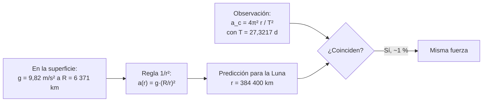

# B02-C15 — Newton y gravitación universal

<!-- nav:top -->
[🏠 Programa](../../../../README.md) · [📚 Bloque B02](../../../tronco-comun/B02-historia-arqueoastronomia-y-culturas-del-cielo.md) · [← Anterior: B02-C14 — Kepler y reconstrucción de órbitas](../B02-C14-kepler-y-reconstruccion-de-orbitas/CLASE.md) · [Siguiente: B02-C16 — Historia de la espectroscopía astronómica →](../B02-C16-historia-de-la-espectroscopia-astronomica/CLASE.md)
<!-- /nav -->

## 1. Ubicación, nivel y alcance

Decimoquinta clase del bloque B02. Kepler describió cómo se mueven los planetas (C14); Newton propone **por qué**: una sola fuerza, la gravedad, que explica la caída de una manzana y la órbita de la Luna. Nivel N1.

Verás la idea de gravitación universal, cómo la tercera ley de Kepler implica una fuerza que cae con el cuadrado de la distancia, y harás la «prueba de la Luna» con datos actuales. No verás mecánica newtoniana completa (bloque A05) ni relatividad (A06).

## 2. Por qué esta clase existe

Una ley que describe es útil; una ley que explica unifica. La pregunta motivadora es: **¿es la misma fuerza la que hace caer una piedra y la que mantiene a la Luna en órbita?** Newton afirma que sí, y la idea se puede probar con números que ya manejas.

Al terminar sabrás comparar la aceleración de la Luna con la de la gravedad en la superficie, deducir una masa efectiva (`GM`) desde un período y un semieje, y reconocer hasta dónde llegaba la evidencia en 1687.

## 3. Lo que podrás hacer al terminar

1. Enunciar la ley de gravitación universal y su dependencia con la distancia.
2. Calcular la aceleración centrípeta de un cuerpo en órbita circular.
3. Hacer la prueba de la Luna y valorar su resultado.
4. Deducir `GM` de un sistema desde `T` y `a`.
5. Explicar por qué `T²/a³` constante implica una fuerza `∝ 1/r²`.
6. Redactar una ficha de contraste de una ley con sus límites.

La evidencia es la **ficha de prueba de la ley** del ejercicio 12 (sección 20).

## 4. Con qué llegas y cómo comprobarlo

Necesitas C14, B01-C04 y álgebra. Cinco preguntas:

1. ¿Qué es la aceleración?
2. ¿Qué significa que algo sea inversamente proporcional al cuadrado de la distancia?
3. Si la distancia se triplica, ¿qué pasa con una fuerza `∝ 1/r²`?
4. ¿Cuántos segundos tiene 1 día?
5. ¿Por qué `4π²a/T²` es una aceleración?

<details>
<summary>Ver respuestas</summary>

1. El cambio de velocidad por unidad de tiempo (m/s²). 2. Que al multiplicar la distancia por `k`, el valor se divide por `k²`. 3. Se divide por 9. 4. 86 400. 5. Porque es `v²/a` con `v = 2πa/T`: (m/s)²/m = m/s².
</details>

Con cuatro o cinco aciertos, sigue. Con tres o menos, repasa C14.

## 5. Un caso real: la Luna también cae

El recurso de la Fordham University con extractos de los *Principia* de Newton (edición traducida, 1687) reproduce el principio de que toda partícula de materia es atraída por toda otra partícula y recoge el Libro III, «sistema del mundo», que trata las fuerzas centrípetas, la Luna, los satélites de Júpiter, los planetas, los cometas y las mareas (S1). La clase hace la comprobación central con números modernos: la Luna, a unos 60 radios terrestres, ¿acelera hacia la Tierra como predice una fuerza `1/r²`?

Límite: el recurso de Fordham es una traducción antigua con comentarios editoriales y no incluye las leyes del movimiento por separado; no leímos el original latino. Las cifras de la prueba son modernas (NASA), no las de Newton.

## 6. Vocabulario

La **gravitación universal** afirma que dos masas se atraen con una fuerza proporcional al producto de sus masas e inversamente proporcional al cuadrado de la distancia entre sus centros (S1 la enuncia como atracción entre toda partícula de materia). La **aceleración centrípeta** de un cuerpo en órbita circular es `a_c = 4π²r/T²`. La **gravedad en superficie** `g` es la aceleración de caída libre cerca de la Tierra (9,820 m/s² en promedio según S2). El parámetro `GM` (producto de la constante de gravitación y la masa central) se obtiene como `GM = 4π²a³/T²`. Una **ley del inverso del cuadrado** decae como `1/r²`.

## 7. Modelo mental: una sola fuerza, dos escalas

La misma regla debe valer a 6 371 km del centro de la Tierra y a 384 400 km.



*Descripción textual:* desde la gravedad de superficie y la regla del inverso del cuadrado se predice la aceleración a la distancia de la Luna; se compara con la aceleración centrípeta calculada del período y la distancia; si coinciden, es la misma fuerza.

Analogía: una piedra lanzada cada vez más fuerte, que en el límite no cae y rodea la Tierra. El límite: la analogía no demuestra nada por sí sola; la prueba es numérica.

## 8. La explicación, paso a paso

### 8.1 La Luna acelera hacia la Tierra

Un cuerpo en órbita circular de radio `r` y período `T` tiene velocidad `v = 2πr/T` y aceleración dirigida al centro `a_c = v²/r = 4π²r/T²`. Para la Luna, con `r = 384,4×10⁶ m` (S3) y `T = 27,3217 d = 2,3606×10⁶ s`: `a_c = 4π² × 3,844×10⁸/(2,3606×10⁶)² = 2,7233×10⁻³ m/s²`.

### 8.2 Lo que predice el inverso del cuadrado

Si la fuerza decae como `1/r²`, la aceleración a la distancia de la Luna es la de la superficie reducida por `(R/r)²`. Con `R = 6 371 km` y `g = 9,820 m/s²` (S2): `r/R = 60,34`, `(r/R)² = 3 640` y `a = 9,820/3 640 = 2,6975×10⁻³ m/s²`.

### 8.3 La comparación

Razón predicha/medida: `2,6975/2,7233 = 0,9905`: coinciden dentro de 1 %. La diferencia se debe, en parte, a que la gravedad varía con la latitud (9,780 m/s² en el ecuador, S2) y a la masa de la Luna (el sistema orbita su centro común). Este resultado apoya la idea de que es la misma fuerza; es un cálculo moderno con datos modernos.

### 8.4 Kepler implica 1/r²

Para órbitas circulares, la tercera ley `T² ∝ a³` en `a_c = 4π²a/T²` da `a_c ∝ a/a³ = 1/a²`. Es decir, si Kepler tiene razón, la aceleración hacia el Sol decae como `1/a²`. Es la deducción lógica que Newton generaliza; aquí la hacemos nosotros y no hemos consultado la forma original.

### 8.5 Una masa efectiva

Con la tercera ley se obtiene `GM = 4π²a³/T²`. Para los cuatro satélites galileanos (S4) salen `1,26803`, `1,26750`, `1,26708` y `1,26711` ×10¹⁷ m³/s²: una dispersión de 0,08 %. Es la «masa» de Júpiter en unidades de `G` (no calculamos la masa en kg porque no consultamos el valor de `G`). Cada sistema (Tierra–Luna, Sol–planetas, Júpiter–lunas) tiene su propio `GM`.

### 8.6 Hasta dónde llegaba la evidencia

La ley se contrastó con la Luna, los planetas, los satélites de Júpiter, los cometas y las mareas, según los temas que cubre el Libro III (S1). Un laboratorio, es decir, una medida directa de la atracción entre dos masas, tardó más: eso no lo consultamos en las fuentes de esta clase y queda pendiente. El «universal» de la ley fue una extrapolación audaz, no un hecho comprobado en todas partes (afirmación nuestra, a contrastar con historiadores de la ciencia).

## 9. Magnitudes, símbolos y unidades

| Símbolo | Qué es | Unidad | Valor o nota |
|---|---|---|---|
| `R` | radio medio terrestre | km | 6 371,0 (S2) |
| `g` | gravedad media en superficie | m/s² | 9,820 (S2) |
| `r`, `a` | distancia de la Luna | km | 384,4×10³ (S3) |
| `T` | período sidéreo de la Luna | d | 27,3217 (S3) |
| `a_c` | aceleración centrípeta | m/s² | 2,7233×10⁻³ |
| `GM` | parámetro gravitacional | m³/s² | Júpiter ≈ 1,267×10¹⁷ |

## 10. Convenciones y referencias

Usamos órbitas circulares y masas puntuales; la gravedad en superficie es un promedio. Los años y períodos son los de las fichas citadas. El resultado de 0,9905 no es una verificación de precisión sino de orden de magnitud al 1 %.

## 11. De dónde sale lo que afirmamos

| ID | Fuente | Localizador | Respalda | Estado |
|---|---|---|---|---|
| S1 | Internet History Sourcebooks (Fordham University), extractos de Newton, *Principia* (1687) | https://sourcebooks.web.fordham.edu/mod/1687Newton-principia-excerpts.asp | Principio de atracción entre toda materia; temas del Libro III | Consultada el 2026-11-05; traducción antigua con texto editorial |
| S2 | NASA NSSDC, *Earth Fact Sheet* | https://nssdc.gsfc.nasa.gov/planetary/factsheet/earthfact.html | Radio medio 6 371,0 km; gravedad media 9,820 y ecuatorial 9,780 m/s² | Consultada el 2026-11-05 (act. 15-nov-2024) |
| S3 | NASA NSSDC, *Moon Fact Sheet* | https://nssdc.gsfc.nasa.gov/planetary/factsheet/moonfact.html | Semieje 384,4×10³ km; período sidéreo 27,3217 d | Consultada el 2026-11-05 (act. 11-ene-2024) |
| S4 | NASA NSSDC, *Jovian Satellite Fact Sheet* | https://nssdc.gsfc.nasa.gov/planetary/factsheet/joviansatfact.html | Semiejes y períodos de los satélites galileanos | Consultada el 2026-11-05 (act. 6-dic-2023) |

Límites: no consultamos la fecha de publicación en una fuente independiente (el título del recurso la indica); no consultamos la forma original del argumento de Newton ni experimentos de laboratorio. Las afirmaciones de 8.4 y 8.6 sobre la deducción son nuestras.

## 12. Cómo ver la prueba

Esta tabla es la versión accesible de un gráfico de comparación.

| Cantidad | Valor |
|---|---|
| `r/R` | 60,34 |
| `(r/R)²` | 3 640 |
| `a` predicha (`g/(r/R)²`) | 2,6975×10⁻³ m/s² |
| `a_c` medida (`4π²r/T²`) | 2,7233×10⁻³ m/s² |
| Razón | 0,9905 |

Descripción larga: dos barras casi iguales, la predicha apenas 1 % menor que la observada.

## 13. Ejemplo trabajado: ¿acelera la Luna como debe?

**Paso 1.** `T = 27,3217 × 86 400 = 2 360 591` s.

**Paso 2.** `a_c = 39,478 × 3,844×10⁸ / (2 360 591)² = 1,5176×10¹⁰ / 5,5724×10¹² = 2,7233×10⁻³` m/s².

**Paso 3.** `a_pred = 9,820 × (6 371/384 400)² = 9,820 × 2,747×10⁻⁴ = 2,6975×10⁻³` m/s².

**Paso 4. Incertidumbre.** Con `g = 9,780` (ecuador) la predicción sería `2,6866×10⁻³`, razón 0,9865: la variación de `g` mueve el resultado en 0,4 %.

**Sentido físico.** Con un 1 % de acuerdo entre dos cálculos independientes se sostiene la idea de una sola fuerza.

## 14. Comparación de explicaciones

**Descripción (Kepler):** buena, no explica. **Fuerza `1/r²` (Newton):** explica las tres leyes y predice casos nuevos. **Relatividad general (bloque A06):** precisa donde Newton falla. Newton es suficiente para esta clase y para muchas tareas, no para todas.

## 15. Práctica guiada

**Ejercicio 1 · con los pasos indicados.** Calcula `v = 2πr/T` de la Luna. *Pasos:* `2π × 3,844×10⁸ / 2 360 591`.

<details><summary>Solución comentada</summary>

`1 023 m/s ≈ 1,02 km/s`, que coincide con la velocidad orbital media de la ficha de la Luna (1,022 km/s, S3).
</details>

**Ejercicio 2 · con una pista.** Calcula `a_c = v²/r`. *Pista:* `1 023²/3,844×10⁸`.

<details><summary>Solución comentada</summary>

`2,72×10⁻³ m/s²`.
</details>

**Ejercicio 3 · casi autónomo.** Si la fuerza decae como `1/r²`, ¿cuánto vale `g` a 2 radios terrestres del centro?

<details><summary>Solución comentada</summary>

`9,82/4 = 2,455 m/s²`.
</details>

## 16. Práctica autónoma, transferencia e integrador

**Ejercicio 4.** Calcula `GM` de Ío: `4π² a³ / T²` con `a = 421,8×10⁶ m` y `T = 152 853` s.

<details><summary>Solución comentada</summary>

`≈ 1,268×10¹⁷ m³/s²`.
</details>

**Ejercicio 5.** Calcula la razón predicha/medida usando `g = 9,780`.

<details><summary>Solución comentada</summary>

`0,9865`: el resultado depende del valor de `g` en 0,4 %.
</details>

**Ejercicio 6.** ¿Qué `T` tendría un satélite a 2 radios terrestres del centro, usando la Luna como referencia con la tercera ley?

<details><summary>Solución comentada</summary>

`T = 27,3217 d × (2/60,34)^(3/2) = 27,3217 × 0,00603 = 0,165 d ≈ 3,96 h`. Es una estimación con la masa de la Luna despreciable.
</details>

**Ejercicio 7.** Explica por qué `T² ∝ a³` implica `a_c ∝ 1/a²`.

<details><summary>Solución comentada</summary>

`a_c = 4π²a/T²` y `T² = k a³`, luego `a_c = 4π²/(k a²)` (sección 8.4).
</details>

**Ejercicio 8.** ¿Por qué no se pudo calcular la masa de Júpiter en kg en esta clase?

<details><summary>Solución comentada</summary>

Faltaría el valor de `G`, que no consultamos. Con `GM` se predicen órbitas sin conocer `M` por separado.
</details>

**Ejercicio 9 · transferencia.** Un compañero dice: «Newton descubrió la gravedad». Responde.

<details><summary>Solución comentada</summary>

La caída de los cuerpos ya se conocía; la propuesta de Newton es que la misma fuerza actúa en la Luna y los planetas y que decae como `1/r²` (S1). El mérito es la unificación y su contraste cuantitativo.
</details>

**Ejercicio 10 · transferencia.** ¿Qué límite de validez tiene esta prueba?

<details><summary>Solución comentada</summary>

Órbita circular, masas puntuales, `g` promedio, masa de la Luna despreciable: precisión de ~1 %. No sirve para trayectorias de misiones.
</details>

**Ejercicio 11 · transferencia.** Diseña una prueba equivalente con un satélite artificial: ¿qué datos necesitas?

<details><summary>Solución comentada</summary>

Su período y altitud (publicados y citados) y los valores de `R` y `g`; calcula `a_c = 4π²r/T²` y compara con `g(R/r)²`.
</details>

**Ejercicio 12 · integrador.** Elabora la *ficha de prueba de la ley* (sección 20): elige un cuerpo en órbita (Luna u otro) con datos publicados, haz la comparación, estima la incertidumbre y di qué simplificaciones usaste.

<details><summary>Solución modelo</summary>

Sigue la sección 13: `a_c`, `a_pred`, razón, sensibilidad a `g` y lista de simplificaciones.
</details>

## 17. Laboratorio: la prueba de la Luna

El script [prueba_de_la_luna.py](prueba_de_la_luna.py) calcula `a_c`, la predicción del inverso del cuadrado y `GM` de Júpiter con sus cuatro satélites. Antes comprueba el caso analítico `ω = 1` (`a_c = 1`), que la razón esté en 2 % y que `GM` sea constante en 0,5 %.

**Datos:** publicados (NASA). **Predice antes de ejecutar:** ¿qué razón predicha/medida esperas? (Cercana a 1.) **Resultados (2026-11-05, Python 3.12.9):** `r/R = 60,34`; `a` predicha `2,6975×10⁻³` m/s²; `a_c` `2,7233×10⁻³` m/s²; razón `0,9905`; `GM` de Júpiter `1,26803`, `1,26750`, `1,26708`, `1,26711` ×10¹⁷ m³/s².

```bash
python programa/clases/B02/B02-C15-newton-y-gravitacion-universal/prueba_de_la_luna.py
```

**Límites:** órbitas circulares, masas puntuales, sin efectos de segundo orden.

## 18. Errores frecuentes y cómo corregirlos

**Usar la distancia a la superficie en lugar del centro.** Ejercicio 3.

**Olvidar convertir días a segundos.** Ejercicio 1.

**Atribuir a Newton los datos modernos.** Sección 5.

**Decir que Newton descubrió la gravedad.** Ejercicio 9.

**Ignorar la variación de `g`.** Ejercicio 5.

## 19. Cómo sabrás que vas bien

Tras 8.1: ¿calculas `a_c` sin mirar? Ejercicio 2. Tras 8.4: ¿explicas la deducción? Ejercicio 7. Al final: ¿declaras las simplificaciones? Ejercicio 12.

## 20. Qué entregas y cómo se evalúa

El producto es tu **ficha de prueba de la ley**.

| Criterio | Inicial | En desarrollo | Logrado | Destacado |
|---|---|---|---|---|
| Cálculo | Con errores | Correcto sin comparar | Correcto y comparado | Con sensibilidad |
| Unidades | Mezcladas | Correctas | Con verificación | Con análisis dimensional |
| Simplificaciones | Ausentes | Algunas | Las principales | Estima su efecto |
| Atribución histórica | Anacrónica | Neutral | Matizada | Con fuentes |

**Condiciones críticas:** no presentar el resultado como más preciso que 1 %; citar solo lo consultado; no usar el cálculo para operar naves.

## 21. Ética, seguridad y límites

La ley es una herramienta, no un dogma: es excelente en su dominio y se supera en otros (relatividad). Esta clase es educativa y no sirve para planificar maniobras orbitales. Accesibilidad: fórmulas en texto, diagrama descrito, tablas equivalentes y script sin conexión.

## 22. Para cerrar y seguir

Una sola fuerza `∝ 1/r²` explica la caída de los cuerpos, la órbita de la Luna y la tercera ley de Kepler; la prueba de la Luna coincide al 1 %, y su alcance universal fue una extrapolación que se fue confirmando. En C16 pasamos de la mecánica del cielo a su composición: la espectroscopía.

**Glosario español–inglés.** gravitación universal · *universal gravitation*; aceleración centrípeta · *centripetal acceleration*; inverso del cuadrado · *inverse-square law*; parámetro gravitacional · *gravitational parameter*; gravedad en superficie · *surface gravity*; fuerza · *force*.

**Continuidad.** B02-C16 usa tu capacidad de **contrastar una ley con datos** para estudiar cómo se leyó la luz de los astros. El bloque A05 desarrolla la mecánica.

**Referencias:** ver sección 11. S1 es un recurso histórico con texto editorial; S2 a S4 son datos oficiales.

<!-- nav:bottom -->
---

[← Anterior: B02-C14 — Kepler y reconstrucción de órbitas](../B02-C14-kepler-y-reconstruccion-de-orbitas/CLASE.md) · [📚 Bloque B02](../../../tronco-comun/B02-historia-arqueoastronomia-y-culturas-del-cielo.md) · [Siguiente: B02-C16 — Historia de la espectroscopía astronómica →](../B02-C16-historia-de-la-espectroscopia-astronomica/CLASE.md)
<!-- /nav -->
