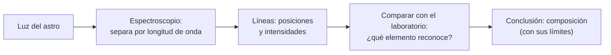

# B02-C16 — Historia de la espectroscopía astronómica

<!-- nav:top -->
[🏠 Programa](../../../../README.md) · [📚 Bloque B02](../../../tronco-comun/B02-historia-arqueoastronomia-y-culturas-del-cielo.md) · [← Anterior: B02-C15 — Newton y gravitación universal](../B02-C15-newton-y-gravitacion-universal/CLASE.md) · [Siguiente: B02-C17 — Nacimiento de la astrofotografía →](../B02-C17-nacimiento-de-la-astrofotografia/CLASE.md)
<!-- /nav -->

## 1. Ubicación, nivel y alcance

Decimosexta clase del bloque B02. Hasta Newton, la astronomía medía **dónde** están los astros. Con la espectroscopía se empieza a preguntar **de qué están hechos**. Nivel N1.

Verás las líneas oscuras del espectro solar, cómo Kirchhoff y Bunsen las convirtieron en firmas químicas, el episodio del helio de 1868 (un elemento visto en el Sol antes que en la Tierra) y harás un laboratorio que calcula las líneas del hidrógeno con la constante de Rydberg y las compara con las medidas del NIST. No verás la física cuántica que explica las líneas (bloque A07 en adelante) ni la espectroscopía moderna (B45).

## 2. Por qué esta clase existe

Hasta 1859 se pensaba, con razones, que nunca sabríamos de qué están hechas las estrellas: estaban demasiado lejos para tocarlas. La pregunta motivadora es: **¿cómo se puede conocer la composición de un objeto que solo se ve como luz?** La respuesta cambió la astronomía.

Al terminar sabrás qué información lleva un espectro, cómo se pasó de ver líneas a identificar elementos, y cómo comprobar una fórmula con una medida independiente.

## 3. Lo que podrás hacer al terminar

1. Distinguir espectro continuo, de emisión y de absorción.
2. Explicar por qué una línea identifica un elemento.
3. Resumir las etapas: Fraunhofer (1817), Kirchhoff y Bunsen (1859), helio (1868, 1895).
4. Calcular longitudes de onda de las líneas de Balmer.
5. Distinguir longitud de onda en vacío y en aire.
6. Redactar una ficha de un hito con sus fuentes y límites.

La evidencia es la **ficha de un hito espectroscópico** del ejercicio 12 (sección 20).

## 4. Con qué llegas y cómo comprobarlo

Necesitas B01-C09 (luz como información) y C15. Cinco preguntas:

1. ¿Qué es la longitud de onda?
2. ¿Cuántos metros es 1 nm?
3. ¿Qué es un prisma y qué hace con la luz?
4. ¿Qué es un átomo de hidrógeno?
5. ¿Qué diferencia hay entre emisión y absorción de luz?

<details>
<summary>Ver respuestas</summary>

1. La distancia entre dos crestas de una onda. 2. `10⁻⁹` m. 3. Un trozo de vidrio que separa la luz por colores. 4. Un protón y un electrón. 5. Emitir es producir luz; absorber es quitar luz de un haz.
</details>

Con cuatro o cinco aciertos, sigue. Con tres o menos, repasa B01-C09.

## 5. Un caso real: un elemento que se vio en el Sol primero

Según la biografía de Norman Lockyer de la Biblioteca Linda Hall: Fraunhofer cartografió en 1817 las líneas oscuras del espectro solar, sin saber qué significaban; en 1859 Kirchhoff y Bunsen mostraron que las líneas son firmas químicas, nació la espectroscopía y se identificaron elementos en el Sol; el 20 de octubre de 1868 Lockyer encontró una forma de observar protuberancias sin eclipse y registró tres líneas brillantes, una de ellas amarilla, algo desplazada de las líneas D del sodio; el 26 de octubre la carta de Lockyer fue leída en la Academia de Ciencias de Francia, junto con la de Janssen, quien había descubierto de forma independiente la técnica; Ramsay halló helio en la Tierra en 1895 (S1). La fuente aclara que Lockyer no reclamó un elemento nuevo en 1868 y que a Lockyer y a Janssen se les suele atribuir conjuntamente el descubrimiento del helio en el Sol.

Ten presente el límite: S1 es una biografía de divulgación en un sitio de historia de la ciencia; no leímos las cartas ni los artículos originales.

## 6. Vocabulario

Un **espectro** es la distribución de la luz por longitud de onda. Un **espectro continuo** tiene todos los colores; uno de **absorción** tiene líneas oscuras donde un gas absorbe; uno de **emisión** tiene líneas brillantes donde un gas emite. Las **líneas de Fraunhofer** son las líneas oscuras del espectro solar (S1). La **serie de Balmer** son las líneas del hidrógeno que terminan en el segundo nivel de energía, cuatro de ellas visibles: Hα, Hβ, Hγ, Hδ. La **constante de Rydberg** `R` fija las longitudes de onda de las líneas del hidrógeno. La longitud de onda **en vacío** y **en aire** difieren porque el aire tiene índice de refracción mayor que 1. Un **espectroscopio** descompone la luz.

## 7. Modelo mental: la luz como código de barras

Cada elemento produce un conjunto propio de líneas, como un código de barras. Leerlo permite saber qué hay en la fuente.



*Descripción textual:* la luz del astro pasa por un espectroscopio que la separa por longitud de onda; se miden posiciones e intensidades de líneas; se comparan con las del laboratorio para identificar elementos; la conclusión sobre composición tiene límites.

Analogía: reconocer una voz entre muchas. El límite: dos elementos pueden compartir una línea, y las condiciones físicas del gas (temperatura, presión) cambian qué líneas se ven.

## 8. La explicación, paso a paso

### 8.1 Un espectro con huecos

S1 señala que Fraunhofer cartografió en 1817 las líneas oscuras del espectro solar, y que sin entender su origen las usó como referencias. La fecha varía entre fuentes (otras mencionan 1814), y por eso citamos la de S1 con ese matiz.

### 8.2 La clave de 1859

S1 indica que Kirchhoff y Bunsen mostraron que las líneas actúan como firmas químicas, y que con eso se pudieron identificar elementos en el Sol, entre ellos hidrógeno, calcio, sodio, oxígeno y magnesio. Es el paso de «hay líneas» a «las líneas son elementos». Nuestro comentario: la identificación se basa en comparar con el laboratorio, no en una teoría de por qué.

### 8.3 El helio

S1 relata que en 1868 se vio una línea amarilla que no coincidía con ninguna conocida; Lockyer sospechó un elemento nuevo, y que Kelvin lo nombró helio algunos años después, sin objeción de Lockyer; y que Ramsay lo halló en la Tierra en 1895, confirmándolo. El caso muestra la potencia y el riesgo del método: una línea sin explicación puede ser un elemento nuevo, y hay que confirmar con otra evidencia.

### 8.4 La fórmula de Balmer y Rydberg

Para el hidrógeno, `1/λ_vacío = R_H (1/2² − 1/n²)` con `n = 3, 4, 5, 6`. La constante de Rydberg para núcleo infinitamente pesado es `R∞ = 10 973 731,568 157 m⁻¹` (NIST, CODATA 2022, S2); para el hidrógeno se corrige por la masa del protón: `R_H = R∞/(1 + mₑ/mₚ)`, con `mₚ/mₑ = 1 836,152 673 426` (S3). El resultado para Hα es `λ_vacío = 656,4696 nm`.

### 8.5 Vacío frente a aire

Las tablas del NIST para las líneas del hidrógeno dan longitudes de onda **en aire** (S4). El aire hace que la longitud de onda sea unos 0,03 % menor que en vacío (656,4696 → 656,288 nm para Hα). El laboratorio usa una fórmula de dispersión del aire (Edlén, 1966), escrita de memoria y validada contra NIST; por eso no la citamos como fuente. Resultado: diferencias relativas con NIST de `2,6×10⁻⁵` (Hα) a `0,9×10⁻⁵` (Hδ). Mezclar vacío con aire introduce un error de 0,18 nm en Hα, mayor que la precisión de un instrumento espectral moderno (B01-C04, ejemplo trabajado).

### 8.6 Qué no dice una línea

Una línea dice qué elemento y, con otras características, algo de temperatura, presión o movimiento. No dice cuánto hay sin un modelo, ni dónde se produce sin contexto. Las condiciones cambian las líneas: por eso la espectroscopía moderna (B45) combina varias.

## 9. Magnitudes, símbolos y unidades

| Símbolo | Qué es | Unidad | Valor o nota |
|---|---|---|---|
| `λ` | longitud de onda | nm | Hα 656,29 (aire) |
| `R∞` | constante de Rydberg | m⁻¹ | 10 973 731,568 157 (S2) |
| `mₚ/mₑ` | razón de masas | — | 1 836,152 673 426 (S3) |
| `R_H` | Rydberg del hidrógeno | m⁻¹ | `R∞/(1 + 1/1 836,15)` |
| `n` | nivel superior de la transición | — | 3, 4, 5, 6 |
| `n_aire` | índice del aire | — | ≈ 1,000276 |

## 10. Convenciones y referencias

Longitudes de onda en nm. Se distingue «vacío» de «aire» en cada cifra. Los valores NIST de las líneas del hidrógeno son los primeros de cada línea de la tabla (las líneas Hα y Hβ tienen componentes de estructura fina muy próximos que no resolvemos).

## 11. De dónde sale lo que afirmamos

| ID | Fuente | Localizador | Respalda | Estado |
|---|---|---|---|---|
| S1 | Linda Hall Library, «Norman Lockyer» (Scientist of the Day) | https://www.lindahall.org/about/news/scientist-of-the-day/norman-lockyer | Fraunhofer 1817, Kirchhoff y Bunsen 1859, helio 1868/1895, Janssen | Consultada el 2026-11-05; biografía de divulgación |
| S2 | NIST, constante de Rydberg (CODATA 2022) | https://physics.nist.gov/cgi-bin/cuu/Value?ryd | R∞ = 10 973 731,568 157 m⁻¹ | Consultada el 2026-11-05 |
| S3 | NIST, razón de masas protón/electrón (CODATA 2022) | https://physics.nist.gov/cgi-bin/cuu/Value?mpsme | 1 836,152 673 426 | Consultada el 2026-11-05 |
| S4 | NIST, Atomic Spectra Database Handbook, «Strong Lines of Hydrogen» | https://physics.nist.gov/PhysRefData/Handbook/Tables/hydrogentable2.htm | Longitudes de onda en aire de Hα, Hβ, Hγ, Hδ | Consultada el 2026-11-05 |

Límites: la fórmula de Balmer–Rydberg con masa reducida y la de Edlén son conocimiento estándar que verificamos contra NIST, sin citar un libro. No consultamos los trabajos originales de Fraunhofer, Kirchhoff, Bunsen, Janssen ni Lockyer; ni el episodio del prisma de Newton. Pendiente: espectroscopía de estrellas del siglo XIX y su clasificación.

## 12. Cómo ver las líneas

Esta tabla es la versión accesible de un espectro con cuatro líneas.

| Línea | `n` | λ vacío (nm) | λ aire calculada (nm) | NIST aire (nm) |
|---|---|---|---|---|
| Hα | 3 | 656,4696 | 656,2883 | 656,2711 |
| Hβ | 4 | 486,2738 | 486,1380 | 486,1279 |
| Hγ | 5 | 434,1730 | 434,0510 | 434,0462 |
| Hδ | 6 | 410,2935 | 410,1777 | 410,1739 |

Si lo dibujas, usa un eje de longitud de onda de 400 a 700 nm, marca cada línea con forma distinta y rotúlala. Descripción larga: cuatro líneas cada vez más juntas hacia el azul, cerca de un límite en 364,7 nm.

## 13. Ejemplo trabajado: calcular Hα

**Paso 1.** `R_H = 10 973 731,568/(1 + 1/1 836,1527) = 10 967 758,3 m⁻¹`.

**Paso 2.** `1/2² − 1/3² = 0,25 − 0,11111 = 0,138889`.

**Paso 3.** `1/λ = 10 967 758,3 × 0,138889 = 1 523 299,8 m⁻¹`; `λ = 656,4696 nm` (vacío).

**Paso 4. Aire.** `n_aire = 1,000276`; `λ_aire = 656,4696/1,000276 = 656,2883 nm`.

**Paso 5. Comparación.** Con NIST (656,2711 nm), la diferencia relativa es `2,6×10⁻⁵`.

**Sentido físico.** Una fórmula de dos constantes reproduce una medida de laboratorio al 0,003 %. Eso permite reconocer hidrógeno en una estrella.

## 14. Comparación de métodos

La **fórmula teórica** (Rydberg) permite predecir líneas; la **tabla medida** (NIST) es la referencia empírica. El **desplazamiento Doppler** cambiará las longitudes en objetos en movimiento (B45). Se contrasta cada una con la otra para detectar errores de convención, como mezclar aire y vacío.

## 15. Práctica guiada

**Ejercicio 1 · con los pasos indicados.** Calcula `1/2² − 1/4²`. *Pasos:* `0,25 − 0,0625`.

<details><summary>Solución comentada</summary>

`0,1875`.
</details>

**Ejercicio 2 · con una pista.** Calcula `λ_vacío` de Hβ (`n = 4`) con `R_H = 10 967 758,3`. *Pista:* `1/(R_H × 0,1875)`.

<details><summary>Solución comentada</summary>

`1/2 056 454,7 = 486,27 nm`.
</details>

**Ejercicio 3 · casi autónomo.** Calcula el límite de la serie (`n → ∞`).

<details><summary>Solución comentada</summary>

`1/(R_H/4) = 4/10 967 758,3 = 364,7 nm`.
</details>

## 16. Práctica autónoma, transferencia e integrador

**Ejercicio 4.** ¿Cuántos nm separan Hα vacío de Hα aire?

<details><summary>Solución comentada</summary>

`656,4696 − 656,2883 = 0,181 nm`.
</details>

**Ejercicio 5.** ¿Qué error relativo comete quien use la λ en aire como si fuera en vacío?

<details><summary>Solución comentada</summary>

`0,181/656,47 = 2,8×10⁻⁴`, el 0,028 %.
</details>

**Ejercicio 6.** Calcula Hγ (`n = 5`) en vacío.

<details><summary>Solución comentada</summary>

`0,25 − 0,04 = 0,21`; `1/(10 967 758,3 × 0,21) = 434,17 nm`.
</details>

**Ejercicio 7.** ¿Por qué la identificación del helio en 1868 no se consideró definitiva de inmediato?

<details><summary>Solución comentada</summary>

Porque una línea desconocida podía ser un elemento nuevo o un efecto de condiciones físicas; la confirmación llegó al hallar helio en la Tierra en 1895 (S1).
</details>

**Ejercicio 8.** ¿Qué diferencia hay entre una línea de absorción y una de emisión en el Sol?

<details><summary>Solución comentada</summary>

Las de Fraunhofer son de absorción (oscuras en el espectro del disco); las de las protuberancias son de emisión (brillantes), como las que Lockyer registró (S1).
</details>

**Ejercicio 9 · transferencia.** Un compañero dice: «los científicos supieron la composición del Sol desde Newton». Responde.

<details><summary>Solución comentada</summary>

Newton descompuso la luz pero la identificación química solo fue posible desde 1859 (S1).
</details>

**Ejercicio 10 · transferencia.** Un artículo da Hα en 656,28 nm y otro en 656,47 nm. ¿Se contradicen?

<details><summary>Solución comentada</summary>

No: el primero es en aire y el segundo en vacío; la diferencia es 0,18 nm. Siempre hay que declarar la convención.
</details>

**Ejercicio 11 · transferencia.** ¿Qué otras condiciones físicas pueden modificar un espectro?

<details><summary>Solución comentada</summary>

Temperatura, presión, campos magnéticos y movimiento (efecto Doppler) pueden cambiar intensidades, anchos y posiciones; se estudian en bloques posteriores.
</details>

**Ejercicio 12 · integrador.** Elabora la *ficha de un hito espectroscópico* (sección 20): elige un hito, di qué se observó, qué se concluyó, qué fuente lo respalda y cómo se comprobó.

<details><summary>Solución modelo</summary>

Una ficha completa sigue la sección 5 con otro hito, distingue observación y conclusión, y declara el tipo de fuente.
</details>

## 17. Laboratorio: líneas de Balmer

El script [balmer_y_rydberg.py](balmer_y_rydberg.py) calcula `λ_vacío` y `λ_aire` de Hα, Hβ, Hγ y Hδ y las compara con NIST. Antes comprueba que `Hα` en vacío sea 656,47 ± 0,02 nm, que las cuatro λ en aire coincidan con NIST en `5×10⁻⁵` y que la serie converja.

**Datos:** publicados (NIST CODATA 2022 y tabla de hidrógeno). **Predice antes de ejecutar:** ¿qué diferencia relativa esperas con NIST? (Muy pequeña, del orden de `10⁻⁵`.) **Resultados (2026-11-05, Python 3.12.9):** Hα 656,4696 (vacío), 656,2883 (aire), NIST 656,2711, dif. `2,62×10⁻⁵`; Hβ 486,2738, 486,1380, 486,1279, `2,07×10⁻⁵`; Hγ 434,1730, 434,0510, 434,0462, `1,10×10⁻⁵`; Hδ 410,2935, 410,1777, 410,1739, `9,37×10⁻⁶`; límite 364,705 nm.

```bash
python programa/clases/B02/B02-C16-historia-de-la-espectroscopia-astronomica/balmer_y_rydberg.py
```

**Límites:** hidrógeno ligero sin estructura fina; la dispersión del aire es una fórmula validada contra NIST, no una fuente consultada.

## 18. Errores frecuentes y cómo corregirlos

**Mezclar aire y vacío.** Ejercicios 4 y 10.

**Olvidar la corrección de masa reducida.** Ejercicio 2.

**Creer que una línea desconocida es siempre un elemento nuevo.** Ejercicio 7.

**Atribuir a Newton la composición.** Ejercicio 9.

**Tomar fechas como únicas.** Sección 8.1.

## 19. Cómo sabrás que vas bien

Tras 8.2: ¿puedes decir por qué una línea es una firma? Ejercicio 8. Tras 8.4: ¿calculas una línea de Balmer? Ejercicio 6. Al final: ¿declaras vacío o aire? Ejercicio 10.

## 20. Qué entregas y cómo se evalúa

El producto es tu **ficha de un hito espectroscópico**.

| Criterio | Inicial | En desarrollo | Logrado | Destacado |
|---|---|---|---|---|
| Observación frente a conclusión | Las mezcla | Las nombra | Las separa | Propone comprobación |
| Fuentes | Sin fuente | Con fuente | Con tipo y estado | Contrasta fuentes |
| Cálculo | Con errores | Correcto sin referencia | Contrastado con NIST | Con convención declarada |
| Contexto histórico | Anacrónico | Neutral | Matizado | Con debate de atribución |

**Condiciones críticas:** declarar vacío o aire; citar solo lo consultado; no atribuir a una persona lo que fue de varias.

## 21. Ética, seguridad y límites

Los episodios de «quién descubrió» (helio) muestran disputas de atribución; citar cada afirmación a su fuente y reconocer a las personas involucradas es parte de la honestidad científica. Cualquier espectroscopía solar exige filtros certificados. Accesibilidad: fórmulas en texto, diagrama descrito, tablas equivalentes y script sin conexión.

## 22. Para cerrar y seguir

Las líneas del espectro son firmas químicas; el helio mostró que se puede ver en el Sol lo que aún no se conocía en la Tierra, y una fórmula con dos constantes reproduce las líneas del hidrógeno al 0,003 %. En C17 se verá cómo la fotografía permitió guardar y estudiar esos espectros y el cielo mismo.

**Glosario español–inglés.** espectro · *spectrum*; línea de absorción · *absorption line*; línea de emisión · *emission line*; constante de Rydberg · *Rydberg constant*; serie de Balmer · *Balmer series*; longitud de onda en vacío · *vacuum wavelength*.

**Continuidad.** B02-C17 usa tu capacidad de **registrar luz con una convención declarada** para entender el nacimiento de la astrofotografía. B45 retomará la espectroscopía.

**Referencias:** ver sección 11. S1 es divulgación; S2 a S4 son datos oficiales.

<!-- nav:bottom -->
---

[← Anterior: B02-C15 — Newton y gravitación universal](../B02-C15-newton-y-gravitacion-universal/CLASE.md) · [📚 Bloque B02](../../../tronco-comun/B02-historia-arqueoastronomia-y-culturas-del-cielo.md) · [Siguiente: B02-C17 — Nacimiento de la astrofotografía →](../B02-C17-nacimiento-de-la-astrofotografia/CLASE.md)
<!-- /nav -->
