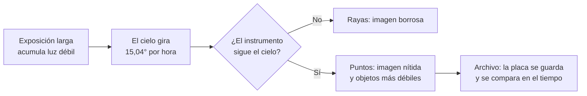

# B02-C17 — Nacimiento de la astrofotografía

<!-- nav:top -->
[🏠 Programa](../../../../README.md) · [📚 Bloque B02](../../../tronco-comun/B02-historia-arqueoastronomia-y-culturas-del-cielo.md) · [← Anterior: B02-C16 — Historia de la espectroscopía astronómica](../B02-C16-historia-de-la-espectroscopia-astronomica/CLASE.md) · [Siguiente: B02-C18 — Expansión de la astronomía en Chile →](../B02-C18-expansion-de-la-astronomia-en-chile/CLASE.md)
<!-- /nav -->

## 1. Ubicación, nivel y alcance

Decimoséptima clase del bloque B02. El ojo humano olvida; una placa fotográfica no. Aquí ves cuándo y cómo la fotografía se convirtió en un instrumento científico para registrar el cielo, y qué problemas técnicos tuvo que resolver. Nivel N1.

Verás los primeros hitos (la Luna, el Sol, Vega, los espectros, la nebulosa de Orión), el problema del seguimiento durante exposiciones largas, que cuantificarás, y la colección de placas de Harvard como archivo científico. No verás procesamiento de imágenes ni detectores modernos (bloques B15 y B28).

## 2. Por qué esta clase existe

Un dibujo depende de quien lo hace; una placa registra lo que llegó. La pregunta motivadora es: **¿qué cambia cuando la observación puede guardarse, compararse años después y medirse?** Cambia que el cielo se vuelve un archivo, y que se ven cosas que el ojo no ve.

Al terminar sabrás ordenar los hitos con sus fuentes y matices, calcular cuánto se mueve el cielo durante una exposición y entender por qué el seguimiento fue una necesidad técnica.

## 3. Lo que podrás hacer al terminar

1. Ordenar cronológicamente cinco hitos de la astrofotografía temprana.
2. Explicar por qué una exposición larga requiere seguir el cielo.
3. Calcular el desplazamiento angular durante una exposición.
4. Explicar la ventaja de la placa seca y de la exposición larga para ver lo débil.
5. Reconocer el valor de un archivo de placas para estudios de largo plazo.
6. Redactar una ficha de un hito con su atribución cuidadosa.

La evidencia es la **ficha de un hito fotográfico** del ejercicio 12 (sección 20).

## 4. Con qué llegas y cómo comprobarlo

Necesitas B01-C04 (día sidéreo) y C13. Cinco preguntas:

1. ¿Cuántas horas tiene el día sidéreo?
2. ¿Cuántos grados gira la Tierra en una hora, aproximadamente?
3. ¿Qué es una exposición?
4. ¿Qué es la magnitud límite de un instrumento?
5. ¿Qué diferencia hay entre un descubrimiento y su atribución?

Ver respuestas

1. 23,9345 h. 2. `360/23,9345 = 15,04°`. 3. El tiempo durante el cual la placa o el sensor recibe luz. 4. El brillo mínimo que se puede registrar. 5. El descubrimiento es el hecho; la atribución es a quién se le reconoce.

Con cuatro o cinco aciertos, sigue. Con tres o menos, repasa B01-C04.

## 5. Un caso real: Vega en una placa

Astronomy.com recoge que el 16–17 de julio de 1850 William Bond y el daguerrotipista John Adams Whipple obtuvieron con el refractor de 15 pulgadas del Observatorio de Harvard una exposición de 90 segundos de Vega, que presenta como la primera fotografía de una estrella aparte del Sol (S4). La misma fuente advierte que esa afirmación se da sin discutir alternativas y que otras fuentes consultadas por búsqueda (no leídas) dan 100 segundos. Del hito lunar, Astronomy.com cuenta que John William Draper anunció el 23 de marzo de 1840 un daguerrotipo exitoso de una Luna de 17 días, y que se cree que Louis Daguerre fotografió la Luna el 2 de enero de 1839, pero no sobrevive detalle de esa imagen porque su laboratorio se incendió en marzo de 1839 (S1). La fuente de la Luna también deja una discrepancia sin explicar: un pie de foto habla de una toma del 26 de marzo de 1840 invertida como en un espejo, y el texto, de un anuncio del 23 (S1).

Es útil como ejemplo de cuidado con la atribución. Límite: S1 y S4 son divulgación de una revista de astronomía, no estudios; no leímos las fuentes originales ni los registros de Harvard.

## 6. Vocabulario

La **astrofotografía** es el registro fotográfico de objetos celestes. El **daguerrotipo** es una imagen sobre una placa metálica sensibilizada, de los primeros procedimientos fotográficos. La **placa seca de gelatina** es una placa de vidrio con emulsión que se desarrolló a comienzos de la década de 1870 (Maddox) y que, según S5, llegó a ser más sensible y barata. La **exposición** es el tiempo de captura. El **seguimiento** (guiado) es mover el instrumento para compensar el giro de la Tierra. El **espectrograma** es la fotografía de un espectro (C16). Una **colección de placas** es un archivo de negativos de vidrio del cielo, como los más de 550 000 de Harvard (S2).

## 7. Modelo mental: luz acumulada y cielo que se mueve

La placa acumula luz mientras el cielo gira; si el instrumento no sigue el giro, cada estrella se convierte en una raya.

*Descripción textual:* una exposición larga acumula luz débil, pero el cielo gira a unos 15 grados por hora; si el instrumento no lo sigue, las estrellas son rayas; si lo sigue, son puntos, se ven objetos más débiles y la placa queda como archivo comparable.

Analogía: fotografiar a un corredor con obturador lento. El límite: aquí el «corredor» se mueve con regularidad perfecta, así que se puede compensar con un mecanismo de relojería.

## 8. La explicación, paso a paso

### 8.1 Los primeros hitos

Con las fuentes consultadas: 1840, daguerrotipo de la Luna de Draper, anunciado el 23 de marzo (S1; S5 lo califica de primera persona en fotografiar un objeto celeste); 1850, Vega con 90 s (Bond y Whipple, S4); comienzos de la década de 1870, placas secas de gelatina desarrolladas por Maddox (S5); 1880, la nebulosa de Orión de Henry Draper, hijo de John W. Draper, con una exposición de 51 minutos en placa seca, «esencialmente la primera astrofoto de cielo profundo» según S5; 1883, la nebulosa de Orión por Andrew Common, con 60 minutos el 26 de febrero de 1883, con un reflector de 36 pulgadas montado en el jardín de su casa en Ealing, una de once fotografías de la serie y una de las primeras de alta resolución de la nebulosa, que muestra detalles invisibles a simple vista (S6). No consultamos fuentes sobre espectros fotográficos, el Sol o los eclipses, por lo que no se tratan.

### 8.2 El problema del giro

La Tierra gira una vez respecto de las estrellas en 23,9345 h (B01-C04), es decir, `360°/23,9345 h = 15,04° por hora = 0,2507° por minuto = 15,04″ por segundo de tiempo` (cerca del ecuador celeste). En 90 segundos: `0,38°`; en 51 minutos: `12,8°`; en 60 minutos: `15,0°`. Sin seguimiento, cada estrella dibuja un arco de esa longitud. Para exposiciones largas, como las de S5 y S6, el instrumento tuvo que seguir el cielo; no sabemos cómo lo hizo cada autor, porque las fuentes consultadas no lo detallan.

### 8.3 Más luz acumulada

En una exposición, lo que se acumula es luz: un objeto de la mitad de brillo necesita el doble de tiempo para dejar la misma marca (aproximación válida mientras la placa responda de forma lineal, lo que no siempre ocurre con las emulsiones antiguas). Por eso las exposiciones de decenas de minutos de S5 y S6 revelaron lo que el ojo no veía: el ojo no acumula (B01-C10).

### 8.4 De la imagen al dato

Una fotografía es un dato si se registran fecha, hora, instrumento, exposición y placa. Con ello se pueden medir posiciones y brillos y comparar años después. La colección de placas del Observatorio de Harvard supera las 550 000 placas de vidrio, y el proyecto DASCH las digitalizó (finalizado en 2024) para estudiar el cielo en escalas de 100 años (S2). Los observatorios chilenos (C18) tuvieron también sus archivos de placas.

### 8.5 La espectrofotografía

Con la placa, los espectros de C16 se podrían guardar, medir y comparar. Esta clase no consultó fuentes sobre los primeros espectros fotográficos, así que no fechamos ese hito; queda pendiente. La combinación de espectro y archivo prepara la astronomía física del siglo XX (afirmación nuestra).

### 8.6 Atribución cuidadosa

Las fuentes muestran que los hitos tienen matices: S4 afirma un «primero» sin discutir alternativas; S1 recoge una creencia sobre Daguerre sin detalles y una discrepancia de fechas en un pie de foto; S5 llama a Draper «el primero» en fotografiar un objeto celeste y a su Orión «esencialmente» la primera astrofoto de cielo profundo; Whipple trabajó con Bond. Por eso redactamos «según la fuente» y evitamos «el primero» sin matiz.

## 9. Magnitudes, símbolos y unidades

| Símbolo | Qué es | Unidad | Valor o nota |
|---|---|---|---|
| `ω` | velocidad de giro respecto de las estrellas | °/h | 15,04 |
| `t_exp` | tiempo de exposición | min | 1,5; 51; 60 (S4, S5, S6) |
| `Δθ` | desplazamiento durante la exposición | grados | `ω·t_exp` |
| placas de Harvard | cantidad | — | > 550 000 (S2) |

## 10. Convenciones y referencias

El desplazamiento se da cerca del ecuador celeste; para objetos próximos al polo celeste el arco angular es menor. Las fechas son las de S1, S4, S5 y S6, con sus matices. No tratamos la sensibilidad de las emulsiones.

## 11. De dónde sale lo que afirmamos

| ID | Fuente | Localizador | Respalda | Estado |
|---|---|---|---|---|
| S1 | Astronomy.com, «March 23, 1840: The first photo of the Moon» | https://www.astronomy.com/today-in-the-history-of-astronomy/march-23-1840-the-first-photo-of-the-moon/ | Anuncio de Draper (23-mar-1840), Luna de 17 días, intento de Daguerre en 1839, discrepancia de fechas | Consultada el 2026-11-05; divulgación de una revista; no da el tiempo de exposición |
| S2 | Harvard College Observatory, DASCH | https://dasch.cfa.harvard.edu/ | Más de 550 000 placas de vidrio; digitalización terminada en 2024; escalas de 100 años | Consultada el 2026-11-05 |
| S3 | NASA NSSDC, *Earth Fact Sheet* | https://nssdc.gsfc.nasa.gov/planetary/factsheet/earthfact.html | Rotación sidérea 23,9345 h | Consultada el 2026-11-05 |
| S4 | Astronomy.com, «July 16, 1850: Bond and Whipple photograph Vega» | https://www.astronomy.com/today-in-the-history-of-astronomy/july-16-1850-bond-and-whipple-photograph-vega/ | Vega, 16–17 jul 1850, refractor de 15 pulgadas, 90 s | Consultada el 2026-11-05; divulgación de una revista |
| S5 | Las Cumbres Observatory, «Photography revolutionizes observations» (Space Book) | https://lco.global/spacebook/telescopes/photography-revolutionizes-observations/ | Draper 1840; placas secas (Maddox); Orión de H. Draper, 51 min, 1880; ventajas del registro fotográfico | Consultada el 2026-11-05; recurso educativo institucional |
| S6 | Science Museum Group, «Photograph of the Great Nebula in Orion, 1883» | https://collection.sciencemuseumgroup.org.uk/objects/co486047 | Common, 26-feb-1883, 60 min, reflector de 36 pulgadas | Consultada el 2026-11-05; registro de colección de museo |

Límites: S1 y S4 son divulgación y S5 es educativa; ningún texto sustituye fuentes primarias (Draper, Bond, Common); no consultamos la página de línea de tiempo de las placas de Harvard (no abrió) ni sobre los orígenes del archivo. El detalle de cómo se logró el seguimiento en cada hito queda pendiente.

## 12. Cómo ver la cronología

Esta tabla es la versión accesible de una línea de tiempo.

| Año | Hito (según las fuentes) | Exposición | Desplazamiento del cielo |
|---|---|---|---|
| 1840 | Luna (J. W. Draper, S1) | no indicada | — |
| 1850 | Vega (Bond y Whipple, S4) | 90 s | 0,38° |
| década de 1870 | Placas secas de gelatina (S5) | — | — |
| 1880 | Nebulosa de Orión (H. Draper, S5) | 51 min | 12,8° |
| 1883 | Nebulosa de Orión (Common, S6) | 60 min | 15,0° |

Si lo dibujas, usa una línea de tiempo con puntos de forma distinta y rotula cada año. Descripción larga: cinco hitos a lo largo de 43 años; las exposiciones crecen de 90 segundos a 60 minutos.

## 13. Ejemplo trabajado: ¿cuánto se mueve el cielo en 51 minutos?

**Paso 1.** `ω = 360/23,9345 = 15,041 °/h`.

**Paso 2.** `51 min = 0,85 h`.

**Paso 3.** `Δθ = 15,041 × 0,85 = 12,78°`.

**Paso 4. Incertidumbre.** La exposición de 51 min es una cifra de S5 (recurso educativo); el resultado supone un objeto cerca del ecuador celeste.

**Sentido físico.** En 51 minutos, el cielo gira una distancia equivalente a unos 25 diámetros de la Luna llena (que mide unos 0,5°, dato de ejemplo): sin seguimiento no habría imagen.

## 14. Comparación de técnicas

El **daguerrotipo** (Draper 1840, Bond y Whipple 1850) fue el primer registro; las **placas secas de gelatina** de la década de 1870 llegaron a ser más sensibles y baratas, y con una de ellas Henry Draper expuso 51 minutos la nebulosa de Orión (S5). Cada técnica cambió qué se podía registrar; no consultamos fuentes que comparen sus sensibilidades.

## 15. Práctica guiada

**Ejercicio 1 · con los pasos indicados.** Calcula `ω` en °/h. *Pasos:* `360/23,9345`.

Solución comentada

`15,041 °/h`.

**Ejercicio 2 · con una pista.** Convierte `ω` a ″/s. *Pista:* `15,041 × 3600/3600`.

Solución comentada

`15,041″` por segundo de tiempo (15,041° × 3 600″/° ÷ 3 600 s).

**Ejercicio 3 · casi autónomo.** ¿Cuántos grados se mueve el cielo en los 90 segundos de la exposición de Vega?

Solución comentada

`15,041 × 90/3 600 = 0,376°`: unos 23 minutos de arco, lo que muestra que ya con 90 s hacía falta seguimiento.

## 16. Práctica autónoma, transferencia e integrador

**Ejercicio 4.** Calcula `Δθ` para 60 minutos.

Solución comentada

`15,04°`.

**Ejercicio 5.** ¿Qué exposición máxima sin seguimiento mantiene el arco por debajo de 1 minuto de arco (cerca del ecuador)?

Solución comentada

`1′ = 0,01667°`; `t = 0,01667/15,041 h = 0,00111 h = 4,0 s`.

**Ejercicio 6.** Si un objeto tiene la mitad de brillo, ¿cuánto debe durar la exposición para dejar la misma marca (placa lineal)?

Solución comentada

El doble; la linealidad es una aproximación.

**Ejercicio 7.** ¿Qué ventaja atribuye S5 a las placas secas de gelatina?

Solución comentada

Según S5 llegaron a ser más sensibles y baratas, lo que favoreció exposiciones largas como la de 51 minutos de la nebulosa de Orión. S5 no compara los procesos en detalle.

**Ejercicio 8.** ¿Qué metadatos necesita una placa para ser dato científico?

Solución comentada

Fecha y hora con escala de tiempo, lugar, instrumento, exposición, emulsión, dirección apuntada y operador.

**Ejercicio 9 · transferencia.** Un compañero dice: «Draper hizo la primera foto de la Luna». Reescríbelo con las cautelas de S1 y S5.

Solución comentada

«Según Astronomy.com, J. W. Draper anunció en marzo de 1840 un daguerrotipo exitoso de la Luna; se cree que Daguerre la había fotografiado en 1839, pero no sobrevive detalle de esa imagen.»

**Ejercicio 10 · transferencia.** Whipple trabajó bajo Bond y Berkowski siguió instrucciones de Busch. ¿Qué lección da para dar crédito?

Solución comentada

Que el crédito suele ser colectivo y debe nombrar a todas las personas involucradas con su rol, en lugar de asignarlo a una sola.

**Ejercicio 11 · transferencia.** Diseña un cuaderno para fotografiar la Luna con tu teléfono sin dañar nada. ¿Qué anotarías?

Solución comentada

Fecha y hora, lugar, aparato, exposición y sensibilidad, condiciones del cielo y el nombre del archivo. No apuntes al Sol.

**Ejercicio 12 · integrador.** Elabora la *ficha de un hito fotográfico* (sección 20): elige un hito de la tabla, calcula el desplazamiento del cielo si hay exposición conocida, di qué fuentes lo respaldan y qué cautelas de atribución aplican.

Solución modelo

Sigue la sección 13: cálculo de `Δθ`, tabla de fuentes, atribución matizada y lista de lo pendiente.

## 17. Actividad sin código: tabla de giro

Esta clase no usa script. En una hoja de cálculo calcula `Δθ` para exposiciones de 1 s, 10 s, 1 min, 90 s, 51 min y 60 min. **Qué observar:** el desplazamiento es proporcional al tiempo y en solo 4 segundos ya supera 1 minuto de arco (ejercicio 5). **Resultado esperado:** 0,004°; 0,042°; 0,25°; 0,376°; 12,78°; 15,04°.

## 18. Errores frecuentes y cómo corregirlos

**Olvidar que el cielo gira.** Ejercicios 3 y 4.

**Usar 24 h en lugar de 23,9345 h.** Ejercicio 1.

**Atribuir un logro a una sola persona.** Ejercicios 9 y 10.

**Asumir linealidad de la emulsión.** Ejercicio 6.

**Tratar el archivo como solo estético.** Ejercicio 8.

## 19. Cómo sabrás que vas bien

Tras 8.2: ¿calculas el giro sin mirar? Ejercicio 3. Tras 8.6: ¿atribuyes con cuidado? Ejercicio 9. Al final: ¿qué metadatos hacen científica una foto? Ejercicio 8.

## 20. Qué entregas y cómo se evalúa

El producto es tu **ficha de un hito fotográfico**.

| Criterio | Inicial | En desarrollo | Logrado | Destacado |
|---|---|---|---|---|
| Cálculo del giro | Ausente | Con errores | Correcto con unidades | Con sensibilidad a la latitud celeste |
| Atribución | Una persona | Dos | Todas con su rol | Con fuente primaria |
| Fuentes | Sin fuente | Con fuente | Con tipo y estado | Contrasta fuentes |
| Metadatos | Ausentes | Algunos | Los principales | Completos |

**Condiciones críticas:** no afirmar «el primero» sin matiz; citar solo lo consultado; no apuntar la cámara al Sol sin filtro certificado.

## 21. Ética, seguridad y límites

Los archivos de placas son patrimonio científico; su digitalización y acceso abierto (S2) es un ejemplo de ciencia abierta. No fotografíes el Sol sin filtros certificados (riesgo para la vista y el equipo). Accesibilidad: cálculos en texto, diagrama descrito, tablas equivalentes.

## 22. Para cerrar y seguir

La fotografía convirtió el cielo en un archivo y mostró lo que el ojo no ve, a costa de resolver el problema del seguimiento; los hitos se cuentan con cuidado de atribución. En C18 vemos cómo esta astronomía se asentó en Chile.

**Glosario español–inglés.** astrofotografía · *astrophotography*; daguerrotipo · *daguerreotype*; placa seca · *dry plate*; exposición · *exposure*; seguimiento · *tracking/guiding*; placa de vidrio · *glass plate*.

**Continuidad.** B02-C18 usa tu capacidad de **calcular efectos de la rotación** para situar la expansión de los observatorios en Chile. B28 retomará los detectores.

**Referencias:** ver sección 11. S1 es enciclopédica.

<!-- nav:bottom -->
---

[← Anterior: B02-C16 — Historia de la espectroscopía astronómica](../B02-C16-historia-de-la-espectroscopia-astronomica/CLASE.md) · [📚 Bloque B02](../../../tronco-comun/B02-historia-arqueoastronomia-y-culturas-del-cielo.md) · [Siguiente: B02-C18 — Expansión de la astronomía en Chile →](../B02-C18-expansion-de-la-astronomia-en-chile/CLASE.md)
<!-- /nav -->
