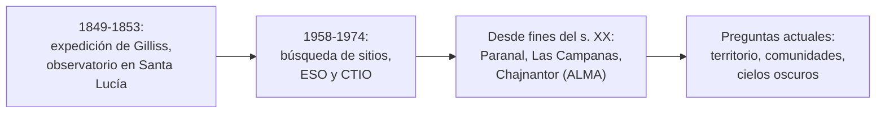

# B02-C18 — Expansión de la astronomía en Chile

<!-- nav:top -->
[🏠 Programa](../../../../README.md) · [📚 Bloque B02](../../../tronco-comun/B02-historia-arqueoastronomia-y-culturas-del-cielo.md) · [← Anterior: B02-C17 — Nacimiento de la astrofotografía](../B02-C17-nacimiento-de-la-astrofotografia/CLASE.md) · [Siguiente: B02-C19 — Historia de la exploración espacial →](../B02-C19-historia-de-la-exploracion-espacial/CLASE.md)
<!-- /nav -->

## 1. Ubicación, nivel y alcance

Decimoctava clase del bloque B02. Viste astronomías de otros lugares y épocas; esta clase mira el país donde hoy se concentra una gran parte de la capacidad astronómica mundial. Nivel N1.

Verás el origen de la astronomía institucional en Chile (la expedición de Gilliss, 1849) y la llegada de los grandes observatorios internacionales (ESO, CTIO, Las Campanas, Paranal, ALMA), con las fechas y datos que pudimos verificar. También verás qué preguntas históricas y éticas se abren. No es una historia completa: hay protagonistas, universidades y observatorios nacionales que no pudimos tratar con fuentes consultadas.

## 2. Por qué esta clase existe

Chile alberga observatorios de primer nivel porque combina cielos oscuros, aire seco y altitud. Pero un observatorio también es una historia de decisiones, instituciones y territorios. La pregunta motivadora es: **¿cómo y cuándo llegó la astronomía profesional a Chile, qué condiciones la hicieron posible y qué preguntas deja?**

Al terminar sabrás ordenar los hitos con sus fuentes, calcular escalas simples de los instrumentos y formular preguntas sobre la relación entre ciencia y territorio.

## 3. Lo que podrás hacer al terminar

1. Resumir la expedición de Gilliss y el origen del Observatorio Astronómico Nacional.
2. Ubicar La Silla, Cerro Tololo, Las Campanas, Paranal y Chajnantor con los datos disponibles.
3. Explicar por qué las condiciones del norte de Chile favorecen la astronomía.
4. Calcular intervalos y áreas colectoras a partir de datos publicados.
5. Distinguir fuentes institucionales de fuentes secundarias.
6. Redactar una ficha de un observatorio con sus fuentes y límites.

La evidencia es la **ficha de un observatorio** del ejercicio 12 (sección 20).

## 4. Con qué llegas y cómo comprobarlo

Necesitas C12, C13 y C17. Cinco preguntas:

1. ¿Qué es la altitud y por qué importa para observar?
2. ¿Qué es el paralaje solar (C10)?
3. ¿Qué área tiene un círculo de 12 m de diámetro?
4. ¿Qué es un observatorio internacional?
5. ¿Qué diferencia hay entre fuente institucional y enciclopédica?

Ver respuestas

1. La altura sobre el nivel del mar; en altura hay menos atmósfera. 2. El desplazamiento aparente de un cuerpo cercano por cambiar el lugar de observación. 3. `π × 6² = 113,1 m²`. 4. Uno operado por varios países o instituciones. 5. La primera la produce el organismo que describe; la segunda resume otras.

Con cuatro o cinco aciertos, sigue. Con tres o menos, repasa C12 y C17.

## 5. Un caso real: observar Marte y Venus desde Santiago

El portal Memoria Chilena (Biblioteca Nacional) relata que en 1849 el astrónomo naval estadounidense James Melville Gilliss, contratado por el gobierno de Manuel Bulnes, instaló un observatorio nacional en el cerro Santa Lucía; que miró por primera vez por el telescopio el 6 de diciembre de 1849; que estudiantes de la Universidad de Chile se sumaron a las observaciones, por impulso de Andrés Bello; y que en 1853 Ignacio Domeyko impulsó la compra del observatorio y sus instrumentos por el gobierno de Montt, con Carlos Guillermo Moesta como primer director (S1). La biblioteca Linda Hall precisa que Gilliss fue elegido en 1848 para dirigir la expedición naval astronómica estadounidense a Sudamérica, que regresó en 1852 y que el propósito era obtener un valor más preciso del paralaje solar (S2).

Una advertencia de fuentes: otras páginas dan fechas distintas para la compra; nos quedamos con la de S1 y la marcamos como pendiente de contraste. Límite: S1 y S2 son divulgación institucional; no leímos el artículo académico de Hidalgo (2017) que revisa la expedición.

## 6. Vocabulario

El **paralaje solar** es el ángulo bajo el cual se vería el radio terrestre desde el Sol; medirlo desde dos hemisferios permite estimar la distancia Tierra–Sol. Un **observatorio nacional** es una institución estatal de astronomía. Un **observatorio internacional** es operado por varios países o instituciones. Un **sitio astronómico** es el lugar elegido por su cielo. La **área colectora** de un telescopio es la superficie con que recoge luz o ondas. Un **interferómetro** combina varias antenas para actuar como una más grande (ALMA). **Cielos oscuros** son cielos con poca luz artificial.

## 7. Modelo mental: de una cúpula a una red

La astronomía en Chile se expande en tres etapas visibles en las fuentes.

*Descripción textual:* tres etapas encadenadas: una expedición que da origen a un observatorio nacional (1849–1853), la búsqueda de sitios y llegada de observatorios internacionales (1958–1974) y la expansión posterior con Paranal, Las Campanas y ALMA; todas conducen a preguntas actuales sobre territorio, comunidades y cielos oscuros.

Analogía: una ciudad que crece por barrios. El límite: aquí cada «barrio» es una institución con un acuerdo propio con el Estado de Chile, que no consultamos.

## 8. La explicación, paso a paso

### 8.1 El punto de partida: Santa Lucía

S1 describe dos pequeños edificios enviados desde Washington y montados sobre piedras y rieles giratorios en el cerro Santa Lucía. El equipo usó cronómetros, barómetros y relojes y observó Saturno y Marte. La expedición terminó a comienzos de 1852 con un catálogo astronómico; Diego Antonio Martínez lo usó para su texto *Cosmografía* (1853). Hacia 1870, un edificio neocolonial con dos grandes cúpulas reemplazó las estructuras de Gilliss, y en 1872 Benjamín Vicuña Mackenna construyó el «Observatorio Americano» en la cima del cerro (S1). S2 añade que el observatorio nacional se trasladó dos veces a mejores sitios, y la primera por un problema: el calor del basalto expuesto inclinaba el cerro durante el día y desalineaba el instrumento principal.

### 8.2 Buscar un sitio

Según el blog oficial de NOIRLab (S3), la idea de un observatorio internacional en Chile la propuso en junio de 1958 Federico Rutllant, astrónomo de la Universidad de Chile, durante una visita al Observatorio Yerkes; en 1960, con el apoyo de la Fundación Nacional de Ciencias (NSF), AURA asumió el «proyecto Chile», y los informes de Kitt Peak de 1960–1961 registran que los estudios de sitios ya habían comenzado. Tras más de un año de pruebas la decisión quedó entre dos cerros de la región de Coquimbo, y el 23 de noviembre de 1962 se decidió oficialmente que sería Cerro Tololo; dos días después AURA compró casi 30 000 hectáreas y el 2 de diciembre se izó una bandera simbólica. Jürgen Stock, que supervisaba los estudios de sitio, sería el primer director. A comienzos de 1964 se allanó la cumbre, 14 m por debajo de la altura original; ese año comenzaron las excavaciones para los primeros telescopios; en 1967 se instaló y vio su primera luz el telescopio SMARTS de 1,5 m; el telescopio Blanco de 4 m fue puesto en servicio en 1974. La cumbre está a unos 2 200 m (S3). La misma fuente indica que «Tololo» significa «al borde del abismo» y que se piensa que el nombre lo dio el antiguo pueblo diaguita; una administradora del observatorio opina que adoptarlo «validó y respetó la cultura indígena», una valoración que es opinión de una persona de la institución.

### 8.3 ESO en Chile

ESO se fundó en 1962 como organización intergubernamental con 16 estados miembros hoy, con Chile como país anfitrión; opera tres sitios en el desierto de Atacama: La Silla (su primer observatorio), Paranal (con el VLT y el VLTI) y Chajnantor (donde opera ALMA con socios), y construye el ELT en Cerro Armazones (S4). La Silla está a unos 2 400 m y a unos 600 km al norte de Santiago, y fue certificado según la norma ISO 9001 (S5); Paranal está a 2 635 m (S6).

### 8.4 ALMA

ALMA reúne 66 antenas en la meseta de Chajnantor, a unos 5 000 m: un conjunto principal de 50 antenas de 12 m, un conjunto compacto de 4 antenas de 12 m y 12 de 7 m; sus socios son ESO, NRAO y NAOJ en colaboración con la República de Chile (S7). Con 54 antenas de 12 m, el área geométrica es `54 × π × 6² = 6 107 m²`, y con las 12 de 7 m se suman `12 × π × 3,5² = 462 m²`: unos 6 570 m². Es un cálculo nuestro (área geométrica, no eficaz) y el interferómetro se comporta como una única antena de gran diámetro (B46).

### 8.5 Las otras instituciones

Las Campanas, del Instituto Carnegie, está en el desierto de Atacama, con sede en La Serena (S8). La página consultada no indica fecha de fundación ni detalla sus telescopios, por lo que no los desarrollamos. Tampoco tratamos en esta clase la astronomía de las universidades chilenas ni los observatorios nacionales actuales, por falta de fuentes consultadas.

### 8.6 Preguntas abiertas

Los observatorios están en un territorio con historia y comunidades. Las fuentes institucionales consultadas (S4, S7) no describen la relación con comunidades indígenas cercanas, y no la inventamos. Un documento de la IAU plantea el consentimiento libre, previo e informado como principio, y la contaminación lumínica como pérdida cultural (S9). C06 y C20 tratan estas preguntas.

## 9. Magnitudes, símbolos y unidades

| Símbolo | Qué es | Unidad | Valor o nota |
|---|---|---|---|
| altitud La Silla | altura | m | ≈ 2 400 (S5) |
| altitud Paranal | altura | m | 2 635 (S6) |
| altitud Cerro Tololo | altura | m | ≈ 2 200 (S3) |
| altitud Chajnantor | altura | m | ≈ 5 000 (S7) |
| antenas de ALMA | número | — | 66 (S7) |
| `A` | área geométrica | m² | `N·π(D/2)²` |

## 10. Convenciones y referencias

Las fechas son las de las fuentes citadas; donde discrepan, lo decimos. Las áreas son geométricas, no eficaces. Altitudes en metros sobre el nivel del mar, según cada fuente.

## 11. De dónde sale lo que afirmamos

| ID | Fuente | Localizador | Respalda | Estado |
|---|---|---|---|---|
| S1 | Memoria Chilena (Biblioteca Nacional), «Observatorio astronómico del cerro Santa Lucía (1849-1872)» | https://www.memoriachilena.gob.cl/602/w3-article-661471.html | Gilliss, primera observación (6-dic-1849), estudiantes, compra de 1853, Moesta | Consultada el 2026-11-05; divulgación institucional |
| S2 | Linda Hall Library, «James Melville Gilliss» (Scientist of the Day) | https://www.lindahall.org/about/news/scientist-of-the-day/james-melville-gilliss/ | Expedición 1848–1852; paralaje solar; traslados | Consultada el 2026-11-05 |
| S3 | NOIRLab (NSF), blog «60 Years of Discovery from Cerro Tololo, the Observatory on the ‘Edge of the Abyss’» (23-nov-2022) | https://noirlab.edu/public/blog/anniversary-ctio | Propuesta de Rutllant (1958), AURA/NSF (1960), selección el 23-nov-1962, compra de terreno, obras de 1964, 1967, Blanco en 1974, altitud, origen del nombre | Página leída (HTML) el 2026-11-05; blog institucional con valoraciones del personal |
| S4 | ESO, «About ESO» | https://www.eso.org/public/about-eso/ | Fundación 1962, sitios en Chile, ELT | Consultada el 2026-11-05 |
| S5 | ESO, «La Silla» | https://www.eso.org/public/teles-instr/lasilla/ | Primer observatorio de ESO; ~2 400 m; ISO 9001 | Consultada el 2026-11-05 |
| S6 | ESO, «Paranal Observatory» | https://www.eso.org/public/teles-instr/paranal-observatory/ | 2 635 m; VLT; ELT | Consultada el 2026-11-05 |
| S7 | ALMA Observatory, «About ALMA» | https://www.almaobservatory.org/en/about-alma/ | 66 antenas; ~5 000 m; socios | Consultada el 2026-11-05 |
| S8 | Carnegie Science, «Las Campanas Observatory» | https://carnegiescience.edu/obs | Ubicación general y sede en La Serena | Consultada el 2026-11-05 |
| S9 | H. Neilson, arXiv:2412.06675 (IAU-CPS Policy Hub) | https://arxiv.org/html/2412.06675v1 | Consentimiento libre, previo e informado; contaminación lumínica | Consultada el 2026-11-05 |

Límites: no consultamos el artículo de Hidalgo (2017), el sitio del Observatorio Astronómico Nacional ni documentos de CONICYT/ANID; la fecha de compra del observatorio (1853) es la de S1 y otras páginas dan fechas distintas. Pendiente: normativa de protección de cielos, historia de las universidades chilenas y de los observatorios nacionales actuales.

## 12. Cómo ver la línea de tiempo

Esta tabla es la versión accesible de una línea de tiempo.

| Año | Hecho | Fuente |
|---|---|---|
| 1849 | Gilliss instala el observatorio; primera observación el 6 de diciembre | S1 |
| 1852 | Termina la expedición | S1, S2 |
| 1853 | Compra por el gobierno de Montt; Moesta, primer director | S1 |
| 1958 | Propuesta de Federico Rutllant (U. de Chile) de un observatorio internacional | S3 |
| 1962 | Fundación de ESO (S4); selección de Cerro Tololo el 23 de noviembre (S3) | S4, S3 |
| 1967 | Primera luz del telescopio SMARTS de 1,5 m en Cerro Tololo | S3 |
| 1974 | Telescopio Blanco de 4 m puesto en servicio | S3 |

Descripción larga: un salto de más de un siglo entre la etapa de Gilliss y la llegada de los grandes observatorios, con un núcleo de hitos entre 1958 y 1974.

## 13. Ejemplo trabajado: ¿cuánto separa la etapa nacional de la internacional?

**Paso 1.** De la primera observación de Gilliss (1849) a la fundación de ESO (1962): `1962 − 1849 = 113` años.

**Paso 2.** De la selección de Cerro Tololo (1962) a la puesta en servicio del Blanco (1974): `12` años.

**Paso 3. Altitudes.** Paranal supera a La Silla en `2 635 − 2 400 = 235 m` y Chajnantor a Paranal en `≈ 5 000 − 2 635 ≈ 2 365 m`.

**Paso 4. Incertidumbre.** Las cifras de La Silla y Chajnantor son aproximadas («unos»), así que los saltos son aproximados.

**Sentido físico.** La distancia en el tiempo (más de un siglo) y en altitud (hasta 5 000 m) muestra dos expansiones distintas: de la astronomía de posición a la astrofísica con instrumentos de altura.

## 14. Comparación de tipos de observatorio

Un **observatorio nacional** (Santa Lucía) sirve a una comunidad científica local y a la educación. Un **observatorio internacional** (ESO, CTIO, ALMA) concentra recursos y sitios, con acuerdos con Chile. Cada modelo tiene ventajas y preguntas propias; esta clase solo las nombra.

## 15. Práctica guiada

**Ejercicio 1 · con los pasos indicados.** Calcula el área geométrica de una antena de 12 m. *Pasos:* `π × 6²`.

Solución comentada

`113,1 m²`.

**Ejercicio 2 · con una pista.** Calcula el área de 50 antenas de 12 m. *Pista:* multiplica.

Solución comentada

`50 × 113,1 = 5 655 m²`.

**Ejercicio 3 · casi autónomo.** ¿Cuántos años pasaron entre 1852 y 1962?

Solución comentada

110 años.

## 16. Práctica autónoma, transferencia e integrador

**Ejercicio 4.** Calcula el área geométrica de las 12 antenas de 7 m.

Solución comentada

`12 × π × 3,5² = 461,8 m²`.

**Ejercicio 5.** ¿Qué fracción del área total representan las antenas de 7 m?

Solución comentada

`461,8/6 569,0 ≈ 7,0 %`.

**Ejercicio 6.** ¿Cuántas antenas de 12 m tiene ALMA en total?

Solución comentada

`50 + 4 = 54`.

**Ejercicio 7.** Gilliss quería medir el paralaje solar. ¿Por qué medirlo desde el hemisferio sur ayudaba?

Solución comentada

Una base de observación mayor entre hemisferios aumenta el ángulo medible (C10: la baja precisión exige baselines grandes); S2 indica el propósito de refinar el paralaje solar.

**Ejercicio 8.** ¿Por qué la fecha de compra del observatorio aparece como «pendiente de contraste»?

Solución comentada

Porque otras páginas dan fechas distintas a la de S1 y no consultamos un artículo académico que las resuelva.

**Ejercicio 9 · transferencia.** Un compañero dice: «la astronomía en Chile empezó con ESO». Responde.

Solución comentada

Según S1 y S2, un observatorio nacional operaba desde 1849–1853, mucho antes de ESO (1962, S4); y estudiantes de la Universidad de Chile participaron desde el inicio (S1).

**Ejercicio 10 · transferencia.** Un titular dice: «ALMA es una antena gigante». Corrígelo con S7.

Solución comentada

ALMA es un conjunto de 66 antenas que trabajan juntas como interferómetro (S7).

**Ejercicio 11 · transferencia.** Formula tres preguntas sobre la relación de un observatorio con las comunidades vecinas que las fuentes consultadas no responden.

Solución comentada

¿Qué acuerdos existen y con quién? ¿Qué beneficios y compromisos incluyen? ¿Qué participación tuvieron las comunidades en la decisión? (Se responden con documentos oficiales y voces comunitarias, C06 y C20.)

**Ejercicio 12 · integrador.** Elabora la *ficha de un observatorio* (sección 20): elige uno, di ubicación y altitud, fecha, operador, fuentes (con tipo), qué falta y qué preguntas deja.

Solución modelo

Una ficha completa usa la sección 11 como modelo, distingue fuentes institucionales de secundarias y lista lo pendiente.

## 17. Actividad sin código: línea de tiempo y áreas

Esta clase no usa script. En una hoja de cálculo arma la línea de tiempo de la sección 12 con una columna de fuente y estado, y calcula las áreas colectoras de los ejercicios 1 a 5. **Qué observar:** cuántos hitos descansan en fuentes institucionales y cuántos en divulgación. **Resultado esperado:** áreas de 113,1; 5 655; 462; 6 569 m²; los hitos de Cerro Tololo descansan en un blog institucional (S3).

## 18. Errores frecuentes y cómo corregirlos

**Empezar la historia en ESO.** Ejercicio 9.

**Tomar el área geométrica por eficaz.** Sección 10.

**Mezclar fechas de fuentes distintas.** Ejercicio 8.

**Hablar de «una antena».** Ejercicio 10.

**Inventar la relación con comunidades.** Ejercicio 11.

## 19. Cómo sabrás que vas bien

Tras 8.1: ¿puedes contar el origen del observatorio nacional con fuentes? Ejercicio 9. Tras 8.4: ¿calculas el área de ALMA? Ejercicio 4. Al final: ¿qué falta en tu ficha? Ejercicio 12.

## 20. Qué entregas y cómo se evalúa

El producto es tu **ficha de un observatorio**.

| Criterio | Inicial | En desarrollo | Logrado | Destacado |
|---|---|---|---|---|
| Datos | Sin fuente | Con fuente | Con fuente y estado | Contrastados |
| Cálculo | Ausente | Con errores | Correcto con unidades | Con supuestos declarados |
| Contexto | Ausente | Mencionado | Con territorio y comunidad | Con voces de la comunidad |
| Límites | No declara | Algunos | Los principales | Propone cómo superarlos |

**Condiciones críticas:** citar solo lo consultado; no inventar acuerdos ni compromisos; marcar lo pendiente.

## 21. Ética, seguridad y límites

Los observatorios están en un territorio con historia y comunidades vivas; hablar de ciencia sin hablar de territorio es incompleto. Esta clase no describe acuerdos ni compromisos porque no consultamos los documentos. Visitar observatorios exige seguir sus normas de seguridad (altura y radiación solar). Accesibilidad: cálculos en texto, diagrama descrito, tablas equivalentes.

## 22. Para cerrar y seguir

La astronomía profesional llegó a Chile con una expedición (1849) y se amplió con la llegada de observatorios internacionales desde 1958–1962; hoy el país concentra instrumentos de altura. Queda abierta la pregunta de cómo esa expansión se relaciona con el territorio y sus comunidades, que cerramos en C20 después de ver la exploración espacial en C19.

**Glosario español–inglés.** observatorio · *observatory*; paralaje solar · *solar parallax*; interferómetro · *interferometer*; área colectora · *collecting area*; cielos oscuros · *dark skies*; sitio astronómico · *astronomical site*.

**Continuidad.** B02-C19 usa tu capacidad de **datar y contrastar fuentes** para recorrer la exploración espacial. B02-C20 retoma las preguntas de territorio y patrimonio.

**Referencias:** ver sección 11. S1, S2 y S3 son divulgación institucional.

<!-- nav:bottom -->
---

[← Anterior: B02-C17 — Nacimiento de la astrofotografía](../B02-C17-nacimiento-de-la-astrofotografia/CLASE.md) · [📚 Bloque B02](../../../tronco-comun/B02-historia-arqueoastronomia-y-culturas-del-cielo.md) · [Siguiente: B02-C19 — Historia de la exploración espacial →](../B02-C19-historia-de-la-exploracion-espacial/CLASE.md)
<!-- /nav -->
