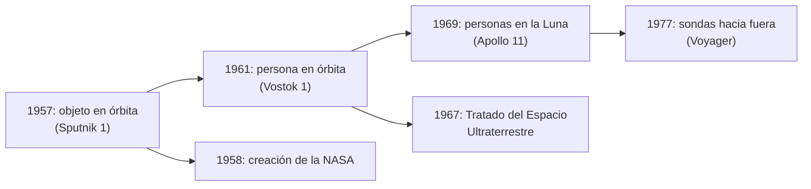

# B02-C19 — Historia de la exploración espacial

<!-- nav:top -->
[🏠 Programa](../../../../README.md) · [📚 Bloque B02](../../../tronco-comun/B02-historia-arqueoastronomia-y-culturas-del-cielo.md) · [← Anterior: B02-C18 — Expansión de la astronomía en Chile](../B02-C18-expansion-de-la-astronomia-en-chile/CLASE.md) · [Siguiente: B02-C20 — Patrimonio astronómico y ética cultural →](../B02-C20-patrimonio-astronomico-y-etica-cultural/CLASE.md)
<!-- /nav -->

## 1. Ubicación, nivel y alcance

Decimonovena clase del bloque B02. Hasta aquí observaste el cielo desde la Tierra. En esta clase el instrumento sale al espacio: satélites, vuelos tripulados, la Luna y las sondas interplanetarias. Nivel N1.

Verás cuatro hitos con fecha y fuente, cómo la tercera ley de Kepler permite estimar una órbita a partir de su período, y el marco jurídico que nació en 1967. No verás ingeniería de misiones (bloques A05 y siguientes) ni una historia completa: otros programas espaciales y países están fuera por falta de fuentes consultadas.

## 2. Por qué esta clase existe

La exploración espacial es una historia científica y también política. La pregunta motivadora es: **¿qué cambió, para la astronomía y para la sociedad, cuando los instrumentos y las personas empezaron a salir de la atmósfera, y qué reglas se acordaron?**

Al terminar sabrás ordenar hitos con sus fuentes, estimar con datos públicos una órbita, y leer un tratado internacional con sus límites.

## 3. Lo que podrás hacer al terminar

1. Ubicar cuatro hitos: Sputnik 1 (1957), Vostok 1 (1961), Apollo 11 (1969), Voyager (1977).
2. Distinguir duración de un vuelo de período orbital.
3. Estimar el semieje mayor de una órbita a partir de su período.
4. Explicar la relación entre el Sputnik y la creación de la NASA.
5. Enunciar tres principios del Tratado del Espacio Ultraterrestre.
6. Redactar una ficha de un hito con sus fuentes y límites.

La evidencia es la **ficha de un hito espacial** del ejercicio 12 (sección 20).

## 4. Con qué llegas y cómo comprobarlo

Necesitas C14, C15 y B01-C04. Cinco preguntas:

1. ¿Qué es un período orbital?
2. ¿Cómo escala el semieje mayor con el período (tercera ley)?
3. ¿Qué diferencia hay entre «duración del vuelo» y «período orbital»?
4. ¿Qué es un tratado internacional?
5. ¿Qué es una fuente primaria?

<details>
<summary>Ver respuestas</summary>

1. El tiempo de una vuelta completa. 2. `a ∝ T^(2/3)`. 3. La duración incluye ascenso y descenso; el período es solo de una vuelta orbital. 4. Un acuerdo escrito entre estados con obligaciones. 5. El documento original.
</details>

Con cuatro o cinco aciertos, sigue. Con tres o menos, repasa C14 y C15.

## 5. Un caso real: 83,6 kg y una pelota de playa

La página de historia de la NASA indica que la Unión Soviética lanzó el Sputnik 1 el 4 de octubre de 1957; que tenía 83,6 kg y unos 58 cm de diámetro, «del tamaño de una pelota de playa»; que seguía una trayectoria elíptica y tardaba «unos 98 minutos» en dar una vuelta a la Tierra; y que el lanzamiento llevó directamente a la creación de la NASA: el Congreso aprobó en julio de 1958 la ley que la creó y la agencia abrió el 1 de octubre de 1958 (S1).

Es un hito donde la ciencia y la política se cruzan. Ten presente el límite: S1 es una página institucional de divulgación que no da perigeo, apogeo ni inclinación; los usamos solo para el cálculo aproximado del laboratorio.

## 6. Vocabulario

Un **satélite artificial** es un objeto fabricado que orbita un cuerpo celeste. Una **órbita baja** es una cercana a la Tierra, de cientos de kilómetros de altitud. La **duración del vuelo** es el tiempo total de una misión; el **período orbital** es el de una sola vuelta. La **órbita geoestacionaria** tiene un período igual a la rotación sidérea de la Tierra (23,9345 h, S4), por lo que el satélite parece fijo sobre un punto del ecuador. Una **sonda** es una nave no tripulada que se aleja de la Tierra. El **espacio interestelar** es la región fuera de la heliosfera (S3). El **Tratado del Espacio Ultraterrestre** (1967) establece principios para la actividad de los estados en el espacio (S5).

## 7. Modelo mental: de la órbita al marco jurídico

Cada hito suma una capacidad técnica y una pregunta de reglas.



*Descripción textual:* una cadena de hitos técnicos (un objeto, una persona, personas en la Luna, sondas hacia fuera) y dos ramas institucionales: la creación de la NASA en 1958 y el tratado de 1967.

Analogía: abrir un camino y luego acordar sus reglas de tránsito. El límite: los hitos no son una escalera inevitable; cada uno fue una decisión política y técnica.

## 8. La explicación, paso a paso

### 8.1 Sputnik 1 (1957)

Según S1: lanzamiento el 4 de octubre de 1957, 83,6 kg, unos 58 cm de diámetro, período de «unos 98 minutos», y consecuencia directa en la creación de la NASA. Con la tercera ley y la Luna como referencia (el mismo cuerpo central), el semieje mayor sale `a = 384 400 km × (98 min / 39 343 min)^(2/3) = 7 064 km`, es decir, una altitud media de unos 685 km sobre el ecuador terrestre, a una velocidad media de unos 7,55 km/s. Es una estimación circular: no da perigeo ni apogeo.

### 8.2 Vostok 1 (1961)

La página educativa de la NASA y una página de ESA indican que el 12 de abril de 1961 Yuri Gagarin dio una vuelta a la Tierra a bordo de la Vostok 1, con un vuelo de unos 108 minutos, y aterrizó en la región de Sarátov, Unión Soviética (S2). **Cuidado:** los 108 minutos son la duración del **vuelo** (ascenso, una vuelta, descenso), no el período orbital; por eso no sirven para el cálculo de la tercera ley.

### 8.3 Apollo 11 (1969)

La NASA indica que la misión se lanzó el 16 de julio de 1969 desde el Centro Espacial Kennedy; la actividad en la superficie lunar fue el 20 de julio, el amerizaje el 24 de julio; la tripulación fue Neil Armstrong (comandante), Edwin «Buzz» Aldrin y Michael Collins; y Armstrong y Aldrin estuvieron unas 22 horas en la superficie lunar (S6). Fue la primera vez que personas pisaron otro cuerpo celeste.

### 8.4 Voyager (1977)

La NASA indica que la misión se lanzó en 1977 con dos naves; que Voyager 1 y 2 son las únicas que operaron fuera de la heliosfera, la primera alcanzó el límite interestelar en 2012 y la segunda en 2018; que cada una lleva un disco con sonidos e imágenes elegido por un comité dirigido por Carl Sagan; y que la misión fue el primer reconocimiento detallado de los planetas exteriores (S3).

### 8.5 El Tratado de 1967

El tratado se abrió a firma en Londres, Moscú y Washington el 27 de enero de 1967 y entró en vigor el 10 de octubre de 1967 (S5). Establece, entre otros, que la exploración se hará en beneficio de todos los países y es «incumbencia de toda la humanidad» (art. I); que el espacio, incluida la Luna, no es objeto de apropiación nacional por reclamación de soberanía, uso u ocupación (art. II); que no se colocarán en órbita armas nucleares ni de destrucción masiva (art. IV); que los estados son responsables de las actividades nacionales, incluidas las de entidades no gubernamentales, que requieren autorización y supervisión (art. VI); y que se evitará la contaminación dañina (art. IX) (S5). Las traducciones y resúmenes son nuestros.

### 8.6 Qué no cuenta esta historia

Esta clase sigue cuatro hitos con fuentes de dos países (Estados Unidos y la Unión Soviética) y no cubre otros programas espaciales, ni a las personas e instituciones que no figuran en esas fuentes, ni los costos humanos y ambientales de la carrera espacial. Esa limitación es de nuestras fuentes, no de la historia.

## 9. Magnitudes, símbolos y unidades

| Símbolo | Qué es | Unidad | Valor o nota |
|---|---|---|---|
| masa del Sputnik 1 | masa | kg | 83,6 (S1) |
| `T` | período orbital del Sputnik 1 | min | ≈ 98 (S1) |
| `a` | semieje mayor estimado | km | ≈ 7 064 |
| altitud media estimada | `a − R_eq` | km | ≈ 685 |
| duración del vuelo de Vostok 1 | tiempo | min | ≈ 108 (S2) |
| `R_eq` | radio ecuatorial terrestre | km | 6 378,137 (S4) |

## 10. Convenciones y referencias

Fechas según las fuentes. La estimación usa órbita circular y la Luna como referencia con masa despreciable. La altitud media estimada no equivale a perigeo ni apogeo. Las citas del tratado son nuestras paráfrasis del texto en inglés.

## 11. De dónde sale lo que afirmamos

| ID | Fuente | Localizador | Respalda | Estado |
|---|---|---|---|---|
| S1 | NASA, «Sputnik and the Dawn of the Space Age» (History) | https://www.nasa.gov/history/sputnik/index.html | Fecha, masa, tamaño, período, creación de la NASA | Consultada el 2026-11-05 |
| S2 | NASA StarChild, «Vostok 1»; ESA, «Tribute to Yuri Gagarin» | https://starchild.gsfc.nasa.gov/docs/StarChild/space_level2/vostok1.html ; https://www.esa.int/Space_in_Member_States/United_Kingdom/Tribute_to_Yuri_Gagarin_-_50th_anniversary_of_the_first_man_in_space | 12-abr-1961, 108 min, una vuelta, aterrizaje en Sarátov | Consultadas el 2026-11-05; la primera es un recurso educativo |
| S3 | NASA Science, «Voyager» | https://science.nasa.gov/mission/voyager/ | Lanzamiento 1977; fuera de la heliosfera en 2012 y 2018; disco | Consultada el 2026-11-05 |
| S4 | NASA NSSDC, *Earth Fact Sheet* y *Moon Fact Sheet* | https://nssdc.gsfc.nasa.gov/planetary/factsheet/earthfact.html ; https://nssdc.gsfc.nasa.gov/planetary/factsheet/moonfact.html | Radio ecuatorial, rotación sidérea; datos de la Luna | Consultadas el 2026-11-05 |
| S5 | Texto del Tratado del Espacio Ultraterrestre (copia del Center for Nonproliferation Studies, vía NTI) | https://www.nti.org/media/documents/outer_space_treaty.pdf | Fechas, arts. I, II, IV, VI, VIII, IX | PDF leído (PyMuPDF) el 2026-11-05; copia no oficial de un texto oficial |
| S6 | NASA, «Apollo 11» | https://www.nasa.gov/mission/apollo-11/ | Lanzamiento, 20-jul, amerizaje, tripulación, ~22 h en la superficie | Consultada el 2026-11-05; fecha de aterrizaje deducida de pies de foto |

Límites: no consultamos informes de misión originales ni el sitio de la Oficina de la ONU para Asuntos del Espacio Ultraterrestre (la página no abrió). El texto del tratado proviene de una copia de un centro de estudios; para uso jurídico debe consultarse la versión oficial de Naciones Unidas.

## 12. Cómo ver la cronología

Esta tabla es la versión accesible de una línea de tiempo.

| Fecha | Hito | Fuente |
|---|---|---|
| 4-oct-1957 | Sputnik 1 | S1 |
| 1-oct-1958 | La NASA abre | S1 |
| 12-abr-1961 | Vostok 1 (Gagarin) | S2 |
| 27-ene-1967 | Tratado abierto a firma | S5 |
| 10-oct-1967 | Tratado en vigor | S5 |
| 16 al 24-jul-1969 | Apollo 11 | S6 |
| 1977 | Lanzamiento de las Voyager | S3 |
| 2012 / 2018 | Voyager 1 / 2 en el espacio interestelar | S3 |

Descripción larga: cuatro hitos técnicos en veinte años (1957–1977) y dos hitos institucionales intercalados.

## 13. Ejemplo trabajado: ¿a qué altura orbitaba el Sputnik?

**Paso 1.** `T_Luna = 27,3217 × 1 440 = 39 343,2` min; `T = 98` min.

**Paso 2.** `(98/39 343,2)^(2/3) = (2,4909×10⁻³)^(2/3) = 0,018375`.

**Paso 3.** `a = 384 400 × 0,018375 = 7 063,5 km`; altitud media `≈ 7 063,5 − 6 378,1 = 685 km`.

**Paso 4. Incertidumbre.** «Unos 98 minutos» tiene al menos ±0,5 min, que cambia `a` en `±0,3 %` (≈ ±20 km); además la masa de la Luna produce una diferencia de ~0,4 % (el laboratorio la verifica con la órbita geoestacionaria).

**Sentido físico.** Una órbita baja con altitud media de varios cientos de kilómetros, con una velocidad media de unos 7,5 km/s.

## 14. Comparación de formas de contar el hito

La **cronología** ordena los hechos; el **análisis técnico** (órbita) los cuantifica; el **análisis político** explica el porqué; el **marco jurídico** muestra cómo se regularon. Una ficha completa usa al menos dos.

## 15. Práctica guiada

**Ejercicio 1 · con los pasos indicados.** Convierte 27,3217 d a minutos. *Pasos:* `× 24 × 60`.

<details><summary>Solución comentada</summary>

`39 343,2 min`.
</details>

**Ejercicio 2 · con una pista.** Calcula `(98/39 343,2)^(2/3)`. *Pista:* logaritmos o calculadora.

<details><summary>Solución comentada</summary>

`0,018375`.
</details>

**Ejercicio 3 · casi autónomo.** Calcula `a` y la altitud media del Sputnik.

<details><summary>Solución comentada</summary>

`7 064 km` y `≈ 685 km`.
</details>

## 16. Práctica autónoma, transferencia e integrador

**Ejercicio 4.** Calcula la velocidad media `2πa/T` del Sputnik.

<details><summary>Solución comentada</summary>

`2π × 7 064/5 880 s = 7,55 km/s`.
</details>

**Ejercicio 5.** ¿Cuántas vueltas por día daría con 98 minutos?

<details><summary>Solución comentada</summary>

`1 440/98 = 14,7` vueltas por día.
</details>

**Ejercicio 6.** ¿Por qué no se puede usar 108 min de Vostok 1 como período?

<details><summary>Solución comentada</summary>

Porque incluye ascenso y descenso (S2); el período es solo de una vuelta orbital, y 108 min daría una altitud absurda (≈ 1 158 km).
</details>

**Ejercicio 7.** Calcula la altitud de una órbita geoestacionaria con la rotación sidérea de 23,9345 h.

<details><summary>Solución comentada</summary>

`a = 42 298 km` con este método, altitud `≈ 35 920 km` (referencia de memoria: 35 786 km; diferencia 0,4 %, explicada por la masa de la Luna).
</details>

**Ejercicio 8.** ¿Qué dicen los artículos II y IX del tratado?

<details><summary>Solución comentada</summary>

II: el espacio no es objeto de apropiación nacional. IX: se evitará la contaminación dañina y los cambios adversos en el entorno de la Tierra (S5).
</details>

**Ejercicio 9 · transferencia.** Un compañero afirma: «el Sputnik dio origen a la NASA el mismo día». Corrígelo.

<details><summary>Solución comentada</summary>

La ley se aprobó en julio de 1958 y la agencia abrió el 1 de octubre de 1958 (S1); el Sputnik fue un año antes.
</details>

**Ejercicio 10 · transferencia.** El artículo VI del tratado exige autorización de entidades no gubernamentales. ¿Qué implicaría para una empresa privada?

<details><summary>Solución comentada</summary>

Que el estado correspondiente es responsable de sus actividades y debe autorizarlas y supervisarlas (S5). No es un análisis jurídico completo.
</details>

**Ejercicio 11 · transferencia.** ¿Qué voces faltan en esta historia?

<details><summary>Solución comentada</summary>

Otros programas y países, trabajadores de apoyo, comunidades afectadas por sitios de lanzamiento y la perspectiva ambiental; los marcamos como pendientes (sección 8.6).
</details>

**Ejercicio 12 · integrador.** Elabora la *ficha de un hito espacial* (sección 20): elige un hito, di fecha, fuente, un cálculo derivado si procede (con supuestos), el marco jurídico y qué voces faltan.

<details><summary>Solución modelo</summary>

Sigue el ejemplo de la sección 13 con otro hito, separa dato y cálculo, y declara lo pendiente.
</details>

## 17. Laboratorio: órbitas de los primeros vuelos

El script [orbitas_de_los_primeros_vuelos.py](orbitas_de_los_primeros_vuelos.py) estima `a`, la altitud media y la velocidad del Sputnik con la tercera ley y la Luna como referencia, y comprueba el método con la órbita geoestacionaria. Antes verifica el caso analítico (la propia Luna), el escalado `T^(2/3)` y que la altitud geoestacionaria esté dentro de 0,6 % de 35 786 km (referencia de memoria, no consultada).

**Datos:** publicados (NASA). **Predice antes de ejecutar:** ¿qué altitud esperas? (Unos cientos de km.) **Resultados (2026-11-05, Python 3.12.9):** Sputnik 1: `a = 7 064 km`, altitud media ≈ 685 km, velocidad media ≈ 7,55 km/s; Vostok 1: no se usa (108 min es la duración del vuelo); geoestacionaria: `a = 42 298 km`, altitud ≈ 35 920 km.

```bash
python programa/clases/B02/B02-C19-historia-de-la-exploracion-espacial/orbitas_de_los_primeros_vuelos.py
```

**Límites:** órbita circular, masa de la Luna despreciable, sin perigeo ni apogeo; no sirve para planificar misiones.

## 18. Errores frecuentes y cómo corregirlos

**Usar la duración del vuelo como período.** Ejercicio 6.

**Confundir semieje con altitud.** Hay que restar el radio. Ejercicio 3.

**Mezclar fechas del Sputnik y de la NASA.** Ejercicio 9.

**Contar una historia con una sola voz.** Ejercicio 11.

**Tomar un resumen del tratado como texto jurídico.** Sección 11.

## 19. Cómo sabrás que vas bien

Tras 8.1: ¿calculas `a` desde `T`? Ejercicio 3. Tras 8.2: ¿distingues duración y período? Ejercicio 6. Al final: ¿qué voces faltan en tu ficha? Ejercicio 11.

## 20. Qué entregas y cómo se evalúa

El producto es tu **ficha de un hito espacial**.

| Criterio | Inicial | En desarrollo | Logrado | Destacado |
|---|---|---|---|---|
| Datos y fuentes | Sin fuente | Con fuente | Con tipo y estado | Contrastadas |
| Cálculo | Con errores | Correcto sin supuestos | Con supuestos | Con incertidumbre |
| Marco jurídico | Ausente | Mencionado | Con artículos citados | Con límites |
| Voces y límites | Una voz | Menciona ausencias | Las lista | Propone cómo incluirlas |

**Condiciones críticas:** no usar duración como período; citar solo lo consultado; no presentar el cálculo como parámetros de misión.

## 21. Ética, seguridad y límites

Esta clase es educativa y no sirve para diseñar órbitas ni para decisiones jurídicas: para eso se requieren efemérides, normas vigentes y profesionales habilitados. La historia espacial incluye costos humanos y ambientales que las fuentes consultadas no recogen. Accesibilidad: cálculos en texto, diagrama descrito, tablas equivalentes y script sin conexión.

## 22. Para cerrar y seguir

Cuatro hitos (1957–1977) llevan instrumentos y personas al espacio y a otros mundos; un tratado de 1967 fija principios, y la tercera ley permite estimar una órbita a partir de su período. Queda por preguntar cómo cuidamos el patrimonio astronómico y respetamos a quienes miran el cielo desde el territorio: C20.

**Glosario español–inglés.** satélite artificial · *artificial satellite*; órbita baja · *low orbit*; órbita geoestacionaria · *geostationary orbit*; sonda · *probe*; espacio interestelar · *interstellar space*; tratado · *treaty*.

**Continuidad.** B02-C20 usa tu capacidad de **leer un marco normativo con sus límites** para cerrar el bloque con patrimonio y ética cultural.

**Referencias:** ver sección 11. S5 es una copia no oficial de un texto oficial.

<!-- nav:bottom -->
---

[← Anterior: B02-C18 — Expansión de la astronomía en Chile](../B02-C18-expansion-de-la-astronomia-en-chile/CLASE.md) · [📚 Bloque B02](../../../tronco-comun/B02-historia-arqueoastronomia-y-culturas-del-cielo.md) · [Siguiente: B02-C20 — Patrimonio astronómico y ética cultural →](../B02-C20-patrimonio-astronomico-y-etica-cultural/CLASE.md)
<!-- /nav -->
