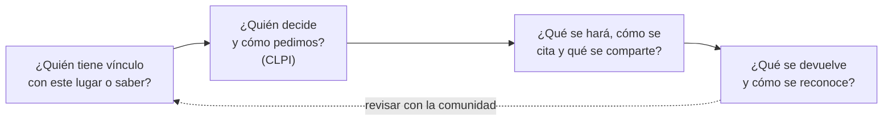

# B02-C20 — Patrimonio astronómico y ética cultural

<!-- nav:top -->
[🏠 Programa](../../../../README.md) · [📚 Bloque B02](../../../tronco-comun/B02-historia-arqueoastronomia-y-culturas-del-cielo.md) · [← Anterior: B02-C19 — Historia de la exploración espacial](../B02-C19-historia-de-la-exploracion-espacial/CLASE.md) · [Siguiente: B03-C01 — Números y operaciones fundamentales →](../../B03/B03-C01-numeros-y-operaciones-fundamentales/CLASE.md)
<!-- /nav -->

## 1. Ubicación, nivel y alcance

Vigésima clase y cierre del bloque B02. Recorriste calendarios, cosmovisiones, métodos, modelos, instrumentos y viajes. Ahora reúnes lo aprendido en una pregunta práctica: **¿cómo se cuida y se estudia el patrimonio del cielo sin dañar a quienes lo mantienen vivo?** Nivel N1.

Verás qué entiende por patrimonio astronómico la iniciativa conjunta de la UNESCO y la Unión Astronómica Internacional, el debate sobre Maunakea, la idea de consentimiento libre, previo e informado, y lo que dicen los tratados sobre el espacio. Elaborarás un plan de trabajo ético para un proyecto. No es una clase jurídica: no resuelve conflictos ni sustituye a las comunidades.

## 2. Por qué esta clase existe

Los sitios, instrumentos, archivos, saberes y hasta la oscuridad del cielo son patrimonio, y los telescopios, el turismo y las constelaciones de satélites pueden dañarlo. La pregunta motivadora es: **¿qué debo preguntar, a quién y antes de qué, cuando mi trabajo toca un cielo o un lugar que importa a otras personas?**

Al terminar sabrás clasificar tipos de patrimonio astronómico, enunciar principios de consentimiento y redactar un plan que declare quién decide, qué se comparte y qué se devuelve.

## 3. Lo que podrás hacer al terminar

1. Clasificar tipos de patrimonio astronómico según la iniciativa UNESCO–IAU.
2. Explicar el principio de consentimiento libre, previo e informado y sus límites.
3. Describir el caso de Maunakea como ejemplo de conflicto.
4. Explicar por qué la oscuridad del cielo puede ser parte de un valor cultural.
5. Relacionar el Tratado de 1967 con la protección del entorno y la no apropiación.
6. Redactar un plan de consentimiento y cuidado del patrimonio.

La evidencia es el **plan de consentimiento y patrimonio** del ejercicio 12 (sección 20).

## 4. Con qué llegas y cómo comprobarlo

Necesitas el bloque B02, sobre todo C05, C06, C08 y C19. Cinco preguntas:

1. ¿Qué es patrimonio?
2. ¿Qué es una comunidad descendiente?
3. ¿Qué es la contaminación lumínica?
4. ¿Por qué un cálculo puede ser respetuoso o irrespetuoso según su uso?
5. ¿Qué diferencia hay entre pedir permiso y avisar?

Ver respuestas

1. Lo que una sociedad hereda y decide cuidar, material o inmaterial. 2. Un grupo con vínculo histórico o cultural con un lugar o saber. 3. La luz artificial excesiva que oculta el cielo nocturno. 4. Porque el contexto, el permiso y el beneficio importan además del método. 5. Pedir permiso acepta que la respuesta sea «no»; avisar no.

Con cuatro o cinco aciertos, sigue. Con tres o menos, repasa C06.

## 5. Un caso real: el Maunakea

Un artículo de 2019 de Hilding Neilson y Samantha Lawler argumenta que la astronomía canadiense se ha beneficiado de telescopios en Maunakea, un lugar de profunda importancia cultural para los hawaianos nativos, en tierras que nunca cedieron; que las tensiones sobre el uso de la cumbre han crecido, en especial por el Telescopio de Treinta Metros propuesto; y que la comunidad astronómica internacional no ha respondido de manera adecuada. Proponen que la sociedad astronómica canadiense adopte una posición oficial guiada por la Declaración de la ONU sobre los derechos de los pueblos indígenas y ofrecen directrices que podrían servir de modelo para el consentimiento en observatorios de todo el mundo (S1). Un texto posterior de Neilson para el centro de política de la IAU sostiene que los astrónomos se han beneficiado de la toma de tierras indígenas sin consentimiento libre e informado, o con consentimiento fabricado (S2).

Estos textos son posiciones argumentadas de sus autores, no sentencias; hay otras voces que no consultamos. Ten presente el límite: no leímos documentos del propio pueblo kānaka maoli ni de las instituciones involucradas.

## 6. Vocabulario

El **patrimonio astronómico** incluye, según la iniciativa UNESCO–IAU: observatorios e instrumentos, sitios prehistóricos y tradicionales, paisajes culturales o naturales, patrimonio tecnológico espacial y observatorios en funcionamiento (S3). El **conocimiento tradicional** es el saber transmitido por una comunidad. El **consentimiento libre, previo e informado** (CLPI) exige obtener el acuerdo de un pueblo antes de un proyecto que afecte sus tierras o territorios, sin coerción y con información suficiente (S2). La **UNDRIP** es la Declaración de la ONU sobre los derechos de los pueblos indígenas. La **contaminación lumínica** es la luz artificial que degrada el cielo nocturno. Un **cielo oscuro** es un cielo con poca luz artificial. La **soberanía de datos indígena** es el derecho de un pueblo a gobernar los datos sobre su territorio y su saber.

## 7. Modelo mental: preguntar antes, devolver después

Un proyecto respetuoso recorre un ciclo con cuatro preguntas.

*Descripción textual:* cuatro preguntas encadenadas: quién tiene vínculo, quién decide y cómo se pide el consentimiento, qué se hará y cómo se cita y qué se devuelve; una flecha punteada vuelve al inicio para revisar con la comunidad.

Analogía: pedir prestado un libro a su dueña y devolverlo con una nota. El límite: aquí el «libro» puede ser un lugar sagrado o un saber que no se puede «prestar».

## 8. La explicación, paso a paso

### 8.1 Qué es patrimonio astronómico

La iniciativa UNESCO–IAU, lanzada en 2003 como actividad de prueba inicial, vincula ciencia y cultura para reconocer sitios relacionados con la astronomía, incluido el «conocimiento comunitario tradicional»; la IAU participa desde un acuerdo con la UNESCO en 2008. Sus categorías son: observatorios e instrumentos (por ejemplo, Jantar Mantar en Jaipur y el observatorio de Dengfeng en China), sitios prehistóricos y tradicionales, paisajes culturales o naturales, patrimonio tecnológico espacial y observatorios en funcionamiento (S3). La página sostiene que el cielo es un patrimonio compartido y que la interacción entre el conocimiento astronómico y la cultura humana es central para el valor universal de un bien (S3).

### 8.2 Cielos oscuros y patrimonio

Según S3, el estudio temático de 2017 concluye que los lugares de cielo oscuro no pueden ser por sí mismos una categoría de Patrimonio Mundial, aunque la calidad del cielo oscuro puede reforzar el valor cultural o natural de un sitio; las Reservas Starlight y los Parques de Cielo Oscuro tampoco son categorías de Patrimonio Mundial. S2 propone ir más lejos: tratar la contaminación lumínica como una pérdida de conocimiento transmitido oralmente, un argumento del autor que no tiene aún base clara en el derecho internacional (S2).

### 8.3 Consentimiento libre, previo e informado

S2 cita el artículo 32.2 de la UNDRIP, que pide a los estados obtener consentimiento libre e informado antes de aprobar proyectos que afecten sus tierras o territorios, y propone no tratar a los pueblos indígenas solo como «partes interesadas» o «compromiso cultural». Lee el límite: es una propuesta de política de un autor que se identifica como mi'kmaq, no una norma vinculante para observatorios. S1 plantea que el marco podría servir de base para dialogar con comunidades en todo el mundo.

### 8.4 Qué dice el tratado del espacio

El Tratado del Espacio Ultraterrestre de 1967 dispone que la exploración sea en beneficio de todos y «incumbencia de toda la humanidad» (art. I), que no haya apropiación nacional del espacio y los cuerpos celestes (art. II) y que se eviten la contaminación dañina y los cambios adversos en el entorno de la Tierra (art. IX) (S4). No menciona a los pueblos indígenas. S2 sostiene que los «terrenos tradicionales» deberían entenderse con amplitud, incluidos el cielo nocturno y el espacio, una lectura que el propio autor reconoce que carece todavía de base clara en el derecho internacional.

### 8.5 Un campo interdisciplinario

S5 define la astronomía cultural como el estudio de la astronomía de culturas antiguas, a veces llamada antropología de la astronomía, y subraya que en el campo trabajan astrónomos, astrofísicos, antropólogos, arqueólogos y especialistas indígenas (S5). Un plan de trabajo ético incluye desde el diseño a esas personas y a las comunidades descendientes, no solo como informantes.

### 8.6 Los límites del rigor y de este cierre

Las posiciones citadas (S1, S2) son argumentadas y minoritarias o emergentes en parte del debate; no las presentamos como consenso. No consultamos las declaraciones oficiales de la IAU sobre ética, ni la ficha de Chankillo en la UNESCO (la página de la lista no abrió), ni los instrumentos jurídicos de Chile. Esa ausencia debe resolverse antes de la revisión disciplinar.

## 9. Magnitudes, símbolos y unidades

| Símbolo | Qué es | Unidad | Valor o nota |
|---|---|---|---|
| lanzamiento de la iniciativa UNESCO–IAU | fecha | año | 2003 (S3) |
| acuerdo UNESCO–IAU | fecha | año | 2008 (S3) |
| estudios temáticos | fechas | año | 2010 y 2017 (S3) |
| UNDRIP, art. 32.2 | cláusula | — | consentimiento libre e informado (S2) |
| Tratado del Espacio | entrada en vigor | fecha | 10-oct-1967 (S4) |

## 10. Convenciones y referencias

Los términos de CLPI se usan como en S2. Las traducciones de los textos son nuestras. «Comunidad» y «pueblo» se usan como lo hacen las fuentes; no sustituimos las categorías de una comunidad concreta por las nuestras.

## 11. De dónde sale lo que afirmamos

| ID | Fuente | Localizador | Respalda | Estado |
|---|---|---|---|---|
| S1 | H. R. Neilson y S. Lawler, «Canadian Astronomy on Maunakea: On Respecting Indigenous Rights», arXiv:1910.03665 (2019) | https://arxiv.org/abs/1910.03665 | Caso Maunakea; propuesta basada en UNDRIP | Solo el resumen, 2026-11-05; posición de los autores |
| S2 | H. Neilson, «Overview of Indigenous rights and outer space for the IAU-CPS Policy Hub», arXiv:2412.06675 (2024), *Astronomy in Focus* 1 | https://arxiv.org/html/2412.06675v1 | CLPI, UNDRIP, contaminación lumínica, límites jurídicos | Consultada el 2026-11-05; posición del autor |
| S3 | UNESCO, «Astronomy and World Heritage» (iniciativa UNESCO–IAU) | https://whc.unesco.org/en/astronomy/ | Categorías de patrimonio, lanzamiento 2003, acuerdo 2008, estudios de 2010 y 2017, cielos oscuros | Consultada el 2026-11-05 (resumen de la herramienta) |
| S4 | Texto del Tratado del Espacio Ultraterrestre (copia del CNS vía NTI) | https://www.nti.org/media/documents/outer_space_treaty.pdf | Arts. I, II, IX; fechas | PDF leído el 2026-11-05; copia no oficial de un texto oficial |
| S5 | S. R. Gullberg, «Cultural Astronomy for Inspiration», *Proc. IAU* Symp. 367, doi:10.1017/S1743921321000612 | https://doi.org/10.1017/S1743921321000612 | Definición de astronomía cultural; interdisciplinariedad | Texto leído el 2026-11-05 |

Límites: S1 y S2 son posiciones de autoría específica; S3 fue consultada mediante una herramienta que resume. No consultamos voces de comunidades, documentos oficiales de la IAU sobre ética, ni normativas chilenas (por ejemplo, de protección de cielos), que quedan pendientes.

## 12. Cómo ver el mapa de patrimonio

Esta tabla es la versión accesible de un mapa de categorías.

| Categoría (S3) | Ejemplos de la propia fuente | Riesgos típicos |
|---|---|---|
| Observatorios e instrumentos | Jantar Mantar (Jaipur), Dengfeng (China) | Deterioro, turismo |
| Sitios prehistóricos y tradicionales | (sin ejemplo en la página consultada) | Pérdida de contexto, acceso |
| Paisajes culturales o naturales | (sin ejemplo en la página consultada) | Cambios del entorno |
| Patrimonio tecnológico espacial | Sitios de exploración espacial | Olvido, pérdida de archivos |
| Observatorios en funcionamiento | Sitios activos | Conflicto de usos |

Descripción larga: cinco categorías, dos con ejemplos explícitos en la fuente y las otras sin ejemplos en la página consultada; la columna de riesgos es nuestra.

## 13. Ejemplo trabajado: un plan en cuatro preguntas

**Planteamiento.** Quieres medir la orientación de una estructura de piedra en tierras de una comunidad (C08).

**Paso 1 · ¿Quién tiene vínculo?** Autoridades y familias de la comunidad, la institución patrimonial local y especialistas arqueológicos.

**Paso 2 · ¿Quién decide?** Se pide permiso por los canales que la comunidad indique, con la posibilidad real de decir «no» (S2), antes de planificar el viaje.

**Paso 3 · ¿Qué se hará?** Medición con instrumentos que no tocan la estructura, sin fotografiar zonas restringidas; se acuerda cómo se citarán los saberes, y los datos se guardan con acuerdo de acceso.

**Paso 4 · ¿Qué se devuelve?** Un informe en un lenguaje comprensible, copia de los datos y una instancia para revisar conclusiones antes de publicar.

**Sentido físico.** El método (C08) no cambia, pero el proyecto cambia por completo: cada decisión técnica pasa por un acuerdo.

## 14. Comparación de enfoques

**Extracción:** se toma el dato y se publica; rápida, pero reproduce los daños que los textos citados critican. **Consulta:** se informa a la comunidad; mejor, pero puede ser formal. **Co-investigación:** la comunidad define preguntas y usos; más lenta, y la más alineada con S2. Elegir depende del proyecto y del acuerdo con la comunidad.

## 15. Práctica guiada

**Ejercicio 1 · con los pasos indicados.** Clasifica Jantar Mantar y Dengfeng en las categorías de S3. *Pasos:* lee la sección 8.1.

Solución comentada

Ambos son «observatorios e instrumentos» (S3).

**Ejercicio 2 · con una pista.** Ordena cronológicamente: acuerdo UNESCO–IAU, lanzamiento de la iniciativa, estudio temático de 2017. *Pista:* sección 9.

Solución comentada

Lanzamiento (2003), acuerdo (2008), estudio temático (2017).

**Ejercicio 3 · casi autónomo.** ¿Qué dice S3 sobre los cielos oscuros como categoría?

Solución comentada

No pueden ser por sí mismos una categoría de Patrimonio Mundial, pero pueden reforzar el valor de un sitio (S3).

## 16. Práctica autónoma, transferencia e integrador

**Ejercicio 4.** Explica la diferencia entre consulta y consentimiento.

Solución comentada

La consulta informa u oye; el consentimiento exige un acuerdo que puede ser negativo, antes del proyecto (S2).

**Ejercicio 5.** ¿Qué valor jurídico tienen las propuestas de S2?

Solución comentada

Son propuestas políticas del autor; él mismo reconoce que no tienen aún base clara en el derecho internacional.

**Ejercicio 6.** ¿Qué dice el artículo IX del tratado de 1967 sobre el entorno?

Solución comentada

Que se eviten la contaminación dañina y los cambios adversos en el entorno de la Tierra por materia extraterrestre (S4).

**Ejercicio 7.** ¿Por qué un cielo oscuro puede ser parte de un valor cultural?

Solución comentada

Porque muchas prácticas y saberes dependen de ver el cielo; S2 argumenta que la luz excesiva puede borrar conocimiento transmitido oralmente.

**Ejercicio 8.** Distingue en S1 qué es hecho y qué es propuesta.

Solución comentada

Hecho: que la astronomía canadiense usa Maunakea y que hay tensiones por el TMT; propuesta: que la sociedad adopte una posición guiada por UNDRIP y use las directrices como modelo.

**Ejercicio 9 · transferencia.** Un colega dice: «el consentimiento retrasa la ciencia». Responde con ventajas y límites.

Solución comentada

Puede alargar el calendario, pero evita daños y conflictos y mejora las preguntas; S2 sostiene que tratar a los pueblos como meras partes interesadas es insuficiente. Las ventajas dependen del caso y deben discutirse con las comunidades.

**Ejercicio 10 · transferencia.** Lee de nuevo tu ficha de C05 o C06 y mejora la sección de consentimiento.

Solución comentada

Agrega quién puede autorizar, qué se pedirá, cómo se cita y qué se devuelve; usa el ciclo de la sección 7.

**Ejercicio 11 · transferencia.** Un observatorio quiere publicar fotos de un sitio sagrado cercano. ¿Qué le recomendarías?

Solución comentada

Pedir permiso por los canales de la comunidad, aceptar un «no», acordar usos y crédito, y no publicar nada restringido.

**Ejercicio 12 · integrador.** Elabora el *plan de consentimiento y patrimonio* (sección 20): elige un proyecto del bloque B02 (por ejemplo, medir un sitio, usar un saber en una clase, visitar un observatorio), identifica a las personas con vínculo, el modo de pedir permiso, qué harás, cómo citarás y qué devolverás, con fuentes.

Solución modelo

Sigue la sección 13: las cuatro preguntas con respuestas concretas, un riesgo y cómo lo mitigas, la lista de fuentes con su estado y lo pendiente.

## 17. Actividad sin código: auditoría ética de una ficha

Esta clase no usa script. Toma una ficha tuya de C01–C19 y audítala con esta lista: ¿nombré a la comunidad o autoría?; ¿distinguí dato, interpretación y divulgación?; ¿declaré lo que no sé?; ¿pedí o pediría permiso?; ¿qué devolvería? **Qué observar:** cuántas respuestas son «no» o «no lo sé». **Resultado esperado:** al menos dos mejoras concretas para tu ficha.

## 18. Errores frecuentes y cómo corregirlos

**Tratar el consentimiento como trámite.** Ejercicio 4.

**Confundir propuesta con norma.** Ejercicio 5.

**Generalizar una posición a todos los pueblos.** Sección 8.6.

**Olvidar la devolución.** Sección 13, paso 4.

**Pensar que el cielo oscuro es solo asunto científico.** Ejercicio 7.

## 19. Cómo sabrás que vas bien

Tras 8.1: ¿clasificas un caso? Ejercicio 1. Tras 8.3: ¿distingues consulta y consentimiento? Ejercicio 4. Al final: ¿tu plan se puede decir que «no» desde la comunidad? Ejercicio 12.

## 20. Qué entregas y cómo se evalúa

El producto es tu **plan de consentimiento y patrimonio**, que además cierra el portafolio del bloque (fichas de C01–C19).

| Criterio | Inicial | En desarrollo | Logrado | Destacado |
|---|---|---|---|---|
| Identificación de vínculos | Ausente | Genérica | Con grupos concretos | Con canales reales |
| Consentimiento | Ausente | Mencionado | Con posibilidad de «no» | Con acuerdo de datos |
| Devolución | Ausente | Mencionada | Concreta | Con revisión previa a publicar |
| Fuentes y límites | Sin fuente | Con fuente | Con tipo, estado y pendientes | Contrasta posiciones |

**Condiciones críticas:** no usar material sagrado o restringido sin permiso; no atribuir a una comunidad lo que no dijo; no presentar posiciones como consenso; citar solo lo consultado.

## 21. Ética, seguridad y límites

Esta clase no sustituye la consulta real a las comunidades ni el asesoramiento legal. Cada caso tiene sus propias personas y reglas. Cuando una fuente muestre una tensión, no la resuelvas por tu cuenta: nómbrala. Accesibilidad: diagramas descritos, tablas equivalentes y sin conexión.

## 22. Para cerrar y seguir

El patrimonio del cielo incluye sitios, instrumentos, archivos, saberes y la oscuridad misma; cuidarlo es preguntar antes, citar con exactitud y devolver. Con esto cierras el bloque B02, que mostró cielos de muchos pueblos y modelos de muchas épocas.

**Glosario español–inglés.** patrimonio astronómico · *astronomical heritage*; consentimiento libre, previo e informado · *free, prior and informed consent (FPIC)*; conocimiento tradicional · *traditional knowledge*; contaminación lumínica · *light pollution*; cielo oscuro · *dark sky*; soberanía de datos indígena · *Indigenous data sovereignty*.

**Continuidad.** El bloque B03 (matemática elemental) retoma los cálculos que usaste aquí. El tronco común volverá sobre ética y consentimiento en los bloques posteriores que involucren observación y datos.

**Referencias:** ver sección 11. S1 y S2 son posiciones de autoría; S3 y S4 deben contrastarse con sus versiones oficiales.

<!-- nav:bottom -->
---

[← Anterior: B02-C19 — Historia de la exploración espacial](../B02-C19-historia-de-la-exploracion-espacial/CLASE.md) · [📚 Bloque B02](../../../tronco-comun/B02-historia-arqueoastronomia-y-culturas-del-cielo.md) · [Siguiente: B03-C01 — Números y operaciones fundamentales →](../../B03/B03-C01-numeros-y-operaciones-fundamentales/CLASE.md)
<!-- /nav -->
