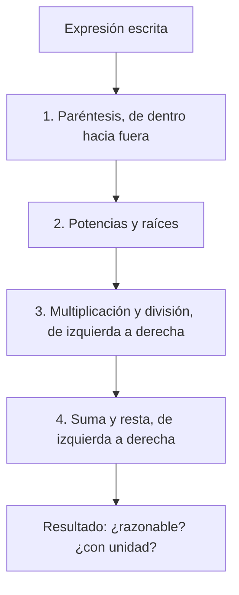

# B03-C01 — Números y operaciones fundamentales

<!-- nav:top -->
[🏠 Programa](../../../../README.md) · [📚 Bloque B03](../../../tronco-comun/B03-matematica-elemental-para-ciencias-espaciales.md) · [← Anterior: B02-C20 — Patrimonio astronómico y ética cultural](../../B02/B02-C20-patrimonio-astronomico-y-etica-cultural/CLASE.md) · [Siguiente: B03-C02 — Fracciones y razones de magnitudes →](../B03-C02-fracciones-y-razones-de-magnitudes/CLASE.md)
<!-- /nav -->

## 1. Ubicación, nivel y alcance

Primera clase del bloque B03, el bloque de matemática elemental del programa. Todo lo que sigue —fracciones, potencias, unidades, álgebra, gráficos— se apoya en saber operar con números sin equivocarse y sin perder de vista qué representan. Nivel N0 → N1: no se exige nada previo salvo saber contar.

Verás qué clases de números existen, en qué orden se hacen las operaciones, por qué una calculadora o un programa no siempre dan «exacto» lo que parece exacto, y cómo comprobar que un resultado tiene sentido. No verás todavía fracciones en profundidad (C02), potencias (C04) ni cifras significativas (C11).

## 2. Por qué esta clase existe

Una agencia espacial no «confía» en un cálculo: lo comprueba. Para saber cuánto tarda la Luna en dar una vuelta alrededor de la Tierra basta multiplicar, dividir y respetar el orden de las operaciones; pero un paréntesis mal puesto convierte 27 días en una cifra absurda. Esta clase existe porque los errores más caros en ciencias espaciales suelen ser errores de aritmética, de unidad o de orden, no de física.

La decisión central es: **¿qué operación aplico, en qué orden, y cómo sé que el resultado es razonable?** Aprenderás a leer una expresión numérica, a calcularla paso a paso y a contrastarla con un orden de magnitud esperado. Es la base de todo B03 y del resto del programa.

## 3. Lo que podrás hacer al terminar

1. Clasificar un número como natural, entero, racional o irracional, y decir por qué.
2. Aplicar la jerarquía de operaciones (paréntesis, potencias, multiplicación y división, suma y resta).
3. Operar con decimales y con unidades sin perder el significado del resultado.
4. Explicar por qué `0,1 + 0,2` puede no dar exactamente `0,3` en un programa.
5. Calcular el período orbital medio de un cuerpo a partir de su distancia y su rapidez.
6. Comprobar un resultado con una estimación gruesa antes de aceptarlo.

La evidencia es la **ficha de operaciones comprobadas** del ejercicio 12 (sección 20).

## 4. Con qué llegas y cómo comprobarlo

Necesitas contar, sumar y multiplicar con números pequeños. Cinco preguntas:

1. ¿Cuánto es `7 × 8`? ¿Y `56 ÷ 7`?
2. ¿Qué número está entre 3 y 4?
3. ¿Qué es mayor, `0,5` o `0,25`?
4. Si un tren avanza 60 km cada hora, ¿cuántos km avanza en 3 horas?
5. ¿Cuánto es `10 − 4 × 2`? (Piénsalo antes de mirar.)

<details>
<summary>Ver respuestas</summary>

1. 56; 8. 2. Hay infinitos, por ejemplo 3,5. 3. `0,5`. 4. 180 km. 5. Es 2, no 12: primero se multiplica (`4 × 2 = 8`) y luego se resta (`10 − 8`). Esa regla es el corazón de la sección 8.2.
</details>

Con cuatro o cinco aciertos, sigue. Con menos, repite la pregunta 5 con otros números hasta que la regla te salga sola.

## 5. Un caso real: cuánto tarda la Luna en dar una vuelta

La ficha de datos de la NASA sobre la Luna indica una distancia media a la Tierra de 384 400 km (el semieje mayor de su órbita) y una velocidad orbital media de 1,022 km/s; además publica un período sidéreo de 27,3217 días (S1). Con solo esas dos primeras cifras y operaciones elementales puedes **predecir** el tercer dato: si el resultado se acerca a 27,3 días, tu aritmética y tu modelo son coherentes.

Lo importante pedagógicamente es que no se pide memorizar nada: se pide operar con orden. Esa es la tarea de la clase. Límite: la órbita de la Luna no es un círculo perfecto y la rapidez no es constante; el modelo de la sección 8.5 es una aproximación, y la comparación con el dato publicado te dirá cuán buena.

## 6. Vocabulario

Un **número natural** sirve para contar: 1, 2, 3… Un **entero** añade el cero y los negativos: −3, 0, 5. Un **número racional** es el que se puede escribir como cociente de dos enteros, como `1/4` o `27,3217` (que es `273 217/10 000`). Un **número irracional** no se puede escribir así; `π` y `√2` son ejemplos: sus decimales no se repiten ni terminan. Los racionales y los irracionales forman juntos los **números reales**, los que ocupan la recta numérica.

Una **operación** combina números: suma, resta, multiplicación, división. Una **expresión** es una cadena de números y operaciones. Un **paréntesis** agrupa. El **dividendo** es lo que se divide y el **divisor** entre lo que se divide. Un **valor medio** es un número que resume varios valores en uno. Una **cantidad** es un número con su unidad: 1,022 km/s es una cantidad; 1,022 solo es un número.

## 7. Modelo mental: una calculadora con memoria de orden

Piensa en una expresión como una receta con pasos ordenados. Algunos pasos «pesan más» y se hacen antes.



*Descripción textual:* una cadena vertical de seis cajas. Se parte de la expresión escrita; se resuelven primero los paréntesis, luego las potencias y raíces, después las multiplicaciones y divisiones y por último las sumas y restas; el proceso termina con una comprobación de si el resultado es razonable y lleva unidad.

Una analogía: cocinar. No se hornea antes de mezclar los ingredientes; el orden importa. El límite de la analogía: en la cocina a veces el orden admite variaciones; en aritmética el orden de la jerarquía no es negociable, aunque **sí** puedes cambiar el orden en que sumas varios números entre sí, porque la suma es conmutativa.

## 8. La explicación, paso a paso

### 8.1 Qué tipos de número hay y por qué importa

Los números naturales cuentan cosas discretas: tres planetas rocosos interiores, cuatro lunas galileanas. Los enteros permiten decir «cinco grados bajo cero» o «diez minutos antes del lanzamiento» (volveremos en C09). Los racionales miden cantidades que se reparten: media vuelta, `3/4` de órbita. Los irracionales aparecen en cuanto hay círculos: el perímetro de una circunferencia de radio `r` es `2πr`, con `π ≈ 3,14159…`. Importa porque un irracional **nunca** se escribe completo: siempre trabajas con una aproximación, y debes saber con cuántas cifras.

### 8.2 La jerarquía de operaciones y por qué es así

Cuando escribes `2 + 3 × 4`, ¿qué significa? La convención universal es que la multiplicación «agrupa más fuerte» que la suma, de modo que `3 × 4` se resuelve antes: `2 + 12 = 14`. Si quieres sumar primero, lo dices con paréntesis: `(2 + 3) × 4 = 20`. Esta convención existe para que todas las personas lean igual una misma expresión; no es una ley de la naturaleza, es un acuerdo, como el idioma.

Dentro de un mismo nivel se va de izquierda a derecha: `100 ÷ 5 × 2` es `20 × 2 = 40`, no `100 ÷ 10`. Y la barra de fracción es un paréntesis disfrazado: `a / b + c` no es lo mismo que `a / (b + c)`. En un programa o una hoja de cálculo hay que escribir esos paréntesis explícitamente.

### 8.3 Operar con decimales

Un decimal como `27,3217` es una suma: `27 + 3/10 + 2/100 + 1/1 000 + 7/10 000`. Sumar y restar decimales exige alinear la coma; multiplicar, contar las cifras decimales del resultado (la suma de las de los factores); dividir, convertir si hace falta el divisor en entero desplazando la coma en ambos. Lo esencial es que **la coma es parte del número**: `0,5` y `5` difieren en un factor diez.

### 8.4 Cuando «exacto» no lo es: números en el computador

Un computador guarda los decimales en binario, y casi ningún decimal como `0,1` se escribe exactamente en binario. Por eso en muchos lenguajes `0,1 + 0,2` da `0,30000000000000004`. No es un fallo del programa: es la consecuencia de usar una cantidad finita de cifras binarias. Dos consecuencias prácticas: no comparar decimales con `==` y distinguir entre un número **exacto** (`1/3` guardado como fracción) y su **aproximación** decimal (`0,333…`). En el bloque B26 y en B03-C19 verás cuánto error se acumula.

### 8.5 Un cálculo completo: el período medio de la Luna

Modelo: la Luna recorre una circunferencia de radio `a = 384 400 km` con rapidez constante `v = 1,022 km/s`.

**Paso 1 · perímetro.** `L = 2πa = 2 × 3,14159 × 384 400 km ≈ 2 415 256 km`.
**Paso 2 · tiempo.** Si la rapidez es distancia dividida entre tiempo, entonces el tiempo es distancia dividida entre rapidez: `T = L / v = 2 415 256 km ÷ 1,022 km/s ≈ 2 363 265 s`. Fíjate: los km se cancelan y quedan segundos; la unidad te confirma que dividiste bien.
**Paso 3 · cambio a días.** Un día tiene `24 × 3600 = 86 400 s` (S2). `T ≈ 2 363 265 ÷ 86 400 ≈ 27,35 d`.
**Paso 4 · comprobación.** El dato publicado es 27,3217 d; la diferencia relativa es del orden de 0,1 % (sección 17). Hay coherencia.

## 9. Magnitudes, símbolos y unidades

| Símbolo | Qué es | Unidad | Valor o nota |
|---|---|---|---|
| `a` | radio de la órbita (semieje mayor) | km | 384 400 (S1) |
| `v` | rapidez orbital media | km/s | 1,022 (S1) |
| `L` | longitud de la órbita | km | `2πa` |
| `T` | período | s, d | `L / v` |
| `π` | razón entre perímetro y diámetro | sin unidad | 3,14159… (irracional) |
| día | unidad de tiempo | s | 1 d = 86 400 s (S2) |

## 10. Convenciones y referencias

En este programa la coma es el separador decimal y el espacio fino separa los miles (`384 400`); el script imprime con punto, como Python. La multiplicación se escribe `×` en el texto y `*` en el código. `≈` significa «aproximadamente igual». Toda cantidad lleva su unidad; un número sin unidad se llama **adimensional** y se indica.

## 11. De dónde sale lo que afirmamos

| ID | Fuente | Localizador | Respalda | Estado |
|---|---|---|---|---|
| S1 | NASA NSSDC, *Moon Fact Sheet* (act. 11-ene-2024) | https://nssdc.gsfc.nasa.gov/planetary/factsheet/moonfact.html | Semieje mayor 0,3844 × 10⁶ km; velocidad orbital media 1,022 km/s; «Revolution period» 27,3217 d | Página consultada el 2026-11-05 |
| S2 | BIPM, *The International System of Units (SI)*, 9.ª ed. (2019), tabla 8 | https://doi.org/10.59161/AUEZ1291 | 1 d = 24 h = 86 400 s; 1 h = 3600 s | PDF leído el 2026-11-05 (versión V4.01 indicada en la portada) |
| S3 | NASA NSSDC, *Earth Fact Sheet* (act. 15-nov-2024) | https://nssdc.gsfc.nasa.gov/planetary/factsheet/earthfact.html | Semieje mayor 149,598 × 10⁶ km; «Sidereal orbit period» 365,256 d; velocidad orbital media 29,78 km/s; radio medio volumétrico 6371,000 km | Página consultada el 2026-11-05 |

Límites: son fichas divulgativas de la NASA con valores medios; no son efemérides. La velocidad de la Luna y el período se comparan solo como control de coherencia. `c` se toma de la definición del SI (299 792 458 m/s, S2).

## 12. Cómo ver los números

Esta tabla es la versión accesible de una recta numérica con las cuatro familias de números.

| Número | Natural | Entero | Racional | Irracional |
|---|---|---|---|---|
| 86 400 | sí | sí | sí | no |
| −3 | no | sí | sí | no |
| 1/4 = 0,25 | no | no | sí | no |
| 27,3217 | no | no | sí | no |
| π | no | no | no | sí |
| √2 | no | no | no | sí |

Si lo dibujas, usa una recta con marcas igualmente espaciadas y distingue cada familia con forma y no solo con color. Descripción larga: todos los números de la tabla caben sobre la misma recta; los racionales son densos pero dejan «huecos» que ocupan los irracionales.

## 13. Ejemplo trabajado: la rapidez media de la Tierra

Datos publicados por la NASA: semieje mayor de la órbita terrestre `149,598 × 10⁶ km` y período sidéreo `365,256 d` (S3). Pregunta: ¿qué rapidez media tiene la Tierra en su órbita, en km/s? La ficha publica 29,78 km/s: será tu control.

**Paso 1 · plan.** Rapidez = longitud de la órbita ÷ tiempo, igual que con la Luna.
**Paso 2 · longitud.** `L = 2π × 149,598 × 10⁶ km = 9,399 × 10⁸ km`.
**Paso 3 · tiempo en segundos.** `365,256 × 86 400 = 31 558 118 s`.
**Paso 4 · cociente.** `v = 9,399 × 10⁸ km ÷ 31 558 118 s = 29,78 km/s`.
**Paso 5 · razonabilidad.** La Luna se mueve a ~1 km/s alrededor de la Tierra; que la Tierra se mueva a ~30 km/s alrededor del Sol es coherente con distancias mucho mayores recorridas en un tiempo mucho mayor.
**Sentido físico.** Vas a casi 30 km/s sin sentirlo, porque tampoco sientes velocidad constante, solo cambios (idea que verás en B05).

## 14. Dos formas de calcular y cuándo falla cada una

**A mano o con fracciones** conserva el valor exacto y muestra la estructura, pero es lenta con muchos decimales. **Con calculadora o programa** es rápida y maneja cifras largas, pero introduce aproximación binaria (sección 8.4) y no avisa si escribiste mal los paréntesis. La práctica profesional combina ambas: se hace una estimación gruesa a mano (el período de la Luna debería rondar un mes) y se deja a la máquina el cálculo fino.

## 15. Práctica guiada

**Ejercicio 1 · con los pasos indicados.** Calcula `2 + 3 × 4²`. *Pasos:* potencia, producto, suma (sección 8.2).

<details><summary>Solución comentada</summary>

`4² = 16`; `3 × 16 = 48`; `2 + 48 = 50`. Si te salió 400 sumaste primero, desobedeciendo la jerarquía.
</details>

**Ejercicio 2 · con una pista.** ¿Cuántos segundos hay en 27 días? *Pista:* un día tiene 86 400 s (S2).

<details><summary>Solución comentada</summary>

`27 × 86 400 = 2 332 800 s`. Comprueba el orden de magnitud: unos 2,3 millones, algo menos que el período calculado en 8.5 (27,35 d).
</details>

**Ejercicio 3 · casi autónomo.** Calcula `8 − 3 × 2 + 4 ÷ 2`.

<details><summary>Solución comentada</summary>

Primero `3 × 2 = 6` y `4 ÷ 2 = 2`; luego, de izquierda a derecha, `8 − 6 + 2 = 4`. Error típico: hacer `8 − 3 = 5` primero y llegar a 12.
</details>

## 16. Práctica autónoma, transferencia e integrador

**Ejercicio 4.** ¿Cuántos segundos tarda la luz en llegar de la Tierra a la Luna? Usa `384 400 km` y `c = 299 792,458 km/s`.

<details><summary>Solución comentada</summary>

`384 400 ÷ 299 792,458 ≈ 1,282 s`. Los km se cancelan y queda un tiempo. Es del orden esperado: algo más de un segundo (por eso hay un retraso perceptible en una conversación con una misión lunar).
</details>

**Ejercicio 5.** Clasifica `−3`, `1/4`, `√2`, `27,3217` y `86 400` como natural, entero, racional o irracional (puede haber varias etiquetas).

<details><summary>Solución comentada</summary>

`−3`: entero y racional. `1/4`: racional. `√2`: irracional. `27,3217`: racional (`273 217/10 000`). `86 400`: natural, entero y racional.
</details>

**Ejercicio 6.** La órbita de la Luna mide `2 415 256 km`; la circunferencia de la Tierra (`2π × 6 371 km`, S3) mide unos `40 030 km`. ¿Cuántas «vueltas a la Tierra» caben en la órbita lunar?

<details><summary>Solución comentada</summary>

`2 415 256 ÷ 40 030 ≈ 60,3`. Unas 60 vueltas a la Tierra. Si te salió 0,0166 invertiste el cociente.
</details>

**Ejercicio 7.** Explica la diferencia entre `2*3.14159*384400/1.022/86400` y `2*3.14159*384400/1.022*86400`. ¿Cuál da días?

<details><summary>Solución comentada</summary>

La primera divide dos veces (entre la rapidez y entre 86 400) y da ≈ 27,35 días. La segunda divide entre la rapidez y **multiplica** por 86 400: da ≈ 2 × 10¹¹, sin sentido físico. La izquierda-a-derecha de la sección 8.2 lo explica.
</details>

**Ejercicio 8.** Si guardas `1/3` como `0,333`, ¿cuánto vale `3 × 0,333`? ¿Por qué no es 1?

<details><summary>Solución comentada</summary>

`0,999`. Truncar `1/3` perdió `0,000333…`; multiplicar lo triplicó. Sirve de aviso: redondear antes de operar acumula error (más en C11 y C19).
</details>

**Ejercicio 9 · transferencia.** Una sonda sin motor, que va a 11 km/s constantes (valor ilustrativo, sin gravedad), ¿en cuánto tiempo cubriría `384 400 km`?

<details><summary>Solución comentada</summary>

`384 400 ÷ 11 ≈ 34 945 s ≈ 9,7 h`. Es un modelo grueso: ignora la gravedad y la trayectoria real; sirve para ordenar magnitudes, no para planear una misión.
</details>

**Ejercicio 10 · transferencia.** Cinco lecturas de un sensor de aceleración dan `9,81; 9,79; 9,82; 9,80; 9,78` m/s². Calcula la media y explica por qué resume bien.

<details><summary>Solución comentada</summary>

Suma `49,00`; entre 5, `9,800 m/s²`. Las lecturas se reparten alrededor de ese valor; la media es un resumen razonable cuando no hay valores extremos. (El tratamiento estadístico llega en B12.)
</details>

**Ejercicio 11 · transferencia.** Un estudiante teclea `2*3.14159*149.598e6/(365.256*86400)` y obtiene `29.78`; otro teclea `2*3.14159*149.598e6/365.256*86400` y obtiene un número enorme. ¿Qué error tiene el segundo?

<details><summary>Solución comentada</summary>

Falta el paréntesis: se divide entre 365,256 pero se **multiplica** por 86 400. El primero agrupa correctamente el denominador. Regla: lo que divide se agrupa.
</details>

**Ejercicio 12 · integrador.** Elabora tu *ficha de operaciones comprobadas* (sección 20) para la rapidez orbital media de otro cuerpo del Sistema Solar a elección, con datos de la NASA (S3): expresión, cálculo por pasos, unidades, estimación previa y comparación.

<details><summary>Solución modelo</summary>

Con Marte (semieje `227,956 × 10⁶ km`, período `686,980 d`): `L = 2π × 227,956 × 10⁶ ≈ 1,432 × 10⁹ km`; `T = 686,980 × 86 400 ≈ 5,936 × 10⁷ s`; `v ≈ 24,13 km/s`. Estimación previa: más lento que la Tierra porque está más lejos (29,8 km/s). Coherente. Cualquier cuerpo vale si cita su fuente y comprueba unidades.
</details>

## 17. Laboratorio: el período lunar con orden de operaciones

El script [laboratorio_periodo_lunar.py](laboratorio_periodo_lunar.py) calcula el período medio de la Luna con el modelo de 8.5 y hace pruebas: jerarquía de operaciones, suma exacta con fracciones, la inexactitud del decimal binario y la coincidencia con 27,3217 d dentro de 0,5 %. Si una prueba falla, se detiene.

**Datos:** publicados (NASA). **Predice antes de ejecutar:** ¿cuántos días saldrán? (Unos 27.) **Resultados (2026-11-05, Python 3.12.9; el script imprime con punto decimal):** perímetro 2 415 256 km; período calculado 27,353 d (publicado 27,3217 d); diferencia relativa 0,11 %; `0,1 + 0,2 = 0,30000000000000004` en `float` y `3/10` en `Fraction`.

```bash
python programa/clases/B03/B03-C01-numeros-y-operaciones-fundamentales/laboratorio_periodo_lunar.py
```

**Límites:** órbita circular y rapidez constante; no sirve para efemérides.

## 18. Errores frecuentes y cómo corregirlos

**Ignorar la jerarquía.** Calcular de izquierda a derecha sin priorizar. Se corrige con los ejercicios 1 y 3.
**Olvidar paréntesis en el divisor.** Se detecta por resultados absurdos. Ejercicios 7 y 11.
**Redondear demasiado pronto.** Ejercicio 8.
**Confundir un número con una cantidad.** Dar `27,35` sin decir días. Se corrige con la sección 8.5.
**Creer que el computador es exacto.** Sección 8.4.

## 19. Cómo sabrás que vas bien

Tras 8.2: ¿resuelves `5 + 2 × 3²` sin calculadora? (`23`). Si no, repite el ejercicio 1. Tras 8.4: ¿puedes explicar por qué `0,1 + 0,2` no es exacto en un programa? Si no, relee. Tras 8.5: ¿ves por qué los km se cancelan? Si no, rehaz el ejercicio 4. Tras el ejemplo: ¿cambiarías el cuerpo y repetirías el cálculo? Si dudas, el ejercicio 12 te guía.

## 20. Qué entregas y cómo se evalúa

El producto es tu **ficha de operaciones comprobadas**: una página con una expresión numérica de un problema astronómico, su cálculo paso a paso, las unidades en cada paso, una estimación gruesa previa y la comparación con un dato publicado.

| Criterio | Inicial | En desarrollo | Logrado | Destacado |
|---|---|---|---|---|
| Orden de operaciones | Errores de jerarquía | Aciertos con ayuda | Correcto | Detecta y explica un error ajeno |
| Unidades | Ausentes | Parciales | En cada paso | Las usa para validar el cálculo |
| Estimación previa | Ausente | Poco justificada | Justificada | Compara con el resultado |
| Comparación con dato | Sin fuente | Fuente sin cita | Fuente citada | Explica la diferencia |
| Claridad | Confusa | Entendible | Reproducible | Otra persona la reproduce sin ayuda |

**Condiciones críticas:** no presentar un cálculo sin unidades; no inventar el dato comparado; citar solo fuentes consultadas.

## 21. Ética, seguridad y límites

Un cálculo correcto de aula no basta para operar una misión: los modelos reales usan efemérides, incertidumbres y verificación independiente. Esta clase es educativa y no sirve para navegación. Accesibilidad: expresiones en texto, diagramas descritos y tablas equivalentes, sin conexión.

## 22. Para cerrar y seguir

Las operaciones se hacen con un orden acordado, los números reales incluyen irracionales que siempre se aproximan, y el computador aproxima casi todo lo que no es entero. Calcular con unidades y comparar con una estimación es la mejor defensa contra el error. Queda una pregunta: ¿cómo comparar dos cantidades de tamaños muy distintos? Eso es C02.

**Glosario español–inglés.** número entero · *integer*; número racional · *rational number*; número irracional · *irrational number*; orden de operaciones · *order of operations*; paréntesis · *parentheses*; valor medio · *mean value*; adimensional · *dimensionless*.

**Continuidad.** B03-C02 usa tu habilidad para **operar con orden y con unidades** para comparar tamaños mediante razones. B03-C11 y B03-C19 retomarán la aproximación numérica.

**Referencias:** ver sección 11. Todas las fuentes son datos oficiales consultados.

<!-- nav:bottom -->
---

[← Anterior: B02-C20 — Patrimonio astronómico y ética cultural](../../B02/B02-C20-patrimonio-astronomico-y-etica-cultural/CLASE.md) · [📚 Bloque B03](../../../tronco-comun/B03-matematica-elemental-para-ciencias-espaciales.md) · [Siguiente: B03-C02 — Fracciones y razones de magnitudes →](../B03-C02-fracciones-y-razones-de-magnitudes/CLASE.md)
<!-- /nav -->
