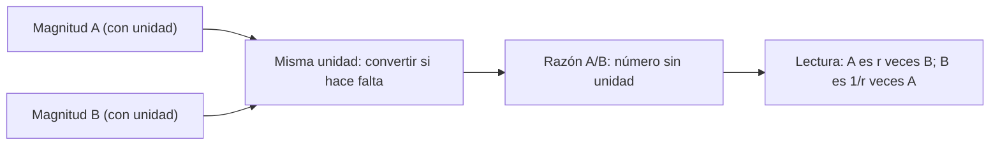

# B03-C02 — Fracciones y razones de magnitudes

<!-- nav:top -->
[🏠 Programa](../../../../README.md) · [📚 Bloque B03](../../../tronco-comun/B03-matematica-elemental-para-ciencias-espaciales.md) · [← Anterior: B03-C01 — Números y operaciones fundamentales](../B03-C01-numeros-y-operaciones-fundamentales/CLASE.md) · [Siguiente: B03-C03 — Porcentajes y escalas comparativas →](../B03-C03-porcentajes-y-escalas-comparativas/CLASE.md)
<!-- /nav -->

## 1. Ubicación, nivel y alcance

Segunda clase del bloque B03. En C01 aprendiste a operar con números; aquí aprendes a **comparar** dos cantidades dividiéndolas. En astronomía casi nunca importa que el Sol mida 695 700 km: importa que sea unas 109 veces más ancho que la Tierra. Nivel N0 → N1.

Verás fracciones (qué son, cómo se simplifican y se suman), razones (cocientes de magnitudes con la misma unidad), proporciones y tasas. No verás aún porcentajes (C03) ni proporcionalidad como función (C10).

## 2. Por qué esta clase existe

Una cifra aislada como «69 911 km» no dice si Júpiter es grande o pequeño. Una razón sí: Júpiter tiene un radio unas 11 veces el terrestre. Las agencias comparan masas, tamaños y distancias con razones porque la razón **no depende de la unidad elegida** y revela la escala de un vistazo.

La decisión central es: **¿cómo comparo dos magnitudes de modo que la comparación signifique lo mismo para cualquiera?** Aprenderás a construir una razón con unidades iguales, a simplificarla, a leerla en las dos direcciones y a detectar cuándo se está comparando lo que no corresponde.

## 3. Lo que podrás hacer al terminar

1. Explicar una fracción como parte de un todo y como cociente.
2. Simplificar fracciones y sumar fracciones con denominadores distintos.
3. Construir una razón entre dos magnitudes de la misma unidad y leerla en ambos sentidos.
4. Resolver una proporción (`a/b = c/d`) para hallar un dato desconocido.
5. Distinguir una razón (adimensional) de una tasa (con unidades, como km/s).
6. Comparar tamaños y masas del Sistema Solar con razones y comprobar su coherencia.

La evidencia es la **tabla de razones comentada** del ejercicio 12 (sección 20).

## 4. Con qué llegas y cómo comprobarlo

Necesitas C01. Cinco preguntas:

1. ¿Cuánto es `12 ÷ 4`? ¿Y `12 ÷ 5` como decimal?
2. ¿Qué fracción es mayor, `3/4` o `2/3`?
3. ¿Es `6/8` igual a `3/4`?
4. Si 2 cuadernos cuestan 10 monedas, ¿cuánto cuestan 5?
5. ¿Por qué `5 km ÷ 2 km` no tiene unidad?

<details>
<summary>Ver respuestas</summary>

1. 3; 2,4. 2. `3/4` (0,75 frente a 0,667). 3. Sí: ambos son 0,75. 4. 25 monedas. 5. Porque los km se cancelan: queda 2,5, un número puro.
</details>

Con cuatro o cinco aciertos, sigue. Con menos, repasa la sección 6 antes de continuar.

## 5. Un caso real: el Sol, la Tierra y la Luna en una sola línea

La NASA publica radios medios volumétricos: 695 700 km para el Sol, 6 371 km para la Tierra y 1 737,4 km para la Luna (S1). Con solo dividir, el Sol resulta unas 109 veces «más ancho» que la Tierra y la Luna casi una cuarta parte (≈ 0,27) del ancho terrestre. Además, la ficha de razones de la NASA indica que Júpiter tiene 317,8 veces la masa de la Tierra (S1). Estas razones están en cualquier texto de divulgación; aquí aprenderás a **construirlas y comprobarlas tú**. Límite: los radios medios tratan a los cuerpos como esferas, aunque no lo son exactamente.

## 6. Vocabulario

Una **fracción** `a/b` expresa `a` partes de un todo dividido en `b` partes iguales; `a` es el **numerador** y `b` el **denominador** (nunca cero). Dos fracciones son **equivalentes** si valen lo mismo (`6/8 = 3/4`). **Simplificar** es dividir numerador y denominador entre un mismo número. Una **razón** entre dos magnitudes `A` y `B` de la misma clase es el cociente `A/B`. Una **proporción** es la igualdad de dos razones. Una **tasa** es un cociente de magnitudes de clases distintas (km/s). Una **cantidad adimensional** es un número puro, sin unidad. El **recíproco** de `a/b` es `b/a`.

## 7. Modelo mental: la barra de comparación

Imagina dos barras. La razón responde: ¿cuántas veces cabe la barra pequeña en la grande?



*Descripción textual:* dos cajas de entrada (A y B, cada una con su unidad) alimentan una caja que obliga a expresar ambas en la misma unidad; de ahí sale la razón, un número sin unidad, que se lee en los dos sentidos.

Analogía: medir con una regla. Decir que algo mide «3 reglas» es una razón entre su longitud y la de la regla. El límite: la regla es fija; en una razón entre dos astros ambos son datos con incertidumbre, así que la razón también la hereda.

## 8. La explicación, paso a paso

### 8.1 Qué es una fracción

`3/4` significa dividir algo en 4 partes iguales y tomar 3, o bien el resultado de `3 ÷ 4 = 0,75`. Ambas lecturas son la misma. Si el numerador es mayor que el denominador (`7/4`), la fracción supera 1. Si es menor, está entre 0 y 1.

### 8.2 Simplificar y comparar

Para simplificar, divide arriba y abajo por un mismo número: `6/8 = 3/4`. Esto funciona porque dividir numerador y denominador entre `k` equivale a multiplicar la fracción por `(1/k)/(1/k) = 1`, que no la cambia. Para comparar `3/4` con `2/3`, llévalas a un denominador común: `9/12` frente a `8/12`; gana la primera. Otra vía es pasar a decimal.

### 8.3 Sumar fracciones

No se suman denominadores. `1/3 + 1/6` necesita primero un denominador común: `2/6 + 1/6 = 3/6 = 1/2`. Justificación: solo se pueden sumar partes del mismo tamaño. Esto reaparece cuando sumes tiempos o fracciones de órbita.

### 8.4 La razón: dividir con la misma unidad

Para comparar el radio del Sol con el de la Tierra: `695 700 km ÷ 6 371 km ≈ 109,2`. Los km se cancelan, y por eso el resultado es el mismo si se expresa en metros (`695 700 000 m ÷ 6 371 000 m`). Esa independencia de la unidad es la gran ventaja de la razón. Si las unidades fueran distintas, **primero se convierten**: no se divide km entre m sin convertir (C07).

### 8.5 Leer una razón en los dos sentidos

`109,2` dice que el Sol es 109,2 veces la Tierra; su recíproco, `1/109,2 ≈ 0,00916`, dice que la Tierra es 0,916 % del Sol en radio (porcentajes en C03). Siempre escribe quién está arriba: «razón Sol/Tierra».

### 8.6 Proporciones: hallar un dato desconocido

Si dos razones son iguales, `a/b = c/d`, puedes hallar uno si conoces tres. Si en un modelo la Tierra mide 1 cm de ancho, ¿cuánto mide el Sol? Se mantiene la razón de diámetros: `x / 1 cm = 109,2`, luego `x = 109,2 cm ≈ 1,09 m`. Justificación: un modelo a escala conserva todas las razones; si una cambiara, el modelo distorsionaría.

### 8.7 Razón frente a tasa

`km ÷ km` es una razón (sin unidad). `km ÷ s` es una tasa, con unidad (km/s): dice «cuántos km por cada segundo». Ambas son cocientes, pero solo la razón es adimensional.

## 9. Magnitudes, símbolos y unidades

| Símbolo | Qué es | Unidad | Valor o nota |
|---|---|---|---|
| `R☉` | radio medio volumétrico del Sol | km | 695 700 (S1) |
| `R⊕` | radio medio volumétrico de la Tierra | km | 6 371,000 (S1) |
| `R☾` | radio medio volumétrico de la Luna | km | 1 737,4 (S1) |
| `M` | masa | 10²⁴ kg | Tierra 5,9722; Júpiter 1 898,13; Sol 1 988 400 (S1) |
| `r` | razón `A/B` | sin unidad | número puro |

## 10. Convenciones y referencias

Una razón se escribe «A/B» con A en el numerador; se nombra «A respecto de B». Los símbolos `☉`, `⊕`, `☾` se usan como subíndices de Sol, Tierra y Luna. Cuando la NASA da razones de diámetro, usa diámetros ecuatoriales; aquí usamos radios medios volumétricos, y la diferencia entre ambas elecciones se discute en 8.4 y en el ejercicio 9.

## 11. De dónde sale lo que afirmamos

| ID | Fuente | Localizador | Respalda | Estado |
|---|---|---|---|---|
| S1 | NASA NSSDC, fichas *Sun* (act. 9-may-2024), *Earth* (15-nov-2024), *Moon* (11-ene-2024), *Jupiter* (2-oct-2024) y *Planetary Fact Sheet – Ratio to Earth* (18-mar-2025) | https://nssdc.gsfc.nasa.gov/planetary/factsheet/ (páginas sunfact, earthfact, moonfact, jupiterfact, planet_table_ratio) | Radios medios volumétricos 695 700; 6 371,000; 1 737,4; 69 911 km. Masas 1 988 400; 5,9722; 0,07346; 1 898,13 × 10²⁴ kg. Razón de diámetro Luna/Tierra 0,2724 y de masa Júpiter/Tierra 317,8 | Páginas consultadas el 2026-11-05 |

Límites: son datos redondeados por la NASA; las razones calculadas aquí heredan ese redondeo. Las explicaciones de simplificación y proporciones son de la clase.

## 12. Cómo ver las razones

Esta tabla es la versión accesible de una gráfica de barras comparativas.

| Comparación | Razón | Lectura |
|---|---|---|
| Radio Sol / Tierra | 109,20 | El Sol es 109 veces más ancho |
| Radio Tierra / Luna | 3,67 | La Tierra es 3,7 veces más ancha |
| Radio Luna / Tierra | 0,2727 | La Luna mide algo más de una cuarta parte |
| Masa Júpiter / Tierra | 317,8 | Júpiter tiene 318 veces la masa |
| Masa Sol / Tierra | 332 943 | El Sol: unas 333 mil Tierras de masa |

Si la dibujas, usa escala logarítmica o varios paneles: una barra de 332 943 aplasta a las demás. Descripción larga: las razones van desde ~0,3 hasta ~3 × 10⁵, un rango de seis órdenes de magnitud.

## 13. Ejemplo trabajado: ¿cuántas Tierras caben en el Sol?

Hay dos preguntas distintas que se confunden.

**Pregunta A: ¿cuántas Tierras caben a lo ancho del Sol?** Es la razón de diámetros (o de radios): `695 700 ÷ 6 371 ≈ 109,2`. Lo comprobamos: si fuesen 109 Tierras en fila, el Sol medirá `109 × 12 742 km ≈ 1,39 × 10⁶ km`, y su diámetro es `2 × 695 700 = 1 391 400 km`. Coinciden dentro de 0,2 % (la diferencia es el 0,2 de Tierra que sobra al redondear 109,2).
**Pregunta B: ¿cuántas Tierras caben en el volumen del Sol?** Eso depende del cubo de la razón (C04, C17): del orden de `109,2³ ≈ 1,3 × 10⁶`. Cada magnitud tiene su razón; no se intercambian.

Primero **estima**: ~100 veces a lo ancho. Luego calcula. Después comprueba por una vía independiente (la fila de Tierras). Sentido físico: el Sol no es «un poco más grande»: es una escala completamente distinta.

## 14. Dos formas de comparar y cuándo fallan

**Diferencia** (`A − B`) dice cuánto más; **razón** (`A/B`) dice cuántas veces. La diferencia depende de la unidad (695 700 − 6 371 km frente a metros) y no revela la escala; la razón es independiente de la unidad. Pero la razón falla cuando `B` es cero o cuando se comparan magnitudes de clases distintas (masa con longitud). Y la diferencia es mejor si lo que importa es una separación absoluta, como la distancia entre dos naves.

## 15. Práctica guiada

**Ejercicio 1 · con los pasos indicados.** Simplifica `18/24`. *Pasos:* busca un número que divida a ambos (sección 8.2).

<details><summary>Solución comentada</summary>

Dividiendo entre 6: `18/24 = 3/4`. También valdría entre 2 y luego entre 3. Al final, no queda divisor común salvo 1.
</details>

**Ejercicio 2 · con una pista.** Suma `1/4 + 1/6`. *Pista:* denominador común 12.

<details><summary>Solución comentada</summary>

`3/12 + 2/12 = 5/12`. Si te salió `2/10`, sumaste numeradores y denominadores: error típico (sección 8.3).
</details>

**Ejercicio 3 · casi autónomo.** Calcula la razón radio Tierra / radio Luna con `6 371` y `1 737,4`. Léela en ambos sentidos.

<details><summary>Solución comentada</summary>

`6 371 ÷ 1 737,4 ≈ 3,667`; la Tierra es unas 3,7 veces más ancha. En sentido inverso, `1 737,4 ÷ 6 371 = 0,2727`: la Luna mide el 27 % (aprox.) de la Tierra. Ambas son la misma información.
</details>

## 16. Práctica autónoma, transferencia e integrador

**Ejercicio 4.** Hay `332 943` veces la masa terrestre en el Sol. Si la Tierra se representase con 1 gramo, ¿cuánto sería el Sol en kilogramos?

<details><summary>Solución comentada</summary>

`332 943 g = 332,9 kg`. La razón se mantiene aunque cambien las unidades.
</details>

**Ejercicio 5.** Un modelo a escala pone la Tierra con 2 cm de diámetro. ¿Qué diámetro tiene la Luna? Usa 0,2727.

<details><summary>Solución comentada</summary>

`2 × 0,2727 ≈ 0,55 cm`. Proporción: `x/2 = 0,2727`.
</details>

**Ejercicio 6.** ¿Es mayor `7/9` o `5/7`? Justifica sin decimales.

<details><summary>Solución comentada</summary>

Denominador común 63: `49/63` frente a `45/63`. Gana `7/9`.
</details>

**Ejercicio 7.** Dos cohetes recorren 9 000 km en 1 h y 6 000 km en 1 h. ¿Cuál es la razón de sus rapideces y qué unidad tiene?

<details><summary>Solución comentada</summary>

`9 000 ÷ 6 000 = 1,5` (km/h entre km/h): es adimensional. Cada rapidez es una tasa (con unidades); la razón entre ellas es un número puro.
</details>

**Ejercicio 8.** Un estudiante calcula `695 700 km ÷ 6 371 000 m ≈ 0,109` y dice que el Sol es 0,109 veces la Tierra. ¿Qué falló?

<details><summary>Solución comentada</summary>

Mezcló unidades (km con m). Debe convertir primero: `6 371 000 m = 6 371 km`, y el cociente es 109,2. Este error es la versión «aritmética» del caso de la sonda de B01-C04.
</details>

**Ejercicio 9 · transferencia.** La NASA da una razón de diámetros Luna/Tierra de 0,2724 (S1) y tú obtuviste 0,2727 con radios medios. Explica la diferencia.

<details><summary>Solución comentada</summary>

La NASA usa diámetros ecuatoriales (sección 10) y la Tierra es achatada; el radio medio volumétrico promedia esa forma. La diferencia de 0,1 % es esperable y no es un error de cálculo.
</details>

**Ejercicio 10 · transferencia.** Con `R☉ = 695 700 km` y `R⊕ = 6 371 km`, ¿qué razón predice el *área* de la sección del Sol frente a la de la Tierra, si el área de un círculo es proporcional al cuadrado del radio?

<details><summary>Solución comentada</summary>

La razón de áreas es la razón de radios al cuadrado: `109,2² ≈ 11 925`. Es solo un adelanto de C04 y C17; muestra que cada magnitud tiene su propia razón.
</details>

**Ejercicio 11 · transferencia.** Una página afirma «Júpiter es 11 veces más grande que la Tierra». ¿Qué falta para que la afirmación sea precisa?

<details><summary>Solución comentada</summary>

Falta decir *qué* se compara: radio (69 911/6 371 ≈ 10,97), volumen o masa (317,8). «Más grande» es ambiguo; una razón siempre nombra la magnitud.
</details>

**Ejercicio 12 · integrador.** Elabora la *tabla de razones comentada* (sección 20) para tres cuerpos del Sistema Solar con datos NASA citados: razones de radio y masa respecto de la Tierra, cada una con lectura en ambos sentidos, unidad y fuente.

<details><summary>Solución modelo</summary>

Con Júpiter, Luna y Sol: radios 10,97; 0,2727; 109,2. Masas: 317,8; 0,0123; 332 943. Se acepta cualquier terna con datos citados; se valora que cada razón esté nombrada («razón de masas Júpiter/Tierra») y comentada («Júpiter tiene unas 318 veces la masa terrestre»).
</details>

## 17. Laboratorio: razones en 40 líneas

El script [laboratorio_razones.py](laboratorio_razones.py) calcula las razones de la sección 12, comprueba que son independientes de la unidad (km frente a m) y que coinciden con las publicadas por la NASA (Luna/Tierra 0,2724 y Júpiter/Tierra 317,8) dentro de 0,3 %, y detiene la ejecución si no.

**Datos:** publicados (NASA). **Predice antes de ejecutar:** ¿cuánto saldrá el Sol/Tierra? (Unos 109.) **Resultados (2026-11-05, Python 3.12.9):** radio Sol/Tierra 109,20; Luna/Tierra 0,2727 (aproximación fraccionaria 3/11); masa Júpiter/Tierra 317,8; Sol/Tierra 332 943.

```bash
python programa/clases/B03/B03-C02-fracciones-y-razones-de-magnitudes/laboratorio_razones.py
```

**Límites:** esferas ideales; las razones heredan el redondeo de las fichas.

## 18. Errores frecuentes y cómo corregirlos

**Sumar numeradores y denominadores.** Ejercicio 2.
**Dividir magnitudes con unidades distintas.** Ejercicio 8.
**No decir quién está arriba.** «La razón es 109» sin decir de qué a qué. Ejercicio 11.
**Confundir diámetro con volumen.** Sección 13 (preguntas A y B).
**Usar la diferencia donde se necesita la razón.** Sección 14.

## 19. Cómo sabrás que vas bien

Tras 8.2: ¿sabes por qué simplificar no cambia el valor? Si no, repite el ejercicio 1. Tras 8.4: ¿puedes explicar por qué una razón no depende de la unidad? Si no, rehaz el ejercicio 4. Tras el ejemplo: ¿distingues «a lo ancho» de «en volumen»? Si dudas, vuelve al ejercicio 10. Al final: ¿escribes la lectura de una razón en ambos sentidos? Si no, repasa 8.5.

## 20. Qué entregas y cómo se evalúa

El producto es tu **tabla de razones comentada**: razones de tamaño y de masa entre cuerpos del Sistema Solar, cada una con fuente, unidad común, lectura en ambos sentidos y una advertencia de límites.

| Criterio | Inicial | En desarrollo | Logrado | Destacado |
|---|---|---|---|---|
| Construcción de razones | Unidades mezcladas | Algunas correctas | Todas correctas | Verifica independencia de unidad |
| Lectura | Una dirección | Con ayuda | Ambas direcciones | Explica la elección de quién va arriba |
| Fuentes | Sin cita | Cita parcial | Cita completa | Compara dos fuentes |
| Coherencia | Cifras sin chequeo | Chequeo parcial | Chequeo por vía independiente | Explica una discrepancia |
| Claridad | Confusa | Entendible | Reproducible | Autoevaluada |

**Condiciones críticas:** no mezclar unidades; no comparar magnitudes de distinta clase; citar solo fuentes consultadas.

## 21. Ética, seguridad y límites

Una razón mal construida engaña con apariencia de precisión. Declarar qué se compara y con qué dato es honestidad científica. La clase es educativa y no sirve para dimensionar hardware. Accesibilidad: tablas equivalentes, ecuaciones en texto, sin conexión.

## 22. Para cerrar y seguir

Una razón compara dos magnitudes de la misma clase y se libera de la unidad; una proporción permite hallar lo desconocido manteniendo la escala. Queda una pregunta: ¿cómo expresar una razón de modo que se entienda a primera vista? Los porcentajes de C03.

**Glosario español–inglés.** fracción · *fraction*; numerador · *numerator*; denominador · *denominator*; razón · *ratio*; proporción · *proportion*; tasa · *rate*; recíproco · *reciprocal*; adimensional · *dimensionless*.

**Continuidad.** B03-C03 reutiliza tu manejo de razones para expresarlas en porcentajes y comparar cambios. B03-C10 las convierte en proporcionalidad.

**Referencias:** ver sección 11. Todas las fuentes son datos oficiales consultados.

<!-- nav:bottom -->
---

[← Anterior: B03-C01 — Números y operaciones fundamentales](../B03-C01-numeros-y-operaciones-fundamentales/CLASE.md) · [📚 Bloque B03](../../../tronco-comun/B03-matematica-elemental-para-ciencias-espaciales.md) · [Siguiente: B03-C03 — Porcentajes y escalas comparativas →](../B03-C03-porcentajes-y-escalas-comparativas/CLASE.md)
<!-- /nav -->
