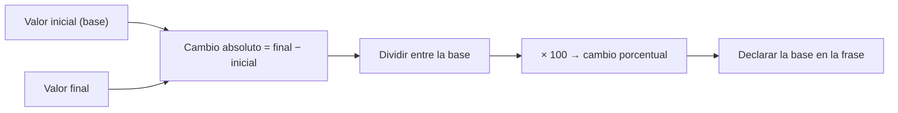

# B03-C03 — Porcentajes y escalas comparativas

<!-- nav:top -->
[🏠 Programa](../../../../README.md) · [📚 Bloque B03](../../../tronco-comun/B03-matematica-elemental-para-ciencias-espaciales.md) · [← Anterior: B03-C02 — Fracciones y razones de magnitudes](../B03-C02-fracciones-y-razones-de-magnitudes/CLASE.md) · [Siguiente: B03-C04 — Potencias y raíces →](../B03-C04-potencias-y-raices/CLASE.md)
<!-- /nav -->

## 1. Ubicación, nivel y alcance

Tercera clase del bloque B03. En C02 comparaste cantidades con razones; aquí aprendes a expresar esa comparación como porcentaje y, sobre todo, a medir **cuánto cambia** algo respecto de un punto de partida. En ciencias espaciales los porcentajes aparecen en errores de medida, variaciones de distancia y diferencias entre valores publicados. Nivel N0 → N1.

Verás qué es un porcentaje, cómo se calcula un cambio porcentual, la diferencia entre porcentaje y punto porcentual, y por qué subir y bajar el mismo porcentaje no devuelve al origen. No verás todavía incertidumbre formal (C19, B12).

## 2. Por qué esta clase existe

La Tierra no gira en un círculo: su distancia al Sol varía a lo largo del año. ¿Mucho o poco? Dicho en millones de kilómetros no se aprecia; dicho en porcentaje, sí. Los porcentajes sirven para decir **cuánto** de forma comparable entre contextos: la misma variación del 3 % puede ser insignificante en una distancia y crítica en un combustible.

La decisión central es: **¿respecto de qué base expreso este cambio, y cómo lo comunico sin que se malinterprete?** Aprenderás a elegir la base, a calcular cambios y a leer con sospecha los titulares con porcentajes.

## 3. Lo que podrás hacer al terminar

1. Expresar una razón como porcentaje y viceversa.
2. Calcular un porcentaje de una cantidad y el cambio porcentual entre dos valores.
3. Explicar por qué el cambio de A a B y de B a A no tienen el mismo porcentaje.
4. Distinguir porcentaje de punto porcentual.
5. Calcular un error relativo porcentual frente a un valor de referencia.
6. Detectar bases ambiguas en una afirmación («50 % menor»).

La evidencia es la **tabla de cambios porcentuales** del ejercicio 12 (sección 20).

## 4. Con qué llegas y cómo comprobarlo

Necesitas C01 y C02. Cinco preguntas:

1. ¿Cuánto es `1/4` como decimal?
2. ¿Cuánto es la mitad de la mitad de 80?
3. ¿Qué es mayor, `2/5` o `0,45`?
4. Si 3 de 12 estudiantes llegaron tarde, ¿qué fracción es?
5. ¿Qué significa «razón entre A y B»?

<details>
<summary>Ver respuestas</summary>

1. 0,25. 2. 20. 3. `0,45`. 4. `3/12 = 1/4`. 5. El cociente `A/B`, en la misma unidad (C02).
</details>

Con cuatro o cinco aciertos, sigue; si no, repasa C02.

## 5. Un caso real: cuánto cambia la distancia entre la Tierra y el Sol

La NASA publica para la Tierra un perihelio de 147,095 millones de km, un afelio de 152,100 millones y un semieje mayor de 149,598 millones (S1). El afelio es mayor que el perihelio en 5,005 millones de km. ¿Es mucho? En porcentaje, sobre el perihelio, es `5,005 / 147,095 ≈ 3,40 %`; sobre el semieje mayor, `3,35 %`. En ambos casos la distancia varía unos tres puntos de cada cien: la órbita terrestre es casi circular. Límite: estas cifras son valores medios de la ficha; la distancia real varía con el tiempo.

## 6. Vocabulario

Un **porcentaje** es una razón expresada «por cada cien»: `25 % = 25/100 = 0,25`. Su símbolo es `%`. La **base** (o referencia) es la cantidad respecto de la cual se expresa el porcentaje. El **cambio absoluto** es `final − inicial`. El **cambio relativo** es el cambio absoluto dividido entre la base: `(final − inicial) / inicial`; expresado en porcentaje es el **cambio porcentual**. El **error relativo** compara un valor medido o calculado con uno de referencia: `|medido − referencia| / referencia`. Un **punto porcentual** es la diferencia entre dos porcentajes: pasar de 20 % a 25 % es un aumento de 5 puntos porcentuales, que es un cambio relativo de 25 %.

## 7. Modelo mental: la base manda

Todo porcentaje responde «de qué». Cambiar la base cambia el número.



*Descripción textual:* dos valores (inicial y final) generan el cambio absoluto; este se divide entre la base, se multiplica por 100 y el resultado se acompaña de la base que se usó.

Analogía: una rebaja del 20 % sobre el precio original; si luego subes un 20 % sobre el precio rebajado, no vuelves al original. El límite de la analogía: los precios cambian por decisión; en la naturaleza las dos bases (antes y después) son simplemente dos estados, y ninguna es «la correcta» a priori.

## 8. La explicación, paso a paso

### 8.1 Del decimal al porcentaje y vuelta

Multiplicar por 100 pasa de razón a porcentaje; dividir entre 100 lo devuelve. `0,2727 → 27,27 %`. Con la Luna y la Tierra: la masa lunar es `0,07346 / 5,9722 = 0,0123`, es decir, `1,23 %` de la masa terrestre.

### 8.2 Porcentaje de una cantidad

El 25 % de 384 400 km es `0,25 × 384 400 = 96 100 km`. Justificación: «por cada cien» significa multiplicar por la razón `p/100`.

### 8.3 Cambio porcentual y por qué la base importa

Si el valor pasa de `x₀` a `x₁`, el cambio porcentual respecto de `x₀` es `(x₁ − x₀)/x₀ × 100`. Con el perihelio y el afelio de la Tierra:

- De perihelio a afelio: `(152,100 − 147,095)/147,095 × 100 = +3,40 %`.
- De afelio a perihelio: `(147,095 − 152,100)/152,100 × 100 = −3,29 %`.

Los mismos dos valores dan dos porcentajes distintos porque la base cambia. Ninguno es un error; lo que sí es un error es no decir cuál se usa.

### 8.4 Aumentos y disminuciones sucesivos

Un aumento del 50 % multiplica por 1,5; una disminución del 50 % multiplica por 0,5. Hacer ambos seguidos: `1,5 × 0,5 = 0,75`, o sea, −25 %. No se anulan, porque la segunda operación toma como base el valor ya modificado. Regla útil: los factores se multiplican; los porcentajes no se suman.

### 8.5 Punto porcentual frente a porcentaje

Si una proporción pasa de 20 % a 25 %, subió 5 puntos porcentuales (diferencia de porcentajes) y subió 25 % en términos relativos (`5/20`). Confundirlos cambia el titular.

### 8.6 Error relativo porcentual

Para evaluar un cálculo frente a una referencia: `error relativo = |calculado − referencia| / referencia`. El período lunar de C01 (27,353 d) frente al publicado (27,3217 d) da `0,0313 / 27,3217 ≈ 0,115 %`. Un error pequeño no demuestra que el modelo sea correcto, solo que concuerda en ese caso.

## 9. Magnitudes, símbolos y unidades

| Símbolo | Qué es | Unidad | Valor o nota |
|---|---|---|---|
| `p` | porcentaje | % | `p = 100 × razón` |
| `x₀`, `x₁` | valor inicial y final | la de la magnitud | — |
| `Δx` | cambio absoluto `x₁ − x₀` | la de la magnitud | — |
| `ε` | error relativo | % o sin unidad | `|calc − ref| / ref` |
| perihelio / afelio | distancias mínima y máxima al Sol | 10⁶ km | 147,095 / 152,100 (S1) |
| `G` | constante de gravitación | m³ kg⁻¹ s⁻² | 6,67408e-11 (CODATA 2014, S3) y 6,67430e-11 (CODATA 2022, S2) |

## 10. Convenciones y referencias

El símbolo `%` se escribe separado del número por un espacio en este programa (`3,40 %`). Los cambios llevan signo: `+` aumento y `−` disminución. Un error relativo se da en valor absoluto. Siempre se escribe la base: «3,40 % sobre el perihelio».

## 11. De dónde sale lo que afirmamos

| ID | Fuente | Localizador | Respalda | Estado |
|---|---|---|---|---|
| S1 | NASA NSSDC, *Earth Fact Sheet* (act. 15-nov-2024) y *Moon Fact Sheet* (11-ene-2024) | https://nssdc.gsfc.nasa.gov/planetary/factsheet/earthfact.html y .../moonfact.html | Perihelio 147,095; afelio 152,100; semieje 149,598 (10⁶ km). Luna: masa 0,07346 × 10²⁴ kg; perigeo medio 0,3633 y apogeo medio 0,4055 (10⁶ km); período «Revolution» 27,3217 d. Tierra: masa 5,9722 × 10²⁴ kg | Páginas consultadas el 2026-11-05 |
| S2 | NIST, CODATA, valor de la constante de gravitación newtoniana G | https://physics.nist.gov/cgi-bin/cuu/Value?bg | G = 6,674 30 × 10⁻¹¹ m³ kg⁻¹ s⁻² (u = 0,000 15 × 10⁻¹¹), CODATA 2022 | Página consultada el 2026-11-05 |
| S3 | IAU 2015, Resolución B3 (Mamajek et al., arXiv:1510.07674) | https://arxiv.org/abs/1510.07674 | Cita G (CODATA 2014) = 6,67408 (±0,00031) × 10⁻¹¹ en su recomendación 5 | PDF leído el 2026-11-05 |
| S4 | NASA NSSDC, *Planetary Fact Sheet – Ratio to Earth* (act. 18-mar-2025) | https://nssdc.gsfc.nasa.gov/planetary/factsheet/planet_table_ratio.html | Diámetro de Marte 0,532 veces el de la Tierra | Página consultada el 2026-11-05 |

Límites: no se contrastaron los dos valores de G con los informes originales de CODATA; se citan tal como aparecen en S2 y S3.

## 12. Cómo ver los cambios

Versión accesible de un gráfico de barras de variaciones.

| Comparación | Base | Cambio |
|---|---|---|
| Afelio frente a perihelio | perihelio | +3,40 % |
| Perihelio frente a afelio | afelio | −3,29 % |
| Apogeo medio frente a perigeo medio de la Luna | perigeo | +11,6 % |
| G (CODATA 2022 frente a 2014) | G de 2014 | +0,0033 % |

Si dibujas, usa una línea de base en cero, etiqueta la base en cada barra y distingue signos por forma. Descripción larga: la variación de la órbita lunar (≈ 12 %) es unas tres veces la de la Tierra (≈ 3 %); el cambio en G es cien mil veces menor.

## 13. Ejemplo trabajado: cuánto varía la distancia a la Luna

Datos: perigeo medio `363 300 km` y apogeo medio `405 500 km` (S1).

**Paso 1 · cambio absoluto.** `405 500 − 363 300 = 42 200 km`.
**Paso 2 · base.** Elegimos el perigeo (el valor «de partida» al alejarse).
**Paso 3 · porcentaje.** `42 200 / 363 300 = 0,1162 → +11,6 %`.
**Paso 4 · comprobación.** Si tomamos el apogeo como base: `42 200/405 500 = 10,4 %`. Las dos bases dan resultados cercanos pero no iguales, igual que en 8.3.
**Paso 5 · estimación previa.** Los extremos difieren en un 10 % aproximadamente: razonable para una órbita con excentricidad ~0,05 (la ficha da 0,0549).
**Sentido físico.** La Luna parece más grande en el perigeo: el diámetro aparente cambia en esa misma proporción, algo apreciable al medirlo.

## 14. Porcentaje o razón: cuándo conviene cada uno

El **porcentaje** es inmediato para cambios y errores ( «+3,4 %» ). La **razón** (`1,034`) es mejor para multiplicar: el factor que lleva de un valor al otro. Si la razón es muy grande (332 943) el porcentaje se vuelve ilegible (33 294 300 %). Y para comparar escalas muy distintas conviene cambiar a órdenes de magnitud (C05). Elige según lo que el lector necesita hacer.

## 15. Práctica guiada

**Ejercicio 1 · con los pasos indicados.** ¿Cuánto es el 25 % de 384 400 km? *Pasos:* convierte 25 % a decimal y multiplica (8.2).

<details><summary>Solución comentada</summary>

`0,25 × 384 400 = 96 100 km`. Si te salió 9 610 000 multiplicaste por 25 en vez de 0,25.
</details>

**Ejercicio 2 · con una pista.** Expresa la masa de la Luna (`0,07346 × 10²⁴ kg`) como porcentaje de la de la Tierra (`5,9722 × 10²⁴ kg`). *Pista:* razón × 100.

<details><summary>Solución comentada</summary>

`0,07346/5,9722 = 0,0123 → 1,23 %`. Las potencias de diez se cancelan al dividir.
</details>

**Ejercicio 3 · casi autónomo.** Calcula el cambio porcentual de la distancia Tierra-Sol del perihelio (147,095) al afelio (152,100).

<details><summary>Solución comentada</summary>

`(152,100 − 147,095)/147,095 = 0,0340 → +3,40 %`.
</details>

## 16. Práctica autónoma, transferencia e integrador

**Ejercicio 4.** Calcula el cambio del afelio al perihelio y explica por qué no es −3,40 %.

<details><summary>Solución comentada</summary>

`−5,005/152,100 = −3,29 %`. La base es otra (afelio), mayor, así que el mismo cambio absoluto es una fracción menor.
</details>

**Ejercicio 5.** Un valor sube 50 % y luego baja 50 %. ¿Cuál es el cambio total?

<details><summary>Solución comentada</summary>

`1,5 × 0,5 = 0,75`: −25 %. Los factores se multiplican (8.4).
</details>

**Ejercicio 6.** Un porcentaje pasa de 20 % a 25 %. Da el cambio en puntos porcentuales y en cambio relativo.

<details><summary>Solución comentada</summary>

+5 puntos porcentuales; relativo `5/20 = +25 %`.
</details>

**Ejercicio 7.** Calcula el error relativo de 27,353 d frente a 27,3217 d.

<details><summary>Solución comentada</summary>

`|27,353 − 27,3217|/27,3217 = 0,0313/27,3217 = 0,115 %`. Está dentro del 0,5 % que usó el laboratorio de C01.
</details>

**Ejercicio 8.** El diámetro de Marte es 0,532 veces el terrestre (S4). Exprésalo como porcentaje y escribe dos frases correctas.

<details><summary>Solución comentada</summary>

53,2 %. «Marte mide el 53,2 % del diámetro terrestre» y «Marte es 46,8 % más pequeño que la Tierra». Ambas dicen lo mismo con bases explícitas.
</details>

**Ejercicio 9 · transferencia.** Entre CODATA 2014 y 2022 el valor de G pasó de `6,67408` a `6,67430` (× 10⁻¹¹). Calcula el cambio porcentual y comenta si importa para estimar una distancia lunar con un 1 % de error.

<details><summary>Solución comentada</summary>

`0,00022/6,67408 = +0,0033 %`. Es unas 300 veces menor que el 1 %, así que no afecta a una estimación a ese nivel. Sí importaría en una medida de precisión muy alta.
</details>

**Ejercicio 10 · transferencia.** La energía solar recibida es proporcional a `1/d²` (se justifica en C10). Con `d_perihelio = 147,095` y `d_afelio = 152,100`, calcula en qué porcentaje excede la recibida en el perihelio a la del afelio.

<details><summary>Solución comentada</summary>

Razón `(152,100/147,095)² = 1,0692`: el perihelio recibe un 6,9 % más que el afelio. El cambio de distancia de 3,4 % se duplica aproximadamente porque `d` está elevado al cuadrado (preview de C04).
</details>

**Ejercicio 11 · transferencia.** Un titular dice «Marte es 50 % más pequeño que la Tierra». ¿Qué base usa, es exacto y cómo lo reescribirías?

<details><summary>Solución comentada</summary>

La base implícita es la Tierra. En diámetro, Marte es 46,8 % más pequeño (53,2 % del terrestre); «50 %» es un redondeo grueso. Una versión precisa: «el diámetro de Marte es el 53 % del terrestre (NASA)».
</details>

**Ejercicio 12 · integrador.** Elabora tu *tabla de cambios porcentuales* (sección 20) con al menos tres comparaciones astronómicas con datos NASA citados, cada una con base, cambio absoluto, cambio relativo y lectura en frase.

<details><summary>Solución modelo</summary>

Ejemplo: perihelio→afelio terrestre (+3,40 %), perigeo→apogeo lunar (+11,6 %), CODATA 2014→2022 de G (+0,0033 %). Cada fila incluye la fórmula, las cifras y la frase con la base. Se acepta cualquier terna con fuente.
</details>

## 17. Laboratorio: porcentajes en 40 líneas

El script [laboratorio_porcentajes.py](laboratorio_porcentajes.py) calcula los cambios de las secciones 8.3 y 8.4 y los de G, con pruebas contra casos exactos (`100 → 150` es `+50 %`; `+50 %` y `−50 %` dan `75`).

**Datos:** publicados (NASA, NIST, IAU). **Predice antes de ejecutar:** ¿el cambio de afelio a perihelio será mayor o menor que 3,40 % en valor absoluto? (Menor.) **Resultados (2026-11-05, Python 3.12.9):** `(afelio − perihelio)/semieje = 3,35 %`; afelio respecto del perihelio `+3,40 %`; perihelio respecto del afelio `−3,29 %`; cambio de G entre 2014 y 2022 `+0,0033 %`; masa de la Luna `1,23 %` de la terrestre.

```bash
python programa/clases/B03/B03-C03-porcentajes-y-escalas-comparativas/laboratorio_porcentajes.py
```

**Límites:** compara valores publicados, no los recalcula; las distancias son medias.

## 18. Errores frecuentes y cómo corregirlos

**Olvidar la base.** Ejercicios 4 y 11.
**Sumar porcentajes sucesivos.** Ejercicio 5.
**Confundir punto porcentual con porcentaje.** Ejercicio 6.
**Poner el 100 mal.** Multiplicar por 25 en vez de 0,25. Ejercicio 1.
**Usar porcentajes con razones enormes.** Sección 14.

## 19. Cómo sabrás que vas bien

Tras 8.3: ¿puedes explicar por qué +3,40 % y −3,29 % describen el mismo cambio? Si no, repite el ejercicio 4. Tras 8.4: ¿calculas sin ayuda el efecto de +20 % y −20 %? (`0,96`: −4 %.) Si no, relee. Tras el ejemplo: ¿cambiarías la base y verías cómo se mueve el resultado? Al final: ¿escribes cada porcentaje con su base? Si dudas, revisa el ejercicio 11.

## 20. Qué entregas y cómo se evalúa

El producto es tu **tabla de cambios porcentuales**: al menos tres comparaciones con base explícita, cambio absoluto, porcentaje, frase de lectura y fuente.

| Criterio | Inicial | En desarrollo | Logrado | Destacado |
|---|---|---|---|---|
| Base explícita | Ausente | Algunas filas | Todas | Compara dos bases y explica |
| Cálculo | Errores | Aciertos parciales | Correcto | Verificado por vía distinta |
| Distinción % / puntos | Confunde | Con ayuda | Distingue | Detecta el error en un titular |
| Fuentes | Sin cita | Parcial | Completa | Declara límites de los datos |
| Redacción | Ambigua | Entendible | Precisa | Reproducible |

**Condiciones críticas:** no omitir la base; no confundir punto porcentual con porcentaje; citar solo fuentes consultadas.

## 21. Ética, seguridad y límites

Los porcentajes sin base son una forma habitual de desinformación. Reportar la base es una obligación de honestidad. La clase es educativa y no sirve para evaluar riesgos de misión. Accesibilidad: tablas equivalentes, ecuaciones en texto, sin conexión.

## 22. Para cerrar y seguir

Un porcentaje es una razón por cien, y su significado depende de la base; los cambios sucesivos se multiplican y los errores se miden contra una referencia. Queda una pregunta: la razón de las energías creció más que la de las distancias, porque `d` aparece al cuadrado. ¿Cómo operar con esos cuadrados y cubos? Es C04.

**Glosario español–inglés.** porcentaje · *percentage*; punto porcentual · *percentage point*; cambio relativo · *relative change*; error relativo · *relative error*; base · *baseline*; valor de referencia · *reference value*.

**Continuidad.** B03-C04 retoma la idea de que el cuadrado de un cambio produce otro cambio, con potencias y raíces. B03-C19 usará el error relativo para propagar redondeos.

**Referencias:** ver sección 11. Todas las fuentes son datos oficiales consultados.

<!-- nav:bottom -->
---

[← Anterior: B03-C02 — Fracciones y razones de magnitudes](../B03-C02-fracciones-y-razones-de-magnitudes/CLASE.md) · [📚 Bloque B03](../../../tronco-comun/B03-matematica-elemental-para-ciencias-espaciales.md) · [Siguiente: B03-C04 — Potencias y raíces →](../B03-C04-potencias-y-raices/CLASE.md)
<!-- /nav -->
