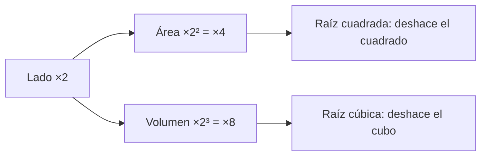

# B03-C04 — Potencias y raíces

<!-- nav:top -->
[🏠 Programa](../../../../README.md) · [📚 Bloque B03](../../../tronco-comun/B03-matematica-elemental-para-ciencias-espaciales.md) · [← Anterior: B03-C03 — Porcentajes y escalas comparativas](../B03-C03-porcentajes-y-escalas-comparativas/CLASE.md) · [Siguiente: B03-C05 — Notación científica y órdenes de magnitud →](../B03-C05-notacion-cientifica-y-ordenes-de-magnitud/CLASE.md)
<!-- /nav -->

## 1. Ubicación, nivel y alcance

Cuarta clase del bloque B03. Hasta ahora has sumado, multiplicado y comparado. Esta clase añade la operación que aparece por todas partes en la física del espacio: **multiplicar un número por sí mismo varias veces** (potencia) y la operación inversa (raíz). El área de un círculo, el volumen de una esfera, la energía recibida del Sol y la tercera ley de Kepler son potencias. Nivel N0 → N1.

Verás potencias con exponente entero, cero, negativo y fraccionario, sus reglas con justificación, raíces cuadradas y cúbicas, y cómo usarlas para predecir el período orbital de un planeta. La notación científica (potencias de diez) se desarrolla en C05.

## 2. Por qué esta clase existe

En 1619 Johannes Kepler publicó que el cuadrado del período de un planeta es proporcional al cubo del tamaño de su órbita. Hoy esa relación sigue sirviendo para estimar el período de cualquier objeto que orbita otro conocido. Pero no puedes ni enunciarla, ni usarla, sin saber qué significa elevar al cuadrado, al cubo o a 3/2.

La decisión central es: **¿qué relación hay entre una magnitud y su cuadrado, su cubo o su raíz, y cómo paso de una a otra sin perder el sentido físico?** Aprenderás las reglas, por qué valen, y las usarás con los ocho planetas.

## 3. Lo que podrás hacer al terminar

1. Interpretar `aⁿ` como multiplicación repetida y explicar `a⁰ = 1` y `a⁻ⁿ = 1/aⁿ`.
2. Aplicar las reglas de producto, cociente y potencia de una potencia.
3. Calcular raíces cuadradas y cúbicas y expresarlas como exponentes fraccionarios.
4. Explicar por qué duplicar un lado cuadruplica un área y octuplica un volumen.
5. Usar `T² = a³` (con `T` en años y `a` en au) para predecir un período o un semieje.
6. Valorar cuánto se desvía una predicción de un dato publicado.

La evidencia es la **hoja de predicciones de Kepler** del ejercicio 12 (sección 20).

## 4. Con qué llegas y cómo comprobarlo

Necesitas C01 a C03. Cinco preguntas:

1. ¿Cuánto es `3 × 3 × 3`?
2. ¿Cuánto es `5²`? ¿Y `10³`?
3. ¿Qué número multiplicado por sí mismo da 49?
4. Si un cuadrado tiene lado 2 cm, ¿qué área tiene?
5. Si duplicas el lado a 4 cm, ¿cuántas veces mayor es el área?

<details>
<summary>Ver respuestas</summary>

1. 27. 2. 25; 1 000. 3. 7. 4. 4 cm². 5. Es 16 cm²: cuatro veces. Esa es la idea central de la sección 8.5.
</details>

Con cuatro o cinco aciertos, sigue; con menos, revisa C01 y C03.

## 5. Un caso real: los ocho planetas siguen una misma regla

La NASA publica para cada planeta el semieje mayor de su órbita y su período sidéreo (S1). Si pasas el semieje a unidades astronómicas (1 au = 149 597 870 700 m exactos, S2) y el período a años terrestres (365,256 d), ocurre algo notable: el cuadrado del período y el cubo del semieje salen casi iguales para los ocho planetas. Marte: `T = 1,881 años`, `T² = 3,537`; `a = 1,524 au`, `a³ = 3,538`. Nadie «puso» esa regla en los datos; los datos la cumplen. Límite: la regla es aproximada porque los planetas se perturban entre sí y porque la masa del planeta no es cero; en la sección 12 verás qué tan buena es.

## 6. Vocabulario

Una **potencia** `aⁿ` es `a` multiplicado por sí mismo `n` veces; `a` es la **base** y `n` el **exponente**. El **cuadrado** de `a` es `a²`; el **cubo**, `a³`. Una **raíz cuadrada** `√x` es el número positivo que, elevado al cuadrado, da `x`; una **raíz cúbica** `∛x` es el que, elevado al cubo, da `x`. Un **exponente fraccionario** como `3/2` combina una potencia y una raíz. La **tercera ley de Kepler** afirma que, para los cuerpos que orbitan el mismo astro, `T²/a³` es constante. Una **unidad astronómica** (au) es una unidad de longitud definida exactamente como 149 597 870 700 m.

## 7. Modelo mental: cuadrados que cuentan casillas y cubos que cuentan cajas

Un cuadrado de lado 3 se llena con `3 × 3 = 9` casillas; un cubo de arista 3, con `3 × 3 × 3 = 27` cajas. Duplicar el lado multiplica por 4 las casillas y por 8 las cajas.



*Descripción textual:* de una caja «lado ×2» salen dos flechas: una hacia «área ×4» y otra hacia «volumen ×8»; cada resultado vuelve a su valor original con su raíz correspondiente.

Analogía: un tablero de ajedrez ampliado al doble. No tiene el doble de casillas sino el cuádruple. El límite: la analogía funciona con figuras semejantes; si cambia la forma, el factor cambia.

## 8. La explicación, paso a paso

### 8.1 Potencia como multiplicación repetida

`2⁵ = 2 × 2 × 2 × 2 × 2 = 32`. El exponente cuenta **cuántas veces aparece la base como factor**, no cuántas veces se multiplica por la base ni por el exponente (`2⁵ ≠ 2 × 5`).

### 8.2 Reglas y por qué valen

- **Producto de potencias de igual base:** `aᵐ · aⁿ = aᵐ⁺ⁿ`. Porque `a³ · a² = (a·a·a)(a·a) = a⁵`: se cuentan los factores.
- **Cociente:** `aᵐ / aⁿ = aᵐ⁻ⁿ`. Porque se cancelan factores iguales arriba y abajo.
- **Potencia de potencia:** `(aᵐ)ⁿ = aᵐⁿ`. Porque `(a²)³ = a²·a²·a² = a⁶`.
- **Potencia de un producto:** `(ab)ⁿ = aⁿbⁿ`.

Ojo: `(a + b)² ≠ a² + b²`. Con `a = 3`, `b = 4`: `(3+4)² = 49` y `3² + 4² = 25`.

### 8.3 Exponente cero y negativo

¿Qué debe valer `a⁰`? Si la regla del cociente ha de seguir valiendo, `a³/a³ = a⁰`; pero `a³/a³ = 1`; luego `a⁰ = 1`. Del mismo modo `a²/a⁵ = a⁻³`, y por cancelación `a²/a⁵ = 1/a³`; luego `a⁻ⁿ = 1/aⁿ`. Así `10⁻³ = 1/1 000 = 0,001`. Los exponentes negativos no dan números negativos: dan **recíprocos**.

### 8.4 Raíces como exponentes fraccionarios

Si `√a` es el número que al cuadrado da `a`, entonces `(a^(1/2))² = a^(1/2 · 2) = a`, así que `a^(1/2) = √a` (por la regla 8.2). En general `a^(1/n)` es la raíz `n`-ésima. Y `a^(3/2) = (√a)³ = √(a³)`: primero raíz y luego cubo, o al revés. Eso será la clave de Kepler: `T = a^(3/2)`.

### 8.5 Cuadrados y cubos en geometría

Si el lado de una figura se multiplica por `k`, el área se multiplica por `k²` y el volumen por `k³`. Ejemplo: el radio del Sol es unas 109,2 veces el terrestre (C02). Su sección frontal es `109,2² ≈ 11 900` veces mayor y su volumen `109,2³ ≈ 1,3 × 10⁶` veces mayor. Por eso el Sol cabe más de un millón de Tierras (en volumen) aunque «solo» sea unas cien veces más ancho.

### 8.6 La tercera ley de Kepler como cálculo

Con `T` en años y `a` en au, la regla `T² = a³` se simplifica porque para la Tierra ambos valen 1. Para predecir el período de un planeta de semieje `a`: `T = a^(3/2)`. Para Venus, `a = 0,7233 au`: `a^(3/2) = 0,7233 × √0,7233 = 0,7233 × 0,8505 = 0,6152 años = 224,7 d`. La NASA publica 224,701 d (S1): coincidencia total.

## 9. Magnitudes, símbolos y unidades

| Símbolo | Qué es | Unidad | Valor o nota |
|---|---|---|---|
| `a` | semieje mayor de la órbita | au (o km) | de S1 |
| `T` | período orbital sidéreo | años (o d) | de S1 |
| `aⁿ` | potencia de base `a`, exponente `n` | depende | — |
| `√x`, `∛x` | raíz cuadrada y cúbica | misma que `x` en potencia 1/2, 1/3 | — |
| 1 au | unidad astronómica | m | 149 597 870 700 exactos (S2) |
| 1 año (terrestre sidéreo) | período de la Tierra | d | 365,256 (S1) |

## 10. Convenciones y referencias

`aⁿ` se escribe `a^n` en código (`a**n` en Python). Los exponentes fraccionarios se escriben `a^(3/2)` con paréntesis. En esta clase el período `T` se mide en años terrestres sidéreos (365,256 d) y la longitud en au. Un cálculo de `T²` con `T` en días no da 1 para la Tierra: da `133 412`; por eso la unidad importa.

## 11. De dónde sale lo que afirmamos

| ID | Fuente | Localizador | Respalda | Estado |
|---|---|---|---|---|
| S1 | NASA NSSDC, fichas de Mercurio, Venus, Tierra, Marte, Júpiter, Saturno, Urano y Neptuno (act. 11-ene-2024 a 19-may-2025) | https://nssdc.gsfc.nasa.gov/planetary/factsheet/ (mercuryfact … neptunefact .html) | Semieje mayor (10⁶ km) y período sidéreo (d) de cada planeta: Mercurio 57,909 y 87,969; Venus 108,210 y 224,701; Tierra 149,598 y 365,256; Marte 227,956 y 686,980; Júpiter 778,479 y 4 332,589; Saturno 1 432,041 y 10 755,699; Urano 2 867,043 y 30 685,400; Neptuno 4 514,953 y 60 189,018 | Páginas consultadas el 2026-11-05 |
| S2 | BIPM, *The International System of Units (SI)*, 9.ª ed. (2019), tabla 8 | https://doi.org/10.59161/AUEZ1291 | 1 au = 149 597 870 700 m | PDF leído el 2026-11-05 |

Límites: la tercera ley es un modelo (órbitas keplerianas, masa planetaria despreciable); no se consultó ningún texto histórico, y la fecha de publicación de Kepler que se menciona en la sección 2 proviene de conocimiento general y no se cita como dato verificado.

## 12. Cómo ver la regla

Versión accesible de una gráfica de `T` frente a `a`.

| Planeta | `a` (au) | `T` (años) | `a^(3/2)` | `T²/a³` |
|---|---|---|---|---|
| Mercurio | 0,3871 | 0,241 | 0,241 | 1,0000 |
| Venus | 0,7233 | 0,615 | 0,615 | 1,0000 |
| Tierra | 1,0000 | 1,000 | 1,000 | 1,0000 |
| Marte | 1,5238 | 1,881 | 1,881 | 0,9998 |
| Júpiter | 5,2038 | 11,862 | 11,871 | 0,9985 |
| Saturno | 9,5726 | 29,447 | 29,617 | 0,9885 |
| Urano | 19,165 | 84,011 | 83,900 | 1,0026 |
| Neptuno | 30,181 | 164,786 | 165,803 | 0,9878 |

Si dibujas, usa escala logarítmica en ambos ejes (los puntos caen sobre una recta) y distingue los planetas por forma. Descripción larga: de Mercurio a Neptuno, `a` crece unas 78 veces y `T` unas 684 veces; `T²/a³` queda entre 0,988 y 1,003.

## 13. Ejemplo trabajado: predecir el período de Marte

Datos: `a = 227,956 × 10⁶ km` (S1). Pregunta: ¿cuál es su período según Kepler?

**Paso 1 · a en au.** `227,956 × 10⁶ ÷ 149,597 870 7 × 10⁶ = 1,5238 au`.
**Paso 2 · estimación.** Marte está algo más lejos que 1,5 au: `1,5^(3/2) = 1,5 × 1,225 = 1,84` años. El resultado debe rondar 1,9.
**Paso 3 · cálculo.** `√1,5238 = 1,2344`; `T = 1,5238 × 1,2344 = 1,8810 años`.
**Paso 4 · a días.** `1,8810 × 365,256 = 687,0 d`.
**Paso 5 · comparación.** NASA: 686,980 d. Diferencia relativa ≈ 0,003 %.
**Sentido físico.** Con solo la distancia al Sol puedes predecir cuándo vuelve Marte a la misma posición respecto de las estrellas: algo menos de dos años terrestres.

## 14. Comparación de métodos

**Con exponente fraccionario** (`a**1.5`) es directo y cabe en una línea. **Con raíz y cubo por separado** (`a³` y luego `√`) obliga a manejar números grandes pero muestra la estructura. **Con tabla de cuadrados** sirve a mano. Ninguno es mejor siempre: para ver el principio, descompone; para calcular muchos casos, usa el exponente. Falla toda la ley si el cuerpo central no es el mismo: para las lunas de Júpiter la constante `T²/a³` es otra.

## 15. Práctica guiada

**Ejercicio 1 · con los pasos indicados.** Calcula `2³ · 2²` y escríbelo como una sola potencia. *Pasos:* cuenta factores (8.2).

<details><summary>Solución comentada</summary>

`2³ · 2² = 2⁵ = 32`. Comprobación: `8 × 4 = 32`.
</details>

**Ejercicio 2 · con una pista.** Calcula `(10³)²`. *Pista:* potencia de potencia.

<details><summary>Solución comentada</summary>

`10⁶ = 1 000 000`. Si te salió `10⁵` sumaste en vez de multiplicar los exponentes.
</details>

**Ejercicio 3 · casi autónomo.** Evalúa `10⁻³` y `4^(1/2)`.

<details><summary>Solución comentada</summary>

`10⁻³ = 1/1 000 = 0,001`; `4^(1/2) = √4 = 2`.
</details>

## 16. Práctica autónoma, transferencia e integrador

**Ejercicio 4.** Calcula `√2,25` y `∛27`.

<details><summary>Solución comentada</summary>

`1,5` porque `1,5² = 2,25`; `3` porque `3³ = 27`.
</details>

**Ejercicio 5.** Predice el período de Venus con `a = 0,7233 au` (8.6) y exprésalo en días.

<details><summary>Solución comentada</summary>

`T = 0,7233^(3/2) = 0,6152 años`; `× 365,256 = 224,7 d`. NASA: 224,701 d.
</details>

**Ejercicio 6.** Con `T = 11,862 años` para Júpiter, calcula `T²` y `a³` con `a = 5,2038 au`. ¿Son iguales?

<details><summary>Solución comentada</summary>

`T² = 140,71`; `a³ = 140,92`. Difieren un 0,15 %, coherente con `T²/a³ = 0,9985` de la tabla.
</details>

**Ejercicio 7.** El radio de Júpiter es unas 10,97 veces el terrestre (69 911/6 371). ¿Cuántas Tierras caben en su volumen, aproximadamente?

<details><summary>Solución comentada</summary>

`10,97³ ≈ 1 320`. Se asume esferas (8.5). Es una razón de volúmenes calculada por nosotros, no un dato de la NASA.
</details>

**Ejercicio 8.** Un compañero dice `(3 + 4)² = 9 + 16 = 25`. Corrige.

<details><summary>Solución comentada</summary>

`(3 + 4)² = 7² = 49`. El cuadrado no se distribuye sobre la suma; `9 + 16` sería `3² + 4²`.
</details>

**Ejercicio 9 · transferencia.** Un cometa tiene período de 8 años alrededor del Sol. ¿Cuál es su semieje mayor en au según Kepler?

<details><summary>Solución comentada</summary>

`a³ = T² = 64`, luego `a = ∛64 = 4 au`. Es una aplicación de la ley a un objeto no catalogado; el resultado es una estimación porque supone órbita kepleriana.
</details>

**Ejercicio 10 · transferencia.** La energía solar que recibe una superficie es inversamente proporcional al cuadrado de la distancia. ¿Qué fracción de la energía de 1 au recibe un cuerpo a 2 au? ¿Y a 0,5 au?

<details><summary>Solución comentada</summary>

A 2 au, `1/2² = 1/4`. A 0,5 au, `1/0,5² = 4`: cuatro veces más. La distancia cambia por un factor, y la energía por su cuadrado.
</details>

**Ejercicio 11 · transferencia.** Con Neptuno, `a = 30,181 au`, Kepler predice `T = 165,80 años`; la NASA da `164,79`. Calcula el error relativo y propón una causa.

<details><summary>Solución comentada</summary>

`(165,80 − 164,79)/164,79 = 0,61 %`. Una causa posible: la ley es un modelo de dos cuerpos y los planetas gigantes se perturban mutuamente (y el valor de la ficha depende del criterio de promedio de los elementos orbitales). El tamaño del error es el que se espera de un modelo simple; la causa exacta no la hemos verificado.
</details>

**Ejercicio 12 · integrador.** Elabora tu *hoja de predicciones de Kepler* (sección 20) para tres planetas: calcula `a` en au desde los km de S1, predice `T = a^(3/2)`, compáralo con el dato, y comenta la mayor desviación.

<details><summary>Solución modelo</summary>

Con Mercurio, Marte y Saturno: `a` = 0,3871; 1,5238; 9,5726 au; `T` predicho = 0,2408; 1,8810; 29,617 años; datos 0,2408; 1,8808; 29,447; la mayor desviación (0,58 %) es Saturno. Se acepta cualquier terna siempre que muestre pasos, unidades y fuente.
</details>

## 17. Laboratorio: Kepler con potencias

El script [laboratorio_kepler.py](laboratorio_kepler.py) convierte los semiejes a au, los períodos a años, calcula `a^(3/2)` y `T²/a³` para los ocho planetas, y comprueba antes las reglas de potencias (`2³ = 8`, `2⁻² = 0,25`, `∛27 = 3`, `4^1,5 = 8`) y que `T²/a³` esté a menos de 1,5 % de 1 para todos.

**Datos:** publicados (NASA). **Predice antes de ejecutar:** ¿para qué planeta crees que la desviación será mayor? (Neptuno o Saturno.) **Resultados (2026-11-05, Python 3.12.9):** pruebas OK; `T²/a³` = 1,0000 (Mercurio, Venus, Tierra), 0,9998 (Marte), 0,9985 (Júpiter), 0,9885 (Saturno), 1,0026 (Urano), 0,9878 (Neptuno); `a^1,5` de Neptuno = 165,803 años frente a 164,786.

```bash
python programa/clases/B03/B03-C04-potencias-y-raices/laboratorio_kepler.py
```

**Límites:** modelo kepleriano; no calcula efemérides.

## 18. Errores frecuentes y cómo corregirlos

**Multiplicar la base por el exponente** (`2⁵ = 10`). Ejercicio 1.
**Sumar al elevar una suma al cuadrado.** Ejercicio 8.
**Creer que un exponente negativo da un número negativo.** Ejercicio 3.
**Mezclar unidades en Kepler** (días y au). Sección 10.
**Olvidar que el área crece con el cuadrado.** Ejercicio 10.

## 19. Cómo sabrás que vas bien

Tras 8.2: ¿puedes explicar por qué `a⁰ = 1` sin memorizarlo? Si no, repite el ejercicio 3. Tras 8.4: ¿puedes pasar de `√x` a `x^(1/2)`? Si no, revisa el ejercicio 4. Tras el ejemplo: ¿predices el período de otro planeta sin mirar? Si dudas, haz el ejercicio 5. Al final: ¿sabes decir cuándo la ley falla? Si no, relee la sección 14.

## 20. Qué entregas y cómo se evalúa

El producto es tu **hoja de predicciones de Kepler**: tres planetas con `a` convertido, `T` predicho, `T` publicado, error relativo y un comentario sobre la mayor desviación.

| Criterio | Inicial | En desarrollo | Logrado | Destacado |
|---|---|---|---|---|
| Conversiones de unidad | Errores | Algunas | Correctas | Verifica con la Tierra = 1 |
| Uso de potencias | Errores de regla | Aciertos con ayuda | Correcto | Explica la regla usada |
| Comparación | Sin dato | Dato sin fuente | Dato citado | Explica la desviación |
| Estimación previa | Ausente | Poco justificada | Justificada | Contrasta con el resultado |
| Claridad | Confusa | Entendible | Reproducible | Autoevaluada |

**Condiciones críticas:** no mezclar unidades; citar solo fuentes consultadas; no presentar la ley como exacta.

## 21. Ética, seguridad y límites

Una ley que «funciona» sigue siendo un modelo: declarar su dominio (cuerpos que orbitan el mismo astro) es parte del trabajo científico. Esta clase es educativa y no sirve para diseñar trayectorias. Accesibilidad: ecuaciones en texto, tablas equivalentes, sin conexión.

## 22. Para cerrar y seguir

Una potencia cuenta factores repetidos; las reglas se deducen de contar; las raíces son sus inversas y se escriben como exponentes fraccionarios; la geometría pone cuadrados y cubos en áreas y volúmenes, y la tercera ley de Kepler los pone en las órbitas. Queda una pregunta: ¿cómo escribir números enormes (como la masa solar) y pequeños sin perderse en los ceros? Es C05.

**Glosario español–inglés.** potencia · *power*; exponente · *exponent*; base · *base*; raíz cuadrada · *square root*; raíz cúbica · *cube root*; unidad astronómica · *astronomical unit*; semieje mayor · *semi-major axis*; período sidéreo · *sidereal period*.

**Continuidad.** B03-C05 usa las potencias de diez como notación científica. B03-C10 vuelve sobre `1/d²` como proporcionalidad inversa y B03-C16 sobre la pendiente 3/2 en una gráfica logarítmica.

**Referencias:** ver sección 11. Todas las fuentes son datos oficiales consultados.

<!-- nav:bottom -->
---

[← Anterior: B03-C03 — Porcentajes y escalas comparativas](../B03-C03-porcentajes-y-escalas-comparativas/CLASE.md) · [📚 Bloque B03](../../../tronco-comun/B03-matematica-elemental-para-ciencias-espaciales.md) · [Siguiente: B03-C05 — Notación científica y órdenes de magnitud →](../B03-C05-notacion-cientifica-y-ordenes-de-magnitud/CLASE.md)
<!-- /nav -->
