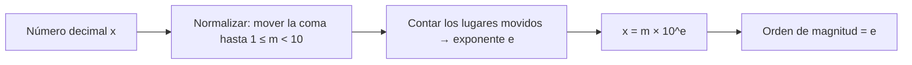

# B03-C05 — Notación científica y órdenes de magnitud

<!-- nav:top -->
[🏠 Programa](../../../../README.md) · [📚 Bloque B03](../../../tronco-comun/B03-matematica-elemental-para-ciencias-espaciales.md) · [← Anterior: B03-C04 — Potencias y raíces](../B03-C04-potencias-y-raices/CLASE.md) · [Siguiente: B03-C06 — Unidades del Sistema Internacional →](../B03-C06-unidades-del-sistema-internacional/CLASE.md)
<!-- /nav -->

## 1. Ubicación, nivel y alcance

Quinta clase del bloque B03 y cierre de su primer tramo. Ya sabes operar con potencias (C04). Ahora las usas para escribir números gigantes y diminutos sin perderte en los ceros y para **compararlos por su tamaño aproximado**. En B01-C02 viste una primera introducción a las escalas; aquí aprendes la técnica con detalle. Nivel N0 → N1.

Verás la notación científica (mantisa y exponente), cómo operar con ella, qué es un orden de magnitud y cómo se compara con logaritmos en base diez usados solo como «contador de ceros». No verás todavía estimación de Fermi (C11) ni unidades SI formales (C06).

## 2. Por qué esta clase existe

Las fichas de la NASA publican las masas en «10²⁴ kg»: la Tierra es 5,9722, el Sol 1 988 400. Si no sabes leer ese `10²⁴`, tampoco sabrás si 1 988 400 es «un poco más» o «mucho más». Una calculadora, además, muestra `1.9884e30`; si no entiendes esa notación, puedes tomar un resultado absurdo por correcto.

La decisión central es: **¿cómo escribo y comparo cantidades que difieren en muchos ceros sin perder el sentido de cuánto difieren?** Aprenderás la forma normalizada, las reglas para operar y el criterio de orden de magnitud.

## 3. Lo que podrás hacer al terminar

1. Escribir un número en notación científica normalizada y recuperarlo en notación decimal.
2. Multiplicar, dividir, elevar y sumar con potencias de diez.
3. Leer correctamente la notación `1.9884e30` de una calculadora o un programa.
4. Asignar a una cantidad su orden de magnitud y comparar dos cantidades por la diferencia de órdenes.
5. Explicar por qué una suma de números de órdenes muy distintos queda dominada por el mayor.
6. Hacer una tabla de órdenes de magnitud con unidades coherentes.

La evidencia es la **tabla de órdenes de magnitud** del ejercicio 12 (sección 20).

## 4. Con qué llegas y cómo comprobarlo

Necesitas C01 a C04. Cinco preguntas:

1. ¿Cuánto es `10³ × 10²`?
2. ¿Cuánto es `10⁻²`?
3. ¿Cuántos ceros tiene un millón?
4. ¿Es mayor `0,004` o `0,0004`?
5. ¿Qué hace `10⁶ ÷ 10⁴`?

<details>
<summary>Ver respuestas</summary>

1. `10⁵`. 2. `0,01`. 3. Seis. 4. `0,004`. 5. Da `10²`: se restan exponentes (C04).
</details>

Con cuatro o cinco aciertos, sigue; con menos, repasa C04.

## 5. Un caso real: la lista de masas de las fichas de la NASA

Las fichas planetarias de la NASA dan: Luna `0,07346`, Marte `0,64169`, Tierra `5,9722`, Neptuno `102,409`, Júpiter `1 898,13` y Sol `1 988 400`, todo en unidades de `10²⁴ kg` (S1). Parecen números «normales», pero detrás hay un salto enorme: de la Luna al Sol hay unos 7,4 órdenes de magnitud (`log₁₀` del cociente). Escribir cada masa en notación científica normalizada (`7,346 × 10²² kg`, `1,9884 × 10³⁰ kg`) hace visible esa distancia de un vistazo. Límite: las masas son valores publicados con sus propias incertidumbres; aquí se usan como datos, no se discuten.

## 6. Vocabulario

La **notación científica** escribe un número como `m × 10ᵉ`. La **mantisa** `m` cumple `1 ≤ |m| < 10` en la forma **normalizada**; el **exponente** `e` es un entero. Un **orden de magnitud** es, a efectos de esta clase, el exponente `e` de la forma normalizada: `86 400` está en el orden 4. La **diferencia de órdenes** entre `A` y `B` es `eA − eB` y, de forma más fina, `log₁₀(A/B)`. El **logaritmo en base diez** de `x`, `log₁₀ x`, es el exponente al que hay que elevar 10 para obtener `x`: `log₁₀ 1000 = 3`. Un **prefijo SI** es un múltiplo de diez con nombre (kilo `10³`, mega `10⁶`, nano `10⁻⁹`; S2).

## 7. Modelo mental: la regla de potencias de diez

Cada paso de exponente es «un cero más». La notación científica separa dos preguntas: «¿cuál es el dígito?» (mantisa) y «¿qué tan grande?» (exponente).



*Descripción textual:* de un número decimal se mueve la coma hasta que la mantisa quede entre 1 y 10; los lugares movidos dan el exponente (positivo si la coma se movió a la izquierda, negativo si a la derecha); el resultado es `m × 10ᵉ` y el orden de magnitud es `e`.

Analogía: el zoom de un mapa. Cada nivel de zoom multiplica la escala por un factor fijo; el exponente es el nivel. El límite: el zoom de un mapa es continuo, mientras que el orden de magnitud es un «peldaño» entero que agrupa números de 1 a 9,99… con el mismo exponente.

## 8. La explicación, paso a paso

### 8.1 Normalizar

Para escribir `384 400 000 m` en notación científica, mueve la coma a la izquierda hasta tener `3,844`: son 8 lugares, así que `3,844 × 10⁸ m`. Para `0,000 000 5` mueve la coma a la derecha 7 lugares: `5 × 10⁻⁷`. Regla: **coma a la izquierda, exponente positivo; coma a la derecha, exponente negativo**. Justificación: dividir entre 10 el número exige multiplicar la potencia por 10 para no cambiar el valor.

### 8.2 Multiplicar y dividir

Se multiplican las mantisas y se suman los exponentes: `(2 × 10⁵)(3 × 10⁻³) = 6 × 10²`. Al dividir, se dividen mantisas y se restan exponentes. Si la mantisa resultante sale fuera de `[1,10)`, se renormaliza: `(4 × 10³)(5 × 10²) = 20 × 10⁵ = 2 × 10⁶`.

### 8.3 Sumar y restar

Aquí no basta con operar exponentes: hay que llevar ambos números al **mismo exponente**. `3,0 × 10⁸ + 4 × 10⁷ = 3,0 × 10⁸ + 0,4 × 10⁸ = 3,4 × 10⁸`. Sumar mantisas con exponentes distintos sería sumar cantidades de distinto tamaño. Y cuando uno de los sumandos es muy pequeño frente al otro (5 órdenes menos), casi no cambia el resultado: la suma queda dominada por el mayor.

### 8.4 Leer la notación de calculadora

`1.9884e30` significa `1,9884 × 10³⁰`; la `e` es «exponente», **no** el número de Euler. `1e-3` es `0,001`. Es la forma en que programas y hojas de cálculo muestran la notación científica.

### 8.5 Orden de magnitud y diferencia de órdenes

El orden de magnitud de `5,9722 × 10²⁴ kg` es 24. Para comparar la Tierra con el Sol: `1,9884 × 10³⁰ / 5,9722 × 10²⁴ = 0,3329 × 10⁶ = 3,329 × 10⁵`; el cociente está en el orden 5, es decir, unos **5,5 órdenes de magnitud** (`log₁₀ 3,329 × 10⁵ = 5,52`). La diferencia de órdenes se lee como cuántas veces hay que multiplicar por diez para pasar de una a otra. Para comparar con prudencia, un factor menor de ~3 se considera «el mismo orden»; un factor de ~30 o más se considera «un orden más».

### 8.6 Logaritmo como contador de ceros

No necesitas teoría de logaritmos aquí: `log₁₀ x` es el exponente de diez que da `x`. Sus valores intermedios sirven para ver proporciones: `log₁₀ 3 ≈ 0,48`, así que 3 está «a medio camino» entre `10⁰` y `10¹` en una escala logarítmica. Esa escala se usa en C15.

## 9. Magnitudes, símbolos y unidades

| Símbolo | Qué es | Unidad | Valor o nota |
|---|---|---|---|
| `m` | mantisa | la de la magnitud | `1 ≤ |m| < 10` |
| `e` | exponente | sin unidad | entero |
| `log₁₀ x` | logaritmo en base diez | sin unidad | `log₁₀ 10ᵉ = e` |
| `M` | masa | kg | Luna 7,346 × 10²²; Tierra 5,9722 × 10²⁴; Sol 1,9884 × 10³⁰ (S1) |
| `d` | distancia | m | Tierra–Luna 3,844 × 10⁸ (S1); 1 au = 1,49598 × 10¹¹ (S2) |

## 10. Convenciones y referencias

La mantisa usa coma decimal en el texto y punto en el código. Se escribe `×` entre mantisa y potencia; en el código, `e`. El exponente se escribe con signo menos si es negativo. Las unidades acompañan a la mantisa: `3,844 × 10⁸ m`, no `3,844 × 10⁸` suelto. Un prefijo SI puede reemplazar la potencia: `3,844 × 10⁸ m = 384,4 Mm` (S2), pero el prefijo y la unidad forman un solo símbolo (`Mm` no es `mm`).

## 11. De dónde sale lo que afirmamos

| ID | Fuente | Localizador | Respalda | Estado |
|---|---|---|---|---|
| S1 | NASA NSSDC, fichas *Moon*, *Mars*, *Earth*, *Neptune*, *Jupiter* y *Sun* (act. entre 11-ene-2024 y 19-may-2025) | https://nssdc.gsfc.nasa.gov/planetary/factsheet/ | Masas en 10²⁴ kg: 0,07346; 0,64169; 5,9722; 102,409; 1 898,13; 1 988 400. Semieje mayor de Neptuno 4 514,953 × 10⁶ km. Semieje de la Luna 0,3844 × 10⁶ km | Páginas consultadas el 2026-11-05 |
| S2 | BIPM, *The International System of Units (SI)*, 9.ª ed. (2019), tablas de prefijos y tabla 8 | https://doi.org/10.59161/AUEZ1291 | Prefijos de 10⁻³⁰ a 10³⁰ (quecto a quetta); 1 au = 149 597 870 700 m; el prefijo y el símbolo de la unidad son inseparables | PDF leído el 2026-11-05 |

Límites: las masas son valores publicados sin incertidumbre en las fichas. La regla de «factor menor de 3 es el mismo orden» es una convención didáctica, no una norma.

## 12. Cómo ver los órdenes

Versión accesible de una escala logarítmica de masas.

| Cuerpo | Masa (kg) | Orden |
|---|---|---|
| Luna | 7,346 × 10²² | 22 |
| Marte | 6,4169 × 10²³ | 23 |
| Tierra | 5,9722 × 10²⁴ | 24 |
| Neptuno | 1,0241 × 10²⁶ | 26 |
| Júpiter | 1,8981 × 10²⁷ | 27 |
| Sol | 1,9884 × 10³⁰ | 30 |

Si lo dibujas, usa un eje logarítmico con marcas en cada potencia de diez y símbolos distintos por cuerpo. Descripción larga: unos 7,4 órdenes de magnitud separan la Luna del Sol (los exponentes difieren en 8); entre Neptuno y Júpiter hay poco más de uno, y entre la Tierra y el Sol más de cinco.

## 13. Ejemplo trabajado: ¿cuán lejos está Neptuno comparado con la Luna?

Datos: semieje de Neptuno `4 514,953 × 10⁶ km = 4,514953 × 10¹² m` y semieje lunar `0,3844 × 10⁶ km = 3,844 × 10⁸ m` (S1).

**Paso 1 · normalizar.** `4,515 × 10¹² m` y `3,844 × 10⁸ m`.
**Paso 2 · estimar el orden.** `10¹² ÷ 10⁸ = 10⁴`: el cociente rondará 10⁴.
**Paso 3 · dividir.** Mantisas `4,515/3,844 = 1,1745`; exponentes `12 − 8 = 4`. Resultado: `1,175 × 10⁴`.
**Paso 4 · orden.** `log₁₀(1,175 × 10⁴) = 4,07`: poco más de **4 órdenes de magnitud**.
**Paso 5 · comprobación.** Neptuno está a unos 30 au; la Luna a 0,0026 au; `30/0,0026 ≈ 1,2 × 10⁴`. Coincide.
**Sentido físico.** Una nave que cruza la distancia Tierra–Luna casi como un trámite necesita recorrer once mil veces esa distancia para llegar a Neptuno.

## 14. Notación científica o prefijos: cuándo conviene cada una

La **notación científica** sirve para calcular y para comparar órdenes. El **prefijo SI** (Mm, nm) sirve para leer una cifra con pocos dígitos en un informe. Para cálculos extensos se evita el prefijo y se pasa todo a unidades SI base con potencias de diez, porque mezclar prefijos es una fuente de error. La notación decimal completa solo conviene si el rango es corto. Y para comparar «¿cuántas veces?» basta restar exponentes; para sumar hay que igualarlos (8.3).

## 15. Práctica guiada

**Ejercicio 1 · con los pasos indicados.** Escribe `86 400` y `0,000 12` en notación científica. *Pasos:* mueve la coma y cuenta (8.1).

<details><summary>Solución comentada</summary>

`86 400 = 8,64 × 10⁴` (coma 4 lugares a la izquierda); `0,000 12 = 1,2 × 10⁻⁴` (4 lugares a la derecha).
</details>

**Ejercicio 2 · con una pista.** Calcula `(2 × 10⁵)(3 × 10⁻³)`. *Pista:* mantisas por un lado, exponentes por otro.

<details><summary>Solución comentada</summary>

`6 × 10²` = 600. Los exponentes se suman: `5 + (−3) = 2`.
</details>

**Ejercicio 3 · casi autónomo.** Suma `3,0 × 10⁸` y `4 × 10⁷`.

<details><summary>Solución comentada</summary>

`4 × 10⁷ = 0,4 × 10⁸`; suma `3,4 × 10⁸`. Si te salió `7 × 10¹⁵` multiplicaste exponentes al sumar.
</details>

## 16. Práctica autónoma, transferencia e integrador

**Ejercicio 4.** Una calculadora muestra `6.674e-11`. Escribe el número en notación científica con `×` y en decimal.

<details><summary>Solución comentada</summary>

`6,674 × 10⁻¹¹`; en decimal, `0,000 000 000 066 74` (diez ceros tras la coma). La `e` es «exponente».
</details>

**Ejercicio 5.** Calcula `(4 × 10³)(5 × 10²)` y renormaliza.

<details><summary>Solución comentada</summary>

`20 × 10⁵`; la mantisa 20 está fuera de `[1,10)`, así que `2 × 10⁶`.
</details>

**Ejercicio 6.** ¿Cuántos órdenes de magnitud separan la masa de la Tierra (5,9722 × 10²⁴ kg) de la de la Luna (7,346 × 10²² kg)?

<details><summary>Solución comentada</summary>

Cociente `81,3`; `log₁₀ 81,3 = 1,91`: casi 2 órdenes. Por exponentes: `24 − 22 = 2`. Las dos vías concuerdan.
</details>

**Ejercicio 7.** Expresa `3,844 × 10⁸ m` en megámetros (Mm) y en kilómetros.

<details><summary>Solución comentada</summary>

`1 Mm = 10⁶ m`, luego `384,4 Mm`; `1 km = 10³ m`, luego `3,844 × 10⁵ km = 384 400 km`.
</details>

**Ejercicio 8.** Un estudiante suma `1,9884 × 10³⁰ kg + 5,97 × 10²⁴ kg` y obtiene `7,96 × 10⁵⁴`. Corrige y comenta el resultado.

<details><summary>Solución comentada</summary>

Debe igualar exponentes: `5,97 × 10²⁴ = 0,00000597 × 10³⁰`, suma `1,98840597 × 10³⁰ ≈ 1,9884 × 10³⁰`. Sumar la Tierra al Sol no cambia la mantisa visible: el mayor domina.
</details>

**Ejercicio 9 · transferencia.** La luz tarda unos `4,5 × 10¹²` m `/ 3,0 × 10⁸` m/s en llegar desde Neptuno. Calcula el tiempo en segundos y su orden de magnitud.

<details><summary>Solución comentada</summary>

`4,5/3,0 = 1,5`; `12 − 8 = 4`; `1,5 × 10⁴ s ≈ 4,2 h`. Orden 4.
</details>

**Ejercicio 10 · transferencia.** Una tabla da una masa «`0,64169 × 10²⁴`» sin la palabra kg. ¿Qué dos errores puede provocar y cómo los evitas?

<details><summary>Solución comentada</summary>

Que se tome por kg el número sin la potencia (error de `10²⁴`) o que se tomen otras unidades (g, toneladas). Se evita escribiendo la unidad con la potencia: `6,4169 × 10²³ kg` y declarando la fuente.
</details>

**Ejercicio 11 · transferencia.** ¿Es razonable decir «Júpiter y Neptuno tienen la misma masa porque ambos son gigantes»? Compara con la tabla de la sección 12.

<details><summary>Solución comentada</summary>

No: `1,8981 × 10²⁷ / 1,0241 × 10²⁶ ≈ 18,5`, es decir, Júpiter tiene unas 18 veces la masa de Neptuno (más de un orden de magnitud, `log₁₀ 18,5 = 1,27`). Ambos son «gigantes», pero no iguales; un criterio claro de comparación evita afirmaciones vagas.
</details>

**Ejercicio 12 · integrador.** Elabora tu *tabla de órdenes de magnitud* (sección 20): al menos cinco cantidades astronómicas (masas, distancias o períodos) en notación científica con unidades, su orden y la diferencia de órdenes respecto de una referencia a elección, con fuente.

<details><summary>Solución modelo</summary>

Con referencia la Tierra: Luna (−1,9 órdenes), Marte (−1,0), Neptuno (+1,2), Júpiter (+2,5), Sol (+5,5). Debe mostrar cada cociente y su logaritmo, y citar S1. Se acepta cualquier conjunto con datos citados.
</details>

## 17. Laboratorio: normalizar y comparar con código

El script [laboratorio_ordenes_de_magnitud.py](laboratorio_ordenes_de_magnitud.py) implementa `a_cientifica(x)` y la usa con las masas y distancias de la clase. Antes de imprimir comprueba que la mantisa queda en `[1,10)`, que `m × 10ᵉ` reconstruye `x`, que `(2×10⁵)(3×10⁻³) = 6×10²` y que `log₁₀ 10⁶ = 6`.

**Datos:** publicados (NASA, SI). **Predice antes de ejecutar:** ¿cuántos órdenes separan Sol y Tierra? (Algo más de cinco.) **Resultados (2026-11-05, Python 3.12.9):** Sol/Tierra = 3,329 × 10⁵ → 5,52 órdenes; Tierra/Luna = 81,3 → 1,91 órdenes; Neptuno–Sol / Tierra–Luna = 1,175 × 10⁴ → 4,07 órdenes. (El script imprime con punto decimal.)

```bash
python programa/clases/B03/B03-C05-notacion-cientifica-y-ordenes-de-magnitud/laboratorio_ordenes_de_magnitud.py
```

**Límites:** usa `float` (unas 15–16 cifras); no maneja el cero ni mantiene incertidumbres.

## 18. Errores frecuentes y cómo corregirlos

**Mantisa fuera de rango** (`20 × 10⁵`). Ejercicio 5.
**Signo del exponente al revés.** Se detecta comparando con el tamaño esperado. Ejercicio 1.
**Sumar con exponentes distintos.** Ejercicios 3 y 8.
**Leer `e` como el número de Euler.** Ejercicio 4.
**Olvidar la unidad con la potencia.** Ejercicio 10.

## 19. Cómo sabrás que vas bien

Tras 8.1: ¿escribes `0,00035` en notación científica sin dudar? (`3,5 × 10⁻⁴`). Si no, repite el ejercicio 1. Tras 8.3: ¿igualas exponentes antes de sumar? Si dudas, rehaz el 3. Tras 8.5: ¿puedes decir cuántos órdenes separan dos cantidades sin calculadora? Si no, practica con el 6. Al final: ¿eres capaz de leer `4.5e12`? Si no, repite el 4.

## 20. Qué entregas y cómo se evalúa

El producto es tu **tabla de órdenes de magnitud**: al menos cinco cantidades astronómicas, su notación científica con unidad, su orden y su diferencia de órdenes con una referencia, más la fuente de cada dato.

| Criterio | Inicial | En desarrollo | Logrado | Destacado |
|---|---|---|---|---|
| Normalización | Mantisas fuera de rango | Algunas correctas | Todas correctas | Detecta errores en datos ajenos |
| Operaciones | Errores de exponente | Aciertos con ayuda | Correctas | Verifica con otra vía |
| Orden de magnitud | Confunde con valor | Lo asigna con ayuda | Correcto | Interpreta la diferencia |
| Unidades | Ausentes | Parciales | En cada cifra | Convierte con prefijos SI |
| Fuentes | Sin cita | Parcial | Completa | Declara límites |

**Condiciones críticas:** no omitir unidades; no sumar con exponentes distintos; citar solo fuentes consultadas.

## 21. Ética, seguridad y límites

La notación científica puede ocultar un error de varios órdenes bajo un número de apariencia sobria: revisa siempre el exponente. Esta clase es educativa y no sirve para dimensionamiento de ingeniería. Accesibilidad: potencias en texto, tablas equivalentes, sin conexión.

## 22. Para cerrar y seguir

Una cantidad se escribe como mantisa por potencia de diez; se multiplica sumando exponentes y se suma igualándolos; el orden de magnitud resume su tamaño y la diferencia de órdenes cuenta los ceros que las separan. Queda una pregunta: esos números no son solo cifras, llevan **unidades**. ¿Qué reglas las gobiernan? Es C06.

**Glosario español–inglés.** notación científica · *scientific notation*; mantisa · *significand*; exponente · *exponent*; orden de magnitud · *order of magnitude*; prefijo · *prefix*; logaritmo decimal · *common logarithm*.

**Continuidad.** B03-C06 añade las unidades a esas cifras y B03-C11 usa los órdenes de magnitud para estimar. B03-C15 llevará la escala logarítmica a los gráficos.

**Referencias:** ver sección 11. Todas las fuentes son datos oficiales consultados.

<!-- nav:bottom -->
---

[← Anterior: B03-C04 — Potencias y raíces](../B03-C04-potencias-y-raices/CLASE.md) · [📚 Bloque B03](../../../tronco-comun/B03-matematica-elemental-para-ciencias-espaciales.md) · [Siguiente: B03-C06 — Unidades del Sistema Internacional →](../B03-C06-unidades-del-sistema-internacional/CLASE.md)
<!-- /nav -->
